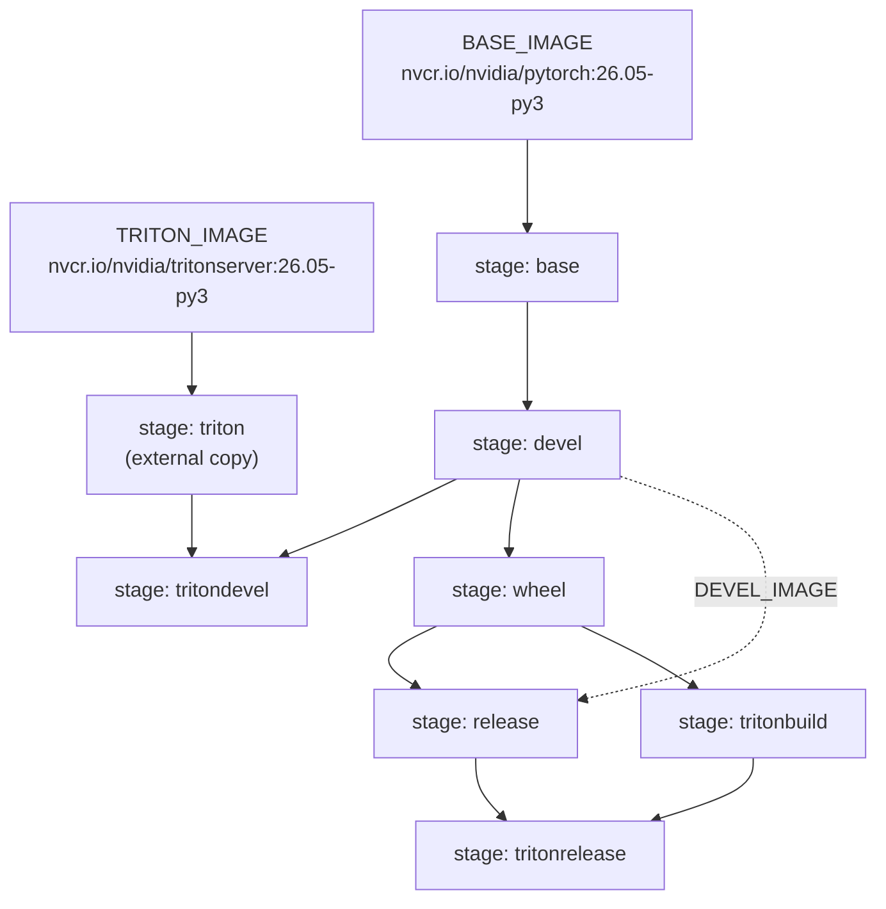
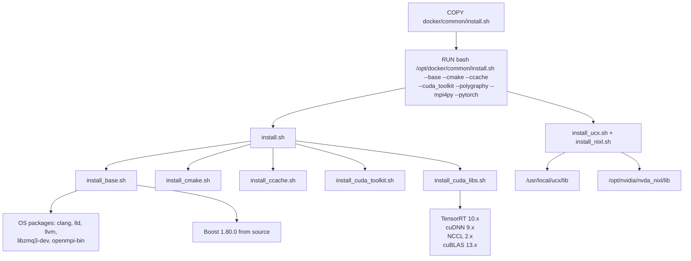
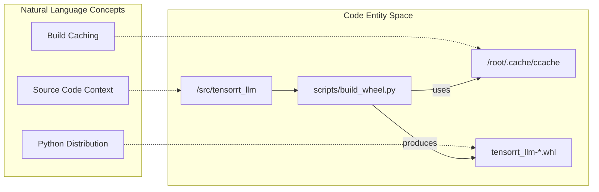
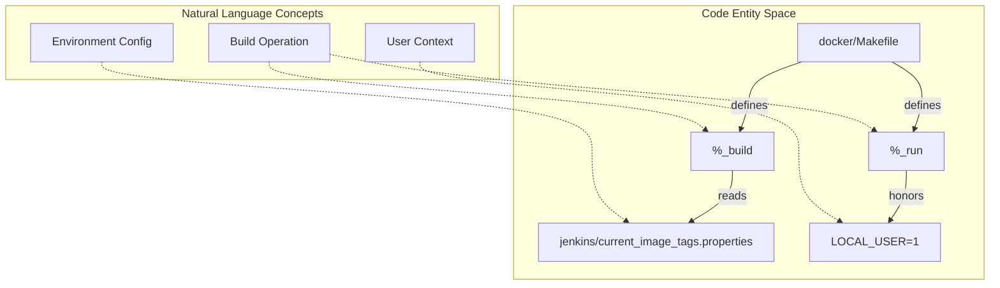

<!-- source: DeepWiki mcp.deepwiki.com · repo NVIDIA/TensorRT-LLM · page 6.2 Docker Multi-Stage Builds · fetched 2026-10-26 -->

# Docker Multi-Stage Builds

Relevant source files

The following files were used as context for generating this wiki page:

- [.devcontainer/docker-compose.yml](.devcontainer/docker-compose.yml)
- [.gitignore](.gitignore)
- [ATTRIBUTIONS-Python.md](ATTRIBUTIONS-Python.md)
- [CONTAINER_SOURCE.md](CONTAINER_SOURCE.md)
- [constraints.txt](constraints.txt)
- [cpp/CMakeLists.txt](cpp/CMakeLists.txt)
- [cpp/include/tensorrt_llm/batch_manager/kvCacheTransferManager.h](cpp/include/tensorrt_llm/batch_manager/kvCacheTransferManager.h)
- [cpp/tensorrt_llm/CMakeLists.txt](cpp/tensorrt_llm/CMakeLists.txt)
- [cpp/tensorrt_llm/batch_manager/CMakeLists.txt](cpp/tensorrt_llm/batch_manager/CMakeLists.txt)
- [cpp/tensorrt_llm/batch_manager/kvCacheTransferManager.cpp](cpp/tensorrt_llm/batch_manager/kvCacheTransferManager.cpp)
- [cpp/tensorrt_llm/executor/kvCacheRetentionConfig.cpp](cpp/tensorrt_llm/executor/kvCacheRetentionConfig.cpp)
- [cpp/tensorrt_llm/nanobind/CMakeLists.txt](cpp/tensorrt_llm/nanobind/CMakeLists.txt)
- [cpp/tensorrt_llm/nanobind/bindings.cpp](cpp/tensorrt_llm/nanobind/bindings.cpp)
- [cpp/tests/unit_tests/batch_manager/CMakeLists.txt](cpp/tests/unit_tests/batch_manager/CMakeLists.txt)
- [cpp/tests/unit_tests/batch_manager/kvCacheManagerV2SlotAllocatorTest.cpp](cpp/tests/unit_tests/batch_manager/kvCacheManagerV2SlotAllocatorTest.cpp)
- [docker/Dockerfile.multi](docker/Dockerfile.multi)
- [docker/Makefile](docker/Makefile)
- [docker/common/install_base.sh](docker/common/install_base.sh)
- [docker/common/install_ccache.sh](docker/common/install_ccache.sh)
- [docker/common/install_ci.sh](docker/common/install_ci.sh)
- [docker/common/install_cmake.sh](docker/common/install_cmake.sh)
- [docker/common/install_etcd.sh](docker/common/install_etcd.sh)
- [docker/common/install_mpi4py.sh](docker/common/install_mpi4py.sh)
- [docker/common/install_nixl.sh](docker/common/install_nixl.sh)
- [docker/common/install_polygraphy.sh](docker/common/install_polygraphy.sh)
- [docker/common/install_triton.sh](docker/common/install_triton.sh)
- [docker/common/install_ucx.sh](docker/common/install_ucx.sh)
- [docs/source/installation/build-from-source.md](docs/source/installation/build-from-source.md)
- [jenkins/Build.groovy](jenkins/Build.groovy)
- [jenkins/BuildDockerImage.groovy](jenkins/BuildDockerImage.groovy)
- [jenkins/L0_MergeRequest.groovy](jenkins/L0_MergeRequest.groovy)
- [jenkins/L0_Test.groovy](jenkins/L0_Test.groovy)
- [jenkins/controlCCache.groovy](jenkins/controlCCache.groovy)
- [jenkins/current_image_tags.properties](jenkins/current_image_tags.properties)
- [requirements.txt](requirements.txt)
- [scripts/build_wheel.py](scripts/build_wheel.py)
- [scripts/generate_container_oss_attribution.sh](scripts/generate_container_oss_attribution.sh)
- [scripts/get_wheel_from_package.py](scripts/get_wheel_from_package.py)
- [scripts/rename_docker_images.py](scripts/rename_docker_images.py)
- [setup.py](setup.py)
- [tests/integration/test_lists/qa/llm_perf_disagg.yml](tests/integration/test_lists/qa/llm_perf_disagg.yml)
- [tests/integration/test_lists/qa/llm_perf_multinode.txt](tests/integration/test_lists/qa/llm_perf_multinode.txt)
- [tests/unittest/scripts/test_build_wheel_copy_back.py](tests/unittest/scripts/test_build_wheel_copy_back.py)

This document describes the Docker multi-stage build infrastructure used to create TensorRT-LLM container images. The system uses a single multi-stage Dockerfile ([docker/Dockerfile.multi:1-179]()) orchestrated by Make targets ([docker/Makefile:1-273]()) and Jenkins pipelines ([jenkins/BuildDockerImage.groovy:1-184]()) to produce multiple image variants for different use cases (development, release, Triton serving) and architectures (x86_64, aarch64).

## Multi-Stage Build Architecture

The build system uses Docker's multi-stage feature to create a layered dependency graph where later stages can selectively copy artifacts from earlier stages while discarding unnecessary build dependencies.

**Dockerfile Stage Dependency Graph:**

**Stage Definitions:**

| Stage Name | FROM Clause | Primary Purpose | Key Outputs |
|-----------|-------------|-----------------|-------------|
| `base` | `${BASE_IMAGE}:${BASE_TAG}` | Environment initialization | `ENV`, `BASH_ENV` configuration [docker/Dockerfile.multi:29-32]() |
| `devel` | `base` | Build dependencies installation | TensorRT, CUDA toolkit, UCX, NIXL, etcd [docker/Dockerfile.multi:42-98]() |
| `tritondevel` | `devel` + `triton` COPY | Triton development environment | Triton libraries, headers, Mooncake [docker/Dockerfile.multi:102-119]() |
| `wheel` | `${DEVEL_IMAGE}` | Python wheel compilation | `tensorrt_llm-*.whl` [docker/Dockerfile.multi:121-140]() |
| `release` | `${DEVEL_IMAGE}` | Production runtime | Installed wheel, benchmarks, examples [docker/Dockerfile.multi:142-175]() |

Sources: [docker/Dockerfile.multi:1-179]()

## Build Stage Details

### base Stage
The base stage establishes the foundational environment from the NGC PyTorch image (defaulting to version 26.05-py3 [docker/Dockerfile.multi:18-19]()).

**Key Configuration:**
- Sets shell environment variables (`ENV`, `BASH_ENV`) for persistent shell configuration [docker/Dockerfile.multi:29-32]().
- Configures Python version (default 3.12.3) [docker/Dockerfile.multi:37-38]().
- Establishes `GITHUB_MIRROR` for artifact downloads in restricted networks [docker/Dockerfile.multi:34-35]().

Sources: [docker/Dockerfile.multi:22-40]()

### devel Stage
The development stage installs all build-time dependencies required to compile TensorRT-LLM. It executes the main `install.sh` script which orchestrates several sub-scripts for specific components.

**Installation Script Execution Flow:**

**Key Components and Tools:**

| Component | Role | Implementation |
|-----------|------|----------------|
| **NIXL** | GPU memory registration | [docker/common/install_nixl.sh:1-52]() |
| **UCX** | High-performance communication | [docker/common/install_ucx.sh:1-20]() |
| **ETCD** | Distributed configuration | [docker/common/install_etcd.sh:1-10]() |
| **FA4** | FlashAttention 4 support | [docker/Dockerfile.multi:87]() |

Sources: [docker/Dockerfile.multi:42-98](), [docker/common/install_nixl.sh:1-52]()

### wheel Stage
Builds the TensorRT-LLM Python wheel package from source code using the `scripts/build_wheel.py` orchestrator [docker/Dockerfile.multi:135-140]().

**Build Process Associated Code Entities:**

**Source Components Copied:**
- `cpp`, `docker`, `scripts`, `tensorrt_llm`, `triton_kernels`, `3rdparty` directories [docker/Dockerfile.multi:123-128]().
- Configuration files: `setup.py`, `requirements.txt`, `requirements-dev.txt`, `constraints.txt`, `README.md` [docker/Dockerfile.multi:129]().

The build uses a persistent `CCACHE_DIR` set to `/root/.cache/ccache` to accelerate repeated builds [docker/Dockerfile.multi:131-136]().

Sources: [docker/Dockerfile.multi:121-140]()

### release Stage
Creates a minimal production runtime image with the TensorRT-LLM wheel installed.

**Key Operations:**
1. Install wheel from bind mount using `pip install "${TRTLLM_WHEEL}[mx]"` [docker/Dockerfile.multi:146-152]().
2. Create symbolic links to Python site-packages for libraries (`libtensorrt_llm.so`) [docker/Dockerfile.multi:168-169]().
3. Configure dynamic linker via `/etc/ld.so.conf.d/tensorrt_llm.conf` [docker/Dockerfile.multi:170-171]().
4. Copy pre-built benchmarks and examples [docker/Dockerfile.multi:154-163]().
5. Generate OSS attribution file [docker/Dockerfile.multi:173-175]().

Sources: [docker/Dockerfile.multi:142-175]()

## Makefile Target System

The Makefile provides a flexible target-based system for building, pushing, and running different image configurations using pattern matching rules. It dynamically extracts default base images and tags from the Dockerfile [docker/Makefile:2-5]().

**Makefile System Entities:**

**Pattern Rule Table:**

| Pattern | Purpose | Command |
|---------|---------|---------|
| `%_build` | Build image using `docker buildx build` | `docker buildx build $(DOCKER_BUILD_OPTS)` [docker/Makefile:86-111]() |
| `%_push` | Push image to registry (with staging rewrite) | `docker push $(IMAGE_WITH_TAG)` [docker/Makefile:116-127]() |
| `%_run` | Run container with GPU and volume mounts | `docker run $(DOCKER_RUN_OPTS) $(GPU_OPTS)` [docker/Makefile:154-178]() |

The Makefile also supports `LOCAL_USER=1` to map the host user into the container for development [docker/Makefile:24-27]().

Sources: [docker/Makefile:1-178]()

### Jenkins CI Integration
The Jenkins pipeline `BuildDockerImage.groovy` manages the creation of these images at scale, including support for x86_64 and AARCH64 (SBSA) architectures [jenkins/BuildDockerImage.groovy:81-129]().

**Image Tagging Strategy:**
Tags follow the pattern: `[base_image_name]-[arch]-[os](-[python_version])-[trt_version]-[torch_install_type]-[stage]-[date]-[mr_id]` [jenkins/L0_Test.groovy:60](). Current stable tags are maintained in `jenkins/current_image_tags.properties` [jenkins/current_image_tags.properties:16-20]().

Sources: [jenkins/BuildDockerImage.groovy:1-184](), [jenkins/L0_Test.groovy:41-70](), [jenkins/current_image_tags.properties:16-20]()

## Network and Performance Optimizations

- **ccache**: Persistent C++ compilation cache shared via PVC [jenkins/BuildDockerImage.groovy:58]() and Docker mounts to `/root/.cache/ccache` [docker/Dockerfile.multi:131-136]().
- **GitHub Mirror**: Support for `GITHUB_MIRROR` to handle restricted network environments [docker/Dockerfile.multi:34-35]().
- **Multi-arch Support**: Makefile detects platform (`arm64` vs `amd64`) and configures `CUDA_ARCHS` accordingly (e.g., 90-real;100-real;120-real for arm64) [docker/Makefile:40-41]().
- **Dependency Constraints**: The `constraints.txt` file is used to resolve vulnerabilities and pin specific package versions (e.g., `numpy>=2.0.0,<2.4`) [requirements.txt:15]().
- **UCX/NIXL Integration**: Specialized installation scripts for high-performance communication libraries like NIXL [docker/common/install_nixl.sh:1-52]() used in multi-GPU setups.
- **Fail Fast**: Pre-merge pipelines enable "Fail Fast" by default to optimize CI resource usage [jenkins/L0_MergeRequest.groovy:95-96]().

Sources: [docker/Makefile:40-53](), [jenkins/BuildDockerImage.groovy:40-58](), [docker/Dockerfile.multi:131-136](), [docker/common/install_nixl.sh:1-52](), [jenkins/L0_MergeRequest.groovy:95-96]()

---

