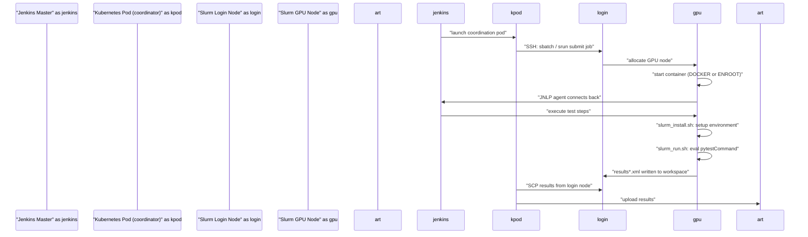
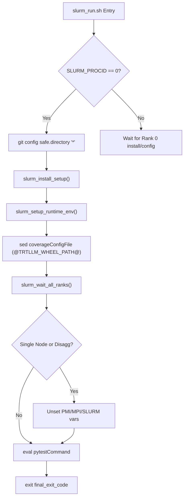
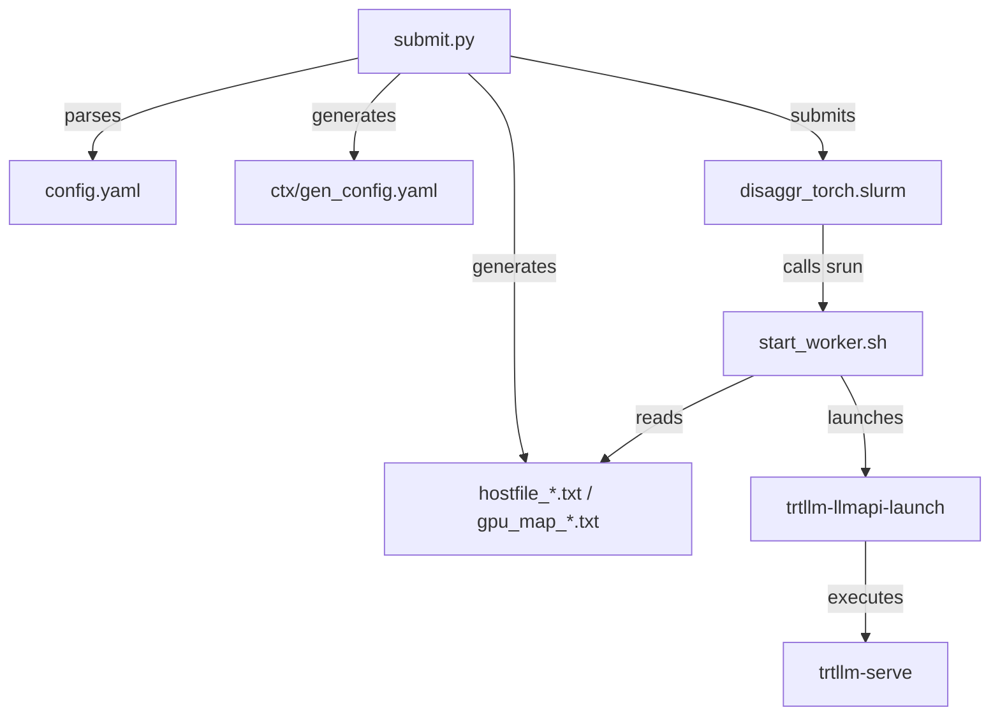

<!-- source: DeepWiki mcp.deepwiki.com · repo NVIDIA/TensorRT-LLM · page 6.3 Slurm Test Execution · fetched 2026-10-26 -->

# Slurm Test Execution

Relevant source files

The following files were used as context for generating this wiki page:

- [examples/disaggregated/slurm/benchmark/README.md](examples/disaggregated/slurm/benchmark/README.md)
- [examples/disaggregated/slurm/benchmark/config.yaml](examples/disaggregated/slurm/benchmark/config.yaml)
- [examples/disaggregated/slurm/benchmark/disaggr_torch.slurm](examples/disaggregated/slurm/benchmark/disaggr_torch.slurm)
- [examples/disaggregated/slurm/benchmark/get_env.py](examples/disaggregated/slurm/benchmark/get_env.py)
- [examples/disaggregated/slurm/benchmark/run_benchmark.sh](examples/disaggregated/slurm/benchmark/run_benchmark.sh)
- [examples/disaggregated/slurm/benchmark/run_benchmark_nv_sa.sh](examples/disaggregated/slurm/benchmark/run_benchmark_nv_sa.sh)
- [examples/disaggregated/slurm/benchmark/start_server.sh](examples/disaggregated/slurm/benchmark/start_server.sh)
- [examples/disaggregated/slurm/benchmark/start_worker.sh](examples/disaggregated/slurm/benchmark/start_worker.sh)
- [examples/disaggregated/slurm/benchmark/submit.py](examples/disaggregated/slurm/benchmark/submit.py)
- [examples/disaggregated/slurm/benchmark/wait_server.sh](examples/disaggregated/slurm/benchmark/wait_server.sh)
- [examples/ray_orchestrator/disaggregated/README.md](examples/ray_orchestrator/disaggregated/README.md)
- [examples/ray_orchestrator/disaggregated/disagg_serving_local.sh](examples/ray_orchestrator/disaggregated/disagg_serving_local.sh)
- [examples/ray_orchestrator/llm_inference_async_ray.py](examples/ray_orchestrator/llm_inference_async_ray.py)
- [examples/wide_ep/README.md](examples/wide_ep/README.md)
- [examples/wide_ep/slurm_scripts/README.md](examples/wide_ep/slurm_scripts/README.md)
- [examples/wide_ep/slurm_scripts/config.yaml](examples/wide_ep/slurm_scripts/config.yaml)
- [jenkins/scripts/bash_utils.sh](jenkins/scripts/bash_utils.sh)
- [jenkins/scripts/slurm_install.sh](jenkins/scripts/slurm_install.sh)
- [jenkins/scripts/slurm_run.sh](jenkins/scripts/slurm_run.sh)
- [tests/integration/defs/examples/test_ray.py](tests/integration/defs/examples/test_ray.py)
- [tests/integration/defs/ray_orchestrator/RL/run_rl_perf_reproduce.py](tests/integration/defs/ray_orchestrator/RL/run_rl_perf_reproduce.py)
- [tests/integration/defs/test_infra_dry_run_benchmark.py](tests/integration/defs/test_infra_dry_run_benchmark.py)
- [tests/integration/defs/verl/.gitignore](tests/integration/defs/verl/.gitignore)
- [tests/integration/defs/verl/test_verl_cases.py](tests/integration/defs/verl/test_verl_cases.py)
- [tests/integration/defs/verl/verl_config.yml](tests/integration/defs/verl/verl_config.yml)
- [tests/integration/test_lists/test-db/infra_dry_run.yml](tests/integration/test_lists/test-db/infra_dry_run.yml)
- [tests/integration/test_lists/test-db/l0_verl.yml](tests/integration/test_lists/test-db/l0_verl.yml)
- [tests/unittest/_torch/ray_orchestrator/multi_gpu/test_executor.py](tests/unittest/_torch/ray_orchestrator/multi_gpu/test_executor.py)
- [tests/unittest/_torch/ray_orchestrator/multi_gpu/test_multi_instance.py](tests/unittest/_torch/ray_orchestrator/multi_gpu/test_multi_instance.py)
- [tests/unittest/tools/test_infra_dry_run_pipeline.py](tests/unittest/tools/test_infra_dry_run_pipeline.py)
- [tests/unittest/tools/test_infra_dry_run_pytest.py](tests/unittest/tools/test_infra_dry_run_pytest.py)

This page describes how GPU tests are dispatched to compute clusters via Slurm in the TensorRT-LLM CI/CD system. It covers the Jenkins-to-Slurm integration, dynamic agent provisioning, test execution scripts, and multi-node disaggregated benchmarking orchestration.

---

## System Overview

GPU tests cannot run on the lightweight Kubernetes CPU nodes used for build and coordination. Instead, the pipeline provisions a **Jenkins agent running directly inside a Slurm-allocated GPU job** on a dedicated compute cluster. This is a layered architecture:

- A lightweight Kubernetes pod acts as the **coordination pod**.
- From that pod, a Slurm job is submitted via SSH to a **cluster login node**.
- The Slurm job allocates a GPU node and starts the container, which connects back to Jenkins as a **dynamic agent**.
- The Jenkins pipeline then executes test steps on that agent, inside the GPU container.
- `slurm_install.sh` (sourced by `slurm_run.sh`) handles environment setup and package installation [jenkins/scripts/slurm_run.sh:32-38]().
- `slurm_run.sh` executes the actual test command and handles performance reporting [jenkins/scripts/slurm_run.sh:150-156]().

**Slurm Distributed Test Execution Flow**

Sources: [jenkins/scripts/slurm_run.sh:1-156](), [jenkins/scripts/slurm_install.sh:25-82]()

---

## Hardware-Specific Execution

The Slurm infrastructure includes optimizations for advanced hardware architectures like GB200 and Hopper-based systems.

### Coherent Memory and GPU Mapping
For GB200 platforms, specific checks are performed to ensure the environment is correctly configured for coherent memory access.

- **Coherent GPU Mapping**: `slurm_run.sh` checks for coherent GPU mapping on GB200 platforms by inspecting `/proc/driver/nvidia/params` [jenkins/scripts/slurm_run.sh:40-43]().
- **NUMA Binding**: On GB200/GB300 NVL72, GPU memory is exposed as NUMA nodes. Benchmarks use `numactl -m 0,1` to bind memory to CPU nodes, preventing GPU memory from being incorrectly used as host memory [examples/disaggregated/slurm/benchmark/start_worker.sh:69-75](), [examples/wide_ep/README.md:111-116]().
- **GDRCopy Support**: For online Expert Parallelism Load Balancing (EPLB) on GB200 with CDMM (Coherent Driver-Based Memory Management) enabled, the `/dev/gdrdrv` device must be mapped into the container [examples/wide_ep/README.md:34-46]().

Sources: [jenkins/scripts/slurm_run.sh:40-43](), [examples/disaggregated/slurm/benchmark/start_worker.sh:69-75](), [examples/wide_ep/README.md:34-46](), [examples/wide_ep/README.md:111-116]()

---

## Test Installation and Execution Scripts

### Installation: `slurm_install.sh`
The `slurm_install_setup` function prepares the environment. It implements a node-local lock mechanism to ensure that only one rank per node performs the heavy installation (downloading artifacts, installing wheels) while others wait [jenkins/scripts/slurm_install.sh:30-81]().

- **Idempotent Download**: Uses `retry_command` with `wget` to a temporary path before promoting to the final artifact name to prevent corrupted partial downloads [jenkins/scripts/slurm_install.sh:41-48]().
- **Dependency Management**: Installs required libraries like `libffi-dev`, `opencv-python-headless`, and specific versions of `ray`, `causal-conv1d`, and `mamba_ssm` if Ray tests are targeted [jenkins/scripts/slurm_install.sh:58-69]().

### Execution: `slurm_run.sh`
`slurm_run.sh` is the main entry point inside the container for CI. It handles:

1.  **Git Configuration**: The first process (`SLURM_PROCID == 0`) configures `safe.directory` to allow operations in the workspace [jenkins/scripts/slurm_run.sh:25-30]().
2.  **Coverage Configuration**: Substitutes `@TRTLLM_WHEEL_PATH@` in the coverage configuration file with the actual path of the installed `tensorrt_llm` package [jenkins/scripts/slurm_run.sh:50-60]().
3.  **Distributed Barrier**: The `slurm_wait_all_ranks` function implements a filesystem-based barrier using the `$jobWorkspace`. This ensures all ranks across all nodes have finished installation before entering `pytest`, preventing MPI collective timeouts during initialization [jenkins/scripts/slurm_run.sh:100-141]().
4.  **Environment Isolation**: For single-node runs or disaggregated benchmarks, it unsets `PMI`, `PMIX`, `MPI`, `OMPI`, and `SLURM` environment variables (except `SLURM_PROCID`) to prevent test processes from incorrectly initializing MPI [jenkins/scripts/slurm_run.sh:79-87]().

**slurm_run.sh Execution Logic**

Sources: [jenkins/scripts/slurm_run.sh:1-156](), [jenkins/scripts/slurm_install.sh:25-82]()

---

## Disaggregated Benchmarking Orchestration

TensorRT-LLM provides specialized scripts for benchmarking disaggregated serving (Context vs. Generation separation) on Slurm clusters.

### Submission Logic: `submit.py`
The `submit.py` script orchestrates the benchmarking lifecycle by parsing a `config.yaml` and generating Slurm job definitions [examples/disaggregated/slurm/benchmark/submit.py:34-53]().

- **GPU Allocation Strategies**:
    - **Round-Robin (Default)**: Each worker owns whole nodes, matching standard Slurm block distribution [examples/disaggregated/slurm/benchmark/submit.py:127-143]().
    - **Compact Packing**: Packs workers into the minimum number of nodes, allowing workers to share physical nodes. This is recommended only for full-mesh NVLink fabrics like NVL72 [examples/disaggregated/slurm/benchmark/submit.py:108-125]().
- **Configuration Generation**: Automatically generates `ctx_config.yaml` and `gen_config.yaml` based on the hardware and worker requirements defined in the master config [examples/disaggregated/slurm/benchmark/submit.py:72-77]().

### Worker Launch: `start_worker.sh`
This script handles the final command execution for individual workers [examples/disaggregated/slurm/benchmark/start_worker.sh:1-98]().
- **CUDA Visibility**: If compact packing is used, it looks up the specific GPU ID from a `gpu_map` file based on `SLURM_PROCID` to ensure workers don't collide on the same device [examples/disaggregated/slurm/benchmark/start_worker.sh:29-39]().
- **API Launch**: Uses `trtllm-llmapi-launch` to wrap the `trtllm-serve` command, ensuring proper resource initialization [examples/disaggregated/slurm/benchmark/start_worker.sh:95-98]().

**Disaggregated Benchmark Code Entities**

Sources: [examples/disaggregated/slurm/benchmark/submit.py:93-177](), [examples/disaggregated/slurm/benchmark/start_worker.sh:29-98](), [examples/disaggregated/slurm/benchmark/disaggr_torch.slurm:141-166]()

---

## Ray Orchestrator Integration

TensorRT-LLM supports distributed execution via Ray, which is also validated in Slurm environments.

- **Distributed Ray Tests**: `test_llm_inference_distributed_ray` validates TP, PP, and EP configurations using Ray [tests/integration/defs/examples/test_ray.py:38-70]().
- **Cleanup Logic**: `_cleanup_leftover_servers` ensures that leaked `trtllm-serve` or `orted` processes from previous runs are killed to prevent port binding failures in subsequent tests [tests/integration/defs/examples/test_ray.py:90-161]().
- **Disaggregated Ray Serving**: Tests like `test_ray_disaggregated_serving` validate the NIXL transceiver backend and Python/C++ runtimes in a Ray-managed cluster [tests/integration/defs/examples/test_ray.py:72-82]().

Sources: [tests/integration/defs/examples/test_ray.py:38-82](), [tests/integration/defs/examples/test_ray.py:90-161]()

---

