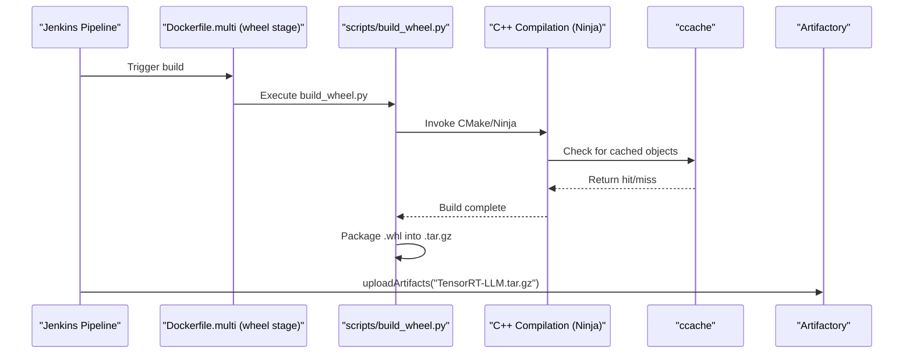
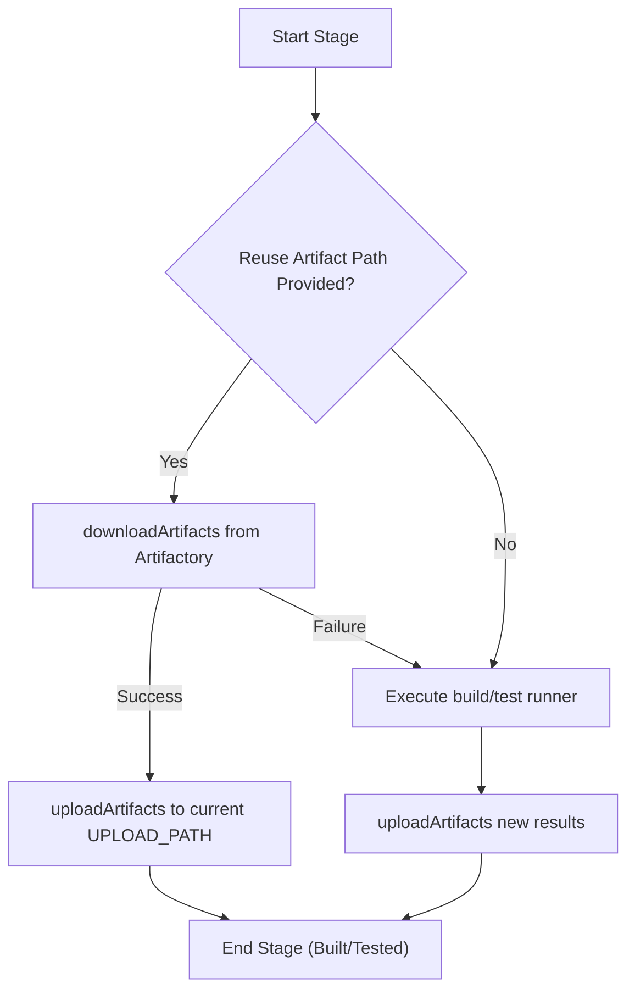
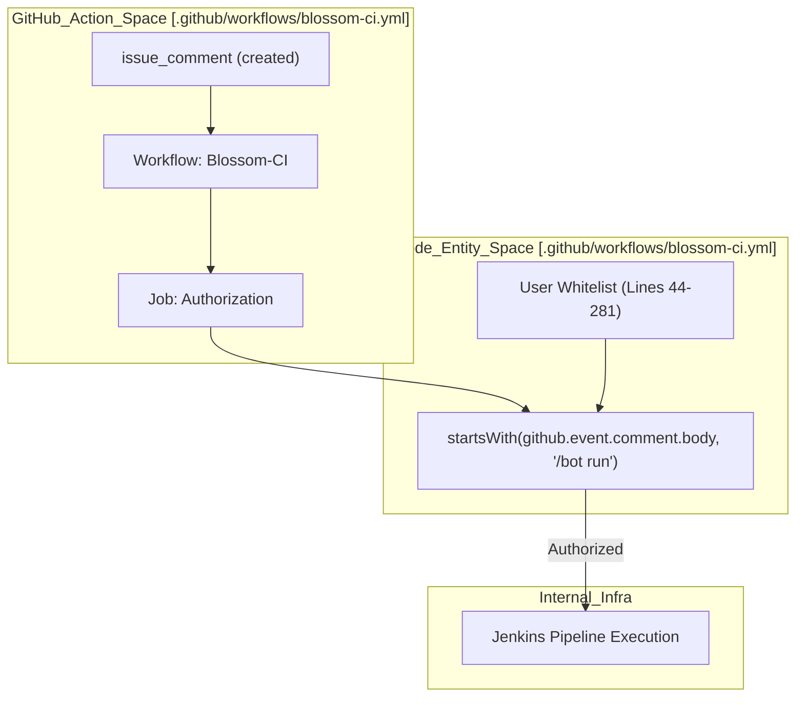
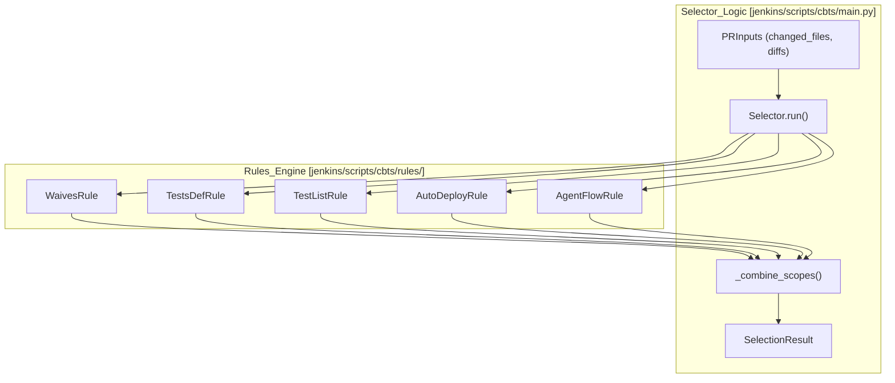
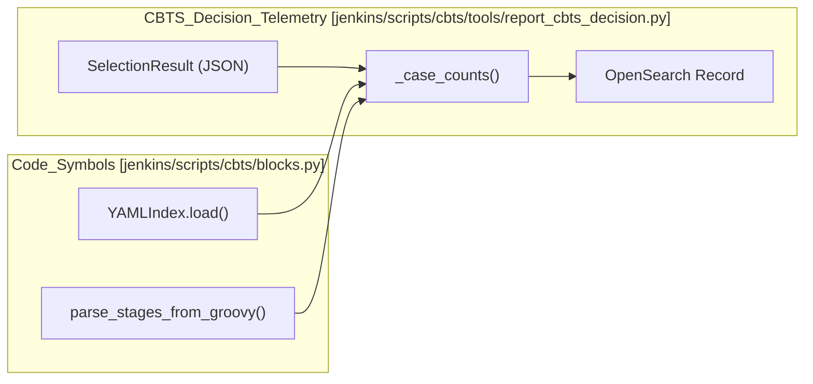

<!-- source: DeepWiki mcp.deepwiki.com · repo NVIDIA/TensorRT-LLM · page 6.4 Artifact Management and Caching · fetched 2026-10-26 -->

# Artifact Management and Caching

<details>
<summary>Relevant source files</summary>

The following files were used as context for generating this wiki page:

- [.coderabbit.yaml](.coderabbit.yaml)
- [.github/CODEOWNERS](.github/CODEOWNERS)
- [.github/pull_request_template.md](.github/pull_request_template.md)
- [.github/scripts/cleanup_stale_prs.test.js](.github/scripts/cleanup_stale_prs.test.js)
- [.github/scripts/label_community_user.py](.github/scripts/label_community_user.py)
- [.github/scripts/pr_checklist_check.py](.github/scripts/pr_checklist_check.py)
- [.github/tava_architecture_diagram.md](.github/tava_architecture_diagram.md)
- [.github/workflows/auto-assign.yml](.github/workflows/auto-assign.yml)
- [.github/workflows/auto-close-inactive-issues.yml](.github/workflows/auto-close-inactive-issues.yml)
- [.github/workflows/blossom-ci.yml](.github/workflows/blossom-ci.yml)
- [.github/workflows/bot-command.yml](.github/workflows/bot-command.yml)
- [.github/workflows/cleanup-stale-prs.yml](.github/workflows/cleanup-stale-prs.yml)
- [.github/workflows/full-premerge-approval.yml](.github/workflows/full-premerge-approval.yml)
- [.github/workflows/l0-test.yml](.github/workflows/l0-test.yml)
- [.github/workflows/label_community_pr.yml](.github/workflows/label_community_pr.yml)
- [.github/workflows/label_issue.yml](.github/workflows/label_issue.yml)
- [.github/workflows/llm-api-compatibility.yml](.github/workflows/llm-api-compatibility.yml)
- [.github/workflows/module-owners.json](.github/workflows/module-owners.json)
- [.github/workflows/post-merge-approval.yml](.github/workflows/post-merge-approval.yml)
- [.github/workflows/pr-check.yml](.github/workflows/pr-check.yml)
- [.github/workflows/precommit-check.yml](.github/workflows/precommit-check.yml)
- [CODING_GUIDELINES.md](CODING_GUIDELINES.md)
- [CONTRIBUTING.md](CONTRIBUTING.md)
- [docs/source/_ext/llmapi_config_telemetry.py](docs/source/_ext/llmapi_config_telemetry.py)
- [docs/source/developer-guide/api-change.md](docs/source/developer-guide/api-change.md)
- [docs/source/developer-guide/ci-overview.md](docs/source/developer-guide/ci-overview.md)
- [docs/source/features/sparse-attention.md](docs/source/features/sparse-attention.md)
- [docs/source/legacy/advanced/executor.md](docs/source/legacy/advanced/executor.md)
- [docs/source/media/sparse_attention_framework.png](docs/source/media/sparse_attention_framework.png)
- [docs/source/media/sparse_attention_op.png](docs/source/media/sparse_attention_op.png)
- [examples/models/core/nemotron/README_nemotron_nano_v3.md](examples/models/core/nemotron/README_nemotron_nano_v3.md)
- [jenkins/scripts/cbts/README.md](jenkins/scripts/cbts/README.md)
- [jenkins/scripts/cbts/blocks.py](jenkins/scripts/cbts/blocks.py)
- [jenkins/scripts/cbts/coverage_pilot.py](jenkins/scripts/cbts/coverage_pilot.py)
- [jenkins/scripts/cbts/coverage_selection/SELECTION.md](jenkins/scripts/cbts/coverage_selection/SELECTION.md)
- [jenkins/scripts/cbts/coverage_selection/artifact.py](jenkins/scripts/cbts/coverage_selection/artifact.py)
- [jenkins/scripts/cbts/coverage_selection/touch_db.py](jenkins/scripts/cbts/coverage_selection/touch_db.py)
- [jenkins/scripts/cbts/coverage_utils/COLLECTION.md](jenkins/scripts/cbts/coverage_utils/COLLECTION.md)
- [jenkins/scripts/cbts/coverage_utils/README.md](jenkins/scripts/cbts/coverage_utils/README.md)
- [jenkins/scripts/cbts/coverage_utils/cbts_pystart.py](jenkins/scripts/cbts/coverage_utils/cbts_pystart.py)
- [jenkins/scripts/cbts/coverage_utils/compact_db.py](jenkins/scripts/cbts/coverage_utils/compact_db.py)
- [jenkins/scripts/cbts/coverage_utils/pystart_report.py](jenkins/scripts/cbts/coverage_utils/pystart_report.py)
- [jenkins/scripts/cbts/main.py](jenkins/scripts/cbts/main.py)
- [jenkins/scripts/cbts/tools/compact_touch_db.py](jenkins/scripts/cbts/tools/compact_touch_db.py)
- [jenkins/scripts/cbts/tools/coverage_audit.py](jenkins/scripts/cbts/tools/coverage_audit.py)
- [jenkins/scripts/cbts/tools/dryrun.py](jenkins/scripts/cbts/tools/dryrun.py)
- [jenkins/scripts/cbts/tools/report_cbts_decision.py](jenkins/scripts/cbts/tools/report_cbts_decision.py)
- [scripts/dco_check.py](scripts/dco_check.py)
- [scripts/generate_llm_args_golden_manifest.py](scripts/generate_llm_args_golden_manifest.py)
- [scripts/release_check.py](scripts/release_check.py)
- [scripts/run_mypy.sh](scripts/run_mypy.sh)
- [scripts/test_to_stage_mapping.py](scripts/test_to_stage_mapping.py)
- [tensorrt_llm/usage/schemas/README.md](tensorrt_llm/usage/schemas/README.md)
- [tests/integration/defs/disaggregated/test_aiperf_gate.py](tests/integration/defs/disaggregated/test_aiperf_gate.py)
- [tests/integration/defs/disaggregated/test_configs/disagg_config_ctxtp1_gentp1_qwen3_5_4b_fp8_tllm.yaml](tests/integration/defs/disaggregated/test_configs/disagg_config_ctxtp1_gentp1_qwen3_5_4b_fp8_tllm.yaml)
- [tests/integration/defs/disaggregated/test_configs/disagg_config_ctxtp2_gentp1cp2_deepseek_v3_lite_bf16_tllm_gen.yaml](tests/integration/defs/disaggregated/test_configs/disagg_config_ctxtp2_gentp1cp2_deepseek_v3_lite_bf16_tllm_gen.yaml)
- [tests/integration/defs/disaggregated/test_configs/disagg_config_ctxtp2_gentp2_gptoss_tllm.yaml](tests/integration/defs/disaggregated/test_configs/disagg_config_ctxtp2_gentp2_gptoss_tllm.yaml)
- [tests/integration/defs/disaggregated/test_configs/disagg_config_ctxtp4_gentp4_deepseek_r1_v2_fp4_tllm.yaml](tests/integration/defs/disaggregated/test_configs/disagg_config_ctxtp4_gentp4_deepseek_r1_v2_fp4_tllm.yaml)
- [tests/integration/defs/disaggregated/test_configs/disagg_config_ctxtp4_gentp4_deepseek_r1_v2_fp4_tllm_mtp.yaml](tests/integration/defs/disaggregated/test_configs/disagg_config_ctxtp4_gentp4_deepseek_r1_v2_fp4_tllm_mtp.yaml)
- [tests/integration/defs/disaggregated/test_configs/disagg_config_deepseek_v3_lite_empty_batch.yaml](tests/integration/defs/disaggregated/test_configs/disagg_config_deepseek_v3_lite_empty_batch.yaml)
- [tests/unittest/scripts/test_cbts_coverage_artifact.py](tests/unittest/scripts/test_cbts_coverage_artifact.py)
- [tests/unittest/scripts/test_cbts_coverage_pilot.py](tests/unittest/scripts/test_cbts_coverage_pilot.py)
- [tests/unittest/scripts/test_report_cbts_decision.py](tests/unittest/scripts/test_report_cbts_decision.py)
- [tests/unittest/usage/test_llmapi_config_telemetry_docs.py](tests/unittest/usage/test_llmapi_config_telemetry_docs.py)

</details>


## Purpose and Scope

This document describes the artifact management and caching infrastructure used in TensorRT-LLM's CI/CD pipeline. It covers artifact storage and retrieval, Docker image management, `ccache` optimization for C++ compilation acceleration, and artifact reuse mechanisms for GitHub Actions and Jenkins. This infrastructure ensures efficient builds by avoiding redundant compilation and enabling artifact sharing across distributed test environments, particularly for community PRs and automated checks. It also details the Change-Based Testing Selection (CBTS) system, which leverages coverage artifacts to optimize test execution.

## Artifactory Integration

### Artifact Storage Architecture

TensorRT-LLM uses NVIDIA's Artifactory server for centralized artifact storage. All build artifacts, test results, and Docker images are uploaded to structured paths for reuse across pipeline stages.

**Artifactory Storage Structure Diagram**

```mermaid
graph TB
    subgraph "Artifactory_Server [urm.nvidia.com/artifactory]"
        ROOT["Root"]
        
        subgraph "Build_Artifacts [sw-tensorrt-generic/llm-artifacts]"
            JOB_PATH["${JOB_NAME}/${BUILD_NUMBER}"]
            WHEELS["TensorRT-LLM.tar.gz<br/>tensorrt_llm-*.whl"]
            TRITON["libtriton_tensorrtllm.so<br/>trtllmExecutorWorker"]
        end
        
        subgraph "Docker_Images [sw-tensorrt-docker]"
            STAGING["tensorrt-llm-staging"]
            NGC["tensorrt-llm-staging/ngc"]
        end
        
        subgraph "Test_Results"
            RESULTS["results-*.xml"]
            PERF["aggr*/ disagg* folders"]
            CBTS_COV["cbts-coverage/cbts_touchmap.sqlite"]
        end
    end
    
    subgraph "Jenkins_Pipelines"
        L0_MR["L0_MergeRequest.groovy"]
        L0_TEST["L0_Test.groovy"]
    end
    
    ROOT --> "sw-tensorrt-generic/llm-artifacts"
    ROOT --> "sw-tensorrt-docker"
    "sw-tensorrt-generic/llm-artifacts" --> JOB_PATH
    JOB_PATH --> WHEELS
    JOB_PATH --> TRITON
    JOB_PATH --> RESULTS
    JOB_PATH --> PERF
    JOB_PATH --> CBTS_COV
    "sw-tensorrt-docker" --> STAGING
    STAGING --> NGC
    
    L0_MR --> JOB_PATH
    L0_TEST --> JOB_PATH
```
**Sources:** [jenkins/scripts/cbts/coverage_utils/README.md:58-60]()

### Artifact Path Configuration

Artifact paths are configured at the pipeline level using environment variables. These paths are utilized by the Jenkins scripts to coordinate between build stages and test stages.

| Variable | Purpose |
|----------|---------|
| `ARTIFACT_PATH` | Download path for artifacts used in subsequent test stages |
| `UPLOAD_PATH` | Upload path for artifacts generated during the build stage |
| `URM_ARTIFACTORY_BASE` | Base URL for the artifact repository |

---

## Docker Image Tag Management

### Image Configuration

CI pipelines use pinned image tags to ensure reproducibility across different hardware architectures and Python versions. These are managed via the Docker multi-stage build system.

**Image Categories**

| Category | Architecture | OS | Python Version |
|-----|-------------|-----|----------------|
| `LLM_DOCKER_IMAGE` | x86_64 | Ubuntu 24.04 | 3.12 |
| `LLM_SBSA_DOCKER_IMAGE` | aarch64 (sbsa) | Ubuntu 24.04 | 3.12 |

---

## Wheel Storage and Management

### Wheel Package Artifacts

Python wheel packages are the primary distributable artifacts. The build process includes binary distribution flags and inclusion of C++ libraries like `libtensorrt_llm.so`.

**Wheel Generation and Storage Flow**



---

## Ccache Optimization

### Ccache Directory and Configuration

TensorRT-LLM uses `ccache` to accelerate C++ compilation. The cache is typically stored on persistent volumes to persist across build jobs.

| Parameter | Purpose |
|-----------|---------|
| `CCACHE_DIR` | Centralized cache storage path |

---

## Artifact Reuse Strategies

### Reuse Mechanism in Pipelines

The pipeline implements logic to determine if test results or builds should be reused from previous pipelines to save time and resources. Authorized users can trigger this via bot parameters like `/bot reuse-pipeline`. The default behavior of the bot is to reuse build artifacts and successful test results from the last pipeline if the Git commit ID has not changed [.github/workflows/bot-command.yml:51-51]().

**Reuse Decision Flow**



**Sources:** [.github/workflows/bot-command.yml:51-52](), [.github/workflows/bot-command.yml:72-74]()

---

## GitHub Actions and Blossom CI

### Community PR Checks and Bot Interaction

GitHub Actions facilitate automated checks for community PRs and provide a user-friendly interface for interacting with the internal Jenkins infrastructure via a bot. The `Bot-Command` workflow displays help information for subcommands like `run`, `kill`, `skip`, and `reuse-pipeline` [.github/workflows/bot-command.yml:42-75]().

**Bot Commands for CI Interaction**

Authorized users can trigger CI actions by commenting on PRs. The Blossom CI workflow parses these commands and triggers the corresponding tasks.

| Command | Action |
|---------|--------|
| `/bot run` | Launch build/test pipelines. Supports options like `--reuse-test`, `--skip-test`, `--stage-list`, and `--gpu-type` [.github/workflows/bot-command.yml:49-56](). |
| `/bot kill` | Kill all running builds associated with the pull request [.github/workflows/bot-command.yml:67-68](). |
| `/bot reuse-pipeline` | Reuse a previous pipeline to validate the current commit [.github/workflows/bot-command.yml:72-74](). |
| `/bot skip --comment` | Skip testing for the latest commit on the pull request. Requires a reason [.github/workflows/bot-command.yml:69-71](). |

**Sources:** [.github/workflows/blossom-ci.yml:39-42](), [.github/workflows/bot-command.yml:28-82]()

### Blossom CI and Hybrid Infrastructure

The `Blossom-CI` workflow acts as a bridge between GitHub and internal self-hosted runners. It performs authorization checks against a whitelist of approved NVIDIA contributors before triggering internal jobs [.github/workflows/blossom-ci.yml:31-281]().

**Authorization and Execution Flow**


**Sources:** [.github/workflows/blossom-ci.yml:17-281]()

### PR Validation and Automated Labeling

The repository uses several automated workflows to manage PR artifacts and metadata:
- **Community Labeling**: Automatically identifies and labels PRs from community contributors every hour using `label_community_user.py` [.github/workflows/label_community_pr.yml:1-37]().
- **PR Checklist Validation**: Ensures that developers have completed the mandatory PR checklist items such as coding guidelines and test coverage [.github/workflows/pr-check.yml:57-73](), [.github/pull_request_template.md:43-58]().
- **PR Title Format**: Enforces a specific format `[JIRA/NVBugs/Issue/None][type] Summary` using `conventional-commit-checker-action` [.github/workflows/pr-check.yml:23-55]().

**Sources:** [.github/workflows/label_community_pr.yml:1-37](), [.github/workflows/pr-check.yml:23-73](), [.github/pull_request_template.md:43-58]()

---

## Change-Based Testing Selection (CBTS)

CBTS is a CI test-selection tool that narrows down Jenkins stages and specific tests based on PR changes to optimize resource usage [jenkins/scripts/cbts/README.md:1-4]().

### CBTS Architecture and Scopes

The system applies rules to the PR diff to determine the "scope" of changes, which dictates which artifacts need re-validation.

| Scope | Triggered By | Action |
|-------|--------------|--------|
| `waiveonly` | `WaivesRule` | PR only edits `waives.txt` [jenkins/scripts/cbts/README.md:51-51](). |
| `testdefonly` | `TestsDefRule` | PR only edits files under `tests/` [jenkins/scripts/cbts/README.md:52-52](). |
| `testlistonly` | `TestListRule` | PR only adds entries to YAML test-db files [jenkins/scripts/cbts/README.md:53-53](). |
| `autodeployonly` | `AutoDeployRule` | PR only touches AutoDeploy source paths [jenkins/scripts/cbts/README.md:54-54](). |
| `noop` | `OutOfScopeRule` | PR only touches docs or non-functional files [jenkins/scripts/cbts/README.md:58-58](). |

**CBTS Logic Flow**


**Sources:** [jenkins/scripts/cbts/README.md:31-64](), [jenkins/scripts/cbts/main.py:110-148](), [jenkins/scripts/cbts/main.py:78-87]()

### Coverage-Based Selection (Tier 2)

CBTS includes a coverage-based selection tier that maps changed lines to specific Python functions (`qualnames`) using a `touch_db` [jenkins/scripts/cbts/README.md:13-13]().

**Coverage Data Flow**
1. **Collection**: During post-merge CI, `cbts_pystart.py` uses `sys.monitoring` to record which functions each test enters [jenkins/scripts/cbts/coverage_utils/README.md:11-13]().
2. **Artifact Generation**: The per-process coverage files are merged by `pystart_report.py` into a compact SQLite database: `cbts_touchmap.sqlite` [jenkins/scripts/cbts/coverage_utils/README.md:26-26]().
3. **Selection**: For community PRs, the `CoverageSelector` queries this artifact to identify only those tests that reach the modified lines of code [jenkins/scripts/cbts/coverage_selection/SELECTION.md:1-10]().

**Sources:** [jenkins/scripts/cbts/coverage_utils/README.md:5-28](), [jenkins/scripts/cbts/coverage_selection/touch_db.py:1-20]()

### Test Waiving Mechanism

When tests are known to fail, they are added to `tests/integration/test_lists/waives.txt`. The `WaivesRule` reads these changes and narrows the CI to only run the affected waived tests for verification [jenkins/scripts/cbts/README.md:37-37]().

**Artifact and Telemetry Mapping**

The CBTS decision results are reported to an OpenSearch database for CI health monitoring, tracking skip rates and decision logic [jenkins/scripts/cbts/tools/report_cbts_decision.py:15-20]().


**Sources:** [jenkins/scripts/cbts/tools/report_cbts_decision.py:80-172](), [jenkins/scripts/cbts/blocks.py:43-52]()

---

