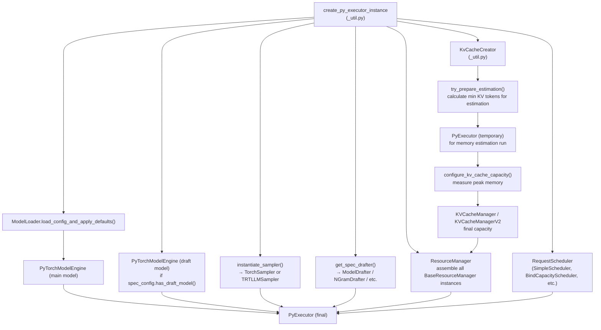
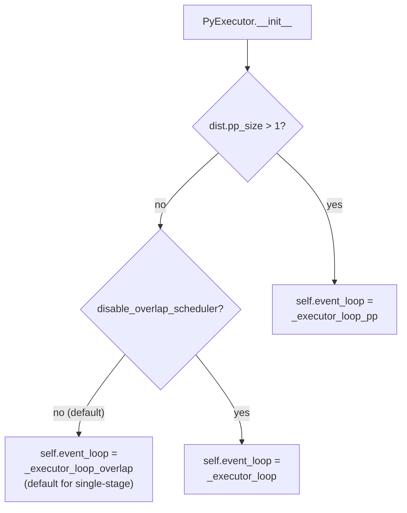

<!-- source: DeepWiki mcp.deepwiki.com · repo NVIDIA/TensorRT-LLM · page 7 PyExecutor Runtime System · fetched 2026-10-26 -->

# PyExecutor Runtime System

<details>
<summary>Relevant source files</summary>

The following files were used as context for generating this wiki page:

- [tensorrt_llm/_torch/pyexecutor/_util.py](tensorrt_llm/_torch/pyexecutor/_util.py)
- [tensorrt_llm/_torch/pyexecutor/llm_request.py](tensorrt_llm/_torch/pyexecutor/llm_request.py)
- [tensorrt_llm/_torch/pyexecutor/model_engine.py](tensorrt_llm/_torch/pyexecutor/model_engine.py)
- [tensorrt_llm/_torch/pyexecutor/py_executor.py](tensorrt_llm/_torch/pyexecutor/py_executor.py)
- [tensorrt_llm/_torch/pyexecutor/py_executor_creator.py](tensorrt_llm/_torch/pyexecutor/py_executor_creator.py)
- [tensorrt_llm/_torch/pyexecutor/resource_manager.py](tensorrt_llm/_torch/pyexecutor/resource_manager.py)
- [tensorrt_llm/commands/serve.py](tensorrt_llm/commands/serve.py)
- [tensorrt_llm/llmapi/llm_args.py](tensorrt_llm/llmapi/llm_args.py)
- [tests/unittest/_torch/executor/test_benchmark_disagg.py](tests/unittest/_torch/executor/test_benchmark_disagg.py)
- [tests/unittest/_torch/executor/test_disagg_fill_gate_stall_bound.py](tests/unittest/_torch/executor/test_disagg_fill_gate_stall_bound.py)
- [tests/unittest/_torch/executor/test_py_executor.py](tests/unittest/_torch/executor/test_py_executor.py)
- [tests/unittest/_torch/executor/test_seq_slot_sizing.py](tests/unittest/_torch/executor/test_seq_slot_sizing.py)
- [tests/unittest/api_stability/references/llm.yaml](tests/unittest/api_stability/references/llm.yaml)
- [tests/unittest/api_stability/references/trtllm_serve_cli.yaml](tests/unittest/api_stability/references/trtllm_serve_cli.yaml)
- [tests/unittest/llmapi/test_llm_args.py](tests/unittest/llmapi/test_llm_args.py)

</details>


## Purpose and Scope

This page describes the **PyExecutor** runtime system — the inference execution engine for TensorRT-LLM's PyTorch backend. `PyExecutor` orchestrates the full inference loop: fetching requests from a queue, scheduling them into batches, invoking the model forward pass, sampling tokens, and delivering responses.

`PyExecutor` is distinct from the C++ TensorRT batch manager described in [C++ Runtime and Batch Manager](#20). The PyTorch backend (`PyExecutor`) supports dynamic eager-mode execution, `torch.compile`, CUDA graph capture, and the full suite of speculative decoding strategies. For details on individual subsystems, see:
- [PyExecutor Event Loop and Request Scheduling](#7.1)
- [Resource Management and KV Cache](#7.2)
- [ModelEngine and Forward Pass Execution](#7.3)
- [Sampler and Token Generation](#7.4)
- [Proxy-Worker Architecture and IPC](#7.5)
- [Post-Processing Workers](#7.6)

Sources: [tensorrt_llm/_torch/pyexecutor/py_executor.py:252-255](), [tensorrt_llm/_torch/pyexecutor/model_engine.py:91-113]()

---

## High-Level Architecture

The `PyExecutor` class ([tensorrt_llm/_torch/pyexecutor/py_executor.py:252-252]()) is the central coordinator. It does not implement any of its subsystems directly; instead, it holds references to separately constructed components that are wired together by the `create_py_executor_instance` factory function ([tensorrt_llm/_torch/pyexecutor/_util.py:65-65]()).

**Component map: PyExecutor and its dependencies**

```mermaid
graph TD
    PyExecutor["PyExecutor\n(py_executor.py)"]

    subgraph "Execution"
        ModelEngine["PyTorchModelEngine\n(model_engine.py)"]
        DraftModelEngine["PyTorchModelEngine\n(draft, optional)"]
        CUDAGraphRunner["CUDAGraphRunner\n(cuda_graph_runner.py)"]
        ModelEngine --> CUDAGraphRunner
    end

    subgraph "Request Routing"
        ExecutorRequestQueue["ExecutorRequestQueue\n(executor_request_queue.py)"]
        WaitingQueue["WaitingQueue\n(scheduler/)"]
        Scheduler["RequestScheduler\n(scheduler/)"]
    end

    subgraph "Sampling"
        Sampler["Sampler\n(TorchSampler or TRTLLMSampler)\n(sampler.py)"]
    end

    subgraph "Resources"
        ResourceManager["ResourceManager\n(resource_manager.py)"]
        KVCacheManager["KVCacheManager\n(resource_manager.py)"]
        SeqSlotManager["SeqSlotManager\n(seq_slot_manager.py)"]
        ResourceManager --> KVCacheManager
        ResourceManager --> SeqSlotManager
    end

    subgraph "Optional"
        Drafter["Drafter\n(drafter.py)"]
        GuidedDecoder["GuidedDecoder\n(guided_decoder.py)"]
        KvCacheTransceiver["KvCacheTransceiver\n(kv_cache_transceiver.py)"]
        KvCacheConnectorManager["KvCacheConnectorManager\n(kv_cache_connector.py)"]
        HangDetector["HangDetector\n(hang_detector.py)"]
        DwdpManager["DwdpManager\n(dwdp.py)"]
    end

    Dist["Distributed\n(distributed/)"]

    PyExecutor --> ModelEngine
    PyExecutor --> DraftModelEngine
    PyExecutor --> Sampler
    PyExecutor --> Scheduler
    PyExecutor --> ResourceManager
    PyExecutor --> ExecutorRequestQueue
    PyExecutor --> WaitingQueue
    PyExecutor --> Dist
    PyExecutor -.-> Drafter
    PyExecutor -.-> GuidedDecoder
    PyExecutor -.-> KvCacheTransceiver
    PyExecutor -.-> KvCacheConnectorManager
    PyExecutor -.-> HangDetector
    PyExecutor -.-> DwdpManager
```



Sources: [tensorrt_llm/_torch/pyexecutor/py_executor.py:260-310](), [tensorrt_llm/_torch/pyexecutor/model_engine.py:91-113](), [tensorrt_llm/_torch/pyexecutor/resource_manager.py:117-143]()

---

## Key Components

| Component | Class(es) | File | Role |
|---|---|---|---|
| Main executor | `PyExecutor` | `py_executor.py` | Coordinates all subsystems; runs the event loop in a background thread |
| Model execution | `ModelEngine` | `model_engine.py` | Abstract interface for running forward passes [tensorrt_llm/_torch/pyexecutor/model_engine.py:91-91]() |
| Resource container | `ResourceManager` | `resource_manager.py` | Holds all per-request resource managers (KV cache, seq slots, etc.) [tensorrt_llm/_torch/pyexecutor/resource_manager.py:117-117]() |
| KV cache | `KVCacheManager`, `KVCacheManagerV2` | `resource_manager.py`, `kv_cache_manager_v2.py` | Paged KV cache block allocation and tracking [tensorrt_llm/_torch/pyexecutor/resource_manager.py:56-71]() |
| Sequence slots | `SeqSlotManager` | `seq_slot_manager.py` | Assigns fixed-size GPU slots to active requests [tensorrt_llm/_torch/pyexecutor/_util.py:74-74]() |
| Sampling | `Sampler`, `TRTLLMSampler` | `sampler.py` | Converts model logits to next tokens [tensorrt_llm/_torch/pyexecutor/sampler.py:83-84]() |
| Scheduling | `RequestScheduler` | `scheduler/` | Selects which requests to include in each iteration [tensorrt_llm/_torch/pyexecutor/py_executor.py:85-85]() |
| Speculative drafting | `Drafter` | `speculative/` | Generates draft tokens for speculative decoding [tensorrt_llm/_torch/pyexecutor/py_executor.py:55-55]() |
| Guided decoding | `GuidedDecoder` | `guided_decoder.py` | Enforces grammar/schema constraints on sampling [tensorrt_llm/_torch/pyexecutor/guided_decoder.py:54-54]() |
| Disaggregated transfer | `KvCacheTransceiver` | `kv_cache_transceiver.py` | Sends/receives KV cache blocks across ranks [tensorrt_llm/_torch/pyexecutor/py_executor.py:69-69]() |
| KV connector | `KvCacheConnectorManager` | `kv_cache_connector.py` | Persistent KV cache save/load manager [tensorrt_llm/_torch/pyexecutor/py_executor.py:59-59]() |
| Distributed Weight DP | `DwdpManager` | `dwdp.py` | Manages distributed weight data parallelism for MoE [tensorrt_llm/_torch/pyexecutor/py_executor.py:64-64]() |
| Hang detection | `HangDetector` | `hang_detector.py` | Monitors executor for stalls [tensorrt_llm/_torch/pyexecutor/py_executor.py:66-66]() |

Sources: [tensorrt_llm/_torch/pyexecutor/py_executor.py:50-87](), [tensorrt_llm/_torch/pyexecutor/_util.py:31-74]()

---

## Factory: `create_py_executor`

Assembly of the components is handled by `create_py_executor_instance` in [tensorrt_llm/_torch/pyexecutor/_util.py:65-65](). This process includes memory estimation to determine optimal KV cache capacity.

**Assembly sequence**



The `_ExecutorMemoryMonitor` class ([tensorrt_llm/_torch/pyexecutor/py_executor_creator.py:61-61]()) wraps each allocation stage. If a `torch.OutOfMemoryError` occurs, it emits a detailed message showing which component failed (e.g., `ExecutorMemoryType.MODEL_ENGINE_MAIN`) and suggestions for tuning, such as reducing `max_num_tokens` [tensorrt_llm/_torch/pyexecutor/py_executor_creator.py:129-150]().

Sources: [tensorrt_llm/_torch/pyexecutor/py_executor_creator.py:61-165](), [tensorrt_llm/_torch/pyexecutor/_util.py:65-157]()

---

## Resource Manager Types

`ResourceManager` holds a dictionary keyed by `ResourceManagerType` (an enum in `resource_manager.py`). Each value is a `BaseResourceManager` implementation.

| Enum Value | Resource Managed | implementation Examples |
|---|---|---|
| `KV_CACHE_MANAGER` | Primary KV cache (paged blocks) | `KVCacheManager`, `KVCacheManagerV2` |
| `DRAFT_KV_CACHE_MANAGER` | Separate KV cache for draft model | `KVCacheManager` |
| `PEFT_CACHE_MANAGER` | LoRA adapter weight cache | `PeftCacheManager` |
| `SEQ_SLOT_MANAGER` | Fixed GPU buffer slots per request | `SeqSlotManager` |
| `SPEC_RESOURCE_MANAGER` | Algorithm-specific state | `Eagle3ResourceManager` |
| `KV_CACHE_COMPRESSION_MANAGER` | Compressed KV cache resources | `KVCacheCompressionManager` |

Sources: [tensorrt_llm/_torch/pyexecutor/resource_manager.py:94-102](), [tensorrt_llm/_torch/pyexecutor/model_engine.py:66-66](), [tensorrt_llm/_torch/pyexecutor/resource_manager.py:117-143]()

---

## Event Loop Variants

`PyExecutor` selects one of three event loop implementations at construction time, stored in `self.event_loop` [tensorrt_llm/_torch/pyexecutor/py_executor.py:504-519]().



| Loop | When Selected | Key Behavior |
|---|---|---|
| `_executor_loop` | `pp_size == 1`, overlap disabled | Simple sequential: schedule → forward → sample → update |
| `_executor_loop_overlap` | `pp_size == 1`, overlap enabled (default) | Forward pass of iteration N overlaps with token sampling from iteration N-1 |
| `_executor_loop_pp` | `pp_size > 1` | Uses micro-batches; results broadcast across pipeline stages via `PPCommTag` [tensorrt_llm/_torch/pyexecutor/py_executor.py:118-126]() |

When pipeline parallelism is active, a second thread (`_broadcast_sample_state_loop`) is started to handle asynchronous sample-state broadcasts across PP ranks using `PPCommTag.SAMPLE_STATE` [tensorrt_llm/_torch/pyexecutor/py_executor.py:609-612]().

Sources: [tensorrt_llm/_torch/pyexecutor/py_executor.py:504-519](), [tensorrt_llm/_torch/pyexecutor/py_executor.py:609-612](), [tensorrt_llm/_torch/pyexecutor/py_executor.py:118-126]()

---

## Threading Model

```mermaid
graph TD
    subgraph "Caller Thread"
        enqueue["enqueue_requests() / enqueue_request()"]
        await["await_responses()"]
        cancel["cancel_request()"]
        shutdown["shutdown()"]
    end

    subgraph "ExecutorRequestQueue"
        inq["Internal queue\n(thread-safe)"]
    end

    subgraph "Worker Thread (worker_thread)"
        eventloop["event_loop()\n_executor_loop / _executor_loop_overlap / _executor_loop_pp"]
        fetch["_fetch_new_requests()"]
        forward["model_engine.forward()"]
        sample["sampler.sample_async()"]
        update["sampler.update_requests()"]
    end

    subgraph "PP Broadcast Thread (pp_size > 1)"
        bcast["_broadcast_sample_state_loop()"]
    end

    subgraph "Async Sampler Worker (optional)"
        asyncworker["D2H copy worker\n(AsyncWorkerMixin)"]
    end

    enqueue --> inq
    cancel --> inq
    shutdown --> inq
    inq --> fetch
    fetch --> eventloop
    fetch -.-> "attach_py_objects_to_requests()"
    eventloop --> forward
    eventloop --> sample
    eventloop --> update
    update --> await
    eventloop --> bcast
    sample --> asyncworker
```

- `response_cv` (`threading.Condition`) is used in `await_responses()` to block the caller until responses are available [tensorrt_llm/_torch/pyexecutor/py_executor.py:654-654]().
- `shutdown_event` (`threading.Event`) signals the background thread to terminate [tensorrt_llm/_torch/pyexecutor/py_executor.py:348-348]().
- `worker_lock` (`threading.Lock`) ensures `start_worker()` is idempotent [tensorrt_llm/_torch/pyexecutor/py_executor.py:601-601]().

Sources: [tensorrt_llm/_torch/pyexecutor/py_executor.py:348-370](), [tensorrt_llm/_torch/pyexecutor/py_executor.py:601-628](), [tensorrt_llm/_torch/pyexecutor/request_utils.py:78-78]()

---

## Public API

`PyExecutor` exposes the following interface to callers:

| Method | Signature | Description |
|---|---|---|
| `enqueue_requests` | `(requests: List[ExecutorRequest], ...) → List[int]` | Submit a batch; returns request IDs |
| `enqueue_request` | `(request: ExecutorRequest, ...) → int` | Submit a single request |
| `await_responses` | `(id=None, timeout=None) → responses` | Block until responses are ready |
| `cancel_request` | `(id: int)` | Signal cancellation for a request |
| `shutdown` | `()` | Drain in-flight requests and stop all threads |
| `get_latest_iteration_stats` | `() → List[IterationStats]` | Retrieve per-iteration stats since last call |

The type `ExecutorRequest` is an alias for `tensorrt_llm.bindings.executor.Request` [tensorrt_llm/_torch/pyexecutor/llm_request.py:31-31](). Responses arrive as `LlmResponse` objects [tensorrt_llm/_torch/pyexecutor/llm_request.py:72-72]() (internal) or `ExecutorResponse` [tensorrt_llm/_torch/pyexecutor/llm_request.py:32-32]() (public).

Sources: [tensorrt_llm/_torch/pyexecutor/py_executor.py:654-763](), [tensorrt_llm/_torch/pyexecutor/llm_request.py:31-34]()

---

## Warmup Sequence

Before the event loop starts, `PyExecutor.__init__` runs warmup on the `execution_stream`:

1. `model_engine.warmup(resource_manager)` — triggers `torch.compile` tracing, autotuner profiling, and CUDA graph capture [tensorrt_llm/_torch/pyexecutor/model_engine.py:111-118]().
2. `draft_model_engine.warmup(resource_manager)` — same, for the draft model if present [tensorrt_llm/_torch/pyexecutor/py_executor.py:433-434]().
3. `torch.cuda.current_stream().wait_stream(execution_stream)` — ensures warmup completes before inference begins.

Sources: [tensorrt_llm/_torch/pyexecutor/py_executor.py:429-440](), [tensorrt_llm/_torch/pyexecutor/model_engine.py:111-118]()

---

## Async KV Cache Transfer (Disaggregated Serving)

`AsyncTransferManager` ([tensorrt_llm/_torch/pyexecutor/py_executor.py:158-158]()) manages the lifecycle of KV cache blocks during disaggregated serving.

It tracks:
- Which requests are currently mid-transfer (`_requests_in_transfer: Dict[int, LlmRequest]`) [tensorrt_llm/_torch/pyexecutor/py_executor.py:196-196]().
- A reference-counted transfer counter per request (`RequestTransferMetadata`) [tensorrt_llm/_torch/pyexecutor/py_executor.py:170-175]().
- Pins blocks for reuse while transfers are in-flight and unpins them after all transfers complete [tensorrt_llm/_torch/pyexecutor/py_executor.py:161-164]().

Sources: [tensorrt_llm/_torch/pyexecutor/py_executor.py:158-249]()

---

## Benchmark Mode Gating

In benchmark disaggregated serving mode, the `PyExecutor` uses a gating mechanism to synchronize context and generation ranks. The generation executor defers the forward pass until the benchmark requests have completed their KV cache transfer [tensorrt_llm/_torch/pyexecutor/py_executor.py:136-137]().

- `_is_benchmark_disagg_fill_complete` checks if the active requests have finished KV transfer [tensorrt_llm/_torch/pyexecutor/py_executor.py:129-130]().
- A stall watchdog `_fail_if_fill_gate_stalled` ensures the rank does not hang indefinitely if transfers stop advancing [tensorrt_llm/_torch/pyexecutor/py_executor.py:136-137]().

Sources: [tensorrt_llm/_torch/pyexecutor/py_executor.py:129-152](), [tests/unittest/_torch/executor/test_benchmark_disagg.py:20-27]()

---

## Profiling and Diagnostics

Several environment variables control profiling behavior inside the event loop:

| Environment Variable | Effect |
|---|---|
| `TLLM_PROFILE_START_STOP` | Comma-separated iteration ranges for CUDA profiler start/stop [tensorrt_llm/_torch/pyexecutor/py_executor.py:113-115]() |
| `TLLM_TORCH_PROFILE_TRACE` | File path to save a PyTorch profiler Chrome trace [tensorrt_llm/_torch/pyexecutor/py_executor.py:117-119]() |
| `TLLM_PROFILE_LOG_RANKS` | Controls which ranks print step logging [tensorrt_llm/_torch/pyexecutor/py_executor.py:124-127]() |

Sources: [tensorrt_llm/_torch/pyexecutor/py_executor.py:113-127]()

---

