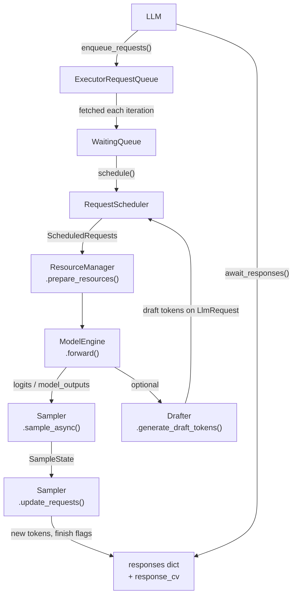
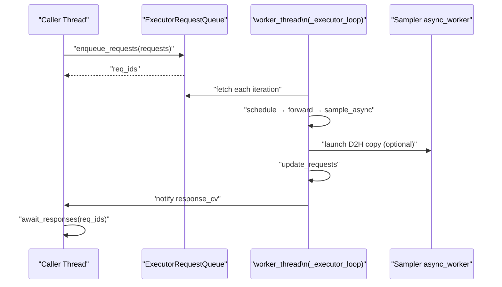
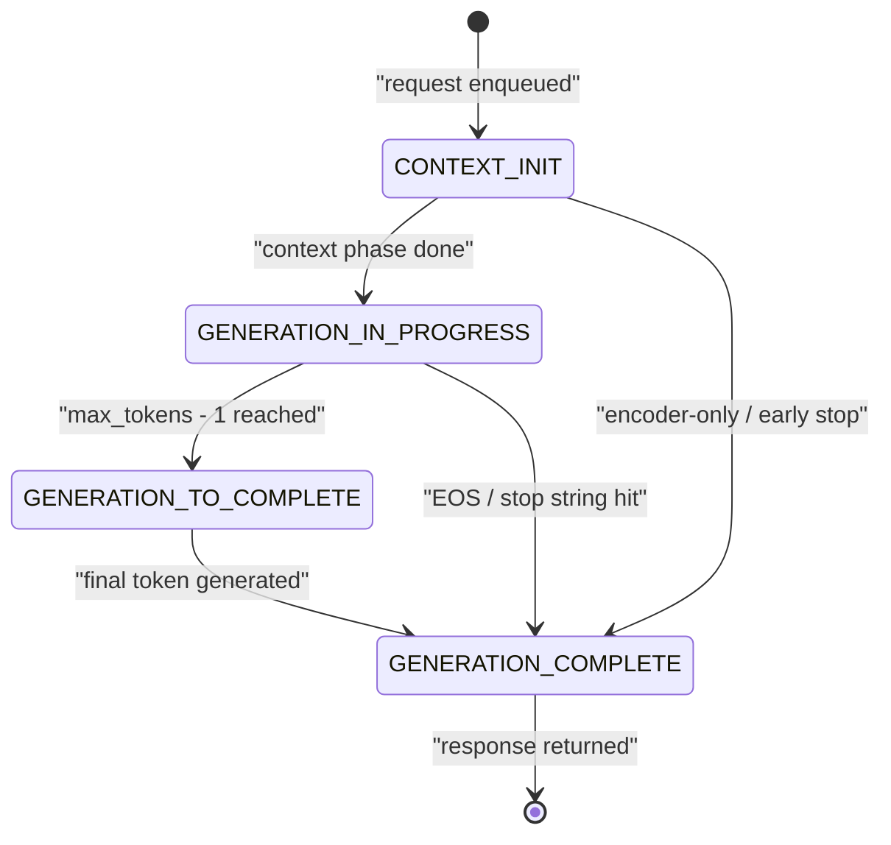
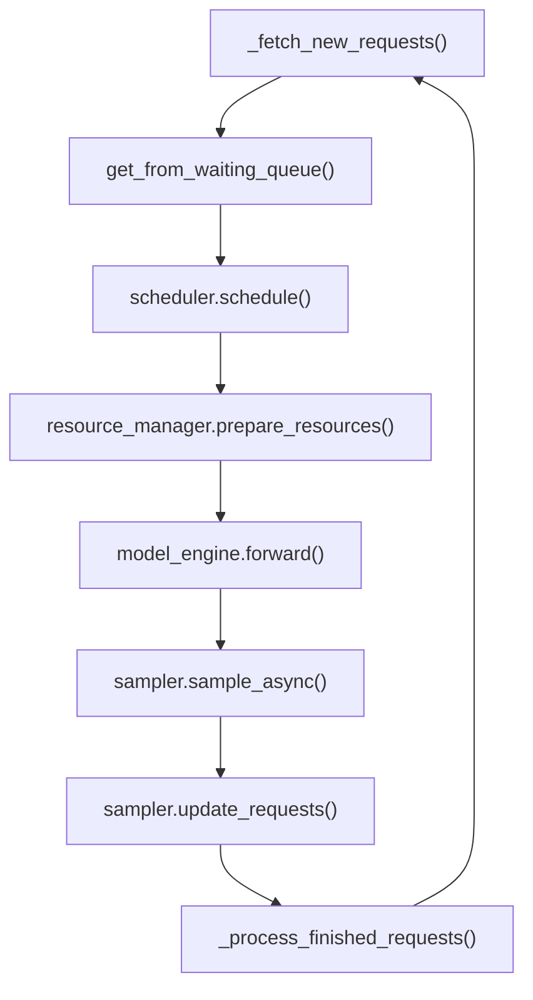
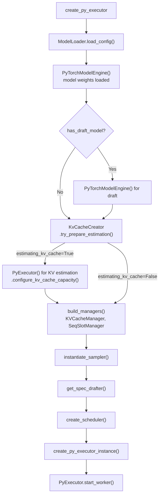
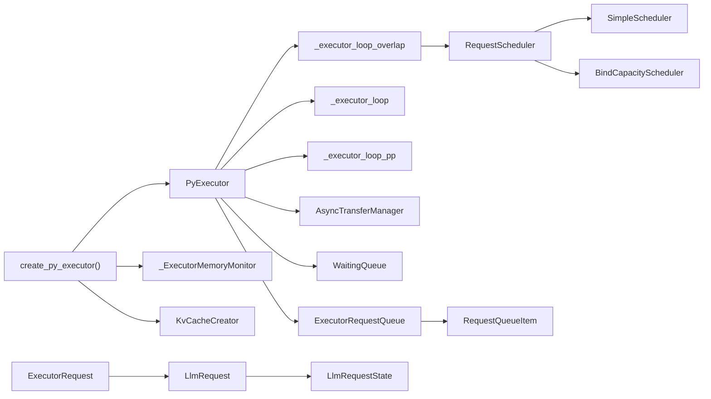

<!-- source: DeepWiki mcp.deepwiki.com · repo NVIDIA/TensorRT-LLM · page 7.1 PyExecutor Event Loop and Request Scheduling · fetched 2026-10-26 -->

# PyExecutor Event Loop and Request Scheduling

<details>
<summary>Relevant source files</summary>

The following files were used as context for generating this wiki page:

- [cpp/include/tensorrt_llm/runtime/worldConfig.h](cpp/include/tensorrt_llm/runtime/worldConfig.h)
- [cpp/tensorrt_llm/runtime/worldConfig.cpp](cpp/tensorrt_llm/runtime/worldConfig.cpp)
- [cpp/tensorrt_llm/thop/ncclCommunicatorOp.cpp](cpp/tensorrt_llm/thop/ncclCommunicatorOp.cpp)
- [cpp/tensorrt_llm/thop/ncclCommunicatorOp.h](cpp/tensorrt_llm/thop/ncclCommunicatorOp.h)
- [cpp/tests/unit_tests/runtime/worldConfigTest.cpp](cpp/tests/unit_tests/runtime/worldConfigTest.cpp)
- [tensorrt_llm/_torch/device_mesh.py](tensorrt_llm/_torch/device_mesh.py)
- [tensorrt_llm/_torch/distributed/communicator.py](tensorrt_llm/_torch/distributed/communicator.py)
- [tensorrt_llm/_torch/pyexecutor/_util.py](tensorrt_llm/_torch/pyexecutor/_util.py)
- [tensorrt_llm/_torch/pyexecutor/adp_iter_stats.py](tensorrt_llm/_torch/pyexecutor/adp_iter_stats.py)
- [tensorrt_llm/_torch/pyexecutor/executor_request_queue.py](tensorrt_llm/_torch/pyexecutor/executor_request_queue.py)
- [tensorrt_llm/_torch/pyexecutor/kv_cache_stats.py](tensorrt_llm/_torch/pyexecutor/kv_cache_stats.py)
- [tensorrt_llm/_torch/pyexecutor/llm_request.py](tensorrt_llm/_torch/pyexecutor/llm_request.py)
- [tensorrt_llm/_torch/pyexecutor/model_engine.py](tensorrt_llm/_torch/pyexecutor/model_engine.py)
- [tensorrt_llm/_torch/pyexecutor/perf_metrics_manager.py](tensorrt_llm/_torch/pyexecutor/perf_metrics_manager.py)
- [tensorrt_llm/_torch/pyexecutor/py_executor.py](tensorrt_llm/_torch/pyexecutor/py_executor.py)
- [tensorrt_llm/_torch/pyexecutor/py_executor_creator.py](tensorrt_llm/_torch/pyexecutor/py_executor_creator.py)
- [tensorrt_llm/_torch/pyexecutor/request_utils.py](tensorrt_llm/_torch/pyexecutor/request_utils.py)
- [tensorrt_llm/_torch/pyexecutor/resource_manager.py](tensorrt_llm/_torch/pyexecutor/resource_manager.py)
- [tensorrt_llm/_torch/pyexecutor/scheduler/__init__.py](tensorrt_llm/_torch/pyexecutor/scheduler/__init__.py)
- [tensorrt_llm/_torch/pyexecutor/scheduler/adp_router.py](tensorrt_llm/_torch/pyexecutor/scheduler/adp_router.py)
- [tensorrt_llm/_torch/pyexecutor/scheduler/waiting_queue.py](tensorrt_llm/_torch/pyexecutor/scheduler/waiting_queue.py)
- [tensorrt_llm/commands/serve.py](tensorrt_llm/commands/serve.py)
- [tensorrt_llm/llmapi/llm_args.py](tensorrt_llm/llmapi/llm_args.py)
- [tensorrt_llm/mapping.py](tensorrt_llm/mapping.py)
- [tensorrt_llm/scheduling_params.py](tensorrt_llm/scheduling_params.py)
- [tests/unittest/_torch/distributed/test_safe_mpi_comm.py](tests/unittest/_torch/distributed/test_safe_mpi_comm.py)
- [tests/unittest/_torch/executor/test_adp_router.py](tests/unittest/_torch/executor/test_adp_router.py)
- [tests/unittest/_torch/executor/test_benchmark_disagg.py](tests/unittest/_torch/executor/test_benchmark_disagg.py)
- [tests/unittest/_torch/executor/test_disagg_fill_gate_stall_bound.py](tests/unittest/_torch/executor/test_disagg_fill_gate_stall_bound.py)
- [tests/unittest/_torch/executor/test_executor_request_queue.py](tests/unittest/_torch/executor/test_executor_request_queue.py)
- [tests/unittest/_torch/executor/test_perf_metrics_manager.py](tests/unittest/_torch/executor/test_perf_metrics_manager.py)
- [tests/unittest/_torch/executor/test_py_executor.py](tests/unittest/_torch/executor/test_py_executor.py)
- [tests/unittest/_torch/executor/test_request_utils.py](tests/unittest/_torch/executor/test_request_utils.py)
- [tests/unittest/_torch/executor/test_seq_slot_sizing.py](tests/unittest/_torch/executor/test_seq_slot_sizing.py)
- [tests/unittest/_torch/executor/test_waiting_queue.py](tests/unittest/_torch/executor/test_waiting_queue.py)
- [tests/unittest/api_stability/references/llm.yaml](tests/unittest/api_stability/references/llm.yaml)
- [tests/unittest/api_stability/references/trtllm_serve_cli.yaml](tests/unittest/api_stability/references/trtllm_serve_cli.yaml)
- [tests/unittest/executor/test_stats_serializer.py](tests/unittest/executor/test_stats_serializer.py)
- [tests/unittest/llmapi/test_llm_args.py](tests/unittest/llmapi/test_llm_args.py)
- [tests/unittest/llmapi/test_request_priority.py](tests/unittest/llmapi/test_request_priority.py)

</details>


## Purpose and Scope

This page describes the `PyExecutor` class — the core runtime loop for the PyTorch-based inference backend — including its threading model, event loop variants, request state machine, and the `create_py_executor` factory function that assembles the executor from its component parts.

For GPU memory allocation and KV cache management, see [Resource Management and KV Cache](7.2). For the model forward pass invoked inside the loop, see [ModelEngine and Forward Pass Execution](7.3). For the samplers called after each forward pass, see [Sampler and Token Generation](7.4). For how the `LLM` class calls into the executor, see [LLM Class and Generation Methods](3.1).

---

## PyExecutor Architecture

`PyExecutor` ([tensorrt_llm/_torch/pyexecutor/py_executor.py:252-538]()) is the central orchestrator. It is given pre-built components at construction time and wires them together into a background event loop.

**Primary Components**

| Field | Type | Role |
|---|---|---|
| `resource_manager` | `ResourceManager` | Manages KV cache, sequence slots, and speculative resources [tensorrt_llm/_torch/pyexecutor/py_executor.py:270-272]() |
| `scheduler` | `RequestScheduler` | Decides which waiting requests to run each iteration [tensorrt_llm/_torch/pyexecutor/py_executor.py:274-275]() |
| `model_engine` | `ModelEngine` | Runs the model forward pass [tensorrt_llm/_torch/pyexecutor/py_executor.py:266-267]() |
| `sampler` | `Sampler` | Samples tokens from model logits [tensorrt_llm/_torch/pyexecutor/py_executor.py:268-269]() |
| `dist` | `Distributed` | Collective ops, ranks, MPI topology [tensorrt_llm/_torch/pyexecutor/py_executor.py:264-265]() |
| `drafter` | `Optional[Drafter]` | Speculative draft token generator [tensorrt_llm/_torch/pyexecutor/py_executor.py:321-322]() |
| `kv_cache_transceiver` | `Optional[KvCacheTransceiver]` | KV cache transfer for disaggregated serving [tensorrt_llm/_torch/pyexecutor/py_executor.py:327-328]() |
| `kv_connector_manager` | `Optional[KvCacheConnectorManager]` | Connector for external KV cache stores [tensorrt_llm/_torch/pyexecutor/py_executor.py:330-331]() |
| `guided_decoder` | `Optional[GuidedDecoder]` | Constrained decoding (xgrammar, llguidance) [tensorrt_llm/_torch/pyexecutor/py_executor.py:324-325]() |
| `executor_request_queue` | `ExecutorRequestQueue` | Thread-safe inbound queue for new requests [tensorrt_llm/_torch/pyexecutor/py_executor.py:281-282]() |
| `waiting_queue` | `WaitingQueue` | Holds fetched-but-unscheduled requests [tensorrt_llm/_torch/pyexecutor/py_executor.py:488-490]() |

### Component Wiring Diagram

**Figure: PyExecutor Component Wiring**



**Sources:** [tensorrt_llm/_torch/pyexecutor/py_executor.py:252-410](), [tensorrt_llm/_torch/pyexecutor/py_executor.py:539-588](), [tensorrt_llm/_torch/pyexecutor/executor_request_queue.py:48-60]()

---

## Thread Model

`PyExecutor` uses a small set of daemon threads:

| Thread | Target | When Present |
|---|---|---|
| `worker_thread` | `_event_loop_wrapper` | Always [tensorrt_llm/_torch/pyexecutor/py_executor.py:601-603]() |
| `broadcast_sample_state_handler` | `_broadcast_sample_state_loop` | `pp_size > 1` only [tensorrt_llm/_torch/pyexecutor/py_executor.py:604-618]() |
| `sampler.async_worker` | Sampler internal D2H copy worker | When `AsyncWorkerMixin` sampler is used [tensorrt_llm/_torch/pyexecutor/sampler/__init__.py:46]() |

The main thread (the caller) calls `enqueue_requests()` and `await_responses()`, which are synchronized via `response_cv` (a `threading.Condition`) [tensorrt_llm/_torch/pyexecutor/py_executor.py:366-370]().



**Sources:** [tensorrt_llm/_torch/pyexecutor/py_executor.py:601-628](), [tensorrt_llm/_torch/pyexecutor/py_executor.py:366-370](), [tensorrt_llm/_torch/pyexecutor/sampler/__init__.py:46]()

---

## Request Lifecycle

### LlmRequestState

`LlmRequestState` is a C++ enum bound into Python ([tensorrt_llm/_torch/pyexecutor/llm_request.py:37]()). Each request transitions through these states:



The `ENCODER_INIT` state exists for encoder-decoder models. `UNKNOWN` is the zero-initialised default.

**Sources:** [tensorrt_llm/_torch/pyexecutor/llm_request.py:27-38](), [tensorrt_llm/_torch/pyexecutor/py_executor.py:34-41]()

### Request Termination

When a request reaches `GENERATION_COMPLETE`, `PyExecutor` calls `_terminate_request()`, which:
1. Releases resources via `resource_manager.free_resources(request)` ([tensorrt_llm/_torch/pyexecutor/py_executor.py:1010-1015]())
2. Packages an `LlmResponse` and places it in `self.responses` ([tensorrt_llm/_torch/pyexecutor/py_executor.py:1021-1025]())
3. Notifies `response_cv` so any waiting `await_responses()` call can return ([tensorrt_llm/_torch/pyexecutor/py_executor.py:1034-1035]())

---

## Enqueue and Await APIs

### Enqueue

```python
PyExecutor.enqueue_requests(requests: List[ExecutorRequest]) -> List[int]
PyExecutor.enqueue_request(request: ExecutorRequest) -> int
```

Both delegate to `ExecutorRequestQueue.enqueue_requests()` / `.enqueue_request()`, which is thread-safe. The returned integers are opaque request IDs [tensorrt_llm/_torch/pyexecutor/py_executor.py:654-683]().

`ExecutorRequest` is an alias for `tensorrt_llm.bindings.executor.Request` ([tensorrt_llm/_torch/pyexecutor/llm_request.py:40]()).

### Await

```python
PyExecutor.await_responses(
    id: Optional[Union[List[int], int]] = None,
    timeout: Optional[datetime.timedelta] = None,
) -> Union[List[LlmResponse], List[List[LlmResponse]]]
```

- `id=None` — waits for **any** response (`_await_any_response`)
- `id=int` — waits for that single request (`_await_single_response`)
- `id=List[int]` — waits for each request in sequence

Internally these block on `response_cv` with an optional timeout ([tensorrt_llm/_torch/pyexecutor/py_executor.py:730-734]()).

### Cancel and Shutdown

- `cancel_request(id)` — enqueues a cancel sentinel into `ExecutorRequestQueue` ([tensorrt_llm/_torch/pyexecutor/py_executor.py:768-771]())
- `shutdown()` — enqueues a shutdown sentinel; blocks until `shutdown_event` is set and `worker_thread` exits ([tensorrt_llm/_torch/pyexecutor/py_executor.py:748-766]())

**Sources:** [tensorrt_llm/_torch/pyexecutor/py_executor.py:654-771](), [tensorrt_llm/_torch/pyexecutor/executor_request_queue.py:130-149]()

---

## Event Loop Variants

The executor picks one of three event loop implementations at construction time:

```python
if self.dist.pp_size > 1:
    self.event_loop = self._executor_loop_pp
else:
    self.event_loop = self._executor_loop if self.disable_overlap_scheduler \
        else self._executor_loop_overlap
```

**Sources:** [tensorrt_llm/_torch/pyexecutor/py_executor.py:507-519]()

### `_executor_loop` — Non-Overlapping

The simplest variant. Each iteration is fully sequential:



**Sources:** [tensorrt_llm/_torch/pyexecutor/py_executor.py:825-873]()

### `_executor_loop_overlap` — Pipelined (Default for Non-PP)

The overlap scheduler hides CPU-side sampling overhead by running `update_requests` for batch *N* concurrently with the forward pass for batch *N+1*.

Because of this overlap, `sample_async` is called twice for new prompts before `update_requests` is called — the code explains this requires excluding the last generation logits:

> `should_exclude_last_generation_logits = not disable_overlap_scheduler and pp_size == 1`

**Sources:** [tensorrt_llm/_torch/pyexecutor/py_executor.py:469-477](), [tensorrt_llm/_torch/pyexecutor/py_executor.py:875-930]()

```mermaid
sequenceDiagram
    participant Loop as "Iteration Driver"
    participant FWD as "model_engine.forward()"
    participant SMP as "sampler.sample_async()"
    participant UPD as "sampler.update_requests()"
    Loop->>FWD: "batch N"
    FWD-->>SMP: "model_outputs N"
    Loop->>UPD: "SampleState N-1 (from previous)"
    SMP-->>Loop: "SampleState N (async, pending D2H)"
    Loop->>FWD: "batch N+1"
    FWD-->>SMP: "model_outputs N+1"
    Loop->>UPD: "SampleState N"
```

### `_executor_loop_pp` — Pipeline Parallelism

Used when `pp_size > 1`. Key differences:

- Scheduling is done only on rank 0; results are broadcast via `PPCommTag.SCHEDULE_RESULT` ([tensorrt_llm/_torch/pyexecutor/py_executor.py:1264-1267]()).
- The executor maintains `num_micro_batches = max(pp_size, MIN_ASYNC_MICRO_BATCH_NUM)` (1024) in-flight micro-batches to keep all pipeline stages busy ([tensorrt_llm/_torch/pyexecutor/py_executor.py:252-258]()).
- A separate `broadcast_sample_state_handler` thread handles `PPCommTag.SAMPLE_STATE` messages asynchronously ([tensorrt_llm/_torch/pyexecutor/py_executor.py:604-618]()).
- Two extra queues: `executed_batch_queue` and `executed_batch_response_queue` carry `BatchStatePP` objects between the main loop and the broadcast thread ([tensorrt_llm/_torch/pyexecutor/py_executor.py:398-420]()).

**Sources:** [tensorrt_llm/_torch/pyexecutor/py_executor.py:1233-1345]()

**`PPCommTag` Values**

| Tag | Value | Purpose |
|---|---|---|
| `TERMINATION` | 20000 | Signal pipeline shutdown |
| `SCHEDULE_RESULT` | 20001 | Broadcast schedule from rank 0 |
| `EXECUTED_BATCH_NUM` | 20002 | Track completed micro-batches |
| `SAMPLE_STATE` | 20003 | Broadcast sampler outputs |

**Sources:** [tensorrt_llm/_torch/pyexecutor/py_executor.py:138-146]()

---

## Request Queuing and ADP Routing

Requests flow through multiple queue stages before execution.

### ExecutorRequestQueue

The `ExecutorRequestQueue` ([tensorrt_llm/_torch/pyexecutor/executor_request_queue.py:46]()) handles the initial ingestion of requests from the LLM API. It manages unique request IDs and enqueues `RequestQueueItem` objects.

| Method | Role |
|---|---|
| `enqueue_requests` | Enqueues a list of `ExecutorRequest` objects [tensorrt_llm/_torch/pyexecutor/executor_request_queue.py:110-114]() |
| `get_from_request_queue` | Fetches items with a timeout, supporting `batch_wait_timeout_ms` to maximize batch size [tensorrt_llm/_torch/pyexecutor/executor_request_queue.py:146-192]() |
| `_generate_child_request_ids` | Generates IDs for parallel sequences (e.g., `num_return_sequences`) [tensorrt_llm/_torch/pyexecutor/executor_request_queue.py:77-90]() |

### Attention Data Parallelism (ADP) Routing

When Attention DP is enabled, the executor uses an `ADPRouter` ([tensorrt_llm/_torch/pyexecutor/scheduler/adp_router.py:18]()) to distribute requests across DP ranks.

**ADPRouter Strategy**

The routing protocol involves:
1. Each rank building a `RankState`.
2. Ranks exchanging states via collective communication [tensorrt_llm/_torch/pyexecutor/py_executor.py:110-115]().
3. The router assigning requests based on global load and cache locality.

**Sources:** [tensorrt_llm/_torch/pyexecutor/executor_request_queue.py:46-192](), [tensorrt_llm/_torch/pyexecutor/scheduler/adp_router.py:18-50]()

---

## Scheduler Integration

The `RequestScheduler` is an abstract interface. The concrete type is selected inside `create_py_executor` based on the `scheduler_config` in `TorchLlmArgs`.

**Available Schedulers**

| Class | Description |
|---|---|
| `SimpleScheduler` | FCFS, context before generation [tensorrt_llm/_torch/pyexecutor/_util.py:79-79]() |
| `SimpleUnifiedScheduler` | Unified context + generation ordering [tensorrt_llm/_torch/pyexecutor/_util.py:80-80]() |
| `BindCapacityScheduler` | Binding to C++ capacity scheduler policy [tensorrt_llm/_torch/pyexecutor/_util.py:77-77]() |
| `BindMicroBatchScheduler` | Micro-batch aware (for PP) [tensorrt_llm/_torch/pyexecutor/_util.py:77-77]() |

### ScheduledRequests

The scheduler returns a `ScheduledRequests` object ([tensorrt_llm/_torch/pyexecutor/scheduler/scheduler.py:99]()) which categorizes requests into:
- `encoder_requests`
- `context_requests_chunking` / `context_requests_last_chunk`
- `generation_requests`
- `paused_requests`

The executor passes this directly to `resource_manager.prepare_resources()` and then `model_engine.forward()` ([tensorrt_llm/_torch/pyexecutor/py_executor.py:841-845]()).

### Waiting Queue

Before scheduling, requests live in a `WaitingQueue` ([tensorrt_llm/_torch/pyexecutor/scheduler/scheduler.py:100]()). The function `get_from_waiting_queue` ([tensorrt_llm/_torch/pyexecutor/request_utils.py:94]()) retrieves requests while respecting `max_num_active_requests` and Attention DP constraints.

**Sources:** [tensorrt_llm/_torch/pyexecutor/py_executor.py:99-101](), [tensorrt_llm/_torch/pyexecutor/request_utils.py:92-94]()

---

## Async Transfer Manager

`AsyncTransferManager` ([tensorrt_llm/_torch/pyexecutor/py_executor.py:158-249]()) handles KV cache transfers for disaggregated serving. It prevents releasing KV blocks while they are being sent to a generation server.

**Key methods:**

| Method | Action |
|---|---|
| `start_transfer(request)` | Frees non-KV resources, pins KV blocks, sets stage to `DISAGG_CONTEXT_TRANS_IN_PROGRESS` [tensorrt_llm/_torch/pyexecutor/py_executor.py:182-198]() |
| `end_transfer(request)` | Decrements counter; when zero, unpins blocks and sets stage to `DISAGG_CONTEXT_COMPLETE` [tensorrt_llm/_torch/pyexecutor/py_executor.py:200-218]() |
| `has_any_inflight_requests()` | Returns `True` if any transfers are in progress [tensorrt_llm/_torch/pyexecutor/py_executor.py:230-231]() |

**Sources:** [tensorrt_llm/_torch/pyexecutor/py_executor.py:158-249]()

---

## `create_py_executor` Factory Function

`create_py_executor` ([tensorrt_llm/_torch/pyexecutor/py_executor_creator.py:220-]()) is the primary entry point for assembling a `PyExecutor`. It is called by the `LLM` Python API during startup.

**Construction sequence:**



**Sources:** [tensorrt_llm/_torch/pyexecutor/py_executor_creator.py:220-](), [tensorrt_llm/_torch/pyexecutor/_util.py:39-41]()

---

## Profiling and Observability

### Iteration Profiling

The profiling logic ([tensorrt_llm/_torch/pyexecutor/py_executor.py:790-]()) manages CUDA profiler start/stop and optional PyTorch trace capture, controlled by environment variables:

| Variable | Purpose |
|---|---|
| `TLLM_PROFILE_START_STOP` | Iteration ranges, e.g. `"10-20,50"` [tensorrt_llm/_torch/pyexecutor/py_executor.py:123-123]() |
| `TLLM_TORCH_PROFILE_TRACE` | File path for `torch.profiler` Chrome trace [tensorrt_llm/_torch/pyexecutor/py_executor.py:127-127]() |

### Hang Detection

`HangDetector` ([tensorrt_llm/_torch/pyexecutor/hang_detector.py:75-76]()) is instantiated with an optional `hang_detection_timeout`. If a hang is detected, the executor calls `_handle_errors()`, sets `shutdown_event`, and marks `is_shutdown = True` ([tensorrt_llm/_torch/pyexecutor/py_executor.py:447-455]()).

**Sources:** [tensorrt_llm/_torch/pyexecutor/py_executor.py:303-307](), [tensorrt_llm/_torch/pyexecutor/py_executor.py:447-455]()

---

## Key Relationships Between Code Entities

**Figure: Code Entity Map for the Executor Loop**



**Sources:** [tensorrt_llm/_torch/pyexecutor/py_executor.py:252-538](), [tensorrt_llm/_torch/pyexecutor/py_executor_creator.py:220-](), [tensorrt_llm/_torch/pyexecutor/_util.py:71-80](), [tensorrt_llm/_torch/pyexecutor/llm_request.py:37-40](), [tensorrt_llm/_torch/pyexecutor/executor_request_queue.py:46-150]()

---

