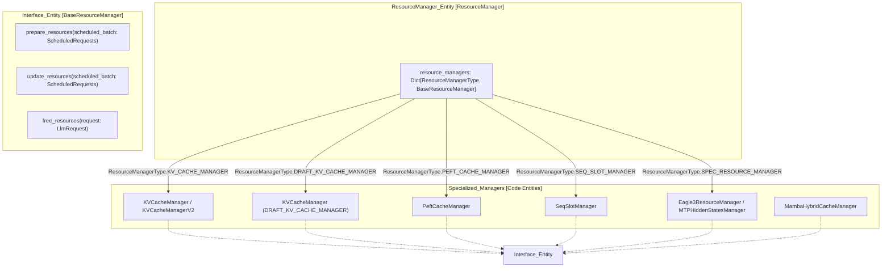
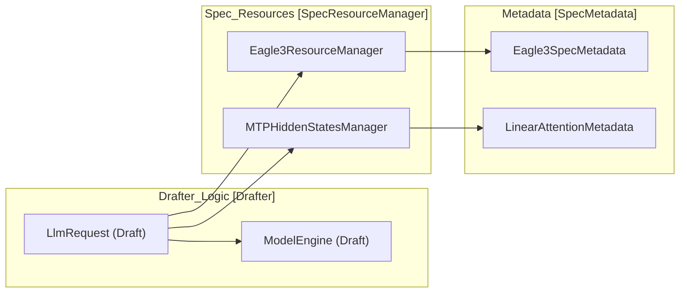

<!-- source: DeepWiki mcp.deepwiki.com · repo NVIDIA/TensorRT-LLM · page 7.2 Resource Management and KV Cache · fetched 2026-10-26 -->

# Resource Management and KV Cache

Relevant source files

The following files were used as context for generating this wiki page:

- [cpp/include/tensorrt_llm/batch_manager/kvCacheManager.h](cpp/include/tensorrt_llm/batch_manager/kvCacheManager.h)
- [cpp/include/tensorrt_llm/batch_manager/llmRequest.h](cpp/include/tensorrt_llm/batch_manager/llmRequest.h)
- [cpp/include/tensorrt_llm/executor/dataTransceiverState.h](cpp/include/tensorrt_llm/executor/dataTransceiverState.h)
- [cpp/include/tensorrt_llm/executor/executor.h](cpp/include/tensorrt_llm/executor/executor.h)
- [cpp/tensorrt_llm/batch_manager/kvCacheManager.cpp](cpp/tensorrt_llm/batch_manager/kvCacheManager.cpp)
- [cpp/tensorrt_llm/batch_manager/llmRequest.cpp](cpp/tensorrt_llm/batch_manager/llmRequest.cpp)
- [cpp/tensorrt_llm/batch_manager/microBatchScheduler.cpp](cpp/tensorrt_llm/batch_manager/microBatchScheduler.cpp)
- [cpp/tensorrt_llm/batch_manager/utils/inflightBatchingUtils.cpp](cpp/tensorrt_llm/batch_manager/utils/inflightBatchingUtils.cpp)
- [cpp/tensorrt_llm/batch_manager/utils/inflightBatchingUtils.h](cpp/tensorrt_llm/batch_manager/utils/inflightBatchingUtils.h)
- [cpp/tensorrt_llm/executor/serialization.cpp](cpp/tensorrt_llm/executor/serialization.cpp)
- [cpp/tensorrt_llm/nanobind/batch_manager/bindings.cpp](cpp/tensorrt_llm/nanobind/batch_manager/bindings.cpp)
- [cpp/tensorrt_llm/nanobind/batch_manager/kvCacheManager.cpp](cpp/tensorrt_llm/nanobind/batch_manager/kvCacheManager.cpp)
- [cpp/tensorrt_llm/nanobind/executor/request.cpp](cpp/tensorrt_llm/nanobind/executor/request.cpp)
- [cpp/tests/unit_tests/batch_manager/capacitySchedulerTest.cpp](cpp/tests/unit_tests/batch_manager/capacitySchedulerTest.cpp)
- [cpp/tests/unit_tests/batch_manager/kvCacheManagerTest.cpp](cpp/tests/unit_tests/batch_manager/kvCacheManagerTest.cpp)
- [cpp/tests/unit_tests/batch_manager/kvCacheUtilsTest.cpp](cpp/tests/unit_tests/batch_manager/kvCacheUtilsTest.cpp)
- [cpp/tests/unit_tests/batch_manager/microBatchSchedulerTest.cpp](cpp/tests/unit_tests/batch_manager/microBatchSchedulerTest.cpp)
- [cpp/tests/unit_tests/executor/serializeUtilsTest.cpp](cpp/tests/unit_tests/executor/serializeUtilsTest.cpp)
- [tensorrt_llm/_torch/pyexecutor/kv_cache_manager_v2.py](tensorrt_llm/_torch/pyexecutor/kv_cache_manager_v2.py)
- [tensorrt_llm/_torch/pyexecutor/mamba_cache_manager.py](tensorrt_llm/_torch/pyexecutor/mamba_cache_manager.py)
- [tensorrt_llm/_torch/pyexecutor/scheduler/scheduler.py](tensorrt_llm/_torch/pyexecutor/scheduler/scheduler.py)
- [tensorrt_llm/_torch/pyexecutor/scheduler/scheduler_v2.py](tensorrt_llm/_torch/pyexecutor/scheduler/scheduler_v2.py)
- [tensorrt_llm/runtime/kv_cache_manager_v2/__init__.py](tensorrt_llm/runtime/kv_cache_manager_v2/__init__.py)
- [tensorrt_llm/runtime/kv_cache_manager_v2/__init__.pyi](tensorrt_llm/runtime/kv_cache_manager_v2/__init__.pyi)
- [tensorrt_llm/runtime/kv_cache_manager_v2/_block_radix_tree.py](tensorrt_llm/runtime/kv_cache_manager_v2/_block_radix_tree.py)
- [tensorrt_llm/runtime/kv_cache_manager_v2/_common.py](tensorrt_llm/runtime/kv_cache_manager_v2/_common.py)
- [tensorrt_llm/runtime/kv_cache_manager_v2/_config.py](tensorrt_llm/runtime/kv_cache_manager_v2/_config.py)
- [tensorrt_llm/runtime/kv_cache_manager_v2/_core/__init__.py](tensorrt_llm/runtime/kv_cache_manager_v2/_core/__init__.py)
- [tensorrt_llm/runtime/kv_cache_manager_v2/_core/_kv_cache.py](tensorrt_llm/runtime/kv_cache_manager_v2/_core/_kv_cache.py)
- [tensorrt_llm/runtime/kv_cache_manager_v2/_core/_kv_cache_manager.py](tensorrt_llm/runtime/kv_cache_manager_v2/_core/_kv_cache_manager.py)
- [tensorrt_llm/runtime/kv_cache_manager_v2/_core/_pending_stats.py](tensorrt_llm/runtime/kv_cache_manager_v2/_core/_pending_stats.py)
- [tensorrt_llm/runtime/kv_cache_manager_v2/_life_cycle_registry.py](tensorrt_llm/runtime/kv_cache_manager_v2/_life_cycle_registry.py)
- [tensorrt_llm/runtime/kv_cache_manager_v2/_page.py](tensorrt_llm/runtime/kv_cache_manager_v2/_page.py)
- [tensorrt_llm/runtime/kv_cache_manager_v2/_storage/_config.py](tensorrt_llm/runtime/kv_cache_manager_v2/_storage/_config.py)
- [tensorrt_llm/runtime/kv_cache_manager_v2/_storage_manager.py](tensorrt_llm/runtime/kv_cache_manager_v2/_storage_manager.py)
- [tensorrt_llm/runtime/kv_cache_manager_v2/_utils.py](tensorrt_llm/runtime/kv_cache_manager_v2/_utils.py)
- [tests/unittest/_torch/executor/test_dual_pool_kv_cache.py](tests/unittest/_torch/executor/test_dual_pool_kv_cache.py)
- [tests/unittest/_torch/executor/test_kv_cache_estimation.py](tests/unittest/_torch/executor/test_kv_cache_estimation.py)
- [tests/unittest/_torch/executor/test_kv_cache_manager_v2.py](tests/unittest/_torch/executor/test_kv_cache_manager_v2.py)
- [tests/unittest/_torch/executor/test_kv_cache_manager_v2_helix_superblock.py](tests/unittest/_torch/executor/test_kv_cache_manager_v2_helix_superblock.py)
- [tests/unittest/_torch/executor/test_kv_cache_v2_capacity_only.py](tests/unittest/_torch/executor/test_kv_cache_v2_capacity_only.py)
- [tests/unittest/_torch/executor/test_kv_cache_v2_scheduler.py](tests/unittest/_torch/executor/test_kv_cache_v2_scheduler.py)
- [tests/unittest/_torch/executor/test_mamba_cache_manager.py](tests/unittest/_torch/executor/test_mamba_cache_manager.py)
- [tests/unittest/_torch/executor/test_py_scheduler.py](tests/unittest/_torch/executor/test_py_scheduler.py)
- [tests/unittest/bindings/test_bindings_ut.py](tests/unittest/bindings/test_bindings_ut.py)
- [tests/unittest/bindings/test_executor_bindings.py](tests/unittest/bindings/test_executor_bindings.py)
- [tests/unittest/kv_cache_manager_v2_tests/fake_engine.py](tests/unittest/kv_cache_manager_v2_tests/fake_engine.py)
- [tests/unittest/kv_cache_manager_v2_tests/test_kv_cache_manager_v2.py](tests/unittest/kv_cache_manager_v2_tests/test_kv_cache_manager_v2.py)
- [tests/unittest/kv_cache_manager_v2_tests/test_kv_cache_stats_behavior.py](tests/unittest/kv_cache_manager_v2_tests/test_kv_cache_stats_behavior.py)

## Purpose and Scope

This document describes the resource management system in TensorRT-LLM's PyExecutor runtime, focusing on the `ResourceManager` architecture, KV cache implementations (V1 and V2), and specialized resource handling for speculative decoding and hybrid models.

Key resources managed include:
- **KV Cache**: Stores attention key-value pairs for transformer models.
- **Mamba Cache**: Manages state for RNN/SSM layers in hybrid models (e.g., Jamba, Nemotron-Hybrid, Qwen3).
- **PEFT Cache**: Manages LoRA adapter parameters and memory.
- **Sequence Slots**: Tracks active request slots for mapping to hardware resources.
- **Speculative Decoding Resources**: Specialized buffers for draft/target model coordination (e.g., EAGLE3, MTP).

For information about the PyExecutor event loop and request scheduling, see [7.1](). For model engine and forward pass execution, see [7.3]().

---

## Resource Manager Architecture

### ResourceManager and ResourceManagerType

The `ResourceManager` class serves as a container that holds multiple specialized resource managers, each identified by a `ResourceManagerType` enum value [tensorrt_llm/_torch/pyexecutor/resource_manager.py:99-107](). It coordinates resource allocation, updates, and freeing across different subsystems through the `BaseResourceManager` interface [tensorrt_llm/_torch/pyexecutor/resource_manager.py:143-168]().

**Resource Manager Types:**

| Type | Purpose | Manager Class |
|------|---------|---------------|
| `KV_CACHE_MANAGER` | Main KV cache for target model | `KVCacheManager` or `KVCacheManagerV2` |
| `DRAFT_KV_CACHE_MANAGER` | Separate KV cache for draft model | `KVCacheManager` or `KVCacheManagerV2` |
| `PEFT_CACHE_MANAGER` | Manages LoRA adapter parameters | `PeftCacheManager` |
| `SEQ_SLOT_MANAGER` | Allocates sequence slots for requests | `SeqSlotManager` |
| `SPEC_RESOURCE_MANAGER` | Resources for speculative algorithms | `Eagle3ResourceManager`, `MTPHiddenStatesManager`, etc. |
| `KV_CACHE_COMPRESSION_MANAGER` | Manages compressed KV cache states | `KVCacheCompressionManager` |

**Sources:** [tensorrt_llm/_torch/pyexecutor/resource_manager.py:99-107](), [tensorrt_llm/_torch/pyexecutor/resource_manager.py:143-168]()

### ResourceManager Container Structure

The following diagram bridges the Natural Language concepts of resource management to the specific code entities in the `pyexecutor` package.

**Natural Language to Code Entity Space: ResourceManager**

**Sources:** [tensorrt_llm/_torch/pyexecutor/resource_manager.py:99-168](), [tensorrt_llm/_torch/pyexecutor/mamba_cache_manager.py:35-38]()

---

## KV Cache Management

### KVCacheManager vs KVCacheManagerV2

TensorRT-LLM provides two primary KV cache implementations. The choice is determined by model requirements (e.g., hybrid layers or per-layer head_dim) and the `use_kv_cache_manager_v2` flag in `KvCacheConfig` [tensorrt_llm/_torch/pyexecutor/kv_cache_manager_v2.py:41-43]().

| Feature | KVCacheManager (V1) | KVCacheManagerV2 |
|---------|---------------------|------------------|
| **Core Class** | `KVCacheManager` (C++ Bindings) [cpp/tensorrt_llm/batch_manager/kvCacheManager.cpp:18-20]() | `KVCacheManagerV2` (Python/C++) [tensorrt_llm/_torch/pyexecutor/kv_cache_manager_v2.py:31-32]() |
| **Memory Model** | Pre-allocated GPU pools [cpp/include/tensorrt_llm/batch_manager/kvCacheManager.h:139-144]() | Multi-tier (GPU/Host/Disk) [tensorrt_llm/runtime/kv_cache_manager_v2/_common.py:63-66]() |
| **Prefix Caching** | `RadixBlockTree` (C++) [cpp/tensorrt_llm/batch_manager/kvCacheManager.cpp:24]() | `BlockRadixTree` (Python/C++) [tensorrt_llm/runtime/kv_cache_manager_v2/_block_radix_tree.py:26-27]() |
| **Role Support** | Key/Value | Key/Value/BlockScales/IndexKey [tensorrt_llm/_torch/pyexecutor/kv_cache_manager_v2.py:126-138]() |

**Sources:** [cpp/tensorrt_llm/batch_manager/kvCacheManager.cpp:1-50](), [tensorrt_llm/_torch/pyexecutor/kv_cache_manager_v2.py:1-140](), [tensorrt_llm/runtime/kv_cache_manager_v2/_core/_kv_cache.py:93-128]()

### Mamba and Hybrid Cache Management

For models combining Attention and Mamba layers, specialized managers handle the state across both domains [tensorrt_llm/_torch/pyexecutor/mamba_cache_manager.py:32-38]().

- **CppMambaHybridCacheManager**: C++ implementation for hybrid models [tensorrt_llm/_torch/pyexecutor/mamba_cache_manager.py:34-35]().
- **MambaHybridCacheManagerV2**: Leverages the V2 architecture to manage `ssm_state` and `conv_state` as specific `DataRole` types [tensorrt_llm/_torch/pyexecutor/mamba_cache_manager.py:122-128]().
- **Replay Kernels**: Mamba SSM state updates use a replay kernel mechanism with `MIN_REPLAY_HISTORY_SIZE` set to 16 for Tensor Core alignment [tensorrt_llm/_torch/pyexecutor/mamba_cache_manager.py:69-70]().

**Sources:** [tensorrt_llm/_torch/pyexecutor/mamba_cache_manager.py:32-130](), [tensorrt_llm/runtime/kv_cache_manager_v2/__init__.py:53-56]()

---

## Speculative Decoding Resources

Speculative decoding requires tracking auxiliary state (hidden states, draft tokens, trees) across multiple forward passes.

### EAGLE3 Resource Management
`Eagle3ResourceManager` manages hidden states captured from target model layers to feed the draft model. It uses specialized acceptance logic to determine which draft tokens are kept [tests/unittest/_torch/executor/test_mamba_cache_manager.py:32-35]().

### MTP (Multi-Token Prediction)
MTP resources manage prediction state used by MTP modules. The `_get_num_cuda_graph_padding_dummy_slots` function calculates the number of persistent CUDA-graph padding dummy IDs needed based on the `draft_len_schedule` [tensorrt_llm/_torch/pyexecutor/mamba_cache_manager.py:72-120]().

**Natural Language to Code Entity Space: Speculative Decoding**

**Sources:** [tensorrt_llm/_torch/pyexecutor/mamba_cache_manager.py:42-43](), [tests/unittest/_torch/executor/test_mamba_cache_manager.py:107-134]()

---

## KV Cache Connector and Prefix Caching

### Prefix Caching Implementation
Prefix caching allows reusing KV cache blocks for identical prompt prefixes. 
- In V1, this is handled by `RadixBlockTree` which manages `KVCacheBlock` objects [cpp/tensorrt_llm/batch_manager/kvCacheManager.cpp:24]().
- The `analyzePrefixReuse` function determines the number of tokens that can be reused from existing blocks [cpp/tensorrt_llm/nanobind/batch_manager/kvCacheManager.cpp:187-191]().

### KV Cache Connector
The `KvCacheConnectorManager` facilitates the movement of KV cache data, particularly for disaggregated serving where the context and generation phases may happen on different nodes [tensorrt_llm/_torch/pyexecutor/kv_cache_manager_v2.py:87]().

**Sources:** [cpp/tensorrt_llm/batch_manager/kvCacheManager.cpp:63-91](), [tensorrt_llm/_torch/pyexecutor/kv_cache_manager_v2.py:87](), [cpp/include/tensorrt_llm/batch_manager/kvCacheManager.h:187-191]()

---

## Memory Monitoring and Allocation

The `KVCacheManager` tracks allocation through `KvCacheStats` and `KvCacheIterationStats` [cpp/include/tensorrt_llm/batch_manager/kvCacheManager.h:105-113]().

**Key Metrics:**
- `numTotalAllocatedBlocks`: Total blocks currently in use [cpp/tensorrt_llm/executor/serialization.cpp:94]().
- `numReusedBlocks`: Blocks successfully reused via prefix caching [cpp/tensorrt_llm/executor/serialization.cpp:96]().
- `kvCacheHitRate`: The ratio of reused blocks to total requested blocks [cpp/tensorrt_llm/executor/serialization.cpp:98]().

**Sources:** [cpp/tensorrt_llm/executor/serialization.cpp:83-115](), [cpp/include/tensorrt_llm/batch_manager/kvCacheManager.h:105-113]()

---

