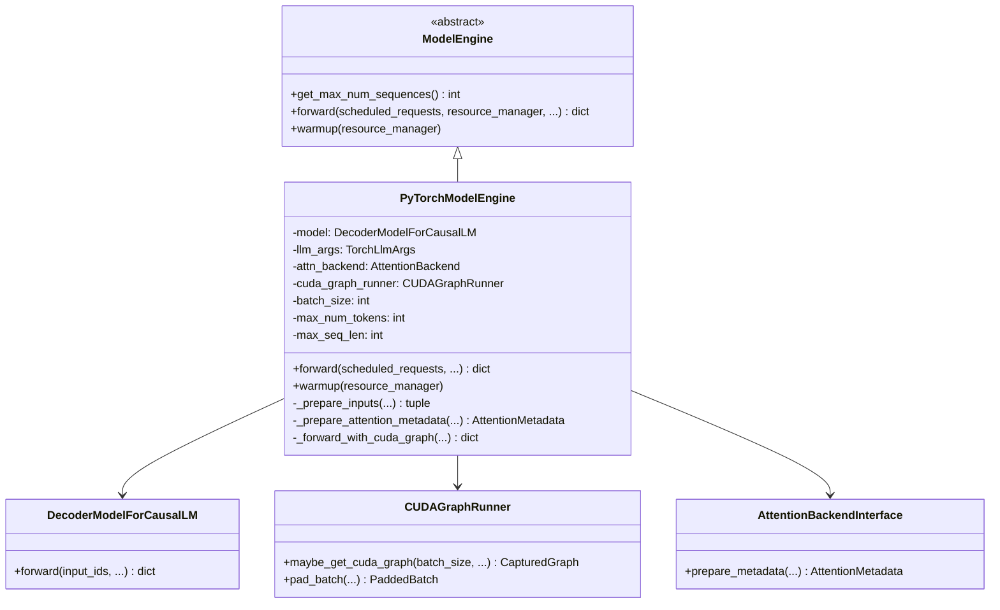
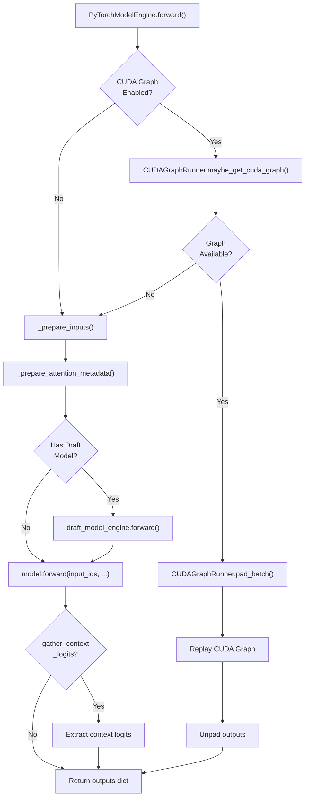
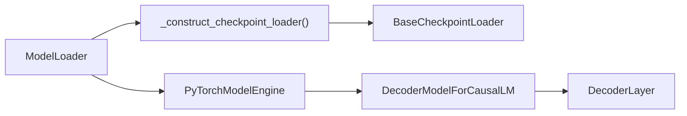

<!-- source: DeepWiki mcp.deepwiki.com · repo NVIDIA/TensorRT-LLM · page 7.3 ModelEngine and Forward Pass Execution · fetched 2026-10-26 -->

# ModelEngine and Forward Pass Execution

Relevant source files

The following files were used as context for generating this wiki page:

- [cpp/tensorrt_llm/kernels/minimaxM3Fp8IndexerKernel.cu](cpp/tensorrt_llm/kernels/minimaxM3Fp8IndexerKernel.cu)
- [cpp/tensorrt_llm/kernels/minimaxM3Fp8IndexerKernel.h](cpp/tensorrt_llm/kernels/minimaxM3Fp8IndexerKernel.h)
- [cpp/tensorrt_llm/thop/minimaxM3Fp8IndexerOp.cpp](cpp/tensorrt_llm/thop/minimaxM3Fp8IndexerOp.cpp)
- [docs/source/developer-guide/telemetry.md](docs/source/developer-guide/telemetry.md)
- [docs/source/features/model-express.md](docs/source/features/model-express.md)
- [tensorrt_llm/_torch/models/checkpoints/mx/checkpoint_loader.py](tensorrt_llm/_torch/models/checkpoints/mx/checkpoint_loader.py)
- [tensorrt_llm/_torch/peft/lora/config.py](tensorrt_llm/_torch/peft/lora/config.py)
- [tensorrt_llm/_torch/peft/lora/cuda_graph_lora_manager.py](tensorrt_llm/_torch/peft/lora/cuda_graph_lora_manager.py)
- [tensorrt_llm/_torch/pyexecutor/_util.py](tensorrt_llm/_torch/pyexecutor/_util.py)
- [tensorrt_llm/_torch/pyexecutor/cuda_graph_runner.py](tensorrt_llm/_torch/pyexecutor/cuda_graph_runner.py)
- [tensorrt_llm/_torch/pyexecutor/llm_request.py](tensorrt_llm/_torch/pyexecutor/llm_request.py)
- [tensorrt_llm/_torch/pyexecutor/model_engine.py](tensorrt_llm/_torch/pyexecutor/model_engine.py)
- [tensorrt_llm/_torch/pyexecutor/model_loader.py](tensorrt_llm/_torch/pyexecutor/model_loader.py)
- [tensorrt_llm/_torch/pyexecutor/py_executor.py](tensorrt_llm/_torch/pyexecutor/py_executor.py)
- [tensorrt_llm/_torch/pyexecutor/py_executor_creator.py](tensorrt_llm/_torch/pyexecutor/py_executor_creator.py)
- [tensorrt_llm/_torch/pyexecutor/resource_manager.py](tensorrt_llm/_torch/pyexecutor/resource_manager.py)
- [tensorrt_llm/_torch/weight_sharing/__init__.py](tensorrt_llm/_torch/weight_sharing/__init__.py)
- [tensorrt_llm/_torch/weight_sharing/artifact_identity.py](tensorrt_llm/_torch/weight_sharing/artifact_identity.py)
- [tensorrt_llm/_torch/weight_sharing/post_transform_profiles.py](tensorrt_llm/_torch/weight_sharing/post_transform_profiles.py)
- [tensorrt_llm/_torch/weight_sharing/source_identity.py](tensorrt_llm/_torch/weight_sharing/source_identity.py)
- [tensorrt_llm/commands/serve.py](tensorrt_llm/commands/serve.py)
- [tensorrt_llm/llmapi/llm_args.py](tensorrt_llm/llmapi/llm_args.py)
- [tensorrt_llm/usage/llm_args_golden_manifest.json](tensorrt_llm/usage/llm_args_golden_manifest.json)
- [tests/integration/defs/kv_cache/test_final_single_token_context_cuda_graph.py](tests/integration/defs/kv_cache/test_final_single_token_context_cuda_graph.py)
- [tests/unittest/_torch/executor/test_benchmark_disagg.py](tests/unittest/_torch/executor/test_benchmark_disagg.py)
- [tests/unittest/_torch/executor/test_disagg_fill_gate_stall_bound.py](tests/unittest/_torch/executor/test_disagg_fill_gate_stall_bound.py)
- [tests/unittest/_torch/executor/test_model_loader_gms.py](tests/unittest/_torch/executor/test_model_loader_gms.py)
- [tests/unittest/_torch/executor/test_model_loader_mx.py](tests/unittest/_torch/executor/test_model_loader_mx.py)
- [tests/unittest/_torch/executor/test_multimodal_scheduler.py](tests/unittest/_torch/executor/test_multimodal_scheduler.py)
- [tests/unittest/_torch/executor/test_py_executor.py](tests/unittest/_torch/executor/test_py_executor.py)
- [tests/unittest/_torch/executor/test_pytorch_model_engine.py](tests/unittest/_torch/executor/test_pytorch_model_engine.py)
- [tests/unittest/_torch/executor/test_pytorch_model_engine_warmup.py](tests/unittest/_torch/executor/test_pytorch_model_engine_warmup.py)
- [tests/unittest/_torch/executor/test_seq_slot_sizing.py](tests/unittest/_torch/executor/test_seq_slot_sizing.py)
- [tests/unittest/_torch/misc/test_moe_a2a_warmup_timeout.py](tests/unittest/_torch/misc/test_moe_a2a_warmup_timeout.py)
- [tests/unittest/_torch/models/checkpoints/mx/test_mx_checkpoint_loader.py](tests/unittest/_torch/models/checkpoints/mx/test_mx_checkpoint_loader.py)
- [tests/unittest/_torch/modules/tests_lora_modules/test_qwen3_sanity.py](tests/unittest/_torch/modules/tests_lora_modules/test_qwen3_sanity.py)
- [tests/unittest/_torch/weight_sharing/_source_identity_fakes.py](tests/unittest/_torch/weight_sharing/_source_identity_fakes.py)
- [tests/unittest/_torch/weight_sharing/test_artifact_identity.py](tests/unittest/_torch/weight_sharing/test_artifact_identity.py)
- [tests/unittest/_torch/weight_sharing/test_gms_source_identity_gate.py](tests/unittest/_torch/weight_sharing/test_gms_source_identity_gate.py)
- [tests/unittest/_torch/weight_sharing/test_mx_source_identity_gate.py](tests/unittest/_torch/weight_sharing/test_mx_source_identity_gate.py)
- [tests/unittest/_torch/weight_sharing/test_post_transform_profiles.py](tests/unittest/_torch/weight_sharing/test_post_transform_profiles.py)
- [tests/unittest/_torch/weight_sharing/test_source_identity.py](tests/unittest/_torch/weight_sharing/test_source_identity.py)
- [tests/unittest/api_stability/references/llm.yaml](tests/unittest/api_stability/references/llm.yaml)
- [tests/unittest/api_stability/references/trtllm_serve_cli.yaml](tests/unittest/api_stability/references/trtllm_serve_cli.yaml)
- [tests/unittest/llmapi/test_llm_args.py](tests/unittest/llmapi/test_llm_args.py)
- [tests/unittest/utils/post_transform_qualification.py](tests/unittest/utils/post_transform_qualification.py)

## Purpose and Scope

This page documents the `ModelEngine` component and its role in executing forward passes through LLM models during inference. The `ModelEngine` is responsible for:

- Orchestrating model forward passes with properly prepared inputs.
- Managing CUDA graphs for optimized execution and low-latency replay.
- Preparing attention metadata for different attention backends (TRTLLM, FlashInfer, Vanilla).
- Handling special execution modes including speculative decoding (EAGLE3, MTP), beam search, and multimodal inputs.
- Coordinating warmup, compilation, and autotuning.

For information about how the PyExecutor schedules requests and calls the ModelEngine, see [PyExecutor Event Loop and Request Scheduling](7.1). For resource management details, see [Resource Management and KV Cache](7.2). For what happens after the forward pass, see [Sampler and Token Generation](7.4).

---

## ModelEngine Architecture

The `ModelEngine` serves as an abstraction layer between the `PyExecutor` and the underlying model implementation, enabling different execution strategies to coexist.

### ModelEngine Class Hierarchy
`ModelEngine` and `PyTorchModelEngine` are the primary entities in the code space.

**Sources:**
- [tensorrt_llm/_torch/pyexecutor/model_engine.py:12-14]()
- [tensorrt_llm/_torch/pyexecutor/model_engine.py:95-118]()
- [tensorrt_llm/_torch/models/modeling_utils.py:61-64]()
- [tensorrt_llm/_torch/pyexecutor/cuda_graph_runner.py:130-137]()
- [tensorrt_llm/_torch/attention_backend/interface.py:48-52]()

### PyTorchModelEngine Implementation

`PyTorchModelEngine` is the primary implementation, supporting PyTorch-based models with extensive optimization features. It maintains references to the `DecoderModelForCausalLM` and handles the mapping of high-level request objects to low-level tensors.

**Key Attributes:**
- `model`: The actual transformer model, typically an instance of `DecoderModelForCausalLM` [tensorrt_llm/_torch/pyexecutor/model_engine.py:67]().
- `attn_backend`: Selected attention implementation (TRTLLM, FlashInfer, or Vanilla) determined via `get_attention_backend` [tensorrt_llm/_torch/pyexecutor/model_engine.py:51]().
- `cuda_graph_runner`: Manages CUDA graph capture and replay for performance optimization [tensorrt_llm/_torch/pyexecutor/model_engine.py:84-89]().
- `spec_config`: Configuration for speculative decoding modes (EAGLE, MTP, etc.) [tensorrt_llm/_torch/pyexecutor/model_engine.py:72-77]().

**Sources:**
- [tensorrt_llm/_torch/pyexecutor/model_engine.py:95-118]()
- [tensorrt_llm/_torch/pyexecutor/_util.py:70-70]()

---

## Forward Pass Execution Flow

The forward pass is the core operation that processes scheduled requests through the model. The flow varies depending on whether CUDA graphs are enabled and whether the batch qualifies for graph execution.

### Forward Execution Logic
This diagram maps the natural language execution flow to the internal private methods of `PyTorchModelEngine`.

**Sources:**
- [tensorrt_llm/_torch/pyexecutor/model_engine.py:102-109]()
- [tensorrt_llm/_torch/pyexecutor/model_engine.py:1056-1140]()

### Main Forward Method

The `forward()` method signature in `PyTorchModelEngine`:
[tensorrt_llm/_torch/pyexecutor/model_engine.py:102-109]()

**Key Steps:**
1. **CUDA Graph Eligibility**: The engine checks if the current batch size and request types (e.g., decode-only) allow for a graph replay. Graphs are generally used for generation-only phases.
2. **Input Preparation**: If no graph is found or the request is in the context phase, it constructs `input_ids` and `position_ids`.
3. **Attention Metadata**: Prepares `AttentionMetadata` which contains KV cache pointers, sequence lengths, and block offsets [tensorrt_llm/_torch/pyexecutor/model_engine.py:48-52]().
4. **Draft Model Execution**: For speculative decoding, the draft model engine may be executed first to generate candidate tokens [tensorrt_llm/_torch/pyexecutor/model_engine.py:1160-1170]().

**Sources:**
- [tensorrt_llm/_torch/pyexecutor/model_engine.py:95-109]()
- [tensorrt_llm/_torch/pyexecutor/model_engine.py:48-52]()

---

## Input Preparation and Model Loading

The `ModelLoader` class handles the instantiation of models and their associated engines. It coordinates the checkpoint loading and weight mapping process.

### Model Loader and Checkpoints
The system uses a registry to map model names to specific architecture classes and checkpoint loaders.

**Sources:**
- [tensorrt_llm/_torch/pyexecutor/model_loader.py:98-98]()
- [tensorrt_llm/_torch/pyexecutor/model_engine.py:98-98]()
- [tensorrt_llm/_torch/pyexecutor/py_executor_creator.py:48-50]()

### Prepared Tensors

| Tensor | Code Entity / Description |
|--------|---------------------------|
| `input_ids` | Token IDs for the current iteration. |
| `position_ids` | Positional indices, handles mRoPE for multimodal models [tensorrt_llm/_torch/pyexecutor/model_engine.py:95-98](). |
| `seq_slots` | Indices mapping requests to KV cache slots. |
| `multimodal_params` | Parameters for vision/audio inputs [tensorrt_llm/_torch/pyexecutor/model_engine.py:30-34](). |

**Sources:**
- [tensorrt_llm/_torch/pyexecutor/model_engine.py:30-34]()
- [tensorrt_llm/_torch/pyexecutor/model_engine.py:95-98]()

### Position ID Computation
For standard causal LLMs, position IDs are sequential. However, for speculative decoding or multimodal models, the logic becomes more complex:
- **Speculative Decoding**: Position IDs must account for accepted/rejected draft tokens to ensure correct causal masking and RoPE.
- **mRoPE**: Used in models like Qwen2-VL to handle spatial (width, height) and temporal (time) dimensions in images/videos [tensorrt_llm/_torch/pyexecutor/model_engine.py:30-34]().

**Sources:**
- [tensorrt_llm/_torch/pyexecutor/model_engine.py:30-34]()
- [tensorrt_llm/_torch/pyexecutor/model_engine.py:63-66]()

---

## CUDA Graph Integration

CUDA graphs are managed by the `CUDAGraphRunner` to minimize CPU-to-GPU launch overhead during the decoding phase.

### Eligibility and Replay
A batch qualifies for CUDA graph execution when it consists solely of generation requests and the batch size matches a pre-captured graph size. Context-phase requests (prefill) typically do not use CUDA graphs due to variable sequence lengths.

### Batch Padding
If the current batch size is smaller than the next available captured graph size, the `CUDAGraphRunner` performs padding using dummy requests.
- **Dummy Requests**: Requests with ID `CUDA_GRAPH_DUMMY_REQUEST_ID` are used for padding during graph capture and execution [tensorrt_llm/_torch/pyexecutor/cuda_graph_runner.py:33]().
- **Unpadding**: After the graph is replayed, the engine extracts the results (logits/tokens) only for the real requests.

**Sources:**
- [tensorrt_llm/_torch/pyexecutor/cuda_graph_runner.py:130-160]()
- [tensorrt_llm/_torch/pyexecutor/llm_request.py:56-56]()

---

## Warmup and Compilation

The `warmup()` method is critical for performance as it triggers kernel autotuning and CUDA graph capture.

1. **Autotuning**: The `AutoTuner` profiles different kernel configurations (e.g., GEMM tile sizes) to select the fastest implementation for the current hardware [tensorrt_llm/_torch/pyexecutor/model_engine.py:53]().
2. **Torch Compile**: If `TorchCompileConfig` is provided, `torch.compile` is invoked on the model's forward pass to generate optimized kernels [tensorrt_llm/_torch/pyexecutor/model_engine.py:44]().
3. **Graph Capture**: The engine iterates through configured batch sizes (from `CudaGraphConfig`) and executes dummy forward passes to capture CUDA graphs [tensorrt_llm/_torch/pyexecutor/model_engine.py:39-44]().

**Sources:**
- [tensorrt_llm/_torch/pyexecutor/model_engine.py:53-53]()
- [tensorrt_llm/_torch/pyexecutor/model_engine.py:39-44]()
- [tensorrt_llm/llmapi/llm_args.py:98-105]()

---

## Speculative Decoding Support

`ModelEngine` orchestrates complex flows for speculative decoding, specifically for EAGLE3 and MTP.

### One-Model Speculative Decoding
In modes like `EAGLE3_ONE_MODEL`, a single model engine handles both the target verification and the draft generation in a single forward pass or interleaved passes.
- **SpecMetadata**: Contains metadata required for speculative verification [tensorrt_llm/_torch/pyexecutor/model_engine.py:72-77]().
- **Accepted Tokens**: The engine uses speculative state to update the KV cache based on which draft tokens were correct [tensorrt_llm/_torch/pyexecutor/model_engine.py:80-83]().

### Draft Replay Logic
When using a separate draft KV cache, the engine must swap metadata before replaying a graph.
- `prepare_attn_metadata_for_draft_replay()`: Swaps the `kv_cache_manager` in the attention metadata to the draft manager [tensorrt_llm/_torch/pyexecutor/model_engine.py:74]().
- `restore_attn_metadata_after_draft_replay()`: Restores the target KV cache manager after the draft forward [tensorrt_llm/_torch/pyexecutor/model_engine.py:75]().

**Sources:**
- [tensorrt_llm/_torch/pyexecutor/model_engine.py:72-83]()
- [tensorrt_llm/_torch/pyexecutor/model_engine.py:63-66]()

---

## Performance Considerations

### Memory Monitoring
The `_ExecutorMemoryMonitor` tracks GPU memory usage across different stages of model engine creation (e.g., `MODEL_ENGINE_MAIN`, `KV_CACHE`) and provides diagnostic information if an Out-of-Memory (OOM) error occurs [tensorrt_llm/_torch/pyexecutor/py_executor_creator.py:61-127]().

### Multi-Token Queries
For speculative decoding, the engine supports processing multiple tokens per sequence in a single iteration. This requires the attention backend to handle `AttentionMetadata` with extra tokens to correctly index into the KV cache during EAGLE3 or MTP passes [tensorrt_llm/_torch/pyexecutor/model_engine.py:48-52]().

**Sources:**
- [tensorrt_llm/_torch/pyexecutor/py_executor_creator.py:61-127]()
- [tensorrt_llm/_torch/pyexecutor/model_engine.py:48-52]()

---

