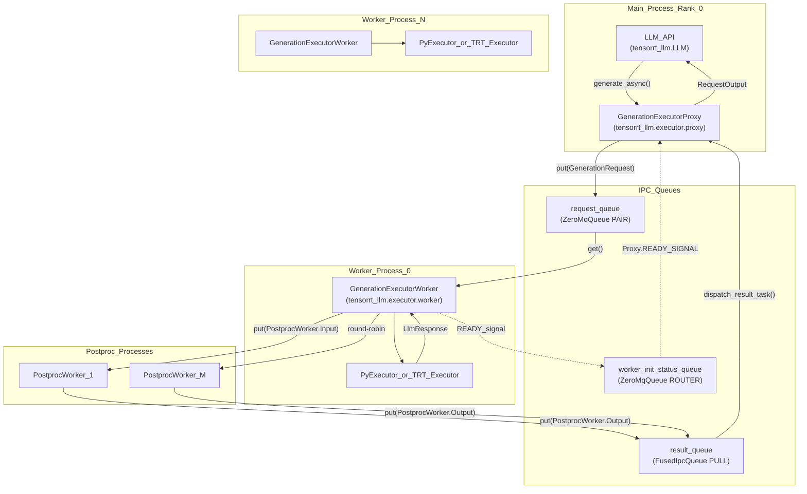
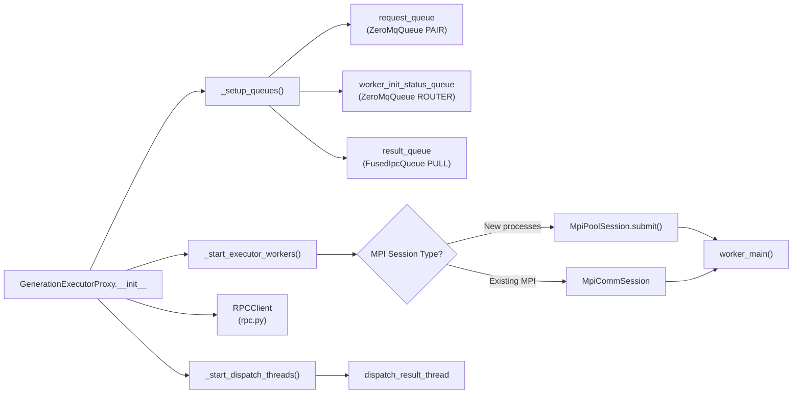
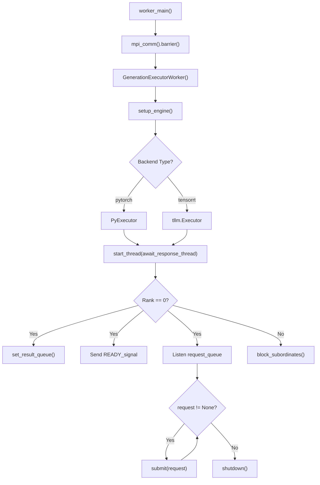
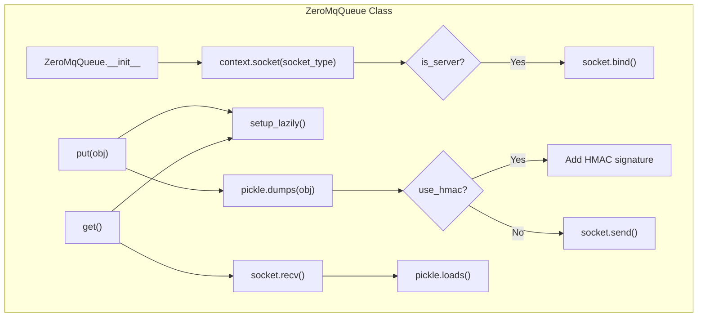
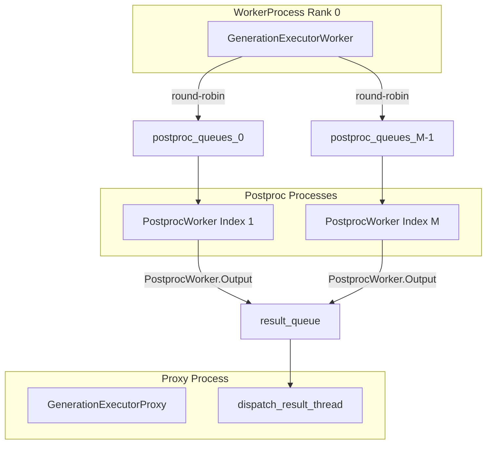
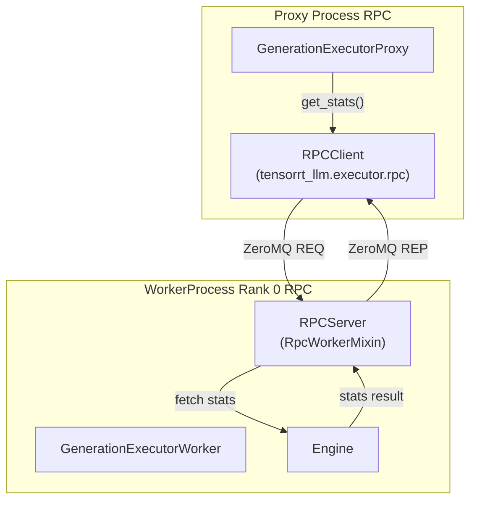

<!-- source: DeepWiki mcp.deepwiki.com · repo NVIDIA/TensorRT-LLM · page 7.5 Proxy-Worker Architecture and IPC · fetched 2026-10-26 -->

# Proxy-Worker Architecture and IPC

Relevant source files

The following files were used as context for generating this wiki page:

- [cpp/include/tensorrt_llm/runtime/worldConfig.h](cpp/include/tensorrt_llm/runtime/worldConfig.h)
- [cpp/tensorrt_llm/runtime/worldConfig.cpp](cpp/tensorrt_llm/runtime/worldConfig.cpp)
- [cpp/tensorrt_llm/thop/ncclCommunicatorOp.cpp](cpp/tensorrt_llm/thop/ncclCommunicatorOp.cpp)
- [cpp/tensorrt_llm/thop/ncclCommunicatorOp.h](cpp/tensorrt_llm/thop/ncclCommunicatorOp.h)
- [cpp/tests/unit_tests/runtime/worldConfigTest.cpp](cpp/tests/unit_tests/runtime/worldConfigTest.cpp)
- [tensorrt_llm/_torch/device_mesh.py](tensorrt_llm/_torch/device_mesh.py)
- [tensorrt_llm/_torch/distributed/communicator.py](tensorrt_llm/_torch/distributed/communicator.py)
- [tensorrt_llm/_torch/pyexecutor/executor_request_queue.py](tensorrt_llm/_torch/pyexecutor/executor_request_queue.py)
- [tensorrt_llm/executor/__init__.py](tensorrt_llm/executor/__init__.py)
- [tensorrt_llm/executor/base_worker.py](tensorrt_llm/executor/base_worker.py)
- [tensorrt_llm/executor/executor.py](tensorrt_llm/executor/executor.py)
- [tensorrt_llm/executor/ipc.py](tensorrt_llm/executor/ipc.py)
- [tensorrt_llm/executor/postproc_worker.py](tensorrt_llm/executor/postproc_worker.py)
- [tensorrt_llm/executor/proxy.py](tensorrt_llm/executor/proxy.py)
- [tensorrt_llm/executor/request.py](tensorrt_llm/executor/request.py)
- [tensorrt_llm/executor/result.py](tensorrt_llm/executor/result.py)
- [tensorrt_llm/executor/utils.py](tensorrt_llm/executor/utils.py)
- [tensorrt_llm/executor/worker.py](tensorrt_llm/executor/worker.py)
- [tensorrt_llm/llmapi/llm.py](tensorrt_llm/llmapi/llm.py)
- [tensorrt_llm/llmapi/mgmn_leader_node.py](tensorrt_llm/llmapi/mgmn_leader_node.py)
- [tensorrt_llm/llmapi/mpi_session.py](tensorrt_llm/llmapi/mpi_session.py)
- [tensorrt_llm/llmapi/trtllm-llmapi-launch](tensorrt_llm/llmapi/trtllm-llmapi-launch)
- [tensorrt_llm/mapping.py](tensorrt_llm/mapping.py)
- [tests/unittest/_torch/distributed/test_safe_mpi_comm.py](tests/unittest/_torch/distributed/test_safe_mpi_comm.py)
- [tests/unittest/_torch/executor/test_executor_request_queue.py](tests/unittest/_torch/executor/test_executor_request_queue.py)
- [tests/unittest/_torch/executor/test_router_dealer_ipc.py](tests/unittest/_torch/executor/test_router_dealer_ipc.py)
- [tests/unittest/executor/test_ipc.py](tests/unittest/executor/test_ipc.py)
- [tests/unittest/executor/test_launcher_envs.py](tests/unittest/executor/test_launcher_envs.py)
- [tests/unittest/executor/test_proxy_fast_death.py](tests/unittest/executor/test_proxy_fast_death.py)
- [tests/unittest/llmapi/_run_mpi_comm_task.py](tests/unittest/llmapi/_run_mpi_comm_task.py)
- [tests/unittest/llmapi/_run_multi_llm_tasks.py](tests/unittest/llmapi/_run_multi_llm_tasks.py)
- [tests/unittest/llmapi/_run_multi_mpi_comm_tasks.py](tests/unittest/llmapi/_run_multi_mpi_comm_tasks.py)
- [tests/unittest/llmapi/lora_test_utils.py](tests/unittest/llmapi/lora_test_utils.py)
- [tests/unittest/llmapi/test_executor.py](tests/unittest/llmapi/test_executor.py)
- [tests/unittest/llmapi/test_llm.py](tests/unittest/llmapi/test_llm.py)
- [tests/unittest/llmapi/test_llm_multi_gpu_pytorch.py](tests/unittest/llmapi/test_llm_multi_gpu_pytorch.py)
- [tests/unittest/llmapi/test_llm_pytorch.py](tests/unittest/llmapi/test_llm_pytorch.py)

This page documents the proxy-worker architecture used in TensorRT-LLM's execution system, the inter-process communication (IPC) mechanisms that connect components, and the process orchestration strategies. This architecture enables multi-GPU inference by distributing work across worker processes that communicate via ZeroMQ queues.

**Scope**: This page covers `GenerationExecutorProxy`, `GenerationExecutorWorker`, IPC queue implementations, MPI session types, and the message flow between components. For the PyExecutor runtime details, see [7. PyExecutor Runtime System](). For the overall execution flow and request handling, see [7.1. PyExecutor Event Loop and Request Scheduling]().

---

## Architecture Overview

The proxy-worker architecture separates request orchestration (proxy) from inference execution (workers). The proxy runs in the main Python process and manages request distribution, while workers run in separate processes (potentially on different GPUs) and execute the actual model inference.

### Component Hierarchy

**Sources**: [tensorrt_llm/executor/proxy.py:99-120](), [tensorrt_llm/executor/worker.py:37-136](), [tensorrt_llm/executor/executor.py:83-117](), [tensorrt_llm/executor/postproc_worker.py:60-85]()

---

## GenerationExecutorProxy

The `GenerationExecutorProxy` class orchestrates multi-process inference by managing worker processes and routing requests/responses. It inherits from `GenerationExecutor` [tensorrt_llm/executor/proxy.py:99]().

### Proxy Initialization

The proxy is responsible for:
1. Setting up IPC queues for communication via `_setup_queues()` [tensorrt_llm/executor/proxy.py:402-430]().
2. Spawning or connecting to worker processes via MPI sessions [tensorrt_llm/executor/proxy.py:128-141]().
3. Starting background threads for result dispatch [tensorrt_llm/executor/proxy.py:194-198]().
4. Managing RPC communication for stats/events using an `RPCClient` [tensorrt_llm/executor/proxy.py:165]().

**Key Methods**:

| Method | Purpose | Location |
|--------|---------|----------|
| `_setup_queues()` | Creates IPC queues for request/result/status | [tensorrt_llm/executor/proxy.py:402-430]() |
| `_start_executor_workers()` | Spawns worker processes via MPI | [tensorrt_llm/executor/proxy.py:432-491]() |
| `submit()` | Submits a generation request | [tensorrt_llm/executor/proxy.py:570-598]() |
| `dispatch_result_task()` | Background thread that routes results to futures | [tensorrt_llm/executor/proxy.py:614-681]() |
| `abort_request()` | Cancels an in-flight request via `CancellingRequest` | [tensorrt_llm/executor/proxy.py:599-612]() |

**Sources**: [tensorrt_llm/executor/proxy.py:99-681](), [tensorrt_llm/executor/request.py:26-26]()

---

## GenerationExecutorWorker

The `GenerationExecutorWorker` runs in each MPI process and executes the actual inference operations. It inherits from `BaseWorker` [tensorrt_llm/executor/worker.py:37](). Rank 0 acts as the primary communicator for IPC while other ranks block on engine execution [tensorrt_llm/executor/worker.py:165-170]().

### Worker Initialization and Lifecycle

**Worker Thread**:
The `await_response_thread` continuously polls for responses from the engine and forwards them to the result queue via `_await_response_helper()` [tensorrt_llm/executor/worker.py:77-88](). This helper interacts with the worker to process engine outputs (`LlmResponse` or `tllm.Response`) and push them to the configured result IPC [tensorrt_llm/executor/base_worker.py:121-125]().

**Sources**: [tensorrt_llm/executor/worker.py:37-136](), [tensorrt_llm/executor/worker.py:173-185](), [tensorrt_llm/executor/base_worker.py:87-152](), [tensorrt_llm/executor/result.py:73-85]()

---

## IPC Queue Implementations

TensorRT-LLM uses ZeroMQ-based queues for inter-process communication, implemented in `tensorrt_llm/executor/ipc.py`.

### Queue Types and Usage

| Queue | Socket Type | Direction | Purpose | Location |
|-------|-------------|-----------|---------|----------|
| `request_queue` | `zmq.PAIR` | Proxy → Worker | Send `GenerationRequest` objects | [tensorrt_llm/executor/proxy.py:405]() |
| `result_queue` | `zmq.PAIR`/`zmq.PULL` | Worker → Proxy | Return `ResponseWrapper` or `tllm.Response` | [tensorrt_llm/executor/proxy.py:417-422]() |
| `worker_init_status_queue` | `zmq.ROUTER` | Worker ↔ Proxy | Synchronize startup with `READY` signal | [tensorrt_llm/executor/proxy.py:406-410]() |

### ZeroMqQueue Implementation

The `ZeroMqQueue` class wraps ZeroMQ sockets with pickle serialization and mandatory HMAC authentication [tensorrt_llm/executor/ipc.py:22](). It uses lazy setup to ensure sockets are initialized in the correct thread [tensorrt_llm/executor/ipc.py:53]().

**Sources**: [tensorrt_llm/executor/ipc.py:22-147](), [tensorrt_llm/executor/proxy.py:402-430]()

---

## Post-Processing Workers

When `num_postprocess_workers > 0`, the system spawns separate processes to handle detokenization in parallel via the `PostprocWorker` class [tensorrt_llm/executor/postproc_worker.py:60]().

### Post-Processing Architecture

The `PostprocWorker` utilizes an internal event loop to handle detokenization asynchronously [tensorrt_llm/executor/postproc_worker.py:121](). It loads a tokenizer to process token IDs into text and can apply a `PostProcessorHook` [tensorrt_llm/executor/postproc_worker.py:126-132]().

**Sources**: [tensorrt_llm/executor/postproc_worker.py:60-128](), [tensorrt_llm/executor/base_worker.py:103-108]()

---

## MPI Session Types

TensorRT-LLM supports multiple MPI session types depending on how processes are launched. The `MpiSession` abstract base class defines the interface for submitting tasks to distributed ranks [tensorrt_llm/llmapi/mpi_session.py:192-206]().

### MPI Session Selection

| Session Class | Purpose | Launch Context | Location |
|---------------|---------|----------------|----------|
| `MpiPoolSession` | Spawns workers using `MPIPoolExecutor` | Default multi-GPU | [tensorrt_llm/llmapi/mpi_session.py:222]() |
| `MpiCommSession` | Binds to existing `COMM_WORLD` | Launched via `mpirun` | [tensorrt_llm/llmapi/mpi_session.py:280]() |
| `RemoteMpiCommSessionClient` | Connects to a leader node via RPC | `trtllm-llmapi-launch` | [tensorrt_llm/llmapi/mpi_session.py:424]() |
| `ProcessPoolExecutorSession` | Fallback for single-GPU | Local execution | [tensorrt_llm/executor/utils.py:158]() |

**Sources**: [tensorrt_llm/llmapi/mpi_session.py:192-424](), [tensorrt_llm/executor/proxy.py:128-141](), [tensorrt_llm/executor/utils.py:158-184]()

---

## RPC Communication for Stats and Events

Stats and KV cache events are fetched on-demand via RPC to reduce overhead on the primary result IPC queue. The `GenerationExecutorWorker` incorporates an RPC server for this purpose by mixing in `RpcWorkerMixin` [tensorrt_llm/executor/worker.py:37-75]().

### RPC Architecture

**Sources**: [tensorrt_llm/executor/proxy.py:165](), [tensorrt_llm/executor/worker.py:37-75]()

---

## Error Handling and Shutdown

### Error Propagation

Errors are caught in background threads and propagated to the main thread via an `_error_queue` defined in the `GenerationExecutor` base class [tensorrt_llm/executor/executor.py:102]().

| Error Source | Propagation Mechanism | Handler |
|--------------|----------------------|---------|
| Worker initialization | `worker_init_status_queue` | Proxy raises `RuntimeError` |
| Per-request errors | `ErrorResponse` in `result_queue` | User receives `RequestError` |
| Background thread errors | `_error_queue` | `_handle_background_error()` |
| Engine Crash | `WorkerProcessMonitor` | `EngineDeadError` |

### Graceful Shutdown Sequence

The shutdown sequence ensures that all worker processes and background threads are terminated cleanly [tensorrt_llm/executor/proxy.py:513-568]().

1. **Proxy** sets `doing_shutdown = True` [tensorrt_llm/executor/proxy.py:515]().
2. **Proxy** sends `None` to `request_queue` as a termination signal [tensorrt_llm/executor/proxy.py:531]().
3. **Worker** receives `None`, stops its `await_response_thread`, and calls `engine.shutdown()` [tensorrt_llm/executor/worker.py:105-120]().
4. **Proxy** stops and joins the `dispatch_result_thread` [tensorrt_llm/executor/proxy.py:541-542]().
5. **Proxy** shuts down the MPI session and cleans up temporary IPC addresses [tensorrt_llm/executor/proxy.py:553-568]().

**Sources**: [tensorrt_llm/executor/proxy.py:513-568](), [tensorrt_llm/executor/worker.py:105-140](), [tensorrt_llm/executor/executor.py:96-107](), [tensorrt_llm/executor/utils.py:141-157]()

---

