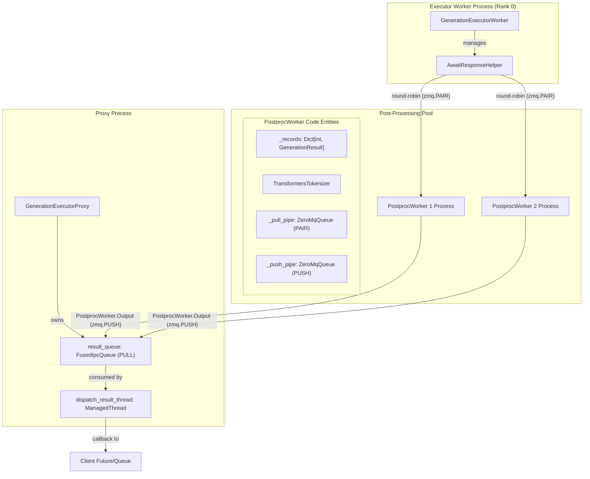
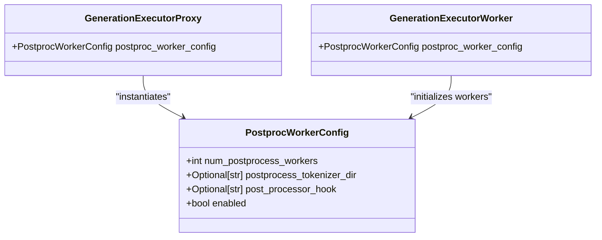
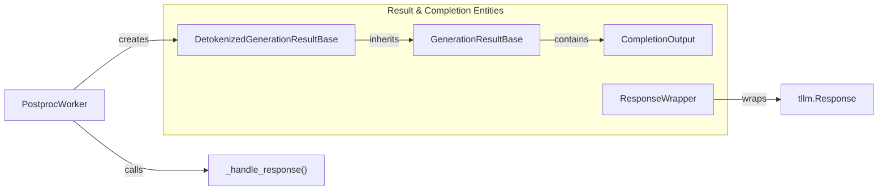

<!-- source: DeepWiki mcp.deepwiki.com · repo NVIDIA/TensorRT-LLM · page 7.6 Post-Processing Workers · fetched 2026-10-26 -->

# Post-Processing Workers

Relevant source files

The following files were used as context for generating this wiki page:

- [examples/llm-api/llm_sparse_attention.py](examples/llm-api/llm_sparse_attention.py)
- [examples/longbench/eval_longbench_v1.py](examples/longbench/eval_longbench_v1.py)
- [examples/longbench/requirements.txt](examples/longbench/requirements.txt)
- [requirements-dev.txt](requirements-dev.txt)
- [security_scanning/examples/longbench/poetry.lock](security_scanning/examples/longbench/poetry.lock)
- [security_scanning/examples/longbench/pyproject.toml](security_scanning/examples/longbench/pyproject.toml)
- [tensorrt_llm/_torch/pyexecutor/grammar_matcher.py](tensorrt_llm/_torch/pyexecutor/grammar_matcher.py)
- [tensorrt_llm/_torch/pyexecutor/guided_decoder.py](tensorrt_llm/_torch/pyexecutor/guided_decoder.py)
- [tensorrt_llm/evaluate/cnn_dailymail.py](tensorrt_llm/evaluate/cnn_dailymail.py)
- [tensorrt_llm/evaluate/interface.py](tensorrt_llm/evaluate/interface.py)
- [tensorrt_llm/evaluate/json_mode_eval.py](tensorrt_llm/evaluate/json_mode_eval.py)
- [tensorrt_llm/evaluate/lm_eval.py](tensorrt_llm/evaluate/lm_eval.py)
- [tensorrt_llm/evaluate/mmlu.py](tensorrt_llm/evaluate/mmlu.py)
- [tensorrt_llm/executor/__init__.py](tensorrt_llm/executor/__init__.py)
- [tensorrt_llm/executor/base_worker.py](tensorrt_llm/executor/base_worker.py)
- [tensorrt_llm/executor/executor.py](tensorrt_llm/executor/executor.py)
- [tensorrt_llm/executor/ipc.py](tensorrt_llm/executor/ipc.py)
- [tensorrt_llm/executor/postproc_worker.py](tensorrt_llm/executor/postproc_worker.py)
- [tensorrt_llm/executor/proxy.py](tensorrt_llm/executor/proxy.py)
- [tensorrt_llm/executor/request.py](tensorrt_llm/executor/request.py)
- [tensorrt_llm/executor/result.py](tensorrt_llm/executor/result.py)
- [tensorrt_llm/executor/utils.py](tensorrt_llm/executor/utils.py)
- [tensorrt_llm/executor/worker.py](tensorrt_llm/executor/worker.py)
- [tensorrt_llm/llmapi/llm.py](tensorrt_llm/llmapi/llm.py)
- [tensorrt_llm/llmapi/mgmn_leader_node.py](tensorrt_llm/llmapi/mgmn_leader_node.py)
- [tensorrt_llm/llmapi/mpi_session.py](tensorrt_llm/llmapi/mpi_session.py)
- [tensorrt_llm/llmapi/trtllm-llmapi-launch](tensorrt_llm/llmapi/trtllm-llmapi-launch)
- [tests/integration/defs/accuracy/accuracy_core.py](tests/integration/defs/accuracy/accuracy_core.py)
- [tests/integration/defs/accuracy/test_cli_flow.py](tests/integration/defs/accuracy/test_cli_flow.py)
- [tests/unittest/_torch/executor/test_router_dealer_ipc.py](tests/unittest/_torch/executor/test_router_dealer_ipc.py)
- [tests/unittest/executor/test_ipc.py](tests/unittest/executor/test_ipc.py)
- [tests/unittest/executor/test_launcher_envs.py](tests/unittest/executor/test_launcher_envs.py)
- [tests/unittest/executor/test_proxy_fast_death.py](tests/unittest/executor/test_proxy_fast_death.py)
- [tests/unittest/llmapi/_run_mpi_comm_task.py](tests/unittest/llmapi/_run_mpi_comm_task.py)
- [tests/unittest/llmapi/_run_multi_llm_tasks.py](tests/unittest/llmapi/_run_multi_llm_tasks.py)
- [tests/unittest/llmapi/_run_multi_mpi_comm_tasks.py](tests/unittest/llmapi/_run_multi_mpi_comm_tasks.py)
- [tests/unittest/llmapi/apps/_test_openai_misc.py](tests/unittest/llmapi/apps/_test_openai_misc.py)
- [tests/unittest/llmapi/lora_test_utils.py](tests/unittest/llmapi/lora_test_utils.py)
- [tests/unittest/llmapi/test_executor.py](tests/unittest/llmapi/test_executor.py)
- [tests/unittest/llmapi/test_llm.py](tests/unittest/llmapi/test_llm.py)
- [tests/unittest/llmapi/test_llm_multi_gpu_pytorch.py](tests/unittest/llmapi/test_llm_multi_gpu_pytorch.py)
- [tests/unittest/llmapi/test_llm_pytorch.py](tests/unittest/llmapi/test_llm_pytorch.py)
- [tests/unittest/others/test_lm_eval.py](tests/unittest/others/test_lm_eval.py)

Post-processing workers are separate parallel processes that handle detokenization and optional custom result transformations for generation outputs. They offload CPU-intensive text processing from the main executor worker to improve throughput, particularly in multi-request scenarios.

For information about the main executor worker that submits responses to post-processing workers, see [PyExecutor Event Loop and Request Scheduling](7.1). For information about the proxy that receives processed results, see [Proxy-Worker Architecture and IPC](7.5).

## Overview and Purpose

Post-processing workers serve two primary functions:

1.  **Detokenization**: Convert token IDs from the executor's sampling output into text strings using the model's tokenizer [tensorrt_llm/executor/postproc_worker.py:129-130]().
2.  **Custom result handling**: Execute user-defined callbacks on generation result objects before returning them to the client [tensorrt_llm/executor/postproc_worker.py:177-181](). This includes specialized logic for serving APIs, such as reasoning extraction and tool call parsing.

The system enables parallel processing across multiple worker processes, distributing results via round-robin distribution from the `GenerationExecutorWorker` [tensorrt_llm/executor/worker.py:24-25]().

**Sources:** [tensorrt_llm/executor/postproc_worker.py:46-58](), [tensorrt_llm/executor/worker.py:24-25](), [tensorrt_llm/executor/base_worker.py:92-108]()

## System Architecture

The following diagram bridges the "Natural Language Space" of the pipeline to the "Code Entity Space" by showing the interaction between the `GenerationExecutorWorker`, `PostprocWorker` pool, and `GenerationExecutorProxy`.

### Executor Pipeline and Post-Processing Bridge

**Post-Processing Data Flow**

The executor worker receives responses from the runtime backend via `AwaitResponseHelper` [tensorrt_llm/executor/base_worker.py:132](), wraps them in `PostprocWorker.Input` objects [tensorrt_llm/executor/postproc_worker.py:65-73](), and distributes them to post-processing workers. Each worker maintains a dictionary of active `GenerationResult` records [tensorrt_llm/executor/postproc_worker.py:107](), performs detokenization incrementally, and forwards completed outputs to the proxy's result queue [tensorrt_llm/executor/postproc_worker.py:113-120]().

**Sources:** [tensorrt_llm/executor/worker.py:39-61](), [tensorrt_llm/executor/base_worker.py:120-132](), [tensorrt_llm/executor/proxy.py:99-111](), [tensorrt_llm/executor/postproc_worker.py:151-181]()

## Configuration

### PostprocWorkerConfig

The configuration for these workers is shared between the proxy and the workers to ensure consistent tokenizer loading and process counts.

**Configuration Parameters**

| Parameter | Type | Default | Description |
| :--- | :--- | :--- | :--- |
| `num_postprocess_workers` | `int` | `0` | Number of parallel post-processing worker processes [tensorrt_llm/executor/postproc_worker.py:48](). |
| `postprocess_tokenizer_dir` | `Optional[str]` | `None` | Directory containing the tokenizer configuration [tensorrt_llm/executor/postproc_worker.py:49](). |
| `post_processor_hook` | `Optional[str]` | `None` | Dotted import path for user-defined post-processing hooks [tensorrt_llm/executor/postproc_worker.py:53](). |

The `enabled` property returns `True` when `num_postprocess_workers > 0` [tensorrt_llm/executor/postproc_worker.py:56-57]().

**Sources:** [tensorrt_llm/executor/postproc_worker.py:45-58](), [tensorrt_llm/executor/proxy.py:109-120](), [tensorrt_llm/executor/executor.py:89-91]()

## Worker Lifecycle

### Initialization

The post-processing workers are spawned during executor worker initialization if configured [tensorrt_llm/executor/worker.py:44](). Each worker process runs `postproc_worker_main`, which creates a `PostprocWorker` instance and enters an asynchronous event loop [tensorrt_llm/executor/postproc_worker.py:183-222]().

**Sources:** [tensorrt_llm/executor/worker.py:44](), [tensorrt_llm/executor/postproc_worker.py:183-222]()

### Event Loop Processing

Each worker maintains a dictionary `_records` mapping `client_id` to result objects [tensorrt_llm/executor/postproc_worker.py:107](). On the first input for a request, it creates a new record using `_record_creator` [tensorrt_llm/executor/postproc_worker.py:167-168](). On subsequent inputs, it updates the existing record with new tokens and performs incremental detokenization via `record._handle_response(input.rsp)` [tensorrt_llm/executor/postproc_worker.py:177]().

**Sources:** [tensorrt_llm/executor/postproc_worker.py:151-181]()

### Shutdown

Workers receive a signal to stop through the `_to_stop` event or via IPC channel closure [tensorrt_llm/executor/postproc_worker.py:121](). The main executor worker manages the shutdown of these subprocesses [tensorrt_llm/executor/worker.py:105-121]().

**Sources:** [tensorrt_llm/executor/worker.py:105-121](), [tensorrt_llm/executor/postproc_worker.py:121]()

## IPC Communication

### Queue Architecture

The system uses ZeroMQ for inter-process communication between the executor worker, post-processing workers, and the proxy.

**Socket Types**
*   **Pull Pipe (`zmq.PAIR`)**: Bidirectional connection between executor worker and each post-processor for input distribution [tensorrt_llm/executor/postproc_worker.py:109-112]().
*   **Push Pipe (`zmq.PUSH`)**: Unidirectional connection from all post-processors to the proxy's result queue [tensorrt_llm/executor/postproc_worker.py:113-120]().
*   **Result Queue (`zmq.PULL`)**: The proxy uses a `zmq.PULL` socket type in its `FusedIpcQueue` to receive from multiple `zmq.PUSH` senders [tensorrt_llm/executor/proxy.py:40]().

**Sources:** [tensorrt_llm/executor/proxy.py:40](), [tensorrt_llm/executor/postproc_worker.py:109-120]()

### Message Types

#### PostprocWorker.Input
The `PostprocWorker.Input` class encapsulates the response from the runtime and metadata required for processing [tensorrt_llm/executor/postproc_worker.py:65-73]().

#### PostprocWorker.Output
The `PostprocWorker.Output` named tuple is sent back to the proxy. It contains the processed result, metrics, and flags for finality or abortion [tensorrt_llm/executor/postproc_worker.py:75-85](). Notably, it carries a `should_abort` flag used to propagate termination signals back to the main generation loop [tensorrt_llm/executor/postproc_worker.py:82]().

**Sources:** [tensorrt_llm/executor/postproc_worker.py:65-85](), [tensorrt_llm/executor/result.py:73-85]()

## Custom Post-Processing

Users can provide custom post-processing logic via `PostprocParams` which includes a `post_processor` callable [tensorrt_llm/executor/postproc_worker.py:40-42]().

In serving scenarios, specialized handlers extract reasoning content and parse tool calls. The `PostprocWorker` executes these handlers by passing the current `record` and `args` to the defined processor [tensorrt_llm/executor/postproc_worker.py:177-181]().

**Sources:** [tensorrt_llm/executor/postproc_worker.py:40-42](), [tensorrt_llm/executor/postproc_worker.py:177-181]()

## Implementation Details

### Result and Completion Objects

The following diagram maps the logical components of a generation result to the code entities that manage them within the post-processing pipeline.

### Key Classes

#### PostprocWorker
The main worker class that manages its own ZeroMQ sockets and tokenizer [tensorrt_llm/executor/postproc_worker.py:60-128]().

| Method | Description |
| :--- | :--- |
| `__init__` | Sets up PAIR and PUSH pipes and loads the HF tokenizer [tensorrt_llm/executor/postproc_worker.py:86-136](). |
| `_handle_input` | Updates request records and executes custom post-processors [tensorrt_llm/executor/postproc_worker.py:151-181](). |
| `default_record_creator` | Creates a `DetokenizedGenerationResultBase` for new requests [tensorrt_llm/executor/postproc_worker.py:138-149](). |

**Sources:** [tensorrt_llm/executor/postproc_worker.py:60-181]()

#### Detokenization and Hooks
The system supports incremental text generation and user hooks. `PostprocWorker` loads a `post_processor_hook` if provided in the config [tensorrt_llm/executor/postproc_worker.py:134-136](). This hook is then threaded onto each request record during initialization [tensorrt_llm/executor/postproc_worker.py:171-172]().

**Sources:** [tensorrt_llm/executor/postproc_worker.py:134-136](), [tensorrt_llm/executor/postproc_worker.py:171-172](), [tensorrt_llm/executor/postprocessor_hook.py:33-34]()

---

