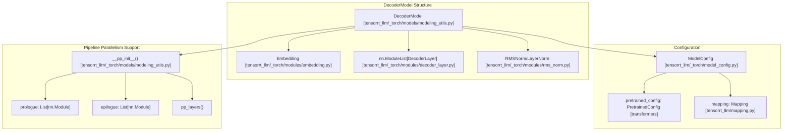
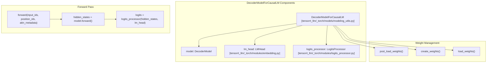
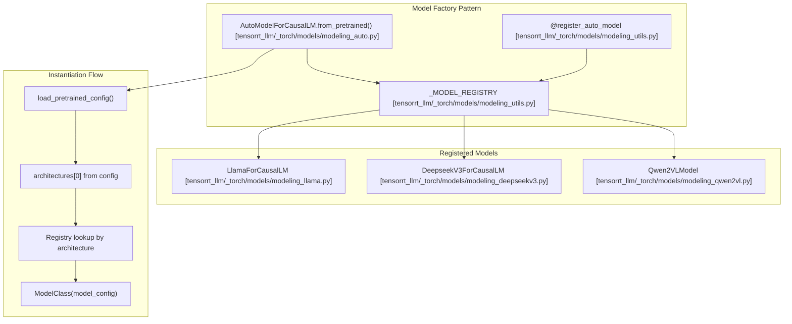

<!-- source: DeepWiki mcp.deepwiki.com · repo NVIDIA/TensorRT-LLM · page 8 Model Architecture and Components · fetched 2026-10-26 -->

# Model Architecture and Components

Relevant source files

The following files were used as context for generating this wiki page:

- [docs/source/models/supported-models.md](docs/source/models/supported-models.md)
- [examples/models/core/multimodal/qwen_image_bench_eval.py](examples/models/core/multimodal/qwen_image_bench_eval.py)
- [tensorrt_llm/_torch/models/__init__.py](tensorrt_llm/_torch/models/__init__.py)
- [tensorrt_llm/_torch/models/checkpoints/hf/qwen3_5_weight_mapper.py](tensorrt_llm/_torch/models/checkpoints/hf/qwen3_5_weight_mapper.py)
- [tensorrt_llm/_torch/models/modeling_deepseekv3.py](tensorrt_llm/_torch/models/modeling_deepseekv3.py)
- [tensorrt_llm/_torch/models/modeling_gemma3vl.py](tensorrt_llm/_torch/models/modeling_gemma3vl.py)
- [tensorrt_llm/_torch/models/modeling_hyperclovax.py](tensorrt_llm/_torch/models/modeling_hyperclovax.py)
- [tensorrt_llm/_torch/models/modeling_llama.py](tensorrt_llm/_torch/models/modeling_llama.py)
- [tensorrt_llm/_torch/models/modeling_llava_next.py](tensorrt_llm/_torch/models/modeling_llava_next.py)
- [tensorrt_llm/_torch/models/modeling_phi4mm.py](tensorrt_llm/_torch/models/modeling_phi4mm.py)
- [tensorrt_llm/_torch/models/modeling_qwen2vl.py](tensorrt_llm/_torch/models/modeling_qwen2vl.py)
- [tensorrt_llm/_torch/models/modeling_qwen3_5.py](tensorrt_llm/_torch/models/modeling_qwen3_5.py)
- [tensorrt_llm/_torch/models/modeling_qwen3_next.py](tensorrt_llm/_torch/models/modeling_qwen3_next.py)
- [tensorrt_llm/_torch/models/modeling_qwen3vl.py](tensorrt_llm/_torch/models/modeling_qwen3vl.py)
- [tensorrt_llm/_torch/models/modeling_utils.py](tensorrt_llm/_torch/models/modeling_utils.py)
- [tensorrt_llm/_torch/models/modeling_vila.py](tensorrt_llm/_torch/models/modeling_vila.py)
- [tensorrt_llm/_torch/modules/attention.py](tensorrt_llm/_torch/modules/attention.py)
- [tensorrt_llm/_torch/pyexecutor/config_utils.py](tensorrt_llm/_torch/pyexecutor/config_utils.py)
- [tests/integration/defs/accuracy/references/mmmu.yaml](tests/integration/defs/accuracy/references/mmmu.yaml)
- [tests/integration/defs/accuracy/test_llm_api_pytorch_multimodal.py](tests/integration/defs/accuracy/test_llm_api_pytorch_multimodal.py)
- [tests/integration/test_lists/test-db/l0_a30.yml](tests/integration/test_lists/test-db/l0_a30.yml)
- [tests/integration/test_lists/test-db/l0_l40s.yml](tests/integration/test_lists/test-db/l0_l40s.yml)
- [tests/unittest/_torch/modeling/test_modeling_multimodal.py](tests/unittest/_torch/modeling/test_modeling_multimodal.py)
- [tests/unittest/_torch/modeling/test_modeling_qwen2_5vl.py](tests/unittest/_torch/modeling/test_modeling_qwen2_5vl.py)
- [tests/unittest/_torch/modeling/test_modeling_qwen3_5_vl_moe.py](tests/unittest/_torch/modeling/test_modeling_qwen3_5_vl_moe.py)
- [tests/unittest/_torch/modeling/test_modeling_qwen3vl.py](tests/unittest/_torch/modeling/test_modeling_qwen3vl.py)
- [tests/unittest/_torch/modeling/test_qwen_image_bench_e2e.py](tests/unittest/_torch/modeling/test_qwen_image_bench_e2e.py)
- [tests/unittest/_torch/modeling/test_qwen_image_bench_modeling.py](tests/unittest/_torch/modeling/test_qwen_image_bench_modeling.py)
- [tests/unittest/_torch/multimodal/golden/generate_qwen_image_bench_cat_piano_golden.py](tests/unittest/_torch/multimodal/golden/generate_qwen_image_bench_cat_piano_golden.py)
- [tests/unittest/_torch/multimodal/golden/qwen_image_bench_cat_piano_alignment.json](tests/unittest/_torch/multimodal/golden/qwen_image_bench_cat_piano_alignment.json)

This document details the model architecture and component implementations in TensorRT-LLM, covering the model class hierarchy, decoder layer implementations, linear layer abstractions, and the weight loading pipeline. This page focuses on how models are structured, instantiated, and configured.

For execution flow and runtime orchestration, see [PyExecutor Runtime System](#7). For attention implementations, see [Attention Backends](#9). For quantization configuration, see [Quantization System](#12).

## Model Class Hierarchy

TensorRT-LLM's model architecture is built around a hierarchical class structure with base classes providing common functionality and specific model implementations extending these for architecture-specific behavior.

### Base Model Classes

**DecoderModel Base Class**
The `DecoderModel` class serves as the base for all decoder-only transformer models, providing the fundamental structure including token embeddings, a module list of decoder layers, and final normalization.

Sources: [tensorrt_llm/_torch/models/modeling_utils.py:234-327](), [tensorrt_llm/_torch/model_config.py:22-60]()

**DecoderModelForCausalLM**
`DecoderModelForCausalLM` extends `DecoderModel` to add causal language modeling capabilities, including the language modeling head (`lm_head`) and a `LogitsProcessor`. It also manages the lifecycle of weights via `create_weights` and `load_weights`.

Sources: [tensorrt_llm/_torch/models/modeling_utils.py:346-482]()

### Model Factory and Registration

**AutoModelForCausalLM Factory**
The `AutoModelForCausalLM` class provides automatic model instantiation based on architecture names. The `_MODEL_REGISTRY` mapping is populated using the `register_auto_model` decorator found across various modeling files.

Sources: [tensorrt_llm/_torch/models/modeling_utils.py:485-546](), [tensorrt_llm/_torch/models/modeling_llama.py:49-50](), [tensorrt_llm/_torch/models/modeling_deepseekv3.py:82](), [tensorrt_llm/_torch/models/modeling_qwen2vl.py:80]()

## Decoder Layer Implementations

Decoder layers are the fundamental building blocks of transformer models, implementing attention, feed-forward networks (MLP/MoE), and normalization.

### Architecture Examples
TensorRT-LLM supports a wide variety of architectures including Dense, Mixture of Experts (MoE), Hybrid SSM, and Multimodal variants.

*   **DeepSeek Family**: Supports `DeepseekV3ForCausalLM` which implements Multi-head Latent Attention (MLA) [tensorrt_llm/_torch/models/modeling_deepseekv3.py:66]() and DeepSeek-V3 MoE with specialized routing [tensorrt_llm/_torch/models/modeling_deepseekv3.py:63-65]().
*   **Llama Family**: Supports standard Llama and Llama 4. `Llama4Attention` supports `QKNorm` via `RMSNorm` applied after RoPE [tensorrt_llm/_torch/models/modeling_llama.py:126-133]().
*   **Hybrid Architectures**: `Qwen3NextForCausalLM` combines standard attention with a `Qwen3NextGatedDeltaNet` (GDN) mixer [tensorrt_llm/_torch/models/modeling_qwen3_next.py:59-66]().
*   **Multimodal Support**: Architectures like `Qwen2VLModel` [tensorrt_llm/_torch/models/modeling_qwen2vl.py:76](), `Qwen3VLModel` [tensorrt_llm/_torch/models/modeling_qwen3vl.py:82](), and `Gemma3VLM` use multimodal input processors and vision encoders. `Qwen2VL` utilizes `MRotaryEmbedding` for multi-modal RoPE [tensorrt_llm/_torch/models/modeling_qwen2vl.py:71]().

Sources: [tensorrt_llm/_torch/models/modeling_llama.py:75-124](), [tensorrt_llm/_torch/models/modeling_deepseekv3.py:54-82](), [tensorrt_llm/_torch/models/modeling_qwen2vl.py:1-82](), [tensorrt_llm/_torch/models/modeling_qwen3_next.py:59-66]()

## Linear Layers and Quantization Integration

The `Linear` module provides a unified interface for linear transformations, supporting:
*   **Tensor Parallelism**: Managed via `TensorParallelMode` (ROW or COLUMN) [tensorrt_llm/_torch/modules/linear.py:99-111]().
*   **Weight Modes**: Supports `VANILLA`, `FUSED_QKV`, and `FUSED_GATE_UP` [tensorrt_llm/_torch/modules/linear.py:50-91]().
*   **Quantization**: Integration with `QuantConfig` and specialized kernels. FP4 quantization is supported via `Fp4QuantizedTensor` [tensorrt_llm/_torch/utils.py:187-203](). It also supports `MxFp8QuantizedTensor` for block-scaled FP8 [tensorrt_llm/_torch/utils.py:205-228]().

Sources: [tensorrt_llm/_torch/modules/linear.py:50-111](), [tensorrt_llm/_torch/utils.py:187-228]()

## Weight Loading Pipeline

The weight loading pipeline manages the transformation of checkpoint weights into sharded and quantized formats.

### Weight Mappers and Loaders

**BaseWeightMapper**
The `BaseWeightMapper` provides the core logic for mapping HuggingFace-style weights to TensorRT-LLM modules, including handling sharding for Tensor Parallelism (TP).
Sources: [tensorrt_llm/_torch/models/checkpoints/base_weight_mapper.py:16-17]()

**Model-Specific Mappers and Loaders**
*   **DeepSeekV3 Loader**: `DeepseekV3WeightLoader` manages the complex weight loading for DeepSeek-V3, including dequantization of weights via Triton kernels [tensorrt_llm/_torch/models/modeling_deepseekv3.py:164-173]().
*   **Qwen2VL Mapper**: `Qwen2VLHfWeightMapper` handles specialized weight mapping for the Qwen2-VL architecture [tensorrt_llm/_torch/models/modeling_qwen2vl.py:26-27]().
*   **Qwen3VL Mapper**: `Qwen3VLHfWeightMapper` manages the mapping for Qwen3-VL, including multimodal components [tensorrt_llm/_torch/models/modeling_qwen3vl.py:49]().
*   **Llama 4 Renormalize**: Supports `Llama4RenormalizeMoeRoutingMethod` for specialized MoE loading [tensorrt_llm/_torch/models/modeling_llama.py:39-40]().

For more detailed information, see the following child pages:
- [Model Class Hierarchy and Configuration](#8.1) — Details on `DecoderModelForCausalLM`, `ModelConfig`, and model registration.
- [Decoder Layers and Normalization](#8.2) — Documentation on layer implementations, `RMSNorm`, and gated MLPs.
- [Linear Layers and Quantization Methods](#8.3) — Technical details on `Linear` layers, TP modes, and quantization integration.
- [Weight Loading Pipeline](#8.4) — In-depth look at `BaseWeightMapper`, HF weight mapping, and model-specific loaders.
- [Hybrid SSM, Linear Attention, and Advanced Residual Models](#8.5) — Documentation on hybrid architectures (Mamba2, Qwen3Next GDN), FLA module library, and advanced residual mixing modules (mHC).

---

