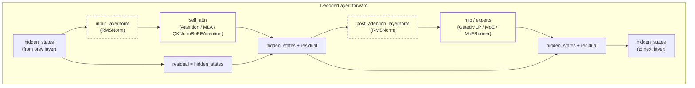
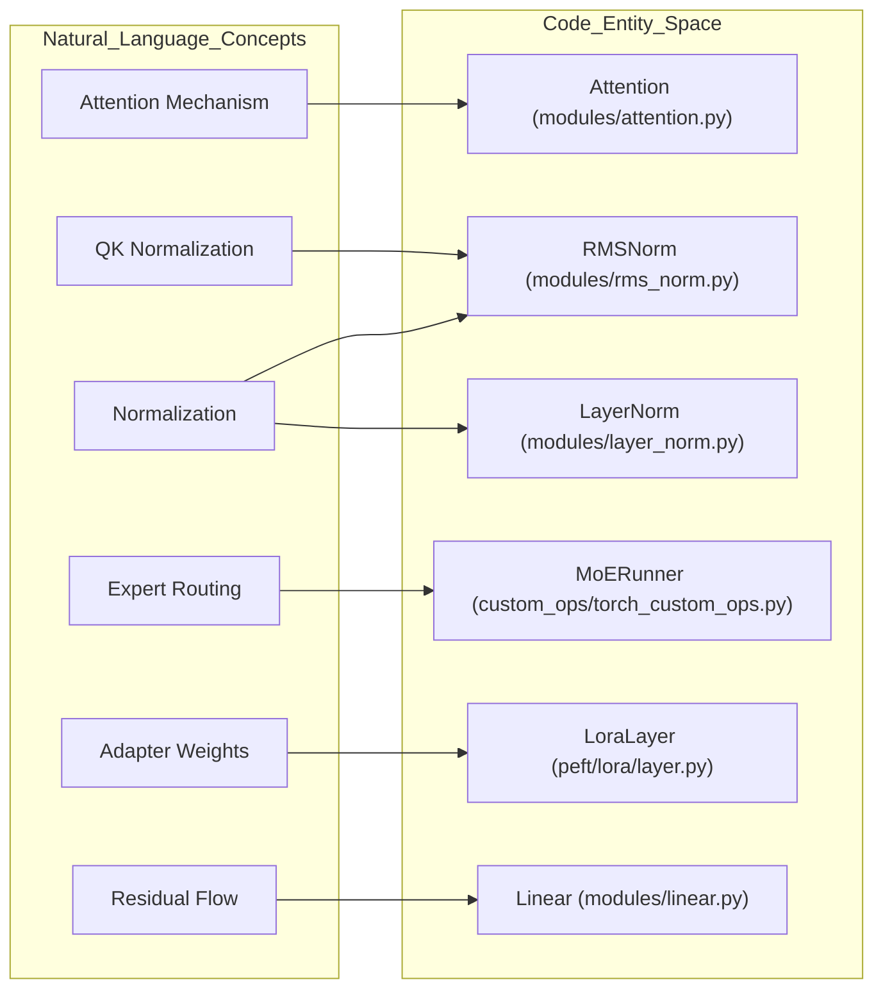
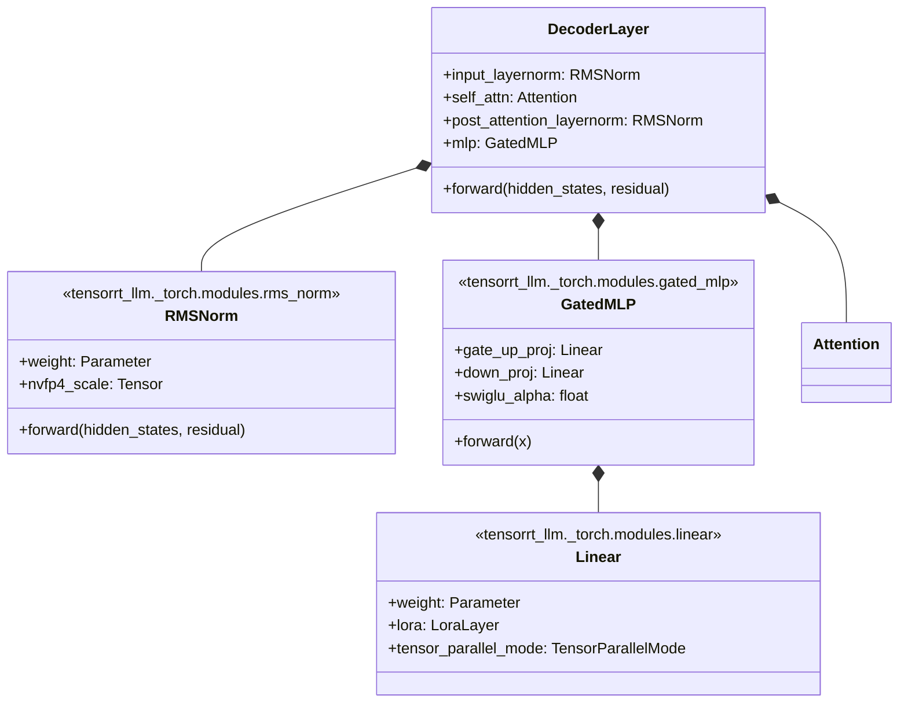

<!-- source: DeepWiki mcp.deepwiki.com · repo NVIDIA/TensorRT-LLM · page 8.2 Decoder Layers and Normalization · fetched 2026-10-26 -->

# Decoder Layers and Normalization

<details>
<summary>Relevant source files</summary>

The following files were used as context for generating this wiki page:

- [cpp/tensorrt_llm/common/memoryUtils.cu](cpp/tensorrt_llm/common/memoryUtils.cu)
- [cpp/tensorrt_llm/kernels/CMakeLists.txt](cpp/tensorrt_llm/kernels/CMakeLists.txt)
- [cpp/tensorrt_llm/kernels/groupRmsNormKernels/CMakeLists.txt](cpp/tensorrt_llm/kernels/groupRmsNormKernels/CMakeLists.txt)
- [cpp/tensorrt_llm/kernels/groupRmsNormKernels/groupRmsNormKernels.cu](cpp/tensorrt_llm/kernels/groupRmsNormKernels/groupRmsNormKernels.cu)
- [cpp/tensorrt_llm/kernels/groupRmsNormKernels/groupRmsNormKernels.h](cpp/tensorrt_llm/kernels/groupRmsNormKernels/groupRmsNormKernels.h)
- [cpp/tensorrt_llm/kernels/userbuffers/CMakeLists.txt](cpp/tensorrt_llm/kernels/userbuffers/CMakeLists.txt)
- [cpp/tensorrt_llm/thop/CMakeLists.txt](cpp/tensorrt_llm/thop/CMakeLists.txt)
- [cpp/tensorrt_llm/thop/groupRmsNormOp.cpp](cpp/tensorrt_llm/thop/groupRmsNormOp.cpp)
- [docs/source/models/encoder-decoder.md](docs/source/models/encoder-decoder.md)
- [tensorrt_llm/_torch/autotuner.py](tensorrt_llm/_torch/autotuner.py)
- [tensorrt_llm/_torch/custom_ops/__init__.py](tensorrt_llm/_torch/custom_ops/__init__.py)
- [tensorrt_llm/_torch/custom_ops/cpp_custom_ops.py](tensorrt_llm/_torch/custom_ops/cpp_custom_ops.py)
- [tensorrt_llm/_torch/custom_ops/flashinfer_custom_ops.py](tensorrt_llm/_torch/custom_ops/flashinfer_custom_ops.py)
- [tensorrt_llm/_torch/custom_ops/torch_custom_ops.py](tensorrt_llm/_torch/custom_ops/torch_custom_ops.py)
- [tensorrt_llm/_torch/custom_ops/trtllm_gen_custom_ops.py](tensorrt_llm/_torch/custom_ops/trtllm_gen_custom_ops.py)
- [tensorrt_llm/_torch/flashinfer_utils.py](tensorrt_llm/_torch/flashinfer_utils.py)
- [tensorrt_llm/_torch/model_config.py](tensorrt_llm/_torch/model_config.py)
- [tensorrt_llm/_torch/modules/gated_mlp.py](tensorrt_llm/_torch/modules/gated_mlp.py)
- [tensorrt_llm/_torch/modules/layer_norm.py](tensorrt_llm/_torch/modules/layer_norm.py)
- [tensorrt_llm/_torch/modules/linear.py](tensorrt_llm/_torch/modules/linear.py)
- [tensorrt_llm/_torch/modules/mlp.py](tensorrt_llm/_torch/modules/mlp.py)
- [tensorrt_llm/_torch/modules/rms_norm.py](tensorrt_llm/_torch/modules/rms_norm.py)
- [tensorrt_llm/_torch/modules/rotary_embedding.py](tensorrt_llm/_torch/modules/rotary_embedding.py)
- [tensorrt_llm/_torch/peft/lora/layer.py](tensorrt_llm/_torch/peft/lora/layer.py)
- [tensorrt_llm/_torch/utils.py](tensorrt_llm/_torch/utils.py)
- [tensorrt_llm/llmapi/llm_utils.py](tensorrt_llm/llmapi/llm_utils.py)
- [tensorrt_llm/models/modeling_utils.py](tensorrt_llm/models/modeling_utils.py)
- [tests/unittest/_torch/misc/test_autotuner.py](tests/unittest/_torch/misc/test_autotuner.py)
- [tests/unittest/_torch/thop/parallel/test_dense_gemm_act_fusion.py](tests/unittest/_torch/thop/parallel/test_dense_gemm_act_fusion.py)

</details>


## Purpose and Scope

This page documents the decoder layer implementations and normalization techniques within TensorRT-LLM's PyTorch-based models (`_torch`). A decoder layer is the fundamental building block of transformer-based language models, orchestrating self-attention, feed-forward components, and residual connections with normalization.

The codebase provides highly optimized implementations supporting **AllReduce fusion**, **Multi-head Latent Attention (MLA)**, **Mixture of Experts (MoE)**, and specialized **NVFP4 (Blackwell)** quantization paths.

## Base DecoderLayer Class

All decoder layer implementations inherit from the abstract `DecoderLayer` base class. This serves as a marker interface for model-specific layer types.

```python
class DecoderLayer(nn.Module):
    pass
```

**Sources:** [tensorrt_llm/_torch/modules/decoder_layer.py:1-5](), imported in [tensorrt_llm/_torch/models/modeling_llama.py:37](), [tensorrt_llm/_torch/models/modeling_mistral.py:35]().

## Standard Pre-Normalization Architecture

Most models in TensorRT-LLM follow the **pre-normalization transformer pattern**, where normalization is applied before the attention and feed-forward sublayers.

### Decoder Layer Structure and Data Flow

The diagram below illustrates the standard data flow, highlighting the residual passing pattern used to minimize memory allocations and support kernel fusion.

Title: Decoder Layer Data Flow and Residual Management


**Sources:** [tensorrt_llm/_torch/models/modeling_llama.py:165-185](), [tensorrt_llm/_torch/models/modeling_mistral.py:150-185](), [tensorrt_llm/_torch/modules/gated_mlp.py:180-210]().

## Core Components

### Normalization: RMSNorm and LayerNorm

#### RMSNorm
The primary normalization technique is `RMSNorm`. It is optimized for performance and quantization:
- **Residual Fusion**: Supports an optimized residual passing pattern where the norm returns both the normalized output and the updated residual [tensorrt_llm/_torch/modules/rms_norm.py:114-121]().
- **NVFP4 Support**: Specialized path for Blackwell (NVFP4) that produces `Fp4QuantizedTensor` directly. It uses a warp-specialized kernel `fused_add_rms_norm_quant` when the hidden dimension is between 2048 and 16384 [tensorrt_llm/_torch/modules/rms_norm.py:30-40](), [tensorrt_llm/_torch/modules/rms_norm.py:138-141]().
- **Gemma Support**: Implements Gemma-style scaling where `(1 + weight)` is applied if `use_gemma` is enabled [tensorrt_llm/_torch/modules/rms_norm.py:53-86]().
- **CUDA Tile**: Integrates with `cuda_tile_rms_norm_fuse_residual_` for fused residual operations [tensorrt_llm/_torch/modules/rms_norm.py:148-156]().

#### LayerNorm
The `LayerNorm` module provides standard layer normalization with optional learnable parameters and residual support. It can accumulate residuals in FP32 for numerical stability [tensorrt_llm/_torch/modules/layer_norm.py:24-52]().

### Feed-Forward Networks (FFN)

The feed-forward block is either a standard `MLP`, `GatedMLP`, or a Mixture of Experts (MoE):
- **`GatedMLP`**: Implements the SwiGLU activation pattern. It uses `gate_up_proj` (fused `COLUMN` parallel) and `down_proj` (`ROW` parallel) [tensorrt_llm/_torch/modules/gated_mlp.py:106-156]().
- **`MLP`**: Standard FFN with `up_proj` and `down_proj`. It supports fused `relu2` + `fp4_quantize` kernels on SM100+ architectures [tensorrt_llm/_torch/modules/mlp.py:103-113]().
- **Fusion**: Both `MLP` and `GatedMLP` support fusing GEMM + Activation + NVFP4-quantization into a single kernel (e.g., GELU tanh fusion for Blackwell) [tensorrt_llm/_torch/modules/mlp.py:133-149](), [tensorrt_llm/_torch/modules/gated_mlp.py:180-200]().
- **MoE**: `MoERunner` handles expert execution, supporting `ActivationType.SiTu` for Kimi K3 and `SwiGlu` [tensorrt_llm/_torch/custom_ops/torch_custom_ops.py:108-111]().

### LoRA Integration
Decoder layers manage LoRA adapters via `LoraLayer`. The `LoraModuleType` enum defines specific modules like `MLP_GATE_UP`, `ATTENTION_QKV`, and `MOE_H_TO_4H` [tensorrt_llm/_torch/peft/lora/layer.py:101-140](). LoRA weights are organized by the `LoraManager`, which handles extraction from HF or NeMo checkpoints [tensorrt_llm/lora_manager.py:27-34]().

## Fusion and Performance Optimizations

TensorRT-LLM performs **AllReduce Fusion**, combining communication with computation (Residual Add + Norm) into single CUDA kernels.

| Configuration Flag | Code Entity Association | Purpose |
| :--- | :--- | :--- |
| `PRE_MOE_FUSION` | `AllReduceFusionOp.RESIDUAL_RMS_NORM` | Fuses Attention AllReduce + Residual + Norm before MoE [tensorrt_llm/_torch/models/modeling_utils.py:47]() |
| `POST_MLP_FUSION` | `AllReduceFusionOp.RESIDUAL_RMS_NORM` | Fuses MLP AllReduce + Residual + Next Layer Norm [tensorrt_llm/_torch/models/modeling_utils.py:49]() |

**Sources:** [tensorrt_llm/_torch/models/modeling_utils.py:45-51](), [tensorrt_llm/_torch/modules/rms_norm.py:134-141]().

## Mapping Natural Language to Code Entities

### Attention and Normalization Dispatch

Title: Architectural Concept to Code Entity Mapping


**Sources:** [tensorrt_llm/_torch/modules/rms_norm.py:40](), [tensorrt_llm/_torch/modules/layer_norm.py:24](), [tensorrt_llm/_torch/peft/lora/layer.py:101](), [tensorrt_llm/_torch/modules/linear.py:38]().

### Decoder Layer Component Mapping

Title: Decoder Layer Class Relationships


**Sources:** [tensorrt_llm/_torch/modules/rms_norm.py:40-109](), [tensorrt_llm/_torch/modules/gated_mlp.py:20-156](), [tensorrt_llm/_torch/modules/linear.py:15-38](), [tensorrt_llm/_torch/models/modeling_mistral.py:115-149]().

## Quantization and Weight Management

Decoder layers are the primary site for quantization-aware execution, particularly for **FP8** and **NVFP4** (Blackwell).

- **`Fp4QuantizedTensor`**: A container for FP4 bitstreams and scaling factors [tensorrt_llm/_torch/utils.py:203-214]().
- **Weight Modes**: `WeightMode` defines fusion/sharding patterns (e.g., `FUSED_GATE_UP_LINEAR` for concatenated gate/up buffers) [tensorrt_llm/_torch/modules/linear.py:50-91]().
- **Fused Epilogues**: Blackwell kernels fuse GEMM with SwiGLU and FP4 quantization, registered as `trtllm::allreduce` variants in `cpp_custom_ops.py` [tensorrt_llm/_torch/custom_ops/cpp_custom_ops.py:46-58]().

**Sources:** [tensorrt_llm/_torch/modules/linear.py:50-91](), [tensorrt_llm/_torch/modules/gated_mlp.py:106-126](), [tensorrt_llm/_torch/custom_ops/cpp_custom_ops.py:14-60]().

---

