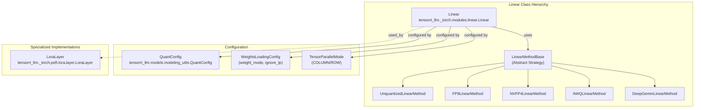
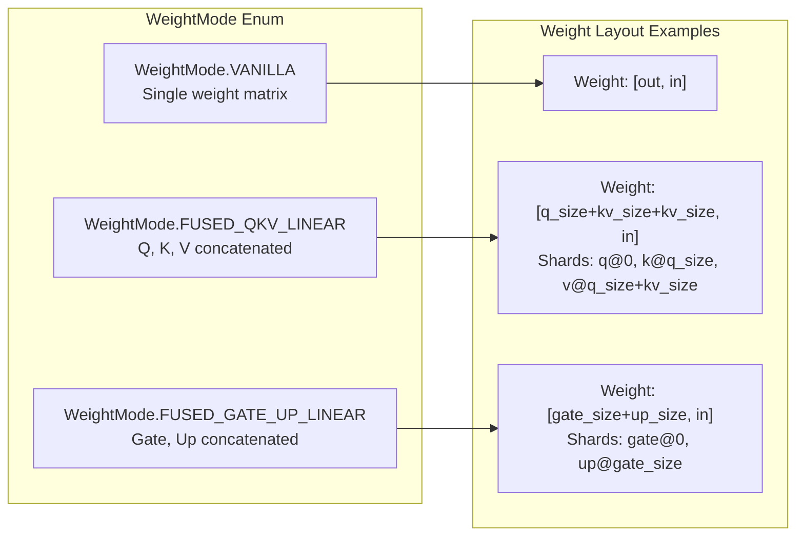
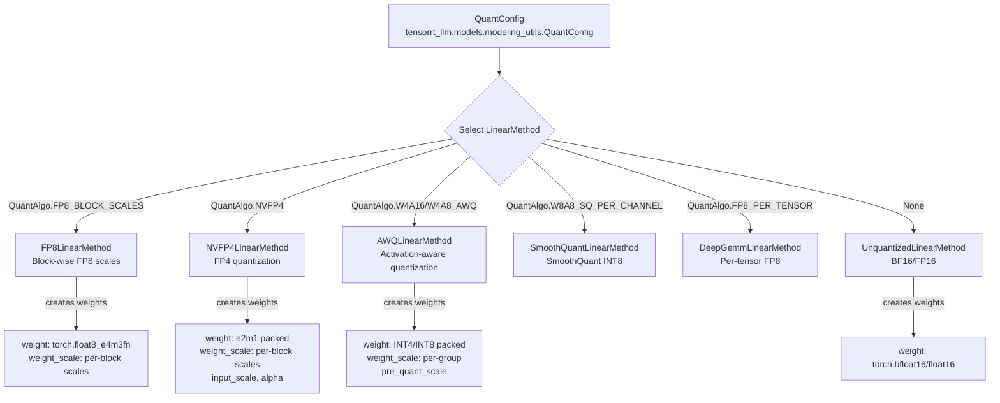

<!-- source: DeepWiki mcp.deepwiki.com · repo NVIDIA/TensorRT-LLM · page 8.3 Linear Layers and Quantization Methods · fetched 2026-10-26 -->

# Linear Layers and Quantization Methods

<details>
<summary>Relevant source files</summary>

The following files were used as context for generating this wiki page:

- [cpp/include/tensorrt_llm/batch_manager/rnnStateManager.h](cpp/include/tensorrt_llm/batch_manager/rnnStateManager.h)
- [cpp/include/tensorrt_llm/runtime/loraCache.h](cpp/include/tensorrt_llm/runtime/loraCache.h)
- [cpp/include/tensorrt_llm/runtime/loraModule.h](cpp/include/tensorrt_llm/runtime/loraModule.h)
- [cpp/include/tensorrt_llm/runtime/modelConfig.h](cpp/include/tensorrt_llm/runtime/modelConfig.h)
- [cpp/tensorrt_llm/batch_manager/peftCacheManager.cpp](cpp/tensorrt_llm/batch_manager/peftCacheManager.cpp)
- [cpp/tensorrt_llm/batch_manager/rnnStateManager.cpp](cpp/tensorrt_llm/batch_manager/rnnStateManager.cpp)
- [cpp/tensorrt_llm/kernels/CMakeLists.txt](cpp/tensorrt_llm/kernels/CMakeLists.txt)
- [cpp/tensorrt_llm/kernels/splitkGroupGemm.cu](cpp/tensorrt_llm/kernels/splitkGroupGemm.cu)
- [cpp/tensorrt_llm/kernels/splitkGroupGemm.h](cpp/tensorrt_llm/kernels/splitkGroupGemm.h)
- [cpp/tensorrt_llm/kernels/userbuffers/CMakeLists.txt](cpp/tensorrt_llm/kernels/userbuffers/CMakeLists.txt)
- [cpp/tensorrt_llm/runtime/loraCache.cpp](cpp/tensorrt_llm/runtime/loraCache.cpp)
- [cpp/tensorrt_llm/runtime/loraManager.cpp](cpp/tensorrt_llm/runtime/loraManager.cpp)
- [cpp/tensorrt_llm/runtime/loraModule.cpp](cpp/tensorrt_llm/runtime/loraModule.cpp)
- [cpp/tensorrt_llm/runtime/loraUtils.cpp](cpp/tensorrt_llm/runtime/loraUtils.cpp)
- [cpp/tensorrt_llm/thop/CMakeLists.txt](cpp/tensorrt_llm/thop/CMakeLists.txt)
- [tensorrt_llm/_torch/autotuner.py](tensorrt_llm/_torch/autotuner.py)
- [tensorrt_llm/_torch/custom_ops/cpp_custom_ops.py](tensorrt_llm/_torch/custom_ops/cpp_custom_ops.py)
- [tensorrt_llm/_torch/custom_ops/torch_custom_ops.py](tensorrt_llm/_torch/custom_ops/torch_custom_ops.py)
- [tensorrt_llm/_torch/custom_ops/trtllm_gen_custom_ops.py](tensorrt_llm/_torch/custom_ops/trtllm_gen_custom_ops.py)
- [tensorrt_llm/_torch/model_config.py](tensorrt_llm/_torch/model_config.py)
- [tensorrt_llm/_torch/modules/gated_mlp.py](tensorrt_llm/_torch/modules/gated_mlp.py)
- [tensorrt_llm/_torch/modules/linear.py](tensorrt_llm/_torch/modules/linear.py)
- [tensorrt_llm/_torch/modules/mlp.py](tensorrt_llm/_torch/modules/mlp.py)
- [tensorrt_llm/_torch/peft/lora/layer.py](tensorrt_llm/_torch/peft/lora/layer.py)
- [tensorrt_llm/_torch/utils.py](tensorrt_llm/_torch/utils.py)
- [tensorrt_llm/llmapi/llm_utils.py](tensorrt_llm/llmapi/llm_utils.py)
- [tensorrt_llm/llmapi/serialization.py](tensorrt_llm/llmapi/serialization.py)
- [tensorrt_llm/lora_helper.py](tensorrt_llm/lora_helper.py)
- [tensorrt_llm/lora_manager.py](tensorrt_llm/lora_manager.py)
- [tensorrt_llm/models/modeling_utils.py](tensorrt_llm/models/modeling_utils.py)
- [tensorrt_llm/prompt_adapter_manager.py](tensorrt_llm/prompt_adapter_manager.py)
- [tests/unittest/_torch/misc/test_autotuner.py](tests/unittest/_torch/misc/test_autotuner.py)
- [tests/unittest/_torch/peft/test_shim_peft.py](tests/unittest/_torch/peft/test_shim_peft.py)
- [tests/unittest/_torch/thop/parallel/test_dense_gemm_act_fusion.py](tests/unittest/_torch/thop/parallel/test_dense_gemm_act_fusion.py)

</details>


This page documents the linear layer implementation and its integration with various quantization methods in TensorRT-LLM's PyTorch backend. Linear layers (`Linear` class) serve as the fundamental building blocks for model architectures, supporting tensor parallelism, weight fusion, and multiple quantization schemes. For information about how weights are loaded into these layers, see [8.4 Weight Loading Pipeline](). For context on how linear layers fit into decoder architectures, see [8.2 Decoder Layers and Normalization]().

Sources: [tensorrt_llm/_torch/modules/linear.py:1-1315](), [tensorrt_llm/models/modeling_utils.py:126-190]()

## Linear Class Architecture

The `Linear` class extends PyTorch's `nn.Module` and provides a unified interface for matrix multiplications with built-in support for tensor parallelism, quantization, and LoRA adapters. Unlike standard PyTorch linear layers, this implementation coordinates weight sharding across multiple GPUs and applies quantization transformations transparently.



**Diagram: Linear Layer Class Hierarchy and Configuration**

The `Linear` class delegates quantization-specific logic to `LinearMethodBase` implementations, following the strategy pattern. Method selection occurs during initialization based on `QuantConfig.quant_algo` [tensorrt_llm/_torch/modules/linear.py:700-750]().

Sources: [tensorrt_llm/_torch/modules/linear.py:330-443](), [tensorrt_llm/_torch/modules/linear.py:625-700](), [tensorrt_llm/_torch/peft/lora/layer.py:17-17]()

### Core Linear Parameters

| Parameter | Type | Purpose |
|-----------|------|---------|
| `in_features` | int | Input dimension size |
| `out_features` | int | Output dimension size |
| `bias` | bool | Whether to include bias term |
| `dtype` | torch.dtype | Weight/computation data type |
| `mapping` | Mapping | Distributed execution configuration |
| `tensor_parallel_mode` | TensorParallelMode | COLUMN or ROW parallelism |
| `quant_config` | QuantConfig | Quantization algorithm and settings |
| `weights_loading_config` | WeightsLoadingConfig | Weight fusion mode (VANILLA, FUSED_QKV, FUSED_GATE_UP) |
| `gather_output` | bool | Whether to all-gather output (COLUMN mode) |
| `reduce_output` | bool | Whether to all-reduce output (ROW mode) |

Sources: [tensorrt_llm/_torch/modules/linear.py:625-660]()

## Weight Modes and Tensor Parallelism

Linear layers support three weight modes that determine how weights are fused and loaded via the `WeightMode` enum [tensorrt_llm/_torch/modules/linear.py:50-56]():



**Diagram: Weight Fusion Modes**

Sources: [tensorrt_llm/_torch/modules/linear.py:50-91]()

### Tensor Parallelism Modes

Tensor parallelism splits weight matrices across GPUs along specific dimensions using `TensorParallelMode` [tensorrt_llm/_torch/modules/linear.py:99-102]():

```mermaid
graph TB
    subgraph "COLUMN Parallelism"
        InputC["Input<br/>[batch, in_features]<br/>(replicated)"]
        WeightC["Weight<br/>[out_features/tp_size, in_features]<br/>(sharded along dim 0)"]
        OutputC["Output<br/>[batch, out_features/tp_size]<br/>(sharded)"]
        AllGatherC["Optional AllGather<br/>if gather_output=True"]
        
        InputC --> WeightC
        WeightC --> OutputC
        OutputC --> AllGatherC
    end
    
    subgraph "ROW Parallelism"
        InputR["Input<br/>[batch, in_features/tp_size]<br/>(sharded)"]
        WeightR["Weight<br/>[out_features, in_features/tp_size]<br/>(sharded along dim 1)"]
        OutputR["Output<br/>[batch, out_features]<br/>(partial results)"]
        AllReduceR["Optional AllReduce<br/>if reduce_output=True"]
        
        InputR --> WeightR
        WeightR --> OutputR
        OutputR --> AllReduceR
    end
```



**Diagram: Tensor Parallelism Sharding Strategies**

The `split_dim` helper determines which dimension to shard:
- COLUMN: `split_dim=0` (output features) [tensorrt_llm/_torch/modules/linear.py:105-105]()
- ROW: `split_dim=1` (input features) [tensorrt_llm/_torch/modules/linear.py:105-105]()

Sources: [tensorrt_llm/_torch/modules/linear.py:99-112](), [tensorrt_llm/_torch/modules/linear.py:132-183]()

## Quantization Integration

The `Linear` class integrates with multiple quantization methods through the `LinearMethodBase` abstraction. Quantization selection occurs in `__init__` based on `QuantConfig.quant_algo` [tensorrt_llm/_torch/modules/linear.py:700-750]():



**Diagram: Quantization Method Selection and Weight Creation**

Sources: [tensorrt_llm/_torch/modules/linear.py:700-850](), [tensorrt_llm/models/modeling_utils.py:126-190]()

### Quantization Attributes

Different quantization methods add specific attributes to the `Linear` instance:

| Quantization | Key Attributes | Purpose |
|--------------|----------------|---------|
| FP8 (FP8_BLOCK_SCALES) | `weight_scale`, `input_scale`, `inv_input_scale` | Block-wise scaling factors for activation and weight quantization [tensorrt_llm/_torch/modules/linear.py:860-880]() |
| NVFP4 | `weight_scale`, `input_scale`, `alpha` | FP4 weight scales plus combined input×weight scale [tensorrt_llm/_torch/modules/linear.py:920-950]() |
| AWQ (W4A16/W4A8) | `weight_scale`, `qzeros`, `pre_quant_scale` | Group-wise scales, zero-points, and pre-quantization scaling [tensorrt_llm/_torch/modules/linear.py:1010-1050]() |
| DeepGemm | `weight_scale`, `input_scale` | Per-tensor FP8 scales for DeepGemm kernels [tensorrt_llm/_torch/modules/linear.py:1120-1140]() |

Sources: [tensorrt_llm/_torch/modules/linear.py:850-1200]()

### Fused Normalization and Quantization

TensorRT-LLM supports fusing RMSNorm with quantization to reduce memory traffic, especially for NVFP4 on Blackwell (SM100) hardware.

- **Fused NVFP4 Quantization**: `RMSNorm` can fold residual addition, normalization, and NVFP4 quantization into a single kernel when `nvfp4_scale` is provided [tensorrt_llm/_torch/modules/rms_norm.py:138-141]().
- **Warp-Specialized Kernels**: For specific hidden dimensions (between 2048 and 16384), a warp-specialized `fused_add_rms_norm_quant` kernel is used for high throughput [tensorrt_llm/_torch/modules/rms_norm.py:30-37]().
- **AllReduce Fusion**: Distributed layers can fuse AllReduce with Residual, RMSNorm, and Quantization (e.g., `AllReduceFusionOp.RESIDUAL_RMS_NORM_QUANT_NVFP4`) to eliminate intermediate memory writes [tensorrt_llm/_torch/custom_ops/cpp_custom_ops.py:46-51]().

Sources: [tensorrt_llm/_torch/modules/rms_norm.py:30-141](), [tensorrt_llm/_torch/custom_ops/cpp_custom_ops.py:16-60]()

## Autotuning for Linear Layers

The `AutoTuner` class optimizes kernel selection for linear operations by profiling different "tactics" on the target hardware. This is particularly important for MoE and quantized GEMMs where performance depends heavily on input shapes and token counts.

```mermaid
graph TB
    subgraph "AutoTuning System"
        AutoTuner["AutoTuner<br/>tensorrt_llm._torch.autotuner.AutoTuner"]
        TunableRunner["TunableRunner<br/>(Abstract Base)"]
        MoERunner["MoERunner<br/>tensorrt_llm._torch.custom_ops.torch_custom_ops.MoERunner"]
        
        AutoTuner -->|manages| TunableRunner
        TunableRunner <|-- MoERunner
    end
    
    subgraph "Tuning Inputs"
        TuningConfig["TuningConfig<br/>(dynamic_specs, tune_max_tokens)"]
        DynamicTensorSpec["DynamicTensorSpec<br/>(input_idx, dim_idx, buckets)"]
    end
    
    AutoTuner -->|uses| TuningConfig
    TuningConfig -->|contains| DynamicTensorSpec
```

**Diagram: AutoTuning Entity Relationship**

Key components in the autotuning process include:
- `AutoTuner`: Selects the best runner and tactic for a given operation [tensorrt_llm/_torch/autotuner.py:44-180]().
- `TunableRunner`: Abstract base for runners that can profile multiple tactics [tensorrt_llm/_torch/autotuner.py:190-205]().
- `MoERunner`: Specialized runner for Mixture of Experts GEMMs that handles distributed tuning strategies [tensorrt_llm/_torch/custom_ops/torch_custom_ops.py:67-88]().

Sources: [tensorrt_llm/_torch/autotuner.py:1-205](), [tensorrt_llm/_torch/custom_ops/torch_custom_ops.py:67-171]()

## Specialized Linear Implementations

### Mixture of Experts (MoE) Runner

The `MoERunner` implements autotuning for MoE operations, supporting various quantization schemes including FP8 block scaling and INT8 weight-only quantization.

- **Initialization**: Creates a `FusedMoeRunner` C++ instance based on data types and quantization flags [tensorrt_llm/_torch/custom_ops/torch_custom_ops.py:134-146]().
- **Tuning Configuration**: Specifies token buckets using `get_last_power_of_2_num_tokens_buckets` and parallel distributed tuning [tensorrt_llm/_torch/custom_ops/torch_custom_ops.py:82-88]().
- **Workspace Management**: Reclaims GPU memory via `clear_all_workspaces` [tensorrt_llm/_torch/custom_ops/torch_custom_ops.py:71-80]().
- **Dummy Top-K for Profiling**: `prepare_dummy_topk_and_hook` creates representative token distributions (balanced or random) during autotuning to ensure the profiled kernels match runtime expert load [tensorrt_llm/_torch/custom_ops/trtllm_gen_custom_ops.py:83-136]().

Sources: [tensorrt_llm/_torch/custom_ops/torch_custom_ops.py:67-171](), [tensorrt_llm/_torch/custom_ops/trtllm_gen_custom_ops.py:83-150]()

### Scaling Factor (SF) Management
For NVFP4 and block-scaled FP8, scaling factors require specific memory layouts (swizzling) to be compatible with hardware GEMM engines.

- **Fp4QuantizedTensor**: A data structure carrying the packed FP4 tensor and its associated scaling factors [tensorrt_llm/_torch/utils.py:203-219]().
- **MxFp8QuantizedTensor**: A similar carrier for MXFP8 (E4M3) activations with per-1x32 scaling factors [tensorrt_llm/_torch/utils.py:221-235]().
- **Layout Transformations**: Functions like `transform_sf_into_required_layout` in `linear.py` handle the necessary data movement for hardware-specific scaling factor formats [tensorrt_llm/_torch/modules/linear.py:27-29]().

Sources: [tensorrt_llm/_torch/utils.py:203-235](), [tensorrt_llm/_torch/modules/linear.py:27-29]()

### Distributed Communication Operations

Linear layers often trigger distributed operations via custom C++ operators registered to PyTorch.

- **Custom AllReduce**: Registered via `trtllm::allreduce`, these operators support fusions like `RESIDUAL_RMS_NORM_OUT_QUANT_NVFP4` to return both the normalized high-precision output and the quantized FP4 output [tensorrt_llm/_torch/custom_ops/cpp_custom_ops.py:52-58]().
- **MNNVL Fusion**: Multi-node NVLink fusion operations for AllReduce, supporting FP8 and NVFP4 quantization within the collective [tensorrt_llm/_torch/custom_ops/cpp_custom_ops.py:122-159]().

Sources: [tensorrt_llm/_torch/custom_ops/cpp_custom_ops.py:14-173](), [cpp/tensorrt_llm/thop/CMakeLists.txt:41-147]()

---

