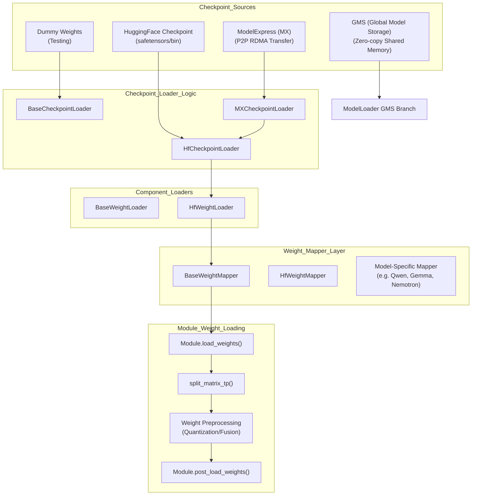
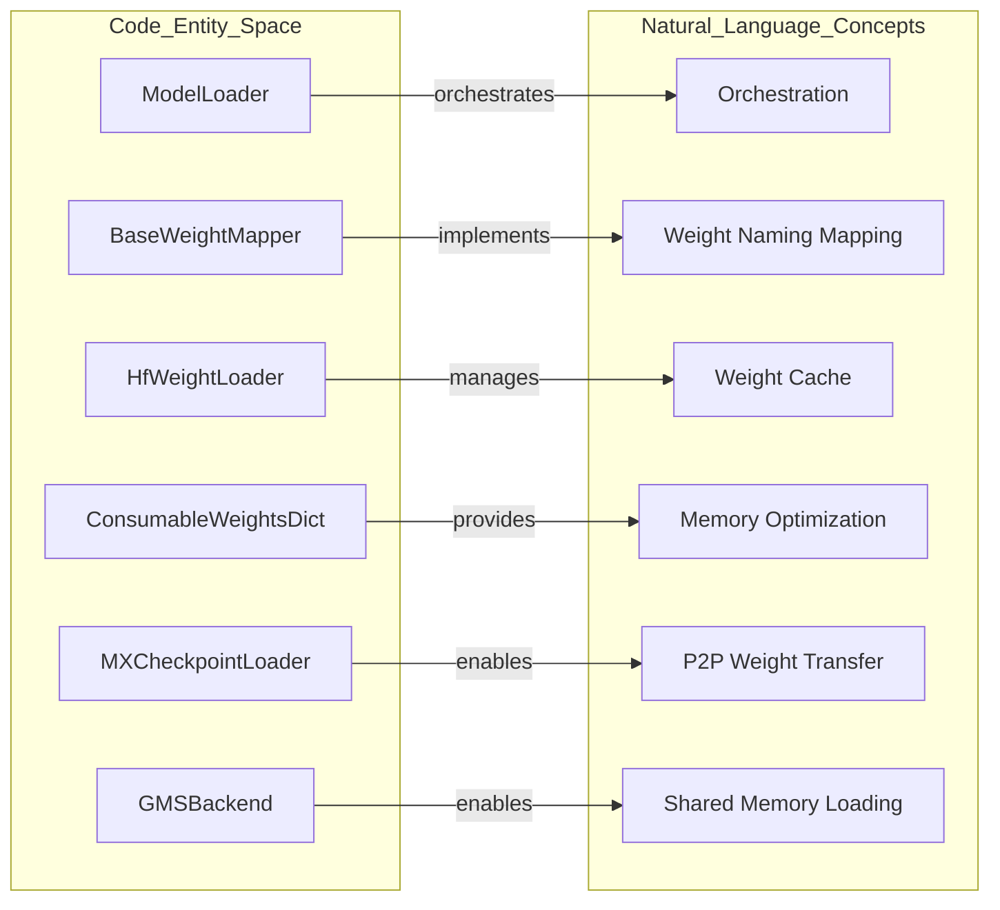

<!-- source: DeepWiki mcp.deepwiki.com · repo NVIDIA/TensorRT-LLM · page 8.4 Weight Loading Pipeline · fetched 2026-10-26 -->

# Weight Loading Pipeline

Relevant source files

The following files were used as context for generating this wiki page:

- [docs/source/features/model-express.md](docs/source/features/model-express.md)
- [examples/models/core/mistral_large_3/README.md](examples/models/core/mistral_large_3/README.md)
- [tensorrt_llm/_torch/mmap_utils.py](tensorrt_llm/_torch/mmap_utils.py)
- [tensorrt_llm/_torch/models/checkpoints/base_weight_loader.py](tensorrt_llm/_torch/models/checkpoints/base_weight_loader.py)
- [tensorrt_llm/_torch/models/checkpoints/base_weight_mapper.py](tensorrt_llm/_torch/models/checkpoints/base_weight_mapper.py)
- [tensorrt_llm/_torch/models/checkpoints/hf/afmoe_weight_mapper.py](tensorrt_llm/_torch/models/checkpoints/hf/afmoe_weight_mapper.py)
- [tensorrt_llm/_torch/models/checkpoints/hf/exaone_moe_weight_mapper.py](tensorrt_llm/_torch/models/checkpoints/hf/exaone_moe_weight_mapper.py)
- [tensorrt_llm/_torch/models/checkpoints/hf/qwen2_moe_weight_mapper.py](tensorrt_llm/_torch/models/checkpoints/hf/qwen2_moe_weight_mapper.py)
- [tensorrt_llm/_torch/models/checkpoints/hf/qwen3_moe_weight_mapper.py](tensorrt_llm/_torch/models/checkpoints/hf/qwen3_moe_weight_mapper.py)
- [tensorrt_llm/_torch/models/checkpoints/hf/qwen3vl_moe_weight_mapper.py](tensorrt_llm/_torch/models/checkpoints/hf/qwen3vl_moe_weight_mapper.py)
- [tensorrt_llm/_torch/models/checkpoints/hf/weight_loader.py](tensorrt_llm/_torch/models/checkpoints/hf/weight_loader.py)
- [tensorrt_llm/_torch/models/checkpoints/hf/weight_mapper.py](tensorrt_llm/_torch/models/checkpoints/hf/weight_mapper.py)
- [tensorrt_llm/_torch/models/checkpoints/mistral/checkpoint_loader.py](tensorrt_llm/_torch/models/checkpoints/mistral/checkpoint_loader.py)
- [tensorrt_llm/_torch/models/checkpoints/mistral/config_loader.py](tensorrt_llm/_torch/models/checkpoints/mistral/config_loader.py)
- [tensorrt_llm/_torch/models/checkpoints/mistral/weight_mapper.py](tensorrt_llm/_torch/models/checkpoints/mistral/weight_mapper.py)
- [tensorrt_llm/_torch/models/checkpoints/mx/checkpoint_loader.py](tensorrt_llm/_torch/models/checkpoints/mx/checkpoint_loader.py)
- [tensorrt_llm/_torch/models/modeling_mistral_large3.py](tensorrt_llm/_torch/models/modeling_mistral_large3.py)
- [tensorrt_llm/_torch/models/modeling_qwen3vl_moe.py](tensorrt_llm/_torch/models/modeling_qwen3vl_moe.py)
- [tensorrt_llm/_torch/pyexecutor/model_loader.py](tensorrt_llm/_torch/pyexecutor/model_loader.py)
- [tensorrt_llm/_torch/weight_sharing/__init__.py](tensorrt_llm/_torch/weight_sharing/__init__.py)
- [tensorrt_llm/_torch/weight_sharing/artifact_identity.py](tensorrt_llm/_torch/weight_sharing/artifact_identity.py)
- [tensorrt_llm/_torch/weight_sharing/post_transform_profiles.py](tensorrt_llm/_torch/weight_sharing/post_transform_profiles.py)
- [tensorrt_llm/_torch/weight_sharing/source_identity.py](tensorrt_llm/_torch/weight_sharing/source_identity.py)
- [tests/unittest/_torch/executor/test_model_loader_gms.py](tests/unittest/_torch/executor/test_model_loader_gms.py)
- [tests/unittest/_torch/executor/test_model_loader_mx.py](tests/unittest/_torch/executor/test_model_loader_mx.py)
- [tests/unittest/_torch/models/checkpoints/hf/test_weight_loader.py](tests/unittest/_torch/models/checkpoints/hf/test_weight_loader.py)
- [tests/unittest/_torch/models/checkpoints/mx/test_mx_checkpoint_loader.py](tests/unittest/_torch/models/checkpoints/mx/test_mx_checkpoint_loader.py)
- [tests/unittest/_torch/test_mmap_utils.py](tests/unittest/_torch/test_mmap_utils.py)
- [tests/unittest/_torch/weight_sharing/_source_identity_fakes.py](tests/unittest/_torch/weight_sharing/_source_identity_fakes.py)
- [tests/unittest/_torch/weight_sharing/test_artifact_identity.py](tests/unittest/_torch/weight_sharing/test_artifact_identity.py)
- [tests/unittest/_torch/weight_sharing/test_gms_source_identity_gate.py](tests/unittest/_torch/weight_sharing/test_gms_source_identity_gate.py)
- [tests/unittest/_torch/weight_sharing/test_mx_source_identity_gate.py](tests/unittest/_torch/weight_sharing/test_mx_source_identity_gate.py)
- [tests/unittest/_torch/weight_sharing/test_post_transform_profiles.py](tests/unittest/_torch/weight_sharing/test_post_transform_profiles.py)
- [tests/unittest/_torch/weight_sharing/test_source_identity.py](tests/unittest/_torch/weight_sharing/test_source_identity.py)
- [tests/unittest/utils/post_transform_qualification.py](tests/unittest/utils/post_transform_qualification.py)

## Purpose and Scope

The Weight Loading Pipeline handles the process of loading pre-trained weights from checkpoint files into TensorRT-LLM model instances. This includes tensor parallel sharding, weight transformations for quantization (such as FP8 and NVFP4), and model-specific preprocessing. The pipeline bridges checkpoint formats (HuggingFace, safetensors, ModelExpress, and GMS) to runtime tensor layouts required by different execution backends.

For information about the Linear layer implementations that consume these weights, see [8.3. Linear Layers and Quantization Methods](). For the overall model architecture that coordinates weight loading, see [8.1. Model Class Hierarchy and Configuration]().

## Weight Loading Architecture

The weight loading system follows a multi-stage pipeline. In the PyTorch-based execution engine (`PyExecutor`), the transition from source checkpoints to an active model in memory is orchestrated by the `ModelLoader` class [tensorrt_llm/_torch/pyexecutor/model_loader.py:38-43]().

Title: Weight Loading Data Flow

Sources: [tensorrt_llm/_torch/pyexecutor/model_loader.py:14-43](), [tensorrt_llm/_torch/models/checkpoints/hf/weight_loader.py:80-84](), [docs/source/features/model-express.md:8-20](), [tensorrt_llm/_torch/executor/test_model_loader_gms.py:93-105]()

## Weight Mappers

Weight mappers bridge the naming and structural differences between source checkpoints and the TensorRT-LLM internal model representation.

### BaseWeightMapper
The `BaseWeightMapper` is an abstract base class that defines the interface for mapping weights and manages the association between a model instance and its configuration [tensorrt_llm/_torch/models/checkpoints/base_weight_mapper.py:11-32]().

- **`map_weights`**: Initializes the dictionary mapping between internal names (e.g., `qkv_proj`) and checkpoint names (e.g., `q_proj`, `k_proj`, `v_proj`) [tensorrt_llm/_torch/models/checkpoints/base_weight_mapper.py:89-97]().
- **`apply_callbacks`**: Builds processed weight dicts for special child modules, such as those requiring fusion [tensorrt_llm/_torch/models/checkpoints/base_weight_mapper.py:99-125]().
- **`rename_by_params_map`**: Utility for regex-based key renaming to handle systematic naming differences between architectures [tensorrt_llm/_torch/models/checkpoints/base_weight_mapper.py:127-160]().

### Specialized Mappers
- **`HfWeightMapper`**: The default mapper for HuggingFace and MX formats. It handles standard `qkv_proj` and `gate_up_proj` mappings and includes callbacks for duplicating KV weights for tensor parallelism [tensorrt_llm/_torch/models/checkpoints/hf/weight_mapper.py:25-40]().
- **`MistralWeightMapper`**: Specialized for Mistral architectures, remapping keys such as `wq`/`wk`/`wv` to `q_proj`/`k_proj`/`v_proj` [tensorrt_llm/_torch/models/checkpoints/mistral/config_loader.py:164-173]().
- **`Qwen3NextHfWeightMapper`**: Specialized mapper for Qwen3-Next architectures [tests/unittest/_torch/models/checkpoints/hf/test_weight_loader.py:29-31]().

Sources: [tensorrt_llm/_torch/models/checkpoints/base_weight_mapper.py:11-160](), [tensorrt_llm/_torch/models/checkpoints/hf/weight_mapper.py:25-117](), [tensorrt_llm/_torch/models/checkpoints/mistral/config_loader.py:164-173]()

## Loading Performance and Caching

### HfWeightLoader and ConsumableWeightsDict
The `HfWeightLoader` loads weights from SafeTensors or PyTorch bin files [tensorrt_llm/_torch/models/checkpoints/hf/weight_loader.py:80-84](). To manage memory peaks, it utilizes `ConsumableWeightsDict`.

- **`ConsumableWeightsDict`**: A thread-safe wrapper that allows the model to "consume" (delete) weight tensors from CPU RAM immediately after they are copied to the GPU [tensorrt_llm/_torch/models/checkpoints/base_weight_loader.py:12-24](). It uses `bisect_left` for efficient prefix-based key filtering [tensorrt_llm/_torch/models/checkpoints/base_weight_loader.py:124-141]().
- **Weight Cache**: Controlled by `TRTLLM_HF_WEIGHT_CACHE`, this mechanism pins raw checkpoint weights in CPU RAM to speed up multi-rank initialization [tensorrt_llm/_torch/models/checkpoints/hf/weight_loader.py:41-48]().
- **Prefetching**: The loader warms the OS page cache using `mmap` and `madvise(MADV_POPULATE_READ)` to reduce disk I/O latency [tensorrt_llm/_torch/models/checkpoints/hf/weight_loader.py:50-57]().

### ModelExpress (MX) Loading
The MX integration reduces repeated disk reads by allowing workers to receive weights directly via P2P RDMA transfer [docs/source/features/model-express.md:8-12]().
- **Compatibility Gates**: MX applies qualification profiles (e.g., `llama-for-causal-lm-target-v1`) to ensure donor and receiver configurations (TP size, quantization, etc.) match exactly [docs/source/features/model-express.md:23-48]().
- **`MXCheckpointLoader`**: A thin adapter on top of the `modelexpress` client that falls back to `HfCheckpointLoader` if the MX server is unreachable [tensorrt_llm/_torch/models/checkpoints/mx/checkpoint_loader.py:15-28]().

### Global Model Storage (GMS)
GMS enables zero-copy shared memory weight loading. The `ModelLoader` handles GMS by connecting to a backend socket and materializing modules directly from the shared memory pool [tests/unittest/_torch/executor/test_model_loader_gms.py:93-105]().

Sources: [tensorrt_llm/_torch/models/checkpoints/hf/weight_loader.py:41-172](), [tensorrt_llm/_torch/models/checkpoints/base_weight_loader.py:12-174](), [docs/source/features/model-express.md:8-48](), [tensorrt_llm/_torch/models/checkpoints/mx/checkpoint_loader.py:15-28]()

## Weight Transformation and Lifecycle

The loading pipeline includes a post-load lifecycle for final tensor adjustments:
1. **`setup_aliases`**: Performs structural wiring and module aliasing [tests/unittest/_torch/executor/test_model_loader_mx.py:128-130]().
2. **`transform_weights`**: One-time tensor-layout changes (e.g., quantization-specific reordering) [docs/source/features/model-express.md:71-79]().
3. **`cache_derived_state`**: Computes process-local derived state [tests/unittest/_torch/executor/test_model_loader_mx.py:131-133]().
4. **`post_load_weights`**: Final hook for any remaining module initialization [tensorrt_llm/_torch/models/checkpoints/base_weight_mapper.py:79-87]().

Title: Weight Loading Pipeline Component Association

Sources: [tensorrt_llm/_torch/pyexecutor/model_loader.py:38-43](), [tensorrt_llm/_torch/models/checkpoints/hf/weight_loader.py:80-84](), [docs/source/features/model-express.md:8-20](), [tensorrt_llm/_torch/models/checkpoints/base_weight_loader.py:12-33](), [tests/unittest/_torch/executor/test_model_loader_gms.py:159-173]()

## Implementation Summary

| Class / Function | Responsibility | File Path |
| :--- | :--- | :--- |
| `ModelLoader` | Orchestrates model bring-up, config loading, and weight mapping across HF/MX/GMS. | [tensorrt_llm/_torch/pyexecutor/model_loader.py:38]() |
| `BaseWeightMapper` | Abstract interface for mapping checkpoint keys to model parameters. | [tensorrt_llm/_torch/models/checkpoints/base_weight_mapper.py:11]() |
| `HfWeightLoader` | Loads weights from disk with optional caching and prefetching. | [tensorrt_llm/_torch/models/checkpoints/hf/weight_loader.py:80]() |
| `ConsumableWeightsDict` | Memory optimization wrapper for CPU-to-GPU weight transfers. | [tensorrt_llm/_torch/models/checkpoints/base_weight_loader.py:12]() |
| `MXCheckpointLoader` | Handles ModelExpress P2P weight reception and metadata verification. | [tensorrt_llm/_torch/models/checkpoints/mx/checkpoint_loader.py:34]() |
| `SourceIdentity` | Binds runs to specific checkpoint artifacts and runtime layouts for compatibility. | [tensorrt_llm/_torch/weight_sharing/source_identity.py:15]() |

Sources: [tensorrt_llm/_torch/pyexecutor/model_loader.py:38-43](), [tensorrt_llm/_torch/models/checkpoints/hf/weight_loader.py:80-84](), [tensorrt_llm/_torch/models/checkpoints/base_weight_loader.py:12-33](), [tensorrt_llm/_torch/models/checkpoints/mx/checkpoint_loader.py:34-46](), [tensorrt_llm/_torch/weight_sharing/source_identity.py:15-30]()

---

