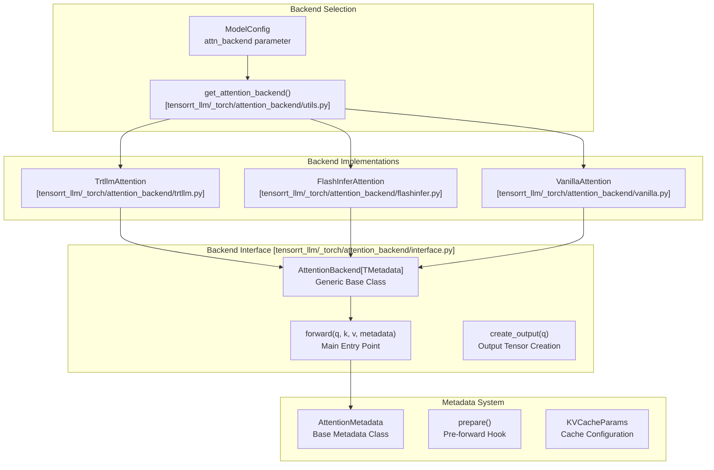
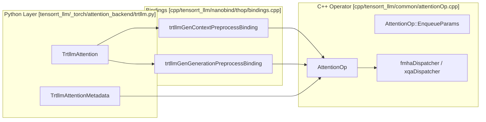

<!-- source: DeepWiki mcp.deepwiki.com · repo NVIDIA/TensorRT-LLM · page 9 Attention Backends · fetched 2026-10-26 -->

# Attention Backends

Relevant source files

The following files were used as context for generating this wiki page:

- [cpp/tensorrt_llm/common/attentionOp.cpp](cpp/tensorrt_llm/common/attentionOp.cpp)
- [cpp/tensorrt_llm/common/attentionOp.h](cpp/tensorrt_llm/common/attentionOp.h)
- [cpp/tensorrt_llm/kernels/contextFusedMultiHeadAttention/fused_multihead_attention_common.h](cpp/tensorrt_llm/kernels/contextFusedMultiHeadAttention/fused_multihead_attention_common.h)
- [cpp/tensorrt_llm/kernels/decoderMaskedMultiheadAttention/xqaParams.h](cpp/tensorrt_llm/kernels/decoderMaskedMultiheadAttention/xqaParams.h)
- [cpp/tensorrt_llm/kernels/fmhaDispatcher.cpp](cpp/tensorrt_llm/kernels/fmhaDispatcher.cpp)
- [cpp/tensorrt_llm/kernels/trtllmGenKernels/fmha/fmhaKernels.h](cpp/tensorrt_llm/kernels/trtllmGenKernels/fmha/fmhaKernels.h)
- [cpp/tensorrt_llm/kernels/trtllmGenKernels/fmha/fmhaRunnerParams.h](cpp/tensorrt_llm/kernels/trtllmGenKernels/fmha/fmhaRunnerParams.h)
- [cpp/tensorrt_llm/kernels/trtllmGenKernels/fmha/prepareCustomMask.cu](cpp/tensorrt_llm/kernels/trtllmGenKernels/fmha/prepareCustomMask.cu)
- [cpp/tensorrt_llm/kernels/unfusedAttentionKernels/unfusedAttentionKernels_2_template.h](cpp/tensorrt_llm/kernels/unfusedAttentionKernels/unfusedAttentionKernels_2_template.h)
- [cpp/tensorrt_llm/kernels/xqaDispatcher.cpp](cpp/tensorrt_llm/kernels/xqaDispatcher.cpp)
- [cpp/tensorrt_llm/nanobind/thop/bindings.cpp](cpp/tensorrt_llm/nanobind/thop/bindings.cpp)
- [cpp/tensorrt_llm/thop/attentionOp.cpp](cpp/tensorrt_llm/thop/attentionOp.cpp)
- [cpp/tensorrt_llm/thop/attentionOp.h](cpp/tensorrt_llm/thop/attentionOp.h)
- [cpp/tensorrt_llm/thop/trtllmGenFusedOps.h](cpp/tensorrt_llm/thop/trtllmGenFusedOps.h)
- [cpp/tensorrt_llm/thop/trtllmGenQKVProcessOp.cpp](cpp/tensorrt_llm/thop/trtllmGenQKVProcessOp.cpp)
- [tensorrt_llm/_torch/attention_backend/flashinfer.py](tensorrt_llm/_torch/attention_backend/flashinfer.py)
- [tensorrt_llm/_torch/attention_backend/interface.py](tensorrt_llm/_torch/attention_backend/interface.py)
- [tensorrt_llm/_torch/attention_backend/trtllm.py](tensorrt_llm/_torch/attention_backend/trtllm.py)
- [tensorrt_llm/_torch/metadata.py](tensorrt_llm/_torch/metadata.py)
- [tensorrt_llm/_torch/models/checkpoints/hf/gemma4_weight_mapper.py](tensorrt_llm/_torch/models/checkpoints/hf/gemma4_weight_mapper.py)
- [tensorrt_llm/_torch/models/modeling_clip.py](tensorrt_llm/_torch/models/modeling_clip.py)
- [tensorrt_llm/_torch/models/modeling_gemma4.py](tensorrt_llm/_torch/models/modeling_gemma4.py)
- [tensorrt_llm/_torch/models/modeling_gemma4_audio.py](tensorrt_llm/_torch/models/modeling_gemma4_audio.py)
- [tensorrt_llm/_torch/models/modeling_gemma4_unified.py](tensorrt_llm/_torch/models/modeling_gemma4_unified.py)
- [tensorrt_llm/_torch/models/modeling_gemma4_vision.py](tensorrt_llm/_torch/models/modeling_gemma4_vision.py)
- [tensorrt_llm/_torch/models/modeling_gemma4mm.py](tensorrt_llm/_torch/models/modeling_gemma4mm.py)
- [tensorrt_llm/_torch/models/modeling_multimodal_encoder.py](tensorrt_llm/_torch/models/modeling_multimodal_encoder.py)
- [tensorrt_llm/_torch/models/modeling_pixtral.py](tensorrt_llm/_torch/models/modeling_pixtral.py)
- [tensorrt_llm/_torch/models/modeling_siglip.py](tensorrt_llm/_torch/models/modeling_siglip.py)
- [tests/unittest/_torch/attention/test_flashinfer_attention.py](tests/unittest/_torch/attention/test_flashinfer_attention.py)
- [tests/unittest/_torch/modeling/test_gemma4_multimodal.py](tests/unittest/_torch/modeling/test_gemma4_multimodal.py)
- [tests/unittest/_torch/modeling/test_modeling_clip.py](tests/unittest/_torch/modeling/test_modeling_clip.py)
- [tests/unittest/_torch/modeling/test_modeling_gemma4.py](tests/unittest/_torch/modeling/test_modeling_gemma4.py)
- [tests/unittest/_torch/modeling/test_modeling_gemma4_unified.py](tests/unittest/_torch/modeling/test_modeling_gemma4_unified.py)
- [tests/unittest/_torch/modeling/test_modeling_pixtral.py](tests/unittest/_torch/modeling/test_modeling_pixtral.py)
- [tests/unittest/_torch/modeling/test_modeling_siglip.py](tests/unittest/_torch/modeling/test_modeling_siglip.py)

## Purpose and Scope

This document describes the pluggable attention backend system in TensorRT-LLM's PyTorch execution engine. The system provides multiple implementations of multi-head attention (MHA), multi-query attention (MQA), grouped-query attention (GQA), and Multi-head Latent Attention (MLA) operations that can be selected at runtime. This page covers the backend architecture, metadata handling, and the primary backend implementations: TRTLLM (including TRTLLM-Gen for Blackwell), FlashInfer, and Vanilla.

For details on the interface, see [Attention Backend Interface](#9.1). For details on the TRTLLM implementation, see [TRTLLM Attention Backend](#9.2). For details on FlashInfer, see [FlashInfer Attention Backend](#9.3). For details on specific optimizations, see [Attention Features and Optimizations](#9.4).

Sources: [tensorrt_llm/_torch/attention_backend/interface.py:1-35](), [tensorrt_llm/_torch/attention_backend/trtllm.py:1-28]()

## Attention Backend Architecture

The attention backend system follows a pluggable architecture where different implementations can be selected based on hardware capabilities, model requirements, and performance characteristics. The selection logic is managed through configuration and factory utilities.

### Architecture Overview

**Attention Backend Architecture**

Sources: [tensorrt_llm/_torch/attention_backend/interface.py:60-168](), [tensorrt_llm/_torch/attention_backend/interface.py:668-754](), [tensorrt_llm/_torch/attention_backend/trtllm.py:81-160](), [tensorrt_llm/_torch/attention_backend/flashinfer.py:155-225]()

## Backend Interface and Metadata

The system relies on a common interface and metadata structure to ensure interoperability between different execution paths.

### AttentionBackend Base Class
The `AttentionBackend` generic base class defines the contract for all implementations. It manages initialization of head dimensions, quantization configurations, and capability queries such as `support_mla()`. [tensorrt_llm/_torch/attention_backend/interface.py:668-754]()
For details, see [Attention Backend Interface](#9.1).

Sources: [tensorrt_llm/_torch/attention_backend/interface.py:668-754]()

### AttentionMetadata Base Class
`AttentionMetadata` contains batch information and cache parameters. It tracks `seq_lens`, `num_contexts`, and `kv_cache_manager` instances. [tensorrt_llm/_torch/attention_backend/interface.py:66-108]() It includes fields for speculative decoding such as `draft_kv_cache_manager` and `is_cuda_graph` flags. [tensorrt_llm/_torch/attention_backend/interface.py:79-92]()
For details, see [Attention Backend Interface](#9.1).

Sources: [tensorrt_llm/_torch/attention_backend/interface.py:66-168]()

## TRTLLM Attention Backend

The TRTLLM backend utilizes optimized C++ CUDA kernels. It supports the widest range of features, including XQA (cross-query attention), Multi-head Latent Attention (MLA), and speculative decoding. [tensorrt_llm/_torch/attention_backend/trtllm.py:81-160]()

### TRTLLM-Gen (Blackwell Optimization)
On Blackwell architectures (SM100/SM103), the backend dispatches to specialized runners like `TllmGenFmhaKernel`. This path supports advanced features like specialized FP8/NVFP4 KV cache formats, SageAttention, and JIT warmup controls. [tensorrt_llm/_torch/attention_backend/trtllm.py:141-142](), [cpp/tensorrt_llm/kernels/trtllmGenKernels/fmha/fmhaKernels.h:98-150]()
For details, see [TRTLLM Attention Backend](#9.2).

Sources: [tensorrt_llm/_torch/attention_backend/trtllm.py:141-142](), [cpp/tensorrt_llm/kernels/trtllmGenKernels/fmha/fmhaKernels.h:98-150]()

### C++ AttentionOp and Preprocessing
The backend bridges Python to C++ via `thop` bindings. Internally, the C++ execution path handles preprocessing of QKV inputs, RoPE application, and KV cache updates via `AttentionOp`. [cpp/tensorrt_llm/common/attentionOp.cpp:45-49](), [cpp/tensorrt_llm/thop/attentionOp.cpp:48-96]()

**TRTLLM Backend Logic Flow**

Sources: [tensorrt_llm/_torch/attention_backend/trtllm.py:81-160](), [cpp/tensorrt_llm/nanobind/thop/bindings.cpp:48-118](), [cpp/tensorrt_llm/common/attentionOp.cpp:17-49]()

## FlashInfer Attention Backend

The FlashInfer backend integrates the FlashInfer library, focusing on high-throughput serving workloads with paged KV caches.

### Planning and Wrappers
FlashInfer uses a planning-based approach where `FlashInferAttentionMetadata` manages wrappers for decode and prefill. [tensorrt_llm/_torch/attention_backend/flashinfer.py:168-192]() The backend manages specialized plan parameters for Multi-head Latent Attention (MLA) and ragged KV data. [tensorrt_llm/_torch/attention_backend/flashinfer.py:156-165]()
For details, see [FlashInfer Attention Backend](#9.3).

Sources: [tensorrt_llm/_torch/attention_backend/flashinfer.py:156-225]()

## Attention Features and Optimizations

### Advanced Features
- **RoPE and Positional Embeddings:** Support for various RoPE scaling types and multi-modal RoPE (MRoPE) via `mrope_rotary_cos_sin` and `mrope_position_deltas`. [tensorrt_llm/_torch/attention_backend/trtllm.py:130-139](), [tensorrt_llm/_torch/attention_backend/interface.py:20-22]()
- **Multi-head Latent Attention (MLA):** Optimized for architectures like DeepSeek-V3/V4 using low-rank KV compression and `flash_mla`. [cpp/tensorrt_llm/common/attentionOp.cpp:28-30](), [tensorrt_llm/_torch/attention_backend/interface.py:88-90]()
- **Speculative Decoding:** Support for tree-based speculative decoding with packed masks and position offsets via `TrtllmAttentionMetadata`. [tensorrt_llm/_torch/attention_backend/trtllm.py:114-135]()
- **Sparse Attention:** Support for sparse KV indices and attention patterns, including DSA (Dynamic Sparse Attention) for Blackwell. [cpp/tensorrt_llm/common/attentionOp.cpp:32](), [tensorrt_llm/_torch/attention_backend/trtllm.py:48-50]()
- **Helix Parallelism:** A specialized attention data parallelism strategy for context phases, utilizing `helix_position_offsets` and `helix_is_inactive_rank` metadata to split sequence attention across ranks. [tensorrt_llm/_torch/attention_backend/trtllm.py:144-160](), [cpp/tensorrt_llm/nanobind/thop/bindings.cpp:23]()

For details, see [Attention Features and Optimizations](#9.4).

Sources: [tensorrt_llm/_torch/attention_backend/interface.py:47-55](), [tensorrt_llm/_torch/attention_backend/trtllm.py:114-160](), [cpp/tensorrt_llm/common/attentionOp.cpp:26-33]()

---

