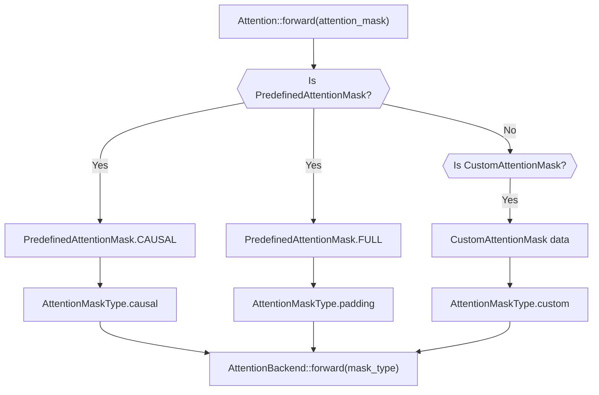
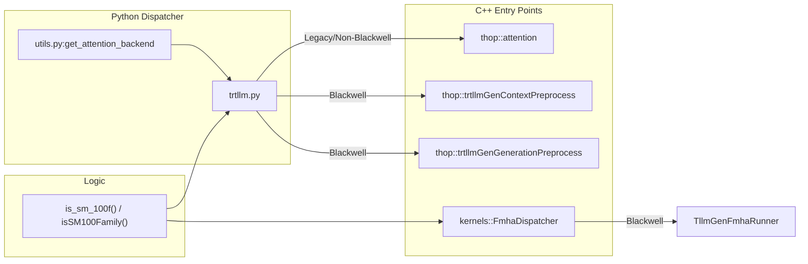
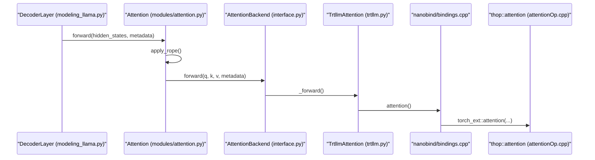

<!-- source: DeepWiki mcp.deepwiki.com · repo NVIDIA/TensorRT-LLM · page 9.1 Attention Backend Interface · fetched 2026-10-26 -->

# Attention Backend Interface

<details>
<summary>Relevant source files</summary>

The following files were used as context for generating this wiki page:

- [cpp/tensorrt_llm/common/attentionOp.cpp](cpp/tensorrt_llm/common/attentionOp.cpp)
- [cpp/tensorrt_llm/common/attentionOp.h](cpp/tensorrt_llm/common/attentionOp.h)
- [cpp/tensorrt_llm/kernels/contextFusedMultiHeadAttention/fused_multihead_attention_common.h](cpp/tensorrt_llm/kernels/contextFusedMultiHeadAttention/fused_multihead_attention_common.h)
- [cpp/tensorrt_llm/kernels/decoderMaskedMultiheadAttention/xqaParams.h](cpp/tensorrt_llm/kernels/decoderMaskedMultiheadAttention/xqaParams.h)
- [cpp/tensorrt_llm/kernels/fmhaDispatcher.cpp](cpp/tensorrt_llm/kernels/fmhaDispatcher.cpp)
- [cpp/tensorrt_llm/kernels/trtllmGenKernels/fmha/fmhaKernels.h](cpp/tensorrt_llm/kernels/trtllmGenKernels/fmha/fmhaKernels.h)
- [cpp/tensorrt_llm/kernels/trtllmGenKernels/fmha/fmhaRunnerParams.h](cpp/tensorrt_llm/kernels/trtllmGenKernels/fmha/fmhaRunnerParams.h)
- [cpp/tensorrt_llm/kernels/trtllmGenKernels/fmha/prepareCustomMask.cu](cpp/tensorrt_llm/kernels/trtllmGenKernels/fmha/prepareCustomMask.cu)
- [cpp/tensorrt_llm/kernels/unfusedAttentionKernels/unfusedAttentionKernels_2_template.h](cpp/tensorrt_llm/kernels/unfusedAttentionKernels/unfusedAttentionKernels_2_template.h)
- [cpp/tensorrt_llm/kernels/xqaDispatcher.cpp](cpp/tensorrt_llm/kernels/xqaDispatcher.cpp)
- [cpp/tensorrt_llm/nanobind/thop/bindings.cpp](cpp/tensorrt_llm/nanobind/thop/bindings.cpp)
- [cpp/tensorrt_llm/thop/attentionOp.cpp](cpp/tensorrt_llm/thop/attentionOp.cpp)
- [cpp/tensorrt_llm/thop/attentionOp.h](cpp/tensorrt_llm/thop/attentionOp.h)
- [cpp/tensorrt_llm/thop/trtllmGenFusedOps.h](cpp/tensorrt_llm/thop/trtllmGenFusedOps.h)
- [cpp/tensorrt_llm/thop/trtllmGenQKVProcessOp.cpp](cpp/tensorrt_llm/thop/trtllmGenQKVProcessOp.cpp)
- [tensorrt_llm/_torch/attention_backend/fmha/__init__.py](tensorrt_llm/_torch/attention_backend/fmha/__init__.py)
- [tensorrt_llm/_torch/attention_backend/fmha/combined.py](tensorrt_llm/_torch/attention_backend/fmha/combined.py)
- [tensorrt_llm/_torch/attention_backend/fmha/cute_dsl_mla.py](tensorrt_llm/_torch/attention_backend/fmha/cute_dsl_mla.py)
- [tensorrt_llm/_torch/attention_backend/fmha/flashinfer_trtllm_gen.py](tensorrt_llm/_torch/attention_backend/fmha/flashinfer_trtllm_gen.py)
- [tensorrt_llm/_torch/attention_backend/fmha/interface.py](tensorrt_llm/_torch/attention_backend/fmha/interface.py)
- [tensorrt_llm/_torch/attention_backend/fmha/phased.py](tensorrt_llm/_torch/attention_backend/fmha/phased.py)
- [tensorrt_llm/_torch/attention_backend/fmha/registry.py](tensorrt_llm/_torch/attention_backend/fmha/registry.py)
- [tensorrt_llm/_torch/attention_backend/interface.py](tensorrt_llm/_torch/attention_backend/interface.py)
- [tensorrt_llm/_torch/attention_backend/trtllm.py](tensorrt_llm/_torch/attention_backend/trtllm.py)
- [tensorrt_llm/_torch/attention_backend/utils.py](tensorrt_llm/_torch/attention_backend/utils.py)
- [tensorrt_llm/_torch/modules/ATTENTION_DEVELOPER_GUIDE.md](tensorrt_llm/_torch/modules/ATTENTION_DEVELOPER_GUIDE.md)
- [tensorrt_llm/_torch/modules/kimi_k3_mla/kimi_k3_mla_attention.py](tensorrt_llm/_torch/modules/kimi_k3_mla/kimi_k3_mla_attention.py)
- [tensorrt_llm/_torch/modules/mla.py](tensorrt_llm/_torch/modules/mla.py)
- [tests/unittest/_torch/attention/test_combined_fmha.py](tests/unittest/_torch/attention/test_combined_fmha.py)
- [tests/unittest/_torch/attention/test_fmha_page_index.py](tests/unittest/_torch/attention/test_fmha_page_index.py)

</details>


This document describes the abstract interface that all attention backends must implement in TensorRT-LLM's PyTorch execution system (`_torch`). The interface defines contracts for attention metadata, configuration parameters, and the forward computation required for multi-head, multi-query, and group-query attention.

For information about specific backend implementations (TRTLLM, FlashInfer), see [TRTLLM Attention Backend](#9.2) and [FlashInfer Attention Backend](#9.3).

## Core Interface Classes

The attention backend system is built around two primary abstract classes: `AttentionBackend` and `AttentionMetadata`. All concrete backend implementations must inherit from these base classes.

### AttentionBackend Abstract Class

The `AttentionBackend` class defines the interface that all attention implementations must satisfy. It is a generic class parameterized by a metadata type `TMetadata` that extends `AttentionMetadata`.

| Class | Purpose | Source |
| :--- | :--- | :--- |
| `AttentionBackend` | Abstract base class for all attention implementations. | [tensorrt_llm/_torch/attention_backend/interface.py:668-754]() |
| `TrtllmAttention` | Implementation using TRT-LLM C++ kernels or `trtllm_gen`. | [tensorrt_llm/_torch/attention_backend/trtllm.py:228-239]() |
| `FlashInferAttention` | Implementation using FlashInfer kernels. | [tensorrt_llm/_torch/attention_backend/flashinfer.py:348-356]() |
| `VanillaAttention` | PyTorch-native implementation for reference and CPU testing. | [tensorrt_llm/_torch/attention_backend/vanilla.py:78-101]() |

**Key Methods:**

- `forward(q, k, v, metadata, attention_mask, ...)`: The main computation method that performs attention and updates KV cache. It accepts tensors for query, key, and value along with metadata and masks. [tensorrt_llm/_torch/attention_backend/interface.py:710-724]()
- `create_output(q, metadata, attention_mask)`: Creates pre-allocated output tensors with appropriate shapes and dtypes. [tensorrt_llm/_torch/attention_backend/interface.py:726-733]()
- `update_quant_config(new_quant_config)`: Updates quantization configuration, supporting mixed quantization modes. [tensorrt_llm/_torch/attention_backend/interface.py:747-754]()
- Class methods `support_fused_rope()`, `support_fused_qkv()`, `support_mla()`: Indicate backend capabilities to the model layer. [tensorrt_llm/_torch/attention_backend/interface.py:735-745]()

### AttentionMetadata Class

`AttentionMetadata` encapsulates all runtime information needed for attention computation, including sequence lengths, KV cache management, and request tracking.

**Attention Metadata Hierarchy**

```mermaid
classDiagram
    class "AttentionMetadata" as AttentionMetadata {
        +max_num_requests: int
        +max_num_tokens: int
        +kv_cache_manager: KVCacheManager
        +mapping: Optional[Mapping]
        +is_cuda_graph: bool
        +seq_lens: torch.Tensor
        +seq_lens_kv: torch.Tensor
        +num_contexts: int
        +num_generations: int
        +position_ids: Optional[Tensor]
        +kv_cache_params: KVCacheParams
        +request_ids: List[int]
        +runtime_features: AttentionRuntimeFeatures
    }
    
    class "FlashInferAttentionMetadata" as FlashInferAttentionMetadata {
        +workspace_buffer: Tensor
        +paged_kv_indices: Tensor
        +paged_kv_last_page_len: Tensor
        +qo_indptr: Tensor
        +kv_indptr: Tensor
        +get_prefill_wrapper(plan_params)
        +get_decode_wrapper(plan_params)
    }
    
    class "TrtllmAttentionMetadata" as TrtllmAttentionMetadata {
        +workspace: Optional[Tensor]
        +cuda_graph_workspace: Optional[Tensor]
        +beam_width: int
        +is_spec_decoding_enabled: bool
        +flash_mla_tile_scheduler_metadata: Tensor
        +enable_helix: bool
        +spec_decoding_packed_mask: Tensor
    }

    class "VanillaAttentionMetadata" as VanillaAttentionMetadata {
        +block_ids_per_seq: Tensor
        +prepare()
    }

    AttentionMetadata <|-- FlashInferAttentionMetadata
    AttentionMetadata <|-- TrtllmAttentionMetadata
    AttentionMetadata <|-- VanillaAttentionMetadata
```

**Key Fields:**

- `seq_lens`: Tensor of shape `(batch_size,)` containing the length of each query sequence. [tensorrt_llm/_torch/attention_backend/interface.py:93-97]()
- `kv_cache_manager`: Manages KV cache allocation and block indices. Supports `KVCacheManager` or `KVCacheManagerV2`. [tensorrt_llm/_torch/attention_backend/interface.py:77-78]()
- `runtime_features`: Flags for `chunked_prefill`, `cache_reuse`, and speculative draft tokens. [tensorrt_llm/_torch/attention_backend/interface.py:46-54]()

Sources: [tensorrt_llm/_torch/attention_backend/interface.py:65-168](), [tensorrt_llm/_torch/attention_backend/trtllm.py:81-168]()

## Configuration Classes

### RopeParams

`RopeParams` encapsulates all parameters for Rotary Position Embedding (RoPE), supporting various scaling strategies and multi-modal extensions.

| Parameter | Type | Description |
| :--- | :--- | :--- |
| `dim` | `int` | Dimension of the RoPE embedding. |
| `theta` | `float` | Base theta value for RoPE. |
| `scale_type` | `RotaryScalingType` | Enum for scaling strategy (linear, yarn, etc.). |
| `max_positions` | `int` | Maximum sequence length supported. |

**Precomputation:**

`create_rope_const_params()` generates precomputed inverse frequencies and cos/sin values for efficient RoPE application. [tensorrt_llm/_torch/attention_backend/interface.py:534-617]()

Sources: [tensorrt_llm/_torch/attention_backend/interface.py:458-532]()

### Positional Embedding and MLA

`PositionalEmbeddingParams` specifies the type and configuration of positional embeddings, including multi-modal RoPE (mRoPE) used in models like Qwen2-VL. [tensorrt_llm/_torch/attention_backend/interface.py:620-641]()

Multi-head Latent Attention (MLA) parameters define compression ranks and head dimensions for DeepSeek-style models. [tensorrt_llm/_torch/attention_backend/interface.py:756-765]()

## Runtime Parameters

### AttentionInputType

Enum indicating the composition of requests in a batch, affecting kernel selection. This matches the `AttentionInputType` in the C++ `attentionOp.cpp`. [tensorrt_llm/_torch/attention_backend/interface.py:58-61]()

```python
class AttentionInputType(IntEnum):
    mixed = 0           # Contains both context and generation requests
    context_only = 1    # Only context-phase (prefill) requests
    generation_only = 2 # Only generation-phase (decode) requests
```

Sources: [tensorrt_llm/_torch/attention_backend/interface.py:58-61](), [cpp/tensorrt_llm/thop/attentionOp.cpp:45-46]()

### AttentionMask Types

The system supports `PredefinedAttentionMask` (e.g., `CAUSAL`, `PADDED`) and `CustomAttentionMask` for user-provided mask data. [tensorrt_llm/_torch/attention_backend/interface.py:646-665]()

**Data Flow: Attention Mask Resolution**



Sources: [tensorrt_llm/_torch/attention_backend/interface.py:646-665](), [cpp/tensorrt_llm/common/attentionOp.h:51]()

## Backend Selection Mechanism

The `AttentionBackend` is selected based on model configuration and hardware capabilities. The function `get_attention_backend` in `utils.py` handles the logic, mapping strings like "TRTLLM" or "FLASHINFER" to their respective classes. [tensorrt_llm/_torch/attention_backend/utils.py:18-38]()

For Blackwell architectures (SM100/SM103), the system prioritizes specialized `trtllm_gen` paths within the TRTLLM backend.

### TrtllmGen Selection Logic

The choice between the standard `thop.attention` path and the specialized `trtllm_gen` path (using kernels optimized for Blackwell) is determined by hardware family checks. The C++ dispatcher `FmhaDispatcher` utilizes `isSM100Family()` to toggle `mUseTllmGen`. [cpp/tensorrt_llm/kernels/fmhaDispatcher.cpp:55-57]()

**Natural Language to Code Entity Space: Backend Selection**



Sources: [cpp/tensorrt_llm/kernels/fmhaDispatcher.cpp:50-68](), [cpp/tensorrt_llm/nanobind/thop/bindings.cpp:48-118](), [tensorrt_llm/_torch/attention_backend/trtllm.py:32-35](), [tensorrt_llm/_torch/attention_backend/utils.py:18-38]()

## Attention Computation Pipeline

The following diagram illustrates the data flow from the PyTorch layer through the abstract interface to the backend implementations.

**Natural Language to Code Entity Space: Execution Flow**



Sources: [tensorrt_llm/_torch/attention_backend/interface.py:710-724](), [tensorrt_llm/_torch/attention_backend/trtllm.py:228-239](), [cpp/tensorrt_llm/thop/attentionOp.cpp:48-98]()

## Workspace Management

The C++ backend uses workspace tensors to manage memory slices for intermediate calculations. This is critical for CUDA Graph support, where workspace pointers must remain stable across replays. The `TrtllmAttentionWorkspaceManager` in `attentionOp.cpp` provides utilities like `makeWorkspaceView` to slice the main workspace tensor into typed views. [cpp/tensorrt_llm/thop/attentionOp.cpp:115-133]()

| Workspace Type | Purpose | Metadata Field |
| :--- | :--- | :--- |
| **Workspace** | General intermediate buffer for FMHA/XQA. | `TrtllmAttentionMetadata.workspace` |
| **CUDA Graph** | Stable buffer for graph replay. | `TrtllmAttentionMetadata.cuda_graph_workspace` |
| **XQA Workspace** | Specific buffers for generation kernels. | `AttentionXqaWorkspaceSizes` |

Sources: [tensorrt_llm/_torch/attention_backend/trtllm.py:81-83](), [cpp/tensorrt_llm/common/attentionOp.cpp:42-47](), [cpp/tensorrt_llm/thop/attentionOp.cpp:135-157]()

## Speculative Decoding Support

The attention interface includes specific hooks for speculative decoding. `AttentionMetadata` supports `draft_kv_cache_manager` for cases where the draft and target models use separate KV cache layouts. [tensorrt_llm/_torch/attention_backend/interface.py:79-80]()

`TrtllmAttentionMetadata` includes fields for speculative decoding such as:
- `spec_decoding_packed_mask`: Packed mask for tree-based speculative decoding. [tensorrt_llm/_torch/attention_backend/trtllm.py:135]()
- `spec_decoding_position_offsets`: Position offsets for draft tokens. [tensorrt_llm/_torch/attention_backend/trtllm.py:129]()
- `is_spec_decoding_enabled`: Global flag for speculative decoding support. [tensorrt_llm/_torch/attention_backend/trtllm.py:117]()

Sources: [tensorrt_llm/_torch/attention_backend/interface.py:79-80](), [tensorrt_llm/_torch/attention_backend/trtllm.py:114-139](), [cpp/tensorrt_llm/kernels/decoderMaskedMultiheadAttention/xqaParams.h:58-66]()

---

