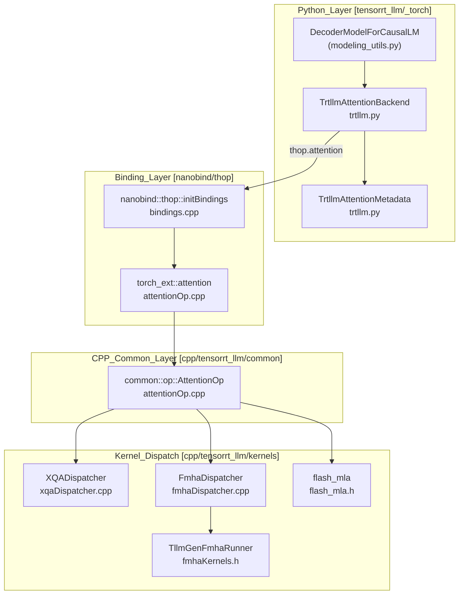
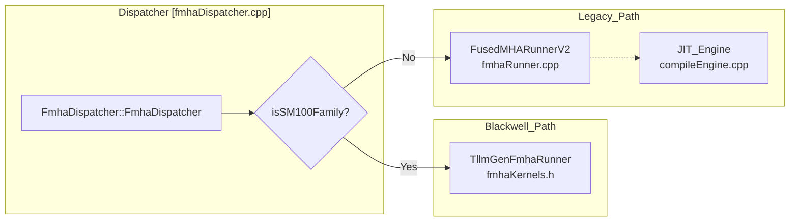

<!-- source: DeepWiki mcp.deepwiki.com · repo NVIDIA/TensorRT-LLM · page 9.2 TRTLLM Attention Backend · fetched 2026-10-26 -->

# TRTLLM Attention Backend

Relevant source files

The following files were used as context for generating this wiki page:

- [cpp/kernels/fmha_v2/README.md](cpp/kernels/fmha_v2/README.md)
- [cpp/kernels/fmha_v2/fmha_test.py](cpp/kernels/fmha_v2/fmha_test.py)
- [cpp/kernels/fmha_v2/setup.py](cpp/kernels/fmha_v2/setup.py)
- [cpp/kernels/fmha_v2/src/fmha/fragment.h](cpp/kernels/fmha_v2/src/fmha/fragment.h)
- [cpp/kernels/fmha_v2/src/fmha/hopper/fragment.h](cpp/kernels/fmha_v2/src/fmha/hopper/fragment.h)
- [cpp/kernels/fmha_v2/src/fmha/hopper/kernel_traits.h](cpp/kernels/fmha_v2/src/fmha/hopper/kernel_traits.h)
- [cpp/kernels/fmha_v2/src/fmha/mask.h](cpp/kernels/fmha_v2/src/fmha/mask.h)
- [cpp/kernels/fmha_v2/src/fmha/warpspec/compute.h](cpp/kernels/fmha_v2/src/fmha/warpspec/compute.h)
- [cpp/kernels/fmha_v2/src/fmha/warpspec/dma.h](cpp/kernels/fmha_v2/src/fmha/warpspec/dma.h)
- [cpp/kernels/fmha_v2/src/fmha/warpspec/epilogue.h](cpp/kernels/fmha_v2/src/fmha/warpspec/epilogue.h)
- [cpp/kernels/fmha_v2/src/fmha/warpspec/kernel_traits.h](cpp/kernels/fmha_v2/src/fmha/warpspec/kernel_traits.h)
- [cpp/kernels/fmha_v2/src/fused_multihead_attention.cpp](cpp/kernels/fmha_v2/src/fused_multihead_attention.cpp)
- [cpp/kernels/fmha_v2/src/fused_multihead_attention.h](cpp/kernels/fmha_v2/src/fused_multihead_attention.h)
- [cpp/kernels/fmha_v2/src/fused_multihead_attention_demo_bert_params.h](cpp/kernels/fmha_v2/src/fused_multihead_attention_demo_bert_params.h)
- [cpp/kernels/fmha_v2/src/fused_multihead_attention_utils.h](cpp/kernels/fmha_v2/src/fused_multihead_attention_utils.h)
- [cpp/kernels/fmha_v2/src/softmax_impl.h](cpp/kernels/fmha_v2/src/softmax_impl.h)
- [cpp/kernels/xqa/CMakeLists.txt](cpp/kernels/xqa/CMakeLists.txt)
- [cpp/kernels/xqa/README.md](cpp/kernels/xqa/README.md)
- [cpp/kernels/xqa/RefChecker.cuh](cpp/kernels/xqa/RefChecker.cuh)
- [cpp/kernels/xqa/defines.h](cpp/kernels/xqa/defines.h)
- [cpp/kernels/xqa/gen_cubins.py](cpp/kernels/xqa/gen_cubins.py)
- [cpp/kernels/xqa/gmma_impl.cuh](cpp/kernels/xqa/gmma_impl.cuh)
- [cpp/kernels/xqa/ldgsts.cuh](cpp/kernels/xqa/ldgsts.cuh)
- [cpp/kernels/xqa/mha.cu](cpp/kernels/xqa/mha.cu)
- [cpp/kernels/xqa/mha.h](cpp/kernels/xqa/mha.h)
- [cpp/kernels/xqa/mhaUtils.cuh](cpp/kernels/xqa/mhaUtils.cuh)
- [cpp/kernels/xqa/mha_sm90.cu](cpp/kernels/xqa/mha_sm90.cu)
- [cpp/kernels/xqa/mha_stdheaders.cuh](cpp/kernels/xqa/mha_stdheaders.cuh)
- [cpp/kernels/xqa/tensorMap.cpp](cpp/kernels/xqa/tensorMap.cpp)
- [cpp/kernels/xqa/test/refAttention.cpp](cpp/kernels/xqa/test/refAttention.cpp)
- [cpp/kernels/xqa/test/refAttention.h](cpp/kernels/xqa/test/refAttention.h)
- [cpp/kernels/xqa/test/test.cpp](cpp/kernels/xqa/test/test.cpp)
- [cpp/tensorrt_llm/common/attentionOp.cpp](cpp/tensorrt_llm/common/attentionOp.cpp)
- [cpp/tensorrt_llm/common/attentionOp.h](cpp/tensorrt_llm/common/attentionOp.h)
- [cpp/tensorrt_llm/kernels/contextFusedMultiHeadAttention/fmhaRunner.cpp](cpp/tensorrt_llm/kernels/contextFusedMultiHeadAttention/fmhaRunner.cpp)
- [cpp/tensorrt_llm/kernels/contextFusedMultiHeadAttention/fused_multihead_attention_common.h](cpp/tensorrt_llm/kernels/contextFusedMultiHeadAttention/fused_multihead_attention_common.h)
- [cpp/tensorrt_llm/kernels/decoderMaskedMultiheadAttention/decoderXQAImplJIT/compileEngine.cpp](cpp/tensorrt_llm/kernels/decoderMaskedMultiheadAttention/decoderXQAImplJIT/compileEngine.cpp)
- [cpp/tensorrt_llm/kernels/decoderMaskedMultiheadAttention/decoderXQAImplJIT/kernelUtils.cpp](cpp/tensorrt_llm/kernels/decoderMaskedMultiheadAttention/decoderXQAImplJIT/kernelUtils.cpp)
- [cpp/tensorrt_llm/kernels/decoderMaskedMultiheadAttention/decoderXQAImplJIT/nvrtcWrapper/include/nvrtcWrapper.h](cpp/tensorrt_llm/kernels/decoderMaskedMultiheadAttention/decoderXQAImplJIT/nvrtcWrapper/include/nvrtcWrapper.h)
- [cpp/tensorrt_llm/kernels/decoderMaskedMultiheadAttention/decoderXQAImplJIT/nvrtcWrapper/src/nvrtcWrapper.cpp](cpp/tensorrt_llm/kernels/decoderMaskedMultiheadAttention/decoderXQAImplJIT/nvrtcWrapper/src/nvrtcWrapper.cpp)
- [cpp/tensorrt_llm/kernels/decoderMaskedMultiheadAttention/decoderXQARunner.cpp](cpp/tensorrt_llm/kernels/decoderMaskedMultiheadAttention/decoderXQARunner.cpp)
- [cpp/tensorrt_llm/kernels/decoderMaskedMultiheadAttention/decoderXQARunnerUtils.h](cpp/tensorrt_llm/kernels/decoderMaskedMultiheadAttention/decoderXQARunnerUtils.h)
- [cpp/tensorrt_llm/kernels/decoderMaskedMultiheadAttention/xqaParams.h](cpp/tensorrt_llm/kernels/decoderMaskedMultiheadAttention/xqaParams.h)
- [cpp/tensorrt_llm/kernels/fmhaDispatcher.cpp](cpp/tensorrt_llm/kernels/fmhaDispatcher.cpp)
- [cpp/tensorrt_llm/kernels/trtllmGenKernels/fmha/fmhaKernels.h](cpp/tensorrt_llm/kernels/trtllmGenKernels/fmha/fmhaKernels.h)
- [cpp/tensorrt_llm/kernels/trtllmGenKernels/fmha/fmhaRunnerParams.h](cpp/tensorrt_llm/kernels/trtllmGenKernels/fmha/fmhaRunnerParams.h)
- [cpp/tensorrt_llm/kernels/trtllmGenKernels/fmha/prepareCustomMask.cu](cpp/tensorrt_llm/kernels/trtllmGenKernels/fmha/prepareCustomMask.cu)
- [cpp/tensorrt_llm/kernels/unfusedAttentionKernels/unfusedAttentionKernels_2_template.h](cpp/tensorrt_llm/kernels/unfusedAttentionKernels/unfusedAttentionKernels_2_template.h)
- [cpp/tensorrt_llm/kernels/xqaDispatcher.cpp](cpp/tensorrt_llm/kernels/xqaDispatcher.cpp)
- [cpp/tensorrt_llm/nanobind/thop/bindings.cpp](cpp/tensorrt_llm/nanobind/thop/bindings.cpp)
- [cpp/tensorrt_llm/thop/attentionOp.cpp](cpp/tensorrt_llm/thop/attentionOp.cpp)
- [cpp/tensorrt_llm/thop/attentionOp.h](cpp/tensorrt_llm/thop/attentionOp.h)
- [cpp/tensorrt_llm/thop/trtllmGenFusedOps.h](cpp/tensorrt_llm/thop/trtllmGenFusedOps.h)
- [cpp/tensorrt_llm/thop/trtllmGenQKVProcessOp.cpp](cpp/tensorrt_llm/thop/trtllmGenQKVProcessOp.cpp)
- [tensorrt_llm/_torch/attention_backend/interface.py](tensorrt_llm/_torch/attention_backend/interface.py)
- [tensorrt_llm/_torch/attention_backend/trtllm.py](tensorrt_llm/_torch/attention_backend/trtllm.py)
- [tests/integration/defs/test_fmha.py](tests/integration/defs/test_fmha.py)

## Purpose and Scope

The TRTLLM Attention Backend is the primary, feature-complete attention implementation within TensorRT-LLM's PyTorch-based runtime system (`_torch`). It provides a Python wrapper around highly optimized C++ attention kernels, enabling high-performance attention operations for both context (prefill) and generation (decoding) phases. [tensorrt_llm/_torch/attention_backend/trtllm.py:75-163]()

Key features supported by this backend include:
- **Multi-head Latent Attention (MLA)**: Optimized support for DeepSeek-style architectures including FlashMLA integration and tile-scheduler metadata management. [tensorrt_llm/_torch/attention_backend/trtllm.py:151-157](), [cpp/tensorrt_llm/thop/attentionOp.cpp:22-25]()
- **Cross-Query Attention (XQA)**: Specialized optimizations for decoding, including JIT and precompiled implementations. [cpp/tensorrt_llm/thop/attentionOp.cpp:180-205](), [cpp/tensorrt_llm/common/attentionOp.h:26-32]()
- **Speculative Decoding**: Support for draft token verification, tree-based masks, and packed masks for Medusa and Eagle. [tensorrt_llm/_torch/attention_backend/trtllm.py:114-140](), [cpp/tensorrt_llm/thop/attentionOp.h:73-79]()
- **Quantization**: Support for KV cache (INT8, FP8, FP4) and advanced scaling factors like SageAttention (QK-INT8). [cpp/tensorrt_llm/common/attentionOp.cpp:128-130](), [cpp/tensorrt_llm/common/attentionOp.h:132-136]()
- **Blackwell (SM100/SM103)**: Integration with the TRTLLM-Gen path for next-generation hardware, including support for FP4 quantized tensors. [cpp/tensorrt_llm/kernels/trtllmGenKernels/fmha/fmhaKernels.h:74-96](), [cpp/tensorrt_llm/kernels/fmhaDispatcher.cpp:55-63]()
- **Helix Parallelism**: Distributed attention support where ranks can be active or inactive for KV cache appending, including softmax statistics collection. [tensorrt_llm/_torch/attention_backend/trtllm.py:144-159](), [cpp/tensorrt_llm/thop/attentionOp.h:71-72]()

Sources: [tensorrt_llm/_torch/attention_backend/trtllm.py:75-163](), [cpp/tensorrt_llm/common/attentionOp.cpp:128-130](), [cpp/tensorrt_llm/common/attentionOp.h:26-136](), [cpp/tensorrt_llm/thop/attentionOp.cpp:22-205](), [cpp/tensorrt_llm/kernels/fmhaDispatcher.cpp:55-63]()

## Architecture Overview

The TRTLLM Attention Backend bridges high-level Python attention modules to low-level CUDA kernels through a multi-stage dispatch system involving PyTorch extensions (`thop`) and C++ orchestrators.

### Diagram: TRTLLM Attention Backend Architecture

Sources: [tensorrt_llm/_torch/attention_backend/trtllm.py:81-163](), [cpp/tensorrt_llm/thop/attentionOp.cpp:42-46](), [cpp/tensorrt_llm/common/attentionOp.h:46-56](), [cpp/tensorrt_llm/nanobind/thop/bindings.cpp:48-118]()

## Key Components

### TrtllmAttention Metadata

The `TrtllmAttentionMetadata` class manages the lifecycle of attention operations in the PyTorch runtime, passing complex state to the C++ layer. [tensorrt_llm/_torch/attention_backend/trtllm.py:81-163]()

| Metadata Field | Role | Source |
| :--- | :--- | :--- |
| `kv_cache_block_offsets` | Block offsets for target and draft KV caches. | [tensorrt_llm/_torch/attention_backend/trtllm.py:161-162]() |
| `spec_decoding_packed_mask` | Mask for tree-based speculative decoding. | [tensorrt_llm/_torch/attention_backend/trtllm.py:135]() |
| `flash_mla_tile_scheduler_metadata` | Metadata for FlashMLA tile scheduling. | [tensorrt_llm/_torch/attention_backend/trtllm.py:170-171]() |
| `helix_is_inactive_rank` | Flags for helix parallelism active/inactive ranks. | [tensorrt_llm/_torch/attention_backend/trtllm.py:158-159]() |
| `trtllm_gen_jit_warmup` | Flag for TRTLLM-Gen FMHA JIT warmup. | [tensorrt_llm/_torch/attention_backend/trtllm.py:141-142]() |

Sources: [tensorrt_llm/_torch/attention_backend/trtllm.py:81-171]()

### C++ AttentionOp

The `AttentionOp` class in `cpp/tensorrt_llm/common` is the core C++ orchestrator. It manages workspace allocation and kernel dispatching. [cpp/tensorrt_llm/common/attentionOp.h:46-56]()

- **Workspace Management**: `getWorkspaceSizeForContext` and `getWorkspaceSizeForGeneration` calculate the exact bytes needed for FMHA and XQA operations based on sequence length and batch size. [cpp/tensorrt_llm/common/attentionOp.h:60-72]()
- **Parameter Structures**: Uses `EnqueueContextParams` and `EnqueueGenerationParams` to encapsulate all pointers (QKV, masks, scales) and scalars (head size, RoPE params) for kernel launch. [cpp/tensorrt_llm/common/attentionOp.h:141-163]()
- **In-place Operations**: The `attention` function in `torch_ext` performs computation in-place on the provided `output` tensor. [cpp/tensorrt_llm/thop/attentionOp.h:48-52]()

Sources: [cpp/tensorrt_llm/common/attentionOp.h:46-163](), [cpp/tensorrt_llm/common/attentionOp.cpp:42-49](), [cpp/tensorrt_llm/thop/attentionOp.h:48-99]()

## XQA (Cross-Query Attention) and Dispatching

XQA is the optimized path for the generation (decoding) phase. It supports multiple kernels including JIT-compiled variants for specific shapes. [cpp/tensorrt_llm/thop/attentionOp.cpp:180-190]()

### XQA Dispatcher
The `XqaDispatcher` selects the appropriate runner based on the GPU architecture and input parameters. [cpp/tensorrt_llm/common/attentionOp.h:32]()

- **Blackwell Support**: The dispatch logic routes to `TllmGenFmhaRunner` for SM100+ hardware. This path supports FP8 and FP4 KV caches. [cpp/tensorrt_llm/kernels/fmhaDispatcher.cpp:55-63]()
- **Standard XQA**: For architectures prior to Blackwell, it routes to specialized XQA runners. [cpp/tensorrt_llm/common/attentionOp.h:26-32]()
- **JIT Compilation**: The system includes a JIT engine for compiling optimized XQA kernels at runtime to match specific model configurations. [cpp/tensorrt_llm/kernels/decoderMaskedMultiheadAttention/decoderXQAImplJIT/compileEngine.cpp:1-20]()

### Diagram: Generation Phase Dispatch

Sources: [cpp/tensorrt_llm/kernels/fmhaDispatcher.cpp:50-82](), [cpp/tensorrt_llm/kernels/decoderMaskedMultiheadAttention/decoderXQAImplJIT/compileEngine.cpp:1-20]()

## TRTLLM-Gen and Blackwell Kernels

For Blackwell (SM100/SM103) architectures, TensorRT-LLM uses the `TllmGenFmhaKernel` system. [cpp/tensorrt_llm/kernels/trtllmGenKernels/fmha/fmhaKernels.h:98-150]()

- **Kernel Metadata**: `TllmGenFmhaKernelMetaInfo` tracks kernel characteristics like data types (Q, K, V, Out) and SM compatibility. [cpp/tensorrt_llm/kernels/trtllmGenKernels/fmha/fmhaKernels.h:121-135]()
- **SM Compatibility**: The `isSMCompatible` function handles family-specific versioning (e.g., SM100 vs SM100f). [cpp/tensorrt_llm/kernels/trtllmGenKernels/fmha/fmhaKernels.h:85-96]()
- **Fused Preprocessing**: `trtllmGenContextPreprocess` and `trtllmGenGenerationPreprocess` fuse RoPE, QKV scaling, and metadata building into a single operation to reduce kernel launch overhead. [cpp/tensorrt_llm/nanobind/thop/bindings.cpp:48-118]()

Sources: [cpp/tensorrt_llm/kernels/trtllmGenKernels/fmha/fmhaKernels.h:74-150](), [cpp/tensorrt_llm/nanobind/thop/bindings.cpp:48-118]()

## FMHA Runners and Context Optimization

For the context phase, the backend utilizes Fused Multi-Head Attention (FMHA) runners. [cpp/tensorrt_llm/kernels/fmhaDispatcher.cpp:86-152]()

- **Input Layouts**: Supports `PACKED_QKV`, `Q_CONTIGUOUS_KV`, `Q_PAGED_KV`, and `SEPARATE_Q_K_V`. [cpp/kernels/fmha_v2/setup.py:106-110](), [cpp/tensorrt_llm/kernels/fmhaDispatcher.cpp:28-48]()
- **Masking**: Supports various mask types including `PADDING`, `CAUSAL`, `SLIDING_OR_CHUNKED_CAUSAL`, and `CUSTOM_MASK`. [cpp/kernels/fmha_v2/setup.py:98-103](), [cpp/tensorrt_llm/kernels/fmhaDispatcher.cpp:91-95]()
- **FlashMLA**: Implements DeepSeek-style MLA optimizations for SM90+ architectures. [tensorrt_llm/_torch/attention_backend/trtllm.py:151-157](), [cpp/tensorrt_llm/thop/attentionOp.cpp:22-25]()
- **SageAttention**: Integrates 8-bit quantization (QK-INT8) for high-efficiency prefill, with support for specific block sizes. [cpp/tensorrt_llm/common/attentionOp.h:132-136](), [cpp/kernels/fmha_v2/setup.py:183]()
- **Skip Softmax**: Optimization path to bypass softmax computation when thresholds are met, particularly used in sparse attention scenarios. [cpp/tensorrt_llm/thop/attentionOp.h:83-84](), [cpp/kernels/xqa/mha_sm90.cu:52-54](), [cpp/kernels/fmha_v2/setup.py:159]()

Sources: [cpp/kernels/fmha_v2/setup.py:98-183](), [tensorrt_llm/_torch/attention_backend/trtllm.py:151-157](), [cpp/tensorrt_llm/common/attentionOp.h:132-136](), [cpp/kernels/xqa/mha_sm90.cu:52-54](), [cpp/tensorrt_llm/kernels/fmhaDispatcher.cpp:28-152]()

---

