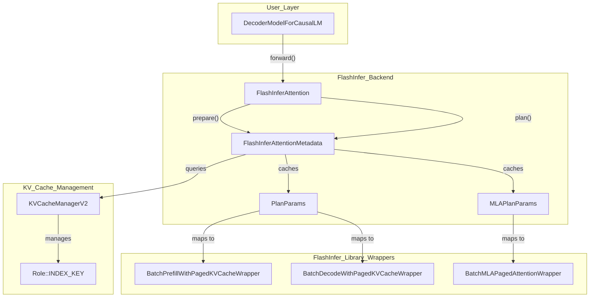
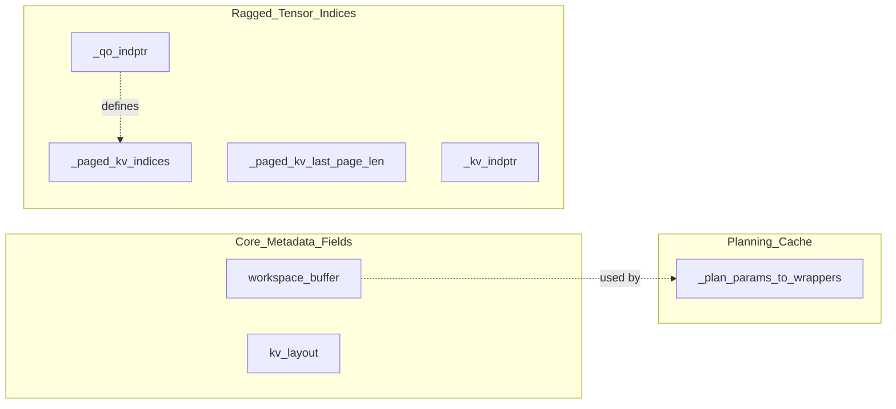
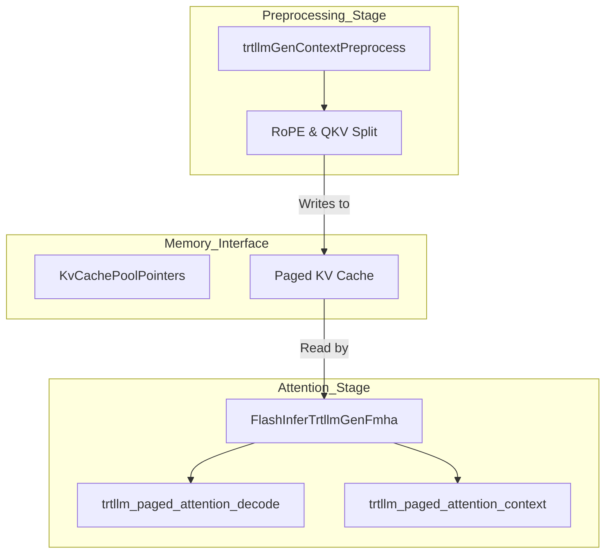
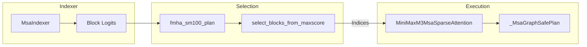

<!-- source: DeepWiki mcp.deepwiki.com · repo NVIDIA/TensorRT-LLM · page 9.3 FlashInfer Attention Backend · fetched 2026-10-26 -->

# FlashInfer Attention Backend

Relevant source files

The following files were used as context for generating this wiki page:

- [3rdparty/patches/msa_strided_paged_kv.patch](3rdparty/patches/msa_strided_paged_kv.patch)
- [cpp/tensorrt_llm/kernels/minimaxM3SelectBlocks.cu](cpp/tensorrt_llm/kernels/minimaxM3SelectBlocks.cu)
- [cpp/tensorrt_llm/kernels/minimaxM3SelectBlocks.h](cpp/tensorrt_llm/kernels/minimaxM3SelectBlocks.h)
- [cpp/tensorrt_llm/thop/minimaxM3SelectBlocksOp.cpp](cpp/tensorrt_llm/thop/minimaxM3SelectBlocksOp.cpp)
- [tensorrt_llm/_torch/attention_backend/flashinfer.py](tensorrt_llm/_torch/attention_backend/flashinfer.py)
- [tensorrt_llm/_torch/attention_backend/fmha/__init__.py](tensorrt_llm/_torch/attention_backend/fmha/__init__.py)
- [tensorrt_llm/_torch/attention_backend/fmha/combined.py](tensorrt_llm/_torch/attention_backend/fmha/combined.py)
- [tensorrt_llm/_torch/attention_backend/fmha/cute_dsl_mla.py](tensorrt_llm/_torch/attention_backend/fmha/cute_dsl_mla.py)
- [tensorrt_llm/_torch/attention_backend/fmha/flashinfer_trtllm_gen.py](tensorrt_llm/_torch/attention_backend/fmha/flashinfer_trtllm_gen.py)
- [tensorrt_llm/_torch/attention_backend/fmha/interface.py](tensorrt_llm/_torch/attention_backend/fmha/interface.py)
- [tensorrt_llm/_torch/attention_backend/fmha/phased.py](tensorrt_llm/_torch/attention_backend/fmha/phased.py)
- [tensorrt_llm/_torch/attention_backend/fmha/registry.py](tensorrt_llm/_torch/attention_backend/fmha/registry.py)
- [tensorrt_llm/_torch/attention_backend/sparse/minimax_m3/cache_manager.py](tensorrt_llm/_torch/attention_backend/sparse/minimax_m3/cache_manager.py)
- [tensorrt_llm/_torch/attention_backend/sparse/minimax_m3/common.py](tensorrt_llm/_torch/attention_backend/sparse/minimax_m3/common.py)
- [tensorrt_llm/_torch/attention_backend/sparse/minimax_m3/msa_backend.py](tensorrt_llm/_torch/attention_backend/sparse/minimax_m3/msa_backend.py)
- [tensorrt_llm/_torch/attention_backend/sparse/minimax_m3/msa_utils.py](tensorrt_llm/_torch/attention_backend/sparse/minimax_m3/msa_utils.py)
- [tensorrt_llm/_torch/attention_backend/sparse/minimax_m3/triton_metadata.py](tensorrt_llm/_torch/attention_backend/sparse/minimax_m3/triton_metadata.py)
- [tensorrt_llm/_torch/attention_backend/utils.py](tensorrt_llm/_torch/attention_backend/utils.py)
- [tensorrt_llm/_torch/metadata.py](tensorrt_llm/_torch/metadata.py)
- [tensorrt_llm/_torch/models/checkpoints/hf/gemma4_weight_mapper.py](tensorrt_llm/_torch/models/checkpoints/hf/gemma4_weight_mapper.py)
- [tensorrt_llm/_torch/models/modeling_clip.py](tensorrt_llm/_torch/models/modeling_clip.py)
- [tensorrt_llm/_torch/models/modeling_gemma4.py](tensorrt_llm/_torch/models/modeling_gemma4.py)
- [tensorrt_llm/_torch/models/modeling_gemma4_audio.py](tensorrt_llm/_torch/models/modeling_gemma4_audio.py)
- [tensorrt_llm/_torch/models/modeling_gemma4_unified.py](tensorrt_llm/_torch/models/modeling_gemma4_unified.py)
- [tensorrt_llm/_torch/models/modeling_gemma4_vision.py](tensorrt_llm/_torch/models/modeling_gemma4_vision.py)
- [tensorrt_llm/_torch/models/modeling_gemma4mm.py](tensorrt_llm/_torch/models/modeling_gemma4mm.py)
- [tensorrt_llm/_torch/models/modeling_minimaxm3.py](tensorrt_llm/_torch/models/modeling_minimaxm3.py)
- [tensorrt_llm/_torch/models/modeling_multimodal_encoder.py](tensorrt_llm/_torch/models/modeling_multimodal_encoder.py)
- [tensorrt_llm/_torch/models/modeling_pixtral.py](tensorrt_llm/_torch/models/modeling_pixtral.py)
- [tensorrt_llm/_torch/models/modeling_siglip.py](tensorrt_llm/_torch/models/modeling_siglip.py)
- [tensorrt_llm/_torch/modules/ATTENTION_DEVELOPER_GUIDE.md](tensorrt_llm/_torch/modules/ATTENTION_DEVELOPER_GUIDE.md)
- [tensorrt_llm/_torch/modules/kimi_k3_mla/kimi_k3_mla_attention.py](tensorrt_llm/_torch/modules/kimi_k3_mla/kimi_k3_mla_attention.py)
- [tensorrt_llm/_torch/modules/mla.py](tensorrt_llm/_torch/modules/mla.py)
- [tests/unittest/_torch/attention/sparse/test_minimax_m3_msa_backend.py](tests/unittest/_torch/attention/sparse/test_minimax_m3_msa_backend.py)
- [tests/unittest/_torch/attention/sparse/test_minimax_m3_msa_selector.py](tests/unittest/_torch/attention/sparse/test_minimax_m3_msa_selector.py)
- [tests/unittest/_torch/attention/test_combined_fmha.py](tests/unittest/_torch/attention/test_combined_fmha.py)
- [tests/unittest/_torch/attention/test_flashinfer_attention.py](tests/unittest/_torch/attention/test_flashinfer_attention.py)
- [tests/unittest/_torch/attention/test_fmha_page_index.py](tests/unittest/_torch/attention/test_fmha_page_index.py)
- [tests/unittest/_torch/modeling/test_gemma4_multimodal.py](tests/unittest/_torch/modeling/test_gemma4_multimodal.py)
- [tests/unittest/_torch/modeling/test_modeling_clip.py](tests/unittest/_torch/modeling/test_modeling_clip.py)
- [tests/unittest/_torch/modeling/test_modeling_gemma4.py](tests/unittest/_torch/modeling/test_modeling_gemma4.py)
- [tests/unittest/_torch/modeling/test_modeling_gemma4_unified.py](tests/unittest/_torch/modeling/test_modeling_gemma4_unified.py)
- [tests/unittest/_torch/modeling/test_modeling_pixtral.py](tests/unittest/_torch/modeling/test_modeling_pixtral.py)
- [tests/unittest/_torch/modeling/test_modeling_siglip.py](tests/unittest/_torch/modeling/test_modeling_siglip.py)
- [tests/unittest/_torch/models/test_minimax_m3.py](tests/unittest/_torch/models/test_minimax_m3.py)

## Purpose and Scope

This document describes the FlashInfer attention backend implementation in TensorRT-LLM's PyTorch execution path (`_torch`). FlashInfer is a high-performance library providing optimized GPU kernels for LLM attention, integrated as a pluggable backend within the `AttentionBackend` interface [[tensorrt_llm/_torch/attention_backend/flashinfer.py:43-45]]().

The FlashInfer backend is utilized for:
- Models requiring custom attention masks, such as Gemma4 which supports sliding window and full attention patterns via `PredefinedAttentionMask` [[tensorrt_llm/_torch/models/modeling_gemma4.py:43-45]]().
- Optimized paged KV cache management using third-party kernels [[tensorrt_llm/_torch/attention_backend/flashinfer.py:126-136]]().
- Multi-head Latent Attention (MLA) optimizations for architectures like DeepSeek-V3, DeepSeek-V4, and Kimi K3 [[tensorrt_llm/_torch/attention_backend/flashinfer.py:196-208]]() [[tensorrt_llm/_torch/modules/kimi_k3_mla/kimi_k3_mla_attention.py:29-30]]().
- Integration with specialized kernels for SM100/SM103 (Blackwell) architectures, including `trtllm-gen` FMHA kernels [[tensorrt_llm/_torch/attention_backend/fmha/flashinfer_trtllm_gen.py:19-22]]().
- Support for "Vanilla" reference implementations and "Star" attention variants [[tensorrt_llm/_torch/attention_backend/star_flashinfer.py:31-33]]().
- Sparse Attention (DSA) and Skip Softmax optimizations for Blackwell-generation models like MiniMax-M3 [[tensorrt_llm/_torch/models/modeling_minimaxm3.py:43-49]]().

**Sources:** [[tensorrt_llm/_torch/attention_backend/flashinfer.py:1-46]](), [[tensorrt_llm/_torch/attention_backend/fmha/flashinfer_trtllm_gen.py:16-39]](), [[tensorrt_llm/_torch/attention_backend/star_flashinfer.py:1-50]](), [[tensorrt_llm/_torch/models/modeling_gemma4.py:38-45]](), [[tensorrt_llm/_torch/modules/kimi_k3_mla/kimi_k3_mla_attention.py:29-30]]()

---

## Architecture Overview

The FlashInfer backend consists of the primary `FlashInferAttention` implementation, specialized metadata for batch management, and a planning system for kernel selection. It interacts with the `KVCacheManager` to handle paged memory allocations.

Title: FlashInfer Backend Component Architecture

The `FlashInferAttentionMetadata` class manages batch-level information and kernel planning [[tensorrt_llm/_torch/attention_backend/flashinfer.py:228]](). Wrapper objects from the `flashinfer` library are cached and reused based on `PlanParams` or `MLAPlanParams` configurations [[tensorrt_llm/_torch/attention_backend/flashinfer.py:236-241]]().

**Sources:** [[tensorrt_llm/_torch/attention_backend/flashinfer.py:153-241]](), [[tensorrt_llm/_torch/attention_backend/interface.py:65-82]]()

---

## FlashInferAttentionMetadata Class

`FlashInferAttentionMetadata` extends the base `AttentionMetadata` to provide FlashInfer-specific batch management, including workspace allocation and ragged tensor indexing for prefill and decode phases.

### Key Data Structures

Title: FlashInferAttentionMetadata Key Fields

| Field | Type | Purpose |
|-------|------|---------|
| `workspace_buffer` | `torch.Tensor` | Temporary storage for kernel execution [[tensorrt_llm/_torch/attention_backend/flashinfer.py:229]](). |
| `kv_layout` | `Literal["NHD", "HND"]` | KV cache memory layout [[tensorrt_llm/_torch/attention_backend/interface.py:86]](). |
| `_paged_kv_indices` | `torch.Tensor` | Flat array of block IDs for generation and context blocks [[tensorrt_llm/_torch/attention_backend/flashinfer.py:233]](). |
| `_paged_kv_last_page_len` | `torch.Tensor` | Number of valid tokens in each sequence's last block [[tensorrt_llm/_torch/attention_backend/flashinfer.py:234]](). |
| `_qo_indptr` | `torch.Tensor` | Cumulative query token counts for ragged tensor indexing [[tensorrt_llm/_torch/attention_backend/flashinfer.py:235]](). |
| `_plan_params_to_wrappers` | `Dict` | Cache mapping kernel configurations (`PlanParams`) to wrapper instances [[tensorrt_llm/_torch/attention_backend/flashinfer.py:236]](). |

**Sources:** [[tensorrt_llm/_torch/attention_backend/flashinfer.py:228-241]](), [[tensorrt_llm/_torch/attention_backend/interface.py:65-87]]()

---

## Blackwell and trtllm-gen Optimizations

The `FlashInferTrtllmGenFmha` module implements attention computation using FlashInfer's `trtllm-gen` kernels, specifically targeting Blackwell architecture (SM100/SM103) [[tensorrt_llm/_torch/attention_backend/fmha/flashinfer_trtllm_gen.py:19-22]]().

### trtllm-gen Component Data Flow
The architecture splits work between TRT-LLM's `thop` library (for QKV preprocessing and RoPE) and FlashInfer (for the attention FMHA kernels) [[tensorrt_llm/_torch/attention_backend/fmha/flashinfer_trtllm_gen.py:25-28]]().

Title: trtllm-gen FMHA Data Flow

### Key Functions and Implementations
- **`_trtllm_gen_batch_decode_with_kv_cache`**: Invokes the `trtllm_paged_attention_decode` kernel from the FlashInfer module. It handles multi-token generation by accepting `max_q_len` and `cum_seq_lens_q` [[tensorrt_llm/_torch/attention_backend/fmha/flashinfer_trtllm_gen.py:160]]().
- **Autotuner Workaround**: `_install_flashinfer_mla_decode_tuning_config_cache` fixes a cache pathology in FlashInfer 0.6.15 by memoizing the `TuningConfig` builder to prevent LRU cache collisions during MLA decode [[tensorrt_llm/_torch/attention_backend/fmha/flashinfer_trtllm_gen.py:70-105]]().
- **Blackwell-Specific Quantization**: Support for NVFP4 quantization in GatedMLP and Linear layers, often used in conjunction with FlashInfer backends on SM100 [[tensorrt_llm/_torch/models/modeling_gemma4.py:138-148]]().

**Sources:** [[tensorrt_llm/_torch/attention_backend/fmha/flashinfer_trtllm_gen.py:1-200]](), [[tensorrt_llm/_torch/models/modeling_gemma4.py:138-160]]()

---

## Sparse Attention (DSA) and MiniMax-M3

For Blackwell-generation models like MiniMax-M3 and DeepSeek-V4, the backend supports Sparse Attention (DSA) and specialized indexing via MSA (Multi-head Sparse Attention) [[tensorrt_llm/_torch/attention_backend/sparse/minimax_m3/msa_backend.py:3-8]]().

### MiniMax-M3 Sparse Attention
MiniMax-M3 uses a sparse attention mechanism involving an index-K block selector and sparse GQA [[tensorrt_llm/_torch/models/modeling_minimaxm3.py:11-13]]().
- **`MiniMaxM3MsaSparseAttention`**: Subclasses `TrtllmAttention` and reuses its forward logic, overriding sparse hooks and owning an `MsaIndexer` [[tensorrt_llm/_torch/attention_backend/sparse/minimax_m3/msa_backend.py:5-7]]().
- **`MsaIndexer`**: Calls `fmha_sm100` directly to produce per-query selected block indices [[tensorrt_llm/_torch/attention_backend/sparse/minimax_m3/msa_backend.py:9-11]]().
- **`MiniMaxM3MsaSparseAttentionMetadata`**: Subclasses `TrtllmAttentionMetadata` and stores per-forward MSA tensors in CUDA-graph-stable buffers [[tensorrt_llm/_torch/attention_backend/sparse/minimax_m3/msa_backend.py:12-14]]().

### MSA SM100 Plan Management
The `_MsaGraphSafePlan` class provides a CUDA-graph-stable mirror of the `fmha_sm100` decode plan. It owns fixed device buffers for worklists, ensuring that captured graphs read stable addresses across replays [[tensorrt_llm/_torch/attention_backend/sparse/minimax_m3/msa_backend.py:120-131]]().

Title: MiniMax-M3 MSA Data Flow

**Sources:** [[tensorrt_llm/_torch/models/modeling_minimaxm3.py:11-50]](), [[tensorrt_llm/_torch/attention_backend/sparse/minimax_m3/msa_backend.py:1-131]](), [[tensorrt_llm/_torch/attention_backend/sparse/minimax_m3/msa_utils.py:181-189]]()

---

## Star Attention and Vanilla Backend

### Star Attention
`StarAttentionMetadata` is a specialized variant for Star Attention patterns. It tracks `num_queries` and manages separate block counts for context, query, and generation blocks [[tensorrt_llm/_torch/attention_backend/star_flashinfer.py:31-33]](). It treats query requests similarly to context requests for FlashInfer kernel calls, allowing for flexible sequence handling in complex attention patterns.

### Vanilla Attention Backend
The `VanillaAttention` backend serves as a reference implementation. It primarily supports linear KV cache and is used as a baseline for accuracy testing [[tensorrt_llm/_torch/attention_backend/vanilla.py:1-10]]().

**Sources:** [[tensorrt_llm/_torch/attention_backend/star_flashinfer.py:31-90]](), [[tensorrt_llm/_torch/attention_backend/vanilla.py:1-50]]()

---

## Implementation Details

### Custom Mask Support
FlashInfer supports custom attention masks via `CustomAttentionMask.CUSTOM` and passing `attention_mask_data` to the planning parameters [[tensorrt_llm/_torch/attention_backend/flashinfer.py:182]](). This is critical for models where specific token interactions are non-causal or follow sliding window patterns [[tensorrt_llm/_torch/models/modeling_gemma4.py:43-45]]().

### MLA (Multi-head Latent Attention) and Kimi K3
For Kimi K3, the absorbed-generation MLA backend defaults to `cute-dsl` for BF16 KV cache, falling back to `trtllm-gen` for FP8 KV cache [[tensorrt_llm/_torch/modules/kimi_k3_mla/kimi_k3_mla_attention.py:33-40]]().
- **Identity RoPE**: K3 implements NoPE (No Positional Encoding) by installing an identity rotary cos/sin table (cos=1, sin=0) on the `TrtllmAttention` backend, effectively making the rotation a mathematical no-op [[tensorrt_llm/_torch/modules/kimi_k3_mla/kimi_k3_mla_attention.py:154-165]]().
- **Backend Policy**: `_kimi_k3_mla_decode_backend_policy` manages per-batch backend selection, falling back from `cute-dsl` to `trtllm-gen` for mixed batches or multi-token speculative verification [[tensorrt_llm/_torch/modules/kimi_k3_mla/kimi_k3_mla_attention.py:64-87]]().

### CUDA Graph Safety for MLA
`append_mla_latent_cache_generation_cuda_graph_safe` derives destination write locations purely from device tensors living in graph-stable buffers [[tensorrt_llm/_torch/attention_backend/utils.py:122-135]](). This prevents stale slot corruption when capturing MLA latent token appends during speculative verification or plain decode [[tensorrt_llm/_torch/attention_backend/utils.py:149-156]]().

**Sources:** [[tensorrt_llm/_torch/attention_backend/flashinfer.py:74-153]](), [[tensorrt_llm/_torch/modules/kimi_k3_mla/kimi_k3_mla_attention.py:33-165]](), [[tensorrt_llm/_torch/attention_backend/utils.py:122-160]]()

---

