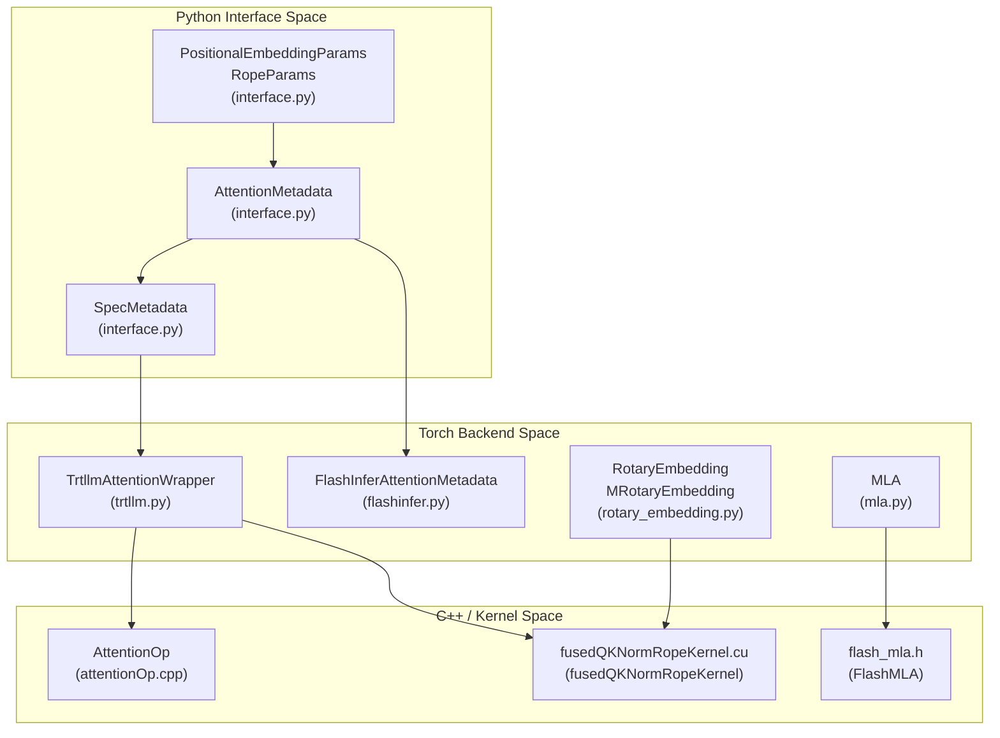
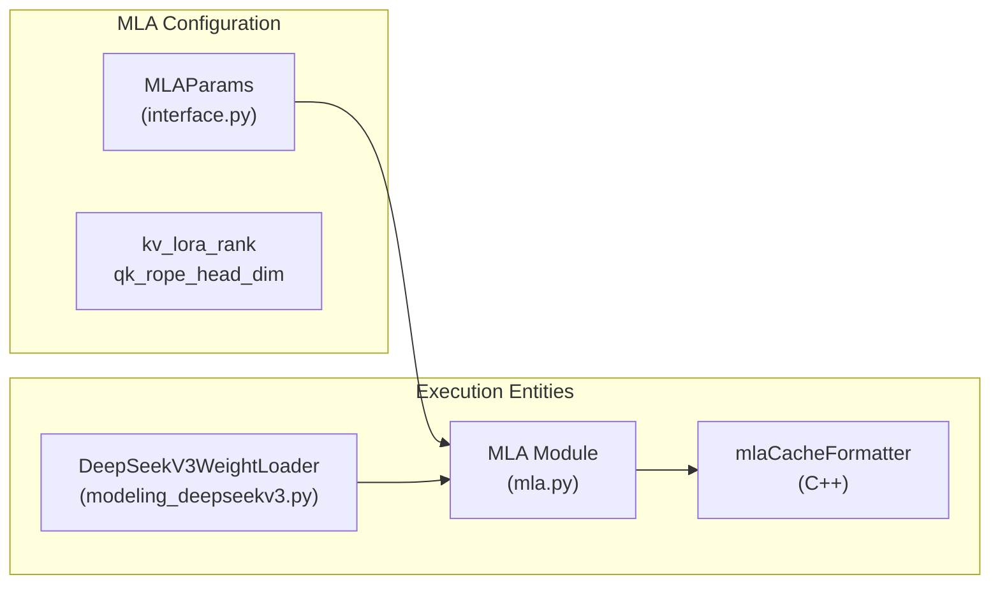

<!-- source: DeepWiki mcp.deepwiki.com · repo NVIDIA/TensorRT-LLM · page 9.4 Attention Features and Optimizations · fetched 2026-10-26 -->

# Attention Features and Optimizations

Relevant source files

The following files were used as context for generating this wiki page:

- [tensorrt_llm/_torch/attention_backend/sparse/deepseek_v4/cache_manager.py](tensorrt_llm/_torch/attention_backend/sparse/deepseek_v4/cache_manager.py)
- [tensorrt_llm/_torch/attention_backend/sparse/deepseek_v4/metadata.py](tensorrt_llm/_torch/attention_backend/sparse/deepseek_v4/metadata.py)
- [tensorrt_llm/_torch/attention_backend/sparse/dsa/__init__.py](tensorrt_llm/_torch/attention_backend/sparse/dsa/__init__.py)
- [tensorrt_llm/_torch/attention_backend/sparse/dsa/indexer.py](tensorrt_llm/_torch/attention_backend/sparse/dsa/indexer.py)
- [tensorrt_llm/_torch/attention_backend/sparse/dsa/metadata.py](tensorrt_llm/_torch/attention_backend/sparse/dsa/metadata.py)
- [tensorrt_llm/_torch/attention_backend/sparse/registry.py](tensorrt_llm/_torch/attention_backend/sparse/registry.py)
- [tensorrt_llm/_torch/cute_dsl_kernels/blackwell/top_k/__init__.py](tensorrt_llm/_torch/cute_dsl_kernels/blackwell/top_k/__init__.py)
- [tensorrt_llm/_torch/cute_dsl_kernels/blackwell/top_k/gvr_topk_decode.py](tensorrt_llm/_torch/cute_dsl_kernels/blackwell/top_k/gvr_topk_decode.py)
- [tensorrt_llm/_torch/cute_dsl_kernels/blackwell/top_k/gvr_topk_decode_direct.py](tensorrt_llm/_torch/cute_dsl_kernels/blackwell/top_k/gvr_topk_decode_direct.py)
- [tensorrt_llm/_torch/cute_dsl_kernels/blackwell/top_k/gvr_topk_decode_dispatch.py](tensorrt_llm/_torch/cute_dsl_kernels/blackwell/top_k/gvr_topk_decode_dispatch.py)
- [tensorrt_llm/_torch/cute_dsl_kernels/blackwell/top_k/gvr_topk_decode_load_balance.py](tensorrt_llm/_torch/cute_dsl_kernels/blackwell/top_k/gvr_topk_decode_load_balance.py)
- [tensorrt_llm/_torch/cute_dsl_kernels/blackwell/top_k/gvr_topk_decode_reg.py](tensorrt_llm/_torch/cute_dsl_kernels/blackwell/top_k/gvr_topk_decode_reg.py)
- [tensorrt_llm/_torch/cute_dsl_kernels/blackwell/top_k/gvr_topk_decode_self_sampling.py](tensorrt_llm/_torch/cute_dsl_kernels/blackwell/top_k/gvr_topk_decode_self_sampling.py)
- [tensorrt_llm/_torch/cute_dsl_kernels/blackwell/top_k/gvr_topk_decode_self_sampling_host.py](tensorrt_llm/_torch/cute_dsl_kernels/blackwell/top_k/gvr_topk_decode_self_sampling_host.py)
- [tensorrt_llm/_torch/cute_dsl_kernels/blackwell/top_k/gvr_topk_decode_tp.py](tensorrt_llm/_torch/cute_dsl_kernels/blackwell/top_k/gvr_topk_decode_tp.py)
- [tensorrt_llm/_torch/kv_cache_compression/triattention/triattention.py](tensorrt_llm/_torch/kv_cache_compression/triattention/triattention.py)
- [tensorrt_llm/_torch/models/modeling_deepseekv3.py](tensorrt_llm/_torch/models/modeling_deepseekv3.py)
- [tensorrt_llm/_torch/models/modeling_gemma3vl.py](tensorrt_llm/_torch/models/modeling_gemma3vl.py)
- [tensorrt_llm/_torch/models/modeling_hyperclovax.py](tensorrt_llm/_torch/models/modeling_hyperclovax.py)
- [tensorrt_llm/_torch/models/modeling_llama.py](tensorrt_llm/_torch/models/modeling_llama.py)
- [tensorrt_llm/_torch/models/modeling_llava_next.py](tensorrt_llm/_torch/models/modeling_llava_next.py)
- [tensorrt_llm/_torch/models/modeling_phi4mm.py](tensorrt_llm/_torch/models/modeling_phi4mm.py)
- [tensorrt_llm/_torch/models/modeling_qwen2vl.py](tensorrt_llm/_torch/models/modeling_qwen2vl.py)
- [tensorrt_llm/_torch/models/modeling_utils.py](tensorrt_llm/_torch/models/modeling_utils.py)
- [tensorrt_llm/_torch/models/modeling_vila.py](tensorrt_llm/_torch/models/modeling_vila.py)
- [tensorrt_llm/_torch/modules/attention.py](tensorrt_llm/_torch/modules/attention.py)
- [tensorrt_llm/_torch/modules/top_k.py](tensorrt_llm/_torch/modules/top_k.py)
- [tests/scripts/cute_dsl_kernels/top_k/run_gvr_topk.py](tests/scripts/cute_dsl_kernels/top_k/run_gvr_topk.py)
- [tests/unittest/_torch/attention/sparse/conftest.py](tests/unittest/_torch/attention/sparse/conftest.py)
- [tests/unittest/_torch/attention/sparse/deepseek_v4/test_deepseek_v4_cache_manager.py](tests/unittest/_torch/attention/sparse/deepseek_v4/test_deepseek_v4_cache_manager.py)
- [tests/unittest/_torch/attention/sparse/dsa/test_dsa_indexer.py](tests/unittest/_torch/attention/sparse/dsa/test_dsa_indexer.py)
- [tests/unittest/_torch/attention/sparse/test_cute_dsl_gvr_topk_decode.py](tests/unittest/_torch/attention/sparse/test_cute_dsl_gvr_topk_decode.py)
- [tests/unittest/_torch/attention/sparse/test_cute_dsl_gvr_topk_tiers.py](tests/unittest/_torch/attention/sparse/test_cute_dsl_gvr_topk_tiers.py)
- [tests/unittest/_torch/modules/test_top_k.py](tests/unittest/_torch/modules/test_top_k.py)
- [tests/unittest/_torch/thop/parallel/test_gvr_selfsampling_topk.py](tests/unittest/_torch/thop/parallel/test_gvr_selfsampling_topk.py)
- [tests/unittest/disaggregated/test_deepseek_v4_kv_transfer.py](tests/unittest/disaggregated/test_deepseek_v4_kv_transfer.py)

This page documents the various features and optimizations implemented in TensorRT-LLM's attention system that enhance performance and enable advanced capabilities. These features are available across different attention backends and support diverse model architectures and inference scenarios.

For information about the attention backend interface and architecture, see **9.1 Attention Backend Interface**. For backend-specific implementations, see **9.2 TRTLLM Attention Backend** and **9.3 FlashInfer Attention Backend**.

## Overview of Attention Features

The attention system in TensorRT-LLM supports a comprehensive set of features categorized into:

*   **Positional Embedding Methods**: RoPE variants (Linear, YaRN, LongRoPE, MRoPE), and QK-normalized RoPE.
*   **Advanced Attention Architectures**: MLA (Multi-head Latent Attention), GQA, MQA, and Sparse Attention (e.g., DeepSeek-V3/V4, MiniMax-M3).
*   **Performance Optimizations**: Helix Context Parallelism, CUDA graph compatibility, and chunked attention.
*   **Quantization Support**: FP8, NVFP4 (Blackwell), and INT8 for KV cache.
*   **Inference Modes**: Speculative decoding (Tree/Linear/EAGLE3/MTP) and sliding window attention.

### Feature Architecture Diagram

The following diagram bridges the high-level features to the specific code entities in the `_torch` and C++ layers.

**Attention Feature Entity Mapping**

Sources: `[tensorrt_llm/_torch/attention_backend/interface.py:65-161]()`, `[tensorrt_llm/_torch/modules/attention.py:33-34]()`, `[cpp/tensorrt_llm/kernels/fusedQKNormRopeKernel.cu:97-123]()`

## Positional Embedding Features

### RoPE and MRoPE
Rotary Positional Embeddings (RoPE) are configured via `RopeParams` `[tensorrt_llm/_torch/attention_backend/interface.py:55-55]()`. For models requiring complex spatial or temporal rotation, such as multimodal models (e.g., Qwen2VL), `MRotaryEmbedding` (MRoPE) is utilized `[tensorrt_llm/_torch/modules/attention.py:33-33]()`.

*   **MRoPE Implementation**: Integrated into the attention forward pass via `mrope_rotary_cos_sin` and `mrope_position_deltas` tensors `[tensorrt_llm/_torch/modules/attention.py:110-111]()`. These are passed to the `attn_custom_op_inplace` for execution `[tensorrt_llm/_torch/modules/attention.py:77-94]()`.
*   **Scaling and YaRN**: The backend supports various scaling types (Linear, Dynamic, YaRN). For YaRN, parameters like `factor`, `low`, `high`, and `attention_factor` are computed and passed to the fused kernels `[tensorrt_llm/_torch/modules/qk_norm_attention.py:35-136]()`.
*   **Fused Kernel**: The `fusedQKNormRopeKernel` handles RoPE application (including interleaved mRoPE) and RMS normalization in a single pass to reduce memory bandwidth overhead `[cpp/tensorrt_llm/kernels/fusedQKNormRopeKernel.cu:97-123]()`.

### QK Normalization
Modern architectures like DeepSeek-V3 and ExaOne4 apply RMSNorm to Queries (Q) and Keys (K) before the dot product.

*   **Fused Execution**: `QKNormRoPEAttention` implements this by calling `fused_qkv_gemma_rmsnorm_rope_gate` or `maybe_bcg_attn_custom_op_inplace` `[tensorrt_llm/_torch/modules/qk_norm_attention.py:139-165]()`.
*   **Gemma-style RMSNorm**: Supports the `(1 + weight)` scaling used in Gemma-style models `[cpp/tensorrt_llm/kernels/fusedQKNormRopeKernel.cu:118-118]()`.
*   **DeepSeek-V3 Support**: DeepSeek-V3 utilizes specialized routing and latent attention mechanisms that integrate with these optimizations `[tensorrt_llm/_torch/models/modeling_deepseekv3.py:63-67]()`.

Sources: `[tensorrt_llm/_torch/attention_backend/interface.py:19-22]()`, `[tensorrt_llm/_torch/modules/attention.py:77-119]()`, `[tensorrt_llm/_torch/modules/qk_norm_attention.py:139-165]()`, `[cpp/tensorrt_llm/kernels/fusedQKNormRopeKernel.cu:97-123]()`

## Multi-head Latent Attention (MLA)

MLA (Multi-head Latent Attention) reduces KV cache memory footprint by projecting keys and values into a lower-dimensional latent space.

**MLA Data Flow and Code Mapping**

**Key MLA Features:**
*   **Latent Compression**: The latent KV representation is managed via `MLAParams`, which includes `kv_lora_rank` and `qk_rope_head_dim` `[tensorrt_llm/_torch/attention_backend/interface.py:41-41]()`.
*   **Cache Formatting**: For disaggregated serving, MLA uses a specialized `mlaCacheFormatter` to handle KV cache transfers `[cpp/tensorrt_llm/common/attentionOp.cpp:48-49]()`.
*   **DeepSeek-V3 Integration**: The `MLA` module is a core component of the `DeepseekV3` architecture in `_torch` `[tensorrt_llm/_torch/models/modeling_deepseekv3.py:66-66]()`.

Sources: `[tensorrt_llm/_torch/attention_backend/interface.py:41-50]()`, `[tensorrt_llm/_torch/models/modeling_deepseekv3.py:66-66]()`, `[cpp/tensorrt_llm/common/attentionOp.cpp:28-49]()`

## Sparse Attention and DeepSeek-V4 Optimizations

DeepSeek-V4 introduces Sparse Attention (DSA) and specialized kernels for Blackwell (SM100).

### GVR (Guess-Verify-Refine) Top-K
The GVR Top-K kernel is a unified single- and multi-CTA-per-row implementation for Blackwell. It uses thread-block clusters to cooperate via DSMEM (Distributed Shared Memory) without GMEM atomics `[tensorrt_llm/_torch/cute_dsl_kernels/blackwell/top_k/gvr_topk_decode.py:17-21]()`.

*   **Cluster Cooperation**: Each row is processed by `cluster_size` CTAs. CTA `r` scans a segment of the row, and candidate counts are aggregated via `mapa.shared::cluster` and `ld.shared::cluster` `[tensorrt_llm/_torch/cute_dsl_kernels/blackwell/top_k/gvr_topk_decode.py:18-20]()`.
*   **Phase Logic**: The kernel implements a Guess-Verify-Refine cycle to find Top-K indices efficiently. The Guess phase can short-circuit if a high hit rate is detected `[tests/unittest/_torch/attention/sparse/test_cute_dsl_gvr_topk_decode.py:75-78]()`.
*   **Warmup**: The system performs a warmup of the CuTe DSL Radix Top-K kernels based on `AttentionMetadata` to ensure peak performance during inference `[tests/unittest/_torch/attention/sparse/dsa/test_dsa_indexer.py:193-202]()`.

### DeepSeek Sparse Attention (DSA) Backend
DSA is integrated into the `DSABackendForwardArgs` and uses `DSACacheManager` for memory management `[tests/unittest/_torch/attention/sparse/dsa/test_dsa_indexer.py:43-49]()`.

*   **Indexer**: The `Indexer` class handles Top-K selection for sparse attention, supporting both Torch and CuTe DSL implementations `[tests/unittest/_torch/attention/sparse/dsa/test_dsa_indexer.py:115-121]()`.
*   **Metadata**: `DSAtrtllmAttentionMetadata` manages sparse metadata parameters such as `compress_ratios` and `indexer_head_dim` `[tests/unittest/_torch/attention/sparse/dsa/test_dsa_indexer.py:148-150]()`.

Sources: `[tensorrt_llm/_torch/cute_dsl_kernels/blackwell/top_k/gvr_topk_decode.py:15-27]()`, `[tests/unittest/_torch/attention/sparse/dsa/test_dsa_indexer.py:43-55]()`, `[tests/unittest/_torch/attention/sparse/test_cute_dsl_gvr_topk_decode.py:75-85]()`

## Performance Optimizations

### Helix Context Parallelism (CP)
Helix CP splits the attention computation across multiple GPUs for a single sequence.

*   **KV Masking**: `_helix_zero_kv_mask` marks tokens with zero local KV on a specific CP rank to handle sequences spanning multiple ranks `[tensorrt_llm/_torch/modules/attention.py:125-160]()`.
*   **Sanitization**: `_helix_sanitize_empty_kv` ensures numerical stability when a rank owns no KV blocks for a sequence by forcing softmax stats to `-inf` `[tensorrt_llm/_torch/modules/attention.py:163-180]()`.
*   **CP Communication**: Uses `HelixAllToAllNative` and `alltoall_helix` for efficient KV and result exchange `[tensorrt_llm/_torch/modules/attention.py:22-23]()`.

### CUDA Graph Compatibility
TensorRT-LLM ensures attention kernels are compatible with CUDA Graphs.

*   **In-place Operations**: `attn_custom_op_inplace` allows the attention operation to mutate existing output buffers, which is critical for graph capture `[tensorrt_llm/_torch/modules/attention.py:77-94]()`.
*   **Breakable Graphs**: The `eager_on_graph` and `is_in_breakable_cuda_graph` utilities allow the runtime to switch between graph and eager modes for attention operations `[tensorrt_llm/_torch/modules/attention.py:26-27]()`.

Sources: `[tensorrt_llm/_torch/modules/attention.py:125-180]()`, `[tensorrt_llm/_torch/modules/attention.py:22-27]()`

## Speculative Decoding Support

The attention system provides specialized metadata and logic to support speculative decoding strategies.

*   **SpecMetadata**: The `SpecMetadata` class carries information about draft tokens and verification status to the attention backends `[tensorrt_llm/_torch/models/modeling_llama.py:45-45]()`.
*   **One-Engine Execution**: `SpecDecOneEngineForCausalLM` utilizes these features to perform both draft generation and target verification within the same model instance `[tensorrt_llm/_torch/models/modeling_llama.py:48-48]()`.
*   **Metadata Replay**: `prepare_attn_metadata_for_draft_replay` and `restore_attn_metadata_after_draft_replay` allow the system to efficiently handle the KV cache state during speculative verification cycles `[tests/unittest/_torch/attention/sparse/dsa/test_dsa_indexer.py:64-67]()`.

Sources: `[tensorrt_llm/_torch/models/modeling_llama.py:45-48]()`, `[tensorrt_llm/_torch/models/modeling_deepseekv3.py:77-77]()`, `[tests/unittest/_torch/attention/sparse/dsa/test_dsa_indexer.py:64-67]()`

## KV Cache Events and Management

*   **KV Cache Slicing**: `maybe_slice_for_helix_cp` handles the extraction of local KV segments for distributed attention `[tensorrt_llm/_torch/models/modeling_deepseekv3.py:59-60]()`.
*   **Quantization**: Supports FP4 and NVFP4 (Blackwell) input scaling. `_static_nvfp4_input_scale` determines if a linear layer is eligible for fused NVFP4 quantization `[tensorrt_llm/_torch/models/modeling_deepseekv3.py:152-162]()`.
*   **Vision Encoder Metadata**: Specialized preparation for multimodal models (e.g., Qwen2VL) is handled via `_prepare_qwen_vl_vision_attn_metadata`, which optimizes host work for encoder-only passes `[tensorrt_llm/_torch/models/modeling_qwen2vl.py:86-137]()`.
*   **MLA FP8 Layout**: `_resolve_fp8_ds_mla_head_dim` calculates the storage head dimension for DeepSeek MLA when using FP8 KV cache, accounting for shared inline scales `[tests/unittest/_torch/attention/sparse/dsa/test_dsa_indexer.py:91-101]()`.

Sources: `[tensorrt_llm/_torch/models/modeling_deepseekv3.py:152-162]()`, `[tensorrt_llm/_torch/models/modeling_qwen2vl.py:86-137]()`, `[tests/unittest/_torch/attention/sparse/dsa/test_dsa_indexer.py:91-101]()`

---

