# Page: Overview

# Overview

<details>
<summary>Relevant source files</summary>

The following files were used as context for generating this wiki page:

- [README.md](README.md)
- [docker/Dockerfile.user](docker/Dockerfile.user)
- [docker/develop.md](docker/develop.md)
- [docker/release.md](docker/release.md)
- [docs/requirements.txt](docs/requirements.txt)
- [docs/source/_static/custom.css](docs/source/_static/custom.css)
- [docs/source/_static/switcher.json](docs/source/_static/switcher.json)
- [docs/source/commands/trtllm-serve/run-benchmark-with-trtllm-serve.md](docs/source/commands/trtllm-serve/run-benchmark-with-trtllm-serve.md)
- [docs/source/conf.py](docs/source/conf.py)
- [docs/source/deployment-guide/deployment-guide-for-deepseek-r1-on-trtllm.md](docs/source/deployment-guide/deployment-guide-for-deepseek-r1-on-trtllm.md)
- [docs/source/deployment-guide/deployment-guide-for-glm-5-on-trtllm.md](docs/source/deployment-guide/deployment-guide-for-glm-5-on-trtllm.md)
- [docs/source/deployment-guide/deployment-guide-for-gpt-oss-on-trtllm.md](docs/source/deployment-guide/deployment-guide-for-gpt-oss-on-trtllm.md)
- [docs/source/deployment-guide/deployment-guide-for-llama3.3-70b-on-trtllm.md](docs/source/deployment-guide/deployment-guide-for-llama3.3-70b-on-trtllm.md)
- [docs/source/deployment-guide/deployment-guide-for-llama4-scout-on-trtllm.md](docs/source/deployment-guide/deployment-guide-for-llama4-scout-on-trtllm.md)
- [docs/source/helper.py](docs/source/helper.py)
- [docs/source/index.rst](docs/source/index.rst)
- [docs/source/installation/containers.md](docs/source/installation/containers.md)
- [docs/source/quick-start-guide.md](docs/source/quick-start-guide.md)
- [examples/constraints.txt](examples/constraints.txt)
- [examples/llm-api/llm_mgmn_llm_distributed.sh](examples/llm-api/llm_mgmn_llm_distributed.sh)
- [examples/llm-api/llm_mgmn_trtllm_bench.sh](examples/llm-api/llm_mgmn_trtllm_bench.sh)
- [examples/llm-api/llm_mgmn_trtllm_serve.sh](examples/llm-api/llm_mgmn_trtllm_serve.sh)
- [scripts/cuda_driver_stub.py](scripts/cuda_driver_stub.py)
- [tensorrt_llm/llmapi/__init__.py](tensorrt_llm/llmapi/__init__.py)
- [tensorrt_llm/version.py](tensorrt_llm/version.py)
- [tests/unittest/api_stability/references_committed/llm.yaml](tests/unittest/api_stability/references_committed/llm.yaml)

</details>


## Purpose and Scope

This page provides a comprehensive introduction to TensorRT-LLM, NVIDIA's advanced open-source library designed to accelerate and optimize inference for Large Language Models (LLMs) and Visual Generation models on NVIDIA GPUs. It covers the purpose, system architecture, core components, execution flow, and key features of the codebase.

Detailed technical explanations are included with references to the code entities and implementation files. While this page serves as a leaf overview, it summarizes the major subsystems and links to related documentation scattered across the codebase.

**Sources:** [README.md:1-16](), [tensorrt_llm/version.py:1-15]()

---

## What is TensorRT-LLM?

TensorRT-LLM (version `1.3.0rc25`) is a modular inference acceleration framework that optimizes large-scale neural models, particularly LLMs and visual generation models [tensorrt_llm/version.py:15-15](). It targets NVIDIA GPUs and incorporates optimized kernels, a efficient runtime, and a pythonic framework that enables customization and extension [README.md:3-7]().

Key qualities:
- **High-level LLM API:** A unified Python interface (`LLM` class) simplifies model loading, configuration, token generation, and multi-GPU distributed inference [tensorrt_llm/llmapi/llm.py:16-67](), [tensorrt_llm/llmapi/__init__.py:36-41]().
- **In-Flight Batching and Scheduling:** Dynamically manages and merges generation requests for efficient GPU utilization, supporting complex scheduling strategies like overlap scheduler [tensorrt_llm/llmapi/llm_args.py:58-67](), [tensorrt_llm/llmapi/__init__.py:68-70]().
- **Advanced Quantization Support:** Supports emerging formats including NVIDIA FP8 (Hopper, Blackwell) and NVFP4 (Blackwell), with methods like AWQ and SmoothQuant [tensorrt_llm/llmapi/llm_utils.py:30-30](), [tensorrt_llm/llmapi/__init__.py:62-64]().
- **Speculative Decoding Algorithms:** Implements multiple techniques including EAGLE 3, Multi-Token Prediction (MTP), and NGram (Prompt Lookup) decoding to accelerate generation [tensorrt_llm/llmapi/llm_args.py:43-57](), [tensorrt_llm/llmapi/__init__.py:55-59]().
- **Disaggregated Serving:** Separates context prefill and token generation phases across different GPUs, optimized for high-performance setups like NVL72 [tensorrt_llm/llmapi/__init__.py:3-3](), [tensorrt_llm/llmapi/__init__.py:44-46](), [README.md:76-77]().
- **Visual Generation:** Provides a unified inference stack for diffusion models such as FLUX, Wan, and LTX2, supporting image and video synthesis [README.md:93-93](), [tensorrt_llm/llmapi/__init__.py:99-99]().

**Sources:** [README.md:1-93](), [tensorrt_llm/version.py:15-15](), [tensorrt_llm/llmapi/llm.py:16-67](), [tensorrt_llm/llmapi/__init__.py:1-100]()

---

## System Architecture Layers

TensorRT-LLM is architected as a layered system from high-level user APIs through runtime components down to GPU kernels and devices.

### Architecture Layer Diagram

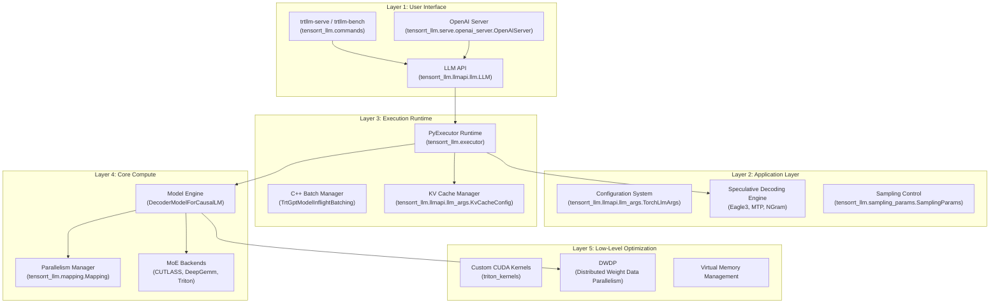

**Sources:** [tensorrt_llm/llmapi/llm.py:40-67](), [tensorrt_llm/llmapi/__init__.py:9-29](), [README.md:37-38](), [docs/source/quick-start-guide.md:13-20]()

---

## Core Subsystems

The codebase is organized into logical subsystems that handle specific aspects of the inference pipeline:

| Subsystem | Purpose | Key Components |
| :--- | :--- | :--- |
| **LLM API** | High-level entry point for LLM inference | `LLM`, `AsyncLLM`, `TorchLlmArgs`, `SamplingParams` [tensorrt_llm/llmapi/llm.py:16-67](), [tensorrt_llm/llmapi/__init__.py:37-43]() |
| **Serving** | OpenAI-compatible API and disaggregated serving | `OpenAIServer`, `trtllm-serve`, `DisaggregatedParams` [tensorrt_llm/llmapi/__init__.py:44-46](), [docs/source/quick-start-guide.md:13-20]() |
| **Quantization** | Low-precision optimization (FP8, NVFP4, INT4/8) | `QuantConfig`, `QuantAlgo`, `CalibConfig` [tensorrt_llm/llmapi/__init__.py:62-64](), [tensorrt_llm/llmapi/llm_utils.py:30-30]() |
| **Distributed** | Multi-GPU communication and parallelism | `MpiCommSession`, `AttentionDpConfig`, `moe_expert_parallel_size` [tensorrt_llm/llmapi/__init__.py:66-66](), [tensorrt_llm/llmapi/__init__.py:84-84](), [tests/unittest/api_stability/references_committed/llm.yaml:43-45]() |
| **Speculative Decoding** | Performance acceleration via draft-verify | `Eagle3DecodingConfig`, `MTPDecodingConfig`, `NGramDecodingConfig` [tensorrt_llm/llmapi/__init__.py:55-59](), [tensorrt_llm/llmapi/__init__.py:72-72]() |

**Sources:** [tensorrt_llm/llmapi/llm.py:16-67](), [tensorrt_llm/llmapi/__init__.py:1-100](), [tests/unittest/api_stability/references_committed/llm.yaml:1-142]()

---

## LLM Request Flow

This diagram bridges the user-level API down to the internal entities handling token generation:

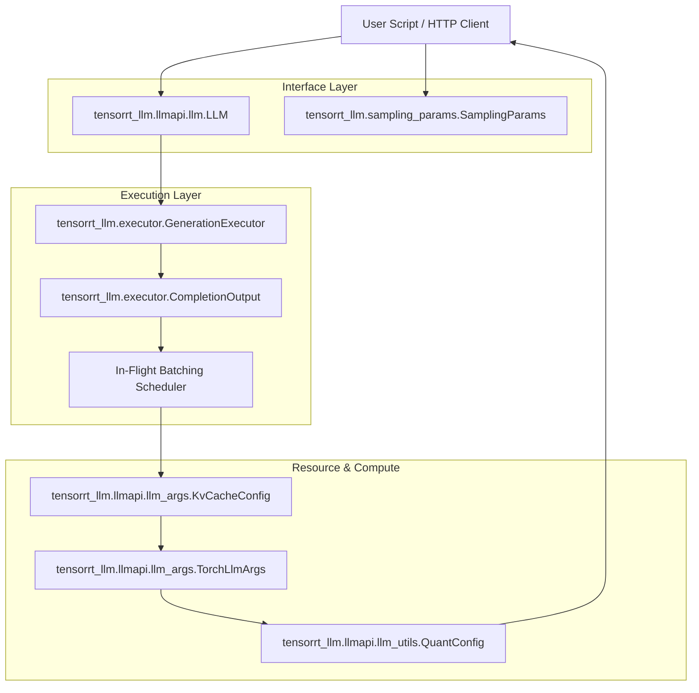

- **LLM Entry:** Users initialize the `LLM` class, which manages the lifecycle of the model and executor [tensorrt_llm/llmapi/llm.py:70-121](), [tests/unittest/api_stability/references_committed/llm.yaml:2-97]().
- **Scheduler:** The in-flight batcher dynamically manages the mix of context (prefill) and generation (decode) phases [tensorrt_llm/llmapi/__init__.py:60-61](), [tensorrt_llm/llmapi/__init__.py:68-70]().
- **KV Cache Manager:** Manages GPU memory for paged attention, supporting features like `BlockReuseConfig` [tensorrt_llm/llmapi/__init__.py:47-48](), [tensorrt_llm/llmapi/__init__.py:50-50]().
- **Sampler:** Handles token selection based on `SamplingParams`, supporting greedy, beam search, and random sampling [tensorrt_llm/llmapi/__init__.py:42-43](), [tests/unittest/api_stability/references_committed/llm.yaml:104-107]().

**Sources:** [tensorrt_llm/llmapi/llm.py:70-121](), [tensorrt_llm/llmapi/__init__.py:1-100](), [tests/unittest/api_stability/references_committed/llm.yaml:1-142]()

---

## Key Optimization Features

TensorRT-LLM integrates multiple advanced techniques to maximize throughput and reduce latency:

| Category | Features |
| :--- | :--- |
| **Parallelism** | Tensor (TP), Pipeline (PP), Expert (EP), and Context Parallelism (CP); Distributed Weight Data Parallelism (DWDP) [tests/unittest/api_stability/references_committed/llm.yaml:21-45](), [README.md:37-38]() |
| **Quantization** | FP8, NVFP4 (Blackwell), INT4/8, AWQ, SmoothQuant, Block-scale quantization [tensorrt_llm/llmapi/__init__.py:62-64](), [docs/source/deployment-guide/deployment-guide-for-gpt-oss-on-trtllm.md:26-29]() |
| **Decoding** | Speculative Decoding (EAGLE 3, MTP, NGram), Guided Decoding (xgrammar, llguidance), Beam Search [tensorrt_llm/llmapi/__init__.py:55-59](), [tests/unittest/api_stability/references_committed/llm.yaml:57-63]() |
| **Memory** | Paged KV Cache, KV Cache Reuse, KV Cache Transfer (NIXL/UCX), Disaggregated Cache [tensorrt_llm/llmapi/__init__.py:47-50](), [tensorrt_llm/llmapi/__init__.py:71-71]() |
| **Visual Gen** | Diffusion Transformers (FLUX, Wan, LTX2), Video generation pipelines [README.md:93-93](), [docs/source/quick-start-guide.md:105-114]() |

**Sources:** [README.md:37-93](), [tensorrt_llm/llmapi/__init__.py:1-100](), [tests/unittest/api_stability/references_committed/llm.yaml:1-142]()

---

## External Dependencies

The framework relies on a specific software stack for optimal performance:

| Dependency | Version | Role |
| :--- | :--- | :--- |
| **Python** | 3.10 / 3.12 | Primary language [README.md:9-10]() |
| **CUDA** | 13.2.1 | GPU acceleration [README.md:11-11]() |
| **PyTorch** | 2.12.0 | Model definition and runtime [README.md:12-12]() |
| **TensorRT-LLM** | 1.3.0rc25 | Current release [tensorrt_llm/version.py:15-15](), [examples/constraints.txt:1-1]() |

**Sources:** [README.md:9-13](), [tensorrt_llm/version.py:15-15](), [examples/constraints.txt:1-1]()

---

# Summary

TensorRT-LLM is a comprehensive framework offering highly optimized inference for large-scale language and visual models. Its layered architecture organizes functionality from user-facing APIs through a flexible runtime and advanced GPU kernels. Key innovations include advanced quantization (NVFP4/FP8), speculative decoding (EAGLE 3, MTP), disaggregated serving, and native support for the latest model architectures including DeepSeek-V3/V4/R1, Llama 3.3/4, and FLUX.

**Sources:** [README.md:3-5](), [tensorrt_llm/llmapi/llm.py:16-67](), [tensorrt_llm/llmapi/__init__.py:1-100]()

---

# Page: Installation and Dependencies

# Installation and Dependencies

<details>
<summary>Relevant source files</summary>

The following files were used as context for generating this wiki page:

- [.devcontainer/docker-compose.yml](.devcontainer/docker-compose.yml)
- [.gitignore](.gitignore)
- [ATTRIBUTIONS-Python.md](ATTRIBUTIONS-Python.md)
- [CONTAINER_SOURCE.md](CONTAINER_SOURCE.md)
- [constraints.txt](constraints.txt)
- [cpp/CMakeLists.txt](cpp/CMakeLists.txt)
- [cpp/include/tensorrt_llm/batch_manager/kvCacheTransferManager.h](cpp/include/tensorrt_llm/batch_manager/kvCacheTransferManager.h)
- [cpp/tensorrt_llm/CMakeLists.txt](cpp/tensorrt_llm/CMakeLists.txt)
- [cpp/tensorrt_llm/batch_manager/CMakeLists.txt](cpp/tensorrt_llm/batch_manager/CMakeLists.txt)
- [cpp/tensorrt_llm/batch_manager/kvCacheTransferManager.cpp](cpp/tensorrt_llm/batch_manager/kvCacheTransferManager.cpp)
- [cpp/tensorrt_llm/executor/kvCacheRetentionConfig.cpp](cpp/tensorrt_llm/executor/kvCacheRetentionConfig.cpp)
- [cpp/tensorrt_llm/nanobind/CMakeLists.txt](cpp/tensorrt_llm/nanobind/CMakeLists.txt)
- [cpp/tensorrt_llm/nanobind/bindings.cpp](cpp/tensorrt_llm/nanobind/bindings.cpp)
- [cpp/tests/unit_tests/batch_manager/CMakeLists.txt](cpp/tests/unit_tests/batch_manager/CMakeLists.txt)
- [cpp/tests/unit_tests/batch_manager/kvCacheManagerV2SlotAllocatorTest.cpp](cpp/tests/unit_tests/batch_manager/kvCacheManagerV2SlotAllocatorTest.cpp)
- [docker/Dockerfile.multi](docker/Dockerfile.multi)
- [docker/Makefile](docker/Makefile)
- [docker/common/install_base.sh](docker/common/install_base.sh)
- [docker/common/install_ccache.sh](docker/common/install_ccache.sh)
- [docker/common/install_ci.sh](docker/common/install_ci.sh)
- [docker/common/install_cmake.sh](docker/common/install_cmake.sh)
- [docker/common/install_etcd.sh](docker/common/install_etcd.sh)
- [docker/common/install_mpi4py.sh](docker/common/install_mpi4py.sh)
- [docker/common/install_nixl.sh](docker/common/install_nixl.sh)
- [docker/common/install_polygraphy.sh](docker/common/install_polygraphy.sh)
- [docker/common/install_triton.sh](docker/common/install_triton.sh)
- [docker/common/install_ucx.sh](docker/common/install_ucx.sh)
- [docs/source/installation/build-from-source.md](docs/source/installation/build-from-source.md)
- [jenkins/Build.groovy](jenkins/Build.groovy)
- [jenkins/BuildDockerImage.groovy](jenkins/BuildDockerImage.groovy)
- [jenkins/L0_MergeRequest.groovy](jenkins/L0_MergeRequest.groovy)
- [jenkins/L0_Test.groovy](jenkins/L0_Test.groovy)
- [jenkins/controlCCache.groovy](jenkins/controlCCache.groovy)
- [jenkins/current_image_tags.properties](jenkins/current_image_tags.properties)
- [requirements.txt](requirements.txt)
- [scripts/build_wheel.py](scripts/build_wheel.py)
- [scripts/generate_container_oss_attribution.sh](scripts/generate_container_oss_attribution.sh)
- [scripts/get_wheel_from_package.py](scripts/get_wheel_from_package.py)
- [scripts/rename_docker_images.py](scripts/rename_docker_images.py)
- [security_scanning/examples/apps/poetry.lock](security_scanning/examples/apps/poetry.lock)
- [security_scanning/examples/auto_deploy/poetry.lock](security_scanning/examples/auto_deploy/poetry.lock)
- [security_scanning/examples/models/contrib/hyperclovax/poetry.lock](security_scanning/examples/models/contrib/hyperclovax/poetry.lock)
- [security_scanning/examples/ngram/poetry.lock](security_scanning/examples/ngram/poetry.lock)
- [security_scanning/examples/quantization/poetry.lock](security_scanning/examples/quantization/poetry.lock)
- [security_scanning/examples/ray_orchestrator/poetry.lock](security_scanning/examples/ray_orchestrator/poetry.lock)
- [security_scanning/examples/trtllm-eval/poetry.lock](security_scanning/examples/trtllm-eval/poetry.lock)
- [security_scanning/metadata.json](security_scanning/metadata.json)
- [security_scanning/poetry.lock](security_scanning/poetry.lock)
- [security_scanning/pyproject.toml](security_scanning/pyproject.toml)
- [security_scanning/triton_backend/poetry.lock](security_scanning/triton_backend/poetry.lock)
- [setup.py](setup.py)
- [tests/integration/test_lists/qa/llm_perf_disagg.yml](tests/integration/test_lists/qa/llm_perf_disagg.yml)
- [tests/integration/test_lists/qa/llm_perf_multinode.txt](tests/integration/test_lists/qa/llm_perf_multinode.txt)
- [tests/unittest/scripts/test_build_wheel_copy_back.py](tests/unittest/scripts/test_build_wheel_copy_back.py)

</details>


## Purpose and Scope

This document provides a high-level overview of the installation processes for TensorRT-LLM, including dependency management and environment setup. It covers multiple installation pathways such as Python package installation, Docker-based deployment, and system-level build requirements, focusing on compatibility and version constraints for target architectures like `x86_64` and `aarch64` (SBSA) [[security_scanning/metadata.json:1-4]]().

For granular details on Python dependencies, Poetry configurations, and the custom wheel build process, refer to the child page [Python Package and Dependencies](#2.1). For comprehensive information on Docker images, container multi-stage builds, and third-party integration libraries (e.g., NIXL, UCX, ETCD), see [Docker Images and Container Setup](#2.2).

---

## Installation Methods Overview

TensorRT-LLM supports three main installation approaches:

| Method                 | Use Case                               | Complexity | Key Files                                                        |
|------------------------|--------------------------------------|------------|-----------------------------------------------------------------|
| **Pre-built Docker Images**  | Production environments and quick deployment | Low        | [[jenkins/L0_MergeRequest.groovy:68-81]]() |
| **Docker Build from Source** | Customized builds and active development    | Medium     | [[docker/Dockerfile.multi:1-165]]()   |
| **Python Package / Wheel**    | Integration within existing Python environments | High       | [[security_scanning/pyproject.toml:1-92]](), <br> [[scripts/build_wheel.py:1-125]]() |

**Diagram: Installation Paths and Build Artifacts**

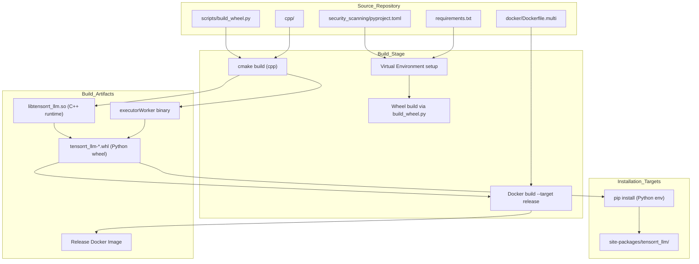

This diagram depicts the source-level files, build stages, artifacts generated, and the final installation targets relevant for each installation method.

Sources: [[security_scanning/pyproject.toml:1-92]](), [[docker/Dockerfile.multi:121-141]](), [[scripts/build_wheel.py:175-191]]()

---

## Python Package Dependencies

Python package dependencies are declared in `security_scanning/pyproject.toml` following Poetry conventions, with full resolution available in `poetry.lock` files. These dependencies cover libraries for core deep learning runtime, model APIs, serving infrastructure, and utilities [[security_scanning/pyproject.toml:1-92]](), [[security_scanning/poetry.lock:1-46]]().

The project requires Python 3.10 up to but not including 3.13 [[security_scanning/pyproject.toml:9]]().

**Diagram: Python Dependency Groups and Code Entities**

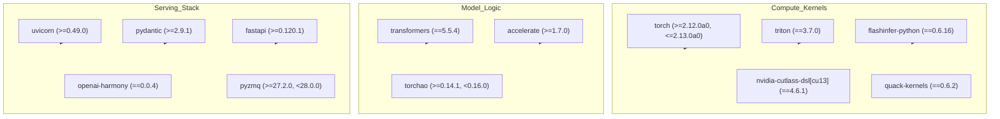

### Critical Version Constraints and Version Pinning

Several libraries are pinned to specific versions to ensure ABI and API compatibility as well as stability of runtime behaviors:

| Package              | Version Constraint         | Purpose / Rationale                               |
|----------------------|----------------------------|-------------------------------------------------|
| `transformers`       | `==5.5.4`                  | Model loader API stability [[security_scanning/pyproject.toml:33]]() |
| `flashinfer-python`  | `==0.6.16`                 | Optimized attention kernels [[security_scanning/pyproject.toml:58]]() |
| `torch`              | `>=2.12.0a0, <=2.13.0a0`   | Base PyTorch runtime compatibility [[security_scanning/pyproject.toml:30]]() |
| `triton`             | `==3.7.0`                  | Vendored kernel compatibility [[security_scanning/pyproject.toml:68]]() |
| `nvidia-nccl-cu13`   | `>=2.29.7, <=2.30.4`       | Distributed communications backend [[security_scanning/pyproject.toml:31]]() |
| `mpi4py`             | `>=4.1.2, <5.0.0`          | MPI Python bindings for distributed execution [[security_scanning/pyproject.toml:19]]() |

For exhaustive dependency versions, please consult the `pyproject.toml` and `poetry.lock` files, and the dedicated child page [Python Package and Dependencies](#2.1).

Sources: [[security_scanning/pyproject.toml:1-92]](), [[security_scanning/poetry.lock:1-46]](), [[requirements.txt:1-106]]()

---

## Build Process Overview

The native C++ runtime and Python bindings are packaged via the `scripts/build_wheel.py` script. This process compiles the core TensorRT-LLM runtime, executor binaries, and embeds custom TensorRT plugins before assembling a Python wheel package [[docker/Dockerfile.multi:132-140]]().

Key aspects include:

- **Environment Preparation:** The build process utilizes `requirements.txt` to install necessary build-time tools like `meson`, `ninja`, and `build` [[requirements.txt:4,72,73]]().
- **C++ Core Compilation:** Sources under `cpp/` are built, producing shared libraries like `libtensorrt_llm.so` [[docker/Dockerfile.multi:123,156]]().
- **Python Bindings:** The package includes compiled libraries to enable efficient interoperability between C++ and Python code [[docker/Dockerfile.multi:126]]().
- **Build Invocation:** The `Dockerfile.multi` orchestrates the build by copying source directories and running the wheel build script [[docker/Dockerfile.multi:121-140]]().

**Diagram: Build Process Flow**

```mermaid
flowchart TD
    subgraph "Build Execution: Docker/Scripts"
        start["Start Build"]
        reqs["Install requirements.txt"]
        cmake["Compile cpp/ source"]
        bindings["Generate Python Bindings"]
        package["scripts/build_wheel.py"]
        end["Output: .whl Package"]
    end

    start --> reqs --> cmake --> bindings --> package --> end
```

Sources: [[docker/Dockerfile.multi:121-152]](), [[requirements.txt:1-106]](), [[scripts/build_wheel.py:1-125]]()

---

## Runtime Environment Setup

After installation via generated wheel or Docker image, the runtime environment requires proper configuration:

- **Shared Library and Binary Exposure:** The release image copies build context files and ensures that the environment is ready for inference [[docker/Dockerfile.multi:154-165]]().
- **MPI and Distributed Execution:** Multi-GPU runtime uses MPI for coordination, facilitated by Python `mpi4py` bindings, and NVIDIA NCCL for device communication [[security_scanning/pyproject.toml:19,31]]().  
- **IPC Mechanisms:** ZeroMQ-based IPC using `pyzmq` enables communication between processes (e.g., between the `GenerationExecutorProxy` and worker processes) [[security_scanning/pyproject.toml:49]]().
- **High-Performance Networking:** Specialized drivers and libraries like UCX, NIXL, and ETCD are installed via dedicated scripts to support high-speed interconnects and service discovery [[docker/Dockerfile.multi:78-86]]().
- **Environment Variables:** The Docker environment sets critical variables such as `PYTORCH_ALLOC_CONF` to manage memory allocation behavior [[docker/Dockerfile.multi:46]]().

Sources: [[security_scanning/pyproject.toml:1-92]](), [[docker/Dockerfile.multi:42-165]]()

---

## References to Child Pages

- For details on Python package dependency management, the Poetry configuration, development dependencies, and the caching mechanism for third-party C++ libraries, see [Python Package and Dependencies](#2.1).
- For detailed Docker multi-stage builds, installation images, and scripts including NIXL, UCX, and FlashAttention 4 support, see [Docker Images and Container Setup](#2.2).

---

# Summary

TensorRT-LLM accommodates multiple installation workflows targeting various deployment scenarios, from local development to large-scale production serving. The build system emphasizes version consistency (pinning `torch`, `triton`, and `transformers`) and isolating dependencies via virtual environments [[scripts/build_wheel.py:152-172]](). High-level dependency management uses Poetry with manifest locking, and specialized multi-stage Docker images provide optimized containerized runtime environments including support for advanced networking via NIXL and UCX [[docker/Dockerfile.multi:78-87]]().

Sources:  
[[security_scanning/metadata.json:1-4]](), [[security_scanning/pyproject.toml:1-92]](), [[security_scanning/poetry.lock:1-46]](), [[jenkins/L0_MergeRequest.groovy:64-81]](), [[docker/Dockerfile.multi:1-165]](), [[requirements.txt:1-106]]()

---

# Page: Python Package and Dependencies

# Python Package and Dependencies

<details>
<summary>Relevant source files</summary>

The following files were used as context for generating this wiki page:

- [.gitignore](.gitignore)
- [.pre-commit-config.yaml](.pre-commit-config.yaml)
- [cpp/CMakeLists.txt](cpp/CMakeLists.txt)
- [cpp/include/tensorrt_llm/batch_manager/kvCacheTransferManager.h](cpp/include/tensorrt_llm/batch_manager/kvCacheTransferManager.h)
- [cpp/tensorrt_llm/CMakeLists.txt](cpp/tensorrt_llm/CMakeLists.txt)
- [cpp/tensorrt_llm/batch_manager/CMakeLists.txt](cpp/tensorrt_llm/batch_manager/CMakeLists.txt)
- [cpp/tensorrt_llm/batch_manager/kvCacheTransferManager.cpp](cpp/tensorrt_llm/batch_manager/kvCacheTransferManager.cpp)
- [cpp/tensorrt_llm/executor/kvCacheRetentionConfig.cpp](cpp/tensorrt_llm/executor/kvCacheRetentionConfig.cpp)
- [cpp/tensorrt_llm/nanobind/CMakeLists.txt](cpp/tensorrt_llm/nanobind/CMakeLists.txt)
- [cpp/tensorrt_llm/nanobind/bindings.cpp](cpp/tensorrt_llm/nanobind/bindings.cpp)
- [cpp/tests/unit_tests/batch_manager/CMakeLists.txt](cpp/tests/unit_tests/batch_manager/CMakeLists.txt)
- [cpp/tests/unit_tests/batch_manager/kvCacheManagerV2SlotAllocatorTest.cpp](cpp/tests/unit_tests/batch_manager/kvCacheManagerV2SlotAllocatorTest.cpp)
- [docs/source/installation/build-from-source.md](docs/source/installation/build-from-source.md)
- [legacy-files.txt](legacy-files.txt)
- [pyproject.toml](pyproject.toml)
- [ruff-legacy.toml](ruff-legacy.toml)
- [scripts/build_wheel.py](scripts/build_wheel.py)
- [scripts/check_test_list.py](scripts/check_test_list.py)
- [security_scanning/examples/apps/poetry.lock](security_scanning/examples/apps/poetry.lock)
- [security_scanning/examples/auto_deploy/poetry.lock](security_scanning/examples/auto_deploy/poetry.lock)
- [security_scanning/examples/models/contrib/hyperclovax/poetry.lock](security_scanning/examples/models/contrib/hyperclovax/poetry.lock)
- [security_scanning/examples/ngram/poetry.lock](security_scanning/examples/ngram/poetry.lock)
- [security_scanning/examples/quantization/poetry.lock](security_scanning/examples/quantization/poetry.lock)
- [security_scanning/examples/ray_orchestrator/poetry.lock](security_scanning/examples/ray_orchestrator/poetry.lock)
- [security_scanning/examples/trtllm-eval/poetry.lock](security_scanning/examples/trtllm-eval/poetry.lock)
- [security_scanning/metadata.json](security_scanning/metadata.json)
- [security_scanning/poetry.lock](security_scanning/poetry.lock)
- [security_scanning/pyproject.toml](security_scanning/pyproject.toml)
- [security_scanning/triton_backend/poetry.lock](security_scanning/triton_backend/poetry.lock)
- [setup.py](setup.py)
- [tests/README.md](tests/README.md)
- [tests/integration/README.md](tests/integration/README.md)
- [tests/integration/defs/test_list_parser.py](tests/integration/defs/test_list_parser.py)
- [tests/integration/defs/triton_server/test_list_parser.py](tests/integration/defs/triton_server/test_list_parser.py)
- [tests/integration/test_lists/qa/llm_perf_disagg.yml](tests/integration/test_lists/qa/llm_perf_disagg.yml)
- [tests/integration/test_lists/qa/llm_perf_multinode.txt](tests/integration/test_lists/qa/llm_perf_multinode.txt)
- [tests/unittest/scripts/test_build_wheel_copy_back.py](tests/unittest/scripts/test_build_wheel_copy_back.py)
- [tests/unittest/scripts/test_check_test_list.py](tests/unittest/scripts/test_check_test_list.py)

</details>


## Purpose and Scope

This page documents the Python package structure, dependency management, and build-from-source infrastructure for TensorRT-LLM. It covers project configuration in `pyproject.toml`, dependency resolution through Poetry lock files, and the `build_wheel.py` script used to compile the C++ runtime and package it into a Python wheel. This infrastructure ensures reproducible environments for model optimization, serving, and evaluation.

## Project Configuration

TensorRT-LLM uses Poetry for Python dependency management with configuration defined in [security_scanning/pyproject.toml:1-94]().

### Package Metadata

```toml
[project]
name = "tensorrt-llm"
version = "0.1.0"
requires-python = ">=3.10,<3.13"
```

The package supports Python versions 3.10 through 3.12 [security_scanning/pyproject.toml:9](). The build system uses `poetry-core>=2.0.0` as specified in [security_scanning/pyproject.toml:97-98]().

**Sources:** [security_scanning/pyproject.toml:1-98]()

## Dependency Categories

The project maintains direct dependencies organized into functional categories to support the full LLM lifecycle.

### Logical Dependency Map

This diagram associates logical system components with their specific package requirements as defined in the project configuration.

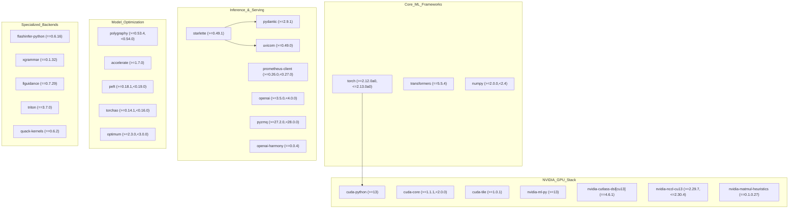

**Sources:** [security_scanning/pyproject.toml:10-93]()

### ML Framework Dependencies

| Package         | Version Constraint         | Purpose                                          |
|-----------------|----------------------------|------------------------------------------------|
| `torch`         | `>=2.12.0a0,<=2.13.0a0`    | PyTorch ML framework for model execution [security_scanning/pyproject.toml:30]() |
| `transformers`  | `==5.5.4`                  | HuggingFace model architectures (pinned) [security_scanning/pyproject.toml:33]() |
| `accelerate`    | `>=1.7.0`                  | Distributed execution utilities [security_scanning/pyproject.toml:11]() |
| `datasets`      | `==3.1.0`                  | Dataset loading (pinned) [security_scanning/pyproject.toml:43]() |
| `diffusers`     | `>=0.39.0,<0.40`           | Diffusion model support [security_scanning/pyproject.toml:15]() |

**Sources:** [security_scanning/pyproject.toml:10-45]()

### NVIDIA CUDA Stack

The stack integrates low-level CUDA interfaces with high-level Python bindings to enable efficient GPU execution and communication.

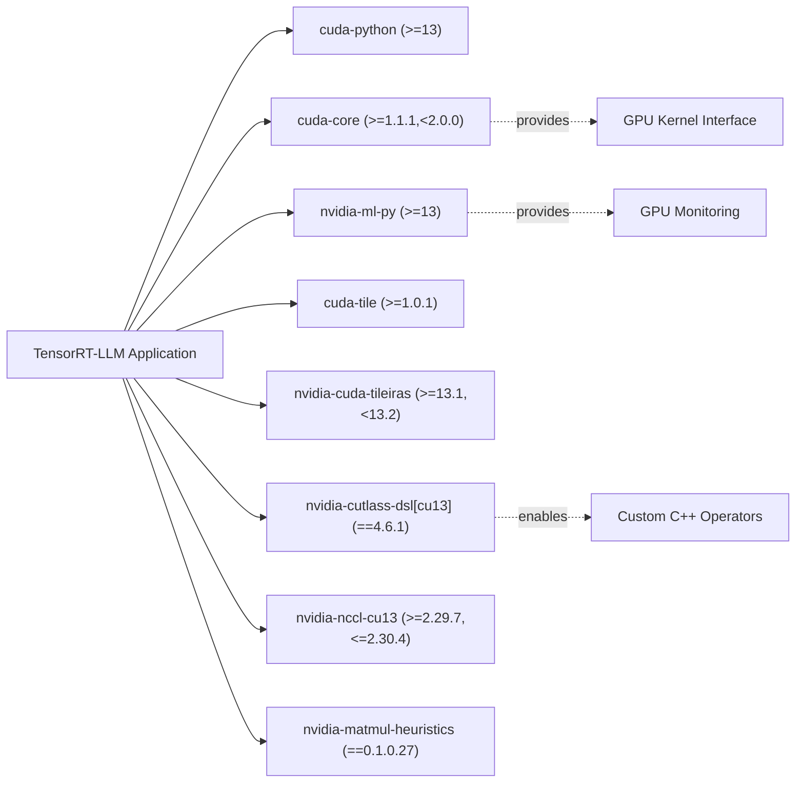

**Sources:** [security_scanning/pyproject.toml:14,25,31,73-74,84-86]()

## Building from Source: `build_wheel.py`

The `scripts/build_wheel.py` script is the primary entry point for building the TensorRT-LLM Python package from source. It orchestrates environment setup, C++ compilation, and Python wheel packaging.

### Build Orchestration Flow

The following diagram maps major build stages and the functions responsible within `build_wheel.py`.

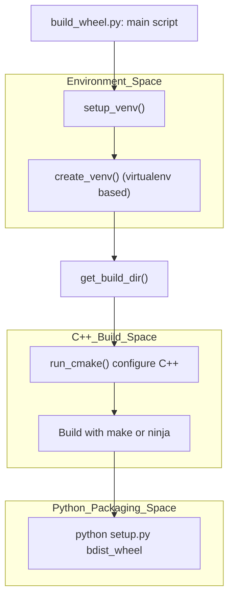

### Key Functions and Implementation Details

- `setup_venv`: Creates or updates a Python virtual environment, or uses current environment if already inside a venv or explicitly requested via `--no-venv` [scripts/build_wheel.py:179-194]().
- `create_venv`: Uses the `virtualenv` package (version constraint `>=20.29.1,<22.0`) to create a venv with system site packages enabled [scripts/build_wheel.py:152-172]().
- `get_available_cpu_count`: Limits build concurrency by respecting CPU affinity on Linux via `os.sched_getaffinity()` [scripts/build_wheel.py:46-57]().
- `apply_version_override`: Allows modifying the package version in `tensorrt_llm/version.py` before building the wheel [scripts/build_wheel.py:74-94]().
- `get_build_dir`: Determines the build directory based on build type (Release vs others) and root configuration [scripts/build_wheel.py:100-119]().

**Sources:** [scripts/build_wheel.py:46-194]()

## C++ 3rdparty and FetchContent

TensorRT-LLM manages C++ dependencies primarily through CMake's `FetchContent` mechanism. External libraries are defined and cached to speed up build times.

### Dependency Management

C++ dependencies are managed in `cpp/CMakeLists.txt` and `cpp/tensorrt_llm/CMakeLists.txt`. Key external projects include:
- **GoogleTest/Benchmark**: For unit testing and performance measurement.
- **NCCL**: For distributed communication.
- **NVRTC**: For runtime compilation of CUDA kernels.
- **fmha_sm100**: Fused Multi-Head Attention kernels for Blackwell, staged under `3rdparty/fmha_sm100` via CMake FetchContent [setup.py:61-67]().

The project uses a `fetch-cache` mechanism to avoid re-downloading large dependencies if they already exist in a specified local directory.

**Sources:** [cpp/CMakeLists.txt:1-100](), [cpp/tensorrt_llm/CMakeLists.txt:1-50](), [setup.py:61-67]()

## Poetry Lock Files

Poetry lock files guarantee reproducible builds by locking dependency versions tightly across various project sub-components.

| Component Lock File | Purpose |
|---------------------|---------|
| `security_scanning/poetry.lock` | Main project dependency lock [security_scanning/poetry.lock:1]() |
| `security_scanning/examples/auto_deploy/poetry.lock` | AutoDeploy tool specific dependencies [security_scanning/examples/auto_deploy/poetry.lock:1]() |
| `security_scanning/examples/trtllm-eval/poetry.lock` | Evaluation harness dependencies [security_scanning/examples/trtllm-eval/poetry.lock:1]() |
| `security_scanning/triton_backend/poetry.lock` | Triton Inference Server backend dependencies [security_scanning/triton_backend/poetry.lock:1]() |

**Sources:** [security_scanning/poetry.lock:1](), [security_scanning/examples/auto_deploy/poetry.lock:1](), [security_scanning/examples/trtllm-eval/poetry.lock:1](), [security_scanning/triton_backend/poetry.lock:1]()

## Security Scanning Infrastructure

The `security_scanning/` directory includes metadata for vulnerability scanning, tracking the current commit hash and scan timestamp to ensure build integrity.

### Metadata File
```json
{
  "commit_hash": "141260367a0cfdd7c1bacff30b20fe81080fed95",
  "timestamp": "2026-08-27T02:52:09Z"
}
```
**Sources:** [security_scanning/metadata.json:1-4]()

## Version Pinning Strategy

TensorRT-LLM uses strict version pinning for core and compatibility-sensitive packages.

| Package | Version | Reason |
|---------|---------|--------|
| `transformers` | `==5.5.4` | Architecture compatibility [security_scanning/pyproject.toml:33]() |
| `triton` | `==3.7.0` | Kernel backend alignment [security_scanning/pyproject.toml:68]() |
| `flashinfer-python` | `==0.6.16` | Sampling and attention kernels [security_scanning/pyproject.toml:58]() |
| `datasets` | `==3.1.0` | Evaluation consistency [security_scanning/pyproject.toml:43]() |
| `nvidia-cutlass-dsl[cu13]` | `==4.6.1` | FP8/FP4 GEMM generation [security_scanning/pyproject.toml:73]() |

**Sources:** [security_scanning/pyproject.toml:10-94]()

---

# Page: Docker Images and Container Setup

# Docker Images and Container Setup

<details>
<summary>Relevant source files</summary>

The following files were used as context for generating this wiki page:

- [.devcontainer/docker-compose.yml](.devcontainer/docker-compose.yml)
- [ATTRIBUTIONS-Python.md](ATTRIBUTIONS-Python.md)
- [CONTAINER_SOURCE.md](CONTAINER_SOURCE.md)
- [constraints.txt](constraints.txt)
- [docker/Dockerfile.multi](docker/Dockerfile.multi)
- [docker/Makefile](docker/Makefile)
- [docker/common/install_base.sh](docker/common/install_base.sh)
- [docker/common/install_ccache.sh](docker/common/install_ccache.sh)
- [docker/common/install_ci.sh](docker/common/install_ci.sh)
- [docker/common/install_cmake.sh](docker/common/install_cmake.sh)
- [docker/common/install_etcd.sh](docker/common/install_etcd.sh)
- [docker/common/install_mpi4py.sh](docker/common/install_mpi4py.sh)
- [docker/common/install_nixl.sh](docker/common/install_nixl.sh)
- [docker/common/install_polygraphy.sh](docker/common/install_polygraphy.sh)
- [docker/common/install_triton.sh](docker/common/install_triton.sh)
- [docker/common/install_ucx.sh](docker/common/install_ucx.sh)
- [jenkins/Build.groovy](jenkins/Build.groovy)
- [jenkins/BuildDockerImage.groovy](jenkins/BuildDockerImage.groovy)
- [jenkins/L0_MergeRequest.groovy](jenkins/L0_MergeRequest.groovy)
- [jenkins/L0_Test.groovy](jenkins/L0_Test.groovy)
- [jenkins/controlCCache.groovy](jenkins/controlCCache.groovy)
- [jenkins/current_image_tags.properties](jenkins/current_image_tags.properties)
- [requirements.txt](requirements.txt)
- [scripts/generate_container_oss_attribution.sh](scripts/generate_container_oss_attribution.sh)
- [scripts/get_wheel_from_package.py](scripts/get_wheel_from_package.py)
- [scripts/rename_docker_images.py](scripts/rename_docker_images.py)
- [security_scanning/docs/poetry.lock](security_scanning/docs/poetry.lock)

</details>


## Purpose and Scope

This document describes the Docker container infrastructure for TensorRT-LLM, covering multi-stage builds, container image variants, automated dependency installations including third-party libraries such as NIXL and UCX, and integration with the Jenkins CI/CD pipeline. The container system ensures consistent and reproducible development and deployment environments with all necessary dependencies pre-installed and configured.

Key elements include:
- Multi-stage Dockerfiles for optimized layer caching and modular builds. [docker/Dockerfile.multi:1-173]()
- Distinct image variants for development, wheel building, runtime, and Triton integration. [docker/Dockerfile.multi:22-142]()
- Installation scripts orchestrating CUDA, TensorRT, UCX, NIXL, and other dependencies. [docker/common/install_nixl.sh:1-52](), [docker/Dockerfile.multi:53-88]()
- Naming conventions and image tagging encoding architecture, OS, Python, and runtime versions. [jenkins/L0_Test.groovy:58-64](), [jenkins/current_image_tags.properties:1-20]()
- CI/CD pipeline automation to build, test, and publish images efficiently. [jenkins/BuildDockerImage.groovy:1-176]()

Sources: [docker/Dockerfile.multi:1-173](), [jenkins/BuildDockerImage.groovy:1-176](), [jenkins/current_image_tags.properties:1-20]()

---

## Multi-Stage Dockerfile Architecture

TensorRT-LLM employs a multi-stage Docker build strategy implemented in `docker/Dockerfile.multi`. This approach produces various reusable image layers to optimize both build time and deployment size.

### Stage Overview

| Stage | Purpose | Description |
|---|---|---|
| `base` | Base OS and environment setup | From a PyTorch base image (default `26.05-py3`), sets environment variables (`SH_ENV`, `BASH_ENV`), shell initialization, and NVIDIA license labels. [docker/Dockerfile.multi:22-40]() |
| `devel` | Development environment | Installs build tools (CMake, ccache); dependencies including CUDA toolkit, Polygraphy, MPI, and PyTorch. Also installs UCX, NIXL, ETCD, and FlashAttention 4. [docker/Dockerfile.multi:42-93]() |
| `tritondevel` | Devel + Triton Server integration | Combines the `devel` image with Triton server libraries and adds Mooncake (except on Rocky8) and CI tooling. [docker/Dockerfile.multi:102-119]() |
| `wheel` | Wheel build environment | Copies source code and scripts, then runs `build_wheel.py` to compile C++ binaries and package the Python wheel. [docker/Dockerfile.multi:121-140]() |
| `release` | Production runtime image | Starts from `devel`, installs the built wheel from the `wheel` stage, sets up runtime library paths (`libtensorrt_llm.so`), and includes examples. [docker/Dockerfile.multi:142-173]() |

### Docker Multi-Stage Build Flow Diagram

Title: Dockerfile.multi Stage Transitions
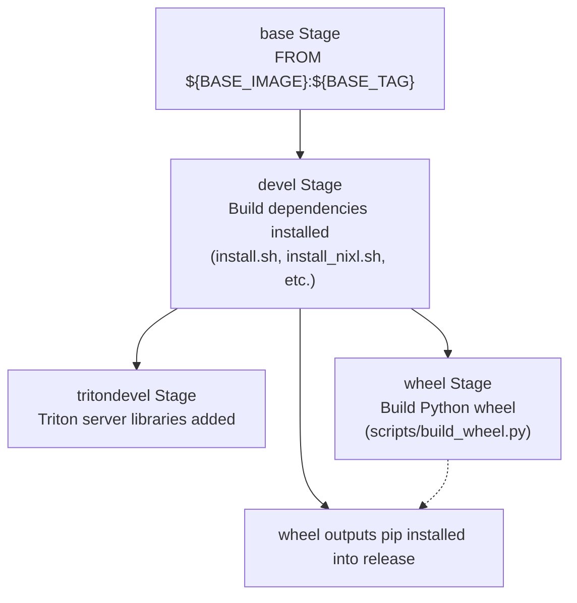

Sources: [docker/Dockerfile.multi:22-173]()

---

## Dependency Installation Scripts

TensorRT-LLM utilizes modular shell scripts under `docker/common/` that install and configure third-party dependencies. These scripts are integrated into the Docker builds via `RUN --mount=type=bind` commands. [docker/Dockerfile.multi:53-65]()

### Orchestration and Key Scripts

- `install.sh`: Master installation script called in the `devel` stage that delegates to component installers like `--cmake`, `--ccache`, and `--cuda_toolkit`. [docker/Dockerfile.multi:64-65]()
- Networking and communication installers:
  - `install_ucx.sh`: Installs UCX (Unified Communication X) for high-performance communication. [docker/Dockerfile.multi:84]()
  - `install_nixl.sh`: Installs NIXL (NVIDIA Inter-GPU eXchange Library), required for distributed KV cache transfers. It uses `meson` and `ninja` for compilation. [docker/common/install_nixl.sh:21-47]()
  - `install_etcd.sh`: Installs ETCD, used for service discovery and coordination in disaggregated serving. [docker/Dockerfile.multi:86]()
  - `install_fa4.sh`: Installs FlashAttention 4 dependencies. [docker/Dockerfile.multi:87]()

### Dependency Installation Flow Diagram

Title: Docker Dependency Installation Orchestration
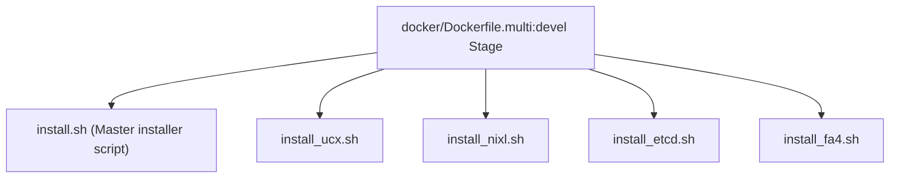

### Details on NIXL Installation

The NIXL installer (`install_nixl.sh`) clones the repository at version `v1.3.1`, compiles it with `meson` and `ninja`, and installs it. [docker/common/install_nixl.sh:7-47](). It specifically configures `LD_LIBRARY_PATH` to include the NIXL library path (`/opt/nvidia/nvda_nixl/lib`) in the container environment. [docker/common/install_nixl.sh:52]()

Sources: [docker/Dockerfile.multi:53-88](), [docker/common/install_nixl.sh:1-52]()

---

## Python Dependencies and Constraints

TensorRT-LLM manages its Python dependencies via `requirements.txt` and `setup.py`.

- `requirements.txt` lists core dependencies including PyTorch (pinned between `2.12.0a0` and `2.13.0a0`), `nvidia-nccl-cu13`, `flashinfer-python==0.6.16`, `transformers==5.5.4`, and `triton==3.7.0`. [requirements.txt:29-76]()
- The system uses `constraints.txt` during pip installs in Docker to enforce specific version constraints and security workarounds, such as specific versions for `h5py==3.12.1`. [requirements.txt:2](), [docker/Dockerfile.multi:68-76]()
- Special dependencies like `nvidia-cutlass-dsl[cu13]==4.6.1` are required for Blackwell CuTe DSL kernels. [requirements.txt:81]()
- The `devel` stage explicitly uninstalls conflicting packages like `tornado`, `black`, and older `nvidia-cutlass-dsl` versions before installing from `constraints.txt`. [docker/Dockerfile.multi:71-75]()

Sources: [requirements.txt:1-105](), [docker/Dockerfile.multi:68-76]()

---

## Image Variant Matrix and Tagging

### Image Tagging Convention

The image tags encode critical build and runtime details:
`[base_image_name]-[arch]-[os](-[python_version])-[trt_version]-[torch_install_type]-[stage]-[date]-[mr_id]` [jenkins/L0_Test.groovy:60]()

### Main Image Variables

The file `jenkins/current_image_tags.properties` tracks the latest valid images produced by CI. [jenkins/current_image_tags.properties:1-20]()

| Env Variable | Example Image URI |
|---|---|
| `LLM_DOCKER_IMAGE` | `...:pytorch-26.05-py3-x86_64-ubuntu24.04-skip-tritondevel-...` [jenkins/current_image_tags.properties:16]() |
| `LLM_SBSA_DOCKER_IMAGE` | `...:pytorch-26.05-py3-sbsa-ubuntu24.04-skip-tritondevel-...` [jenkins/current_image_tags.properties:17]() |
| `LLM_ROCKYLINUX8_PY310_DOCKER_IMAGE` | `...:cuda-13.2.1-devel-rocky8-x86_64-rocky8-py310-skip-tritondevel-...` [jenkins/current_image_tags.properties:18]() |
| `LLM_ROCKYLINUX8_PY312_DOCKER_IMAGE` | `...:cuda-13.2.1-devel-rocky8-x86_64-rocky8-py312-skip-tritondevel-...` [jenkins/current_image_tags.properties:19]() |

Sources: [jenkins/current_image_tags.properties:1-20](), [jenkins/L0_Test.groovy:58-64](), [jenkins/L0_MergeRequest.groovy:64-81]()

---

## CI/CD Pipeline Integration

Image building is automated via Jenkins pipelines, leveraging Kubernetes pods.

### Jenkins Pipeline Workflow

- `BuildDockerImage.groovy` provisions Kubernetes pods with isolated Docker environments (`docker:dind`). [jenkins/BuildDockerImage.groovy:175-176]()
- It orchestrates parallel builds for different architectures (x86_64, SBSA/aarch64) and configurations. [jenkins/Build.groovy:73-103]()
- Pod configurations include specific node selectors for architectures (`amd64`, `arm64`) and block unstable nodes to ensure build reliability. [jenkins/BuildDockerImage.groovy:81-149]()
- The `docker/Makefile` provides the `_build` and `_push` targets used by the pipeline to trigger `docker buildx build`. [docker/Makefile:81-126]()

### Jenkins Pipeline to Docker Code Mapping Diagram

Title: CI/CD Infrastructure and Build Orchestration
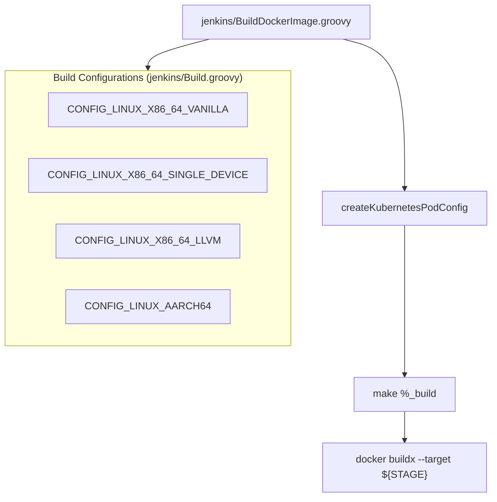

Sources: [jenkins/BuildDockerImage.groovy:1-176](), [jenkins/Build.groovy:73-103](), [docker/Makefile:81-126]()

---

## Python Wheel Building and Installation

### Wheel Build Process

The `wheel` stage in the Dockerfile performs a full build of the TensorRT-LLM Python wheel.

- Source code directories (`cpp`, `docker`, `scripts`, `tensorrt_llm`, `triton_kernels`, `3rdparty`) are copied into the image. [docker/Dockerfile.multi:123-129]()
- The build uses `scripts/build_wheel.py` with arguments defined in `BUILD_WHEEL_ARGS` (default `--clean`). [docker/Dockerfile.multi:134-140]()
- C++ compilation is accelerated via `CCACHE_DIR=/root/.cache/ccache`. [docker/Dockerfile.multi:131-136]()
- The `release` stage then installs the wheel using `pip install "${TRTLLM_WHEEL}[mx]"`. [docker/Dockerfile.multi:152]()

### Wheel Build Pipeline Diagram

Title: Native Build and Wheel Packaging Flow
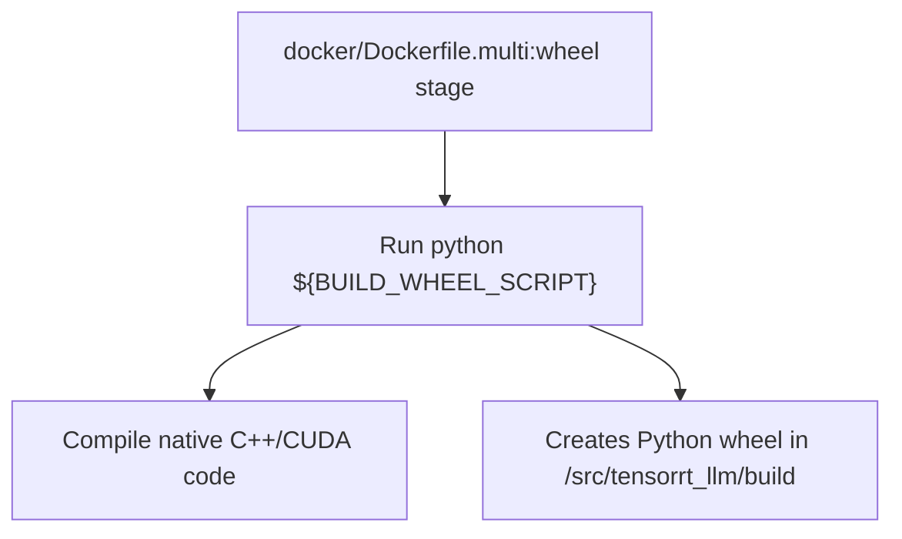

Sources: [docker/Dockerfile.multi:121-140](), [docker/Makefile:41-44]()

---

# Page: LLM API and User Interface

# LLM API and User Interface

<details>
<summary>Relevant source files</summary>

The following files were used as context for generating this wiki page:

- [tensorrt_llm/executor/__init__.py](tensorrt_llm/executor/__init__.py)
- [tensorrt_llm/executor/base_worker.py](tensorrt_llm/executor/base_worker.py)
- [tensorrt_llm/executor/executor.py](tensorrt_llm/executor/executor.py)
- [tensorrt_llm/executor/ipc.py](tensorrt_llm/executor/ipc.py)
- [tensorrt_llm/executor/postproc_worker.py](tensorrt_llm/executor/postproc_worker.py)
- [tensorrt_llm/executor/proxy.py](tensorrt_llm/executor/proxy.py)
- [tensorrt_llm/executor/request.py](tensorrt_llm/executor/request.py)
- [tensorrt_llm/executor/result.py](tensorrt_llm/executor/result.py)
- [tensorrt_llm/executor/utils.py](tensorrt_llm/executor/utils.py)
- [tensorrt_llm/executor/worker.py](tensorrt_llm/executor/worker.py)
- [tensorrt_llm/llmapi/__init__.py](tensorrt_llm/llmapi/__init__.py)
- [tensorrt_llm/llmapi/llm.py](tensorrt_llm/llmapi/llm.py)
- [tensorrt_llm/llmapi/mgmn_leader_node.py](tensorrt_llm/llmapi/mgmn_leader_node.py)
- [tensorrt_llm/llmapi/mpi_session.py](tensorrt_llm/llmapi/mpi_session.py)
- [tensorrt_llm/llmapi/trtllm-llmapi-launch](tensorrt_llm/llmapi/trtllm-llmapi-launch)
- [tests/unittest/_torch/executor/test_router_dealer_ipc.py](tests/unittest/_torch/executor/test_router_dealer_ipc.py)
- [tests/unittest/api_stability/references_committed/llm.yaml](tests/unittest/api_stability/references_committed/llm.yaml)
- [tests/unittest/executor/test_ipc.py](tests/unittest/executor/test_ipc.py)
- [tests/unittest/executor/test_launcher_envs.py](tests/unittest/executor/test_launcher_envs.py)
- [tests/unittest/executor/test_proxy_fast_death.py](tests/unittest/executor/test_proxy_fast_death.py)
- [tests/unittest/llmapi/_run_mpi_comm_task.py](tests/unittest/llmapi/_run_mpi_comm_task.py)
- [tests/unittest/llmapi/_run_multi_llm_tasks.py](tests/unittest/llmapi/_run_multi_llm_tasks.py)
- [tests/unittest/llmapi/_run_multi_mpi_comm_tasks.py](tests/unittest/llmapi/_run_multi_mpi_comm_tasks.py)
- [tests/unittest/llmapi/lora_test_utils.py](tests/unittest/llmapi/lora_test_utils.py)
- [tests/unittest/llmapi/test_executor.py](tests/unittest/llmapi/test_executor.py)
- [tests/unittest/llmapi/test_llm.py](tests/unittest/llmapi/test_llm.py)
- [tests/unittest/llmapi/test_llm_multi_gpu_pytorch.py](tests/unittest/llmapi/test_llm_multi_gpu_pytorch.py)
- [tests/unittest/llmapi/test_llm_pytorch.py](tests/unittest/llmapi/test_llm_pytorch.py)

</details>


## Purpose and Scope

This page provides a high-level overview of the primary Python API exposed by TensorRT-LLM for Large Language Model (LLM) inference and generation. It introduces the central `LLM` class used by applications, explains its configuration system, the key generation methods, and how multi-GPU and disaggregated setups are managed.

This page acts as a parent overview. Detailed technical aspects, code usage examples, and configuration options are covered in child pages:

- For `LLM` class details, usage examples, and generation methods, see [LLM Class and Generation Methods](#3.1).
- For the Python configuration system including `TorchLlmArgs`/`TrtLlmArgs`, KV cache management, scheduling, and attention backends, see [Configuration System and LlmArgs](#3.2).
- For sampling control, beam search, logits processing, and output customization, see [SamplingParams and Generation Control](#3.3).
- For multi-GPU distributed setups, MPI session management, launching, and Ray executor usage, see [Multi-GPU Setup and MPI Sessions](#3.4).
- For disaggregated serving and specialized inference parameter management, see [Disaggregated Serving Parameters](#3.5).
- For the underlying PyTorch runtime used in `backend="pytorch"`, see [PyExecutor Runtime System](#7).
- For the C++ TensorRT based runtime engine, see [C++ Runtime and Batch Manager](#20).

Sources: [tensorrt_llm/llmapi/llm.py:70-82](), [tensorrt_llm/llmapi/llm.py:1022-1065]()

---

## Architecture Overview

The user-facing LLM API is anchored around the `LLM` class defined in `tensorrt_llm/llmapi/llm.py`. This class encapsulates model loading, configuration parsing, backend selection, and generation handling.

At initialization, `LLM` parses user-provided configuration arguments into specialized classes (`TorchLlmArgs` or `TrtLlmArgs`), chooses the runtime backend (PyTorch or TensorRT), and instantiates a `GenerationExecutor`. The executor manages all model inference and token generation logic, including multi-GPU coordination if requested.

Key components of the API are:

- `LLM`: The main interface, created by the user [tensorrt_llm/llmapi/llm.py:202-210]().
- `LlmArgs` subclasses: Configuration objects that control executor behavior, KV cache, tensor parallelism, etc [tensorrt_llm/llmapi/llm_args.py:28-30](), [tensorrt_llm/llmapi/llm_args.py:575-800]().
- `GenerationExecutor`: Abstracts runtime execution; varies by backend [tensorrt_llm/executor/executor.py:83-88]().
- `RequestOutput`: Represents results for a single generation request [tensorrt_llm/llmapi/llm.py:70-82]().
- `TokenizerBase`: Abstracts tokenization for text and multimodal inputs [tensorrt_llm/llmapi/tokenizer.py:23]().

**Diagram: Natural Language to Code Entity Mapping (Request Flow)**

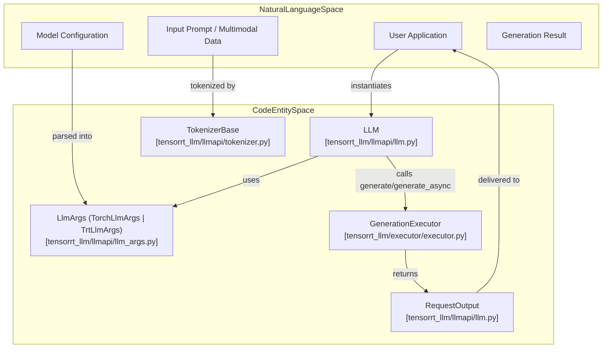

Sources: [tensorrt_llm/llmapi/llm.py:70-123](), [tensorrt_llm/llmapi/llm_args.py:575-800](), [tensorrt_llm/llmapi/llm.py:1022-1180]()

---

## Public API Surface

The LLM API symbols exposed for direct user usage are exported from `tensorrt_llm/llmapi/__init__.py`. Major symbols include:

| Symbol                | Description                                                  | Source Location                                |
|-----------------------|--------------------------------------------------------------|------------------------------------------------|
| `LLM`                 | Main user-facing class for loading models and generating text| [tensorrt_llm/llmapi/llm.py:202]() |
| `RequestOutput`        | Result class containing generation outputs                   | [tensorrt_llm/llmapi/llm.py:70]() |
| `EncoderOutput`        | Output from encoder-only (classification/embedding) models  | [tensorrt_llm/llmapi/llm.py:124]() |
| `SamplingParams`       | Controls sampling strategies: temperature, beams, top-k, etc.| [tensorrt_llm/sampling_params.py:57]() |
| `KvCacheConfig`        | Configuration for KV cache sizing and reuse                  | [tensorrt_llm/llmapi/llm_args.py:9]() |
| `TorchLlmArgs`         | PyTorch backend configuration parameters                     | [tensorrt_llm/llmapi/llm_args.py:575]() |
| `TrtLlmArgs`           | TensorRT backend configuration parameters                    | [tensorrt_llm/llmapi/llm_args.py:795]() |
| `LoRARequest`          | LoRA adapter request specification for per-request control  | [tensorrt_llm/executor/request.py:45]() |
| `DisaggregatedParams`  | Parameters for disaggregated serving                          | [tensorrt_llm/disaggregated_params.py:3]() |

Sources: [tensorrt_llm/llmapi/__init__.py:1-100](), [tensorrt_llm/llmapi/llm.py:70-137]()

---

## Class Hierarchy and Relationships

The core class inheritance and relations around the LLM API involve bridging the high-level user interface with the underlying executor workers.

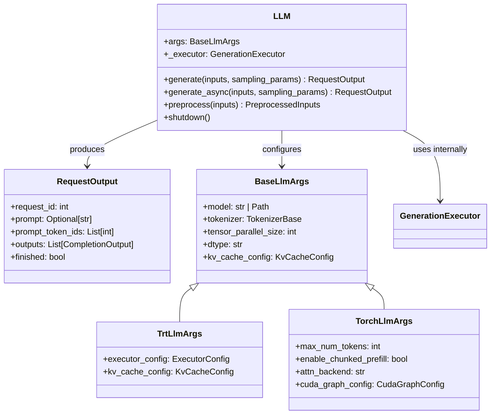

This hierarchy shows how `LLM` is configured by argument classes (`TrtLlmArgs` or `TorchLlmArgs`) which extend a common base `BaseLlmArgs`. `RequestOutput` encapsulates generation output results [tensorrt_llm/llmapi/llm.py:70-121]().

Sources: [tensorrt_llm/llmapi/llm.py:202-300](), [tensorrt_llm/llmapi/llm_args.py:575-800]()

---

## Backend Selection and Execution

The `LLM` constructor accepts parameters determining runtime behavior. The selection of the backend influences model loading and execution pipelines [tensorrt_llm/llmapi/llm.py:220-250]():

| Backend Value     | Configuration Args Class | Runtime Executor Implementation                     | Notes                                      |
|-------------------|--------------------------|----------------------------------------------------|--------------------------------------------|
| `"pytorch"`       | `TorchLlmArgs`           | `GenerationExecutorWorker` (Python PyTorch runtime) | Enables PyTorch-based inference and autotuning |
| `"tensorrt"` (default) | `TrtLlmArgs`          | C++ TensorRT batch manager via bindings             | High-performance GPU TensorRT engine        |

For multi-GPU, the system uses an MPI session (e.g., `MpiPoolSession`) to manage multiple executor worker processes [tensorrt_llm/llmapi/mpi_session.py:62-63](). The `GenerationExecutorProxy` handles communication between the frontend and these workers [tensorrt_llm/executor/proxy.py:99-102]().

Sources: [tensorrt_llm/llmapi/llm.py:202-350](), [tensorrt_llm/llmapi/mpi_session.py:62-63](), [tensorrt_llm/executor/proxy.py:99-102]()

---

## Configuration Overview

All parameters controlling model loading, execution, and generation are supplied via the `LLM` constructor. Configuration flows through specialized classes [tensorrt_llm/llmapi/llm_args.py:575-800]():

- `TorchLlmArgs`: Parameters controlling PyTorch backend features including chunked prefill, attention backend selection, CUDA graph usage, and LoRA integration [tensorrt_llm/llmapi/llm_args.py:575]().
- `TrtLlmArgs`: Parameters controlling TensorRT backend execution including executor config, scheduling, KV cache policies, and kernel selection [tensorrt_llm/llmapi/llm_args.py:795]().

These argument classes reference and compose smaller configuration classes such as `KvCacheConfig` [tensorrt_llm/llmapi/llm_args.py:9]() and `SchedulerConfig` [tensorrt_llm/llmapi/llm_args.py:26]().

**Diagram: Configuration Composition in LLM Constructor**

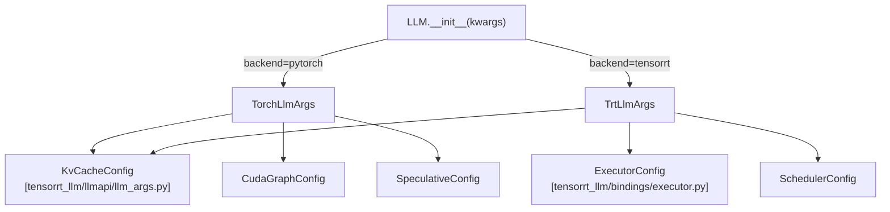

Sources: [tensorrt_llm/llmapi/llm_args.py:9-26](), [tensorrt_llm/llmapi/llm.py:202-350]()

---

## Generation Interface

Applications primarily interact with the `LLM` class using generation methods:

- **`generate` (synchronous)**: Accepts a single prompt string or a list of prompts. Internally calls `generate_async` and waits for results to complete [tensorrt_llm/llmapi/llm.py:1022-1065]().
- **`generate_async` (asynchronous and streaming capable)**: Returns a `GenerationResult` object immediately, with results delivered asynchronously or via streaming [tensorrt_llm/llmapi/llm.py:1126-1180]().
- **`preprocess`**: Performs tokenization and multimodal input preprocessing without submitting for model inference [tensorrt_llm/llmapi/llm.py:1010-1020]().

Generation inputs can include plain text prompts, token ID lists, or multimodal data. Tokenization and preprocessing are handled by the configured tokenizer (`TokenizerBase` implementations) [tensorrt_llm/llmapi/tokenizer.py:23]().

Sources: [tensorrt_llm/llmapi/llm.py:1022-1180](), [tensorrt_llm/llmapi/tokenizer.py:23]()

---

## Output Types

Output from the LLM API is modeled primarily through:

- `RequestOutput`: The main result object returned by generation calls [tensorrt_llm/llmapi/llm.py:70-121]().
- `CompletionOutput`: Represents a single generated completion sequence with text, tokens, logprobs, and metadata [tensorrt_llm/executor/result.py:105-145]().
- `EncoderOutput`: Used for encoder-only models like classification or embedding extraction, containing logits and prompt tokens [tensorrt_llm/llmapi/llm.py:124-137]().

Sources: [tensorrt_llm/llmapi/llm.py:70-137](), [tensorrt_llm/executor/result.py:105-145]()

---

## Typical Usage Pattern

The following demonstrates a typical usage of the `LLM` Python API for text generation.

**Synchronous, single prompt generation**

```python
from tensorrt_llm import LLM
from tensorrt_llm.llmapi import KvCacheConfig, SamplingParams

llm = LLM(model="path/to/model", kv_cache_config=KvCacheConfig(free_gpu_memory_fraction=0.4))
outputs = llm.generate(["Hello, world"], sampling_params=SamplingParams(max_tokens=8))

print(outputs[0].outputs[0].text)  # Print first token sequence generated
```

**Context-managed lifecycle**

```python
with LLM(model="path/to/model", tensor_parallel_size=2) as llm:
    prompts = ["Once upon a time"]
    results = llm.generate(prompts)
    for output in results:
        print(output.outputs[0].text)
```

The context manager ensures proper resource cleanup via `atexit` and internal `shutdown` logic [tensorrt_llm/llmapi/llm.py:202-350]().

Sources: [tensorrt_llm/llmapi/llm.py:202-350](), [tests/unittest/llmapi/test_llm.py:148-154]()

---

# Links to Child Pages

For detailed exploration of the components introduced here, please visit:

- **[LLM Class and Generation Methods](#3.1)** — Details of `LLM` initialization, usage, generation methods, and tokenization events.
- **[Configuration System and LlmArgs](#3.2)** — Deep dive into the Torch and TensorRT configuration parameter classes.
- **[SamplingParams and Generation Control](#3.3)** — In-depth guide to sampling parameters, beam search, logits processing, and output controls.
- **[Multi-GPU Setup and MPI Sessions](#3.4)** — Documentation of multi-GPU deployment, MPI session types, and launcher scripts.
- **[Disaggregated Serving Parameters](#3.5)** — Explanation of disaggregated inference parameters, context-generation separation, and KV cache transfer.

---

Sources Summary:  
- [`tensorrt_llm/llmapi/llm.py:70-137,202-350,1022-1180`]()  
- [`tensorrt_llm/llmapi/llm_args.py:9-30,575-800`]()  
- [`tensorrt_llm/executor/executor.py:83-88`]()  
- [`tensorrt_llm/executor/proxy.py:99-102`]()
- [`tensorrt_llm/llmapi/mpi_session.py:62-63`]()  
- [`tensorrt_llm/llmapi/tokenizer.py:64`]()  
- [`tensorrt_llm/sampling_params.py:57`]()
- [`tensorrt_llm/executor/result.py:105-145`]()

---

# Page: LLM Class and Generation Methods

# LLM Class and Generation Methods

<details>
<summary>Relevant source files</summary>

The following files were used as context for generating this wiki page:

- [examples/llm-api/quickstart_advanced.py](examples/llm-api/quickstart_advanced.py)
- [tensorrt_llm/_torch/models/modeling_multimodal_utils.py](tensorrt_llm/_torch/models/modeling_multimodal_utils.py)
- [tensorrt_llm/_torch/models/modeling_nemotron_nano.py](tensorrt_llm/_torch/models/modeling_nemotron_nano.py)
- [tensorrt_llm/_torch/models/modeling_parakeet.py](tensorrt_llm/_torch/models/modeling_parakeet.py)
- [tensorrt_llm/_torch/models/modeling_radio.py](tensorrt_llm/_torch/models/modeling_radio.py)
- [tensorrt_llm/_torch/models/multimodal_encoder_graph.py](tensorrt_llm/_torch/models/multimodal_encoder_graph.py)
- [tensorrt_llm/executor/__init__.py](tensorrt_llm/executor/__init__.py)
- [tensorrt_llm/executor/base_worker.py](tensorrt_llm/executor/base_worker.py)
- [tensorrt_llm/executor/executor.py](tensorrt_llm/executor/executor.py)
- [tensorrt_llm/executor/ipc.py](tensorrt_llm/executor/ipc.py)
- [tensorrt_llm/executor/postproc_worker.py](tensorrt_llm/executor/postproc_worker.py)
- [tensorrt_llm/executor/proxy.py](tensorrt_llm/executor/proxy.py)
- [tensorrt_llm/executor/request.py](tensorrt_llm/executor/request.py)
- [tensorrt_llm/executor/result.py](tensorrt_llm/executor/result.py)
- [tensorrt_llm/executor/utils.py](tensorrt_llm/executor/utils.py)
- [tensorrt_llm/executor/worker.py](tensorrt_llm/executor/worker.py)
- [tensorrt_llm/inputs/__init__.py](tensorrt_llm/inputs/__init__.py)
- [tensorrt_llm/inputs/media_io.py](tensorrt_llm/inputs/media_io.py)
- [tensorrt_llm/inputs/multimodal.py](tensorrt_llm/inputs/multimodal.py)
- [tensorrt_llm/inputs/multimodal_data.py](tensorrt_llm/inputs/multimodal_data.py)
- [tensorrt_llm/inputs/registry.py](tensorrt_llm/inputs/registry.py)
- [tensorrt_llm/inputs/utils.py](tensorrt_llm/inputs/utils.py)
- [tensorrt_llm/llmapi/llm.py](tensorrt_llm/llmapi/llm.py)
- [tensorrt_llm/llmapi/mgmn_leader_node.py](tensorrt_llm/llmapi/mgmn_leader_node.py)
- [tensorrt_llm/llmapi/mpi_session.py](tensorrt_llm/llmapi/mpi_session.py)
- [tensorrt_llm/llmapi/trtllm-llmapi-launch](tensorrt_llm/llmapi/trtllm-llmapi-launch)
- [tensorrt_llm/serve/chat_utils.py](tensorrt_llm/serve/chat_utils.py)
- [tests/unittest/_torch/executor/test_router_dealer_ipc.py](tests/unittest/_torch/executor/test_router_dealer_ipc.py)
- [tests/unittest/_torch/modeling/test_modeling_nemotron_nano_v2_vl.py](tests/unittest/_torch/modeling/test_modeling_nemotron_nano_v2_vl.py)
- [tests/unittest/_torch/modeling/test_modeling_parakeet.py](tests/unittest/_torch/modeling/test_modeling_parakeet.py)
- [tests/unittest/_torch/modeling/test_modeling_radio.py](tests/unittest/_torch/modeling/test_modeling_radio.py)
- [tests/unittest/_torch/modeling/test_multimodal_encoder_graph.py](tests/unittest/_torch/modeling/test_multimodal_encoder_graph.py)
- [tests/unittest/_torch/modeling/test_nemotron_nano_preprocessing.py](tests/unittest/_torch/modeling/test_nemotron_nano_preprocessing.py)
- [tests/unittest/_torch/multimodal/test_qwen3vl_mixed_modality_encoder.py](tests/unittest/_torch/multimodal/test_qwen3vl_mixed_modality_encoder.py)
- [tests/unittest/_torch/test_utils.py](tests/unittest/_torch/test_utils.py)
- [tests/unittest/executor/test_ipc.py](tests/unittest/executor/test_ipc.py)
- [tests/unittest/executor/test_launcher_envs.py](tests/unittest/executor/test_launcher_envs.py)
- [tests/unittest/executor/test_proxy_fast_death.py](tests/unittest/executor/test_proxy_fast_death.py)
- [tests/unittest/inputs/test_video_data_hashing.py](tests/unittest/inputs/test_video_data_hashing.py)
- [tests/unittest/inputs/test_video_decode.py](tests/unittest/inputs/test_video_decode.py)
- [tests/unittest/llmapi/_run_mpi_comm_task.py](tests/unittest/llmapi/_run_mpi_comm_task.py)
- [tests/unittest/llmapi/_run_multi_llm_tasks.py](tests/unittest/llmapi/_run_multi_llm_tasks.py)
- [tests/unittest/llmapi/_run_multi_mpi_comm_tasks.py](tests/unittest/llmapi/_run_multi_mpi_comm_tasks.py)
- [tests/unittest/llmapi/apps/test_chat_utils.py](tests/unittest/llmapi/apps/test_chat_utils.py)
- [tests/unittest/llmapi/lora_test_utils.py](tests/unittest/llmapi/lora_test_utils.py)
- [tests/unittest/llmapi/test_executor.py](tests/unittest/llmapi/test_executor.py)
- [tests/unittest/llmapi/test_llm.py](tests/unittest/llmapi/test_llm.py)
- [tests/unittest/llmapi/test_llm_kv_cache_events.py](tests/unittest/llmapi/test_llm_kv_cache_events.py)
- [tests/unittest/llmapi/test_llm_multi_gpu_pytorch.py](tests/unittest/llmapi/test_llm_multi_gpu_pytorch.py)
- [tests/unittest/llmapi/test_llm_pytorch.py](tests/unittest/llmapi/test_llm_pytorch.py)

</details>


## Purpose and Scope

This page documents the `LLM` class and its core generation methods, which provide the primary Python API for text generation in TensorRT-LLM. The `LLM` class abstracts model loading, inference execution, and output handling into a simple interface for both synchronous and asynchronous generation. It supports multiple backends, including a high-performance C++ runtime and a flexible PyTorch-based execution engine (`PyExecutor`).

**Related pages:**
- For configuration parameters and validation, see [3.2 Configuration System and LlmArgs]()
- For sampling strategy control, see [3.3 SamplingParams and Generation Control]()
- For multi-GPU distribution setup, see [3.4 Multi-GPU Setup and MPI Sessions]()
- For the underlying execution orchestration, see [7 PyExecutor Runtime System]()

---

## LLM Class Overview

The `LLM` class serves as the main entry point for model inference. It supports multiple backend implementations, primarily branching between a C++ based TensorRT engine executor and a PyTorch-based execution engine.

| Backend | Code Entity | Use Case |
|---------|-------------|----------|
| **PyTorch** | `tensorrt_llm.llmapi.llm.LLM` | Development, debugging, and models without pre-built engines. [tensorrt_llm/llmapi/llm.py:150-237]() |
| **TensorRT** | `tensorrt_llm._tensorrt_engine.LLM` | Production deployments requiring maximum performance via compiled engines. [tensorrt_llm/llmapi/llm.py:182-196]() |

The class provides three primary methods for interaction:

- `__init__`: Initialize and load the model [tensorrt_llm/llmapi/llm.py:150-237]()
- `generate`: Synchronous batch generation, returning all outputs once completed [tensorrt_llm/llmapi/llm.py:793-933]()
- `generate_async`: Asynchronous generation that returns immediately with a `GenerationResult` for streaming or later retrieval [tensorrt_llm/llmapi/llm.py:946-1047]()

**Sources:** [tensorrt_llm/llmapi/llm.py:70-1047]()

---

## Class Initialization

### Constructor Signature

```python
# Initialization parameters [tensorrt_llm/llmapi/llm.py:150-161]
LLM(
    model: Union[str, Path],
    tokenizer: Optional[Union[str, Path, TokenizerBase, PreTrainedTokenizerBase]] = None,
    tokenizer_mode: Literal['auto', 'slow'] = 'auto',
    skip_tokenizer_init: bool = False,
    trust_remote_code: bool = False,
    tensor_parallel_size: int = 1,
    dtype: str = "auto",
    revision: Optional[str] = None,
    tokenizer_revision: Optional[str] = None,
    **kwargs: Any
)
```

The constructor accepts a model path or identifier and optional tokenizer configurations. Extensive backend and runtime options passed via `**kwargs` are parsed into an internal configuration class, typically `TorchLlmArgs` [tensorrt_llm/llmapi/llm.py:150-237]().

### Initialization Data Flow

The initialization involves the following transformations from user parameters to the internal executor:

Title: LLM Initialization Data Flow
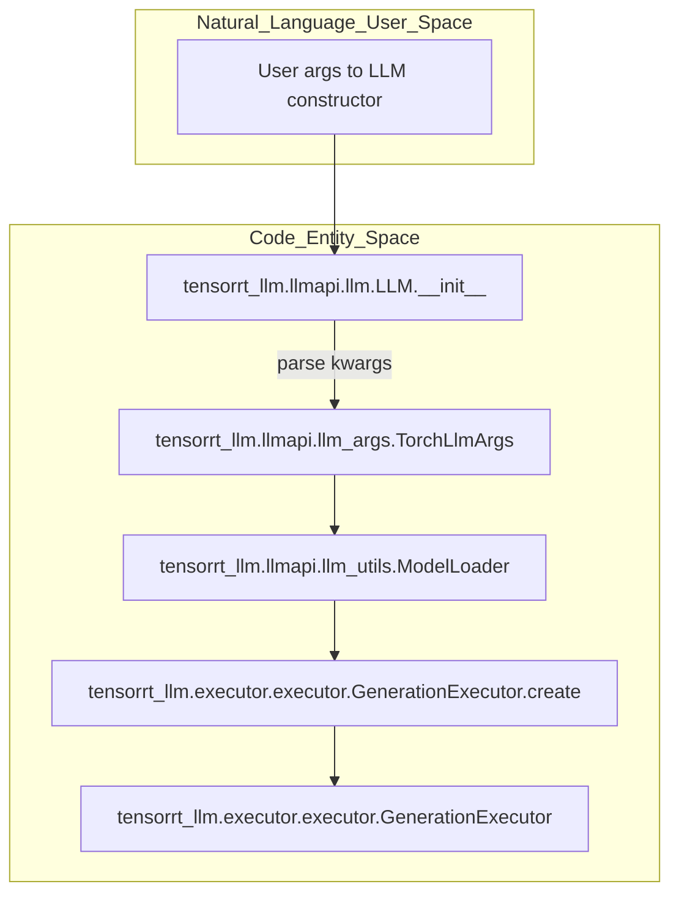
**Sources:** [tensorrt_llm/llmapi/llm.py:150-237](), [tensorrt_llm/llmapi/llm_args.py:59-157](), [tensorrt_llm/llmapi/llm_utils.py:61]().

### Key Initialization Steps

1. **MPI and Distributed Handling:**  
   The constructor checks for MPI availability and creates a communication session if `tensor_parallel_size` or `pipeline_parallel_size` is greater than 1 [tensorrt_llm/llmapi/llm.py:172-178](). It uses `create_mpi_comm_session` to manage multi-GPU orchestration [tensorrt_llm/llmapi/llm.py:225-227]().
   
2. **LlmArgs Parsing:**  
   The `TorchLlmArgs` configuration class parses and validates keyword arguments. This includes setting up `KvCacheConfig`, `SchedulerConfig`, and `SpeculativeConfig` [tensorrt_llm/llmapi/llm_args.py:59-157]().

3. **Model Loading:**  
   `ModelLoader` (or `CachedModelLoader`) manages constructing the model from HuggingFace checkpoints. It handles weight transformation and model parallelism sharding [tensorrt_llm/llmapi/llm_utils.py:60-61]().

4. **Executor Creation:**  
   The `LLM` class initializes a `GenerationExecutor`. Depending on the `backend` and `orchestrator_type` (e.g., `rpc`, `ray`), it may spawn worker processes using `GenerationExecutorProxy` [tensorrt_llm/llmapi/llm.py:230-237]().

**Sources:** [tensorrt_llm/llmapi/llm.py:150-237](), [tensorrt_llm/llmapi/llm_args.py:59-157](), [tensorrt_llm/llmapi/llm_utils.py:60-61]().

---

## Generate Method (Synchronous)

### Overview

The synchronous `generate` method provides batch text generation. It is a blocking method that waits for completion before returning a list of `RequestOutput` objects [tensorrt_llm/llmapi/llm.py:793-933]().

### Synchronous Generation Flow

Title: Synchronous Generation Sequence
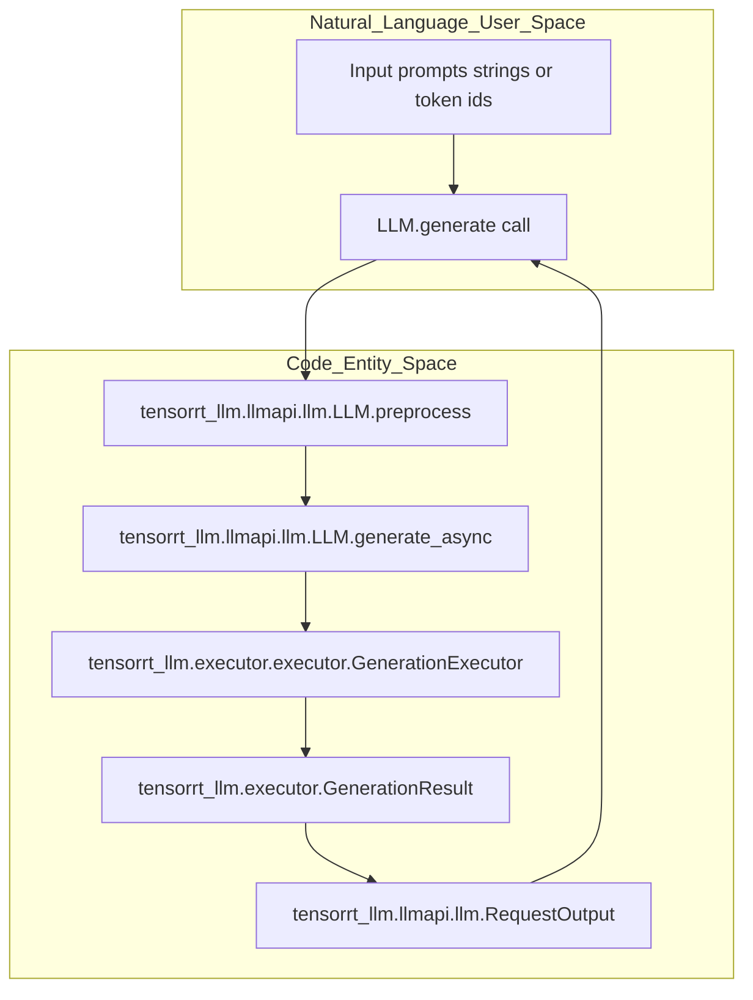
**Sources:** [tensorrt_llm/llmapi/llm.py:793-933](), [tensorrt_llm/llmapi/llm.py:1187-1237]().

### Features and Arguments

- **Sampling Control:** Accepts `SamplingParams` per request or per batch [tensorrt_llm/llmapi/llm.py:793-803]().
- **LoRA Support:** Integrates `LoRARequest` for dynamic adapter switching [tensorrt_llm/llmapi/llm.py:814-815]().
- **Reasoning Budget:** Supports `thinking_token_budget` via `add_thinking_budget_logits_processor` to control chain-of-thought generation [tensorrt_llm/llmapi/llm.py:63](), [tensorrt_llm/llmapi/thinking_budget.py:20]().

---

## Generate Async Method (Asynchronous)

`generate_async` is the non-blocking foundation of the API. It returns a `GenerationResult` (a future-like object) immediately [tensorrt_llm/llmapi/llm.py:946-1047]().

### Key Execution Path
1. **Preprocessing:** Raw inputs are converted to token IDs via `LLM.preprocess()` [tensorrt_llm/llmapi/llm.py:1187-1237]().
2. **Request Submission:** The executor's `enqueue` or equivalent method is called with a `GenerationRequest` [tensorrt_llm/llmapi/llm.py:1010-1025]().
3. **Result Tracking:** A `GenerationResult` is returned, which the user can poll or use for streaming [tensorrt_llm/llmapi/llm.py:1040-1047]().

**Sources:** [tensorrt_llm/llmapi/llm.py:946-1047](), [tensorrt_llm/llmapi/llm.py:1187-1237]().

---

## Preprocess Method

The `preprocess` method handles the conversion of high-level inputs into the format required by the inference engine.

```python
def preprocess(self, inputs: PromptInputs | Sequence[PromptInputs]) -> Tuple[List[List[int]], Optional[MultimodalParams]]:
```

- **Input Processing:** Uses `create_input_processor` to handle strings, `TokensPrompt`, and multimodal data [tensorrt_llm/llmapi/llm.py:1195-1200]().
- **Multimodal Handling:** If multimodal inputs are present, it computes embeddings and handles cumulative sum offsets for the encoder [tensorrt_llm/llmapi/llm.py:1210-1225](). For models like Nemotron-Nano, specific input processors handle aspect-preserving resizing for video and audio data [tensorrt_llm/_torch/models/modeling_nemotron_nano.py:74-146]().
- **Tokenizer Integration:** Uses `TokenizerBase` to ensure consistent encoding between prompt strings and model inputs [tensorrt_llm/llmapi/llm.py:1190-1205]().

**Sources:** [tensorrt_llm/llmapi/llm.py:1187-1237](), [tensorrt_llm/llmapi/tokenizer.py:23](), [tensorrt_llm/_torch/models/modeling_nemotron_nano.py:17-41]().

---

## RequestOutput Class

`RequestOutput` is the container for generation results. It inherits from `GenerationResult` and adds detokenization context [tensorrt_llm/llmapi/llm.py:70-121]().

### Key Attributes
- `request_id`: The unique ID assigned by the executor [tensorrt_llm/llmapi/llm.py:74]().
- `prompt`: The original input string [tensorrt_llm/llmapi/llm.py:75]().
- `outputs`: A list of `CompletionOutput` objects containing the generated text and tokens [tensorrt_llm/llmapi/llm.py:77]().
- `finished`: Boolean indicating if the request reached an EOS or limit [tensorrt_llm/llmapi/llm.py:80]().

**Sources:** [tensorrt_llm/llmapi/llm.py:70-121]()

---

## KV Cache Management and Events

The `LLM` class manages the KV cache through `KvCacheConfig` passed during initialization.

- **Resource Management:** Allocation is handled by the executor's `KVCacheManager` or `KVCacheManagerV2` for PyTorch backend [tensorrt_llm/llmapi/llm_args.py:64](), [examples/llm-api/quickstart_advanced.py:156-162]().
- **Retention Policies:** `KvCacheRetentionConfig` allows specifying how long blocks should be kept in memory after a request finishes to facilitate prefix caching [tensorrt_llm/llmapi/llm_utils.py:60]().
- **Event Logging:** When `log_kv_cache_events` is enabled in `LlmArgs`, the system tracks cache hits, misses, and evictions via the `await_response_thread` in the worker [tensorrt_llm/llmapi/llm_args.py:155-157](), [tensorrt_llm/executor/worker.py:77-81]().

**Sources:** [tensorrt_llm/llmapi/llm_args.py:64](), [tensorrt_llm/llmapi/llm_utils.py:60](), [tensorrt_llm/executor/worker.py:77-81]().

---

## Basic Usage Patterns

### Simple Synchronous Generation
```python
from tensorrt_llm import LLM, SamplingParams

llm = LLM(model="llama-models-v2/TinyLlama-1.1B-Chat-v1.0")
outputs = llm.generate(
    ["A B C"],
    sampling_params=SamplingParams(max_tokens=8),
)
for output in outputs:
    print(output.outputs[0].text)
```

### Asynchronous Streaming
```python
# Streaming usage pattern [tensorrt_llm/llmapi/llm.py:864-870]
result = llm.generate_async(
    "The future of AI is",
    sampling_params=SamplingParams(max_tokens=32),
    streaming=True,
)

for partial in result:
    print(partial.outputs[0].text_diff, end="", flush=True)
```

**Sources:** [tensorrt_llm/llmapi/llm.py:793-1047](), [examples/llm-api/quickstart_advanced.py:29-33](), [tests/unittest/llmapi/test_llm.py:147-153]().

---

# Page: Configuration System and LlmArgs

# Configuration System and LlmArgs

<details>
<summary>Relevant source files</summary>

The following files were used as context for generating this wiki page:

- [cpp/tensorrt_llm/kernels/minimaxM3Fp8IndexerKernel.cu](cpp/tensorrt_llm/kernels/minimaxM3Fp8IndexerKernel.cu)
- [cpp/tensorrt_llm/kernels/minimaxM3Fp8IndexerKernel.h](cpp/tensorrt_llm/kernels/minimaxM3Fp8IndexerKernel.h)
- [cpp/tensorrt_llm/thop/minimaxM3Fp8IndexerOp.cpp](cpp/tensorrt_llm/thop/minimaxM3Fp8IndexerOp.cpp)
- [docs/source/developer-guide/telemetry.md](docs/source/developer-guide/telemetry.md)
- [tensorrt_llm/_torch/peft/lora/config.py](tensorrt_llm/_torch/peft/lora/config.py)
- [tensorrt_llm/_torch/peft/lora/cuda_graph_lora_manager.py](tensorrt_llm/_torch/peft/lora/cuda_graph_lora_manager.py)
- [tensorrt_llm/_torch/pyexecutor/_util.py](tensorrt_llm/_torch/pyexecutor/_util.py)
- [tensorrt_llm/_torch/pyexecutor/cuda_graph_runner.py](tensorrt_llm/_torch/pyexecutor/cuda_graph_runner.py)
- [tensorrt_llm/_torch/pyexecutor/llm_request.py](tensorrt_llm/_torch/pyexecutor/llm_request.py)
- [tensorrt_llm/_torch/pyexecutor/model_engine.py](tensorrt_llm/_torch/pyexecutor/model_engine.py)
- [tensorrt_llm/_torch/pyexecutor/py_executor.py](tensorrt_llm/_torch/pyexecutor/py_executor.py)
- [tensorrt_llm/_torch/pyexecutor/py_executor_creator.py](tensorrt_llm/_torch/pyexecutor/py_executor_creator.py)
- [tensorrt_llm/_torch/pyexecutor/resource_manager.py](tensorrt_llm/_torch/pyexecutor/resource_manager.py)
- [tensorrt_llm/commands/serve.py](tensorrt_llm/commands/serve.py)
- [tensorrt_llm/llmapi/llm_args.py](tensorrt_llm/llmapi/llm_args.py)
- [tensorrt_llm/usage/llm_args_golden_manifest.json](tensorrt_llm/usage/llm_args_golden_manifest.json)
- [tests/integration/defs/kv_cache/test_final_single_token_context_cuda_graph.py](tests/integration/defs/kv_cache/test_final_single_token_context_cuda_graph.py)
- [tests/unittest/_torch/executor/test_benchmark_disagg.py](tests/unittest/_torch/executor/test_benchmark_disagg.py)
- [tests/unittest/_torch/executor/test_disagg_fill_gate_stall_bound.py](tests/unittest/_torch/executor/test_disagg_fill_gate_stall_bound.py)
- [tests/unittest/_torch/executor/test_multimodal_scheduler.py](tests/unittest/_torch/executor/test_multimodal_scheduler.py)
- [tests/unittest/_torch/executor/test_py_executor.py](tests/unittest/_torch/executor/test_py_executor.py)
- [tests/unittest/_torch/executor/test_pytorch_model_engine.py](tests/unittest/_torch/executor/test_pytorch_model_engine.py)
- [tests/unittest/_torch/executor/test_pytorch_model_engine_warmup.py](tests/unittest/_torch/executor/test_pytorch_model_engine_warmup.py)
- [tests/unittest/_torch/executor/test_seq_slot_sizing.py](tests/unittest/_torch/executor/test_seq_slot_sizing.py)
- [tests/unittest/_torch/misc/test_moe_a2a_warmup_timeout.py](tests/unittest/_torch/misc/test_moe_a2a_warmup_timeout.py)
- [tests/unittest/_torch/modules/tests_lora_modules/test_qwen3_sanity.py](tests/unittest/_torch/modules/tests_lora_modules/test_qwen3_sanity.py)
- [tests/unittest/api_stability/references/llm.yaml](tests/unittest/api_stability/references/llm.yaml)
- [tests/unittest/api_stability/references/trtllm_serve_cli.yaml](tests/unittest/api_stability/references/trtllm_serve_cli.yaml)
- [tests/unittest/llmapi/test_llm_args.py](tests/unittest/llmapi/test_llm_args.py)

</details>


This page documents the configuration system in TensorRT-LLM, focusing on the `TorchLlmArgs` and `TrtLlmArgs` configuration classes. These classes govern model loading, execution settings, KV cache management, scheduling, and attention backend selection. They act as the centralized interface bridging external user configurations to internal runtime and executor components.

---

## Purpose and Scope

The configuration classes (`TorchLlmArgs` for PyTorch backend and `TrtLlmArgs` for TensorRT backend) provide a comprehensive, type-safe, and validated mechanism to specify detailed LLM execution parameters:

- **Executor Selection**: Control over using PyTorch `PyExecutor` or native TensorRT execution APIs.
- **KV Cache Management**: Configuration of cache sizing, block reuse, memory fraction, and cache transceiver details.
- **Scheduling Policies**: Settings to govern request queuing, batch formation, and capacity management for efficient GPU utilization.
- **Attention Backend Choice**: Selection among available attention kernel backends (e.g., TRTLLM, FlashInfer).
- **Speculative Decoding**: Parameters for configuring advanced speculative decoding strategies like EAGLE, MTP, and lookahead.
- **Performance Optimizations**: Options for CUDA graph capture, `torch.compile` integration, quantization, and pipeline/hybrid model support.

These classes are implemented with Pydantic models enforcing field validation, default values, and API stability annotations via a custom `Field` wrapper that supports telemetry and status metadata [tensorrt_llm/llmapi/llm_args.py:92-157]().

---

## Configuration Class Hierarchy

The configuration system extends Pydantic's `BaseModel` via `StrictBaseModel`, which forbids unknown fields to prevent configuration errors. The hierarchy defines specialized subclasses for each executor backend.

Title: Configuration Hierarchy
```mermaid
graph TB
    ["pydantic.BaseModel"] --> ["StrictBaseModel"]
    ["StrictBaseModel"] --> ["BaseLlmArgs"]
    ["BaseLlmArgs"] --> ["TorchLlmArgs"]
    ["BaseLlmArgs"] --> ["TrtLlmArgs"]

    subgraph "Nested_Configuration_Objects"
        ["KvCacheConfig"]
        ["BuildConfig"]
        ["_ParallelConfig"]
        ["SchedulerConfig"]
        ["SpeculativeConfig"]
        ["QuantConfig"]
        ["CudaGraphConfig"]
        ["TorchCompileConfig"]
        ["SparseAttentionConfig"]
    end

    ["TorchLlmArgs"] -.-> ["KvCacheConfig"]
    ["TorchLlmArgs"] -.-> ["_ParallelConfig"]
    ["TorchLlmArgs"] -.-> ["SpeculativeConfig"]
    ["TorchLlmArgs"] -.-> ["CudaGraphConfig"]
    ["TorchLlmArgs"] -.-> ["TorchCompileConfig"]
    ["TorchLlmArgs"] -.-> ["SparseAttentionConfig"]

    ["TrtLlmArgs"] -.-> ["KvCacheConfig"]
    ["TrtLlmArgs"] -.-> ["BuildConfig"]
    ["TrtLlmArgs"] -.-> ["_ParallelConfig"]
```

- `StrictBaseModel` applies strict field checking, preventing undetected typos or misuse [tensorrt_llm/llmapi/llm_args.py:79-80]().
- Both `TorchLlmArgs` and `TrtLlmArgs` extend `BaseLlmArgs` and interlink nested configs for modular structure [tensorrt_llm/llmapi/llm_args.py:1079-1565]().

Sources: [tensorrt_llm/llmapi/llm_args.py:79-157](), [tensorrt_llm/llmapi/llm_args.py:528-594](), [tensorrt_llm/llmapi/llm_args.py:826-920]()

---

## Configuration Flow from User API to Execution

The configuration lifecycle begins when a user instantiates the public `LLM` class. This triggers backend selection and creates either a `TorchLlmArgs` or `TrtLlmArgs` object, which in turn configure the execution engine and resource managers.

Title: Data Flow from API to Code Entities
```mermaid
graph TB
    ["User_Code"] -- "LLM(**kwargs)" --> ["LLM.__init__"]
    ["LLM.__init__"] -- "backend detection" --> ["TorchLlmArgs.from_kwargs"]
    ["LLM.__init__"] -- "backend detection" --> ["TrtLlmArgs.from_kwargs"]
    ["TorchLlmArgs.from_kwargs"] --> ["Pydantic_Validation"]
    ["Pydantic_Validation"] --> ["TorchLlmArgs_Object"]

    subgraph "Execution_Entities"
        ["TorchLlmArgs_Object"] --> ["PyExecutor"]
        ["TorchLlmArgs_Object"] --> ["PyTorchModelEngine"]
        ["TorchLlmArgs_Object"] --> ["ResourceManager"]
    end

    ["PyExecutor"] -- "constructs" --> ["PyTorchModelEngine"]
    ["ResourceManager"] -- "manages" --> ["KVCacheManager"]
    ["PyExecutor"] -- "uses" --> ["RequestScheduler"]
```

- The `LLM` constructor internally selects the configuration class matching the backend.
- `TorchLlmArgs` drive `PyExecutor` construction and model engine setup [tensorrt_llm/llmapi/llm_args.py:1248-1690]().
- `PyExecutor` utilizes `TorchLlmArgs` to initialize the `RequestScheduler`, `ResourceManager`, and `PyTorchModelEngine` [tensorrt_llm/_torch/pyexecutor/py_executor.py:200-400]().
- CLI tools such as `trtllm-serve` use `update_llm_args_with_extra_dict` to merge command-line overrides into the `TorchLlmArgs` schema [tensorrt_llm/commands/serve.py:44-45]().

Sources: [tensorrt_llm/llmapi/llm_args.py:1248-1690](), [tensorrt_llm/_torch/pyexecutor/py_executor.py:200-400](), [tensorrt_llm/commands/serve.py:44-45]()

---

## Key Configuration Components

### KvCacheConfig

Governs memory allocation and block reuse policy for the KV cache [tensorrt_llm/llmapi/llm_args.py:828-920]():

| Field                  | Type           | Default | Description                                 |
|------------------------|----------------|---------|---------------------------------------------|
| `max_tokens`           | Optional[int]  | None    | Max tokens that KV cache can hold            |
| `free_gpu_memory_fraction` | float          | 0.9     | Fraction of free GPU memory allowed for KV cache  |
| `enable_block_reuse`   | bool           | True    | Enable reuse of KV cache blocks across requests |
| `tokens_per_block`     | int            | 64      | Number of tokens per reusable KV cache block |
| `use_kv_cache_manager_v2` | Union[bool, Literal["auto"]] | "auto" | Selects between V1 and V2 manager |

`KVCacheManagerV2` is required for models with per-layer `head_dim` (e.g., Gemma4 hybrid) [tensorrt_llm/_torch/pyexecutor/_util.py:104-108]().

Sources: [tensorrt_llm/llmapi/llm_args.py:828-920](), [tensorrt_llm/_torch/pyexecutor/_util.py:104-108]()

---

### Parallelism Configuration (`_ParallelConfig`)

Defines multi-GPU execution topology [tensorrt_llm/llmapi/llm_args.py:528-594]():

| Field       | Type | Default | Description                    |
|-------------|------|---------|--------------------------------|
| `tp_size`   | int  | 1       | Tensor parallel rank count      |
| `pp_size`   | int  | 1       | Pipeline parallel stage count   |
| `cp_size`   | int  | 1       | Context parallel size           |
| `moe_ep_size` | int  | -1      | Expert parallel size for MoE    |

Sources: [tensorrt_llm/llmapi/llm_args.py:528-594]()

---

### Speculative Decoding Configuration

Speculative decoding is controlled via `SpeculativeConfig` [tensorrt_llm/llmapi/llm_args.py:648-826]():

- `Eagle3DecodingConfig`: Configures EAGLE3 speculative drafting, which supports both one-model and two-model configurations [tensorrt_llm/llmapi/llm_args.py:688-720]().
- `MTPDecodingConfig`: Sets MTP-specific options for multi-token prediction, including `max_draft_len` and `use_rejection_sampling` [tensorrt_llm/llmapi/llm_args.py:722-750]().
- `LookaheadDecodingConfig`: Controls window size, ngram size, and verification sets [tensorrt_llm/llmapi/llm_args.py:752-780]().

Sources: [tensorrt_llm/llmapi/llm_args.py:648-826](), [tensorrt_llm/_torch/pyexecutor/llm_request.py:25]()

---

## Backend-Specific Arguments

### TorchLlmArgs (PyTorch Backend)

The `TorchLlmArgs` class exposes parameters controlling the PyTorch-based execution path [tensorrt_llm/llmapi/llm_args.py:1079-1245]():

- `attn_backend`: Specifies the attention kernel backend (e.g., `"TRTLLM"`, `"FLASHINFER"`) [tensorrt_llm/llmapi/llm_args.py:1130]().
- `enable_chunked_prefill`: Whether to split large context prefill requests into smaller chunks [tensorrt_llm/llmapi/llm_args.py:1138]().
- `torch_compile_config`: Controls use of PyTorch's `torch.compile` [tensorrt_llm/llmapi/llm_args.py:1170]().
- `cuda_graph_config`: Configuration for CUDA graph capture and replay via `CUDAGraphRunner` [tensorrt_llm/llmapi/llm_args.py:1165]().

Sources: [tensorrt_llm/llmapi/llm_args.py:1079-1245](), [tensorrt_llm/_torch/pyexecutor/cuda_graph_runner.py:77-128]()

---

### TrtLlmArgs (TensorRT Backend)

`TrtLlmArgs` focus on engine building and runtime with TensorRT [tensorrt_llm/llmapi/llm_args.py:1400-1565]():

- `build_config`: Engine compilation flags including `max_batch_size` and `max_seq_len` [tensorrt_llm/llmapi/llm_args.py:1410]().
- `skip_build`: Allows reuse of existing compiled engines [tensorrt_llm/llmapi/llm_args.py:1435]().
- `parallel_config`: Multi-GPU parallelism setup [tensorrt_llm/llmapi/llm_args.py:1450]().

Sources: [tensorrt_llm/llmapi/llm_args.py:1400-1565]()

---

## Serving and Disaggregated Configuration

For serving environments, `TorchLlmArgs` integrates with `OpenAIServer` and `OpenAIDisaggServer` to map HTTP requests to internal parameters [tensorrt_llm/commands/serve.py:51-52]().

Title: Serving Configuration Mapping
```mermaid
graph LR
    ["ChatCompletionRequest"] -- "to_llm_disaggregated_params" --> ["DisaggregatedParams"]
    ["ChatCompletionRequest"] -- "to_llm_conversation_params" --> ["ConversationParams"]
    ["TorchLlmArgs"] -- "configures" --> ["OpenAIServer"]
    ["DisaggClusterConfig"] -- "configures" --> ["OpenAIDisaggServer"]
```

- `DisaggregatedParams`: Used for separating context and generation phases, including KV cache transfer metadata via `CacheTransceiverConfig` [tensorrt_llm/llmapi/llm_args.py:56-57]().
- `DisaggClusterConfig`: Defines the topology for disaggregated serving, including metadata server endpoints [tensorrt_llm/commands/serve.py:38-43]().
- `MetadataServerConfig`: Configuration for the disaggregated serving metadata server [tensorrt_llm/commands/serve.py:38-43]().

Sources: [tensorrt_llm/commands/serve.py:38-52](), [tensorrt_llm/llmapi/llm_args.py:56-57]()

---

# Summary

The `TorchLlmArgs` and `TrtLlmArgs` configuration classes form the core of TensorRT-LLM's runtime customization layer. They encapsulate all crucial aspects of model loading, executor initialization, KV cache management, parallelism schemes, scheduling, and kernel backend choices. Validated with Pydantic, these configs are the entry point for users and system components alike to manipulate LLM inference execution precisely and safely.

Sources:
- [tensorrt_llm/llmapi/llm_args.py:17-157]()
- [tensorrt_llm/llmapi/llm_args.py:528-594]()
- [tensorrt_llm/llmapi/llm_args.py:828-920]()
- [tensorrt_llm/llmapi/llm_args.py:1079-1245]()
- [tensorrt_llm/llmapi/llm_args.py:1400-1565]()
- [tensorrt_llm/commands/serve.py:136-171]()
- [tensorrt_llm/_torch/pyexecutor/py_executor.py:200-400]()
- [tensorrt_llm/_torch/pyexecutor/cuda_graph_runner.py:77-128]()

---

# Page: SamplingParams and Generation Control

# SamplingParams and Generation Control

<details>
<summary>Relevant source files</summary>

The following files were used as context for generating this wiki page:

- [docs/source/features/sampling.md](docs/source/features/sampling.md)
- [tensorrt_llm/_torch/pyexecutor/sampler/__init__.py](tensorrt_llm/_torch/pyexecutor/sampler/__init__.py)
- [tensorrt_llm/_torch/pyexecutor/sampler/beam_search.py](tensorrt_llm/_torch/pyexecutor/sampler/beam_search.py)
- [tensorrt_llm/_torch/pyexecutor/sampler/logprobs.py](tensorrt_llm/_torch/pyexecutor/sampler/logprobs.py)
- [tensorrt_llm/_torch/pyexecutor/sampler/ops/flashinfer.py](tensorrt_llm/_torch/pyexecutor/sampler/ops/flashinfer.py)
- [tensorrt_llm/_torch/pyexecutor/sampler/ops/vanilla.py](tensorrt_llm/_torch/pyexecutor/sampler/ops/vanilla.py)
- [tensorrt_llm/_torch/pyexecutor/sampler/penalties.py](tensorrt_llm/_torch/pyexecutor/sampler/penalties.py)
- [tensorrt_llm/_torch/pyexecutor/sampler/sampler.py](tensorrt_llm/_torch/pyexecutor/sampler/sampler.py)
- [tensorrt_llm/_torch/pyexecutor/sampler/sampler_common.py](tensorrt_llm/_torch/pyexecutor/sampler/sampler_common.py)
- [tensorrt_llm/_torch/pyexecutor/sampler/sampler_features.py](tensorrt_llm/_torch/pyexecutor/sampler/sampler_features.py)
- [tensorrt_llm/_torch/pyexecutor/sampler/sampler_strategy.py](tensorrt_llm/_torch/pyexecutor/sampler/sampler_strategy.py)
- [tensorrt_llm/_torch/pyexecutor/sampler/seed_manager.py](tensorrt_llm/_torch/pyexecutor/sampler/seed_manager.py)
- [tensorrt_llm/_torch/pyexecutor/sampler/top_p_decay.py](tensorrt_llm/_torch/pyexecutor/sampler/top_p_decay.py)
- [tensorrt_llm/_torch/speculative/spec_sampler_base.py](tensorrt_llm/_torch/speculative/spec_sampler_base.py)
- [tensorrt_llm/llmapi/reasoning_parser.py](tensorrt_llm/llmapi/reasoning_parser.py)
- [tensorrt_llm/llmapi/thinking_budget.py](tensorrt_llm/llmapi/thinking_budget.py)
- [tensorrt_llm/sampling_params.py](tensorrt_llm/sampling_params.py)
- [tensorrt_llm/serve/harmony_adapter.py](tensorrt_llm/serve/harmony_adapter.py)
- [tensorrt_llm/serve/openai_protocol.py](tensorrt_llm/serve/openai_protocol.py)
- [tensorrt_llm/serve/openai_server.py](tensorrt_llm/serve/openai_server.py)
- [tensorrt_llm/serve/postprocess_handlers.py](tensorrt_llm/serve/postprocess_handlers.py)
- [tensorrt_llm/serve/responses_utils.py](tensorrt_llm/serve/responses_utils.py)
- [tensorrt_llm/tokenizer/__init__.py](tensorrt_llm/tokenizer/__init__.py)
- [tensorrt_llm/tokenizer/tokenizer.py](tensorrt_llm/tokenizer/tokenizer.py)
- [tests/unittest/_torch/executor/test_resource_manager.py](tests/unittest/_torch/executor/test_resource_manager.py)
- [tests/unittest/_torch/sampler/test_beam_search.py](tests/unittest/_torch/sampler/test_beam_search.py)
- [tests/unittest/_torch/sampler/test_beam_search_util.py](tests/unittest/_torch/sampler/test_beam_search_util.py)
- [tests/unittest/_torch/sampler/test_logits_logprobs.py](tests/unittest/_torch/sampler/test_logits_logprobs.py)
- [tests/unittest/_torch/sampler/test_penalties.py](tests/unittest/_torch/sampler/test_penalties.py)
- [tests/unittest/_torch/sampler/test_penalties_e2e.py](tests/unittest/_torch/sampler/test_penalties_e2e.py)
- [tests/unittest/_torch/sampler/test_torch_sampler.py](tests/unittest/_torch/sampler/test_torch_sampler.py)
- [tests/unittest/llmapi/apps/_test_openai_chat.py](tests/unittest/llmapi/apps/_test_openai_chat.py)
- [tests/unittest/llmapi/apps/_test_openai_chat_guided_decoding.py](tests/unittest/llmapi/apps/_test_openai_chat_guided_decoding.py)
- [tests/unittest/llmapi/apps/_test_openai_chat_harmony.py](tests/unittest/llmapi/apps/_test_openai_chat_harmony.py)
- [tests/unittest/llmapi/apps/_test_openai_chat_harmony_perf_metrics.py](tests/unittest/llmapi/apps/_test_openai_chat_harmony_perf_metrics.py)
- [tests/unittest/llmapi/apps/_test_openai_completions.py](tests/unittest/llmapi/apps/_test_openai_completions.py)
- [tests/unittest/llmapi/apps/_test_openai_reasoning.py](tests/unittest/llmapi/apps/_test_openai_reasoning.py)
- [tests/unittest/llmapi/apps/_test_openai_responses.py](tests/unittest/llmapi/apps/_test_openai_responses.py)
- [tests/unittest/llmapi/apps/test_harmony_channel_validation.py](tests/unittest/llmapi/apps/test_harmony_channel_validation.py)
- [tests/unittest/llmapi/apps/test_harmony_parsing.py](tests/unittest/llmapi/apps/test_harmony_parsing.py)
- [tests/unittest/llmapi/test_reasoning_parser.py](tests/unittest/llmapi/test_reasoning_parser.py)
- [tests/unittest/llmapi/test_sampling_params.py](tests/unittest/llmapi/test_sampling_params.py)

</details>


This page documents the `SamplingParams` class and related generation control mechanisms in TensorRT-LLM. `SamplingParams` encapsulates parameters that govern text generation, such as sampling strategy configuration, stopping criteria, beam search options, guided decoding constraints, logits processing hooks, and output control. This configuration is passed to the `LLM.generate()` and `LLM.generate_async()` API methods.

For details on scheduling and resource management parameters that complement these generation controls, see [3.2 Configuration System and LlmArgs](). For the overarching usage of generation APIs, see [3.1 LLM Class and Generation Methods]().

---

## Overview and Purpose

`SamplingParams` is a comprehensive dataclass that captures configuration for text generation requests. Its fields cover:

- **Length and Stopping Controls:** Maximum and minimum generated tokens, end token IDs, stop strings, early stopping.  
- **Sampling Strategies:** Temperature, top-k, top-p, min-p sampling, and beam search configuration including beam widths and diversity.  
- **Multiple Outputs:** Parameters to generate multiple candidate sequences and select the best among them.  
- **Guided Decoding:** Enforce constraints on output format, e.g., JSON schemas, regex, grammars.  
- **Logits Processing:** Custom user callbacks to modify logits before sampling, embedding bias tensors, and handling of reasoning token budgets.  
- **Output Controls:** Requests for log probabilities, raw logits, and format options.

This class is the key data structure passed at generation time to precisely tune the behavior of the inference sampler.

Sources: [tensorrt_llm/sampling_params.py:171-280](), [tensorrt_llm/llmapi/llm.py:57-57]()

---

## SamplingParams Class Structure

Below is an annotated diagram outlining the primary parameter groups inside the `SamplingParams` class and their corresponding code elements. This provides an architectural view of generation control parameters and how they relate semantically.

### SamplingParams Grouping
```mermaid
graph TB
    SamplingParams["SamplingParams<br/>tensorrt_llm.sampling_params"]

    subgraph Length_and_Stopping
        MaxTokens["max_tokens: int<br/>min_tokens: int"]
        EarlyStop["early_stopping: int | bool"]
        StopTokens["end_id: int<br/>pad_id: int<br/>stop_token_ids: List[int]<br/>stop: str | List[str]<br/>include_stop_str_in_output: bool"]
    end

    subgraph Sampling_Strategy
        Temperature["temperature: float"]
        TopK["top_k: int"]
        TopP["top_p: float<br/>top_p_min: float<br/>top_p_decay: float<br/>top_p_reset_ids: List[int]"]
        MinP["min_p: float"]
        BeamSearch["use_beam_search: bool<br/>beam_width: int<br/>beam_search_diversity_rate: float<br/>length_penalty: float"]
        SamplingFlags["n: int<br/>best_of: int"]
        Penalties["repetition_penalty: float<br/>presence_penalty: float<br/>frequency_penalty: float"]
    end

    subgraph Guided_Decoding
        GuidedDecoding["guided_decoding: GuidedDecodingParams"]
    end

    subgraph Logits_Processing_and_Bias
        LogitsProcessor["logits_processor: LogitsProcessor"]
        EmbeddingBias["embedding_bias: torch.Tensor"]
        ThinkingBudget["thinking_token_budget: int"]
    end

    subgraph Output_Control
        ReturnLogProbs["logprobs: int<br/>prompt_logprobs: int<br/>logprob_mode: LogprobMode"]
        ReturnLogits["return_context_logits: bool<br/>return_generation_logits: bool"]
        DetokenizeFlags["detokenize_streamed: bool<br/>detokenize_final: bool"]
    end

    SamplingParams --> Length_and_Stopping
    SamplingParams --> Sampling_Strategy
    SamplingParams --> Guided_Decoding
    SamplingParams --> Logits_Processing_and_Bias
    SamplingParams --> Output_Control
```

Sources: [tensorrt_llm/sampling_params.py:171-280]()

---

## Basic Generation Control

### Max Tokens and Stopping Criteria

- **Max Tokens (`max_tokens`)**: The upper bound on the number of tokens generated (default 32) [tensorrt_llm/sampling_params.py:173-173]().  
- **Min Tokens (`min_tokens`)**: Minimum tokens to generate before enforcing stopping conditions [tensorrt_llm/sampling_params.py:176-176]().  
- **Stopping Conditions**:  
  - `end_id`: Specifies token ID for the end of generation [tensorrt_llm/sampling_params.py:179-179]().  
  - `pad_id`: Token padding ID [tensorrt_llm/sampling_params.py:182-182]().  
  - `stop_token_ids`: List of token IDs considered as stop signals [tensorrt_llm/sampling_params.py:185-185]().  
  - `stop`: String or list of stop strings to end generation early [tensorrt_llm/sampling_params.py:202-205]().  
  - `include_stop_str_in_output`: Boolean flag whether to include the stop string in the output [tensorrt_llm/sampling_params.py:208-208]().

Sources: [tensorrt_llm/sampling_params.py:172-208]()

### Early Stopping for Beam Search

`early_stopping` controls whether beam search terminates early:

- If `True`, the generation halts as soon as `beam_width` finished candidates are available [tensorrt_llm/sampling_params.py:243-243]().  
- If an integer, the generation stops when that many finished beams are reached.  
- The `openai_protocol.py` module translates HF-style tri-states (`True`, `False`, `"never"`) into engine-specific integer encodings [tensorrt_llm/serve/openai_protocol.py:74-86]().

Sources: [tensorrt_llm/sampling_params.py:243-243](), [tensorrt_llm/serve/openai_protocol.py:74-86]()

---

## Sampling Strategies and Implementation

### Strategy Resolution Logic

The generation configuration determines the sampling strategy based on the following precedence:

1. **Greedy**: Applied if `temperature=0`, `top_k=1`, or `top_p=0` [tensorrt_llm/sampling_params.py:226-231]().  
2. **Beam Search**: Enabled if `use_beam_search=True` [tensorrt_llm/sampling_params.py:241-241]().  
3. **Top-K / Top-P / Min-P**: For non-greedy sampling, the relevant probability thresholds apply [tensorrt_llm/sampling_params.py:231-239]().

In the PyTorch runtime (`TorchSampler`), requests are grouped by strategy (e.g., `GREEDY`, `TopK`, `TopP`, `MinP`, `BeamSearch`) to enable efficient batched kernels [tensorrt_llm/_torch/pyexecutor/sampler/sampler_strategy.py:61-76]().

Sources: [tensorrt_llm/sampling_params.py:226-241](), [tensorrt_llm/_torch/pyexecutor/sampler/sampler_strategy.py:71-76](), [docs/source/features/sampling.md:121-168]()

---

## Beam Search and Multi-Output Generation

`SamplingParams` supports complex output modalities:

| Mode        | n (outputs)    | best_of (sample count) | Semantics                                             |
|-------------|----------------|-----------------------|-------------------------------------------------------|
| Sampling    | default 1      | None                  | Sample `n` sequences and return all                   |
| Sampling    | >1             | `best_of` specified   | Sample `best_of`, return top `n` by cumulative score  |
| Beam Search | `n`            | None                  | Beam width = `n`, directly return `n` final beams     |
| Beam Search | `n`            | `best_of` specified   | Beam width = `best_of`, return top `n` sequences      |

Beam search is handled by the `BeamSearchHandler` in the PyTorch runtime, which manages beam history and candidate finalization [tensorrt_llm/_torch/pyexecutor/sampler/sampler.py:94-94]().

Sources: [tensorrt_llm/sampling_params.py:190-195](), [tensorrt_llm/_torch/pyexecutor/sampler/beam_search.py:42-43](), [tests/unittest/_torch/sampler/test_beam_search.py:42-46]()

### Output Selection Flow
```mermaid
graph TB
    SP["SamplingParams"]

    UseBeam{"use_beam_search?"}
    SP --> UseBeam

    UseBeam -->|True| BeamMode["Beam Search Mode"]
    UseBeam -->|False| SamplingMode["Sampling Mode"]

    BeamMode --> BeamBestOf{"best_of set?"}
    BeamBestOf -->|No| BeamN["Beam width = n<br/>Return n sequences"]
    BeamBestOf -->|Yes| BeamBestOF["Beam width = best_of<br/>Return top n by cumulative score"]

    SamplingMode --> SampBestOf{"best_of set?"}
    SampBestOf -->|No| SampN["Sample n sequences<br/>Return all"]
    SampBestOf -->|Yes| SampBestOF["Sample best_of sequences<br/> Return top n by cumulative score"]

    BeamN --> Output["RequestOutput<br/>tensorrt_llm.llmapi.llm"]
    BeamBestOF --> Output
    SampN --> Output
    SampBestOF --> Output
```

Sources: [tensorrt_llm/sampling_params.py:190-195](), [tensorrt_llm/llmapi/llm.py:70-82]()

---

## Guided Decoding

Guided decoding constrains generation output to follow specific formats. `SamplingParams` accepts a `guided_decoding` field of type `GuidedDecodingParams` [tensorrt_llm/sampling_params.py:70-86](), supporting exactly one of:

- **JSON**: JSON schema or Pydantic model describing allowable generated text structure [tensorrt_llm/sampling_params.py:81-81]().  
- **Regex**: Regular expression patterns the output must match [tensorrt_llm/sampling_params.py:82-82]().  
- **Grammar**: Extended Backus–Naur Form (EBNF) style grammar constraints [tensorrt_llm/sampling_params.py:83-83]().  
- **json_object**: Boolean flag for any valid JSON output [tensorrt_llm/sampling_params.py:84-84]().  
- **structural_tag**: Structural tag used by `xgrammar` backend [tensorrt_llm/sampling_params.py:85-85]().

Sources: [tensorrt_llm/sampling_params.py:70-93]()

---

## Logits Processing and Reasoning Control

### LogitsProcessor Interface

`SamplingParams` supports custom logits processors to alter the output logits tensor just before sampling [tensorrt_llm/sampling_params.py:122-152]().

- Users subclass `LogitsProcessor` or provide any callable with the same interface.  
- The key method is `__call__(req_id, logits, token_ids, stream_ptr=None, client_id=None)` [tensorrt_llm/sampling_params.py:132-150](). It modifies logits in-place.

Sources: [tensorrt_llm/sampling_params.py:122-152]()

### Thinking Token Budget and Reasoning Parsers

For models that utilize reasoning (e.g., DeepSeek-R1, Nemotron), TensorRT-LLM provides specialized controls:

- **Thinking Budget**: `thinking_token_budget` limits tokens in the reasoning phase [tensorrt_llm/sampling_params.py:45-55](). It is implemented via `add_thinking_budget_logits_processor` [tensorrt_llm/llmapi/thinking_budget.py:23-26]().
- **Reasoning Parsers**: The `ReasoningParserFactory` creates parsers (e.g., `DeepSeekR1ReasoningParser`) that split model output into `content` and `reasoning_content` based on markers like `` [tensorrt_llm/llmapi/reasoning_parser.py:68-85]().

Sources: [tensorrt_llm/sampling_params.py:45-55](), [tensorrt_llm/llmapi/thinking_budget.py:23-52](), [tensorrt_llm/llmapi/reasoning_parser.py:26-30](), [tensorrt_llm/serve/postprocess_handlers.py:158-164]()

---

## Diagrams Bridging Natural Language Concepts to Code Entities

### Diagram 1: Generation Control to Code Entities

```mermaid
graph TB
    NL_SamplingParams["SamplingParams (Natural Language Generation Control)"]
    Code_SamplingParams["SamplingParams (tensorrt_llm.sampling_params)"]
    LLM_API["LLM.generate() (tensorrt_llm.llmapi.llm)"]
    OpenAI_Server["OpenAIServer (tensorrt_llm.serve.openai_server)"]
    Protocol["ChatCompletionRequest (tensorrt_llm.serve.openai_protocol)"]

    NL_SamplingParams --> Code_SamplingParams
    OpenAI_Server --> Protocol
    Protocol -->|to_llm_conversation_params()| Code_SamplingParams
    Code_SamplingParams --> LLM_API
```

Sources: [tensorrt_llm/sampling_params.py:171-280](), [tensorrt_llm/serve/openai_server.py:51-51](), [tensorrt_llm/serve/openai_protocol.py:58-59]()

---

### Diagram 2: Logits Processing and Post-Processing Pipeline

```mermaid
graph TB
    SP["SamplingParams"]
    LogitsProc["LogitsProcessor (tensorrt_llm.sampling_params)"]
    ThinkingBudget["ThinkingBudgetLogitsProcessor (tensorrt_llm.llmapi.thinking_budget)"]
    
    Sampler["TorchSampler (tensorrt_llm._torch.pyexecutor.sampler)"]
    ReasoningParser["ReasoningParserFactory (tensorrt_llm.llmapi.reasoning_parser)"]
    PostProc["chat_harmony_post_processor (tensorrt_llm.serve.postprocess_handlers)"]

    SP --> LogitsProc
    SP --> ThinkingBudget
    LogitsProc -->|In-place Modification| Sampler
    Sampler -->|Result| PostProc
    PostProc -->|Apply| ReasoningParser
```

Sources: [tensorrt_llm/sampling_params.py:122-152](), [tensorrt_llm/llmapi/thinking_budget.py:23-52](), [tensorrt_llm/_torch/pyexecutor/sampler/sampler.py:22-27](), [tensorrt_llm/serve/postprocess_handlers.py:91-95]()

---

# Page: Multi-GPU Setup and MPI Sessions

# Multi-GPU Setup and MPI Sessions

<details>
<summary>Relevant source files</summary>

The following files were used as context for generating this wiki page:

- [examples/llm-api/llm_logits_processor.py](examples/llm-api/llm_logits_processor.py)
- [tensorrt_llm/_bootstrap.py](tensorrt_llm/_bootstrap.py)
- [tensorrt_llm/_common.py](tensorrt_llm/_common.py)
- [tensorrt_llm/_ipc_utils.py](tensorrt_llm/_ipc_utils.py)
- [tensorrt_llm/_ray_utils.py](tensorrt_llm/_ray_utils.py)
- [tensorrt_llm/_torch/async_llm.py](tensorrt_llm/_torch/async_llm.py)
- [tensorrt_llm/_torch/auto_deploy/distributed/common.py](tensorrt_llm/_torch/auto_deploy/distributed/common.py)
- [tensorrt_llm/_torch/models/checkpoints/hf/qwen3_next_weight_mapper.py](tensorrt_llm/_torch/models/checkpoints/hf/qwen3_next_weight_mapper.py)
- [tensorrt_llm/executor/__init__.py](tensorrt_llm/executor/__init__.py)
- [tensorrt_llm/executor/base_worker.py](tensorrt_llm/executor/base_worker.py)
- [tensorrt_llm/executor/executor.py](tensorrt_llm/executor/executor.py)
- [tensorrt_llm/executor/ipc.py](tensorrt_llm/executor/ipc.py)
- [tensorrt_llm/executor/postproc_worker.py](tensorrt_llm/executor/postproc_worker.py)
- [tensorrt_llm/executor/proxy.py](tensorrt_llm/executor/proxy.py)
- [tensorrt_llm/executor/ray_executor.py](tensorrt_llm/executor/ray_executor.py)
- [tensorrt_llm/executor/ray_gpu_worker.py](tensorrt_llm/executor/ray_gpu_worker.py)
- [tensorrt_llm/executor/request.py](tensorrt_llm/executor/request.py)
- [tensorrt_llm/executor/result.py](tensorrt_llm/executor/result.py)
- [tensorrt_llm/executor/utils.py](tensorrt_llm/executor/utils.py)
- [tensorrt_llm/executor/worker.py](tensorrt_llm/executor/worker.py)
- [tensorrt_llm/llmapi/llm.py](tensorrt_llm/llmapi/llm.py)
- [tensorrt_llm/llmapi/mgmn_leader_node.py](tensorrt_llm/llmapi/mgmn_leader_node.py)
- [tensorrt_llm/llmapi/mpi_session.py](tensorrt_llm/llmapi/mpi_session.py)
- [tensorrt_llm/llmapi/rlhf_utils.py](tensorrt_llm/llmapi/rlhf_utils.py)
- [tensorrt_llm/llmapi/trtllm-llmapi-launch](tensorrt_llm/llmapi/trtllm-llmapi-launch)
- [tensorrt_llm/llmapi/utils.py](tensorrt_llm/llmapi/utils.py)
- [tensorrt_llm/ray_stub.py](tensorrt_llm/ray_stub.py)
- [tensorrt_llm/serialization.py](tensorrt_llm/serialization.py)
- [tests/conftest.py](tests/conftest.py)
- [tests/integration/defs/kv_cache/test_kv_cache_v2_scheduler.py](tests/integration/defs/kv_cache/test_kv_cache_v2_scheduler.py)
- [tests/test_common/_session_utils.py](tests/test_common/_session_utils.py)
- [tests/test_common/grouped_test_utils.py](tests/test_common/grouped_test_utils.py)
- [tests/test_common/session_prefetcher.py](tests/test_common/session_prefetcher.py)
- [tests/test_common/session_prefetcher_hooks.py](tests/test_common/session_prefetcher_hooks.py)
- [tests/test_common/session_reuse.py](tests/test_common/session_reuse.py)
- [tests/test_common/session_reuse_hooks.py](tests/test_common/session_reuse_hooks.py)
- [tests/unittest/_torch/executor/test_router_dealer_ipc.py](tests/unittest/_torch/executor/test_router_dealer_ipc.py)
- [tests/unittest/_torch/ray_orchestrator/conftest.py](tests/unittest/_torch/ray_orchestrator/conftest.py)
- [tests/unittest/_torch/ray_orchestrator/multi_gpu/test_accuracy_with_allreduce_strategy.py](tests/unittest/_torch/ray_orchestrator/multi_gpu/test_accuracy_with_allreduce_strategy.py)
- [tests/unittest/_torch/ray_orchestrator/multi_gpu/test_llm_update_weights_multi_gpu.py](tests/unittest/_torch/ray_orchestrator/multi_gpu/test_llm_update_weights_multi_gpu.py)
- [tests/unittest/_torch/ray_orchestrator/multi_gpu/test_ops.py](tests/unittest/_torch/ray_orchestrator/multi_gpu/test_ops.py)
- [tests/unittest/_torch/ray_orchestrator/single_gpu/test_llm_update_weights.py](tests/unittest/_torch/ray_orchestrator/single_gpu/test_llm_update_weights.py)
- [tests/unittest/auto_deploy/multigpu/custom_ops/test_multi_stream_moe_trailing_allreduce.py](tests/unittest/auto_deploy/multigpu/custom_ops/test_multi_stream_moe_trailing_allreduce.py)
- [tests/unittest/auto_deploy/multigpu/transformations/library/test_allreduce_residual_rmsnorm_fusion.py](tests/unittest/auto_deploy/multigpu/transformations/library/test_allreduce_residual_rmsnorm_fusion.py)
- [tests/unittest/executor/test_ipc.py](tests/unittest/executor/test_ipc.py)
- [tests/unittest/executor/test_launcher_envs.py](tests/unittest/executor/test_launcher_envs.py)
- [tests/unittest/executor/test_proxy_fast_death.py](tests/unittest/executor/test_proxy_fast_death.py)
- [tests/unittest/executor/test_ray_stub.py](tests/unittest/executor/test_ray_stub.py)
- [tests/unittest/executor/test_shim_ray.py](tests/unittest/executor/test_shim_ray.py)
- [tests/unittest/llmapi/_run_mpi_comm_task.py](tests/unittest/llmapi/_run_mpi_comm_task.py)
- [tests/unittest/llmapi/_run_multi_llm_tasks.py](tests/unittest/llmapi/_run_multi_llm_tasks.py)
- [tests/unittest/llmapi/_run_multi_mpi_comm_tasks.py](tests/unittest/llmapi/_run_multi_mpi_comm_tasks.py)
- [tests/unittest/llmapi/_test_remote_mpi_session.sh](tests/unittest/llmapi/_test_remote_mpi_session.sh)
- [tests/unittest/llmapi/lora_test_utils.py](tests/unittest/llmapi/lora_test_utils.py)
- [tests/unittest/llmapi/test_async_llm.py](tests/unittest/llmapi/test_async_llm.py)
- [tests/unittest/llmapi/test_executor.py](tests/unittest/llmapi/test_executor.py)
- [tests/unittest/llmapi/test_llm.py](tests/unittest/llmapi/test_llm.py)
- [tests/unittest/llmapi/test_llm_multi_gpu_pytorch.py](tests/unittest/llmapi/test_llm_multi_gpu_pytorch.py)
- [tests/unittest/llmapi/test_llm_pytorch.py](tests/unittest/llmapi/test_llm_pytorch.py)
- [tests/unittest/llmapi/test_mpi_session.py](tests/unittest/llmapi/test_mpi_session.py)
- [tests/unittest/llmapi/test_serialization.py](tests/unittest/llmapi/test_serialization.py)
- [tests/unittest/llmapi/test_session_prefetcher.py](tests/unittest/llmapi/test_session_prefetcher.py)
- [tests/unittest/llmapi/test_session_reuse.py](tests/unittest/llmapi/test_session_reuse.py)

</details>


This document details the distributed execution infrastructure within TensorRT-LLM, emphasizing multi-GPU execution management through MPI sessions and Ray orchestration. It covers key abstractions such as the `MpiSession` interface, its multiple implementation variants, the `trtllm-llmapi-launch` script facilitating managed MPI environments, and the `RayExecutor` enabling a Ray-based multi-GPU orchestration approach.

TensorRT-LLM employs these mechanisms to support scalable inference across single-node multi-GPU and multi-node clusters, providing flexible environments including direct MPI launches and managed orchestration with Ray.

---

## MpiSession Abstraction

The `MpiSession` abstract base class defines a uniform interface for submitting callable tasks to distributed worker processes and managing the session lifecycle. It acts as a polymorphic interface for both spawned MPI pools and externally coordinated MPI environments. [tensorrt_llm/llmapi/mpi_session.py:192-205]()

### Interface and Key Methods

The core interface methods are:

- `submit(task: Callable[..., T], *args, **kwargs) -> List[Future[T]]`: Submits a callable `task` to all worker processes asynchronously, returning futures. [tensorrt_llm/llmapi/mpi_session.py:195-197]()
- `submit_sync(task: Callable[..., T], *args, **kwargs) -> List[T]`: Submits `task` synchronously, blocking until all results are available. [tensorrt_llm/llmapi/mpi_session.py:199-201]()
- `shutdown()`: Gracefully shuts down the session. [tensorrt_llm/llmapi/mpi_session.py:203-204]()

**Code Entity Association:**

```mermaid
graph TB
    subgraph "Natural Language Space"
        Session["MPI Session"]
        TaskSub["Task Submission"]
        Life["Lifecycle Management"]
    end

    subgraph "Code Entity Space: tensorrt_llm.llmapi.mpi_session"
        MpiSession["class MpiSession (ABC)"]
        
        Submit["submit(task, *args, **kwargs)<br/>[tensorrt_llm/llmapi/mpi_session.py:195-197]()"]
        SubmitSync["submit_sync(task, *args, **kwargs)<br/>[tensorrt_llm/llmapi/mpi_session.py:199-201]()"]
        Shutdown["shutdown()<br/>[tensorrt_llm/llmapi/mpi_session.py:203-204]()"]
    end
    
    Session --- MpiSession
    TaskSub --- Submit
    TaskSub --- SubmitSync
    Life --- Shutdown
```

**Sources:** [tensorrt_llm/llmapi/mpi_session.py:192-205]()


### Implementation Variants

TensorRT-LLM supports several `MpiSession` implementations for different deployment scenarios:

| Implementation       | Class Name                  | Mechanism                                  | Use Case                                         |
|----------------------|-----------------------------|--------------------------------------------|-------------------------------------------------|
| **Pool-based MPI**    | `MpiPoolSession`            | Spawns workers via `mpi4py.futures.MPIPoolExecutor` | Simple single-node local multi-GPU setups        |
| **Comm-based MPI**    | `MpiCommSession`            | Uses existing `MPI_COMM_WORLD`              | Multi-node clusters launched via `mpirun`        |
| **Remote Client**     | `RemoteMpiCommSessionClient`| Client connects via ZeroMQ IPC to a remote server | Proxy-worker IPC solutions with task multiplexing|
| **Process Pool Exec** | `ProcessPoolExecutorSession`| Uses `concurrent.futures.ProcessPoolExecutor` | Single-GPU fallback with exception recovery      |

**Sources:** [tensorrt_llm/llmapi/mpi_session.py:208-260](), [tensorrt_llm/executor/utils.py:158-183]()

---

## MpiPoolSession: Pool-Based MPI Worker Spawning

The `MpiPoolSession` concrete class spawns multiple MPI workers using `MPIPoolExecutor` (provided by `mpi4py`). This approach encapsulates the MPI multiprocess launch and starts worker processes locally. [tensorrt_llm/llmapi/mpi_session.py:245-248]()

### Lifecycle Overview

```mermaid
sequenceDiagram
    participant Main as "Main Process"
    participant Pool as "MpiPoolSession"
    participant Executor as "MPIPoolExecutor"
    participant Workers as "MPI Worker Processes"
    
    Main->>Pool: "__init__(n_workers)"
    Pool->>Executor: "MPIPoolExecutor(max_workers=n_workers)"
    Executor->>Workers: "Spawn worker processes"
    
    Main->>Pool: "submit(task, *args)"
    Pool->>Executor: "submit(task)"
    Executor->>Workers: "Distribute tasks"
    Workers->>Executor: "Return results"
    Pool->>Main: "List[Future[T]]"
    
    Main->>Pool: "shutdown()"
    Pool->>Executor: "shutdown(wait=True)"
```

### Key Implementation Notes

- The constructor creates an `MPIPoolExecutor` with the specified number of workers. [tensorrt_llm/llmapi/mpi_session.py:249-252]()
- `submit` and `submit_sync` delegate to the executor, returning futures or results synchronously. [tensorrt_llm/llmapi/mpi_session.py:254-260]()
- Shutdown behavior calls the executor's shutdown method to clean up worker processes gracefully. [tensorrt_llm/llmapi/mpi_session.py:262-264]()

**Sources:** [tensorrt_llm/llmapi/mpi_session.py:245-264]()

---

## RemoteMpiCommSession: IPC and Proxy-Worker Architecture

`RemoteMpiCommSessionClient` allows a non-MPI main process to interact with MPI worker processes launched independently, communicating via ZeroMQ IPC. This is part of the proxy-worker architecture for situations where `mpirun`-launched processes coordinate with a user script. [tensorrt_llm/llmapi/mpi_session.py:474-563]()

### Architecture Overview

```mermaid
graph LR
    subgraph "Client Process (Non-MPI)"
        Proxy["GenerationExecutorProxy<br/>[tensorrt_llm/executor/proxy.py:99-122]()"]
        Client["RemoteMpiCommSessionClient<br/>[tensorrt_llm/llmapi/mpi_session.py:474-563]()"]
    end

    subgraph "IPC Layer (ZeroMQ)"
        IpcQ["ZeroMqQueue / FusedIpcQueue<br/>[tensorrt_llm/executor/ipc.py:22-132]()"]
        Addr["TLLM_SPAWN_PROXY_PROCESS_IPC_ADDR"]
    end

    subgraph "Server Process (MPI Rank 0)"
        Server["RemoteMpiCommSessionServer<br/>[tensorrt_llm/llmapi/mpi_session.py:564-663]()"]
        CommExecutor["MPICommExecutor<br/>[tensorrt_llm/llmapi/mpi_session.py:569]()"]
    end

    Proxy --> Client
    Client --> IpcQ
    IpcQ --> Server
    Server --> CommExecutor
```

- The client (`RemoteMpiCommSessionClient`) sends serialized tasks over a ZeroMQ socket to the server process. [tensorrt_llm/llmapi/mpi_session.py:512-519]()
- The server receives tasks and submits them to MPI workers managed by `MPICommExecutor`. [tensorrt_llm/llmapi/mpi_session.py:607-622]()
- Communication channels include request, response, and error queues secured by an HMAC key. [tensorrt_llm/executor/utils.py:119-121]()
- This mechanism enables task multiplexing over a single MPI communicator without spawning MPI processes within the user script. [tensorrt_llm/executor/proxy.py:128-152]()

**Sources:** [tensorrt_llm/llmapi/mpi_session.py:474-663](), [tensorrt_llm/executor/proxy.py:99-163](), [tensorrt_llm/executor/utils.py:109-127]()


---

## trtllm-llmapi-launch Script

The `trtllm-llmapi-launch` is a shell script wrapper that orchestrates a multi-GPU MPI launch scenario. It uniquely supports running a user script while managing MPI environment variables and background MPI server processes. [tensorrt_llm/llmapi/trtllm-llmapi-launch:1-138]()

### Script Flow Overview

```mermaid
flowchart TD
    A["Script Entry"] --> B{"Is RANK == 0?"}
    B -->|Yes| C["Unset MPI Env Variables<br/>(OMPI_, PMI_, SLURM_, etc.)"]
    C --> D["Run User Script in Background"]
    D --> E["Run mgmn_leader_node Server"]
    B -->|No| F["Run mgmn_worker_node"]
```

- On rank 0, the script unsets environment variables related to MPI (e.g., `OMPI_`, `PMIX_`, `SLURM_`) to avoid conflicts in the user script. [tensorrt_llm/llmapi/trtllm-llmapi-launch:66-80]()
- The user script is started in a background subshell with these variables cleared. [tensorrt_llm/llmapi/trtllm-llmapi-launch:71-101]()
- The script then runs `mgmn_leader_node`, which coordinates the MPI server side to manage worker nodes. [tensorrt_llm/llmapi/trtllm-llmapi-launch:110-112]()
- Worker ranks launch `mgmn_worker_node` for communication and task execution within the MPI session. [tensorrt_llm/llmapi/trtllm-llmapi-launch:132-133]()

**Sources:** [tensorrt_llm/llmapi/trtllm-llmapi-launch:1-138]()


---

## RayExecutor for Multi-GPU Orchestration

The `RayExecutor` enables multi-GPU distributed LLM inference without requiring direct MPI usage in the user process. It orchestrates distributed resources by managing remote workers as Ray actors. [tensorrt_llm/executor/ray_executor.py:15-37]()

### Key Components

- **Ray Compatibility Shim**: The `RayExecutor` provides a unified interface for Ray-based deployments. [tensorrt_llm/executor/ray_executor.py:15-37]()
- **Worker Architecture**: It utilizes `RayGPUWorker` to manage individual GPU instances and actor lifecycles. [tensorrt_llm/executor/ray_gpu_worker.py:38]()
- **Distributed Environment**: Ray workers configure process groups to facilitate tensor parallelism and other distributed operations. [tensorrt_llm/executor/worker.py:142-145]()

**Sources:** [tensorrt_llm/executor/ray_executor.py:15-37](), [tensorrt_llm/executor/ray_gpu_worker.py:38](), [tensorrt_llm/executor/worker.py:142-145]()


---

## Summary Table: Distributed Execution Components

| Subsystem                     | Implementation                      | Description                                                         | Key Files and Lines                      |
|-------------------------------|-----------------------------------|---------------------------------------------------------------------|-----------------------------------------|
| MPI Session Interface          | `MpiSession` (ABC)                | Abstract base class for MPI-based distributed task sessions          | [tensorrt_llm/llmapi/mpi_session.py:192-205]() |
| Pool-based MPI Execution       | `MpiPoolSession`                  | Local MPI worker pool with `MPIPoolExecutor`                        | [tensorrt_llm/llmapi/mpi_session.py:245-264]() |
| MPI Communicator Session       | `MpiCommSession`                  | Binds to external MPI_COMM_WORLD for cluster multi-node setups      | [tensorrt_llm/llmapi/mpi_session.py:266-347]() |
| Remote MPI Client              | `RemoteMpiCommSessionClient`      | ZeroMQ IPC communication with MPI rank 0 server process             | [tensorrt_llm/llmapi/mpi_session.py:474-563]() |
| Ray Worker Wrapper Actor       | `RayWorkerWrapper`                | Ray remote actor wrapping the actual GPU worker                      | [tensorrt_llm/executor/ray_gpu_worker.py:38]() |
| Multi-GPU Launch Script        | `trtllm-llmapi-launch` shell script | Manages MPI variables and launches user command in multi-GPU setups | [tensorrt_llm/llmapi/trtllm-llmapi-launch:1-138]() |

---

## Distributed Data Flow and IPC

Distributed execution relies on robust IPC mechanisms for coordination between the `GenerationExecutorProxy` and `GenerationExecutorWorker`. [tensorrt_llm/executor/proxy.py:99-122](), [tensorrt_llm/executor/worker.py:37-61]()

### IPC Mechanisms
- **ZeroMqQueue**: A wrapper around ZeroMQ sockets supporting multiple communication patterns. [tensorrt_llm/executor/postproc_worker.py:109-120]()
- **HMAC Security**: IPC communication requires HMAC encryption for secure serialization. [tensorrt_llm/executor/utils.py:92-101]()
- **FusedIpcQueue**: A specialized queue for inter-process communication between proxy and workers. [tensorrt_llm/executor/worker.py:23]()

### MPI Session Task Flow

```mermaid
sequenceDiagram
    participant Client as "Application (e.g. LLM API)"
    participant Session as "MpiSession (Pool/Comm/Remote)"
    participant Workers as "MPI Worker Processes"
    
    Client->>Session: submit(task, *args)
    Session->>Workers: Distribute serialized task via MPI / IPC
    Workers->>Session: Execute task and return result/future
    Session->>Client: Return futures or synchronous results
```

**Sources:** [tensorrt_llm/executor/proxy.py:99-163](), [tensorrt_llm/executor/worker.py:37-159](), [tensorrt_llm/llmapi/mpi_session.py:192-205]()

---

## Summary

TensorRT-LLM's multi-GPU distributed execution is built upon a layered MPI session abstraction complemented by a Ray-based orchestration alternative. The `MpiSession` interface unifies different session management strategies including pool spawning (`MpiPoolSession`), communication-based multi-node coordination (`MpiCommSession`), and remote IPC via ZeroMQ (`RemoteMpiCommSessionClient`). The `trtllm-llmapi-launch` script facilitates managing MPI environment conflicts while standardizing multi-GPU launches.

Together, these components form the foundation for TensorRT-LLM's scalable, multi-GPU inference capabilities with flexible environments ranging from local MPI pools to managed Ray clusters.

---

# Sources

- [tensorrt_llm/llmapi/mpi_session.py:192-264, 474-663]()
- [tensorrt_llm/llmapi/trtllm-llmapi-launch:1-138]()
- [tensorrt_llm/executor/ray_executor.py:15-37]()
- [tensorrt_llm/executor/ray_gpu_worker.py:38]()
- [tensorrt_llm/executor/proxy.py:99-163]()
- [tensorrt_llm/executor/worker.py:37-159]()
- [tensorrt_llm/executor/utils.py:109-127]()
- [tensorrt_llm/executor/postproc_worker.py:109-120]()

---

# Page: Disaggregated Serving Parameters

# Disaggregated Serving Parameters

<details>
<summary>Relevant source files</summary>

The following files were used as context for generating this wiki page:

- [tensorrt_llm/_torch/disaggregation/base/agent.py](tensorrt_llm/_torch/disaggregation/base/agent.py)
- [tensorrt_llm/_torch/disaggregation/base/transfer.py](tensorrt_llm/_torch/disaggregation/base/transfer.py)
- [tensorrt_llm/_torch/disaggregation/native/bounce/impl.py](tensorrt_llm/_torch/disaggregation/native/bounce/impl.py)
- [tensorrt_llm/_torch/disaggregation/native/mixers/attention/peer.py](tensorrt_llm/_torch/disaggregation/native/mixers/attention/peer.py)
- [tensorrt_llm/_torch/disaggregation/native/mixers/ssm/peer.py](tensorrt_llm/_torch/disaggregation/native/mixers/ssm/peer.py)
- [tensorrt_llm/_torch/disaggregation/native/peer.py](tensorrt_llm/_torch/disaggregation/native/peer.py)
- [tensorrt_llm/_torch/disaggregation/native/transfer.py](tensorrt_llm/_torch/disaggregation/native/transfer.py)
- [tensorrt_llm/_torch/disaggregation/resource/cache_reuse.py](tensorrt_llm/_torch/disaggregation/resource/cache_reuse.py)
- [tensorrt_llm/_torch/disaggregation/resource/kv_extractor.py](tensorrt_llm/_torch/disaggregation/resource/kv_extractor.py)
- [tensorrt_llm/_torch/disaggregation/resource/page.py](tensorrt_llm/_torch/disaggregation/resource/page.py)
- [tensorrt_llm/_torch/disaggregation/resource/utils.py](tensorrt_llm/_torch/disaggregation/resource/utils.py)
- [tensorrt_llm/_torch/disaggregation/transceiver.py](tensorrt_llm/_torch/disaggregation/transceiver.py)
- [tensorrt_llm/disaggregated_params.py](tensorrt_llm/disaggregated_params.py)
- [tensorrt_llm/llmapi/disagg_utils.py](tensorrt_llm/llmapi/disagg_utils.py)
- [tensorrt_llm/serve/chat_tokenization.py](tensorrt_llm/serve/chat_tokenization.py)
- [tensorrt_llm/serve/conversation_id.py](tensorrt_llm/serve/conversation_id.py)
- [tensorrt_llm/serve/openai_client.py](tensorrt_llm/serve/openai_client.py)
- [tensorrt_llm/serve/openai_disagg_server.py](tensorrt_llm/serve/openai_disagg_server.py)
- [tensorrt_llm/serve/openai_disagg_service.py](tensorrt_llm/serve/openai_disagg_service.py)
- [tensorrt_llm/serve/perf_metrics.py](tensorrt_llm/serve/perf_metrics.py)
- [tensorrt_llm/serve/router.py](tensorrt_llm/serve/router.py)
- [tensorrt_llm/serve/router_utils.py](tensorrt_llm/serve/router_utils.py)
- [tests/integration/defs/disaggregated/test_ad_disagg.py](tests/integration/defs/disaggregated/test_ad_disagg.py)
- [tests/integration/defs/disaggregated/test_ad_disagg_trtllm_serve.py](tests/integration/defs/disaggregated/test_ad_disagg_trtllm_serve.py)
- [tests/integration/defs/disaggregated/test_disaggregated_etcd.py](tests/integration/defs/disaggregated/test_disaggregated_etcd.py)
- [tests/integration/defs/disaggregated/test_disaggregated_single_gpu.py](tests/integration/defs/disaggregated/test_disaggregated_single_gpu.py)
- [tests/integration/defs/disaggregated/test_workers.py](tests/integration/defs/disaggregated/test_workers.py)
- [tests/unittest/disaggregated/test_bounce.py](tests/unittest/disaggregated/test_bounce.py)
- [tests/unittest/disaggregated/test_cache_reuse_adapter.py](tests/unittest/disaggregated/test_cache_reuse_adapter.py)
- [tests/unittest/disaggregated/test_cache_transceiver_single_process.py](tests/unittest/disaggregated/test_cache_transceiver_single_process.py)
- [tests/unittest/disaggregated/test_coordinator_worker.py](tests/unittest/disaggregated/test_coordinator_worker.py)
- [tests/unittest/disaggregated/test_disagg_internal_auth.py](tests/unittest/disaggregated/test_disagg_internal_auth.py)
- [tests/unittest/disaggregated/test_disagg_openai_client.py](tests/unittest/disaggregated/test_disagg_openai_client.py)
- [tests/unittest/disaggregated/test_disagg_utils.py](tests/unittest/disaggregated/test_disagg_utils.py)
- [tests/unittest/disaggregated/test_disaggregated_params.py](tests/unittest/disaggregated/test_disaggregated_params.py)
- [tests/unittest/disaggregated/test_extractor.py](tests/unittest/disaggregated/test_extractor.py)
- [tests/unittest/disaggregated/test_kda_mamba_transfer.py](tests/unittest/disaggregated/test_kda_mamba_transfer.py)
- [tests/unittest/disaggregated/test_kv_transfer.py](tests/unittest/disaggregated/test_kv_transfer.py)
- [tests/unittest/disaggregated/test_kv_transfer_mp.py](tests/unittest/disaggregated/test_kv_transfer_mp.py)
- [tests/unittest/disaggregated/test_mamba_transfer.py](tests/unittest/disaggregated/test_mamba_transfer.py)
- [tests/unittest/disaggregated/test_openai_disagg_server.py](tests/unittest/disaggregated/test_openai_disagg_server.py)
- [tests/unittest/disaggregated/test_openai_disagg_service.py](tests/unittest/disaggregated/test_openai_disagg_service.py)
- [tests/unittest/disaggregated/test_peer.py](tests/unittest/disaggregated/test_peer.py)
- [tests/unittest/disaggregated/test_py_cache_transceiver_mp.py](tests/unittest/disaggregated/test_py_cache_transceiver_mp.py)
- [tests/unittest/disaggregated/test_router.py](tests/unittest/disaggregated/test_router.py)

</details>


This document describes the disaggregated serving parameters system in TensorRT-LLM, which enables separation of the prefill (context) and decode (generation) phases of inference into different server instances. This architecture allows independent scaling and optimization of each phase on specialized hardware.

For information about the disaggregated serving infrastructure and server architecture, see [Disaggregated Serving Architecture](#15.2). For general serving parameters and configuration, see [SamplingParams and Generation Control](#3.3).

## Purpose and Scope

Disaggregated serving splits LLM inference into two stages with distinct compute characteristics:

- **Context Phase (Prefill)**: Computes the KV cache for prompt tokens. This phase is typically compute-bound and benefits from high tensor parallelism.
- **Generation Phase (Decode)**: Generates tokens one by one using cached KV values. This phase is often memory bandwidth-bound and favors different parallelism techniques.

The system facilitates KV cache transfer and state handoff between these two phases via specialized protocols and backends such as NIXL and UCX, allowing seamless end-to-end inference across distinct server roles.

---

## DisaggregatedParams Class

The central data structure for disaggregated serving is the `DisaggregatedParams` class defined in `tensorrt_llm/disaggregated_params.py`. It encapsulates metadata needed for coordinating the two-phase inference and KV cache management.

### Class Structure

```mermaid
classDiagram
    class DisaggregatedParams {
        +str request_type
        +list[int]? first_gen_tokens
        +list[float]? first_gen_log_probs
        +list[float]? first_gen_logits
        +int? ctx_request_id
        +bytes? opaque_state
        +list[int]? draft_tokens
        +int? disagg_request_id
        +DisaggScheduleStyle? schedule_style
        +list[dict]? multimodal_embedding_handles
        +dict? ctx_usage
        +get_context_phase_params() ContextPhaseParams
        +get_request_type() RequestType
    }
    
    class RequestType {
        <<enumeration>>
        REQUEST_TYPE_CONTEXT_ONLY
        REQUEST_TYPE_GENERATION_ONLY
        REQUEST_TYPE_CONTEXT_AND_GENERATION
    }

    class DisaggScheduleStyle {
        <<enumeration>>
        CONTEXT_FIRST
        GENERATION_FIRST
    }
    
    DisaggregatedParams ..> RequestType : request_type
    DisaggregatedParams ..> DisaggScheduleStyle : schedule_style
```

Sources: [tensorrt_llm/disaggregated_params.py:31-77](), [tensorrt_llm/disaggregated_params.py:78-92](), [tensorrt_llm/disaggregated_params.py:94-105]()

### Key Fields and Purpose

| Field                      | Type                  | Purpose                                                                                                                             |
|----------------------------|-----------------------|-------------------------------------------------------------------------------------------------------------------------------------|
| `request_type`             | `str`                 | Indicates phase of the request: `"context_only"`, `"generation_only"`, or `"context_and_generation"`.                               |
| `disagg_request_id`        | `Optional[int]`       | A globally unique snowflake-style ID to track requests across context and generation phases.                                        |
| `first_gen_tokens`         | `Optional[List[int]]` | The initial tokens generated during prefill, passed to generation worker to avoid redundant decoding.                               |
| `opaque_state`             | `Optional[bytes]`     | Optional arbitrary state blob exchanged between workers for coordination.                                                           |
| `ctx_info_endpoint`        | `Optional[str]`       | Endpoint for the generation worker to query KV cache metadata from its paired context worker.                                        |
| `ctx_usage`                | `Optional[Dict]`      | Usage accounting data (prompt tokens, cached tokens) preserved on the generation side for transparency and billing.                 |
| `multimodal_embedding_handles`| `List[Dict]`       | CUDA IPC handles for multimodal embeddings produced by a Vision Encoder (E-P Disaggregation).                                        |

The method `get_context_phase_params()` converts this object into the `tllme.ContextPhaseParams` structure required by the C++ executor bindings. [tensorrt_llm/disaggregated_params.py:78-92]()

Sources: [tensorrt_llm/disaggregated_params.py:53-77](), [tensorrt_llm/disaggregated_params.py:78-92]()

---

## Request Workflow and Service Layer

Disaggregated serving is implemented chiefly by the `OpenAIDisaggregatedService` class located in `tensorrt_llm/serve/openai_disagg_service.py`. It orchestrates request dispatch and phases execution across context and generation workers.

### Disaggregated Request Flow (Context-First Scheduling)

```mermaid
sequenceDiagram
    participant Client as "Client (OpenAI API)"
    participant DisaggServer as "OpenAIDisaggServer\n[tensorrt_llm/serve/openai_disagg_server.py]"
    participant Service as "OpenAIDisaggregatedService\n[tensorrt_llm/serve/openai_disagg_service.py]"
    participant ContextRouter as "Router (Context)\n[tensorrt_llm/serve/router.py]"
    participant ContextWorker as "Context Worker (trtllm-serve)"
    participant GenRouter as "Router (Generation)\n[tensorrt_llm/serve/router.py]"
    participant GenWorker as "Generation Worker (trtllm-serve)"

    Client->>DisaggServer: POST /v1/completions (request)
    DisaggServer->>Service: openai_completion(request)
    Service->>Service: _get_ctx_request(request)
    Service->>ContextRouter: get_next_server(ctx_req)
    ContextRouter-->>Service: ctx_server_addr
    Service->>ContextWorker: send_request(ctx_req)
    Note over ContextWorker: Executes prefill, produces KV cache and DisaggregatedParams
    ContextWorker-->>Service: ctx_response (with DisaggregatedParams)
    Service->>Service: _get_gen_request(request, ctx_response)
    Service->>GenRouter: get_next_server(gen_req)
    GenRouter-->>Service: gen_server_addr
    Service->>GenWorker: send_request(gen_req)
    Note over GenWorker: Restore KV cache, generate tokens via disaggregated KV transfer backends
    GenWorker-->>Service: stream tokens to client
    Service-->>DisaggServer: UCompletionResponseOrGenerator
    DisaggServer-->>Client: OpenAI-compatible response
```

Sources: [tensorrt_llm/serve/openai_disagg_service.py:113-160](), [tensorrt_llm/serve/openai_disagg_server.py:139-168](), [tensorrt_llm/serve/openai_client.py:178-200]()

### Scheduling Styles

The service supports two inference scheduling styles, configured by the `schedule_style` parameter:

1. **Context First (default)**:  
   The context worker precomputes the KV cache and returns a response containing `DisaggregatedParams` metadata. The generation worker is then selected and invoked with these parameters to resume generation. [tensorrt_llm/serve/openai_disagg_service.py:78-82]()

2. **Generation First**:  
   A generation worker is pre-selected before context computation. The context worker is then instructed to perform prefill and directly transfer KV cache to the generation worker. [tensorrt_llm/serve/openai_disagg_service.py:70-76]()

Sources: [tensorrt_llm/serve/openai_disagg_service.py:70-82](), [tensorrt_llm/llmapi/disagg_utils.py:144-145]()

---

## KV Cache Transfer Configuration

The transfer of KV cache between context and generation workers is managed by the `KvCacheTransceiverV2` and `TransferWorker` classes. These entities use high-performance communication backends like NIXL or UCX to move cache blocks across the network or PCIe.

### KV Cache Transceiver Architecture

```mermaid
graph TD
    subgraph LLM_API ["LLM API Layer"]
        LLM["LLM Class\n[tensorrt_llm/llmapi/llm.py]"]
        CTC["CacheTransceiverConfig\n[tensorrt_llm/llmapi/llm_args.py]"]
    end

    subgraph Runtime ["Runtime Layer"]
        KCT["KvCacheTransceiverV2\n[tensorrt_llm/_torch/disaggregation/transceiver.py]"]
        TW["TransferWorker\n[tensorrt_llm/_torch/disaggregation/native/transfer.py]"]
        KCM["KVCacheManager\n[tensorrt_llm/_torch/pyexecutor/resource_manager.py]"]
    end

    subgraph Transport ["Transport Layer"]
        NIXL["NixlTransferAgent\n[tensorrt_llm/_torch/disaggregation/nixl/agent.py]"]
        UCX["UCX/NIXL Transport"]
    end

    LLM --> CTC
    KCT --> TW
    TW --> NIXL
    NIXL --> UCX
    TW --> KCM
```

Sources: [tensorrt_llm/_torch/disaggregation/transceiver.py:76-134](), [tensorrt_llm/_torch/disaggregation/native/transfer.py:117-136](), [tests/integration/defs/disaggregated/test_disaggregated_single_gpu.py:139-145]()

### Configuration Parameters

KV cache transfer behavior is controlled via `CacheTransceiverConfig`:

- `kv_transfer_timeout_ms`: The total time allowed for a KV transfer operation before failure. [tensorrt_llm/_torch/disaggregation/transceiver.py:87-89]()
- `kv_cache_bounce_size_mb`: Size of the intermediate CPU buffer used for "bouncing" transfers when direct P2P is unavailable or inefficient. [tensorrt_llm/_torch/disaggregation/transceiver.py:132]()
- `kv_transfer_sender_future_timeout_ms`: Timeout for the sender to wait for a receiver future to become available. [tensorrt_llm/_torch/disaggregation/transceiver.py:91-93]()

Sources: [tensorrt_llm/_torch/disaggregation/transceiver.py:82-100](), [tensorrt_llm/llmapi/llm_args.py:59]()

---

## Routing and KV Cache Affinity

Specialized routers are used to distribute requests to context and generation workers while optimizing cache affinity and load balancing.

### Router Types

| Router Class         | Purpose                              | Description                                                                                                    |
|----------------------|------------------------------------|---------------------------------------------------------------------------------------------------------------|
| `RoundRobinRouter`   | Simple load distribution            | Cycles requests evenly among available servers.                                                              |
| `LoadBalancingRouter` | Least loaded server selection       | Chooses server with the fewest active requests or tokens to balance load.                                      |
| `KvCacheAwareRouter` | Cache affinity routing              | Selects servers with the highest KV cache prefix match to maximize reuse and minimize data transfers.          |
| `ConversationRouter` | Sticky session routing              | Routes based on conversation or session identifiers to maintain context affinity in multi-turn conversations. |
| `CoordinatorDelegatingRouter` | Remote placement | Forwards placement decisions to a central coordinator service (e.g. in multi-worker fleet). |

Sources: [tensorrt_llm/serve/router.py:30-35](), [tensorrt_llm/serve/router.py:51-55](), [tensorrt_llm/serve/router.py:37-38]()

### KV Cache Event Tracking

The `KvCacheAwareServerState` class tracks cache block ownership by periodically polling `/kv_cache_events` from workers. Events reflect block creation, storage, and removal and update internal block tables accordingly. [tensorrt_llm/serve/router.py:158-177]()

This enables routers to select servers best matching the request's KV cache needs, optimizing for cache hits and reducing transfer overhead.

Sources: [tensorrt_llm/serve/router.py:100-177]()

---

## Cluster and Metadata Configuration

In a disaggregated serving environment, discovery and registration of context and generation worker instances are critical. TensorRT-LLM uses a metadata server and cluster storage abstractions for this purpose.

### Configuration Entities

```mermaid
graph TD
    subgraph DisaggConfig ["DisaggConfig Space"]
        DSC["DisaggServerConfig"]
        CSC["CtxGenServerConfig (Worker info)"]
        RC["RouterConfig"]
        DCC["DisaggClusterConfig"]
    end

    subgraph ClusterStorage ["Code Entities Space"]
        MS["MetadataServerConfig (etcd)"]
        CS["HttpClusterStorageServer\n[tensorrt_llm/serve/cluster_storage.py]"]
        DCS["DisaggCoordinatorService\n[tensorrt_llm/serve/disagg_coordinator.py]"]
    end

    DSC --> CSC
    DSC --> RC
    DSC --> DCC
    DCC --> MS
    DCC --> CS
    DCS --> CS
```

Sources: [tensorrt_llm/llmapi/disagg_utils.py:128-168](), [tensorrt_llm/serve/openai_disagg_server.py:140-158]()

### DisaggClusterConfig Overview

The `DisaggClusterConfig` specifies cluster-wide parameters such as:

- `cluster_uri`: URI of the cluster storage service (e.g., HTTP or Redis API endpoint). [tensorrt_llm/llmapi/disagg_utils.py:120]()
- `cluster_name`: Optional namespace for the cluster. [tensorrt_llm/llmapi/disagg_utils.py:121]()
- `minimal_instances`: Minimum required counts for context and generation servers. [tensorrt_llm/llmapi/disagg_utils.py:122]()
- `heartbeat_interval_sec`: Frequency at which workers send liveness heartbeats (default 5 seconds). [tensorrt_llm/llmapi/disagg_utils.py:123]()
- `inactive_timeout_sec`: Worker timeout after which it is considered inactive (default 10 seconds). [tensorrt_llm/llmapi/disagg_utils.py:124]()

Sources: [tensorrt_llm/llmapi/disagg_utils.py:119-125](), [tensorrt_llm/serve/openai_disagg_server.py:140-152]()

---

# Summary

Disaggregated serving parameters provide the foundational data types, configuration structs, and API mechanisms to enable efficient two-phase distributed LLM inference with separated context and generation workloads. Key components revolve around:

- The `DisaggregatedParams` class linking context and generation requests.
- The `OpenAIDisaggregatedService` orchestrating request dispatch and phase handoff.
- The `KvCacheTransceiverV2` and `TransferWorker` managing high-performance KV cache movement.
- KV cache-aware routers optimizing resource usage and data locality.
- Metadata cluster storage integration for worker discovery, liveness, and scaling.

Sources:
- [tensorrt_llm/disaggregated_params.py:16-127]()
- [tensorrt_llm/serve/openai_disagg_service.py:44-160]()
- [tensorrt_llm/serve/openai_disagg_server.py:139-168]()
- [tensorrt_llm/serve/router.py:58-177]()
- [tensorrt_llm/llmapi/disagg_utils.py:77-168]()
- [tensorrt_llm/_torch/disaggregation/transceiver.py:76-145]()
- [tensorrt_llm/_torch/disaggregation/native/transfer.py:117-205]()

---

# Page: Command-Line Tools

# Command-Line Tools

<details>
<summary>Relevant source files</summary>

The following files were used as context for generating this wiki page:

- [docs/source/commands/trtllm-bench.rst](docs/source/commands/trtllm-bench.rst)
- [docs/source/developer-guide/perf-benchmarking.md](docs/source/developer-guide/perf-benchmarking.md)
- [docs/source/developer-guide/perf-overview.md](docs/source/developer-guide/perf-overview.md)
- [docs/source/examples/kvcacheconfig.md](docs/source/examples/kvcacheconfig.md)
- [docs/source/examples/kvcacheretentionconfig.md](docs/source/examples/kvcacheretentionconfig.md)
- [docs/source/features/auto_deploy/advanced/expert_configurations.md](docs/source/features/auto_deploy/advanced/expert_configurations.md)
- [docs/source/features/auto_deploy/support_matrix.md](docs/source/features/auto_deploy/support_matrix.md)
- [docs/source/features/long-sequence.md](docs/source/features/long-sequence.md)
- [docs/source/features/quantization.md](docs/source/features/quantization.md)
- [docs/source/legacy/performance/perf-benchmarking.md](docs/source/legacy/performance/perf-benchmarking.md)
- [docs/source/overview.md](docs/source/overview.md)
- [docs/source/supported-hardware.md](docs/source/supported-hardware.md)
- [examples/sparse_attention/RocketKV.md](examples/sparse_attention/RocketKV.md)
- [tensorrt_llm/bench/benchmark/low_latency.py](tensorrt_llm/bench/benchmark/low_latency.py)
- [tensorrt_llm/bench/benchmark/throughput.py](tensorrt_llm/bench/benchmark/throughput.py)
- [tensorrt_llm/bench/benchmark/utils/asynchronous.py](tensorrt_llm/bench/benchmark/utils/asynchronous.py)
- [tensorrt_llm/bench/benchmark/utils/general.py](tensorrt_llm/bench/benchmark/utils/general.py)
- [tensorrt_llm/bench/dataclasses/configuration.py](tensorrt_llm/bench/dataclasses/configuration.py)
- [tensorrt_llm/bench/dataclasses/general.py](tensorrt_llm/bench/dataclasses/general.py)
- [tensorrt_llm/bench/dataclasses/reporting.py](tensorrt_llm/bench/dataclasses/reporting.py)
- [tensorrt_llm/bench/dataclasses/statistics.py](tensorrt_llm/bench/dataclasses/statistics.py)
- [tensorrt_llm/bench/utils/data.py](tensorrt_llm/bench/utils/data.py)
- [tensorrt_llm/commands/bench.py](tensorrt_llm/commands/bench.py)
- [tensorrt_llm/commands/eval.py](tensorrt_llm/commands/eval.py)
- [tensorrt_llm/evaluate/__init__.py](tensorrt_llm/evaluate/__init__.py)
- [tensorrt_llm/evaluate/longbench_v2.py](tensorrt_llm/evaluate/longbench_v2.py)
- [tensorrt_llm/serve/scripts/time_breakdown/images/perf_metrics_timepoints.png](tensorrt_llm/serve/scripts/time_breakdown/images/perf_metrics_timepoints.png)
- [tests/integration/defs/accuracy/references/longbench_v2.yaml](tests/integration/defs/accuracy/references/longbench_v2.yaml)

</details>


This page provides an overview of the primary command-line tools included in TensorRT-LLM: `trtllm-build`, `trtllm-bench`, `trtllm-serve`, and `trtllm-eval`. Each tool covers a distinct stage of the LLM deployment lifecycle, from engine compilation through benchmarking, serving, and evaluation.

For details on the Python `LLM` API used under the hood by these tools, see [LLM API and User Interface](#3). For the underlying serving infrastructure, see [Serving Infrastructure](#15).

---

## Tool Roles at a Glance

| Tool | Role | Primary Input | Primary Output |
|---|---|---|---|
| `trtllm-build` | Compile TensorRT engine from checkpoint | HF/TRT-LLM checkpoint | Serialized TRT engine directory |
| `trtllm-bench` | Throughput and latency benchmarking | Dataset + checkpoint or engine | Console/JSON performance report |
| `trtllm-serve` | OpenAI-compatible HTTP inference server | Checkpoint or engine | HTTP API at `/v1/...` endpoints |
| `trtllm-eval` | Accuracy evaluation on standard benchmarks | Checkpoint or engine | Accuracy scores (MMLU, GSM8K, etc.) |

---

## Workflow Overview

**Diagram: CLI Tool Relationships and Data Flow**

```mermaid
flowchart TD
    HFCheckpoint["HuggingFace / TRT-LLM Checkpoint"]
    TRTEngine["Serialized TRT Engine"]

    HFCheckpoint -->|"trtllm-build --checkpoint_dir"| TRTEngine

    HFCheckpoint -->|"--backend pytorch"| trtllm_bench["trtllm-bench"]
    TRTEngine -->|"--backend tensorrt --engine_dir"| trtllm_bench

    HFCheckpoint --> trtllm_serve["trtllm-serve"]
    TRTEngine --> trtllm_serve

    HFCheckpoint -->|"--backend pytorch"| trtllm_eval["trtllm-eval"]
    TRTEngine -->|"--backend tensorrt"| trtllm_eval

    trtllm_bench --> BenchReport["JSON / Console Benchmark Report"]
    trtllm_serve --> OpenAIAPI["OpenAI-Compatible HTTP API"]
    trtllm_eval --> AccuracyScore["Accuracy Score (MMLU, GSM8K, ...)"]
```

Sources: [tensorrt_llm/bench/benchmark/throughput.py:52-68](), [tensorrt_llm/bench/benchmark/low_latency.py:51-76](), [tensorrt_llm/commands/eval.py:49-73]()

---

## trtllm-build

`trtllm-build` compiles TRT-LLM checkpoint directories into serialized TensorRT engine files. It is used exclusively with the TensorRT (C++) backend. Engines produced by `trtllm-build` are required when `trtllm-bench` or `trtllm-serve` is run with `--backend tensorrt`.

Key build options include `--checkpoint_dir`, `--output_dir`, and various plugin flags defined in the engine's `build_config` [tensorrt_llm/bench/benchmark/utils/general.py:48-53]().

Sources: [tensorrt_llm/bench/benchmark/utils/general.py:48-53]()

---

## trtllm-bench

`trtllm-bench` is the primary benchmarking tool for measuring performance. It supports multiple backends and provides detailed metrics for both LLM and Multimodal models. For detailed documentation, see [trtllm-bench: Benchmarking Tool](#4.2).

### Subcommands

| Subcommand | Purpose | Default Concurrency |
|---|---|---|
| `throughput` | Max-throughput measurement [tensorrt_llm/bench/benchmark/throughput.py:52]() | Unlimited (all requests submitted simultaneously) |
| `latency` | Min-latency measurement [tensorrt_llm/bench/benchmark/low_latency.py:51]() | 1 request at a time |

### Key Options
- **Backends**: `pytorch` (default), `_autodeploy` [tensorrt_llm/bench/benchmark/utils/general.py:27-27]().
- **Dataset**: Path to a dataset file for parsing [tensorrt_llm/bench/benchmark/throughput.py:128-135]().
- **Parallelism**: Supports `--tp`, `--pp`, and `--ep` (expert parallelism) via `mapping` dictionary [tensorrt_llm/bench/benchmark/utils/general.py:106-113]().

**Diagram: trtllm-bench Code Architecture**

```mermaid
flowchart TD
    bench_cmd["trtllm-bench CLI"]

    bench_cmd --> throughput_command["throughput.py:throughput()"]
    bench_cmd --> latency_command["low_latency.py:latency()"]

    throughput_command --> async_benchmark["utils/asynchronous.py:async_benchmark()"]
    latency_command --> async_benchmark

    async_benchmark --> LlmManager["utils/asynchronous.py:LlmManager"]
    LlmManager --> StatsKeeper["dataclasses/reporting.py:StatsKeeper"]

    StatsKeeper --> generate_statistics_summary["StatsKeeper.generate_statistics_summary()"]
    generate_statistics_summary --> BenchmarkStatistics["dataclasses/statistics.py:BenchmarkStatistics"]

    BenchmarkStatistics --> ReportUtility["dataclasses/reporting.py:ReportUtility"]
```

Sources: [tensorrt_llm/bench/benchmark/throughput.py:52-52](), [tensorrt_llm/bench/dataclasses/reporting.py:40-83](), [tensorrt_llm/bench/benchmark/low_latency.py:51-51](), [tensorrt_llm/bench/benchmark/utils/general.py:106-113](), [tensorrt_llm/bench/benchmark/utils/asynchronous.py:38-48]()

---

## trtllm-serve

`trtllm-serve` launches an inference server providing OpenAI-compatible endpoints. For detailed documentation, see [trtllm-serve: Inference Server](#4.1).

### Features
- **OpenAI Compatibility**: Launches an `OpenAIServer` compatible with standard chat (`/v1/chat/completions`) and completion (`/v1/completions`) protocols [docs/source/developer-guide/perf-benchmarking.md:19-22]().
- **Visual Generation**: Supports diffusion-based models (e.g., FLUX, Wan, LTX2) for image and video generation [docs/source/overview.md:30-30]().
- **Multimodal Serving**: Supports vision-language models like Qwen2-VL, handling images, videos, and audio inputs [tensorrt_llm/bench/utils/data.py:153-155]().
- **Disaggregated Serving**: Supports separate context and generation phases across different GPUs [docs/source/overview.md:53-53]().

### Configuration
The server can be configured via YAML files or explicit CLI flags. Parameters like `kv_cache_config` and `enable_chunked_prefill` are passed to the underlying `LLM` engine via `RuntimeConfig` [tensorrt_llm/bench/dataclasses/configuration.py:44-75]().

Sources: [docs/source/developer-guide/perf-benchmarking.md:19-24](), [docs/source/overview.md:30-53](), [tensorrt_llm/bench/dataclasses/configuration.py:44-75]()

---

## trtllm-eval

`trtllm-eval` is a tool for evaluating the accuracy of models on standard benchmarks.

### Supported Benchmarks
- **MMLU / MMMU**: Massive Multitask Language Understanding (Text and Multimodal) [tensorrt_llm/commands/eval.py:22-26]().
- **GSM8K**: Grade-school math reasoning [tensorrt_llm/commands/eval.py:22-22]().
- **LongBench**: Long-context understanding [tensorrt_llm/commands/eval.py:25-25]().
- **AIME**: Mathematical competition benchmarks [tensorrt_llm/commands/eval.py:22-22]().

**Diagram: trtllm-eval Execution Flow**

```mermaid
flowchart TD
    eval_cli["trtllm-eval CLI"]
    
    eval_cli --> PyTorchLLM["tensorrt_llm.LLM (PyTorchLLM)"]
    
    PyTorchLLM --> Benchmark["Benchmark Implementation\ne.g. evaluate.MMLU"]
    
    Benchmark --> LLM_generate["LLM.generate()"]
```

Sources: [tensorrt_llm/commands/eval.py:21-30](), [tensorrt_llm/commands/eval.py:49-142]()

---

## Entry Point Registration

The command implementations are registered as entry points in the package and live under `tensorrt_llm/commands/` and `tensorrt_llm/bench/`.

| Command | Implementation |
|---|---|
| `trtllm-bench` | `tensorrt_llm/bench/benchmark/throughput.py` [tensorrt_llm/bench/benchmark/throughput.py:52-52]() |
| `trtllm-serve` | `tensorrt_llm/commands/serve.py` (via `trtllm-serve` entry point) |
| `trtllm-eval` | `tensorrt_llm/commands/eval.py` [tensorrt_llm/commands/eval.py:49-49]() |

Sources: [tensorrt_llm/bench/benchmark/throughput.py:52-52](), [tensorrt_llm/commands/eval.py:49-49]()

---

# Page: trtllm-serve: Inference Server

# trtllm-serve: Inference Server

<details>
<summary>Relevant source files</summary>

The following files were used as context for generating this wiki page:

- [docs/source/commands/trtllm-serve/trtllm-serve.rst](docs/source/commands/trtllm-serve/trtllm-serve.rst)
- [docs/source/release-notes.md](docs/source/release-notes.md)
- [examples/visual_gen/serve/README.md](examples/visual_gen/serve/README.md)
- [examples/visual_gen/serve/sync_video_gen.py](examples/visual_gen/serve/sync_video_gen.py)
- [tensorrt_llm/_torch/pyexecutor/_util.py](tensorrt_llm/_torch/pyexecutor/_util.py)
- [tensorrt_llm/_torch/pyexecutor/llm_request.py](tensorrt_llm/_torch/pyexecutor/llm_request.py)
- [tensorrt_llm/_torch/pyexecutor/model_engine.py](tensorrt_llm/_torch/pyexecutor/model_engine.py)
- [tensorrt_llm/_torch/pyexecutor/py_executor.py](tensorrt_llm/_torch/pyexecutor/py_executor.py)
- [tensorrt_llm/_torch/pyexecutor/py_executor_creator.py](tensorrt_llm/_torch/pyexecutor/py_executor_creator.py)
- [tensorrt_llm/_torch/pyexecutor/resource_manager.py](tensorrt_llm/_torch/pyexecutor/resource_manager.py)
- [tensorrt_llm/_torch/visual_gen/models/ltx2/pipeline_ltx2.py](tensorrt_llm/_torch/visual_gen/models/ltx2/pipeline_ltx2.py)
- [tensorrt_llm/_torch/visual_gen/models/ltx2/pipeline_ltx2_two_stages.py](tensorrt_llm/_torch/visual_gen/models/ltx2/pipeline_ltx2_two_stages.py)
- [tensorrt_llm/commands/serve.py](tensorrt_llm/commands/serve.py)
- [tensorrt_llm/llmapi/llm_args.py](tensorrt_llm/llmapi/llm_args.py)
- [tensorrt_llm/llmapi/reasoning_parser.py](tensorrt_llm/llmapi/reasoning_parser.py)
- [tensorrt_llm/llmapi/thinking_budget.py](tensorrt_llm/llmapi/thinking_budget.py)
- [tensorrt_llm/sampling_params.py](tensorrt_llm/sampling_params.py)
- [tensorrt_llm/serve/harmony_adapter.py](tensorrt_llm/serve/harmony_adapter.py)
- [tensorrt_llm/serve/openai_protocol.py](tensorrt_llm/serve/openai_protocol.py)
- [tensorrt_llm/serve/openai_server.py](tensorrt_llm/serve/openai_server.py)
- [tensorrt_llm/serve/openai_video_routes.py](tensorrt_llm/serve/openai_video_routes.py)
- [tensorrt_llm/serve/postprocess_handlers.py](tensorrt_llm/serve/postprocess_handlers.py)
- [tensorrt_llm/serve/responses_utils.py](tensorrt_llm/serve/responses_utils.py)
- [tensorrt_llm/serve/scripts/benchmark_visual_gen.py](tensorrt_llm/serve/scripts/benchmark_visual_gen.py)
- [tensorrt_llm/serve/visual_gen_metrics.py](tensorrt_llm/serve/visual_gen_metrics.py)
- [tests/unittest/_torch/executor/test_benchmark_disagg.py](tests/unittest/_torch/executor/test_benchmark_disagg.py)
- [tests/unittest/_torch/executor/test_disagg_fill_gate_stall_bound.py](tests/unittest/_torch/executor/test_disagg_fill_gate_stall_bound.py)
- [tests/unittest/_torch/executor/test_py_executor.py](tests/unittest/_torch/executor/test_py_executor.py)
- [tests/unittest/_torch/executor/test_seq_slot_sizing.py](tests/unittest/_torch/executor/test_seq_slot_sizing.py)
- [tests/unittest/_torch/visual_gen/test_ltx2_pipeline.py](tests/unittest/_torch/visual_gen/test_ltx2_pipeline.py)
- [tests/unittest/_torch/visual_gen/test_trtllm_serve_e2e.py](tests/unittest/_torch/visual_gen/test_trtllm_serve_e2e.py)
- [tests/unittest/_torch/visual_gen/test_trtllm_serve_endpoints.py](tests/unittest/_torch/visual_gen/test_trtllm_serve_endpoints.py)
- [tests/unittest/_torch/visual_gen/test_visual_gen_utils.py](tests/unittest/_torch/visual_gen/test_visual_gen_utils.py)
- [tests/unittest/api_stability/references/llm.yaml](tests/unittest/api_stability/references/llm.yaml)
- [tests/unittest/api_stability/references/trtllm_serve_cli.yaml](tests/unittest/api_stability/references/trtllm_serve_cli.yaml)
- [tests/unittest/llmapi/apps/_test_openai_chat.py](tests/unittest/llmapi/apps/_test_openai_chat.py)
- [tests/unittest/llmapi/apps/_test_openai_chat_harmony.py](tests/unittest/llmapi/apps/_test_openai_chat_harmony.py)
- [tests/unittest/llmapi/apps/_test_openai_chat_harmony_perf_metrics.py](tests/unittest/llmapi/apps/_test_openai_chat_harmony_perf_metrics.py)
- [tests/unittest/llmapi/apps/_test_openai_completions.py](tests/unittest/llmapi/apps/_test_openai_completions.py)
- [tests/unittest/llmapi/apps/_test_openai_reasoning.py](tests/unittest/llmapi/apps/_test_openai_reasoning.py)
- [tests/unittest/llmapi/apps/_test_openai_responses.py](tests/unittest/llmapi/apps/_test_openai_responses.py)
- [tests/unittest/llmapi/apps/test_harmony_channel_validation.py](tests/unittest/llmapi/apps/test_harmony_channel_validation.py)
- [tests/unittest/llmapi/apps/test_harmony_parsing.py](tests/unittest/llmapi/apps/test_harmony_parsing.py)
- [tests/unittest/llmapi/test_llm_args.py](tests/unittest/llmapi/test_llm_args.py)
- [tests/unittest/llmapi/test_reasoning_parser.py](tests/unittest/llmapi/test_reasoning_parser.py)
- [tests/unittest/llmapi/test_sampling_params.py](tests/unittest/llmapi/test_sampling_params.py)

</details>


## Purpose and Scope

The `trtllm-serve` tool is the primary entry point for deploying TensorRT-LLM models as production-ready inference services. It provides high-performance HTTP and gRPC interfaces compatible with the OpenAI API protocol. The server architecture supports standalone single-instance serving, multimodal inputs (Vision/Audio), visual generation (Diffusion), and advanced disaggregated serving where context (prefill) and generation (decode) phases are handled by specialized worker clusters.

---

## Command Overview and Invocation

The `trtllm-serve` command is implemented as a Click-based CLI in `tensorrt_llm/commands/serve.py` that orchestrates the initialization of the underlying LLM engine and the FastAPI web server.

### Primary Serving Modes

1.  **Standalone HTTP Mode**: Launches a single process (or MPI cluster) serving the full model using the `OpenAIServer` class [tensorrt_llm/commands/serve.py:51](). It supports both the TensorRT-LLM C++ runtime (`tensorrt` backend) and the PyTorch runtime (`pytorch` backend) [tensorrt_llm/commands/serve.py:172-177]().
2.  **Disaggregated Serving**: Launches a coordinator using `OpenAIDisaggServer` that distributes work to specialized context and generation workers [tensorrt_llm/commands/serve.py:51](). This mode is enabled via the `disaggregated` subcommand [tensorrt_llm/commands/serve.py:840]().
3.  **Visual Generation**: A specialized mode for diffusion-based models (e.g., Flux, WAN). This mode is automatically triggered if the model is identified as a diffusion model via `get_is_diffusion_only_model` [tensorrt_llm/commands/serve.py:34]().

**Sources**: [tensorrt_llm/commands/serve.py:34-51](), [tensorrt_llm/commands/serve.py:172-177](), [tensorrt_llm/commands/serve.py:840]()

---

## Server Architecture and Data Flow

### Standalone OpenAI Server

The `OpenAIServer` class encapsulates a **FastAPI** application [tensorrt_llm/serve/openai_server.py:25](). It initializes either a `tensorrt_llm.llmapi.llm.LLM` (C++ runtime) [tensorrt_llm/serve/openai_server.py:51]() or `AsyncLLM` (PyTorch runtime) [tensorrt_llm/serve/openai_server.py:34]() as the core generator.

#### Natural Language to Code Entity Mapping: Standalone
The following diagram bridges the high-level request lifecycle to specific code entities in the serving stack.

```mermaid
graph TD
    subgraph "Entry_Point"
        CLI["trtllm-serve CLI<br/>(tensorrt_llm.commands.serve)"]
    end

    subgraph "FastAPI_Application_OpenAIServer"
        App["FastAPI app instance"]
        Handler["chat_completions_endpoint"]
    end
    
    subgraph "Processing_Logic"
        Parser["parse_chat_messages_coroutines"]
        Template["async_apply_chat_template"]
    end

    subgraph "Inference_Engine"
        Gen["LLM.generate_async()"]
    end

    subgraph "Post-Processing"
        PostProc["chat_stream_post_processor"]
        ParserTools["ToolParserFactory"]
    end

    CLI -->|"launch"| App [tensorrt_llm/commands/serve.py:51]()
    App -->|"POST /v1/chat/completions"| Handler [tensorrt_llm/serve/openai_server.py:25]()
    Handler --> Parser [tensorrt_llm/serve/chat_utils.py:64]()
    Parser --> Template [tensorrt_llm/inputs/utils.py:46]()
    Template -->|"yields TokensPrompt"| Gen [tensorrt_llm/llmapi/llm.py:143]()
    Gen -->|"yields RequestOutput"| PostProc [tensorrt_llm/serve/postprocess_handlers.py:93]()
    PostProc -->|"uses"| ParserTools [tensorrt_llm/serve/tool_parser/tool_parser_factory.py:85]()
```

**Sources**: [tensorrt_llm/commands/serve.py:51](), [tensorrt_llm/serve/openai_server.py:25-104](), [tensorrt_llm/serve/chat_utils.py:64](), [tensorrt_llm/inputs/utils.py:46](), [tensorrt_llm/serve/postprocess_handlers.py:93](), [tensorrt_llm/serve/tool_parser/tool_parser_factory.py:85]()

### Disaggregated Serving Architecture

Disaggregated serving separates the context (prefill) and generation (decode) phases. The `OpenAIDisaggServer` acts as a proxy that routes requests between `ServerRole.CONTEXT` and `ServerRole.GENERATION` nodes [tensorrt_llm/llmapi/disagg_utils.py:49-50]().

#### Natural Language to Code Entity Mapping: Disaggregated
The following diagram maps the disaggregated data flow to the classes managing the distributed lifecycle.

```mermaid
graph LR
    Client["OpenAI Client"]
    
    subgraph "Proxy_Layer"
        DisaggServer["OpenAIDisaggServer<br/>(tensorrt_llm.serve.openai_disagg_server)"]
    end

    subgraph "Routing_Layer"
        RouterCtx["KvCacheAwareRouter (Context)"]
        RouterGen["Router (Generation)"]
    end

    subgraph "Compute_Workers"
        CtxWorker["ServerRole.CONTEXT"]
        GenWorker["ServerRole.GENERATION"]
    end

    Client -->|"ChatCompletionRequest"| DisaggServer [tensorrt_llm/commands/serve.py:51]()
    DisaggServer --> RouterCtx [tensorrt_llm/llmapi/disagg_utils.py:49]()
    RouterCtx -->|"Route"| CtxWorker [tensorrt_llm/llmapi/disagg_utils.py:50]()
    DisaggServer --> RouterGen [tensorrt_llm/llmapi/disagg_utils.py:49]()
    RouterGen -->|"Route"| GenWorker [tensorrt_llm/llmapi/disagg_utils.py:50]()
```

**Sources**: [tensorrt_llm/commands/serve.py:51](), [tensorrt_llm/llmapi/disagg_utils.py:49-50]()

---

## Request Processing and Specialized Parsers

### Tool and Reasoning Parsers

TensorRT-LLM provides extensible parsers to handle model-specific structured outputs:

*   **ToolParser**: Detects and extracts JSON function calls. `ToolParserFactory` creates the appropriate parser [tensorrt_llm/serve/openai_server.py:104]().
*   **ReasoningParser**: Extracts internal "thought" processes via `ReasoningParserFactory` to populate `reasoning_content` [tensorrt_llm/llmapi/reasoning_parser.py:60]().
*   **Guided Decoding**: Supports strict constraints via `GuidedDecodingParams`, including `json`, `regex`, and `xgrammar` formats [tensorrt_llm/sampling_params.py:70-85](), [tensorrt_llm/serve/openai_protocol.py:25]().

| Feature | Code Entity | File Pointer |
| :--- | :--- | :--- |
| Tool Factory | `ToolParserFactory` | [tensorrt_llm/serve/tool_parser/tool_parser_factory.py:85]() |
| Reasoning Factory | `ReasoningParserFactory` | [tensorrt_llm/llmapi/reasoning_parser.py:60]() |
| Auto Reasoning | `resolve_auto_reasoning_parser` | [tensorrt_llm/commands/serve.py:48]() |
| Tool Resolution | `resolve_auto_tool_parser` | [tensorrt_llm/commands/serve.py:54]() |

**Sources**: [tensorrt_llm/serve/openai_server.py:104](), [tensorrt_llm/llmapi/reasoning_parser.py:60](), [tensorrt_llm/commands/serve.py:48-54](), [tensorrt_llm/sampling_params.py:70-85](), [tensorrt_llm/serve/openai_protocol.py:25]()

---

## Server Configuration and Protocol

### Sampling and Resource Config

The server translates OpenAI parameters and CLI flags into engine-specific arguments. CLI flags are used to construct `TorchLlmArgs` or backend-specific configurations [tensorrt_llm/commands/serve.py:44]().

*   **KV Cache Config**: Controlled via `KvCacheConfig`, including `free_gpu_memory_fraction` and `kv_cache_dtype` [tensorrt_llm/commands/serve.py:37]().
*   **Disaggregated Cluster**: Configured via `DisaggClusterConfig`, defining `cluster_uri`, `heartbeat_interval_sec`, and `inactive_timeout_sec` [tensorrt_llm/llmapi/disagg_utils.py:38]().
*   **Thinking Budget**: Validates `thinking_token_budget` to control reasoning token generation limits via `validate_thinking_token_budget` [tensorrt_llm/sampling_params.py:62]().

**Sources**: [tensorrt_llm/commands/serve.py:37-44](), [tensorrt_llm/llmapi/disagg_utils.py:38](), [tensorrt_llm/sampling_params.py:62]()

---

## Performance and Metrics

The serving infrastructure includes built-in metric collection and performance tracking.

*   **Prometheus Metrics**: Configurable via `MetricsCollector` to export server health and performance data [tensorrt_llm/serve/openai_server.py:58]().
*   **Energy Monitoring**: Supports energy consumption tracking during inference via `EnergyMonitor` [tensorrt_llm/serve/openai_server.py:35]().
*   **Logit Bias**: Converts OpenAI `logit_bias` dictionaries into `embedding_bias` tensors for sampling via `_logit_bias_to_embedding_bias` [tensorrt_llm/serve/openai_protocol.py:97-144]().

| Metric Type | Code Entity / Description | File Pointer |
| :--- | :--- | :--- |
| `Energy` | `EnergyMonitor` | [tensorrt_llm/serve/openai_server.py:35]() |
| `Usage` | `UsageInfo` (tokens) | [tensorrt_llm/serve/openai_protocol.py:161]() |
| `Collector` | `MetricsCollector` | [tensorrt_llm/serve/openai_server.py:58]() |
| `Logit Bias` | `_logit_bias_to_embedding_bias` | [tensorrt_llm/serve/openai_protocol.py:97]() |

**Sources**: [tensorrt_llm/serve/openai_server.py:35-58](), [tensorrt_llm/serve/openai_protocol.py:97-161]()

---

# Page: trtllm-bench: Benchmarking Tool

# trtllm-bench: Benchmarking Tool

<details>
<summary>Relevant source files</summary>

The following files were used as context for generating this wiki page:

- [docs/source/commands/trtllm-bench.rst](docs/source/commands/trtllm-bench.rst)
- [docs/source/developer-guide/perf-benchmarking.md](docs/source/developer-guide/perf-benchmarking.md)
- [docs/source/developer-guide/perf-overview.md](docs/source/developer-guide/perf-overview.md)
- [docs/source/examples/kvcacheconfig.md](docs/source/examples/kvcacheconfig.md)
- [docs/source/examples/kvcacheretentionconfig.md](docs/source/examples/kvcacheretentionconfig.md)
- [docs/source/features/auto_deploy/advanced/expert_configurations.md](docs/source/features/auto_deploy/advanced/expert_configurations.md)
- [docs/source/features/auto_deploy/support_matrix.md](docs/source/features/auto_deploy/support_matrix.md)
- [docs/source/features/long-sequence.md](docs/source/features/long-sequence.md)
- [docs/source/features/quantization.md](docs/source/features/quantization.md)
- [docs/source/legacy/performance/perf-benchmarking.md](docs/source/legacy/performance/perf-benchmarking.md)
- [docs/source/overview.md](docs/source/overview.md)
- [docs/source/supported-hardware.md](docs/source/supported-hardware.md)
- [examples/sparse_attention/RocketKV.md](examples/sparse_attention/RocketKV.md)
- [tensorrt_llm/bench/benchmark/low_latency.py](tensorrt_llm/bench/benchmark/low_latency.py)
- [tensorrt_llm/bench/benchmark/throughput.py](tensorrt_llm/bench/benchmark/throughput.py)
- [tensorrt_llm/bench/benchmark/utils/asynchronous.py](tensorrt_llm/bench/benchmark/utils/asynchronous.py)
- [tensorrt_llm/bench/benchmark/utils/general.py](tensorrt_llm/bench/benchmark/utils/general.py)
- [tensorrt_llm/bench/dataclasses/configuration.py](tensorrt_llm/bench/dataclasses/configuration.py)
- [tensorrt_llm/bench/dataclasses/general.py](tensorrt_llm/bench/dataclasses/general.py)
- [tensorrt_llm/bench/dataclasses/reporting.py](tensorrt_llm/bench/dataclasses/reporting.py)
- [tensorrt_llm/bench/dataclasses/statistics.py](tensorrt_llm/bench/dataclasses/statistics.py)
- [tensorrt_llm/bench/utils/data.py](tensorrt_llm/bench/utils/data.py)
- [tensorrt_llm/commands/bench.py](tensorrt_llm/commands/bench.py)
- [tensorrt_llm/commands/eval.py](tensorrt_llm/commands/eval.py)
- [tensorrt_llm/evaluate/__init__.py](tensorrt_llm/evaluate/__init__.py)
- [tensorrt_llm/evaluate/longbench_v2.py](tensorrt_llm/evaluate/longbench_v2.py)
- [tensorrt_llm/serve/scripts/__init__.py](tensorrt_llm/serve/scripts/__init__.py)
- [tensorrt_llm/serve/scripts/backend_request_func.py](tensorrt_llm/serve/scripts/backend_request_func.py)
- [tensorrt_llm/serve/scripts/benchmark_dataset.py](tensorrt_llm/serve/scripts/benchmark_dataset.py)
- [tensorrt_llm/serve/scripts/benchmark_serving.py](tensorrt_llm/serve/scripts/benchmark_serving.py)
- [tensorrt_llm/serve/scripts/benchmark_utils.py](tensorrt_llm/serve/scripts/benchmark_utils.py)
- [tensorrt_llm/serve/scripts/time_breakdown/README.md](tensorrt_llm/serve/scripts/time_breakdown/README.md)
- [tensorrt_llm/serve/scripts/time_breakdown/images/perf_metrics_timepoints.png](tensorrt_llm/serve/scripts/time_breakdown/images/perf_metrics_timepoints.png)
- [tensorrt_llm/serve/scripts/time_breakdown/images/request_time_breakdown_example.png](tensorrt_llm/serve/scripts/time_breakdown/images/request_time_breakdown_example.png)
- [tensorrt_llm/serve/scripts/time_breakdown/time_breakdown.py](tensorrt_llm/serve/scripts/time_breakdown/time_breakdown.py)
- [tests/integration/defs/accuracy/references/longbench_v2.yaml](tests/integration/defs/accuracy/references/longbench_v2.yaml)
- [tests/unittest/others/test_time_breakdown.py](tests/unittest/others/test_time_breakdown.py)

</details>


## Purpose and Scope

`trtllm-bench` is a command-line benchmarking tool for measuring inference performance of TensorRT-LLM models. It provides end-to-end performance measurement capabilities including dataset generation, engine building, and throughput/latency testing across `pytorch`, `_autodeploy`, and `tensorrt` backends [tensorrt_llm/bench/benchmark/utils/general.py:25-28]().

The tool is designed to simplify the reproduction of performance numbers and supports advanced features like speculative decoding, multi-modal models (VLM), and LoRA adapters. It integrates directly with the high-level `LLM` API to provide a unified benchmarking interface across different runtimes [tensorrt_llm/bench/benchmark/utils/asynchronous.py:29-31]().

Sources: [tensorrt_llm/bench/benchmark/utils/general.py:25-28](), [tensorrt_llm/bench/benchmark/utils/asynchronous.py:29-31](), [docs/source/developer-guide/perf-benchmarking.md:12-18]()

## Command Structure and Workflow

The tool follows a multi-stage workflow: dataset preparation, engine building, and performance measurement via the `throughput` or `latency` commands.

**trtllm-bench subcommand flow:**

```mermaid
graph TB
    Root["trtllm-bench"]

    Root --> PrepareDataset["prepare-dataset\n(benchmarks/cpp/prepare_dataset.py)"]
    Root --> Build["build\n(tensorrt_llm/bench/build/build.py)"]
    Root --> Throughput["throughput\n(throughput.py:throughput_command)"]
    Root --> Latency["latency\n(low_latency.py:latency_command)"]
    Root --> Eval["eval\n(tensorrt_llm/commands/eval.py)"]

    Throughput --> ThroughputRun["throughput.py:throughput_command\n--backend, --dataset, --concurrency"]
    Latency --> LatencyRun["low_latency.py:latency_command\n--backend, --dataset"]
    Eval --> EvalRun["eval.py:main\n--model, --backend, --tp_size"]
```

**Typical workflow by backend:**

```mermaid
graph LR
    subgraph "PyTorch / AutoDeploy"
        A1["prepare-dataset"] --> A3["trtllm-bench throughput\n--backend pytorch"]
    end

    subgraph "TensorRT"
        B1["prepare-dataset"] --> B2["trtllm-bench build"] --> B3["trtllm-bench throughput\n--backend tensorrt\n--engine_dir PATH"]
    end

    A3 --> Out["Performance Metrics\ntokens/sec, req/sec, latency"]
    B3 --> Out
```

Sources: [tensorrt_llm/bench/benchmark/throughput.py:52-68](), [tensorrt_llm/bench/benchmark/low_latency.py:51-76](), [tensorrt_llm/commands/eval.py:49-150](), [docs/source/developer-guide/perf-benchmarking.md:88-112]()

## Internal Execution Architecture

The subcommands utilize a shared execution pipeline that leverages the high-level `LLM` API. The `LlmManager` class coordinates request submission and result collection [tensorrt_llm/bench/benchmark/utils/asynchronous.py:38-48]().

**Execution pipeline for `throughput_command`:**

```mermaid
graph TB
    CLI["throughput_command\nthroughput.py:52"]
    CLI --> GetOpts["get_general_cli_options()"]
    CLI --> LoadDataset["create_dataset_from_stream()\nutils/data.py:82"]
    LoadDataset --> GetSettings["get_settings() or get_settings_from_engine()\nutils/general.py:30"]
    GetSettings --> RuntimeConfig["RuntimeConfig\ndataclasses/configuration.py:24"]
    RuntimeConfig --> GetLLM["get_llm()\nbenchmark/__init__.py"]
    GetLLM --> AsyncBench["async_benchmark()\nutils/asynchronous.py"]
    AsyncBench --> LlmManager["LlmManager.process_request()\nutils/asynchronous.py:79"]
    LlmManager --> LLMAPI["LLM.generate_async()\nllmapi/llm.py"]
    LlmManager --> Report["ReportUtility.report_statistics()\ndataclasses/reporting.py"]
    Report --> JSONOut["generate_json_report()"]
```

The `LlmManager` handles both single-turn and multi-turn requests. For multi-turn benchmarks, it ensures conversation history is maintained by sequentially applying chat templates and appending model responses to the message list before the next turn [tensorrt_llm/bench/benchmark/utils/asynchronous.py:138-161]().

Sources: [tensorrt_llm/bench/benchmark/throughput.py:52-106](), [tensorrt_llm/bench/benchmark/low_latency.py:51-188](), [tensorrt_llm/bench/benchmark/utils/asynchronous.py:38-137](), [tensorrt_llm/bench/benchmark/utils/asynchronous.py:138-161](), [tensorrt_llm/bench/dataclasses/reporting.py:81-97]()

## Dataset Preparation and Serving Benchmarking

The tool supports various dataset sources and sampling strategies. For serving-specific benchmarks, `benchmark_serving.py` simulates client-side behavior against a running server [tensorrt_llm/serve/scripts/benchmark_serving.py:4-18]().

**Dataset and Request Entities:**

```mermaid
graph TD
    SR["SampleRequest\nserve/scripts/benchmark_dataset.py:204"] --> SL["prompt_len: int"]
    SR --> ST["prompt: str"]
    SR --> SI["image: Image"]
    
    BDS["BenchmarkDataset\nserve/scripts/benchmark_dataset.py:228"] --> SGP["ShareGPTDataset"]
    BDS --> RD["RandomDataset"]
    BDS --> HF["HuggingFaceDataset"]

    BM["BenchmarkMetrics\nserve/scripts/benchmark_serving.py:56"] --> TTFT["mean_ttft_ms"]
    BM --> TPOT["mean_tpot_ms"]
    BM --> ITL["mean_itl_ms"]
```

For multimodal models, `trtllm-bench` uses `update_metadata_for_multimodal` to handle media paths provided in the dataset [tensorrt_llm/bench/utils/data.py:153-156](). The `InferenceRequest` dataclass captures the specific parameters for each benchmark entry in the Python API flow [tensorrt_llm/bench/dataclasses/general.py:17-19]().

Sources: [tensorrt_llm/serve/scripts/benchmark_serving.py:4-96](), [tensorrt_llm/serve/scripts/benchmark_dataset.py:204-228](), [tensorrt_llm/bench/utils/data.py:82-166](), [tensorrt_llm/bench/dataclasses/general.py:17-19]()

## Engine Building and Runtime Configuration

For the `tensorrt` backend, `get_settings_from_engine` extracts metadata such as `max_batch_size`, `max_num_tokens`, and speculative decoding modes from the `config.json` file within the engine directory [tensorrt_llm/bench/benchmark/utils/general.py:30-67]().

For the `pytorch` backend, `get_settings` determines runtime parameters. If `max_batch_size` or `max_num_tokens` are not provided, it uses heuristics via `get_benchmark_engine_settings` based on average input/output lengths (ISL/OSL) and the KV cache memory fraction [tensorrt_llm/bench/benchmark/utils/general.py:115-152]().

**Backend Configuration Mapping:**
The `RuntimeConfig` class maps these settings to the `LLM` API arguments, including parallelism sizes, chunked prefill settings, and performance knobs like CUDA graphs [tensorrt_llm/bench/dataclasses/configuration.py:41-110]().

Sources: [tensorrt_llm/bench/benchmark/utils/general.py:30-186](), [tensorrt_llm/bench/dataclasses/configuration.py:41-110](), [tensorrt_llm/bench/dataclasses/configuration.py:172-182]()

## Throughput Benchmarking

The `throughput` subcommand measures sustained performance. It allows for fine-grained control over the workload via concurrency limits or request capping [tensorrt_llm/bench/benchmark/throughput.py:189-202]().

### Key Metrics for Throughput

| Metric | Definition | Source |
|---|---|---|
| **Output Token Throughput** | Total generated tokens per second | [tensorrt_llm/bench/dataclasses/statistics.py:82-86]() |
| **Generation Throughput** | Tokens generated per second during generation phase | [tensorrt_llm/bench/dataclasses/statistics.py:89-90]() |
| **Batch Full Throughput** | Estimated throughput while active requests fill a batch | [tensorrt_llm/bench/dataclasses/reporting.py:103-152]() |

Sources: [tensorrt_llm/bench/benchmark/throughput.py:52-291](), [tensorrt_llm/bench/dataclasses/reporting.py:103-152](), [tensorrt_llm/bench/dataclasses/statistics.py:82-90]()

## Metrics and Reporting

The `StatsKeeper` class accumulates `PerfItemTuple` objects (containing timestamps and token counts) into `RequestRecord` entries to generate a comprehensive `BenchmarkStatistics` summary [tensorrt_llm/bench/dataclasses/reporting.py:41-97](), [tensorrt_llm/bench/dataclasses/reporting.py:154-208]().

### `RequestRecord` Latency Metrics

`RequestRecord` computes key latency metrics for each request [tensorrt_llm/bench/dataclasses/statistics.py:54-80]():
- **TTFT (Time to First Token):** Time from request submission to the first generated token [tensorrt_llm/bench/dataclasses/statistics.py:61-63]().
- **Inter-Token Latency:** Average time delay between individual tokens during the generation phase [tensorrt_llm/bench/dataclasses/statistics.py:66-72]().
- **End-to-to-End Latency:** Total time from submission to final response [tensorrt_llm/bench/dataclasses/statistics.py:75-79]().

### Speculative Decoding Metrics
If speculative decoding is enabled (e.g., Medusa), the tool tracks `acceptance_length` (average tokens per decoding iteration) and acceptance rates [tensorrt_llm/bench/dataclasses/reporting.py:178-183](), [tensorrt_llm/bench/dataclasses/configuration.py:18-21]().

Sources: [tensorrt_llm/bench/dataclasses/reporting.py:41-208](), [tensorrt_llm/bench/dataclasses/statistics.py:8-134](), [tensorrt_llm/bench/dataclasses/statistics.py:151-168]()

## Latency Measurement Mode

The `latency` command is optimized for measuring minimum response times. It typically runs with a low concurrency (default 1) to avoid queuing delays and focuses on end-to-end latency and TTFT [tensorrt_llm/bench/benchmark/low_latency.py:181-186](). It supports the same backends (`pytorch`, `_autodeploy`) and reporting options as the throughput command [tensorrt_llm/bench/benchmark/low_latency.py:73-76]().

Sources: [tensorrt_llm/bench/benchmark/low_latency.py:51-210](), [tensorrt_llm/bench/benchmark/utils/asynchronous.py:92-136]()

## Serving and API Benchmarking

For online serving scenarios, `benchmark_serving.py` provides a client simulation that sends requests to an OpenAI-compatible endpoint [tensorrt_llm/serve/scripts/benchmark_serving.py:18-24]().

### Backend Request Functions
The benchmarking tool supports multiple backend types through specific request functions:
- `async_request_trt_llm`: For native TensorRT-LLM `generate_stream` endpoints [tensorrt_llm/serve/scripts/backend_request_func.py:73-83]().
- `async_request_openai_completions`: For OpenAI-compatible completion endpoints [tensorrt_llm/serve/scripts/backend_request_func.py:165-175]().
- `async_request_openai_chat`: For OpenAI-compatible chat completion endpoints [tensorrt_llm/serve/scripts/backend_request_func.py:255-265]().

Sources: [tensorrt_llm/serve/scripts/benchmark_serving.py:4-149](), [tensorrt_llm/serve/scripts/backend_request_func.py:73-265]()

## C++ Benchmark Utilities

Beyond the Python-based `trtllm-bench`, the codebase includes low-level C++ utilities for specialized performance testing.

### gptManagerBenchmark
A C++ utility designed to benchmark the `GptManager` (or `Executor` API) directly. It measures the throughput and latency of the C++ runtime without Python overhead, focusing on inflight batching efficiency and scheduler performance.

### disaggServerBenchmark
A C++ utility specifically for testing **disaggregated serving** architectures. It simulates the separation of context (prefill) and generation (decode) phases across different server instances, measuring the efficiency of KV cache transfers and the impact of network latency on end-to-end performance in a distributed disaggregated environment.

Sources: [tensorrt_llm/bench/dataclasses/reporting.py:103-152](), [tensorrt_llm/bench/benchmark/throughput.py:52-68]()

---

# Page: Testing Infrastructure

# Testing Infrastructure

<details>
<summary>Relevant source files</summary>

The following files were used as context for generating this wiki page:

- [tests/integration/defs/.test_durations](tests/integration/defs/.test_durations)
- [tests/integration/defs/accuracy/references/cnn_dailymail.yaml](tests/integration/defs/accuracy/references/cnn_dailymail.yaml)
- [tests/integration/defs/accuracy/references/gsm8k.yaml](tests/integration/defs/accuracy/references/gsm8k.yaml)
- [tests/integration/defs/accuracy/references/mmlu.yaml](tests/integration/defs/accuracy/references/mmlu.yaml)
- [tests/integration/defs/accuracy/test_disaggregated_serving.py](tests/integration/defs/accuracy/test_disaggregated_serving.py)
- [tests/integration/defs/accuracy/test_llm_api_autodeploy.py](tests/integration/defs/accuracy/test_llm_api_autodeploy.py)
- [tests/integration/defs/accuracy/test_llm_api_pytorch.py](tests/integration/defs/accuracy/test_llm_api_pytorch.py)
- [tests/integration/defs/common.py](tests/integration/defs/common.py)
- [tests/integration/defs/conftest.py](tests/integration/defs/conftest.py)
- [tests/integration/defs/disaggregated/test_disaggregated.py](tests/integration/defs/disaggregated/test_disaggregated.py)
- [tests/integration/defs/examples/test_gpt.py](tests/integration/defs/examples/test_gpt.py)
- [tests/integration/defs/pytest.ini](tests/integration/defs/pytest.ini)
- [tests/integration/defs/test_e2e.py](tests/integration/defs/test_e2e.py)
- [tests/integration/defs/test_unittests.py](tests/integration/defs/test_unittests.py)
- [tests/integration/defs/trt_test_alternative.py](tests/integration/defs/trt_test_alternative.py)
- [tests/integration/defs/utils/__init__.py](tests/integration/defs/utils/__init__.py)
- [tests/integration/defs/utils/timeout_manager.py](tests/integration/defs/utils/timeout_manager.py)
- [tests/integration/test_lists/qa/llm_function_core.txt](tests/integration/test_lists/qa/llm_function_core.txt)
- [tests/integration/test_lists/qa/llm_function_multinode.txt](tests/integration/test_lists/qa/llm_function_multinode.txt)
- [tests/integration/test_lists/qa/llm_function_rtx6k.txt](tests/integration/test_lists/qa/llm_function_rtx6k.txt)
- [tests/integration/test_lists/test-db/l0_a10.yml](tests/integration/test_lists/test-db/l0_a10.yml)
- [tests/integration/test_lists/test-db/l0_b200.yml](tests/integration/test_lists/test-db/l0_b200.yml)
- [tests/integration/test_lists/test-db/l0_dgx_b200.yml](tests/integration/test_lists/test-db/l0_dgx_b200.yml)
- [tests/integration/test_lists/test-db/l0_dgx_b300.yml](tests/integration/test_lists/test-db/l0_dgx_b300.yml)
- [tests/integration/test_lists/test-db/l0_dgx_h100.yml](tests/integration/test_lists/test-db/l0_dgx_h100.yml)
- [tests/integration/test_lists/test-db/l0_dgx_h200.yml](tests/integration/test_lists/test-db/l0_dgx_h200.yml)
- [tests/integration/test_lists/test-db/l0_gb200_multi_gpus.yml](tests/integration/test_lists/test-db/l0_gb200_multi_gpus.yml)
- [tests/integration/test_lists/test-db/l0_h100.yml](tests/integration/test_lists/test-db/l0_h100.yml)
- [tests/integration/test_lists/test-db/l0_rtx_pro_6000.yml](tests/integration/test_lists/test-db/l0_rtx_pro_6000.yml)
- [tests/integration/test_lists/waives.txt](tests/integration/test_lists/waives.txt)
- [tests/test_common/s3_output.py](tests/test_common/s3_output.py)
- [tests/test_common/s3_output_hooks.py](tests/test_common/s3_output_hooks.py)
- [tests/unittest/conftest.py](tests/unittest/conftest.py)
- [tests/unittest/pytest.ini](tests/unittest/pytest.ini)
- [tests/unittest/test_s3_output.py](tests/unittest/test_s3_output.py)
- [tests/unittest/tools/test_test_to_stage_mapping.py](tests/unittest/tools/test_test_to_stage_mapping.py)
- [tests/unittest/tools/test_unittest_culprits.py](tests/unittest/tools/test_unittest_culprits.py)

</details>


## Purpose and Scope

This document describes the comprehensive testing infrastructure of TensorRT-LLM, which validates code quality, accuracy, and performance across multiple GPU platforms and configurations. The testing system encompasses test organization, execution orchestration, result management, and quality tracking.

For details on the specific testing sub-systems, see:
- [Test Framework Overview and Architecture](#5.1) — Overall test organization and execution flow.
- [Accuracy Testing Framework](#5.2) — Accuracy tests against benchmarks like MMLU and GSM8K.
- [Performance Testing Framework](#5.3) — Performance test execution and metric collection.
- [Test Configuration and Test Database](#5.4) — YAML-based test selection and hardware conditions.
- [Test Waives and Known Issues](#5.5) — The `waives.txt` system for tracking known failures.

## Test Organization and Selection

### Test Database System

The testing infrastructure uses YAML-based test databases to organize and select tests based on hardware capabilities and testing stages. Test databases are stored in `tests/integration/test_lists/test-db/` and define which tests run on specific GPU types.

**Test Database Structure**

```mermaid
graph TB
    subgraph "Natural Language Space"
    Requirement["Run Llama 3.1 tests on H100"]
    end

    subgraph "Code Entity Space"
    TestDB["l0_h100.yml / l0_dgx_h100.yml"]
    ConditionBlock["condition"]
    
    Ranges["ranges:<br/>system_gpu_count"]
    Wildcards["wildcards:<br/>gpu: '*h100*'"]
    Terms["terms:<br/>stage: pre_merge"]
    
    TestList["tests:<br/>- accuracy/test_llm_api_pytorch.py<br/>- unittest/_torch/attention"]
    
    TestDB --> ConditionBlock
    ConditionBlock --> Ranges
    ConditionBlock --> Wildcards
    ConditionBlock --> Terms
    ConditionBlock --> TestList
    
    TestSelector["pytest collection<br/>matches HW config"]
    FilteredTests["Filtered test list<br/>for execution"]
    end
    
    Requirement -.-> TestDB
    TestDB --> TestSelector
    TestSelector --> FilteredTests
```

Each test database entry defines conditions such as `system_gpu_count` ranges [tests/integration/test_lists/test-db/l0_h100.yml:5-7](), GPU name `wildcards` (e.g., `*h100*`, `*b200*`) [tests/integration/test_lists/test-db/l0_h100.yml:9-10](), [tests/integration/test_lists/test-db/l0_b200.yml:9-11](), and stage `terms` like `pre_merge` [tests/integration/test_lists/test-db/l0_h100.yml:13](). Hardware-specific lists exist for platforms including H100 [tests/integration/test_lists/test-db/l0_h100.yml:2](), B200 [tests/integration/test_lists/test-db/l0_b200.yml:2](), A10 [tests/integration/test_lists/test-db/l0_a10.yml:2](), and DGX H100 [tests/integration/test_lists/test-db/l0_dgx_h100.yml:2](). The system also supports Blackwell-specific configurations like `l0_dgx_b200.yml` [tests/integration/test_lists/test-db/l0_dgx_b200.yml:2]().

**Sources:** [tests/integration/test_lists/test-db/l0_h100.yml:1-16](), [tests/integration/test_lists/test-db/l0_b200.yml:1-16](), [tests/integration/test_lists/test-db/l0_dgx_b200.yml:1-17](), [tests/integration/test_lists/test-db/l0_a10.yml:1-15]()

### Waiver System

The waiver system tracks known issues and temporarily skips failing tests. The waiver list is stored in `tests/integration/test_lists/waives.txt` [tests/integration/test_lists/waives.txt:1-10]().

**Waiver Processing Flow**

```mermaid
graph TB
    WaiveFile["waives.txt<br/>Line-by-line entries"]
    Entry["Test Path + SKIP + (nvbugs/ID)"]
    
    PytestHook["pytest_collection_modifyitems"]
    
    MatchedWaives["Matched waive list"]
    PytestMarker["pytest.mark.skip()<br/>with reason"]
    
    TestCollection["pytest collection"]
    SkippedTests["Tests marked SKIPPED<br/>in results"]
    
    WaiveFile --> Entry
    Entry --> PytestHook
    PytestHook --> MatchedWaives
    
    MatchedWaives --> PytestMarker
    PytestMarker --> TestCollection
    TestCollection --> SkippedTests
```

Waivers are applied per test case and include a reference to an internal bug tracker (e.g., `https://nvbugs/6619883`) [tests/integration/test_lists/waives.txt:1](). This allows the CI to continue running while tracking specific regressions in features like `disaggregated_serving` [tests/integration/test_lists/waives.txt:1-15]() or `llm_api_pytorch` [tests/integration/test_lists/waives.txt:20-47]().

**Sources:** [tests/integration/test_lists/waives.txt:1-50](), [tests/integration/test_lists/qa/llm_function_core.txt:1-10]()

## Test Types and Frameworks

### Accuracy Testing Infrastructure

Accuracy testing validates model outputs against established benchmarks. The `LlmapiAccuracyTestHarness` [tests/integration/defs/accuracy/test_llm_api_pytorch.py:51]() provides a standardized interface for running tasks like `GSM8K` [tests/integration/defs/accuracy/test_llm_api_pytorch.py:50](), `MMLU` [tests/integration/defs/accuracy/test_llm_api_pytorch.py:50](), `CnnDailymail` [tests/integration/defs/accuracy/test_llm_api_pytorch.py:50](), and `LongBench` [tests/integration/defs/accuracy/test_llm_api_pytorch.py:52]().

Reference accuracy values are stored in YAML files, such as `tests/integration/defs/accuracy/references/gsm8k.yaml`, which record expected percentages for different models and quantization algorithms like `FP8`, `NVFP4`, or `FP8_BLOCK_SCALES` [tests/integration/defs/accuracy/references/gsm8k.yaml:23-31](), [tests/integration/defs/accuracy/references/gsm8k.yaml:66-70](). These references include specific targets for models like `DeepSeek-V4-Flash` [tests/integration/defs/accuracy/references/gsm8k.yaml:138-147]() and `Llama-3.1-8B-Instruct` [tests/integration/defs/accuracy/references/gsm8k.yaml:1-10]().

**Sources:** [tests/integration/defs/accuracy/test_llm_api_pytorch.py:44-55](), [tests/integration/defs/accuracy/test_disaggregated_serving.py:45-47](), [tests/integration/defs/accuracy/references/gsm8k.yaml:1-200]()

### Disaggregated and Distributed Testing

The infrastructure includes specialized setups for testing multi-GPU and disaggregated serving configurations. The `launch_disaggregated_llm` context manager [tests/integration/defs/accuracy/test_disaggregated_serving.py:194-200]() orchestrates the lifecycle of context workers, generation workers, and the disaggregated server.

For distributed testing, the framework utilizes `mpirun` and the `trtllm-llmapi-launch` script [tests/integration/defs/test_e2e.py:132]() to manage `tensor_parallel_size` and `pipeline_parallel_size` [tests/integration/defs/accuracy/test_llm_api_pytorch.py:123-125](). The `get_ucx_tls` utility selects appropriate UCX transports based on GPU architecture, such as excluding `cuda_ipc` on pre-Hopper [tests/integration/defs/disaggregated/test_disaggregated.py:70-88]().

**Sources:** [tests/integration/defs/accuracy/test_disaggregated_serving.py:113-142](), [tests/integration/defs/test_e2e.py:92-134](), [tests/integration/defs/disaggregated/test_disaggregated.py:70-98]()

## Execution and Reporting

### Process Management and Diagnostic Logging

To handle complex server-worker architectures, the infrastructure provides tools like `ProcessWrapper` [tests/integration/defs/disaggregated/test_disaggregated.py:40]() and `scan_logs_for_fatal_errors` [tests/integration/defs/disaggregated/test_disaggregated.py:123-146](). The framework scans logs for specific fatal patterns such as "Hang detected on rank" or "out of memory" [tests/integration/defs/disaggregated/test_disaggregated.py:117-120](). For deeper debugging, `print_first_fatal_log_context` provides context around the first occurrence of a fatal error to bypass post-crash shutdown spam [tests/integration/defs/disaggregated/test_disaggregated.py:149-157]().

### End-to-End Benchmarking

The `BenchRunner` class in `test_e2e.py` automates the benchmarking workflow, including dataset preparation via `trtllm-bench prepare-dataset` [tests/integration/defs/test_e2e.py:153-176]() and throughput measurement [tests/integration/defs/test_e2e.py:178-188](). It supports various parameters including `concurrency`, `num_requests`, and `streaming` [tests/integration/defs/test_e2e.py:103-123]().

**Sources:** [tests/integration/defs/disaggregated/test_disaggregated.py:101-146](), [tests/integration/defs/test_e2e.py:92-188]()

---

# Page: Test Framework Overview and Architecture

# Test Framework Overview and Architecture

<details>
<summary>Relevant source files</summary>

The following files were used as context for generating this wiki page:

- [.pre-commit-config.yaml](.pre-commit-config.yaml)
- [cpp/include/tensorrt_llm/runtime/iTensor.h](cpp/include/tensorrt_llm/runtime/iTensor.h)
- [examples/llm-api/llm_multilora.py](examples/llm-api/llm_multilora.py)
- [examples/llm-api/llm_runtime.py](examples/llm-api/llm_runtime.py)
- [examples/llm-api/llm_sampling.py](examples/llm-api/llm_sampling.py)
- [examples/llm-api/llm_speculative_decoding.py](examples/llm-api/llm_speculative_decoding.py)
- [examples/llm-api/quickstart_example.py](examples/llm-api/quickstart_example.py)
- [legacy-files.txt](legacy-files.txt)
- [pyproject.toml](pyproject.toml)
- [ruff-legacy.toml](ruff-legacy.toml)
- [scripts/check_test_list.py](scripts/check_test_list.py)
- [tests/README.md](tests/README.md)
- [tests/integration/README.md](tests/integration/README.md)
- [tests/integration/defs/common.py](tests/integration/defs/common.py)
- [tests/integration/defs/conftest.py](tests/integration/defs/conftest.py)
- [tests/integration/defs/examples/test_gpt.py](tests/integration/defs/examples/test_gpt.py)
- [tests/integration/defs/llmapi/test_llm_examples.py](tests/integration/defs/llmapi/test_llm_examples.py)
- [tests/integration/defs/pytest.ini](tests/integration/defs/pytest.ini)
- [tests/integration/defs/test_list_parser.py](tests/integration/defs/test_list_parser.py)
- [tests/integration/defs/test_unittests.py](tests/integration/defs/test_unittests.py)
- [tests/integration/defs/triton_server/test_list_parser.py](tests/integration/defs/triton_server/test_list_parser.py)
- [tests/integration/defs/trt_test_alternative.py](tests/integration/defs/trt_test_alternative.py)
- [tests/integration/defs/utils/__init__.py](tests/integration/defs/utils/__init__.py)
- [tests/integration/defs/utils/timeout_manager.py](tests/integration/defs/utils/timeout_manager.py)
- [tests/integration/test_lists/test-db/l0_gb202.yml](tests/integration/test_lists/test-db/l0_gb202.yml)
- [tests/integration/test_lists/test-db/l0_gb203.yml](tests/integration/test_lists/test-db/l0_gb203.yml)
- [tests/integration/test_lists/test-db/l0_sanity_check.yml](tests/integration/test_lists/test-db/l0_sanity_check.yml)
- [tests/test_common/s3_output.py](tests/test_common/s3_output.py)
- [tests/test_common/s3_output_hooks.py](tests/test_common/s3_output_hooks.py)
- [tests/unittest/conftest.py](tests/unittest/conftest.py)
- [tests/unittest/pytest.ini](tests/unittest/pytest.ini)
- [tests/unittest/scripts/test_check_test_list.py](tests/unittest/scripts/test_check_test_list.py)
- [tests/unittest/test_s3_output.py](tests/unittest/test_s3_output.py)
- [tests/unittest/tools/test_test_to_stage_mapping.py](tests/unittest/tools/test_test_to_stage_mapping.py)
- [tests/unittest/tools/test_unittest_culprits.py](tests/unittest/tools/test_unittest_culprits.py)

</details>


This page covers the integration test framework structure for TensorRT-LLM, specifically the shared infrastructure in `tests/integration/defs/` and `tests/unittest/` that all tests depend on. This includes the pytest fixture system, common utility functions, subprocess management, and how tests are organized.

For hardware-specific test selection and sharding, see **Section 5.4 Test Configuration and Test Database**. For accuracy test harnesses, see **Section 5.2 Accuracy Testing Framework**. For waive tracking, see **Section 5.5 Test Waives and Known Issues**.

---

## Directory Structure

Integration tests are located under `tests/integration/defs/`. The `defs/` package provides shared infrastructure; individual test modules live under `defs/accuracy/`, `defs/llmapi/`, and similar subdirectories. Unit tests are located in `tests/unittest/`.

```
tests/
├── integration/
│   ├── defs/
│   │   ├── conftest.py             # Session/module/function-scoped pytest fixtures
│   │   ├── common.py               # Shared utility functions (venv_check_call, parse_mpi_cmd, etc.)
│   │   ├── trt_test_alternative.py # Subprocess wrappers with process-tree cleanup
│   │   ├── test_list_parser.py     # Waive and correction list parsing
│   │   ├── test_unittests.py       # Bridge for running unit tests as integration tests
│   │   ├── agg_unit_mem_df.csv     # Parallelization config for unit tests
│   │   └── utils/
│   │       └── periodic_junit.py   # Streaming JUnit XML output
│   └── test_lists/                 # Test selection databases and waives
│       ├── test-db/                # Hardware-specific YAML test lists (e.g., l0_sanity_check.yml)
│       └── waives.txt              # Global skip list for known issues
└── unittest/
    ├── conftest.py                 # Unit test specific fixtures and hooks
    └── pytest.ini                  # Pytest configuration for unittests
```

Sources: [tests/integration/defs/conftest.py:116-126](), [tests/unittest/conftest.py:35-41](), [tests/integration/defs/common.py:35-37](), [tests/README.md:36-40](), [tests/unittest/pytest.ini:1-13](), [tests/integration/test_lists/test-db/l0_sanity_check.yml:1-30]()

---

## Core Component Relationships

The framework bridges high-level test definitions to the underlying C++/Python runtime using a combination of decorators, subprocess wrappers, and hardware detection logic.

**Diagram: Integration Test Framework Components**

```mermaid
graph TD
    conftest["tests/integration/defs/conftest.py\n(pytest fixtures)"]
    common["tests/integration/defs/common.py\n(utility functions)"]
    trt_alt["tests/integration/defs/trt_test_alternative.py\n(subprocess wrappers)"]
    test_files["tests/integration/defs/accuracy/test_*.py\n(integration tests)"]
    test_list["tests/integration/defs/test_list_parser.py\n(waive/correction logic)"]
    unit_bridge["tests/integration/defs/test_unittests.py\n(test_unittests_v2)"]

    conftest --> trt_alt
    common --> trt_alt
    test_files --> conftest
    test_files --> common
    test_files --> trt_alt
    unit_bridge --> trt_alt
    conftest --> test_list
```

Sources: [tests/integration/defs/conftest.py:42-62](), [tests/integration/defs/common.py:35-37](), [tests/integration/defs/test_unittests.py:66-160](), [tests/integration/defs/test_list_parser.py:21-23]()

---

## Fixture System and Environment

### Path Resolution and Model Fixtures
`conftest.py` provides path resolution for models and datasets. The `llm_models_root()` function resolves the path to model weights by checking the `LLM_MODELS_ROOT` environment variable or falling back to standard scratch paths [tests/integration/defs/conftest.py:99-113]().

| Fixture / Function | Scope | Description |
|---|---|---|
| `llm_root` | session | Path to TRT-LLM repo root [tests/unittest/conftest.py:35-35](). |
| `llm_venv` | session | A virtual environment runner for executing CLI tools [tests/integration/defs/common.py:39-46](). |
| `llm_models_root()` | N/A | Returns root directory for model checkpoints [tests/integration/defs/conftest.py:99-113](). |
| `cached_in_llm_models_root` | decorator | Decorator to enforce use of cached NFS data in CI [tests/integration/defs/conftest.py:128-169](). |

Sources: [tests/integration/defs/conftest.py:99-169](), [tests/integration/defs/common.py:39-46](), [tests/integration/defs/common.py:58-64]()

### Resource and Memory Management
The framework includes hooks to manage GPU memory and prevent resource leaks during long test sessions.

- **`pytest_runtest_protocol`**: In `tests/unittest/conftest.py`, this hook triggers `gc.collect()` and `torch.cuda.empty_cache()` if memory usage (reserved + allocated) exceeds 90% of the available worker quota [tests/unittest/conftest.py:106-135]().
- **Thread Leak Tracking**: `pytest.ini` configures `threadleak = True` but excludes legitimate long-lived threads like `session-prefetch-*` or `rpc_client_loop` [tests/unittest/pytest.ini:6-13](), [tests/integration/defs/pytest.ini:5-10]().
- **Signal Handling**: `pytest_configure` in `tests/unittest/conftest.py` sets up `SIGALRM` to trigger `dump_threads`, which calls `print_all_stacks()` for debugging hangs [tests/unittest/conftest.py:53-65]().

Sources: [tests/unittest/conftest.py:106-135](), [tests/unittest/pytest.ini:6-13](), [tests/unittest/conftest.py:53-65]()

---

## Unit Test Bridge

TensorRT-LLM uses a specialized bridge to run unit tests as part of the integration pipeline. This allows for parallel execution and hardware-specific targeting of unit tests.

- **`test_unittests_v2`**: The primary entry point in `tests/integration/defs/test_unittests.py` that spawns a `pytest` subprocess for specific unit test files [tests/integration/defs/test_unittests.py:66-160]().
- **Parallelization**: It uses a lookup table (loaded via `pd.read_csv` on `agg_unit_mem_df.csv`) to determine the optimal `num_workers` for parallel execution on a given GPU based on memory consumption [tests/integration/defs/test_unittests.py:188-210]().
- **Periodic JUnit**: The `PeriodicJUnitXML` class (registered in `pytest_configure`) streams results to XML files at set intervals, preventing loss of data if a test process hangs [tests/unittest/conftest.py:75-104]().
- **Failure Attribution**: The `_fail_unittests` function identifies specific "culprit" tests from JUnit reports and `unfinished_test.txt` when a fatal error (like OOM) occurs [tests/integration/defs/test_unittests.py:118-162]().
- **S3 Log Upload**: The framework supports uploading test logs and artifacts to S3 buckets via `test_common.s3_output`. This is used to capture output from long-running tests or parallel unit test workers [tests/integration/defs/test_unittests.py:182-195]().

Sources: [tests/integration/defs/test_unittests.py:66-160](), [tests/unittest/conftest.py:75-104](), [tests/integration/defs/test_unittests.py:118-162](), [tests/integration/defs/test_unittests.py:182-195](), [tests/integration/defs/test_unittests.py:188-210]()

---

## Subprocess and MPI Management

Many tests require executing external commands or running distributed inference via MPI. The framework provides specialized wrappers to ensure process tree cleanup.

- **`venv_check_call`**: Executes a command within the test's virtual environment, ensuring the correct `cwd` is used [tests/integration/defs/common.py:39-46]().
- **`venv_mpi_check_call`**: A wrapper for running Python scripts with `mpirun` or `mpiexec`. It merges MPI arguments with the Python command [tests/integration/defs/common.py:67-84]().
- **`parse_mpi_cmd`**: Adjusts MPI command flags for platform compatibility (e.g., handling Windows `mpiexec` differences) [tests/integration/defs/common.py:107-121]().
- **`cleanup_process_tree`**: In `trt_test_alternative.py`, this function builds a process tree using `psutil` and sends `SIGKILL` to all descendants (including Ray or Torch Inductor workers) to prevent orphan processes [tests/integration/defs/trt_test_alternative.py:151-213]().
- **Redaction**: Subprocess invocation logs are passed through `redact_env` and `redact_args` to mask sensitive values like API keys or passwords [tests/integration/defs/trt_test_alternative.py:30-70]().

**Diagram: Integration Test Execution Flow**

```mermaid
sequenceDiagram
    participant P as "pytest (Integration)"
    participant V as "tests/integration/defs/common.py\n(venv_mpi_check_call)"
    participant M as "MPI Runtime\n(mpirun / mpiexec)"
    participant R as "run.py / summarize.py"
    participant C as "tests/integration/defs/trt_test_alternative.py\n(cleanup_process_tree)"

    P->>V: "Execute command"
    V->>M: "mpirun -n [N] python run.py"
    M->>R: "Spawn Ranks"
    R-->>P: "Results / Exit"
    P->>C: "Post-test cleanup"
    C->>R: "SIGKILL orphans"
```

Sources: [tests/integration/defs/common.py:39-104](), [tests/integration/defs/trt_test_alternative.py:151-213](), [tests/integration/defs/common.py:67-84](), [tests/integration/defs/trt_test_alternative.py:30-70]()

---

## Test Selection and Static Validation

The framework includes tools to ensure test lists are accurate and synchronized with the source code.

- **`check_test_list.py`**: A utility script that performs AST-based validation of test list entries. It checks that the file paths, class names, and function names listed in `.yml` or `.txt` files actually exist in the codebase [scripts/check_test_list.py:48-85]().
- **Parametrize Validation**: The script parses `pytest.mark.parametrize` and `parametrize_with_ids` calls in the source code to verify that specific parameter IDs (e.g., `[bs1-fp16]`) used in test lists are valid [scripts/check_test_list.py:108-152]().
- **Mako Preprocessing**: Test lists can use Mako templates to conditionally include tests based on environment variables like `test_prefix` or hardware properties [tests/integration/defs/test_list_parser.py:34-75]().
- **`test_to_stage_mapping.py`**: A script used to map individual tests to the Jenkins stages that execute them, facilitating targeted CI runs via `StageQuery` which parses the Jenkins Groovy pipeline and the test database [tests/unittest/tools/test_test_to_stage_mapping.py:17-31]().
- **Hardware-Specific YAMLs**: The `tests/integration/test_lists/test-db/` directory contains GPU-specific configurations (e.g., `l0_gb202.yml`, `l0_gb203.yml`) that define which tests run on specific architectures [tests/integration/test_lists/test-db/l0_sanity_check.yml:1-20]().

Sources: [scripts/check_test_list.py:48-152](), [tests/integration/defs/test_list_parser.py:34-75](), [tests/unittest/tools/test_test_to_stage_mapping.py:17-31](), [tests/integration/test_lists/test-db/l0_sanity_check.yml:1-20]()

---

# Page: Accuracy Testing Framework

# Accuracy Testing Framework

<details>
<summary>Relevant source files</summary>

The following files were used as context for generating this wiki page:

- [docs/source/models/supported-models.md](docs/source/models/supported-models.md)
- [examples/llm-api/llm_sparse_attention.py](examples/llm-api/llm_sparse_attention.py)
- [examples/longbench/eval_longbench_v1.py](examples/longbench/eval_longbench_v1.py)
- [examples/longbench/requirements.txt](examples/longbench/requirements.txt)
- [examples/models/core/multimodal/qwen_image_bench_eval.py](examples/models/core/multimodal/qwen_image_bench_eval.py)
- [requirements-dev.txt](requirements-dev.txt)
- [security_scanning/examples/longbench/poetry.lock](security_scanning/examples/longbench/poetry.lock)
- [security_scanning/examples/longbench/pyproject.toml](security_scanning/examples/longbench/pyproject.toml)
- [tensorrt_llm/_torch/models/__init__.py](tensorrt_llm/_torch/models/__init__.py)
- [tensorrt_llm/_torch/models/checkpoints/hf/qwen3_5_weight_mapper.py](tensorrt_llm/_torch/models/checkpoints/hf/qwen3_5_weight_mapper.py)
- [tensorrt_llm/_torch/models/modeling_qwen3_5.py](tensorrt_llm/_torch/models/modeling_qwen3_5.py)
- [tensorrt_llm/_torch/models/modeling_qwen3_next.py](tensorrt_llm/_torch/models/modeling_qwen3_next.py)
- [tensorrt_llm/_torch/models/modeling_qwen3vl.py](tensorrt_llm/_torch/models/modeling_qwen3vl.py)
- [tensorrt_llm/_torch/pyexecutor/config_utils.py](tensorrt_llm/_torch/pyexecutor/config_utils.py)
- [tensorrt_llm/_torch/pyexecutor/grammar_matcher.py](tensorrt_llm/_torch/pyexecutor/grammar_matcher.py)
- [tensorrt_llm/_torch/pyexecutor/guided_decoder.py](tensorrt_llm/_torch/pyexecutor/guided_decoder.py)
- [tensorrt_llm/evaluate/cnn_dailymail.py](tensorrt_llm/evaluate/cnn_dailymail.py)
- [tensorrt_llm/evaluate/interface.py](tensorrt_llm/evaluate/interface.py)
- [tensorrt_llm/evaluate/json_mode_eval.py](tensorrt_llm/evaluate/json_mode_eval.py)
- [tensorrt_llm/evaluate/lm_eval.py](tensorrt_llm/evaluate/lm_eval.py)
- [tensorrt_llm/evaluate/mmlu.py](tensorrt_llm/evaluate/mmlu.py)
- [tests/integration/defs/.test_durations](tests/integration/defs/.test_durations)
- [tests/integration/defs/accuracy/accuracy_core.py](tests/integration/defs/accuracy/accuracy_core.py)
- [tests/integration/defs/accuracy/references/cnn_dailymail.yaml](tests/integration/defs/accuracy/references/cnn_dailymail.yaml)
- [tests/integration/defs/accuracy/references/gsm8k.yaml](tests/integration/defs/accuracy/references/gsm8k.yaml)
- [tests/integration/defs/accuracy/references/mmlu.yaml](tests/integration/defs/accuracy/references/mmlu.yaml)
- [tests/integration/defs/accuracy/references/mmmu.yaml](tests/integration/defs/accuracy/references/mmmu.yaml)
- [tests/integration/defs/accuracy/test_cli_flow.py](tests/integration/defs/accuracy/test_cli_flow.py)
- [tests/integration/defs/accuracy/test_disaggregated_serving.py](tests/integration/defs/accuracy/test_disaggregated_serving.py)
- [tests/integration/defs/accuracy/test_llm_api_autodeploy.py](tests/integration/defs/accuracy/test_llm_api_autodeploy.py)
- [tests/integration/defs/accuracy/test_llm_api_pytorch.py](tests/integration/defs/accuracy/test_llm_api_pytorch.py)
- [tests/integration/defs/accuracy/test_llm_api_pytorch_multimodal.py](tests/integration/defs/accuracy/test_llm_api_pytorch_multimodal.py)
- [tests/integration/defs/disaggregated/test_disaggregated.py](tests/integration/defs/disaggregated/test_disaggregated.py)
- [tests/integration/defs/test_e2e.py](tests/integration/defs/test_e2e.py)
- [tests/integration/test_lists/qa/llm_function_core.txt](tests/integration/test_lists/qa/llm_function_core.txt)
- [tests/integration/test_lists/qa/llm_function_multinode.txt](tests/integration/test_lists/qa/llm_function_multinode.txt)
- [tests/integration/test_lists/qa/llm_function_rtx6k.txt](tests/integration/test_lists/qa/llm_function_rtx6k.txt)
- [tests/integration/test_lists/test-db/l0_a10.yml](tests/integration/test_lists/test-db/l0_a10.yml)
- [tests/integration/test_lists/test-db/l0_a30.yml](tests/integration/test_lists/test-db/l0_a30.yml)
- [tests/integration/test_lists/test-db/l0_b200.yml](tests/integration/test_lists/test-db/l0_b200.yml)
- [tests/integration/test_lists/test-db/l0_dgx_b200.yml](tests/integration/test_lists/test-db/l0_dgx_b200.yml)
- [tests/integration/test_lists/test-db/l0_dgx_b300.yml](tests/integration/test_lists/test-db/l0_dgx_b300.yml)
- [tests/integration/test_lists/test-db/l0_dgx_h100.yml](tests/integration/test_lists/test-db/l0_dgx_h100.yml)
- [tests/integration/test_lists/test-db/l0_dgx_h200.yml](tests/integration/test_lists/test-db/l0_dgx_h200.yml)
- [tests/integration/test_lists/test-db/l0_gb200_multi_gpus.yml](tests/integration/test_lists/test-db/l0_gb200_multi_gpus.yml)
- [tests/integration/test_lists/test-db/l0_h100.yml](tests/integration/test_lists/test-db/l0_h100.yml)
- [tests/integration/test_lists/test-db/l0_l40s.yml](tests/integration/test_lists/test-db/l0_l40s.yml)
- [tests/integration/test_lists/test-db/l0_rtx_pro_6000.yml](tests/integration/test_lists/test-db/l0_rtx_pro_6000.yml)
- [tests/integration/test_lists/waives.txt](tests/integration/test_lists/waives.txt)
- [tests/unittest/_torch/modeling/test_modeling_multimodal.py](tests/unittest/_torch/modeling/test_modeling_multimodal.py)
- [tests/unittest/_torch/modeling/test_modeling_qwen2_5vl.py](tests/unittest/_torch/modeling/test_modeling_qwen2_5vl.py)
- [tests/unittest/_torch/modeling/test_modeling_qwen3_5_vl_moe.py](tests/unittest/_torch/modeling/test_modeling_qwen3_5_vl_moe.py)
- [tests/unittest/_torch/modeling/test_modeling_qwen3vl.py](tests/unittest/_torch/modeling/test_modeling_qwen3vl.py)
- [tests/unittest/_torch/modeling/test_qwen_image_bench_e2e.py](tests/unittest/_torch/modeling/test_qwen_image_bench_e2e.py)
- [tests/unittest/_torch/modeling/test_qwen_image_bench_modeling.py](tests/unittest/_torch/modeling/test_qwen_image_bench_modeling.py)
- [tests/unittest/_torch/multimodal/golden/generate_qwen_image_bench_cat_piano_golden.py](tests/unittest/_torch/multimodal/golden/generate_qwen_image_bench_cat_piano_golden.py)
- [tests/unittest/_torch/multimodal/golden/qwen_image_bench_cat_piano_alignment.json](tests/unittest/_torch/multimodal/golden/qwen_image_bench_cat_piano_alignment.json)
- [tests/unittest/llmapi/apps/_test_openai_misc.py](tests/unittest/llmapi/apps/_test_openai_misc.py)
- [tests/unittest/others/test_lm_eval.py](tests/unittest/others/test_lm_eval.py)

</details>


The Accuracy Testing Framework validates that TensorRT-LLM produces correct outputs across different models, quantization methods, parallelism configurations, and hardware platforms. It runs benchmark tasks (MMLU, GSM8K, CNN/DailyMail, MMMU, LongBench, etc.) and compares generated outputs against reference accuracy values, ensuring that optimizations and code changes do not degrade model quality.

For information about performance testing and benchmarking throughput/latency, see [Performance Benchmarking](#17). For integration testing of multi-GPU configurations, see [Test Framework Overview and Architecture](#5.1).

## Architecture Overview

The framework consists of test harness classes, task evaluators, reference data files, and a test database that organizes tests by hardware platform and configuration.

### System Architecture and Code Entities
The following diagram maps the logical testing components to their corresponding implementations in the codebase.

**Accuracy Testing Component Mapping**
```mermaid
graph TB
    subgraph "Test Organization"
        TestClasses["Test Classes<br/>(TestLlama3_1_8B, etc.)"]
        TestHarness["LlmapiAccuracyTestHarness<br/>(Base class)"]
        TestClasses -.inherits.-> TestHarness
    end
    
    subgraph "Task Evaluation (accuracy_core.py)"
        TaskEvaluators["Task Evaluators"]
        MMLU["MMLU<br/>Multiple choice"]
        GSM8K["GSM8K<br/>Math word problems"]
        CnnDailymail["CnnDailymail<br/>Summarization"]
        GPQADiamond["GPQADiamond<br/>Graduate-level Q&A"]
        JsonModeEval["JsonModeEval<br/>Structured output"]
        LongBench["LongBenchV1/V2<br/>Long context"]
        MMMU["MMMU<br/>Multimodal benchmark"]
        
        TaskEvaluators --> MMLU
        TaskEvaluators --> GSM8K
        TaskEvaluators --> CnnDailymail
        TaskEvaluators --> GPQADiamond
        TaskEvaluators --> JsonModeEval
        TaskEvaluators --> LongBench
        TaskEvaluators --> MMMU
    end
    
    subgraph "Reference Data (references/*.yaml)"
        ReferenceFiles["Reference YAML Files"]
        MMLURef["mmlu.yaml"]
        GSM8KRef["gsm8k.yaml"]
        CnnRef["cnn_dailymail.yaml"]
        MMMURef["mmmu.yaml"]
        
        ReferenceFiles --> MMLURef
        ReferenceFiles --> GSM8KRef
        ReferenceFiles --> CnnRef
        ReferenceFiles --> MMMURef
    end
    
    subgraph "Test Configuration"
        TestDB["Test Database<br/>(l0_h100.yml, l0_b200.yml)"]
        TestLists["Test Lists<br/>(llm_function_core.txt)"]
        Waives["waives.txt<br/>(Known skips)"]
    end
    
    subgraph "Execution Backends"
        PyTorchTests["test_llm_api_pytorch.py"]
        AutoDeployTests["test_llm_api_autodeploy.py"]
        TRTTests["test_llm_api.py"]
        CLITests["test_cli_flow.py"]
        DisaggTests["test_disaggregated_serving.py"]
        MultimodalTests["test_llm_api_pytorch_multimodal.py"]
    end
    
    TestClasses --> TaskEvaluators
    TaskEvaluators --> ReferenceFiles
    TestDB --> TestClasses
    TestLists --> TestClasses
    
    TestClasses --> PyTorchTests
    TestClasses --> AutoDeployTests
    TestClasses --> TRTTests
    TestClasses --> CLITests
    TestClasses --> DisaggTests
    TestClasses --> MultimodalTests
```
**Sources**: [tests/integration/defs/accuracy/test_llm_api_pytorch.py:50-52](), [tests/integration/test_lists/test-db/l0_h100.yml:14-16](), [tests/integration/defs/accuracy/test_disaggregated_serving.py:46-47]()

## Core Components

### LlmapiAccuracyTestHarness

`LlmapiAccuracyTestHarness` is the base class for all model-specific accuracy test classes. Each model test class inherits from this harness and defines `MODEL_NAME` and `MODEL_PATH` attributes.

**Key Attributes**:
- `MODEL_NAME`: HuggingFace model identifier (e.g., `"meta-llama/Llama-3.1-8B"`) [tests/integration/defs/accuracy/test_llm_api_pytorch.py:169-169]()
- `MODEL_PATH`: Local path to model weights, often retrieved via `llm_models_root()` [tests/integration/defs/accuracy/test_llm_api_pytorch.py:170-170]()

**Example Test Class Structure**:
```python
class TestLlama3_1_8B(LlmapiAccuracyTestHarness):
    MODEL_NAME = "meta-llama/Llama-3.1-8B"
    MODEL_PATH = f"{llm_models_root()}/llama-3.1-model/Meta-Llama-3.1-8B"

    @pytest.mark.skip_less_device_memory(32000)
    def test_auto_dtype(self):
        with LLM(self.MODEL_PATH) as llm:
            task = CnnDailymail(self.MODEL_NAME)
            task.evaluate(llm)
            task = MMLU(self.MODEL_NAME)
            task.evaluate(llm)
```
[tests/integration/defs/accuracy/test_llm_api_pytorch.py:168-174]()

### Task Evaluators

Task evaluators implement benchmark-specific evaluation logic. Each evaluator class corresponds to a specific benchmark dataset defined in `accuracy_core.py`.

| Evaluator | Benchmark | Purpose | Reference File |
|-----------|-----------|---------|----------------|
| `MMLU` | MMLU | Multiple-choice questions across 57 subjects | `mmlu.yaml` |
| `GSM8K` | GSM8K | Grade school math word problems | `gsm8k.yaml` |
| `CnnDailymail` | CNN/DailyMail | Text summarization task | `cnn_dailymail.yaml` |
| `GPQADiamond` | GPQA Diamond | Graduate-level science Q&A | N/A |
| `JsonModeEval` | JsonModeEval | Structured output validation | N/A |
| `LongBenchV1/V2` | LongBench | Long context understanding | N/A |

**Sources**: [tests/integration/defs/accuracy/test_llm_api_pytorch.py:50-52](), [tests/integration/defs/accuracy/test_disaggregated_serving.py:46-47]()

### Reference Data Management

Reference accuracy values are stored in YAML files organized by model and configuration. The framework matches the test configuration (quantization, speculative decoding, etc.) against reference entries to find the expected accuracy.

**YAML Structure Example** (from `gsm8k.yaml`):
```yaml
meta-llama/Llama-3.1-8B-Instruct:
  - accuracy: 74.20
  - spec_dec_algo: NGram
    accuracy: 74.20
  - quant_algo: FP8
    accuracy: 74.30
```
[tests/integration/defs/accuracy/references/gsm8k.yaml:1-24]()

## Test Execution Flow

### Natural Language to Code Entity Mapping
This diagram illustrates the flow from a high-level test request to the specific code entities involved in execution.

**Execution Flow and Logic Mapping**
```mermaid
graph TD
    User["Developer/CI"] --> Pytest["'pytest' command"]
    Pytest --> Harness["LlmapiAccuracyTestHarness"]
    Harness --> LLMClass["'tensorrt_llm.LLM' or 'AutoDeployLLM'"]
    LLMClass --> Backend["'PyExecutor' or 'Executor'"]
    Harness --> Task["'GSM8K' / 'MMLU' Class"]
    Task --> Eval["'task.evaluate(llm)'"]
    Eval --> Data["'load_dataset()'"]
    Eval --> Compare["'accuracy_core' comparison"]
    Compare --> Ref["'references/*.yaml'"]
```

**Execution Steps**:
1. **Initialization**: The test method initializes an `LLM` instance with specific flags (e.g., `tensor_parallel_size`, `quant_config`). [tests/integration/defs/accuracy/test_llm_api_pytorch.py:151-159]()
2. **Task Creation**: A task object (e.g., `GSM8K`) is created with the model name. [tests/integration/defs/accuracy/test_llm_api_pytorch.py:164-164]()
3. **Evaluation**: `task.evaluate(llm)` is called, which triggers inference on the benchmark dataset and compares results against reference YAML values. [tests/integration/defs/accuracy/test_llm_api_pytorch.py:165-165]()

**Sources**: [tests/integration/defs/accuracy/test_llm_api_pytorch.py:151-165](), [tests/integration/defs/accuracy/test_disaggregated_serving.py:173-185]()

## Specialized Testing Modes

### Disaggregated Serving Accuracy
Tests the accuracy when prefill (context) and decode (generation) are separated across different nodes or GPUs. It uses a `launch_disaggregated_llm` context manager to orchestrate the cluster setup.

**Key Components**:
- `launch_disaggregated_llm`: Context manager to spin up context and generation servers, using HTTP service discovery at `cluster_uri`. [tests/integration/defs/accuracy/test_disaggregated_serving.py:193-196]()
- `run_accuracy_test`: Orchestrates evaluation across the disaggregated setup using a `DuckLLM` wrapper that provides `generate_async` capabilities. [tests/integration/defs/accuracy/test_disaggregated_serving.py:163-171]()
- `DuckLLM`: A namedtuple providing `args`, `tokenizer`, and `generate_async` to allow accuracy tasks to interact with disaggregated endpoints as if they were a local `LLM` instance. [tests/integration/defs/accuracy/test_disaggregated_serving.py:66-66]()

**Sources**: [tests/integration/defs/accuracy/test_disaggregated_serving.py:66-196]()

### Multi-GPU Accuracy
Uses `MPIPoolExecutor` and specialized patching to manage distributed execution for Tensor Parallel (TP) and Pipeline Parallel (PP) tests. 

**Implementation Details**:
- `patch_mpi_pool_session_for_env`: Patches `MpiPoolSession._start_mpi_pool` to propagate environment variables to MPI child processes using `env` parameters to avoid segfaults during cleanup. [tests/integration/defs/accuracy/test_llm_api_pytorch.py:57-78]()
- `_run_multinode_accuracy`: Orchestrates accuracy tasks (MMLU, GSM8K) with specified `tp_size`, `pp_size`, and `ep_size`. [tests/integration/defs/accuracy/test_llm_api_pytorch.py:124-166]()

**Sources**: [tests/integration/defs/accuracy/test_llm_api_pytorch.py:57-166]()

### AutoDeploy Accuracy Testing
AutoDeploy models are validated using graph transformation logic. This path tests the automated graph transformation and sharding logic. [tests/integration/defs/accuracy/test_llm_api_autodeploy.py:1-18]()

**Sources**: [tests/integration/defs/accuracy/test_llm_api_autodeploy.py:1-18]()

## Test Configuration and Database

### Test Database (test-db)
The framework uses YAML-based databases to define which tests run on specific hardware. These files use `condition` blocks to match GPU types and counts.

| Database File | GPU Type | GPU Count | Orchestrator |
|---------------|----------|-----------|--------------|
| `l0_h100.yml` | H100 | 1 | `mpi` [tests/integration/test_lists/test-db/l0_h100.yml:3-15]() |
| `l0_dgx_h100.yml` | H100 | 2, 4 | `mpi` [tests/integration/test_lists/test-db/l0_dgx_h100.yml:3-16]() |
| `l0_b200.yml` | B200 | 1 | `pytorch` [tests/integration/test_lists/test-db/l0_b200.yml:3-15]() |
| `l0_dgx_b200.yml` | B200 | 2, 4 | `mpi` / `ray` [tests/integration/test_lists/test-db/l0_dgx_b200.yml:3-16]() |

**Sources**: [tests/integration/test_lists/test-db/l0_h100.yml:1-15](), [tests/integration/test_lists/test-db/l0_dgx_h100.yml:1-16](), [tests/integration/test_lists/test-db/l0_b200.yml:1-15](), [tests/integration/test_lists/test-db/l0_dgx_b200.yml:1-16]()

### Test Waives
Known issues, timeouts, or unsupported hardware/software combinations are tracked in `waives.txt`. The CI system filters tests based on these entries.

**Example Waive Entry**:
`accuracy/test_disaggregated_serving.py::TestLlama3_1_8BInstruct::test_ngram SKIP (https://nvbugs/6245651)` [tests/integration/test_lists/waives.txt:7-7]()

**Sources**: [tests/integration/test_lists/waives.txt:1-50]()

### Core Function Lists
Curated lists of tests are maintained for QA verification:
- `llm_function_core.txt`: Essential accuracy tests for Llama 3.1, DeepSeek-V3, DeepSeek-R1, and GPT-OSS models, covering disaggregated serving, guided decoding, and NVFP4. [tests/integration/test_lists/qa/llm_function_core.txt:1-75]()

**Sources**: [tests/integration/test_lists/qa/llm_function_core.txt:1-75]()

---

# Page: Performance Testing Framework

# Performance Testing Framework

<details>
<summary>Relevant source files</summary>

The following files were used as context for generating this wiki page:

- [examples/disaggregated/slurm/cache_transceiver_test/run_cache_transceiver_test.py](examples/disaggregated/slurm/cache_transceiver_test/run_cache_transceiver_test.py)
- [jenkins/scripts/perf/cluster_env.py](jenkins/scripts/perf/cluster_env.py)
- [jenkins/scripts/perf/disaggregated/slurm_ct_precheck_gate.sh](jenkins/scripts/perf/disaggregated/slurm_ct_precheck_gate.sh)
- [jenkins/scripts/perf/disaggregated/slurm_launch_draft.sh](jenkins/scripts/perf/disaggregated/slurm_launch_draft.sh)
- [jenkins/scripts/perf/local/submit.py](jenkins/scripts/perf/local/submit.py)
- [jenkins/scripts/perf/submit.py](jenkins/scripts/perf/submit.py)
- [tensorrt_llm/bench/benchmark/__init__.py](tensorrt_llm/bench/benchmark/__init__.py)
- [tests/integration/defs/examples/serve/test_configs/Nemotron3_Nano_Omni_30B_NVFP4.yml](tests/integration/defs/examples/serve/test_configs/Nemotron3_Nano_Omni_30B_NVFP4.yml)
- [tests/integration/defs/examples/serve/test_configs/Qwen3-30B-A3B-FP8.yml](tests/integration/defs/examples/serve/test_configs/Qwen3-30B-A3B-FP8.yml)
- [tests/integration/defs/examples/serve/test_serve.py](tests/integration/defs/examples/serve/test_serve.py)
- [tests/integration/defs/perf/README.md](tests/integration/defs/perf/README.md)
- [tests/integration/defs/perf/_model_paths.py](tests/integration/defs/perf/_model_paths.py)
- [tests/integration/defs/perf/base_perf_pytorch.csv](tests/integration/defs/perf/base_perf_pytorch.csv)
- [tests/integration/defs/perf/open_search_db_utils.py](tests/integration/defs/perf/open_search_db_utils.py)
- [tests/integration/defs/perf/pytorch_model_config.py](tests/integration/defs/perf/pytorch_model_config.py)
- [tests/integration/defs/perf/sanity_perf_check.py](tests/integration/defs/perf/sanity_perf_check.py)
- [tests/integration/defs/perf/test_perf.py](tests/integration/defs/perf/test_perf.py)
- [tests/integration/defs/perf/test_perf_sanity.py](tests/integration/defs/perf/test_perf_sanity.py)
- [tests/integration/defs/perf/utils.py](tests/integration/defs/perf/utils.py)
- [tests/integration/test_lists/qa/README.md](tests/integration/test_lists/qa/README.md)
- [tests/integration/test_lists/qa/llm_perf_core.yml](tests/integration/test_lists/qa/llm_perf_core.yml)
- [tests/integration/test_lists/qa/llm_perf_multinode.yml](tests/integration/test_lists/qa/llm_perf_multinode.yml)
- [tests/integration/test_lists/qa/llm_spark_core.txt](tests/integration/test_lists/qa/llm_spark_core.txt)
- [tests/integration/test_lists/qa/llm_spark_func.yml](tests/integration/test_lists/qa/llm_spark_func.yml)
- [tests/integration/test_lists/qa/llm_spark_perf.yml](tests/integration/test_lists/qa/llm_spark_perf.yml)
- [tests/integration/test_lists/test-db/l0_gb200_multi_gpus_perf_sanity.yml](tests/integration/test_lists/test-db/l0_gb200_multi_gpus_perf_sanity.yml)
- [tests/integration/test_lists/test-db/l0_perf.yml](tests/integration/test_lists/test-db/l0_perf.yml)
- [tests/scripts/perf-sanity/aggregated/super_ad_blackwell.yaml](tests/scripts/perf-sanity/aggregated/super_ad_blackwell.yaml)
- [tests/scripts/perf-sanity/cache_transceiver_precheck/README.md](tests/scripts/perf-sanity/cache_transceiver_precheck/README.md)
- [tests/scripts/perf-sanity/cache_transceiver_precheck/precheck_config.py](tests/scripts/perf-sanity/cache_transceiver_precheck/precheck_config.py)
- [tests/scripts/perf-sanity/cache_transceiver_precheck/run_precheck.py](tests/scripts/perf-sanity/cache_transceiver_precheck/run_precheck.py)
- [tests/scripts/perf/disaggregated/gb300_kimi-k3-fp4_8k1k_con512_ctx1_dep16_gen1_dep16_eplb0_mtp0_ccb-NIXL.yaml](tests/scripts/perf/disaggregated/gb300_kimi-k3-fp4_8k1k_con512_ctx1_dep16_gen1_dep16_eplb0_mtp0_ccb-NIXL.yaml)
- [tests/unittest/others/test_cache_transceiver_precheck_config.py](tests/unittest/others/test_cache_transceiver_precheck_config.py)
- [tests/unittest/others/test_cache_transceiver_precheck_run.py](tests/unittest/others/test_cache_transceiver_precheck_run.py)
- [tests/unittest/scripts/test_cluster_env.py](tests/unittest/scripts/test_cluster_env.py)
- [tests/unittest/scripts/test_perf_sanity_helpers.py](tests/unittest/scripts/test_perf_sanity_helpers.py)
- [tests/unittest/scripts/test_perf_submit.py](tests/unittest/scripts/test_perf_submit.py)

</details>


## Purpose and Scope

The Performance Testing Framework provides comprehensive performance validation for TensorRT-LLM across different models, backends, quantization schemes, and hardware configurations. This framework executes throughput and latency benchmarks using `trtllm-bench` and the `benchmark_serving.py` utility, parses performance metrics from execution logs, and validates results against regression thresholds. It supports single-node, multi-node aggregated, and multi-node disaggregated architectures.

For accuracy testing, see [Accuracy Testing Framework](5.2). For general test infrastructure and CI/CD integration, see [Test Framework Overview and Architecture](5.1) and [Jenkins Pipeline Architecture](6.1).

**Sources:** [tests/integration/defs/perf/test_perf.py:15-17](), [tests/integration/defs/perf/utils.py:88-119]()

## Framework Architecture

The performance testing framework consists of several interconnected components that handle test configuration, execution, metric collection, and validation.

Title: "Performance Testing Architecture"
```mermaid
graph TB
    subgraph "TestEntry" ["Test Entry Point"]
        TestPytest["test_perf.py::test_perf"]
        TestSanity["test_perf_sanity.py::test_e2e"]
    end
    
    subgraph "ConfigLayer" ["Configuration Layer"]
        ModelPaths["_model_paths.py"]
        ModelConfig["get_model_yaml_config()"]
        AllowedConfigs["allowed_configs.py"]
        TestDatabase["l0_perf.yml / llm_perf_core.yml"]
    end
    
    subgraph "ExecutionClasses" ["Test Execution Classes"]
        AbstractTest["AbstractPerfScriptTestClass"]
        BenchTest["PerfBenchScriptTestCmds"]
        ServeTest["PerfServeScriptTestCmds"]
    end
    
    subgraph "ExecutionSteps" ["Test Execution Steps"]
        DatasetPrep["trtllm-bench prepare-dataset"]
        BenchExec["trtllm-bench throughput"]
        ServeExec["benchmark_serving.py"]
        LogParse["Regex Log Parsing"]
    end
    
    subgraph "MetricValidation" ["Metric Validation"]
        PerfMetricType["PerfMetricType Enum"]
        MetricQueries["PERF_METRIC_LOG_QUERIES"]
        RegressionUtils["perf_regression_utils.py"]
        OpenSearch["OpenSearchDB"]
    end
    
    TestPytest --> ModelPaths
    TestPytest --> AllowedConfigs
    TestPytest --> AbstractTest
    
    AbstractTest --> BenchTest
    AbstractTest --> ServeTest
    
    BenchTest --> DatasetPrep
    BenchTest --> BenchExec
    ServeTest --> ServeExec
    
    BenchExec --> LogParse
    ServeExec --> LogParse
    
    LogParse --> MetricQueries
    MetricQueries --> PerfMetricType
    LogParse --> RegressionUtils
    RegressionUtils --> OpenSearch
```

**Sources:** [tests/integration/defs/perf/test_perf.py:32-39](), [tests/integration/defs/perf/utils.py:88-119](), [tests/integration/defs/perf/test_perf_sanity.py:151-169](), [tests/integration/defs/perf/open_search_db_utils.py:18-20]()

## Test Configuration System

### Model Configuration and Paths
The framework centralizes model locations in `_model_paths.py`, mapping internal model names to local filesystem paths or HuggingFace identifiers [tests/integration/defs/perf/_model_paths.py:18-116](). It also maintains sets of models requiring special handling, such as `TRUST_REMOTE_CODE_MODELS` [tests/integration/defs/perf/test_perf.py:57-72]() or `SPEC_DEC_MODELS` for speculative decoding [tests/integration/defs/perf/test_perf.py:95-101]().

### Backend Configuration
For the PyTorch backend, `get_model_yaml_config` in `pytorch_model_config.py` provides specialized configurations based on model labels:
*   **DeepSeek Support:** Supports MTP speculative decoding with `decoding_type: 'MTP'` [tests/integration/defs/perf/pytorch_model_config.py:173-176]() and DSpark speculative decoding [tests/integration/defs/perf/pytorch_model_config.py:134-142]().
*   **Blackwell Optimizations:** For SM100+ hardware, models like `deepseek_v3_lite_fp8` are configured to use the `DEEPGEMM` MoE backend to avoid compatibility issues with default CUTLASS runners [tests/integration/defs/perf/pytorch_model_config.py:22-31]().
*   **Chunked Prefill:** Enabled for high-throughput scenarios to optimize attention computation [tests/integration/defs/perf/pytorch_model_config.py:102-102](), [tests/integration/defs/perf/pytorch_model_config.py:202-202]().
*   **Attention DP:** Enabled for specific models like `deepseek_r1` to optimize distributed attention [tests/integration/defs/perf/pytorch_model_config.py:87-91]().

Title: "Configuration and Metric Entity Space"
```mermaid
classDiagram
    class PerfMetricType {
        <<enumeration>>
        INFERENCE_TIME
        TOTAL_OUTPUT_THROUGHPUT
        SEQ_THROUGHPUT
        FIRST_TOKEN_TIME
        BUILD_TIME
        KV_CACHE_SIZE
    }
    
    class ModelPaths {
        +MODEL_PATH_DICT
        +HF_MODEL_PATH
        +get_model_dir(name)
    }
    
    class PytorchModelConfig {
        +get_model_yaml_config(label)
        +recursive_update(d, u)
    }

    class PERF_METRIC_LOG_QUERIES {
        +Regex Patterns
    }
    
    ModelPaths ..> PytorchModelConfig : provides paths
    PytorchModelConfig ..> PERF_METRIC_LOG_QUERIES : metrics extracted from run
    PERF_METRIC_LOG_QUERIES --> PerfMetricType : maps to
```

**Sources:** [tests/integration/defs/perf/pytorch_model_config.py:55-190](), [tests/integration/defs/perf/_model_paths.py:18-116](), [tests/integration/defs/perf/utils.py:88-119]()

## Test Execution Flow

### Process Monitoring and Health
The framework uses a robust execution utility `_run_command_with_captured_output` in `utils.py` to monitor process health. It includes a stall detector that kills processes if no output is produced for a set timeout (`_STALL_TIMEOUT` = 1800s), or if fatal patterns like "Segmentation fault" or "RuntimeError: [TensorRT-LLM][ERROR]" are detected [tests/integration/defs/perf/utils.py:152-162](), [tests/integration/defs/perf/utils.py:165-188]().

### Serving Performance (test_perf_sanity.py)
Sanity tests validate end-to-end serving performance by:
1.  Cloning the `bench_serving` repository using a file lock to prevent race conditions [tests/integration/defs/perf/test_perf_sanity.py:61-97]().
2.  Launching the inference server (aggregated or disaggregated).
3.  Executing `benchmark_serving.py` against the server endpoints.
4.  Parsing metrics like `mean_ttft`, `p99_itl`, and `token_throughput` [tests/integration/defs/perf/test_perf_sanity.py:152-169]().

### Server Health and Readiness
For serving tests, the framework implements health checks to ensure the server endpoint is functional before benchmarking begins. It uses `wait_for_endpoint_ready` from `test_common.http_utils` [tests/integration/defs/perf/test_perf_sanity.py:32-32](). Timeouts are configurable based on serving mode (e.g., `DISAGG_SERVER_READY_TIMEOUT` = 3600s) [tests/integration/defs/perf/test_perf_sanity.py:108-108]().

**Sources:** [tests/integration/defs/perf/utils.py:152-188](), [tests/integration/defs/perf/test_perf_sanity.py:61-169]()

## Performance Metrics and Regression Detection

### Metric Collection
The framework tracks performance metrics extracted from benchmark logs using regex patterns defined in `PERF_METRIC_LOG_QUERIES` [tests/integration/defs/perf/test_perf.py:163-194]().

| Metric Key | Description | Source |
|------------|-------------|--------|
| `INFERENCE_TIME` | Total latency for inference requests | [tests/integration/defs/perf/test_perf.py:166-167]() |
| `FIRST_TOKEN_TIME` | Avg Time To First Token (TTFT) | [tests/integration/defs/perf/test_perf.py:168-169]() |
| `SEQ_THROUGHPUT` | Request throughput (seq/sec) | [tests/integration/defs/perf/test_perf.py:172-173]() |
| `TOTAL_OUTPUT_THROUGHPUT` | Output token throughput (token/sec) | [tests/integration/defs/perf/test_perf.py:174-177]() |
| `KV_CACHE_SIZE` | Memory allocated for paged KV cache | [tests/integration/defs/perf/test_perf.py:192-193]() |
| `BUILD_TIME` | Time taken to generate the TRT engine | [tests/integration/defs/perf/test_perf.py:164-165]() |

### Regression Detection and OpenSearch
Test results are processed and uploaded to an OpenSearch database via `open_search_db_utils.py`. The system:
1.  Queries historical post-merge data for matching configurations [tests/integration/defs/perf/open_search_db_utils.py:47-56]().
2.  Calculates baselines and thresholds based on the most recent entries that contain valid baseline data [tests/integration/defs/perf/open_search_db_utils.py:95-116]().
3.  Uploads new results with metadata including GPU type and boolean flags for backward compatibility [tests/integration/defs/perf/open_search_db_utils.py:148-176]().

**Sources:** [tests/integration/defs/perf/test_perf.py:163-194](), [tests/integration/defs/perf/open_search_db_utils.py:47-176]()

## Disaggregated Performance Testing

Disaggregated testing separates the Context (prefill) and Generation (decode) phases across different nodes.

### CI Submission Logic
The `submit.py` script generates SLURM launch scripts for multi-node tests. It supports `aggregated`, `disaggregated`, and `ctx_only` modes [jenkins/scripts/perf/submit.py:22-30](). It uses `pytest-split` to balance test durations across multi-node allocations [jenkins/scripts/perf/submit.py:146-185](). The local submission variant also validates benchmark concurrency settings, ensuring they are positive integers [jenkins/scripts/perf/local/submit.py:30-32]().

Title: "Disaggregated Test Submission Flow"
```mermaid
graph LR
    TestList["test_list.txt"] --> Splitter["_select_least_duration_group"]
    Splitter --> DurationDB[".test_durations"]
    Splitter --> Group["Assigned Test Group"]
    Group --> Slurm["srun pytest"]
```

**Sources:** [jenkins/scripts/perf/submit.py:17-47](), [jenkins/scripts/perf/submit.py:146-185](), [jenkins/scripts/perf/local/submit.py:30-32]()

## Test Lists and Hardware Conditions

Tests are organized into core, spark, and sanity lists, executed based on hardware capabilities defined in YAML files.

*   **Core Performance:** Comprehensive tests for models like `qwen3.5_9b` and `nemotron_nano_12b_v2`. These validate both minimum latency and maximum throughput [tests/integration/test_lists/qa/llm_perf_core.yml:29-37](), [tests/integration/test_lists/qa/llm_perf_core.yml:71-79]().
*   **Spark Performance:** Single-GPU rapid smoke tests (1 req, 1 concurrency) for a wide variety of models including `llama_v3.3_70b_instruct_fp4` and `gemma_3` [tests/integration/test_lists/qa/llm_spark_perf.yml:12-60]().
*   **Hardware Conditions:** Filtering is applied using `supports_fp8`, `system_gpu_count`, `compute_capability`, and `gpu_memory` ranges [tests/integration/test_lists/qa/llm_perf_core.yml:22-27](), [tests/integration/test_lists/qa/llm_perf_core.yml:57-65]().

**Sources:** [tests/integration/test_lists/qa/llm_perf_core.yml:22-113](), [tests/integration/test_lists/qa/llm_spark_perf.yml:6-60](), [tests/integration/test_lists/test-db/l0_perf.yml:3-16]()

---

# Page: Test Configuration and Test Database

# Test Configuration and Test Database

<details>
<summary>Relevant source files</summary>

The following files were used as context for generating this wiki page:

- [cpp/tensorrt_llm/kernels/noAuxTcKernels.cu](cpp/tensorrt_llm/kernels/noAuxTcKernels.cu)
- [cpp/tensorrt_llm/kernels/noAuxTcKernels.h](cpp/tensorrt_llm/kernels/noAuxTcKernels.h)
- [cpp/tensorrt_llm/thop/noAuxTcOp.cpp](cpp/tensorrt_llm/thop/noAuxTcOp.cpp)
- [tensorrt_llm/_torch/models/modeling_kimi_linear.py](tensorrt_llm/_torch/models/modeling_kimi_linear.py)
- [tensorrt_llm/_torch/modules/situ.py](tensorrt_llm/_torch/modules/situ.py)
- [tests/integration/defs/.test_durations](tests/integration/defs/.test_durations)
- [tests/integration/defs/accuracy/references/cnn_dailymail.yaml](tests/integration/defs/accuracy/references/cnn_dailymail.yaml)
- [tests/integration/defs/accuracy/references/gsm8k.yaml](tests/integration/defs/accuracy/references/gsm8k.yaml)
- [tests/integration/defs/accuracy/references/mmlu.yaml](tests/integration/defs/accuracy/references/mmlu.yaml)
- [tests/integration/defs/accuracy/test_disaggregated_serving.py](tests/integration/defs/accuracy/test_disaggregated_serving.py)
- [tests/integration/defs/accuracy/test_llm_api_autodeploy.py](tests/integration/defs/accuracy/test_llm_api_autodeploy.py)
- [tests/integration/defs/accuracy/test_llm_api_pytorch.py](tests/integration/defs/accuracy/test_llm_api_pytorch.py)
- [tests/integration/defs/disaggregated/test_disaggregated.py](tests/integration/defs/disaggregated/test_disaggregated.py)
- [tests/integration/defs/test_e2e.py](tests/integration/defs/test_e2e.py)
- [tests/integration/test_lists/qa/llm_function_core.txt](tests/integration/test_lists/qa/llm_function_core.txt)
- [tests/integration/test_lists/qa/llm_function_multinode.txt](tests/integration/test_lists/qa/llm_function_multinode.txt)
- [tests/integration/test_lists/qa/llm_function_rtx6k.txt](tests/integration/test_lists/qa/llm_function_rtx6k.txt)
- [tests/integration/test_lists/test-db/l0_a10.yml](tests/integration/test_lists/test-db/l0_a10.yml)
- [tests/integration/test_lists/test-db/l0_b200.yml](tests/integration/test_lists/test-db/l0_b200.yml)
- [tests/integration/test_lists/test-db/l0_b300.yml](tests/integration/test_lists/test-db/l0_b300.yml)
- [tests/integration/test_lists/test-db/l0_cpu.yml](tests/integration/test_lists/test-db/l0_cpu.yml)
- [tests/integration/test_lists/test-db/l0_dgx_b200.yml](tests/integration/test_lists/test-db/l0_dgx_b200.yml)
- [tests/integration/test_lists/test-db/l0_dgx_b300.yml](tests/integration/test_lists/test-db/l0_dgx_b300.yml)
- [tests/integration/test_lists/test-db/l0_dgx_h100.yml](tests/integration/test_lists/test-db/l0_dgx_h100.yml)
- [tests/integration/test_lists/test-db/l0_dgx_h200.yml](tests/integration/test_lists/test-db/l0_dgx_h200.yml)
- [tests/integration/test_lists/test-db/l0_gb200_multi_gpus.yml](tests/integration/test_lists/test-db/l0_gb200_multi_gpus.yml)
- [tests/integration/test_lists/test-db/l0_gb300.yml](tests/integration/test_lists/test-db/l0_gb300.yml)
- [tests/integration/test_lists/test-db/l0_gb300_multi_gpus.yml](tests/integration/test_lists/test-db/l0_gb300_multi_gpus.yml)
- [tests/integration/test_lists/test-db/l0_h100.yml](tests/integration/test_lists/test-db/l0_h100.yml)
- [tests/integration/test_lists/test-db/l0_rtx_pro_6000.yml](tests/integration/test_lists/test-db/l0_rtx_pro_6000.yml)
- [tests/integration/test_lists/waives.txt](tests/integration/test_lists/waives.txt)
- [tests/unittest/_torch/modules/kimi_kda/test_kda_decode_op.py](tests/unittest/_torch/modules/kimi_kda/test_kda_decode_op.py)
- [tests/unittest/_torch/modules/moe/kimi_k3_ref_moe/_moe_kernels.py](tests/unittest/_torch/modules/moe/kimi_k3_ref_moe/_moe_kernels.py)
- [tests/unittest/_torch/modules/moe/kimi_k3_ref_moe/_mxfp4.py](tests/unittest/_torch/modules/moe/kimi_k3_ref_moe/_mxfp4.py)
- [tests/unittest/_torch/modules/moe/kimi_k3_ref_moe/kimi_k3_mlp_test_utils.py](tests/unittest/_torch/modules/moe/kimi_k3_ref_moe/kimi_k3_mlp_test_utils.py)
- [tests/unittest/_torch/modules/moe/kimi_k3_ref_moe/kimi_k3_moe_block.py](tests/unittest/_torch/modules/moe/kimi_k3_ref_moe/kimi_k3_moe_block.py)
- [tests/unittest/_torch/modules/moe/test_kimi_k3_mlp.py](tests/unittest/_torch/modules/moe/test_kimi_k3_mlp.py)
- [tests/unittest/_torch/modules/moe/test_kimi_k3_moe_gate.py](tests/unittest/_torch/modules/moe/test_kimi_k3_moe_gate.py)
- [tests/unittest/_torch/modules/moe/test_kimi_k3_situ_and_mul.py](tests/unittest/_torch/modules/moe/test_kimi_k3_situ_and_mul.py)
- [tests/unittest/_torch/modules/moe/test_kimi_k3_situ_moe.py](tests/unittest/_torch/modules/moe/test_kimi_k3_situ_moe.py)
- [tests/unittest/_torch/visual_gen/kernels/parallel/test_fused_dit_gate_resid_norm_shift_scale.py](tests/unittest/_torch/visual_gen/kernels/parallel/test_fused_dit_gate_resid_norm_shift_scale.py)
- [tests/unittest/_torch/visual_gen/kernels/parallel/test_fused_dit_layernorm_shift_scale.py](tests/unittest/_torch/visual_gen/kernels/parallel/test_fused_dit_layernorm_shift_scale.py)
- [tests/unittest/_torch/visual_gen/kernels/parallel_hw_agnostic/test_fused_dit_qk_norm_rope.py](tests/unittest/_torch/visual_gen/kernels/parallel_hw_agnostic/test_fused_dit_qk_norm_rope.py)
- [tests/unittest/_torch/visual_gen/kernels/parallel_hw_agnostic/test_fused_dit_split_norm.py](tests/unittest/_torch/visual_gen/kernels/parallel_hw_agnostic/test_fused_dit_split_norm.py)
- [tests/unittest/_torch/visual_gen/kernels/parallel_hw_agnostic/test_fused_dit_split_qk_norm_rope.py](tests/unittest/_torch/visual_gen/kernels/parallel_hw_agnostic/test_fused_dit_split_qk_norm_rope.py)

</details>


## Purpose and Scope

This document describes TensorRT-LLM's test configuration and test database system, which controls which tests run on which hardware configurations. The system uses YAML-based configuration files to define test conditions, accuracy thresholds, and test selections based on GPU type, GPU count, pipeline stage, and execution backend.

For information about the test execution infrastructure and CI/CD pipeline, see **Jenkins Pipeline Architecture (6.1)**. For details on test frameworks and test execution, see **Test Framework Overview and Architecture (5.1)**. For the waives system that tracks known issues, see **Test Waives and Known Issues (5.5)**.

## Test Database Architecture

The test database is a collection of YAML files that define which tests should run under specific hardware and software conditions. Each YAML file represents a test configuration for a particular GPU family or cluster type.

### YAML File Structure

The following diagram illustrates how the YAML configuration files bridge hardware requirements to specific test execution commands.

**Test Configuration Data Flow**
```mermaid
graph TB
    subgraph "Test_Database_Files"
        L0_H100["l0_h100.yml<br/>H100 specific configs"]
        L0_B200["l0_b200.yml<br/>B200 single-GPU"]
        L0_DGX_B200["l0_dgx_b200.yml<br/>Multi-GPU B200"]
        L0_A100["l0_a100.yml<br/>A100 specific configs"]
    end
    
    subgraph "YAML_Structure"
        Version["version: 0.0.1"]
        Configs["GPU-specific configs"]
        
        subgraph "Condition_Block"
            Ranges["ranges:<br/>system_gpu_count"]
            Wildcards["wildcards:<br/>gpu, linux_distribution_name, cpu"]
            Terms["terms:<br/>stage, backend, orchestrator"]
        end
        
        TestList["tests:<br/>- Test paths<br/>- Test markers<br/>- Keywords (-k)<br/>- Timeouts"]
    end
    
    subgraph "Test_Selection_Logic"
        Matcher["Condition Matcher"]
        Runner["pytest Runner"]
    end
    
    L0_H100 --> Configs
    L0_B200 --> Configs
    L0_A100 --> Configs
    
    Configs --> Ranges
    Configs --> Wildcards
    Configs --> Terms
    Configs --> TestList
    
    Ranges --> Matcher
    Wildcards --> Matcher
    Terms --> Matcher
    TestList --> Matcher
    
    Matcher --> Runner
```
**Sources:** [tests/integration/test_lists/test-db/l0_h100.yml:1-15](), [tests/integration/test_lists/test-db/l0_b200.yml:1-16]()

### Condition-Based Test Selection

Each test configuration contains one or more condition blocks that specify when tests should run. The condition system uses three types of filters:

#### Ranges
Numeric range constraints for hardware attributes, typically used to shard tests by node size.
```yaml
ranges:
  system_gpu_count:
    gte: 4  # Greater than or equal
    lte: 4  # Less than or equal
```
**Sources:** [tests/integration/test_lists/test-db/l0_dgx_b200.yml:28-31](), [tests/integration/test_lists/test-db/l0_dgx_h100.yml:71-74]()

#### Wildcards
Pattern matching for string attributes like GPU architecture or CPU type.
```yaml
wildcards:
  gpu:
    - '*h100*'
  linux_distribution_name: ubuntu*
  cpu: x86_64
```
**Sources:** [tests/integration/test_lists/test-db/l0_h100.yml:8-11](), [tests/integration/test_lists/test-db/l0_dgx_b200.yml:8-12]()

#### Terms
Exact match constraints for execution context and orchestration.
```yaml
terms:
  stage: pre_merge          # pre_merge or post_merge
  backend: pytorch          # pytorch, cpp, tensorrt
  orchestrator: mpi         # mpi or ray
```
**Sources:** [tests/integration/test_lists/test-db/l0_h100.yml:12-15](), [tests/integration/test_lists/test-db/l0_dgx_b200.yml:13-16]()

### Test Path Specifications

Test entries support several formats for granular execution:

| Format | Example | Description |
|--------|---------|-------------|
| **Specific Test** | `accuracy/test_llm_api_pytorch.py::TestLlama3_1_8B::test_nvfp4` | Executes a single test method [tests/integration/test_lists/test-db/l0_b200.yml:20-20](). |
| **Parameterized** | `accuracy/test_llm_api_pytorch.py::TestLlama3_1_8BInstruct::test_fp8[...]` | Executes a specific parameterization [tests/integration/test_lists/test-db/l0_dgx_h100.yml:93-98](). |
| **Keyword Filter** | `unittest/_torch/modeling -k "modeling_llama"` | Pytest `-k` filter for matching names [tests/integration/test_lists/test-db/l0_h100.yml:69-69](). |
| **Marker Filter** | `unittest/llmapi/test_llm_multi_gpu_pytorch.py -m "gpu4"` | Pytest `-m` filter for markers [tests/integration/test_lists/test-db/l0_dgx_b200.yml:118-118](). |
| **Timeout** | `...::test_nvfp4_4gpu_mtp_ar TIMEOUT (60)` | Custom timeout in minutes for long-running tests [tests/integration/test_lists/test-db/l0_dgx_b200.yml:42-42](). |

**Sources:** [tests/integration/test_lists/test-db/l0_h100.yml:18-126](), [tests/integration/test_lists/test-db/l0_dgx_h100.yml:18-116](), [tests/integration/test_lists/test-db/l0_b200.yml:17-72]()

## Test Database Files by GPU Type

### Single-GPU Configurations
Configurations for single-GPU environments focus on functional correctness of core components and specific quantization kernels.

*   **`l0_h100.yml`**: Focuses on Hopper-specific features like MLA Helix, MoE routing, and Eagle3 speculative decoding [tests/integration/test_lists/test-db/l0_h100.yml:26-58](). It also includes disaggregated serving unit tests for cache transceivers [tests/integration/test_lists/test-db/l0_h100.yml:89-112]().
*   **`l0_b200.yml`**: Targets Blackwell architectures, emphasizing NVFP4 (FP4) quantization, block-scale FP8, and DeepSeek-V3-Lite support [tests/integration/test_lists/test-db/l0_b200.yml:20-47]().
*   **`l0_a10.yml`**: Covers tests for smaller GPUs, including single-GPU disaggregated serving and multimodal input processing [tests/integration/test_lists/test-db/l0_a10.yml:59-105]().

### Multi-GPU Configurations
Multi-GPU configurations focus on distributed features like Tensor Parallelism (TP), Pipeline Parallelism (PP), and Expert Parallelism (EP).

*   **`l0_dgx_h100.yml`**: Covers disaggregated serving accuracy (Llama 3.1, Qwen 3) and multi-GPU PyTorch LLM API tests using MPI [tests/integration/test_lists/test-db/l0_dgx_h100.yml:30-52]().
*   **`l0_dgx_b200.yml`**: Validates MoE backends (CUTLASS, TRTLLM, DEEPGEMM, CUTEDSL) across multiple GPUs, including Expert Parallel Load Balancing (EPLB) and Blackwell-specific DSA FP4 indexers [tests/integration/test_lists/test-db/l0_dgx_b200.yml:82-103]().

**Sources:** [tests/integration/test_lists/test-db/l0_h100.yml:1-126](), [tests/integration/test_lists/test-db/l0_dgx_h100.yml:1-116](), [tests/integration/test_lists/test-db/l0_dgx_b200.yml:1-125](), [tests/integration/test_lists/test-db/l0_a10.yml:1-135]()

## Accuracy Testing Database

Accuracy tests use reference YAML files to define expected performance metrics across different models and hardware.

### Accuracy Reference Files
The system compares current test results against baselines stored in:
*   `tests/integration/defs/accuracy/references/mmlu.yaml`: MMLU accuracy thresholds per model and quantization scheme.
*   `tests/integration/defs/accuracy/references/gsm8k.yaml`: GSM8K accuracy thresholds, including speculative decoding algorithms like NGram, SA, Eagle, and PARD (e.g., DeepSeek-V3-Lite MTP at 64.44%) [tests/integration/defs/accuracy/references/gsm8k.yaml:71-72]().
*   `tests/integration/defs/accuracy/references/cnn_dailymail.yaml`: Baselines for summarization tasks used in `CnnDailymail` accuracy tasks [tests/integration/defs/accuracy/test_llm_api_pytorch.py:50-52]().

### Test Harness Mapping
The `LlmapiAccuracyTestHarness` class and its model-specific subclasses (e.g., `TestLlama3_1_8B`) orchestrate these comparisons by invoking `accuracy_core` tasks [tests/integration/defs/accuracy/test_llm_api_pytorch.py:168-174]().

**Accuracy Evaluation Mapping**
```mermaid
graph LR
    subgraph "Natural_Language_Space"
        MMLU_Task["MMLU Accuracy Task"]
        Quant_Spec["NVFP4 Quantization"]
        Spec_Algo["Eagle3 Speculative"]
    end

    subgraph "Code_Entity_Space"
        Harness["LlmapiAccuracyTestHarness<br/>(test_llm_api_pytorch.py)"]
        TaskClass["MMLU Class<br/>(accuracy_core.py)"]
        RefFile["mmlu.yaml / gsm8k.yaml<br/>(Baselines)"]
    end

    MMLU_Task --> Harness
    Harness --> TaskClass
    TaskClass --> RefFile
    Quant_Spec --> Harness
    Spec_Algo --> Harness
```
**Sources:** [tests/integration/defs/accuracy/test_llm_api_pytorch.py:168-174](), [tests/integration/defs/accuracy/test_llm_api_pytorch.py:50-52]()

## Disaggregated Serving Test Configuration

The database defines specific configurations for disaggregated serving, where context (prefill) and generation (decode) tasks are split across different nodes or GPUs.

Key configuration and implementation entities in `test_disaggregated_serving.py`:
*   `launch_disaggregated_llm`: A context manager that orchestrates the startup of context and generation servers [tests/integration/defs/accuracy/test_disaggregated_serving.py:193-202]().
*   `DuckLLM`: A `namedtuple` used to mock the LLM interface for accuracy evaluation in disaggregated environments [tests/integration/defs/accuracy/test_disaggregated_serving.py:66-66]().
*   `run_accuracy_test`: Function that executes accuracy tasks against a launched disaggregated LLM instance [tests/integration/defs/accuracy/test_disaggregated_serving.py:163-171]().

**Sources:** [tests/integration/defs/accuracy/test_disaggregated_serving.py:50-202]()

## Test Waives and Hardware-Specific Skips

The system utilizes a `waives.txt` file to skip known issues or hardware-incompatible tests.

*   **Hardware Filtering**: Tests are skipped based on SM version using utilities like `skip_pre_blackwell`, `skip_pre_hopper`, and `skip_no_hopper` [tests/integration/defs/accuracy/test_llm_api_pytorch.py:44-49]().
*   **Bug Tracking**: Skips in `waives.txt` are linked to internal bug IDs (e.g., `nvbugs/6428069`) and provide specific skip patterns for pytest [tests/integration/test_lists/waives.txt:2-5]().
*   **Memory Checks**: The `@pytest.mark.skip_less_device_memory(32000)` marker is used to skip tests on GPUs with insufficient VRAM [tests/integration/defs/accuracy/test_llm_api_pytorch.py:172-172]().

**Sources:** [tests/integration/test_lists/waives.txt:1-47](), [tests/integration/defs/accuracy/test_llm_api_pytorch.py:44-49](), [tests/integration/defs/accuracy/test_llm_api_pytorch.py:172-172]()

## Summary of Backend-Specific Terms

The `terms` section in YAML files differentiates between runtime environments and triggers:

| Backend Term | Implementation Focus |
|--------------|----------------------|
| `pytorch` | Focuses on `tensorrt_llm._torch` modules and the PyTorch-based LLM API [tests/integration/test_lists/test-db/l0_h100.yml:14-14](). |
| `mpi` | Distributed execution using the MPI-based `MpiPoolSession` [tests/integration/test_lists/test-db/l0_dgx_h100.yml:16-16](). |
| `ray` | Distributed execution using the Ray orchestrator [tests/integration/test_lists/test-db/l0_dgx_b200.yml:116-116](). |

**Sources:** [tests/integration/test_lists/test-db/l0_h100.yml:12-16](), [tests/integration/test_lists/test-db/l0_dgx_h100.yml:12-16](), [tests/integration/test_lists/test-db/l0_dgx_b200.yml:104-117]()

---

# Page: Test Waives and Known Issues

# Test Waives and Known Issues

<details>
<summary>Relevant source files</summary>

The following files were used as context for generating this wiki page:

- [tests/integration/defs/.test_durations](tests/integration/defs/.test_durations)
- [tests/integration/defs/accuracy/references/cnn_dailymail.yaml](tests/integration/defs/accuracy/references/cnn_dailymail.yaml)
- [tests/integration/defs/accuracy/references/gsm8k.yaml](tests/integration/defs/accuracy/references/gsm8k.yaml)
- [tests/integration/defs/accuracy/references/mmlu.yaml](tests/integration/defs/accuracy/references/mmlu.yaml)
- [tests/integration/defs/accuracy/test_disaggregated_serving.py](tests/integration/defs/accuracy/test_disaggregated_serving.py)
- [tests/integration/defs/accuracy/test_llm_api_autodeploy.py](tests/integration/defs/accuracy/test_llm_api_autodeploy.py)
- [tests/integration/defs/accuracy/test_llm_api_pytorch.py](tests/integration/defs/accuracy/test_llm_api_pytorch.py)
- [tests/integration/defs/disaggregated/test_disaggregated.py](tests/integration/defs/disaggregated/test_disaggregated.py)
- [tests/integration/defs/test_e2e.py](tests/integration/defs/test_e2e.py)
- [tests/integration/test_lists/qa/llm_function_core.txt](tests/integration/test_lists/qa/llm_function_core.txt)
- [tests/integration/test_lists/qa/llm_function_multinode.txt](tests/integration/test_lists/qa/llm_function_multinode.txt)
- [tests/integration/test_lists/qa/llm_function_rtx6k.txt](tests/integration/test_lists/qa/llm_function_rtx6k.txt)
- [tests/integration/test_lists/test-db/l0_a10.yml](tests/integration/test_lists/test-db/l0_a10.yml)
- [tests/integration/test_lists/test-db/l0_b200.yml](tests/integration/test_lists/test-db/l0_b200.yml)
- [tests/integration/test_lists/test-db/l0_dgx_b200.yml](tests/integration/test_lists/test-db/l0_dgx_b200.yml)
- [tests/integration/test_lists/test-db/l0_dgx_b300.yml](tests/integration/test_lists/test-db/l0_dgx_b300.yml)
- [tests/integration/test_lists/test-db/l0_dgx_h100.yml](tests/integration/test_lists/test-db/l0_dgx_h100.yml)
- [tests/integration/test_lists/test-db/l0_dgx_h200.yml](tests/integration/test_lists/test-db/l0_dgx_h200.yml)
- [tests/integration/test_lists/test-db/l0_gb200_multi_gpus.yml](tests/integration/test_lists/test-db/l0_gb200_multi_gpus.yml)
- [tests/integration/test_lists/test-db/l0_h100.yml](tests/integration/test_lists/test-db/l0_h100.yml)
- [tests/integration/test_lists/test-db/l0_rtx_pro_6000.yml](tests/integration/test_lists/test-db/l0_rtx_pro_6000.yml)
- [tests/integration/test_lists/waives.txt](tests/integration/test_lists/waives.txt)

</details>


## Purpose and Scope

This document describes the test waive system and known issues management in TensorRT-LLM's testing infrastructure. A test waive is a mechanism to temporarily skip tests that have known failures, typically due to bugs, platform limitations, or hardware-specific regressions. The waive system allows continuous integration (CI) to proceed while issues are being resolved, without losing visibility of the failing tests.

The primary configuration for these waives resides in `tests/integration/test_lists/waives.txt`, which acts as a centralized database for skipping tests across different hardware architectures and software configurations [tests/integration/test_lists/waives.txt:1-55]().

## Test Waive System Architecture

The test waive system is integrated into the pytest-based integration testing suite. It bridges the gap between the test database (YAML files defining which tests to run on specific hardware) and the actual test execution.

### Code-to-System Mapping

The following diagram maps the logical waive system to specific code entities and files within the repository.

**Diagram: Test Waive System Code Map**
```mermaid
graph TB
    subgraph "NaturalLanguageSpace"
        Issue["Known Issue / Bug / nvbug"]
        Constraint["Hardware Constraint"]
        Regress["Accuracy Regression"]
    end

    subgraph "CodeEntitySpace"
        WaiveFile["tests/integration/test_lists/waives.txt"]
        TestDB_H100["tests/integration/test_lists/test-db/l0_h100.yml"]
        TestDB_B200["tests/integration/test_lists/test-db/l0_dgx_b200.yml"]
        PytestMarkers["pytest.mark.skip"]
        
        subgraph "HardwareDecorators"
            SM_Check["defs/conftest.py:get_sm_version"]
            SkipHopper["skip_pre_hopper"]
            SkipBlackwell["skip_pre_blackwell"]
            SkipPostBlackwell["skip_post_blackwell"]
        end
    end

    Issue --> WaiveFile
    Regress --> WaiveFile
    Constraint --> SM_Check
    SM_Check --> SkipHopper
    SM_Check --> SkipBlackwell
    SM_Check --> SkipPostBlackwell
    WaiveFile --> PytestMarkers
    TestDB_H100 --> WaiveFile
    TestDB_B200 --> WaiveFile

    style WaiveFile stroke-dasharray: 5 5
```

**Sources:** [tests/integration/test_lists/waives.txt:1-10](), [tests/integration/test_lists/test-db/l0_h100.yml:1-16](), [tests/integration/defs/accuracy/test_llm_api_pytorch.py:44-49]()

## Waive File Format and Structure

The `waives.txt` file uses a specific syntax to target tests. Each line represents a waive entry that the test runner parses during the collection phase.

### Syntax Components

The format generally follows: `[TEST_PATH]::[CLASS]::[METHOD][PARAMS] [ACTION] (REASON)`

| Component | Description | Example |
| :--- | :--- | :--- |
| **Test Path** | The pytest node ID for the test, including parameters. | `accuracy/test_disaggregated_serving.py::TestDeepSeekV3Lite::test_auto_dtype_with_helix[...]` |
| **Action** | What to do with the test. | `SKIP` or `TIMEOUT` |
| **Reason** | Documentation of why the test is waived, usually a bug link (nvbugs). | `(https://nvbugs/6567057)` |

**Diagram: Waive Entry Logic Flow**
```mermaid
graph LR
    Entry["waives.txt Entry"] --> PathMatch{"NodeID Match?"}
    PathMatch -- "No" --> RunTest["Run Test"]
    PathMatch -- "Yes" --> ActionType{"Action Type?"}
    ActionType -- "SKIP" --> MarkSkip["Mark as SKIP in Pytest"]
    ActionType -- "TIMEOUT" --> SetTimeout["Override Timeout Value"]
    MarkSkip --> Reporter["CI Report: Skipped"]
    SetTimeout --> PytestRunner["Execute with New Timeout"]
```

**Sources:** [tests/integration/test_lists/waives.txt:1-55](), [tests/integration/test_lists/test-db/l0_dgx_b200.yml:42-57]()

## Categories of Known Issues

### 1. Disaggregated Serving Issues
Issues specific to the disaggregated context/generation architecture are tracked extensively. These often involve complex communication patterns like `ctx_pp` (context pipeline parallel) or `gen_tp` (generation tensor parallel).

*   **DeepSeek V3 Lite:** Multiple helix and auto_dtype variants are waived due to specific bugs (e.g., nvbugs 6633927, 6388139, 6507095) [tests/integration/test_lists/waives.txt:23-34]().
*   **Asymmetric Parallelism:** Llama 3.1 8B Instruct tests with asymmetric context pipeline parallel and generation tensor parallel are currently skipped across multiple GSM8K and MMLU configurations [tests/integration/test_lists/waives.txt:2-6]().
*   **DeepSeek R1:** KV cache v2 NIXL Python tests for R1 are tracked for potential issues [tests/integration/test_lists/qa/llm_function_core.txt:1]().

### 2. Blackwell (B200) and NVFP4 Regressions
As Blackwell support is integrated, certain high-precision or experimental quantization formats (NVFP4) may undergo temporary waives during tuning.

*   **GLM52 NVFP4:** Disaggregated serving tests with NIXL and NVFP4 are currently skipped [tests/integration/test_lists/waives.txt:1]().
*   **DeepSeek R1:** NVFP4 multi-GPU throughput/latency tests are skipped (e.g., nvbugs 6655987, 6481323) [tests/integration/test_lists/waives.txt:17-18]().
*   **DeepSeek V3 Lite:** A large matrix of NVFP4 multi-GPU tests involving combinations of `moe_backend=CUTLASS`, `attention_dp`, and `torch_compile` are waived (nvbugs 6384625) [tests/integration/test_lists/waives.txt:35-39]().

### 3. PyTorch Backend and MTP
The PyTorch-based execution engine (`test_llm_api_pytorch.py`) has specific waives for Multi-Token Prediction (MTP) and block-scale quantization.

*   **DeepSeek V3 Lite:** Multiple `bfloat16_4gpus` tests involving combinations of `pp4`, `mtp_nextn`, and `torch_compile` are waived (nvbugs 6278337, 6428057) [tests/integration/test_lists/waives.txt:27-30]().
*   **DeepSeek R1:** FP8 blockscale throughput tests for MTP are skipped [tests/integration/test_lists/waives.txt:15-16]().

**Sources:** [tests/integration/test_lists/waives.txt:1-55](), [tests/integration/test_lists/qa/llm_function_core.txt:1-17]()

## Hardware-Based Skip Decorators

In addition to the `waives.txt` file, the codebase uses Python decorators to handle dynamic hardware requirements within the test files.

### Key Decorators and Functions
These are primarily used in `tests/integration/defs/accuracy/test_llm_api_pytorch.py` and defined in the test configuration [tests/integration/defs/accuracy/test_llm_api_pytorch.py:44-49]().

*   `skip_pre_hopper`: Skips tests on GPUs older than Hopper (SM90) [tests/integration/defs/accuracy/test_llm_api_pytorch.py:49]().
*   `skip_pre_blackwell`: Skips tests on GPUs older than Blackwell (SM100) [tests/integration/defs/accuracy/test_llm_api_pytorch.py:48]().
*   `skip_post_blackwell`: Skips tests on architectures newer than Blackwell [tests/integration/defs/accuracy/test_llm_api_pytorch.py:47]().
*   `@pytest.mark.skip_less_device_memory(MB)`: Skips if the available VRAM is insufficient for the model (e.g., 32GB for Llama 3.1 8B) [tests/integration/defs/accuracy/test_llm_api_pytorch.py:172]().

**Diagram: Hardware Constraint Implementation**
```mermaid
graph TD
    TestClass["TestLlama3_1_8B"]
    MemoryCheck["@pytest.mark.skip_less_device_memory(32000)"]
    BlackwellCheck["@skip_pre_blackwell"]
    
    TestClass --> MemoryCheck
    MemoryCheck --> test_auto_dtype["test_auto_dtype()"]
    
    TestClass --> BlackwellCheck
    BlackwellCheck --> test_nvfp4["test_nvfp4()"]
    
    subgraph "ImplementationInConftest"
        get_sm_version["defs/conftest.py:get_sm_version"]
        is_sm_100f["defs/conftest.py:is_sm_100f"]
    end
    
    BlackwellCheck -.-> get_sm_version
    BlackwellCheck -.-> is_sm_100f
```

**Sources:** [tests/integration/defs/accuracy/test_llm_api_pytorch.py:168-173](), [tests/integration/defs/accuracy/test_llm_api_pytorch.py:44-49]()

## Integration with Test Database

The `test-db` YAML files (e.g., `l0_h100.yml`, `l0_dgx_b200.yml`) specify which tests are active for a given hardware "condition". If a test is listed in the YAML but also appears in `waives.txt`, the waive takes precedence.

### Resource and Timeout Overrides
The test database often includes timeout overrides for long-running tests to prevent CI hang-ups.

*   **B200:** `TestNemotronV3Super::test_nvfp4_4gpu_mtp_ar` is given a 60s timeout [tests/integration/test_lists/test-db/l0_dgx_b200.yml:42]().
*   **DeepSeek V4:** `TestDeepSeekV4Flash::test_auto_dtype` is given a 60s timeout [tests/integration/test_lists/test-db/l0_dgx_b200.yml:55]().
*   **OpenAI Contamination:** `test_openai_kv_cache_contamination` is given a 120s timeout [tests/integration/test_lists/test-db/l0_dgx_b200.yml:58]().

**Sources:** [tests/integration/test_lists/test-db/l0_dgx_b200.yml:1-128](), [tests/integration/test_lists/test-db/l0_h100.yml:1-130]()

## Accuracy References and Thresholds

The system tracks expected accuracy values in reference YAML files. Tests validate that current performance meets these known good thresholds.

| Model | Benchmark | Configuration | Expected Accuracy |
| :--- | :--- | :--- | :--- |
| **Llama-3.1-8B-Instruct** | GSM8K | Base | 74.20 |
| **DeepSeek-V3-Lite** | GSM8K | NVFP4 | 63.71 |
| **DeepSeek-R1** | GSM8K | NVFP4 | 95.42 |
| **Qwen3-30B-A3B** | GSM8K | Base | 83.43 |
| **DeepSeek-V4-Flash** | GSM8K | FP8 Blockscale | 95.11 |

**Sources:** [tests/integration/defs/accuracy/references/gsm8k.yaml:1-240](), [tests/integration/defs/accuracy/references/mmlu.yaml:1-230]()

---

# Page: CI/CD and Build Infrastructure

# CI/CD and Build Infrastructure

<details>
<summary>Relevant source files</summary>

The following files were used as context for generating this wiki page:

- [.coderabbit.yaml](.coderabbit.yaml)
- [.devcontainer/docker-compose.yml](.devcontainer/docker-compose.yml)
- [.github/pull_request_template.md](.github/pull_request_template.md)
- [.github/scripts/label_community_user.py](.github/scripts/label_community_user.py)
- [.github/scripts/pr_checklist_check.py](.github/scripts/pr_checklist_check.py)
- [.github/tava_architecture_diagram.md](.github/tava_architecture_diagram.md)
- [.github/workflows/auto-assign.yml](.github/workflows/auto-assign.yml)
- [.github/workflows/auto-close-inactive-issues.yml](.github/workflows/auto-close-inactive-issues.yml)
- [.github/workflows/blossom-ci.yml](.github/workflows/blossom-ci.yml)
- [.github/workflows/bot-command.yml](.github/workflows/bot-command.yml)
- [.github/workflows/full-premerge-approval.yml](.github/workflows/full-premerge-approval.yml)
- [.github/workflows/l0-test.yml](.github/workflows/l0-test.yml)
- [.github/workflows/label_community_pr.yml](.github/workflows/label_community_pr.yml)
- [.github/workflows/label_issue.yml](.github/workflows/label_issue.yml)
- [.github/workflows/module-owners.json](.github/workflows/module-owners.json)
- [.github/workflows/post-merge-approval.yml](.github/workflows/post-merge-approval.yml)
- [.github/workflows/pr-check.yml](.github/workflows/pr-check.yml)
- [ATTRIBUTIONS-Python.md](ATTRIBUTIONS-Python.md)
- [CONTAINER_SOURCE.md](CONTAINER_SOURCE.md)
- [constraints.txt](constraints.txt)
- [docker/Dockerfile.multi](docker/Dockerfile.multi)
- [docker/Makefile](docker/Makefile)
- [docker/common/install_base.sh](docker/common/install_base.sh)
- [docker/common/install_ccache.sh](docker/common/install_ccache.sh)
- [docker/common/install_ci.sh](docker/common/install_ci.sh)
- [docker/common/install_cmake.sh](docker/common/install_cmake.sh)
- [docker/common/install_etcd.sh](docker/common/install_etcd.sh)
- [docker/common/install_mpi4py.sh](docker/common/install_mpi4py.sh)
- [docker/common/install_nixl.sh](docker/common/install_nixl.sh)
- [docker/common/install_polygraphy.sh](docker/common/install_polygraphy.sh)
- [docker/common/install_triton.sh](docker/common/install_triton.sh)
- [docker/common/install_ucx.sh](docker/common/install_ucx.sh)
- [docs/source/developer-guide/ci-overview.md](docs/source/developer-guide/ci-overview.md)
- [docs/source/legacy/advanced/executor.md](docs/source/legacy/advanced/executor.md)
- [jenkins/Build.groovy](jenkins/Build.groovy)
- [jenkins/BuildDockerImage.groovy](jenkins/BuildDockerImage.groovy)
- [jenkins/L0_MergeRequest.groovy](jenkins/L0_MergeRequest.groovy)
- [jenkins/L0_Test.groovy](jenkins/L0_Test.groovy)
- [jenkins/controlCCache.groovy](jenkins/controlCCache.groovy)
- [jenkins/current_image_tags.properties](jenkins/current_image_tags.properties)
- [requirements.txt](requirements.txt)
- [scripts/dco_check.py](scripts/dco_check.py)
- [scripts/generate_container_oss_attribution.sh](scripts/generate_container_oss_attribution.sh)
- [scripts/get_wheel_from_package.py](scripts/get_wheel_from_package.py)
- [scripts/rename_docker_images.py](scripts/rename_docker_images.py)
- [scripts/test_to_stage_mapping.py](scripts/test_to_stage_mapping.py)
- [tests/integration/defs/disaggregated/test_aiperf_gate.py](tests/integration/defs/disaggregated/test_aiperf_gate.py)
- [tests/integration/defs/disaggregated/test_configs/disagg_config_ctxtp1_gentp1_qwen3_5_4b_fp8_tllm.yaml](tests/integration/defs/disaggregated/test_configs/disagg_config_ctxtp1_gentp1_qwen3_5_4b_fp8_tllm.yaml)
- [tests/integration/defs/disaggregated/test_configs/disagg_config_ctxtp2_gentp1cp2_deepseek_v3_lite_bf16_tllm_gen.yaml](tests/integration/defs/disaggregated/test_configs/disagg_config_ctxtp2_gentp1cp2_deepseek_v3_lite_bf16_tllm_gen.yaml)
- [tests/integration/defs/disaggregated/test_configs/disagg_config_ctxtp2_gentp2_gptoss_tllm.yaml](tests/integration/defs/disaggregated/test_configs/disagg_config_ctxtp2_gentp2_gptoss_tllm.yaml)
- [tests/integration/defs/disaggregated/test_configs/disagg_config_ctxtp4_gentp4_deepseek_r1_v2_fp4_tllm.yaml](tests/integration/defs/disaggregated/test_configs/disagg_config_ctxtp4_gentp4_deepseek_r1_v2_fp4_tllm.yaml)
- [tests/integration/defs/disaggregated/test_configs/disagg_config_ctxtp4_gentp4_deepseek_r1_v2_fp4_tllm_mtp.yaml](tests/integration/defs/disaggregated/test_configs/disagg_config_ctxtp4_gentp4_deepseek_r1_v2_fp4_tllm_mtp.yaml)
- [tests/integration/defs/disaggregated/test_configs/disagg_config_deepseek_v3_lite_empty_batch.yaml](tests/integration/defs/disaggregated/test_configs/disagg_config_deepseek_v3_lite_empty_batch.yaml)

</details>


This page documents the continuous integration, continuous delivery, and build infrastructure for TensorRT-LLM. The system is designed to handle complex C++/CUDA builds, multi-stage Docker image creation, and distributed GPU testing across various hardware architectures (x86_64 and aarch64/SBSA).

The infrastructure is primarily orchestrated via Jenkins pipelines that interact with Kubernetes for CPU-based build tasks and SLURM for GPU-accelerated testing, supplemented by GitHub Actions for community PR management and automated checks.

## Jenkins Pipeline Architecture
The CI/CD workflow is defined through a series of Groovy scripts that manage the lifecycle of code changes from merge requests to release-ready artifacts.

*   **L0_MergeRequest**: Handles pre-merge validation, including "Fail Fast" logic to abort early on critical failures [jenkins/L0_MergeRequest.groovy:93-95](). It manages test filtering, backend selection, and result reuse based on bot triggers [jenkins/L0_MergeRequest.groovy:176-186](). It also implements the Coverage-Based Test Selection (CBTS) pilot for specific users [jenkins/L0_MergeRequest.groovy:158-173]().
*   **L0_Test**: The primary test orchestrator that manages SLURM cluster interactions, result collection, and artifact uploads [jenkins/L0_Test.groovy:47-51](). It includes sophisticated classification for infrastructure failures via `FailureClassifier` to automate retries [jenkins/L0_Test.groovy:34-38](), [jenkins/L0_Test.groovy:150-160]().
*   **Build**: Manages the compilation of Python wheels and C++ binaries across different configurations such as `CONFIG_LINUX_X86_64_VANILLA`, `CONFIG_LINUX_X86_64_SINGLE_DEVICE`, and `CONFIG_LINUX_AARCH64` [jenkins/Build.groovy:73-103]().
*   **BuildDockerImage**: Orchestrates the creation of Docker images, pushing them to internal registries (URM) [jenkins/BuildDockerImage.groovy:23-32](). It configures Kubernetes pods for different architectures (amd64/arm64) and handles specific node affinities for stable builds [jenkins/BuildDockerImage.groovy:94-162]().

For details, see [Jenkins Pipeline Architecture](#6.1).

**Sources**: [jenkins/L0_MergeRequest.groovy:1-186](), [jenkins/L0_Test.groovy:1-160](), [jenkins/Build.groovy:1-130](), [jenkins/BuildDockerImage.groovy:1-184]()

## Docker Multi-Stage Builds
TensorRT-LLM utilizes a complex multi-stage `Dockerfile.multi` to optimize image size and build times. The `docker/Makefile` provides a standard interface for building and pushing these stages.

### Docker Build Flow
The following diagram maps the Docker stages to the scripts and configuration files used to populate them.

```mermaid
graph TD
    subgraph "Build_Stages"
        Base["[base]<br/>PyTorch/Ubuntu Base"]
        Devel["[devel]<br/>Build Tools & SDKs"]
        Wheel["[wheel]<br/>Compiles .whl"]
        Release["[release]<br/>Production Image"]
        TritonBuild["[tritondevel]<br/>Backend Compilation"]
    end

    subgraph "Code_Entities"
        InstallSH["install.sh"]
        BuildWheelPy["build_wheel.py"]
        Requirements["requirements.txt"]
        Constraints["constraints.txt"]
        InstallUCX["install_ucx.sh"]
        InstallNIXL["install_nixl.sh"]
        Makefile["docker/Makefile"]
    end

    Makefile -- "docker buildx build" --> Base
    Base --> Devel
    Devel -- "Uses install.sh" --> InstallSH
    Devel -- "Applies" --> Constraints
    Devel -- "Configures Comm" --> InstallUCX
    Devel -- "Configures Comm" --> InstallNIXL
    Devel --> Wheel
    Wheel -- "Runs build_wheel.py" --> BuildWheelPy
    Wheel -- "Parses deps" --> Requirements
    Wheel --> Release
    Devel --> TritonBuild
    Release -- "pip install" --> FinalWhl[".whl artifact"]
```

The `Makefile` automates the build process, detecting architectures and setting `DOCKER_BUILD_ARGS` [docker/Makefile:88-111](). It also supports local user mapping via `Dockerfile.user` to prevent permission issues in development containers [docker/Makefile:59-70](). The build process incorporates critical dependencies like `UCX`, `NIXL`, and `etcd` [docker/Dockerfile.multi:78-86](). NIXL installation specifically targets `nvda_nixl` paths and configures environment variables for communication [docker/common/install_nixl.sh:52]().

For details, see [Docker Multi-Stage Builds](#6.2).

**Sources**: [docker/Makefile:1-168](), [docker/Dockerfile.multi:1-165](), [jenkins/BuildDockerImage.groovy:173-184](), [requirements.txt:1-101](), [docker/common/install_nixl.sh:1-52]()

## Slurm Test Execution
To support multi-GPU and multi-node testing (e.g., for Tensor Parallelism or Pipeline Parallelism), the infrastructure integrates with SLURM.

### Slurm Integration Space
The diagram below illustrates the relationship between Jenkins orchestration logic and the physical execution environment in SLURM.

```mermaid
graph LR
    subgraph "Jenkins_Environment"
        L0_Test_Groovy["jenkins/L0_Test.groovy"]
        CloudMgr["com.nvidia.bloom.CloudManager"]
        SlurmCluster["com.nvidia.bloom.SlurmCluster"]
        FailureClassifier["trtllm.FailureClassifier"]
    end

    subgraph "Slurm_Space"
        Srun["srun / sbatch"]
        RemoteCmd["scpFromRemoteCmd"]
    end

    subgraph "Execution_Entity"
        Pytest["pytest"]
        LLMAPI_Launch["trtllm-llmapi-launch"]
        SlurmRunSH["slurm_run.sh"]
        SlurmInstallSH["slurm_install.sh"]
        EnvSetup["slurm_env_setup.sh"]
    end

    L0_Test_Groovy -- "SSH via" --> CloudMgr
    L0_Test_Groovy -- "Categorizes" --> FailureClassifier
    CloudMgr -- "Submits to" --> SlurmCluster
    SlurmCluster -- "Runs" --> Srun
    L0_Test_Groovy -- "Downloads results" --> RemoteCmd
    Srun -- "Executes script" --> SlurmRunSH
    SlurmRunSH -- "Calls" --> SlurmInstallSH
    SlurmRunSH -- "Sources" --> EnvSetup
    SlurmRunSH -- "Triggers" --> Pytest
    SlurmRunSH -- "Sets up" --> LLMAPI_Launch
```

The CI infrastructure manages GPU types that require specific drivers, such as "open" drivers for `REQUIRED_OPEN_DRIVER_TYPES` (e.g., B100, RTX 5090) or restricted driver flashing for `REQUIRED_NO_DRIVER_TYPES` (e.g., DGX-H100, GB10x) [jenkins/L0_Test.groovy:145-148](). Jenkins uses logic to classify infrastructure failures to determine if a Slurm job should be retried, capped at `SLURM_INFRA_RETRY_MAX` (1) to avoid burning partition walltime [jenkins/L0_Test.groovy:150-160]().

For details, see [Slurm Test Execution](#6.3).

**Sources**: [jenkins/L0_Test.groovy:110-160](), [jenkins/scripts/slurm_run.sh:1-139](), [jenkins/scripts/slurm_env_setup.sh]()

## Artifact Management and Caching
Efficiency is maintained through aggressive caching of build artifacts and compiler outputs.

*   **CCache**: Shared compilation cache is stored on a Persistent Volume Claim (PVC) at `/mnt/sw-tensorrt-pvc/scratch.trt_ccache/llm_ccache` to speed up C++ builds across Jenkins jobs [jenkins/Build.groovy:130](), [jenkins/L0_Test.groovy:135]().
*   **Model Cache**: Pre-downloaded LLM weights are cached at `/scratch.trt_llm_data/llm-models` to avoid network bottlenecks during integration tests [jenkins/L0_Test.groovy:136]().
*   **URM Artifactory**: Final artifacts, including `.tar.gz` releases and Docker images, are stored in NVIDIA's internal Artifactory (URM) [jenkins/L0_Test.groovy:49](). Current tags are tracked in `current_image_tags.properties` [jenkins/current_image_tags.properties:14-20]().
*   **GitHub Blossom CI**: Community PRs are handled via a hybrid infrastructure using the `Blossom-CI` workflow, which triggers internal CI runs based on authorized user comments [.github/workflows/blossom-ci.yml:17-42]().

For details, see [Artifact Management and Caching](#6.4).

**Sources**: [jenkins/Build.groovy:130](), [jenkins/L0_Test.groovy:47-56](), [jenkins/current_image_tags.properties:1-20](), [.github/workflows/blossom-ci.yml:17-42]()

---

# Page: Jenkins Pipeline Architecture

# Jenkins Pipeline Architecture

<details>
<summary>Relevant source files</summary>

The following files were used as context for generating this wiki page:

- [.devcontainer/docker-compose.yml](.devcontainer/docker-compose.yml)
- [ATTRIBUTIONS-Python.md](ATTRIBUTIONS-Python.md)
- [CONTAINER_SOURCE.md](CONTAINER_SOURCE.md)
- [constraints.txt](constraints.txt)
- [docker/Dockerfile.multi](docker/Dockerfile.multi)
- [docker/Makefile](docker/Makefile)
- [docker/common/install_base.sh](docker/common/install_base.sh)
- [docker/common/install_ccache.sh](docker/common/install_ccache.sh)
- [docker/common/install_ci.sh](docker/common/install_ci.sh)
- [docker/common/install_cmake.sh](docker/common/install_cmake.sh)
- [docker/common/install_etcd.sh](docker/common/install_etcd.sh)
- [docker/common/install_mpi4py.sh](docker/common/install_mpi4py.sh)
- [docker/common/install_nixl.sh](docker/common/install_nixl.sh)
- [docker/common/install_polygraphy.sh](docker/common/install_polygraphy.sh)
- [docker/common/install_triton.sh](docker/common/install_triton.sh)
- [docker/common/install_ucx.sh](docker/common/install_ucx.sh)
- [jenkins/Build.groovy](jenkins/Build.groovy)
- [jenkins/BuildDockerImage.groovy](jenkins/BuildDockerImage.groovy)
- [jenkins/L0_MergeRequest.groovy](jenkins/L0_MergeRequest.groovy)
- [jenkins/L0_Test.groovy](jenkins/L0_Test.groovy)
- [jenkins/TensorRT_LLM_PLC.groovy](jenkins/TensorRT_LLM_PLC.groovy)
- [jenkins/controlCCache.groovy](jenkins/controlCCache.groovy)
- [jenkins/current_image_tags.properties](jenkins/current_image_tags.properties)
- [jenkins/scripts/get_image_key_to_tag.py](jenkins/scripts/get_image_key_to_tag.py)
- [jenkins/scripts/pulse_in_pipeline_scanning/main.py](jenkins/scripts/pulse_in_pipeline_scanning/main.py)
- [jenkins/scripts/pulse_in_pipeline_scanning/submit_preapproved_candidates.py](jenkins/scripts/pulse_in_pipeline_scanning/submit_preapproved_candidates.py)
- [jenkins/scripts/pulse_in_pipeline_scanning/submit_report.py](jenkins/scripts/pulse_in_pipeline_scanning/submit_report.py)
- [jenkins/scripts/pulse_in_pipeline_scanning/utils/common.py](jenkins/scripts/pulse_in_pipeline_scanning/utils/common.py)
- [jenkins/scripts/pulse_in_pipeline_scanning/utils/es.py](jenkins/scripts/pulse_in_pipeline_scanning/utils/es.py)
- [jenkins/scripts/pulse_in_pipeline_scanning/utils/report.py](jenkins/scripts/pulse_in_pipeline_scanning/utils/report.py)
- [jenkins/scripts/pulse_in_pipeline_scanning/utils/slack.py](jenkins/scripts/pulse_in_pipeline_scanning/utils/slack.py)
- [jenkins/scripts/pulse_in_pipeline_scanning/utils/triage.py](jenkins/scripts/pulse_in_pipeline_scanning/utils/triage.py)
- [requirements.txt](requirements.txt)
- [scripts/generate_container_oss_attribution.sh](scripts/generate_container_oss_attribution.sh)
- [scripts/generate_lock_file.py](scripts/generate_lock_file.py)
- [scripts/get_wheel_from_package.py](scripts/get_wheel_from_package.py)
- [scripts/rename_docker_images.py](scripts/rename_docker_images.py)
- [tests/unittest/scripts/test_pulse_triage.py](tests/unittest/scripts/test_pulse_triage.py)

</details>


## Overview

The Jenkins CI/CD infrastructure for TensorRT-LLM consists of several primary orchestration layers: pre-merge validation via `L0_MergeRequest.groovy`, comprehensive testing via `L0_Test.groovy`, artifact generation via `Build.groovy`, and container image builds via `BuildDockerImage.groovy`. These pipelines execute workloads on Kubernetes CPU pods for compilation and Slurm GPU clusters for testing, coordinating via Artifactory for artifact storage.

**Architecture Components:**
- **Kubernetes Execution**: CPU-based builds using `createKubernetesPodConfig()` [jenkins/Build.groovy:133-192](), [jenkins/BuildDockerImage.groovy:94-172](), and `trtllm_utils.launchKubernetesPod()`.
- **Slurm GPU Testing**: Multi-GPU test execution managed via `L0_Test.groovy`, including infrastructure failure detection and retries for transient Slurm issues [jenkins/L0_Test.groovy:150-160]().
- **Artifact Management**: Upload/download to URM Artifactory using `ARTIFACT_PATH` and `UPLOAD_PATH` configurations [jenkins/Build.groovy:27-28]().
- **Result Aggregation**: Handling of test results and performance metrics, including logic for retryable infrastructure failures via `FailureClassifier` [jenkins/L0_Test.groovy:34-39]().

**Sources:** [jenkins/L0_MergeRequest.groovy:1-31](), [jenkins/L0_Test.groovy:1-39](), [jenkins/Build.groovy:1-17](), [jenkins/BuildDockerImage.groovy:1-21]()

## Pipeline Files Overview

### Diagram: Pipeline Orchestration Flow

```mermaid
graph TB
    subgraph "PipelineEntryPoints"
        MR["L0_MergeRequest.groovy<br/>testFilter"]
        PM["L0_Test.groovy<br/>FailureClassifier"]
        Build["Build.groovy<br/>BUILD_CONFIGS"]
        Docker["BuildDockerImage.groovy<br/>LLM_DEFAULT_TAG"]
        Lock["TensorRT_LLM_PLC.groovy<br/>savePipelineScripts()"]
    end
    
    subgraph "ExecutionInfrastructure"
        K8sPod["createKubernetesPodConfig()<br/>Returns Pod YAML"]
        Slurm["SlurmCluster Orchestration<br/>SLURM_INFRA_RETRY_MAX"]
        SlurmRun["slurm_run.sh<br/>pytest execution"]
    end
    
    subgraph "ArtifactImageManagement"
        Artifactory["URM Artifactory<br/>ARTIFACT_PATH"]
        Registry["Docker Registry<br/>IMAGE_NAME"]
        Properties["current_image_tags.properties"]
    end
    
    MR --> K8sPod
    PM --> Slurm
    Slurm --> SlurmRun
    Build --> K8sPod
    Docker --> K8sPod
    Lock --> K8sPod
    
    K8sPod --> Artifactory
    SlurmRun --> Artifactory
    Docker --> Registry
    Registry --> Properties
```

**Sources:** [jenkins/L0_MergeRequest.groovy:176-190](), [jenkins/L0_Test.groovy:150-170](), [jenkins/Build.groovy:73-103](), [jenkins/BuildDockerImage.groovy:94-172](), [jenkins/TensorRT_LLM_PLC.groovy:19-91](), [jenkins/current_image_tags.properties:1-20]()

### Core Pipeline Files

| File | Purpose | Key Functions/Fields |
|------|---------|---------------|
| `L0_MergeRequest.groovy` | Pre-merge validation gate | `testFilter`, `getContainerURIs()`, `createKubernetesPodConfig()` |
| `L0_Test.groovy` | Comprehensive testing on GPU clusters | `FailureClassifier`, `BUILD_CONFIGS`, `SLURM_INFRA_RETRY_MAX` |
| `Build.groovy` | Wheel and tarball generation | `BUILD_CONFIGS`, `createKubernetesPodConfig()` |
| `BuildDockerImage.groovy` | Multi-stage Docker image builds | `createKubernetesPodConfig()`, `LLM_DEFAULT_TAG` |
| `TensorRT_LLM_PLC.groovy` | Security scanning and lockfile generation | `savePipelineScripts()`, `getPulseToken()` |
| `controlCCache.groovy` | Maintenance of the ccache volume | `NuclearClean`, `Reset`, `Stats` |

**Sources:** [jenkins/L0_MergeRequest.groovy:176-190](), [jenkins/L0_Test.groovy:109-115](), [jenkins/Build.groovy:73-103](), [jenkins/BuildDockerImage.groovy:45-46](), [jenkins/TensorRT_LLM_PLC.groovy:19-91](), [jenkins/controlCCache.groovy:1-10]()

## L0_MergeRequest Pipeline

The `L0_MergeRequest.groovy` pipeline validates merge requests. It determines the necessary test scope by parsing bot triggers and reading image tags from properties files.

### Diagram: Merge Request Logic Space

```mermaid
graph LR
    Trigger["env.gitlabTriggerPhrase"] -- "readJSON" --> BotParams["gitlabParamsFromBot"]
    BotParams -- "Populates" --> Filter["testFilter Map"]
    
    subgraph "testFilterKeys [jenkins/L0_MergeRequest.groovy]"
        REUSE_TEST["REUSE_TEST"]
        GPU_TYPE_LIST["GPU_TYPE_LIST"]
        TEST_STAGE_LIST["TEST_STAGE_LIST"]
        ONLY_MULTI_GPU["ONLY_MULTI_GPU_TEST"]
    end
    
    Properties["current_image_tags.properties"] -- "readProperties" --> Tags["getContainerURIs()"]
    Tags -- "Injects" --> K8s["createKubernetesPodConfig()"]
```

**Sources:** [jenkins/L0_MergeRequest.groovy:32-37](), [jenkins/L0_MergeRequest.groovy:64-81](), [jenkins/L0_MergeRequest.groovy:176-190]()

### Key Components

#### Pipeline Parameters and Filtering
The pipeline accepts JSON parameters via `env.gitlabTriggerPhrase` [jenkins/L0_MergeRequest.groovy:33-36](). These populate the `testFilter` map to control execution:
- `TEST_STAGE_LIST`: Filters specific stages like `accuracy_test` or `perf_test` [jenkins/L0_MergeRequest.groovy:180]().
- `GPU_TYPE_LIST`: Restricts execution to specific hardware (e.g., `h100`, `a100`) [jenkins/L0_MergeRequest.groovy:181]().
- `isReleaseCheckMode`: Triggered when `runMode` is set to `release_check` [jenkins/L0_MergeRequest.groovy:97]().

**Sources:** [jenkins/L0_MergeRequest.groovy:32-190]()

## L0_Test and Build Configurations

`L0_Test.groovy` and `Build.groovy` define the build matrix and hardware-specific requirements for the project.

### Build Matrix (BUILD_CONFIGS)
The `BUILD_CONFIGS` map defines how different flavors of TensorRT-LLM are compiled [jenkins/Build.groovy:73-103]():
- `CONFIG_LINUX_X86_64_VANILLA`: Standard build with `ENABLE_MULTI_DEVICE=1`, `NIXL`, and `Mooncake` support [jenkins/Build.groovy:76-80]().
- `CONFIG_LINUX_AARCH64`: Specialized for Grace Hopper (GH200) with `WHEEL_ARCHS` set to `90-real;100-real;103-real;120-real` [jenkins/Build.groovy:91-96]().
- `CONFIG_LINUX_X86_64_LLVM`: Build using Clang/LLVM toolchain [jenkins/Build.groovy:86-90]().

**Sources:** [jenkins/Build.groovy:73-103]()

### Infrastructure Resilience
`L0_Test.groovy` implements logic to handle transient issues during Slurm job execution. It utilizes a `FailureClassifier` to categorize exceptions into `InfraFailure`, `UserFailure`, or `PipelineInterruption` [jenkins/L0_Test.groovy:34-39](). Jobs matching infrastructure failure patterns are retried up to `SLURM_INFRA_RETRY_MAX` times [jenkins/L0_Test.groovy:160](). K8s-specific failures are independently tracked with a retry limit of `K8S_INFRA_RETRY_MAX` [jenkins/L0_Test.groovy:170]().

**Sources:** [jenkins/L0_Test.groovy:144-171]()

## BuildDockerImage and Docker Infrastructure

`BuildDockerImage.groovy` orchestrates the creation of container images using `docker/Dockerfile.multi` and `docker/Makefile`.

### Multi-Stage Build Orchestration
The pipeline builds several stages defined in the Dockerfile:
- `base`: Initial environment based on `nvcr.io/nvidia/pytorch` [docker/Dockerfile.multi:22-32]().
- `devel`: Includes build tools, TRT, CUDA, and dependencies like UCX/NIXL [docker/Dockerfile.multi:42-92]().
- `wheel`: Executes `scripts/build_wheel.py` to produce the Python package [docker/Dockerfile.multi:121-141]().
- `release`: Final lightweight image containing the installed wheel, examples, and benchmarks [docker/Dockerfile.multi:142-162]().

**Sources:** [jenkins/BuildDockerImage.groovy:94-172](), [docker/Dockerfile.multi:1-162]()

### Makefile Integration
The `docker/Makefile` provides targets like `%_build` and `%_push` that encapsulate `docker buildx` commands [docker/Makefile:81-111](). It dynamically extracts base images and tags from the Dockerfile using `grep` [docker/Makefile:2-5](). It also supports `LOCAL_USER` mapping for development environments [docker/Makefile:23-27]().

**Sources:** [docker/Makefile:2-5](), [docker/Makefile:81-126]()

## Dependency and Security Management

### Automated Security and Compliance
The `TensorRT_LLM_PLC.groovy` pipeline automates the maintenance of security-related metadata:
- **savePipelineScripts()**: Captures the pipeline's scan scripts and lock file generators before workspace checkout [jenkins/TensorRT_LLM_PLC.groovy:146-154]().
- **Pulse Integration**: Retrieves authentication tokens for internal security scanning services via `getPulseToken()` [jenkins/TensorRT_LLM_PLC.groovy:165-183]().
- **Container Scanning**: Utilizes the `pulse-container-scanner` and `pulse-oss-scanner` containers within a Kubernetes pod to perform compliance checks [jenkins/TensorRT_LLM_PLC.groovy:53-86]().

**Sources:** [jenkins/TensorRT_LLM_PLC.groovy:19-183](), [requirements.txt:1-105]()

---

# Page: Docker Multi-Stage Builds

# Docker Multi-Stage Builds

<details>
<summary>Relevant source files</summary>

The following files were used as context for generating this wiki page:

- [.devcontainer/docker-compose.yml](.devcontainer/docker-compose.yml)
- [.gitignore](.gitignore)
- [ATTRIBUTIONS-Python.md](ATTRIBUTIONS-Python.md)
- [CONTAINER_SOURCE.md](CONTAINER_SOURCE.md)
- [constraints.txt](constraints.txt)
- [cpp/CMakeLists.txt](cpp/CMakeLists.txt)
- [cpp/include/tensorrt_llm/batch_manager/kvCacheTransferManager.h](cpp/include/tensorrt_llm/batch_manager/kvCacheTransferManager.h)
- [cpp/tensorrt_llm/CMakeLists.txt](cpp/tensorrt_llm/CMakeLists.txt)
- [cpp/tensorrt_llm/batch_manager/CMakeLists.txt](cpp/tensorrt_llm/batch_manager/CMakeLists.txt)
- [cpp/tensorrt_llm/batch_manager/kvCacheTransferManager.cpp](cpp/tensorrt_llm/batch_manager/kvCacheTransferManager.cpp)
- [cpp/tensorrt_llm/executor/kvCacheRetentionConfig.cpp](cpp/tensorrt_llm/executor/kvCacheRetentionConfig.cpp)
- [cpp/tensorrt_llm/nanobind/CMakeLists.txt](cpp/tensorrt_llm/nanobind/CMakeLists.txt)
- [cpp/tensorrt_llm/nanobind/bindings.cpp](cpp/tensorrt_llm/nanobind/bindings.cpp)
- [cpp/tests/unit_tests/batch_manager/CMakeLists.txt](cpp/tests/unit_tests/batch_manager/CMakeLists.txt)
- [cpp/tests/unit_tests/batch_manager/kvCacheManagerV2SlotAllocatorTest.cpp](cpp/tests/unit_tests/batch_manager/kvCacheManagerV2SlotAllocatorTest.cpp)
- [docker/Dockerfile.multi](docker/Dockerfile.multi)
- [docker/Makefile](docker/Makefile)
- [docker/common/install_base.sh](docker/common/install_base.sh)
- [docker/common/install_ccache.sh](docker/common/install_ccache.sh)
- [docker/common/install_ci.sh](docker/common/install_ci.sh)
- [docker/common/install_cmake.sh](docker/common/install_cmake.sh)
- [docker/common/install_etcd.sh](docker/common/install_etcd.sh)
- [docker/common/install_mpi4py.sh](docker/common/install_mpi4py.sh)
- [docker/common/install_nixl.sh](docker/common/install_nixl.sh)
- [docker/common/install_polygraphy.sh](docker/common/install_polygraphy.sh)
- [docker/common/install_triton.sh](docker/common/install_triton.sh)
- [docker/common/install_ucx.sh](docker/common/install_ucx.sh)
- [docs/source/installation/build-from-source.md](docs/source/installation/build-from-source.md)
- [jenkins/Build.groovy](jenkins/Build.groovy)
- [jenkins/BuildDockerImage.groovy](jenkins/BuildDockerImage.groovy)
- [jenkins/L0_MergeRequest.groovy](jenkins/L0_MergeRequest.groovy)
- [jenkins/L0_Test.groovy](jenkins/L0_Test.groovy)
- [jenkins/controlCCache.groovy](jenkins/controlCCache.groovy)
- [jenkins/current_image_tags.properties](jenkins/current_image_tags.properties)
- [requirements.txt](requirements.txt)
- [scripts/build_wheel.py](scripts/build_wheel.py)
- [scripts/generate_container_oss_attribution.sh](scripts/generate_container_oss_attribution.sh)
- [scripts/get_wheel_from_package.py](scripts/get_wheel_from_package.py)
- [scripts/rename_docker_images.py](scripts/rename_docker_images.py)
- [setup.py](setup.py)
- [tests/integration/test_lists/qa/llm_perf_disagg.yml](tests/integration/test_lists/qa/llm_perf_disagg.yml)
- [tests/integration/test_lists/qa/llm_perf_multinode.txt](tests/integration/test_lists/qa/llm_perf_multinode.txt)
- [tests/unittest/scripts/test_build_wheel_copy_back.py](tests/unittest/scripts/test_build_wheel_copy_back.py)

</details>


This document describes the Docker multi-stage build infrastructure used to create TensorRT-LLM container images. The system uses a single multi-stage Dockerfile ([docker/Dockerfile.multi:1-179]()) orchestrated by Make targets ([docker/Makefile:1-273]()) and Jenkins pipelines ([jenkins/BuildDockerImage.groovy:1-184]()) to produce multiple image variants for different use cases (development, release, Triton serving) and architectures (x86_64, aarch64).

## Multi-Stage Build Architecture

The build system uses Docker's multi-stage feature to create a layered dependency graph where later stages can selectively copy artifacts from earlier stages while discarding unnecessary build dependencies.

**Dockerfile Stage Dependency Graph:**

```mermaid
graph TB
    BaseImage["BASE_IMAGE<br/>nvcr.io/nvidia/pytorch:26.05-py3"]
    TritonImage["TRITON_IMAGE<br/>nvcr.io/nvidia/tritonserver:26.05-py3"]
    
    BaseImage --> base["stage: base"]
    base --> devel["stage: devel"]
    
    TritonImage --> triton["stage: triton<br/>(external copy)"]
    
    devel --> tritondevel["stage: tritondevel"]
    triton --> tritondevel
    
    devel --> wheel["stage: wheel"]
    
    wheel --> release["stage: release"]
    devel -.->|DEVEL_IMAGE| release
    
    wheel --> tritonbuild["stage: tritonbuild"]
    release --> tritonrelease["stage: tritonrelease"]
    tritonbuild --> tritonrelease
```

**Stage Definitions:**

| Stage Name | FROM Clause | Primary Purpose | Key Outputs |
|-----------|-------------|-----------------|-------------|
| `base` | `${BASE_IMAGE}:${BASE_TAG}` | Environment initialization | `ENV`, `BASH_ENV` configuration [docker/Dockerfile.multi:29-32]() |
| `devel` | `base` | Build dependencies installation | TensorRT, CUDA toolkit, UCX, NIXL, etcd [docker/Dockerfile.multi:42-98]() |
| `tritondevel` | `devel` + `triton` COPY | Triton development environment | Triton libraries, headers, Mooncake [docker/Dockerfile.multi:102-119]() |
| `wheel` | `${DEVEL_IMAGE}` | Python wheel compilation | `tensorrt_llm-*.whl` [docker/Dockerfile.multi:121-140]() |
| `release` | `${DEVEL_IMAGE}` | Production runtime | Installed wheel, benchmarks, examples [docker/Dockerfile.multi:142-175]() |

Sources: [docker/Dockerfile.multi:1-179]()

## Build Stage Details

### base Stage
The base stage establishes the foundational environment from the NGC PyTorch image (defaulting to version 26.05-py3 [docker/Dockerfile.multi:18-19]()).

**Key Configuration:**
- Sets shell environment variables (`ENV`, `BASH_ENV`) for persistent shell configuration [docker/Dockerfile.multi:29-32]().
- Configures Python version (default 3.12.3) [docker/Dockerfile.multi:37-38]().
- Establishes `GITHUB_MIRROR` for artifact downloads in restricted networks [docker/Dockerfile.multi:34-35]().

Sources: [docker/Dockerfile.multi:22-40]()

### devel Stage
The development stage installs all build-time dependencies required to compile TensorRT-LLM. It executes the main `install.sh` script which orchestrates several sub-scripts for specific components.

**Installation Script Execution Flow:**

```mermaid
graph TB
    copy["COPY docker/common/install.sh"]
    copy --> run["RUN bash /opt/docker/common/install.sh --base --cmake --ccache<br/>--cuda_toolkit --polygraphy --mpi4py --pytorch"]
    
    run --> master["install.sh"]
    master --> base["install_base.sh"]
    master --> cmake["install_cmake.sh"]
    master --> ccache["install_ccache.sh"]
    master --> cuda["install_cuda_toolkit.sh"]
    master --> libs["install_cuda_libs.sh"]
    
    base --> pkg1["OS packages: clang, lld, llvm,<br/>libzmq3-dev, openmpi-bin"]
    base --> boost["Boost 1.80.0 from source"]
    
    libs --> trt_components["TensorRT 10.x<br/>cuDNN 9.x<br/>NCCL 2.x<br/>cuBLAS 13.x"]
    
    run --> ucx_nixl["install_ucx.sh + install_nixl.sh"]
    ucx_nixl --> ucx_lib["/usr/local/ucx/lib"]
    ucx_nixl --> nixl_lib["/opt/nvidia/nvda_nixl/lib"]
```

**Key Components and Tools:**

| Component | Role | Implementation |
|-----------|------|----------------|
| **NIXL** | GPU memory registration | [docker/common/install_nixl.sh:1-52]() |
| **UCX** | High-performance communication | [docker/common/install_ucx.sh:1-20]() |
| **ETCD** | Distributed configuration | [docker/common/install_etcd.sh:1-10]() |
| **FA4** | FlashAttention 4 support | [docker/Dockerfile.multi:87]() |

Sources: [docker/Dockerfile.multi:42-98](), [docker/common/install_nixl.sh:1-52]()

### wheel Stage
Builds the TensorRT-LLM Python wheel package from source code using the `scripts/build_wheel.py` orchestrator [docker/Dockerfile.multi:135-140]().

**Build Process Associated Code Entities:**

```mermaid
graph LR
    subgraph "Natural Language Concepts"
        SRC["Source Code Context"]
        CACHE["Build Caching"]
        PACKAGE["Python Distribution"]
    end

    subgraph "Code Entity Space"
        SRC_DIR["/src/tensorrt_llm"]
        WHEEL_PY["scripts/build_wheel.py"]
        CCACHE["/root/.cache/ccache"]
        WHL_FILE["tensorrt_llm-*.whl"]
    end

    SRC -.-> SRC_DIR
    CACHE -.-> CCACHE
    PACKAGE -.-> WHL_FILE
    
    SRC_DIR --> WHEEL_PY
    WHEEL_PY -- "uses" --> CCACHE
    WHEEL_PY -- "produces" --> WHL_FILE
```

**Source Components Copied:**
- `cpp`, `docker`, `scripts`, `tensorrt_llm`, `triton_kernels`, `3rdparty` directories [docker/Dockerfile.multi:123-128]().
- Configuration files: `setup.py`, `requirements.txt`, `requirements-dev.txt`, `constraints.txt`, `README.md` [docker/Dockerfile.multi:129]().

The build uses a persistent `CCACHE_DIR` set to `/root/.cache/ccache` to accelerate repeated builds [docker/Dockerfile.multi:131-136]().

Sources: [docker/Dockerfile.multi:121-140]()

### release Stage
Creates a minimal production runtime image with the TensorRT-LLM wheel installed.

**Key Operations:**
1. Install wheel from bind mount using `pip install "${TRTLLM_WHEEL}[mx]"` [docker/Dockerfile.multi:146-152]().
2. Create symbolic links to Python site-packages for libraries (`libtensorrt_llm.so`) [docker/Dockerfile.multi:168-169]().
3. Configure dynamic linker via `/etc/ld.so.conf.d/tensorrt_llm.conf` [docker/Dockerfile.multi:170-171]().
4. Copy pre-built benchmarks and examples [docker/Dockerfile.multi:154-163]().
5. Generate OSS attribution file [docker/Dockerfile.multi:173-175]().

Sources: [docker/Dockerfile.multi:142-175]()

## Makefile Target System

The Makefile provides a flexible target-based system for building, pushing, and running different image configurations using pattern matching rules. It dynamically extracts default base images and tags from the Dockerfile [docker/Makefile:2-5]().

**Makefile System Entities:**

```mermaid
graph TB
    subgraph "Natural Language Concepts"
        OP["Build Operation"]
        CFG["Environment Config"]
        USER["User Context"]
    end

    subgraph "Code Entity Space"
        TARGET_BUILD["%_build"]
        TARGET_RUN["%_run"]
        TAG_PROPS["jenkins/current_image_tags.properties"]
        LOCAL_USER_FLAG["LOCAL_USER=1"]
        DOCKER_MAKE["docker/Makefile"]
    end

    OP -.-> TARGET_BUILD
    OP -.-> TARGET_RUN
    CFG -.-> TAG_PROPS
    USER -.-> LOCAL_USER_FLAG
    
    DOCKER_MAKE -- "defines" --> TARGET_BUILD
    DOCKER_MAKE -- "defines" --> TARGET_RUN
    TARGET_BUILD -- "reads" --> TAG_PROPS
    TARGET_RUN -- "honors" --> LOCAL_USER_FLAG
```

**Pattern Rule Table:**

| Pattern | Purpose | Command |
|---------|---------|---------|
| `%_build` | Build image using `docker buildx build` | `docker buildx build $(DOCKER_BUILD_OPTS)` [docker/Makefile:86-111]() |
| `%_push` | Push image to registry (with staging rewrite) | `docker push $(IMAGE_WITH_TAG)` [docker/Makefile:116-127]() |
| `%_run` | Run container with GPU and volume mounts | `docker run $(DOCKER_RUN_OPTS) $(GPU_OPTS)` [docker/Makefile:154-178]() |

The Makefile also supports `LOCAL_USER=1` to map the host user into the container for development [docker/Makefile:24-27]().

Sources: [docker/Makefile:1-178]()

### Jenkins CI Integration
The Jenkins pipeline `BuildDockerImage.groovy` manages the creation of these images at scale, including support for x86_64 and AARCH64 (SBSA) architectures [jenkins/BuildDockerImage.groovy:81-129]().

**Image Tagging Strategy:**
Tags follow the pattern: `[base_image_name]-[arch]-[os](-[python_version])-[trt_version]-[torch_install_type]-[stage]-[date]-[mr_id]` [jenkins/L0_Test.groovy:60](). Current stable tags are maintained in `jenkins/current_image_tags.properties` [jenkins/current_image_tags.properties:16-20]().

Sources: [jenkins/BuildDockerImage.groovy:1-184](), [jenkins/L0_Test.groovy:41-70](), [jenkins/current_image_tags.properties:16-20]()

## Network and Performance Optimizations

- **ccache**: Persistent C++ compilation cache shared via PVC [jenkins/BuildDockerImage.groovy:58]() and Docker mounts to `/root/.cache/ccache` [docker/Dockerfile.multi:131-136]().
- **GitHub Mirror**: Support for `GITHUB_MIRROR` to handle restricted network environments [docker/Dockerfile.multi:34-35]().
- **Multi-arch Support**: Makefile detects platform (`arm64` vs `amd64`) and configures `CUDA_ARCHS` accordingly (e.g., 90-real;100-real;120-real for arm64) [docker/Makefile:40-41]().
- **Dependency Constraints**: The `constraints.txt` file is used to resolve vulnerabilities and pin specific package versions (e.g., `numpy>=2.0.0,<2.4`) [requirements.txt:15]().
- **UCX/NIXL Integration**: Specialized installation scripts for high-performance communication libraries like NIXL [docker/common/install_nixl.sh:1-52]() used in multi-GPU setups.
- **Fail Fast**: Pre-merge pipelines enable "Fail Fast" by default to optimize CI resource usage [jenkins/L0_MergeRequest.groovy:95-96]().

Sources: [docker/Makefile:40-53](), [jenkins/BuildDockerImage.groovy:40-58](), [docker/Dockerfile.multi:131-136](), [docker/common/install_nixl.sh:1-52](), [jenkins/L0_MergeRequest.groovy:95-96]()

---

# Page: Slurm Test Execution

# Slurm Test Execution

<details>
<summary>Relevant source files</summary>

The following files were used as context for generating this wiki page:

- [examples/disaggregated/slurm/benchmark/README.md](examples/disaggregated/slurm/benchmark/README.md)
- [examples/disaggregated/slurm/benchmark/config.yaml](examples/disaggregated/slurm/benchmark/config.yaml)
- [examples/disaggregated/slurm/benchmark/disaggr_torch.slurm](examples/disaggregated/slurm/benchmark/disaggr_torch.slurm)
- [examples/disaggregated/slurm/benchmark/get_env.py](examples/disaggregated/slurm/benchmark/get_env.py)
- [examples/disaggregated/slurm/benchmark/run_benchmark.sh](examples/disaggregated/slurm/benchmark/run_benchmark.sh)
- [examples/disaggregated/slurm/benchmark/run_benchmark_nv_sa.sh](examples/disaggregated/slurm/benchmark/run_benchmark_nv_sa.sh)
- [examples/disaggregated/slurm/benchmark/start_server.sh](examples/disaggregated/slurm/benchmark/start_server.sh)
- [examples/disaggregated/slurm/benchmark/start_worker.sh](examples/disaggregated/slurm/benchmark/start_worker.sh)
- [examples/disaggregated/slurm/benchmark/submit.py](examples/disaggregated/slurm/benchmark/submit.py)
- [examples/disaggregated/slurm/benchmark/wait_server.sh](examples/disaggregated/slurm/benchmark/wait_server.sh)
- [examples/ray_orchestrator/disaggregated/README.md](examples/ray_orchestrator/disaggregated/README.md)
- [examples/ray_orchestrator/disaggregated/disagg_serving_local.sh](examples/ray_orchestrator/disaggregated/disagg_serving_local.sh)
- [examples/ray_orchestrator/llm_inference_async_ray.py](examples/ray_orchestrator/llm_inference_async_ray.py)
- [examples/wide_ep/README.md](examples/wide_ep/README.md)
- [examples/wide_ep/slurm_scripts/README.md](examples/wide_ep/slurm_scripts/README.md)
- [examples/wide_ep/slurm_scripts/config.yaml](examples/wide_ep/slurm_scripts/config.yaml)
- [jenkins/scripts/bash_utils.sh](jenkins/scripts/bash_utils.sh)
- [jenkins/scripts/slurm_install.sh](jenkins/scripts/slurm_install.sh)
- [jenkins/scripts/slurm_run.sh](jenkins/scripts/slurm_run.sh)
- [tests/integration/defs/examples/test_ray.py](tests/integration/defs/examples/test_ray.py)
- [tests/integration/defs/ray_orchestrator/RL/run_rl_perf_reproduce.py](tests/integration/defs/ray_orchestrator/RL/run_rl_perf_reproduce.py)
- [tests/integration/defs/test_infra_dry_run_benchmark.py](tests/integration/defs/test_infra_dry_run_benchmark.py)
- [tests/integration/defs/verl/.gitignore](tests/integration/defs/verl/.gitignore)
- [tests/integration/defs/verl/test_verl_cases.py](tests/integration/defs/verl/test_verl_cases.py)
- [tests/integration/defs/verl/verl_config.yml](tests/integration/defs/verl/verl_config.yml)
- [tests/integration/test_lists/test-db/infra_dry_run.yml](tests/integration/test_lists/test-db/infra_dry_run.yml)
- [tests/integration/test_lists/test-db/l0_verl.yml](tests/integration/test_lists/test-db/l0_verl.yml)
- [tests/unittest/_torch/ray_orchestrator/multi_gpu/test_executor.py](tests/unittest/_torch/ray_orchestrator/multi_gpu/test_executor.py)
- [tests/unittest/_torch/ray_orchestrator/multi_gpu/test_multi_instance.py](tests/unittest/_torch/ray_orchestrator/multi_gpu/test_multi_instance.py)
- [tests/unittest/tools/test_infra_dry_run_pipeline.py](tests/unittest/tools/test_infra_dry_run_pipeline.py)
- [tests/unittest/tools/test_infra_dry_run_pytest.py](tests/unittest/tools/test_infra_dry_run_pytest.py)

</details>


This page describes how GPU tests are dispatched to compute clusters via Slurm in the TensorRT-LLM CI/CD system. It covers the Jenkins-to-Slurm integration, dynamic agent provisioning, test execution scripts, and multi-node disaggregated benchmarking orchestration.

---

## System Overview

GPU tests cannot run on the lightweight Kubernetes CPU nodes used for build and coordination. Instead, the pipeline provisions a **Jenkins agent running directly inside a Slurm-allocated GPU job** on a dedicated compute cluster. This is a layered architecture:

- A lightweight Kubernetes pod acts as the **coordination pod**.
- From that pod, a Slurm job is submitted via SSH to a **cluster login node**.
- The Slurm job allocates a GPU node and starts the container, which connects back to Jenkins as a **dynamic agent**.
- The Jenkins pipeline then executes test steps on that agent, inside the GPU container.
- `slurm_install.sh` (sourced by `slurm_run.sh`) handles environment setup and package installation [jenkins/scripts/slurm_run.sh:32-38]().
- `slurm_run.sh` executes the actual test command and handles performance reporting [jenkins/scripts/slurm_run.sh:150-156]().

**Slurm Distributed Test Execution Flow**

```mermaid
sequenceDiagram
    participant "Jenkins Master" as jenkins
    participant "Kubernetes Pod (coordinator)" as kpod
    participant "Slurm Login Node" as login
    participant "Slurm GPU Node" as gpu
    participant "Artifactory" as art

    jenkins->>kpod: "launch coordination pod"
    kpod->>login: "SSH: sbatch / srun submit job"
    login->>gpu: "allocate GPU node"
    gpu->>gpu: "start container (DOCKER or ENROOT)"
    gpu->>jenkins: "JNLP agent connects back"
    jenkins->>gpu: "execute test steps"
    gpu->>gpu: "slurm_install.sh: setup environment"
    gpu->>gpu: "slurm_run.sh: eval pytestCommand"
    gpu->>login: "results*.xml written to workspace"
    kpod->>login: "SCP results from login node"
    kpod->>art: "upload results"
```

Sources: [jenkins/scripts/slurm_run.sh:1-156](), [jenkins/scripts/slurm_install.sh:25-82]()

---

## Hardware-Specific Execution

The Slurm infrastructure includes optimizations for advanced hardware architectures like GB200 and Hopper-based systems.

### Coherent Memory and GPU Mapping
For GB200 platforms, specific checks are performed to ensure the environment is correctly configured for coherent memory access.

- **Coherent GPU Mapping**: `slurm_run.sh` checks for coherent GPU mapping on GB200 platforms by inspecting `/proc/driver/nvidia/params` [jenkins/scripts/slurm_run.sh:40-43]().
- **NUMA Binding**: On GB200/GB300 NVL72, GPU memory is exposed as NUMA nodes. Benchmarks use `numactl -m 0,1` to bind memory to CPU nodes, preventing GPU memory from being incorrectly used as host memory [examples/disaggregated/slurm/benchmark/start_worker.sh:69-75](), [examples/wide_ep/README.md:111-116]().
- **GDRCopy Support**: For online Expert Parallelism Load Balancing (EPLB) on GB200 with CDMM (Coherent Driver-Based Memory Management) enabled, the `/dev/gdrdrv` device must be mapped into the container [examples/wide_ep/README.md:34-46]().

Sources: [jenkins/scripts/slurm_run.sh:40-43](), [examples/disaggregated/slurm/benchmark/start_worker.sh:69-75](), [examples/wide_ep/README.md:34-46](), [examples/wide_ep/README.md:111-116]()

---

## Test Installation and Execution Scripts

### Installation: `slurm_install.sh`
The `slurm_install_setup` function prepares the environment. It implements a node-local lock mechanism to ensure that only one rank per node performs the heavy installation (downloading artifacts, installing wheels) while others wait [jenkins/scripts/slurm_install.sh:30-81]().

- **Idempotent Download**: Uses `retry_command` with `wget` to a temporary path before promoting to the final artifact name to prevent corrupted partial downloads [jenkins/scripts/slurm_install.sh:41-48]().
- **Dependency Management**: Installs required libraries like `libffi-dev`, `opencv-python-headless`, and specific versions of `ray`, `causal-conv1d`, and `mamba_ssm` if Ray tests are targeted [jenkins/scripts/slurm_install.sh:58-69]().

### Execution: `slurm_run.sh`
`slurm_run.sh` is the main entry point inside the container for CI. It handles:

1.  **Git Configuration**: The first process (`SLURM_PROCID == 0`) configures `safe.directory` to allow operations in the workspace [jenkins/scripts/slurm_run.sh:25-30]().
2.  **Coverage Configuration**: Substitutes `@TRTLLM_WHEEL_PATH@` in the coverage configuration file with the actual path of the installed `tensorrt_llm` package [jenkins/scripts/slurm_run.sh:50-60]().
3.  **Distributed Barrier**: The `slurm_wait_all_ranks` function implements a filesystem-based barrier using the `$jobWorkspace`. This ensures all ranks across all nodes have finished installation before entering `pytest`, preventing MPI collective timeouts during initialization [jenkins/scripts/slurm_run.sh:100-141]().
4.  **Environment Isolation**: For single-node runs or disaggregated benchmarks, it unsets `PMI`, `PMIX`, `MPI`, `OMPI`, and `SLURM` environment variables (except `SLURM_PROCID`) to prevent test processes from incorrectly initializing MPI [jenkins/scripts/slurm_run.sh:79-87]().

**slurm_run.sh Execution Logic**

```mermaid
graph TD
    Start["slurm_run.sh Entry"] --> CheckID{"SLURM_PROCID == 0?"}
    CheckID -- Yes --> GitSafe["git config safe.directory '*'"]
    CheckID -- No --> WaitInstall["Wait for Rank 0 install/config"]
    GitSafe --> Install["slurm_install_setup()"]
    Install --> SetPath["slurm_setup_runtime_env()"]
    SetPath --> Coverage["sed coverageConfigFile (@TRTLLM_WHEEL_PATH@)"]
    Coverage --> Barrier["slurm_wait_all_ranks()"]
    Barrier --> UnsetMPI{"Single Node or Disagg?"}
    UnsetMPI -- Yes --> ClearEnv["Unset PMI/MPI/SLURM vars"]
    UnsetMPI -- No --> ExecPytest["eval pytestCommand"]
    ClearEnv --> ExecPytest
    ExecPytest --> Final["exit final_exit_code"]
```

Sources: [jenkins/scripts/slurm_run.sh:1-156](), [jenkins/scripts/slurm_install.sh:25-82]()

---

## Disaggregated Benchmarking Orchestration

TensorRT-LLM provides specialized scripts for benchmarking disaggregated serving (Context vs. Generation separation) on Slurm clusters.

### Submission Logic: `submit.py`
The `submit.py` script orchestrates the benchmarking lifecycle by parsing a `config.yaml` and generating Slurm job definitions [examples/disaggregated/slurm/benchmark/submit.py:34-53]().

- **GPU Allocation Strategies**:
    - **Round-Robin (Default)**: Each worker owns whole nodes, matching standard Slurm block distribution [examples/disaggregated/slurm/benchmark/submit.py:127-143]().
    - **Compact Packing**: Packs workers into the minimum number of nodes, allowing workers to share physical nodes. This is recommended only for full-mesh NVLink fabrics like NVL72 [examples/disaggregated/slurm/benchmark/submit.py:108-125]().
- **Configuration Generation**: Automatically generates `ctx_config.yaml` and `gen_config.yaml` based on the hardware and worker requirements defined in the master config [examples/disaggregated/slurm/benchmark/submit.py:72-77]().

### Worker Launch: `start_worker.sh`
This script handles the final command execution for individual workers [examples/disaggregated/slurm/benchmark/start_worker.sh:1-98]().
- **CUDA Visibility**: If compact packing is used, it looks up the specific GPU ID from a `gpu_map` file based on `SLURM_PROCID` to ensure workers don't collide on the same device [examples/disaggregated/slurm/benchmark/start_worker.sh:29-39]().
- **API Launch**: Uses `trtllm-llmapi-launch` to wrap the `trtllm-serve` command, ensuring proper resource initialization [examples/disaggregated/slurm/benchmark/start_worker.sh:95-98]().

**Disaggregated Benchmark Code Entities**

```mermaid
graph TD
    Submit["submit.py"] -- parses --> ConfigYAML["config.yaml"]
    Submit -- generates --> WorkerConfigs["ctx/gen_config.yaml"]
    Submit -- generates --> Hostfiles["hostfile_*.txt / gpu_map_*.txt"]
    Submit -- submits --> SlurmScript["disaggr_torch.slurm"]
    SlurmScript -- calls srun --> StartWorker["start_worker.sh"]
    StartWorker -- reads --> Hostfiles
    StartWorker -- launches --> LLAPILaunch["trtllm-llmapi-launch"]
    LLAPILaunch -- executes --> ServeCmd["trtllm-serve"]
```

Sources: [examples/disaggregated/slurm/benchmark/submit.py:93-177](), [examples/disaggregated/slurm/benchmark/start_worker.sh:29-98](), [examples/disaggregated/slurm/benchmark/disaggr_torch.slurm:141-166]()

---

## Ray Orchestrator Integration

TensorRT-LLM supports distributed execution via Ray, which is also validated in Slurm environments.

- **Distributed Ray Tests**: `test_llm_inference_distributed_ray` validates TP, PP, and EP configurations using Ray [tests/integration/defs/examples/test_ray.py:38-70]().
- **Cleanup Logic**: `_cleanup_leftover_servers` ensures that leaked `trtllm-serve` or `orted` processes from previous runs are killed to prevent port binding failures in subsequent tests [tests/integration/defs/examples/test_ray.py:90-161]().
- **Disaggregated Ray Serving**: Tests like `test_ray_disaggregated_serving` validate the NIXL transceiver backend and Python/C++ runtimes in a Ray-managed cluster [tests/integration/defs/examples/test_ray.py:72-82]().

Sources: [tests/integration/defs/examples/test_ray.py:38-82](), [tests/integration/defs/examples/test_ray.py:90-161]()

---

# Page: Artifact Management and Caching

# Artifact Management and Caching

<details>
<summary>Relevant source files</summary>

The following files were used as context for generating this wiki page:

- [.coderabbit.yaml](.coderabbit.yaml)
- [.github/CODEOWNERS](.github/CODEOWNERS)
- [.github/pull_request_template.md](.github/pull_request_template.md)
- [.github/scripts/cleanup_stale_prs.test.js](.github/scripts/cleanup_stale_prs.test.js)
- [.github/scripts/label_community_user.py](.github/scripts/label_community_user.py)
- [.github/scripts/pr_checklist_check.py](.github/scripts/pr_checklist_check.py)
- [.github/tava_architecture_diagram.md](.github/tava_architecture_diagram.md)
- [.github/workflows/auto-assign.yml](.github/workflows/auto-assign.yml)
- [.github/workflows/auto-close-inactive-issues.yml](.github/workflows/auto-close-inactive-issues.yml)
- [.github/workflows/blossom-ci.yml](.github/workflows/blossom-ci.yml)
- [.github/workflows/bot-command.yml](.github/workflows/bot-command.yml)
- [.github/workflows/cleanup-stale-prs.yml](.github/workflows/cleanup-stale-prs.yml)
- [.github/workflows/full-premerge-approval.yml](.github/workflows/full-premerge-approval.yml)
- [.github/workflows/l0-test.yml](.github/workflows/l0-test.yml)
- [.github/workflows/label_community_pr.yml](.github/workflows/label_community_pr.yml)
- [.github/workflows/label_issue.yml](.github/workflows/label_issue.yml)
- [.github/workflows/llm-api-compatibility.yml](.github/workflows/llm-api-compatibility.yml)
- [.github/workflows/module-owners.json](.github/workflows/module-owners.json)
- [.github/workflows/post-merge-approval.yml](.github/workflows/post-merge-approval.yml)
- [.github/workflows/pr-check.yml](.github/workflows/pr-check.yml)
- [.github/workflows/precommit-check.yml](.github/workflows/precommit-check.yml)
- [CODING_GUIDELINES.md](CODING_GUIDELINES.md)
- [CONTRIBUTING.md](CONTRIBUTING.md)
- [docs/source/_ext/llmapi_config_telemetry.py](docs/source/_ext/llmapi_config_telemetry.py)
- [docs/source/developer-guide/api-change.md](docs/source/developer-guide/api-change.md)
- [docs/source/developer-guide/ci-overview.md](docs/source/developer-guide/ci-overview.md)
- [docs/source/features/sparse-attention.md](docs/source/features/sparse-attention.md)
- [docs/source/legacy/advanced/executor.md](docs/source/legacy/advanced/executor.md)
- [docs/source/media/sparse_attention_framework.png](docs/source/media/sparse_attention_framework.png)
- [docs/source/media/sparse_attention_op.png](docs/source/media/sparse_attention_op.png)
- [examples/models/core/nemotron/README_nemotron_nano_v3.md](examples/models/core/nemotron/README_nemotron_nano_v3.md)
- [jenkins/scripts/cbts/README.md](jenkins/scripts/cbts/README.md)
- [jenkins/scripts/cbts/blocks.py](jenkins/scripts/cbts/blocks.py)
- [jenkins/scripts/cbts/coverage_pilot.py](jenkins/scripts/cbts/coverage_pilot.py)
- [jenkins/scripts/cbts/coverage_selection/SELECTION.md](jenkins/scripts/cbts/coverage_selection/SELECTION.md)
- [jenkins/scripts/cbts/coverage_selection/artifact.py](jenkins/scripts/cbts/coverage_selection/artifact.py)
- [jenkins/scripts/cbts/coverage_selection/touch_db.py](jenkins/scripts/cbts/coverage_selection/touch_db.py)
- [jenkins/scripts/cbts/coverage_utils/COLLECTION.md](jenkins/scripts/cbts/coverage_utils/COLLECTION.md)
- [jenkins/scripts/cbts/coverage_utils/README.md](jenkins/scripts/cbts/coverage_utils/README.md)
- [jenkins/scripts/cbts/coverage_utils/cbts_pystart.py](jenkins/scripts/cbts/coverage_utils/cbts_pystart.py)
- [jenkins/scripts/cbts/coverage_utils/compact_db.py](jenkins/scripts/cbts/coverage_utils/compact_db.py)
- [jenkins/scripts/cbts/coverage_utils/pystart_report.py](jenkins/scripts/cbts/coverage_utils/pystart_report.py)
- [jenkins/scripts/cbts/main.py](jenkins/scripts/cbts/main.py)
- [jenkins/scripts/cbts/tools/compact_touch_db.py](jenkins/scripts/cbts/tools/compact_touch_db.py)
- [jenkins/scripts/cbts/tools/coverage_audit.py](jenkins/scripts/cbts/tools/coverage_audit.py)
- [jenkins/scripts/cbts/tools/dryrun.py](jenkins/scripts/cbts/tools/dryrun.py)
- [jenkins/scripts/cbts/tools/report_cbts_decision.py](jenkins/scripts/cbts/tools/report_cbts_decision.py)
- [scripts/dco_check.py](scripts/dco_check.py)
- [scripts/generate_llm_args_golden_manifest.py](scripts/generate_llm_args_golden_manifest.py)
- [scripts/release_check.py](scripts/release_check.py)
- [scripts/run_mypy.sh](scripts/run_mypy.sh)
- [scripts/test_to_stage_mapping.py](scripts/test_to_stage_mapping.py)
- [tensorrt_llm/usage/schemas/README.md](tensorrt_llm/usage/schemas/README.md)
- [tests/integration/defs/disaggregated/test_aiperf_gate.py](tests/integration/defs/disaggregated/test_aiperf_gate.py)
- [tests/integration/defs/disaggregated/test_configs/disagg_config_ctxtp1_gentp1_qwen3_5_4b_fp8_tllm.yaml](tests/integration/defs/disaggregated/test_configs/disagg_config_ctxtp1_gentp1_qwen3_5_4b_fp8_tllm.yaml)
- [tests/integration/defs/disaggregated/test_configs/disagg_config_ctxtp2_gentp1cp2_deepseek_v3_lite_bf16_tllm_gen.yaml](tests/integration/defs/disaggregated/test_configs/disagg_config_ctxtp2_gentp1cp2_deepseek_v3_lite_bf16_tllm_gen.yaml)
- [tests/integration/defs/disaggregated/test_configs/disagg_config_ctxtp2_gentp2_gptoss_tllm.yaml](tests/integration/defs/disaggregated/test_configs/disagg_config_ctxtp2_gentp2_gptoss_tllm.yaml)
- [tests/integration/defs/disaggregated/test_configs/disagg_config_ctxtp4_gentp4_deepseek_r1_v2_fp4_tllm.yaml](tests/integration/defs/disaggregated/test_configs/disagg_config_ctxtp4_gentp4_deepseek_r1_v2_fp4_tllm.yaml)
- [tests/integration/defs/disaggregated/test_configs/disagg_config_ctxtp4_gentp4_deepseek_r1_v2_fp4_tllm_mtp.yaml](tests/integration/defs/disaggregated/test_configs/disagg_config_ctxtp4_gentp4_deepseek_r1_v2_fp4_tllm_mtp.yaml)
- [tests/integration/defs/disaggregated/test_configs/disagg_config_deepseek_v3_lite_empty_batch.yaml](tests/integration/defs/disaggregated/test_configs/disagg_config_deepseek_v3_lite_empty_batch.yaml)
- [tests/unittest/scripts/test_cbts_coverage_artifact.py](tests/unittest/scripts/test_cbts_coverage_artifact.py)
- [tests/unittest/scripts/test_cbts_coverage_pilot.py](tests/unittest/scripts/test_cbts_coverage_pilot.py)
- [tests/unittest/scripts/test_report_cbts_decision.py](tests/unittest/scripts/test_report_cbts_decision.py)
- [tests/unittest/usage/test_llmapi_config_telemetry_docs.py](tests/unittest/usage/test_llmapi_config_telemetry_docs.py)

</details>


## Purpose and Scope

This document describes the artifact management and caching infrastructure used in TensorRT-LLM's CI/CD pipeline. It covers artifact storage and retrieval, Docker image management, `ccache` optimization for C++ compilation acceleration, and artifact reuse mechanisms for GitHub Actions and Jenkins. This infrastructure ensures efficient builds by avoiding redundant compilation and enabling artifact sharing across distributed test environments, particularly for community PRs and automated checks. It also details the Change-Based Testing Selection (CBTS) system, which leverages coverage artifacts to optimize test execution.

## Artifactory Integration

### Artifact Storage Architecture

TensorRT-LLM uses NVIDIA's Artifactory server for centralized artifact storage. All build artifacts, test results, and Docker images are uploaded to structured paths for reuse across pipeline stages.

**Artifactory Storage Structure Diagram**

```mermaid
graph TB
    subgraph "Artifactory_Server [urm.nvidia.com/artifactory]"
        ROOT["Root"]
        
        subgraph "Build_Artifacts [sw-tensorrt-generic/llm-artifacts]"
            JOB_PATH["${JOB_NAME}/${BUILD_NUMBER}"]
            WHEELS["TensorRT-LLM.tar.gz<br/>tensorrt_llm-*.whl"]
            TRITON["libtriton_tensorrtllm.so<br/>trtllmExecutorWorker"]
        end
        
        subgraph "Docker_Images [sw-tensorrt-docker]"
            STAGING["tensorrt-llm-staging"]
            NGC["tensorrt-llm-staging/ngc"]
        end
        
        subgraph "Test_Results"
            RESULTS["results-*.xml"]
            PERF["aggr*/ disagg* folders"]
            CBTS_COV["cbts-coverage/cbts_touchmap.sqlite"]
        end
    end
    
    subgraph "Jenkins_Pipelines"
        L0_MR["L0_MergeRequest.groovy"]
        L0_TEST["L0_Test.groovy"]
    end
    
    ROOT --> "sw-tensorrt-generic/llm-artifacts"
    ROOT --> "sw-tensorrt-docker"
    "sw-tensorrt-generic/llm-artifacts" --> JOB_PATH
    JOB_PATH --> WHEELS
    JOB_PATH --> TRITON
    JOB_PATH --> RESULTS
    JOB_PATH --> PERF
    JOB_PATH --> CBTS_COV
    "sw-tensorrt-docker" --> STAGING
    STAGING --> NGC
    
    L0_MR --> JOB_PATH
    L0_TEST --> JOB_PATH
```
**Sources:** [jenkins/scripts/cbts/coverage_utils/README.md:58-60]()

### Artifact Path Configuration

Artifact paths are configured at the pipeline level using environment variables. These paths are utilized by the Jenkins scripts to coordinate between build stages and test stages.

| Variable | Purpose |
|----------|---------|
| `ARTIFACT_PATH` | Download path for artifacts used in subsequent test stages |
| `UPLOAD_PATH` | Upload path for artifacts generated during the build stage |
| `URM_ARTIFACTORY_BASE` | Base URL for the artifact repository |

---

## Docker Image Tag Management

### Image Configuration

CI pipelines use pinned image tags to ensure reproducibility across different hardware architectures and Python versions. These are managed via the Docker multi-stage build system.

**Image Categories**

| Category | Architecture | OS | Python Version |
|-----|-------------|-----|----------------|
| `LLM_DOCKER_IMAGE` | x86_64 | Ubuntu 24.04 | 3.12 |
| `LLM_SBSA_DOCKER_IMAGE` | aarch64 (sbsa) | Ubuntu 24.04 | 3.12 |

---

## Wheel Storage and Management

### Wheel Package Artifacts

Python wheel packages are the primary distributable artifacts. The build process includes binary distribution flags and inclusion of C++ libraries like `libtensorrt_llm.so`.

**Wheel Generation and Storage Flow**

```mermaid
sequenceDiagram
    participant Jenkins as "Jenkins Pipeline"
    participant Docker as "Dockerfile.multi (wheel stage)"
    participant Script as "scripts/build_wheel.py"
    participant Compile as "C++ Compilation (Ninja)"
    participant Ccache as "ccache"
    participant Upload as "Artifactory"
    
    Jenkins->>Docker: Trigger build
    Docker->>Script: Execute build_wheel.py
    Script->>Compile: Invoke CMake/Ninja
    Compile->>Ccache: Check for cached objects
    Ccache-->>Compile: Return hit/miss
    Compile-->>Script: Build complete
    Script->>Script: Package .whl into .tar.gz
    Jenkins->>Upload: uploadArtifacts("TensorRT-LLM.tar.gz")
```

---

## Ccache Optimization

### Ccache Directory and Configuration

TensorRT-LLM uses `ccache` to accelerate C++ compilation. The cache is typically stored on persistent volumes to persist across build jobs.

| Parameter | Purpose |
|-----------|---------|
| `CCACHE_DIR` | Centralized cache storage path |

---

## Artifact Reuse Strategies

### Reuse Mechanism in Pipelines

The pipeline implements logic to determine if test results or builds should be reused from previous pipelines to save time and resources. Authorized users can trigger this via bot parameters like `/bot reuse-pipeline`. The default behavior of the bot is to reuse build artifacts and successful test results from the last pipeline if the Git commit ID has not changed [.github/workflows/bot-command.yml:51-51]().

**Reuse Decision Flow**

```mermaid
graph TD
    Start["Start Stage"] --> CheckReuse{"Reuse Artifact Path Provided?"}
    CheckReuse -- Yes --> Download["downloadArtifacts from Artifactory"]
    Download -- Success --> Upload["uploadArtifacts to current UPLOAD_PATH"]
    Upload --> End["End Stage (Reused)"]
    Download -- Failure --> Build["Execute build/test runner"]
    CheckReuse -- No --> Build
    Build --> NewUpload["uploadArtifacts new results"]
    NewUpload --> End["End Stage (Built/Tested)"]
```

**Sources:** [.github/workflows/bot-command.yml:51-52](), [.github/workflows/bot-command.yml:72-74]()

---

## GitHub Actions and Blossom CI

### Community PR Checks and Bot Interaction

GitHub Actions facilitate automated checks for community PRs and provide a user-friendly interface for interacting with the internal Jenkins infrastructure via a bot. The `Bot-Command` workflow displays help information for subcommands like `run`, `kill`, `skip`, and `reuse-pipeline` [.github/workflows/bot-command.yml:42-75]().

**Bot Commands for CI Interaction**

Authorized users can trigger CI actions by commenting on PRs. The Blossom CI workflow parses these commands and triggers the corresponding tasks.

| Command | Action |
|---------|--------|
| `/bot run` | Launch build/test pipelines. Supports options like `--reuse-test`, `--skip-test`, `--stage-list`, and `--gpu-type` [.github/workflows/bot-command.yml:49-56](). |
| `/bot kill` | Kill all running builds associated with the pull request [.github/workflows/bot-command.yml:67-68](). |
| `/bot reuse-pipeline` | Reuse a previous pipeline to validate the current commit [.github/workflows/bot-command.yml:72-74](). |
| `/bot skip --comment` | Skip testing for the latest commit on the pull request. Requires a reason [.github/workflows/bot-command.yml:69-71](). |

**Sources:** [.github/workflows/blossom-ci.yml:39-42](), [.github/workflows/bot-command.yml:28-82]()

### Blossom CI and Hybrid Infrastructure

The `Blossom-CI` workflow acts as a bridge between GitHub and internal self-hosted runners. It performs authorization checks against a whitelist of approved NVIDIA contributors before triggering internal jobs [.github/workflows/blossom-ci.yml:31-281]().

**Authorization and Execution Flow**

```mermaid
graph TD
    subgraph "GitHub_Action_Space [.github/workflows/blossom-ci.yml]"
        PR_COMMENT["issue_comment (created)"]
        BLOSSOM_WF["Workflow: Blossom-CI"]
        AUTH_JOB["Job: Authorization"]
    end

    subgraph "Code_Entity_Space [.github/workflows/blossom-ci.yml]"
        WHITELIST["User Whitelist (Lines 44-281)"]
        BOT_CHECK["startsWith(github.event.comment.body, '/bot run')"]
    end

    subgraph "Internal_Infra"
        JENKINS["Jenkins Pipeline Execution"]
    end

    PR_COMMENT --> BLOSSOM_WF
    BLOSSOM_WF --> AUTH_JOB
    AUTH_JOB --> BOT_CHECK
    WHITELIST --> BOT_CHECK
    BOT_CHECK -- "Authorized" --> JENKINS
```
**Sources:** [.github/workflows/blossom-ci.yml:17-281]()

### PR Validation and Automated Labeling

The repository uses several automated workflows to manage PR artifacts and metadata:
- **Community Labeling**: Automatically identifies and labels PRs from community contributors every hour using `label_community_user.py` [.github/workflows/label_community_pr.yml:1-37]().
- **PR Checklist Validation**: Ensures that developers have completed the mandatory PR checklist items such as coding guidelines and test coverage [.github/workflows/pr-check.yml:57-73](), [.github/pull_request_template.md:43-58]().
- **PR Title Format**: Enforces a specific format `[JIRA/NVBugs/Issue/None][type] Summary` using `conventional-commit-checker-action` [.github/workflows/pr-check.yml:23-55]().

**Sources:** [.github/workflows/label_community_pr.yml:1-37](), [.github/workflows/pr-check.yml:23-73](), [.github/pull_request_template.md:43-58]()

---

## Change-Based Testing Selection (CBTS)

CBTS is a CI test-selection tool that narrows down Jenkins stages and specific tests based on PR changes to optimize resource usage [jenkins/scripts/cbts/README.md:1-4]().

### CBTS Architecture and Scopes

The system applies rules to the PR diff to determine the "scope" of changes, which dictates which artifacts need re-validation.

| Scope | Triggered By | Action |
|-------|--------------|--------|
| `waiveonly` | `WaivesRule` | PR only edits `waives.txt` [jenkins/scripts/cbts/README.md:51-51](). |
| `testdefonly` | `TestsDefRule` | PR only edits files under `tests/` [jenkins/scripts/cbts/README.md:52-52](). |
| `testlistonly` | `TestListRule` | PR only adds entries to YAML test-db files [jenkins/scripts/cbts/README.md:53-53](). |
| `autodeployonly` | `AutoDeployRule` | PR only touches AutoDeploy source paths [jenkins/scripts/cbts/README.md:54-54](). |
| `noop` | `OutOfScopeRule` | PR only touches docs or non-functional files [jenkins/scripts/cbts/README.md:58-58](). |

**CBTS Logic Flow**

```mermaid
graph TD
    subgraph "Selector_Logic [jenkins/scripts/cbts/main.py]"
        INPUT["PRInputs (changed_files, diffs)"]
        RUN_RULES["Selector.run()"]
        COMBINE["_combine_scopes()"]
        RESULT["SelectionResult"]
    end

    subgraph "Rules_Engine [jenkins/scripts/cbts/rules/]"
        WAIVE_R["WaivesRule"]
        TEST_DEF_R["TestsDefRule"]
        LIST_R["TestListRule"]
        AD_R["AutoDeployRule"]
        AF_R["AgentFlowRule"]
    end

    INPUT --> RUN_RULES
    RUN_RULES --> WAIVE_R
    RUN_RULES --> TEST_DEF_R
    RUN_RULES --> LIST_R
    RUN_RULES --> AD_R
    RUN_RULES --> AF_R
    WAIVE_R --> COMBINE
    TEST_DEF_R --> COMBINE
    LIST_R --> COMBINE
    AD_R --> COMBINE
    AF_R --> COMBINE
    COMBINE --> RESULT
```
**Sources:** [jenkins/scripts/cbts/README.md:31-64](), [jenkins/scripts/cbts/main.py:110-148](), [jenkins/scripts/cbts/main.py:78-87]()

### Coverage-Based Selection (Tier 2)

CBTS includes a coverage-based selection tier that maps changed lines to specific Python functions (`qualnames`) using a `touch_db` [jenkins/scripts/cbts/README.md:13-13]().

**Coverage Data Flow**
1. **Collection**: During post-merge CI, `cbts_pystart.py` uses `sys.monitoring` to record which functions each test enters [jenkins/scripts/cbts/coverage_utils/README.md:11-13]().
2. **Artifact Generation**: The per-process coverage files are merged by `pystart_report.py` into a compact SQLite database: `cbts_touchmap.sqlite` [jenkins/scripts/cbts/coverage_utils/README.md:26-26]().
3. **Selection**: For community PRs, the `CoverageSelector` queries this artifact to identify only those tests that reach the modified lines of code [jenkins/scripts/cbts/coverage_selection/SELECTION.md:1-10]().

**Sources:** [jenkins/scripts/cbts/coverage_utils/README.md:5-28](), [jenkins/scripts/cbts/coverage_selection/touch_db.py:1-20]()

### Test Waiving Mechanism

When tests are known to fail, they are added to `tests/integration/test_lists/waives.txt`. The `WaivesRule` reads these changes and narrows the CI to only run the affected waived tests for verification [jenkins/scripts/cbts/README.md:37-37]().

**Artifact and Telemetry Mapping**

The CBTS decision results are reported to an OpenSearch database for CI health monitoring, tracking skip rates and decision logic [jenkins/scripts/cbts/tools/report_cbts_decision.py:15-20]().

```mermaid
graph LR
    subgraph "CBTS_Decision_Telemetry [jenkins/scripts/cbts/tools/report_cbts_decision.py]"
        DECISION["SelectionResult (JSON)"]
        DOC_BUILDER["_case_counts()"]
        POST["OpenSearch Record"]
    end

    subgraph "Code_Symbols [jenkins/scripts/cbts/blocks.py]"
        YAML_IDX["YAMLIndex.load()"]
        PARSE_GROOVY["parse_stages_from_groovy()"]
    end

    DECISION --> DOC_BUILDER
    YAML_IDX --> DOC_BUILDER
    PARSE_GROOVY --> DOC_BUILDER
    DOC_BUILDER --> POST
```
**Sources:** [jenkins/scripts/cbts/tools/report_cbts_decision.py:80-172](), [jenkins/scripts/cbts/blocks.py:43-52]()

---

# Page: PyExecutor Runtime System

# PyExecutor Runtime System

<details>
<summary>Relevant source files</summary>

The following files were used as context for generating this wiki page:

- [tensorrt_llm/_torch/pyexecutor/_util.py](tensorrt_llm/_torch/pyexecutor/_util.py)
- [tensorrt_llm/_torch/pyexecutor/llm_request.py](tensorrt_llm/_torch/pyexecutor/llm_request.py)
- [tensorrt_llm/_torch/pyexecutor/model_engine.py](tensorrt_llm/_torch/pyexecutor/model_engine.py)
- [tensorrt_llm/_torch/pyexecutor/py_executor.py](tensorrt_llm/_torch/pyexecutor/py_executor.py)
- [tensorrt_llm/_torch/pyexecutor/py_executor_creator.py](tensorrt_llm/_torch/pyexecutor/py_executor_creator.py)
- [tensorrt_llm/_torch/pyexecutor/resource_manager.py](tensorrt_llm/_torch/pyexecutor/resource_manager.py)
- [tensorrt_llm/commands/serve.py](tensorrt_llm/commands/serve.py)
- [tensorrt_llm/llmapi/llm_args.py](tensorrt_llm/llmapi/llm_args.py)
- [tests/unittest/_torch/executor/test_benchmark_disagg.py](tests/unittest/_torch/executor/test_benchmark_disagg.py)
- [tests/unittest/_torch/executor/test_disagg_fill_gate_stall_bound.py](tests/unittest/_torch/executor/test_disagg_fill_gate_stall_bound.py)
- [tests/unittest/_torch/executor/test_py_executor.py](tests/unittest/_torch/executor/test_py_executor.py)
- [tests/unittest/_torch/executor/test_seq_slot_sizing.py](tests/unittest/_torch/executor/test_seq_slot_sizing.py)
- [tests/unittest/api_stability/references/llm.yaml](tests/unittest/api_stability/references/llm.yaml)
- [tests/unittest/api_stability/references/trtllm_serve_cli.yaml](tests/unittest/api_stability/references/trtllm_serve_cli.yaml)
- [tests/unittest/llmapi/test_llm_args.py](tests/unittest/llmapi/test_llm_args.py)

</details>


## Purpose and Scope

This page describes the **PyExecutor** runtime system — the inference execution engine for TensorRT-LLM's PyTorch backend. `PyExecutor` orchestrates the full inference loop: fetching requests from a queue, scheduling them into batches, invoking the model forward pass, sampling tokens, and delivering responses.

`PyExecutor` is distinct from the C++ TensorRT batch manager described in [C++ Runtime and Batch Manager](#20). The PyTorch backend (`PyExecutor`) supports dynamic eager-mode execution, `torch.compile`, CUDA graph capture, and the full suite of speculative decoding strategies. For details on individual subsystems, see:
- [PyExecutor Event Loop and Request Scheduling](#7.1)
- [Resource Management and KV Cache](#7.2)
- [ModelEngine and Forward Pass Execution](#7.3)
- [Sampler and Token Generation](#7.4)
- [Proxy-Worker Architecture and IPC](#7.5)
- [Post-Processing Workers](#7.6)

Sources: [tensorrt_llm/_torch/pyexecutor/py_executor.py:252-255](), [tensorrt_llm/_torch/pyexecutor/model_engine.py:91-113]()

---

## High-Level Architecture

The `PyExecutor` class ([tensorrt_llm/_torch/pyexecutor/py_executor.py:252-252]()) is the central coordinator. It does not implement any of its subsystems directly; instead, it holds references to separately constructed components that are wired together by the `create_py_executor_instance` factory function ([tensorrt_llm/_torch/pyexecutor/_util.py:65-65]()).

**Component map: PyExecutor and its dependencies**

```mermaid
graph TD
    PyExecutor["PyExecutor\n(py_executor.py)"]

    subgraph "Execution"
        ModelEngine["PyTorchModelEngine\n(model_engine.py)"]
        DraftModelEngine["PyTorchModelEngine\n(draft, optional)"]
        CUDAGraphRunner["CUDAGraphRunner\n(cuda_graph_runner.py)"]
        ModelEngine --> CUDAGraphRunner
    end

    subgraph "Request Routing"
        ExecutorRequestQueue["ExecutorRequestQueue\n(executor_request_queue.py)"]
        WaitingQueue["WaitingQueue\n(scheduler/)"]
        Scheduler["RequestScheduler\n(scheduler/)"]
    end

    subgraph "Sampling"
        Sampler["Sampler\n(TorchSampler or TRTLLMSampler)\n(sampler.py)"]
    end

    subgraph "Resources"
        ResourceManager["ResourceManager\n(resource_manager.py)"]
        KVCacheManager["KVCacheManager\n(resource_manager.py)"]
        SeqSlotManager["SeqSlotManager\n(seq_slot_manager.py)"]
        ResourceManager --> KVCacheManager
        ResourceManager --> SeqSlotManager
    end

    subgraph "Optional"
        Drafter["Drafter\n(drafter.py)"]
        GuidedDecoder["GuidedDecoder\n(guided_decoder.py)"]
        KvCacheTransceiver["KvCacheTransceiver\n(kv_cache_transceiver.py)"]
        KvCacheConnectorManager["KvCacheConnectorManager\n(kv_cache_connector.py)"]
        HangDetector["HangDetector\n(hang_detector.py)"]
        DwdpManager["DwdpManager\n(dwdp.py)"]
    end

    Dist["Distributed\n(distributed/)"]

    PyExecutor --> ModelEngine
    PyExecutor --> DraftModelEngine
    PyExecutor --> Sampler
    PyExecutor --> Scheduler
    PyExecutor --> ResourceManager
    PyExecutor --> ExecutorRequestQueue
    PyExecutor --> WaitingQueue
    PyExecutor --> Dist
    PyExecutor -.-> Drafter
    PyExecutor -.-> GuidedDecoder
    PyExecutor -.-> KvCacheTransceiver
    PyExecutor -.-> KvCacheConnectorManager
    PyExecutor -.-> HangDetector
    PyExecutor -.-> DwdpManager
```

Sources: [tensorrt_llm/_torch/pyexecutor/py_executor.py:260-310](), [tensorrt_llm/_torch/pyexecutor/model_engine.py:91-113](), [tensorrt_llm/_torch/pyexecutor/resource_manager.py:117-143]()

---

## Key Components

| Component | Class(es) | File | Role |
|---|---|---|---|
| Main executor | `PyExecutor` | `py_executor.py` | Coordinates all subsystems; runs the event loop in a background thread |
| Model execution | `ModelEngine` | `model_engine.py` | Abstract interface for running forward passes [tensorrt_llm/_torch/pyexecutor/model_engine.py:91-91]() |
| Resource container | `ResourceManager` | `resource_manager.py` | Holds all per-request resource managers (KV cache, seq slots, etc.) [tensorrt_llm/_torch/pyexecutor/resource_manager.py:117-117]() |
| KV cache | `KVCacheManager`, `KVCacheManagerV2` | `resource_manager.py`, `kv_cache_manager_v2.py` | Paged KV cache block allocation and tracking [tensorrt_llm/_torch/pyexecutor/resource_manager.py:56-71]() |
| Sequence slots | `SeqSlotManager` | `seq_slot_manager.py` | Assigns fixed-size GPU slots to active requests [tensorrt_llm/_torch/pyexecutor/_util.py:74-74]() |
| Sampling | `Sampler`, `TRTLLMSampler` | `sampler.py` | Converts model logits to next tokens [tensorrt_llm/_torch/pyexecutor/sampler.py:83-84]() |
| Scheduling | `RequestScheduler` | `scheduler/` | Selects which requests to include in each iteration [tensorrt_llm/_torch/pyexecutor/py_executor.py:85-85]() |
| Speculative drafting | `Drafter` | `speculative/` | Generates draft tokens for speculative decoding [tensorrt_llm/_torch/pyexecutor/py_executor.py:55-55]() |
| Guided decoding | `GuidedDecoder` | `guided_decoder.py` | Enforces grammar/schema constraints on sampling [tensorrt_llm/_torch/pyexecutor/guided_decoder.py:54-54]() |
| Disaggregated transfer | `KvCacheTransceiver` | `kv_cache_transceiver.py` | Sends/receives KV cache blocks across ranks [tensorrt_llm/_torch/pyexecutor/py_executor.py:69-69]() |
| KV connector | `KvCacheConnectorManager` | `kv_cache_connector.py` | Persistent KV cache save/load manager [tensorrt_llm/_torch/pyexecutor/py_executor.py:59-59]() |
| Distributed Weight DP | `DwdpManager` | `dwdp.py` | Manages distributed weight data parallelism for MoE [tensorrt_llm/_torch/pyexecutor/py_executor.py:64-64]() |
| Hang detection | `HangDetector` | `hang_detector.py` | Monitors executor for stalls [tensorrt_llm/_torch/pyexecutor/py_executor.py:66-66]() |

Sources: [tensorrt_llm/_torch/pyexecutor/py_executor.py:50-87](), [tensorrt_llm/_torch/pyexecutor/_util.py:31-74]()

---

## Factory: `create_py_executor`

Assembly of the components is handled by `create_py_executor_instance` in [tensorrt_llm/_torch/pyexecutor/_util.py:65-65](). This process includes memory estimation to determine optimal KV cache capacity.

**Assembly sequence**

```mermaid
flowchart TD
    A["create_py_executor_instance\n(_util.py)"]

    A --> B["ModelLoader.load_config_and_apply_defaults()"]
    B --> C["PyTorchModelEngine (main model)"]
    A --> D["PyTorchModelEngine (draft model)\nif spec_config.has_draft_model()"]

    A --> E["instantiate_sampler()\n→ TorchSampler or TRTLLMSampler"]

    A --> F["get_spec_drafter()\n→ ModelDrafter / NGramDrafter / etc."]

    A --> G["KvCacheCreator\n(_util.py)"]
    G --> G1["try_prepare_estimation()\ncalculate min KV tokens for estimation"]
    G1 --> G2["PyExecutor (temporary)\nfor memory estimation run"]
    G2 --> G3["configure_kv_cache_capacity()\nmeasure peak memory"]
    G3 --> G4["KVCacheManager / KVCacheManagerV2\nfinal capacity"]

    A --> H["RequestScheduler\n(SimpleScheduler, BindCapacityScheduler, etc.)"]
    A --> I["ResourceManager\nassemble all BaseResourceManager instances"]

    C --> J["PyExecutor (final)"]
    D --> J
    E --> J
    F --> J
    G4 --> I
    I --> J
    H --> J
```

The `_ExecutorMemoryMonitor` class ([tensorrt_llm/_torch/pyexecutor/py_executor_creator.py:61-61]()) wraps each allocation stage. If a `torch.OutOfMemoryError` occurs, it emits a detailed message showing which component failed (e.g., `ExecutorMemoryType.MODEL_ENGINE_MAIN`) and suggestions for tuning, such as reducing `max_num_tokens` [tensorrt_llm/_torch/pyexecutor/py_executor_creator.py:129-150]().

Sources: [tensorrt_llm/_torch/pyexecutor/py_executor_creator.py:61-165](), [tensorrt_llm/_torch/pyexecutor/_util.py:65-157]()

---

## Resource Manager Types

`ResourceManager` holds a dictionary keyed by `ResourceManagerType` (an enum in `resource_manager.py`). Each value is a `BaseResourceManager` implementation.

| Enum Value | Resource Managed | implementation Examples |
|---|---|---|
| `KV_CACHE_MANAGER` | Primary KV cache (paged blocks) | `KVCacheManager`, `KVCacheManagerV2` |
| `DRAFT_KV_CACHE_MANAGER` | Separate KV cache for draft model | `KVCacheManager` |
| `PEFT_CACHE_MANAGER` | LoRA adapter weight cache | `PeftCacheManager` |
| `SEQ_SLOT_MANAGER` | Fixed GPU buffer slots per request | `SeqSlotManager` |
| `SPEC_RESOURCE_MANAGER` | Algorithm-specific state | `Eagle3ResourceManager` |
| `KV_CACHE_COMPRESSION_MANAGER` | Compressed KV cache resources | `KVCacheCompressionManager` |

Sources: [tensorrt_llm/_torch/pyexecutor/resource_manager.py:94-102](), [tensorrt_llm/_torch/pyexecutor/model_engine.py:66-66](), [tensorrt_llm/_torch/pyexecutor/resource_manager.py:117-143]()

---

## Event Loop Variants

`PyExecutor` selects one of three event loop implementations at construction time, stored in `self.event_loop` [tensorrt_llm/_torch/pyexecutor/py_executor.py:504-519]().

```mermaid
flowchart TD
    init["PyExecutor.__init__"]
    pp_check{"dist.pp_size > 1?"}
    overlap_check{"disable_overlap_scheduler?"}

    pp["self.event_loop =\n_executor_loop_pp"]
    overlap["self.event_loop =\n_executor_loop_overlap\n(default for single-stage)"]
    basic["self.event_loop =\n_executor_loop"]

    init --> pp_check
    pp_check --> |"yes"| pp
    pp_check --> |"no"| overlap_check
    overlap_check --> |"no (default)"| overlap
    overlap_check --> |"yes"| basic
```

| Loop | When Selected | Key Behavior |
|---|---|---|
| `_executor_loop` | `pp_size == 1`, overlap disabled | Simple sequential: schedule → forward → sample → update |
| `_executor_loop_overlap` | `pp_size == 1`, overlap enabled (default) | Forward pass of iteration N overlaps with token sampling from iteration N-1 |
| `_executor_loop_pp` | `pp_size > 1` | Uses micro-batches; results broadcast across pipeline stages via `PPCommTag` [tensorrt_llm/_torch/pyexecutor/py_executor.py:118-126]() |

When pipeline parallelism is active, a second thread (`_broadcast_sample_state_loop`) is started to handle asynchronous sample-state broadcasts across PP ranks using `PPCommTag.SAMPLE_STATE` [tensorrt_llm/_torch/pyexecutor/py_executor.py:609-612]().

Sources: [tensorrt_llm/_torch/pyexecutor/py_executor.py:504-519](), [tensorrt_llm/_torch/pyexecutor/py_executor.py:609-612](), [tensorrt_llm/_torch/pyexecutor/py_executor.py:118-126]()

---

## Threading Model

```mermaid
graph TD
    subgraph "Caller Thread"
        enqueue["enqueue_requests() / enqueue_request()"]
        await["await_responses()"]
        cancel["cancel_request()"]
        shutdown["shutdown()"]
    end

    subgraph "ExecutorRequestQueue"
        inq["Internal queue\n(thread-safe)"]
    end

    subgraph "Worker Thread (worker_thread)"
        eventloop["event_loop()\n_executor_loop / _executor_loop_overlap / _executor_loop_pp"]
        fetch["_fetch_new_requests()"]
        forward["model_engine.forward()"]
        sample["sampler.sample_async()"]
        update["sampler.update_requests()"]
    end

    subgraph "PP Broadcast Thread (pp_size > 1)"
        bcast["_broadcast_sample_state_loop()"]
    end

    subgraph "Async Sampler Worker (optional)"
        asyncworker["D2H copy worker\n(AsyncWorkerMixin)"]
    end

    enqueue --> inq
    cancel --> inq
    shutdown --> inq
    inq --> fetch
    fetch --> eventloop
    fetch -.-> "attach_py_objects_to_requests()"
    eventloop --> forward
    eventloop --> sample
    eventloop --> update
    update --> await
    eventloop --> bcast
    sample --> asyncworker
```

- `response_cv` (`threading.Condition`) is used in `await_responses()` to block the caller until responses are available [tensorrt_llm/_torch/pyexecutor/py_executor.py:654-654]().
- `shutdown_event` (`threading.Event`) signals the background thread to terminate [tensorrt_llm/_torch/pyexecutor/py_executor.py:348-348]().
- `worker_lock` (`threading.Lock`) ensures `start_worker()` is idempotent [tensorrt_llm/_torch/pyexecutor/py_executor.py:601-601]().

Sources: [tensorrt_llm/_torch/pyexecutor/py_executor.py:348-370](), [tensorrt_llm/_torch/pyexecutor/py_executor.py:601-628](), [tensorrt_llm/_torch/pyexecutor/request_utils.py:78-78]()

---

## Public API

`PyExecutor` exposes the following interface to callers:

| Method | Signature | Description |
|---|---|---|
| `enqueue_requests` | `(requests: List[ExecutorRequest], ...) → List[int]` | Submit a batch; returns request IDs |
| `enqueue_request` | `(request: ExecutorRequest, ...) → int` | Submit a single request |
| `await_responses` | `(id=None, timeout=None) → responses` | Block until responses are ready |
| `cancel_request` | `(id: int)` | Signal cancellation for a request |
| `shutdown` | `()` | Drain in-flight requests and stop all threads |
| `get_latest_iteration_stats` | `() → List[IterationStats]` | Retrieve per-iteration stats since last call |

The type `ExecutorRequest` is an alias for `tensorrt_llm.bindings.executor.Request` [tensorrt_llm/_torch/pyexecutor/llm_request.py:31-31](). Responses arrive as `LlmResponse` objects [tensorrt_llm/_torch/pyexecutor/llm_request.py:72-72]() (internal) or `ExecutorResponse` [tensorrt_llm/_torch/pyexecutor/llm_request.py:32-32]() (public).

Sources: [tensorrt_llm/_torch/pyexecutor/py_executor.py:654-763](), [tensorrt_llm/_torch/pyexecutor/llm_request.py:31-34]()

---

## Warmup Sequence

Before the event loop starts, `PyExecutor.__init__` runs warmup on the `execution_stream`:

1. `model_engine.warmup(resource_manager)` — triggers `torch.compile` tracing, autotuner profiling, and CUDA graph capture [tensorrt_llm/_torch/pyexecutor/model_engine.py:111-118]().
2. `draft_model_engine.warmup(resource_manager)` — same, for the draft model if present [tensorrt_llm/_torch/pyexecutor/py_executor.py:433-434]().
3. `torch.cuda.current_stream().wait_stream(execution_stream)` — ensures warmup completes before inference begins.

Sources: [tensorrt_llm/_torch/pyexecutor/py_executor.py:429-440](), [tensorrt_llm/_torch/pyexecutor/model_engine.py:111-118]()

---

## Async KV Cache Transfer (Disaggregated Serving)

`AsyncTransferManager` ([tensorrt_llm/_torch/pyexecutor/py_executor.py:158-158]()) manages the lifecycle of KV cache blocks during disaggregated serving.

It tracks:
- Which requests are currently mid-transfer (`_requests_in_transfer: Dict[int, LlmRequest]`) [tensorrt_llm/_torch/pyexecutor/py_executor.py:196-196]().
- A reference-counted transfer counter per request (`RequestTransferMetadata`) [tensorrt_llm/_torch/pyexecutor/py_executor.py:170-175]().
- Pins blocks for reuse while transfers are in-flight and unpins them after all transfers complete [tensorrt_llm/_torch/pyexecutor/py_executor.py:161-164]().

Sources: [tensorrt_llm/_torch/pyexecutor/py_executor.py:158-249]()

---

## Benchmark Mode Gating

In benchmark disaggregated serving mode, the `PyExecutor` uses a gating mechanism to synchronize context and generation ranks. The generation executor defers the forward pass until the benchmark requests have completed their KV cache transfer [tensorrt_llm/_torch/pyexecutor/py_executor.py:136-137]().

- `_is_benchmark_disagg_fill_complete` checks if the active requests have finished KV transfer [tensorrt_llm/_torch/pyexecutor/py_executor.py:129-130]().
- A stall watchdog `_fail_if_fill_gate_stalled` ensures the rank does not hang indefinitely if transfers stop advancing [tensorrt_llm/_torch/pyexecutor/py_executor.py:136-137]().

Sources: [tensorrt_llm/_torch/pyexecutor/py_executor.py:129-152](), [tests/unittest/_torch/executor/test_benchmark_disagg.py:20-27]()

---

## Profiling and Diagnostics

Several environment variables control profiling behavior inside the event loop:

| Environment Variable | Effect |
|---|---|
| `TLLM_PROFILE_START_STOP` | Comma-separated iteration ranges for CUDA profiler start/stop [tensorrt_llm/_torch/pyexecutor/py_executor.py:113-115]() |
| `TLLM_TORCH_PROFILE_TRACE` | File path to save a PyTorch profiler Chrome trace [tensorrt_llm/_torch/pyexecutor/py_executor.py:117-119]() |
| `TLLM_PROFILE_LOG_RANKS` | Controls which ranks print step logging [tensorrt_llm/_torch/pyexecutor/py_executor.py:124-127]() |

Sources: [tensorrt_llm/_torch/pyexecutor/py_executor.py:113-127]()

---

# Page: PyExecutor Event Loop and Request Scheduling

# PyExecutor Event Loop and Request Scheduling

<details>
<summary>Relevant source files</summary>

The following files were used as context for generating this wiki page:

- [cpp/include/tensorrt_llm/runtime/worldConfig.h](cpp/include/tensorrt_llm/runtime/worldConfig.h)
- [cpp/tensorrt_llm/runtime/worldConfig.cpp](cpp/tensorrt_llm/runtime/worldConfig.cpp)
- [cpp/tensorrt_llm/thop/ncclCommunicatorOp.cpp](cpp/tensorrt_llm/thop/ncclCommunicatorOp.cpp)
- [cpp/tensorrt_llm/thop/ncclCommunicatorOp.h](cpp/tensorrt_llm/thop/ncclCommunicatorOp.h)
- [cpp/tests/unit_tests/runtime/worldConfigTest.cpp](cpp/tests/unit_tests/runtime/worldConfigTest.cpp)
- [tensorrt_llm/_torch/device_mesh.py](tensorrt_llm/_torch/device_mesh.py)
- [tensorrt_llm/_torch/distributed/communicator.py](tensorrt_llm/_torch/distributed/communicator.py)
- [tensorrt_llm/_torch/pyexecutor/_util.py](tensorrt_llm/_torch/pyexecutor/_util.py)
- [tensorrt_llm/_torch/pyexecutor/adp_iter_stats.py](tensorrt_llm/_torch/pyexecutor/adp_iter_stats.py)
- [tensorrt_llm/_torch/pyexecutor/executor_request_queue.py](tensorrt_llm/_torch/pyexecutor/executor_request_queue.py)
- [tensorrt_llm/_torch/pyexecutor/kv_cache_stats.py](tensorrt_llm/_torch/pyexecutor/kv_cache_stats.py)
- [tensorrt_llm/_torch/pyexecutor/llm_request.py](tensorrt_llm/_torch/pyexecutor/llm_request.py)
- [tensorrt_llm/_torch/pyexecutor/model_engine.py](tensorrt_llm/_torch/pyexecutor/model_engine.py)
- [tensorrt_llm/_torch/pyexecutor/perf_metrics_manager.py](tensorrt_llm/_torch/pyexecutor/perf_metrics_manager.py)
- [tensorrt_llm/_torch/pyexecutor/py_executor.py](tensorrt_llm/_torch/pyexecutor/py_executor.py)
- [tensorrt_llm/_torch/pyexecutor/py_executor_creator.py](tensorrt_llm/_torch/pyexecutor/py_executor_creator.py)
- [tensorrt_llm/_torch/pyexecutor/request_utils.py](tensorrt_llm/_torch/pyexecutor/request_utils.py)
- [tensorrt_llm/_torch/pyexecutor/resource_manager.py](tensorrt_llm/_torch/pyexecutor/resource_manager.py)
- [tensorrt_llm/_torch/pyexecutor/scheduler/__init__.py](tensorrt_llm/_torch/pyexecutor/scheduler/__init__.py)
- [tensorrt_llm/_torch/pyexecutor/scheduler/adp_router.py](tensorrt_llm/_torch/pyexecutor/scheduler/adp_router.py)
- [tensorrt_llm/_torch/pyexecutor/scheduler/waiting_queue.py](tensorrt_llm/_torch/pyexecutor/scheduler/waiting_queue.py)
- [tensorrt_llm/commands/serve.py](tensorrt_llm/commands/serve.py)
- [tensorrt_llm/llmapi/llm_args.py](tensorrt_llm/llmapi/llm_args.py)
- [tensorrt_llm/mapping.py](tensorrt_llm/mapping.py)
- [tensorrt_llm/scheduling_params.py](tensorrt_llm/scheduling_params.py)
- [tests/unittest/_torch/distributed/test_safe_mpi_comm.py](tests/unittest/_torch/distributed/test_safe_mpi_comm.py)
- [tests/unittest/_torch/executor/test_adp_router.py](tests/unittest/_torch/executor/test_adp_router.py)
- [tests/unittest/_torch/executor/test_benchmark_disagg.py](tests/unittest/_torch/executor/test_benchmark_disagg.py)
- [tests/unittest/_torch/executor/test_disagg_fill_gate_stall_bound.py](tests/unittest/_torch/executor/test_disagg_fill_gate_stall_bound.py)
- [tests/unittest/_torch/executor/test_executor_request_queue.py](tests/unittest/_torch/executor/test_executor_request_queue.py)
- [tests/unittest/_torch/executor/test_perf_metrics_manager.py](tests/unittest/_torch/executor/test_perf_metrics_manager.py)
- [tests/unittest/_torch/executor/test_py_executor.py](tests/unittest/_torch/executor/test_py_executor.py)
- [tests/unittest/_torch/executor/test_request_utils.py](tests/unittest/_torch/executor/test_request_utils.py)
- [tests/unittest/_torch/executor/test_seq_slot_sizing.py](tests/unittest/_torch/executor/test_seq_slot_sizing.py)
- [tests/unittest/_torch/executor/test_waiting_queue.py](tests/unittest/_torch/executor/test_waiting_queue.py)
- [tests/unittest/api_stability/references/llm.yaml](tests/unittest/api_stability/references/llm.yaml)
- [tests/unittest/api_stability/references/trtllm_serve_cli.yaml](tests/unittest/api_stability/references/trtllm_serve_cli.yaml)
- [tests/unittest/executor/test_stats_serializer.py](tests/unittest/executor/test_stats_serializer.py)
- [tests/unittest/llmapi/test_llm_args.py](tests/unittest/llmapi/test_llm_args.py)
- [tests/unittest/llmapi/test_request_priority.py](tests/unittest/llmapi/test_request_priority.py)

</details>


## Purpose and Scope

This page describes the `PyExecutor` class — the core runtime loop for the PyTorch-based inference backend — including its threading model, event loop variants, request state machine, and the `create_py_executor` factory function that assembles the executor from its component parts.

For GPU memory allocation and KV cache management, see [Resource Management and KV Cache](7.2). For the model forward pass invoked inside the loop, see [ModelEngine and Forward Pass Execution](7.3). For the samplers called after each forward pass, see [Sampler and Token Generation](7.4). For how the `LLM` class calls into the executor, see [LLM Class and Generation Methods](3.1).

---

## PyExecutor Architecture

`PyExecutor` ([tensorrt_llm/_torch/pyexecutor/py_executor.py:252-538]()) is the central orchestrator. It is given pre-built components at construction time and wires them together into a background event loop.

**Primary Components**

| Field | Type | Role |
|---|---|---|
| `resource_manager` | `ResourceManager` | Manages KV cache, sequence slots, and speculative resources [tensorrt_llm/_torch/pyexecutor/py_executor.py:270-272]() |
| `scheduler` | `RequestScheduler` | Decides which waiting requests to run each iteration [tensorrt_llm/_torch/pyexecutor/py_executor.py:274-275]() |
| `model_engine` | `ModelEngine` | Runs the model forward pass [tensorrt_llm/_torch/pyexecutor/py_executor.py:266-267]() |
| `sampler` | `Sampler` | Samples tokens from model logits [tensorrt_llm/_torch/pyexecutor/py_executor.py:268-269]() |
| `dist` | `Distributed` | Collective ops, ranks, MPI topology [tensorrt_llm/_torch/pyexecutor/py_executor.py:264-265]() |
| `drafter` | `Optional[Drafter]` | Speculative draft token generator [tensorrt_llm/_torch/pyexecutor/py_executor.py:321-322]() |
| `kv_cache_transceiver` | `Optional[KvCacheTransceiver]` | KV cache transfer for disaggregated serving [tensorrt_llm/_torch/pyexecutor/py_executor.py:327-328]() |
| `kv_connector_manager` | `Optional[KvCacheConnectorManager]` | Connector for external KV cache stores [tensorrt_llm/_torch/pyexecutor/py_executor.py:330-331]() |
| `guided_decoder` | `Optional[GuidedDecoder]` | Constrained decoding (xgrammar, llguidance) [tensorrt_llm/_torch/pyexecutor/py_executor.py:324-325]() |
| `executor_request_queue` | `ExecutorRequestQueue` | Thread-safe inbound queue for new requests [tensorrt_llm/_torch/pyexecutor/py_executor.py:281-282]() |
| `waiting_queue` | `WaitingQueue` | Holds fetched-but-unscheduled requests [tensorrt_llm/_torch/pyexecutor/py_executor.py:488-490]() |

### Component Wiring Diagram

**Figure: PyExecutor Component Wiring**

```mermaid
graph TD
    A["LLM"] -->|"enqueue_requests()"| B["ExecutorRequestQueue"]
    A -->|"await_responses()"| C["responses dict\n+ response_cv"]
    B -->|"fetched each iteration"| D["WaitingQueue"]
    D -->|"schedule()"| E["RequestScheduler"]
    E -->|"ScheduledRequests"| F["ResourceManager\n.prepare_resources()"]
    F --> G["ModelEngine\n.forward()"]
    G -->|"logits / model_outputs"| H["Sampler\n.sample_async()"]
    H -->|"SampleState"| I["Sampler\n.update_requests()"]
    I -->|"new tokens, finish flags"| C
    G -->|"optional"| J["Drafter\n.generate_draft_tokens()"]
    J -->|"draft tokens on LlmRequest"| E
```

**Sources:** [tensorrt_llm/_torch/pyexecutor/py_executor.py:252-410](), [tensorrt_llm/_torch/pyexecutor/py_executor.py:539-588](), [tensorrt_llm/_torch/pyexecutor/executor_request_queue.py:48-60]()

---

## Thread Model

`PyExecutor` uses a small set of daemon threads:

| Thread | Target | When Present |
|---|---|---|
| `worker_thread` | `_event_loop_wrapper` | Always [tensorrt_llm/_torch/pyexecutor/py_executor.py:601-603]() |
| `broadcast_sample_state_handler` | `_broadcast_sample_state_loop` | `pp_size > 1` only [tensorrt_llm/_torch/pyexecutor/py_executor.py:604-618]() |
| `sampler.async_worker` | Sampler internal D2H copy worker | When `AsyncWorkerMixin` sampler is used [tensorrt_llm/_torch/pyexecutor/sampler/__init__.py:46]() |

The main thread (the caller) calls `enqueue_requests()` and `await_responses()`, which are synchronized via `response_cv` (a `threading.Condition`) [tensorrt_llm/_torch/pyexecutor/py_executor.py:366-370]().

```mermaid
sequenceDiagram
    participant U as "Caller Thread"
    participant Q as "ExecutorRequestQueue"
    participant W as "worker_thread\n(_executor_loop)"
    participant S as "Sampler async_worker"
    U->>Q: "enqueue_requests(requests)"
    Q-->>U: "req_ids"
    W->>Q: "fetch each iteration"
    W->>W: "schedule → forward → sample_async"
    W->>S: "launch D2H copy (optional)"
    W->>W: "update_requests"
    W->>U: "notify response_cv"
    U->>U: "await_responses(req_ids)"
```

**Sources:** [tensorrt_llm/_torch/pyexecutor/py_executor.py:601-628](), [tensorrt_llm/_torch/pyexecutor/py_executor.py:366-370](), [tensorrt_llm/_torch/pyexecutor/sampler/__init__.py:46]()

---

## Request Lifecycle

### LlmRequestState

`LlmRequestState` is a C++ enum bound into Python ([tensorrt_llm/_torch/pyexecutor/llm_request.py:37]()). Each request transitions through these states:

```mermaid
stateDiagram-v2
    [*] --> CONTEXT_INIT : "request enqueued"
    CONTEXT_INIT --> GENERATION_IN_PROGRESS : "context phase done"
    GENERATION_IN_PROGRESS --> GENERATION_TO_COMPLETE : "max_tokens - 1 reached"
    GENERATION_TO_COMPLETE --> GENERATION_COMPLETE : "final token generated"
    GENERATION_COMPLETE --> [*] : "response returned"
    CONTEXT_INIT --> GENERATION_COMPLETE : "encoder-only / early stop"
    GENERATION_IN_PROGRESS --> GENERATION_COMPLETE : "EOS / stop string hit"
```

The `ENCODER_INIT` state exists for encoder-decoder models. `UNKNOWN` is the zero-initialised default.

**Sources:** [tensorrt_llm/_torch/pyexecutor/llm_request.py:27-38](), [tensorrt_llm/_torch/pyexecutor/py_executor.py:34-41]()

### Request Termination

When a request reaches `GENERATION_COMPLETE`, `PyExecutor` calls `_terminate_request()`, which:
1. Releases resources via `resource_manager.free_resources(request)` ([tensorrt_llm/_torch/pyexecutor/py_executor.py:1010-1015]())
2. Packages an `LlmResponse` and places it in `self.responses` ([tensorrt_llm/_torch/pyexecutor/py_executor.py:1021-1025]())
3. Notifies `response_cv` so any waiting `await_responses()` call can return ([tensorrt_llm/_torch/pyexecutor/py_executor.py:1034-1035]())

---

## Enqueue and Await APIs

### Enqueue

```python
PyExecutor.enqueue_requests(requests: List[ExecutorRequest]) -> List[int]
PyExecutor.enqueue_request(request: ExecutorRequest) -> int
```

Both delegate to `ExecutorRequestQueue.enqueue_requests()` / `.enqueue_request()`, which is thread-safe. The returned integers are opaque request IDs [tensorrt_llm/_torch/pyexecutor/py_executor.py:654-683]().

`ExecutorRequest` is an alias for `tensorrt_llm.bindings.executor.Request` ([tensorrt_llm/_torch/pyexecutor/llm_request.py:40]()).

### Await

```python
PyExecutor.await_responses(
    id: Optional[Union[List[int], int]] = None,
    timeout: Optional[datetime.timedelta] = None,
) -> Union[List[LlmResponse], List[List[LlmResponse]]]
```

- `id=None` — waits for **any** response (`_await_any_response`)
- `id=int` — waits for that single request (`_await_single_response`)
- `id=List[int]` — waits for each request in sequence

Internally these block on `response_cv` with an optional timeout ([tensorrt_llm/_torch/pyexecutor/py_executor.py:730-734]()).

### Cancel and Shutdown

- `cancel_request(id)` — enqueues a cancel sentinel into `ExecutorRequestQueue` ([tensorrt_llm/_torch/pyexecutor/py_executor.py:768-771]())
- `shutdown()` — enqueues a shutdown sentinel; blocks until `shutdown_event` is set and `worker_thread` exits ([tensorrt_llm/_torch/pyexecutor/py_executor.py:748-766]())

**Sources:** [tensorrt_llm/_torch/pyexecutor/py_executor.py:654-771](), [tensorrt_llm/_torch/pyexecutor/executor_request_queue.py:130-149]()

---

## Event Loop Variants

The executor picks one of three event loop implementations at construction time:

```python
if self.dist.pp_size > 1:
    self.event_loop = self._executor_loop_pp
else:
    self.event_loop = self._executor_loop if self.disable_overlap_scheduler \
        else self._executor_loop_overlap
```

**Sources:** [tensorrt_llm/_torch/pyexecutor/py_executor.py:507-519]()

### `_executor_loop` — Non-Overlapping

The simplest variant. Each iteration is fully sequential:

```mermaid
flowchart TD
    A["_fetch_new_requests()"] --> B["get_from_waiting_queue()"]
    B --> C["scheduler.schedule()"]
    C --> D["resource_manager.prepare_resources()"]
    D --> E["model_engine.forward()"]
    E --> F["sampler.sample_async()"]
    F --> G["sampler.update_requests()"]
    G --> H["_process_finished_requests()"]
    H --> A
```

**Sources:** [tensorrt_llm/_torch/pyexecutor/py_executor.py:825-873]()

### `_executor_loop_overlap` — Pipelined (Default for Non-PP)

The overlap scheduler hides CPU-side sampling overhead by running `update_requests` for batch *N* concurrently with the forward pass for batch *N+1*.

Because of this overlap, `sample_async` is called twice for new prompts before `update_requests` is called — the code explains this requires excluding the last generation logits:

> `should_exclude_last_generation_logits = not disable_overlap_scheduler and pp_size == 1`

**Sources:** [tensorrt_llm/_torch/pyexecutor/py_executor.py:469-477](), [tensorrt_llm/_torch/pyexecutor/py_executor.py:875-930]()

```mermaid
sequenceDiagram
    participant Loop as "Iteration Driver"
    participant FWD as "model_engine.forward()"
    participant SMP as "sampler.sample_async()"
    participant UPD as "sampler.update_requests()"
    Loop->>FWD: "batch N"
    FWD-->>SMP: "model_outputs N"
    Loop->>UPD: "SampleState N-1 (from previous)"
    SMP-->>Loop: "SampleState N (async, pending D2H)"
    Loop->>FWD: "batch N+1"
    FWD-->>SMP: "model_outputs N+1"
    Loop->>UPD: "SampleState N"
```

### `_executor_loop_pp` — Pipeline Parallelism

Used when `pp_size > 1`. Key differences:

- Scheduling is done only on rank 0; results are broadcast via `PPCommTag.SCHEDULE_RESULT` ([tensorrt_llm/_torch/pyexecutor/py_executor.py:1264-1267]()).
- The executor maintains `num_micro_batches = max(pp_size, MIN_ASYNC_MICRO_BATCH_NUM)` (1024) in-flight micro-batches to keep all pipeline stages busy ([tensorrt_llm/_torch/pyexecutor/py_executor.py:252-258]()).
- A separate `broadcast_sample_state_handler` thread handles `PPCommTag.SAMPLE_STATE` messages asynchronously ([tensorrt_llm/_torch/pyexecutor/py_executor.py:604-618]()).
- Two extra queues: `executed_batch_queue` and `executed_batch_response_queue` carry `BatchStatePP` objects between the main loop and the broadcast thread ([tensorrt_llm/_torch/pyexecutor/py_executor.py:398-420]()).

**Sources:** [tensorrt_llm/_torch/pyexecutor/py_executor.py:1233-1345]()

**`PPCommTag` Values**

| Tag | Value | Purpose |
|---|---|---|
| `TERMINATION` | 20000 | Signal pipeline shutdown |
| `SCHEDULE_RESULT` | 20001 | Broadcast schedule from rank 0 |
| `EXECUTED_BATCH_NUM` | 20002 | Track completed micro-batches |
| `SAMPLE_STATE` | 20003 | Broadcast sampler outputs |

**Sources:** [tensorrt_llm/_torch/pyexecutor/py_executor.py:138-146]()

---

## Request Queuing and ADP Routing

Requests flow through multiple queue stages before execution.

### ExecutorRequestQueue

The `ExecutorRequestQueue` ([tensorrt_llm/_torch/pyexecutor/executor_request_queue.py:46]()) handles the initial ingestion of requests from the LLM API. It manages unique request IDs and enqueues `RequestQueueItem` objects.

| Method | Role |
|---|---|
| `enqueue_requests` | Enqueues a list of `ExecutorRequest` objects [tensorrt_llm/_torch/pyexecutor/executor_request_queue.py:110-114]() |
| `get_from_request_queue` | Fetches items with a timeout, supporting `batch_wait_timeout_ms` to maximize batch size [tensorrt_llm/_torch/pyexecutor/executor_request_queue.py:146-192]() |
| `_generate_child_request_ids` | Generates IDs for parallel sequences (e.g., `num_return_sequences`) [tensorrt_llm/_torch/pyexecutor/executor_request_queue.py:77-90]() |

### Attention Data Parallelism (ADP) Routing

When Attention DP is enabled, the executor uses an `ADPRouter` ([tensorrt_llm/_torch/pyexecutor/scheduler/adp_router.py:18]()) to distribute requests across DP ranks.

**ADPRouter Strategy**

The routing protocol involves:
1. Each rank building a `RankState`.
2. Ranks exchanging states via collective communication [tensorrt_llm/_torch/pyexecutor/py_executor.py:110-115]().
3. The router assigning requests based on global load and cache locality.

**Sources:** [tensorrt_llm/_torch/pyexecutor/executor_request_queue.py:46-192](), [tensorrt_llm/_torch/pyexecutor/scheduler/adp_router.py:18-50]()

---

## Scheduler Integration

The `RequestScheduler` is an abstract interface. The concrete type is selected inside `create_py_executor` based on the `scheduler_config` in `TorchLlmArgs`.

**Available Schedulers**

| Class | Description |
|---|---|
| `SimpleScheduler` | FCFS, context before generation [tensorrt_llm/_torch/pyexecutor/_util.py:79-79]() |
| `SimpleUnifiedScheduler` | Unified context + generation ordering [tensorrt_llm/_torch/pyexecutor/_util.py:80-80]() |
| `BindCapacityScheduler` | Binding to C++ capacity scheduler policy [tensorrt_llm/_torch/pyexecutor/_util.py:77-77]() |
| `BindMicroBatchScheduler` | Micro-batch aware (for PP) [tensorrt_llm/_torch/pyexecutor/_util.py:77-77]() |

### ScheduledRequests

The scheduler returns a `ScheduledRequests` object ([tensorrt_llm/_torch/pyexecutor/scheduler/scheduler.py:99]()) which categorizes requests into:
- `encoder_requests`
- `context_requests_chunking` / `context_requests_last_chunk`
- `generation_requests`
- `paused_requests`

The executor passes this directly to `resource_manager.prepare_resources()` and then `model_engine.forward()` ([tensorrt_llm/_torch/pyexecutor/py_executor.py:841-845]()).

### Waiting Queue

Before scheduling, requests live in a `WaitingQueue` ([tensorrt_llm/_torch/pyexecutor/scheduler/scheduler.py:100]()). The function `get_from_waiting_queue` ([tensorrt_llm/_torch/pyexecutor/request_utils.py:94]()) retrieves requests while respecting `max_num_active_requests` and Attention DP constraints.

**Sources:** [tensorrt_llm/_torch/pyexecutor/py_executor.py:99-101](), [tensorrt_llm/_torch/pyexecutor/request_utils.py:92-94]()

---

## Async Transfer Manager

`AsyncTransferManager` ([tensorrt_llm/_torch/pyexecutor/py_executor.py:158-249]()) handles KV cache transfers for disaggregated serving. It prevents releasing KV blocks while they are being sent to a generation server.

**Key methods:**

| Method | Action |
|---|---|
| `start_transfer(request)` | Frees non-KV resources, pins KV blocks, sets stage to `DISAGG_CONTEXT_TRANS_IN_PROGRESS` [tensorrt_llm/_torch/pyexecutor/py_executor.py:182-198]() |
| `end_transfer(request)` | Decrements counter; when zero, unpins blocks and sets stage to `DISAGG_CONTEXT_COMPLETE` [tensorrt_llm/_torch/pyexecutor/py_executor.py:200-218]() |
| `has_any_inflight_requests()` | Returns `True` if any transfers are in progress [tensorrt_llm/_torch/pyexecutor/py_executor.py:230-231]() |

**Sources:** [tensorrt_llm/_torch/pyexecutor/py_executor.py:158-249]()

---

## `create_py_executor` Factory Function

`create_py_executor` ([tensorrt_llm/_torch/pyexecutor/py_executor_creator.py:220-]()) is the primary entry point for assembling a `PyExecutor`. It is called by the `LLM` Python API during startup.

**Construction sequence:**

```mermaid
flowchart TD
    A["create_py_executor"] --> B["ModelLoader.load_config()"]
    B --> C["PyTorchModelEngine()\nmodel weights loaded"]
    C --> D{"has_draft_model?"}
    D -->|"Yes"| E["PyTorchModelEngine() for draft"]
    D -->|"No"| F["KvCacheCreator\n.try_prepare_estimation()"]
    E --> F
    F -->|"estimating_kv_cache=True"| G["PyExecutor() for KV estimation\n.configure_kv_cache_capacity()"]
    G --> H["build_managers()\nKVCacheManager, SeqSlotManager"]
    F -->|"estimating_kv_cache=False"| H
    H --> I["instantiate_sampler()"]
    I --> J["get_spec_drafter()"]
    J --> K["create_scheduler()"]
    K --> L["create_py_executor_instance()"]
    L --> M["PyExecutor.start_worker()"]
```

**Sources:** [tensorrt_llm/_torch/pyexecutor/py_executor_creator.py:220-](), [tensorrt_llm/_torch/pyexecutor/_util.py:39-41]()

---

## Profiling and Observability

### Iteration Profiling

The profiling logic ([tensorrt_llm/_torch/pyexecutor/py_executor.py:790-]()) manages CUDA profiler start/stop and optional PyTorch trace capture, controlled by environment variables:

| Variable | Purpose |
|---|---|
| `TLLM_PROFILE_START_STOP` | Iteration ranges, e.g. `"10-20,50"` [tensorrt_llm/_torch/pyexecutor/py_executor.py:123-123]() |
| `TLLM_TORCH_PROFILE_TRACE` | File path for `torch.profiler` Chrome trace [tensorrt_llm/_torch/pyexecutor/py_executor.py:127-127]() |

### Hang Detection

`HangDetector` ([tensorrt_llm/_torch/pyexecutor/hang_detector.py:75-76]()) is instantiated with an optional `hang_detection_timeout`. If a hang is detected, the executor calls `_handle_errors()`, sets `shutdown_event`, and marks `is_shutdown = True` ([tensorrt_llm/_torch/pyexecutor/py_executor.py:447-455]()).

**Sources:** [tensorrt_llm/_torch/pyexecutor/py_executor.py:303-307](), [tensorrt_llm/_torch/pyexecutor/py_executor.py:447-455]()

---

## Key Relationships Between Code Entities

**Figure: Code Entity Map for the Executor Loop**

```mermaid
graph LR
    PE["PyExecutor"]
    BW["_executor_loop_overlap"]
    BNW["_executor_loop"]
    BPP["_executor_loop_pp"]
    ATM["AsyncTransferManager"]
    CPE["create_py_executor()"]
    MEM["_ExecutorMemoryMonitor"]
    KCC["KvCacheCreator"]
    RS["RequestScheduler"]
    SS["SimpleScheduler"]
    BCS["BindCapacityScheduler"]
    WQ["WaitingQueue"]
    ERQ["ExecutorRequestQueue"]
    RQI["RequestQueueItem"]
    LRS["LlmRequestState"]
    LR["LlmRequest"]
    ER["ExecutorRequest"]

    PE --> BW
    PE --> BNW
    PE --> BPP
    PE --> ATM
    PE --> WQ
    PE --> ERQ
    CPE --> PE
    CPE --> KCC
    CPE --> MEM
    BW --> RS
    RS --> SS
    RS --> BCS
    LR --> LRS
    ER --> LR
    ERQ --> RQI
```

**Sources:** [tensorrt_llm/_torch/pyexecutor/py_executor.py:252-538](), [tensorrt_llm/_torch/pyexecutor/py_executor_creator.py:220-](), [tensorrt_llm/_torch/pyexecutor/_util.py:71-80](), [tensorrt_llm/_torch/pyexecutor/llm_request.py:37-40](), [tensorrt_llm/_torch/pyexecutor/executor_request_queue.py:46-150]()

---

# Page: Resource Management and KV Cache

# Resource Management and KV Cache

<details>
<summary>Relevant source files</summary>

The following files were used as context for generating this wiki page:

- [cpp/include/tensorrt_llm/batch_manager/kvCacheManager.h](cpp/include/tensorrt_llm/batch_manager/kvCacheManager.h)
- [cpp/include/tensorrt_llm/batch_manager/llmRequest.h](cpp/include/tensorrt_llm/batch_manager/llmRequest.h)
- [cpp/include/tensorrt_llm/executor/dataTransceiverState.h](cpp/include/tensorrt_llm/executor/dataTransceiverState.h)
- [cpp/include/tensorrt_llm/executor/executor.h](cpp/include/tensorrt_llm/executor/executor.h)
- [cpp/tensorrt_llm/batch_manager/kvCacheManager.cpp](cpp/tensorrt_llm/batch_manager/kvCacheManager.cpp)
- [cpp/tensorrt_llm/batch_manager/llmRequest.cpp](cpp/tensorrt_llm/batch_manager/llmRequest.cpp)
- [cpp/tensorrt_llm/batch_manager/microBatchScheduler.cpp](cpp/tensorrt_llm/batch_manager/microBatchScheduler.cpp)
- [cpp/tensorrt_llm/batch_manager/utils/inflightBatchingUtils.cpp](cpp/tensorrt_llm/batch_manager/utils/inflightBatchingUtils.cpp)
- [cpp/tensorrt_llm/batch_manager/utils/inflightBatchingUtils.h](cpp/tensorrt_llm/batch_manager/utils/inflightBatchingUtils.h)
- [cpp/tensorrt_llm/executor/serialization.cpp](cpp/tensorrt_llm/executor/serialization.cpp)
- [cpp/tensorrt_llm/nanobind/batch_manager/bindings.cpp](cpp/tensorrt_llm/nanobind/batch_manager/bindings.cpp)
- [cpp/tensorrt_llm/nanobind/batch_manager/kvCacheManager.cpp](cpp/tensorrt_llm/nanobind/batch_manager/kvCacheManager.cpp)
- [cpp/tensorrt_llm/nanobind/executor/request.cpp](cpp/tensorrt_llm/nanobind/executor/request.cpp)
- [cpp/tests/unit_tests/batch_manager/capacitySchedulerTest.cpp](cpp/tests/unit_tests/batch_manager/capacitySchedulerTest.cpp)
- [cpp/tests/unit_tests/batch_manager/kvCacheManagerTest.cpp](cpp/tests/unit_tests/batch_manager/kvCacheManagerTest.cpp)
- [cpp/tests/unit_tests/batch_manager/kvCacheUtilsTest.cpp](cpp/tests/unit_tests/batch_manager/kvCacheUtilsTest.cpp)
- [cpp/tests/unit_tests/batch_manager/microBatchSchedulerTest.cpp](cpp/tests/unit_tests/batch_manager/microBatchSchedulerTest.cpp)
- [cpp/tests/unit_tests/executor/serializeUtilsTest.cpp](cpp/tests/unit_tests/executor/serializeUtilsTest.cpp)
- [tensorrt_llm/_torch/pyexecutor/kv_cache_manager_v2.py](tensorrt_llm/_torch/pyexecutor/kv_cache_manager_v2.py)
- [tensorrt_llm/_torch/pyexecutor/mamba_cache_manager.py](tensorrt_llm/_torch/pyexecutor/mamba_cache_manager.py)
- [tensorrt_llm/_torch/pyexecutor/scheduler/scheduler.py](tensorrt_llm/_torch/pyexecutor/scheduler/scheduler.py)
- [tensorrt_llm/_torch/pyexecutor/scheduler/scheduler_v2.py](tensorrt_llm/_torch/pyexecutor/scheduler/scheduler_v2.py)
- [tensorrt_llm/runtime/kv_cache_manager_v2/__init__.py](tensorrt_llm/runtime/kv_cache_manager_v2/__init__.py)
- [tensorrt_llm/runtime/kv_cache_manager_v2/__init__.pyi](tensorrt_llm/runtime/kv_cache_manager_v2/__init__.pyi)
- [tensorrt_llm/runtime/kv_cache_manager_v2/_block_radix_tree.py](tensorrt_llm/runtime/kv_cache_manager_v2/_block_radix_tree.py)
- [tensorrt_llm/runtime/kv_cache_manager_v2/_common.py](tensorrt_llm/runtime/kv_cache_manager_v2/_common.py)
- [tensorrt_llm/runtime/kv_cache_manager_v2/_config.py](tensorrt_llm/runtime/kv_cache_manager_v2/_config.py)
- [tensorrt_llm/runtime/kv_cache_manager_v2/_core/__init__.py](tensorrt_llm/runtime/kv_cache_manager_v2/_core/__init__.py)
- [tensorrt_llm/runtime/kv_cache_manager_v2/_core/_kv_cache.py](tensorrt_llm/runtime/kv_cache_manager_v2/_core/_kv_cache.py)
- [tensorrt_llm/runtime/kv_cache_manager_v2/_core/_kv_cache_manager.py](tensorrt_llm/runtime/kv_cache_manager_v2/_core/_kv_cache_manager.py)
- [tensorrt_llm/runtime/kv_cache_manager_v2/_core/_pending_stats.py](tensorrt_llm/runtime/kv_cache_manager_v2/_core/_pending_stats.py)
- [tensorrt_llm/runtime/kv_cache_manager_v2/_life_cycle_registry.py](tensorrt_llm/runtime/kv_cache_manager_v2/_life_cycle_registry.py)
- [tensorrt_llm/runtime/kv_cache_manager_v2/_page.py](tensorrt_llm/runtime/kv_cache_manager_v2/_page.py)
- [tensorrt_llm/runtime/kv_cache_manager_v2/_storage/_config.py](tensorrt_llm/runtime/kv_cache_manager_v2/_storage/_config.py)
- [tensorrt_llm/runtime/kv_cache_manager_v2/_storage_manager.py](tensorrt_llm/runtime/kv_cache_manager_v2/_storage_manager.py)
- [tensorrt_llm/runtime/kv_cache_manager_v2/_utils.py](tensorrt_llm/runtime/kv_cache_manager_v2/_utils.py)
- [tests/unittest/_torch/executor/test_dual_pool_kv_cache.py](tests/unittest/_torch/executor/test_dual_pool_kv_cache.py)
- [tests/unittest/_torch/executor/test_kv_cache_estimation.py](tests/unittest/_torch/executor/test_kv_cache_estimation.py)
- [tests/unittest/_torch/executor/test_kv_cache_manager_v2.py](tests/unittest/_torch/executor/test_kv_cache_manager_v2.py)
- [tests/unittest/_torch/executor/test_kv_cache_manager_v2_helix_superblock.py](tests/unittest/_torch/executor/test_kv_cache_manager_v2_helix_superblock.py)
- [tests/unittest/_torch/executor/test_kv_cache_v2_capacity_only.py](tests/unittest/_torch/executor/test_kv_cache_v2_capacity_only.py)
- [tests/unittest/_torch/executor/test_kv_cache_v2_scheduler.py](tests/unittest/_torch/executor/test_kv_cache_v2_scheduler.py)
- [tests/unittest/_torch/executor/test_mamba_cache_manager.py](tests/unittest/_torch/executor/test_mamba_cache_manager.py)
- [tests/unittest/_torch/executor/test_py_scheduler.py](tests/unittest/_torch/executor/test_py_scheduler.py)
- [tests/unittest/bindings/test_bindings_ut.py](tests/unittest/bindings/test_bindings_ut.py)
- [tests/unittest/bindings/test_executor_bindings.py](tests/unittest/bindings/test_executor_bindings.py)
- [tests/unittest/kv_cache_manager_v2_tests/fake_engine.py](tests/unittest/kv_cache_manager_v2_tests/fake_engine.py)
- [tests/unittest/kv_cache_manager_v2_tests/test_kv_cache_manager_v2.py](tests/unittest/kv_cache_manager_v2_tests/test_kv_cache_manager_v2.py)
- [tests/unittest/kv_cache_manager_v2_tests/test_kv_cache_stats_behavior.py](tests/unittest/kv_cache_manager_v2_tests/test_kv_cache_stats_behavior.py)

</details>


## Purpose and Scope

This document describes the resource management system in TensorRT-LLM's PyExecutor runtime, focusing on the `ResourceManager` architecture, KV cache implementations (V1 and V2), and specialized resource handling for speculative decoding and hybrid models.

Key resources managed include:
- **KV Cache**: Stores attention key-value pairs for transformer models.
- **Mamba Cache**: Manages state for RNN/SSM layers in hybrid models (e.g., Jamba, Nemotron-Hybrid, Qwen3).
- **PEFT Cache**: Manages LoRA adapter parameters and memory.
- **Sequence Slots**: Tracks active request slots for mapping to hardware resources.
- **Speculative Decoding Resources**: Specialized buffers for draft/target model coordination (e.g., EAGLE3, MTP).

For information about the PyExecutor event loop and request scheduling, see [7.1](). For model engine and forward pass execution, see [7.3]().

---

## Resource Manager Architecture

### ResourceManager and ResourceManagerType

The `ResourceManager` class serves as a container that holds multiple specialized resource managers, each identified by a `ResourceManagerType` enum value [tensorrt_llm/_torch/pyexecutor/resource_manager.py:99-107](). It coordinates resource allocation, updates, and freeing across different subsystems through the `BaseResourceManager` interface [tensorrt_llm/_torch/pyexecutor/resource_manager.py:143-168]().

**Resource Manager Types:**

| Type | Purpose | Manager Class |
|------|---------|---------------|
| `KV_CACHE_MANAGER` | Main KV cache for target model | `KVCacheManager` or `KVCacheManagerV2` |
| `DRAFT_KV_CACHE_MANAGER` | Separate KV cache for draft model | `KVCacheManager` or `KVCacheManagerV2` |
| `PEFT_CACHE_MANAGER` | Manages LoRA adapter parameters | `PeftCacheManager` |
| `SEQ_SLOT_MANAGER` | Allocates sequence slots for requests | `SeqSlotManager` |
| `SPEC_RESOURCE_MANAGER` | Resources for speculative algorithms | `Eagle3ResourceManager`, `MTPHiddenStatesManager`, etc. |
| `KV_CACHE_COMPRESSION_MANAGER` | Manages compressed KV cache states | `KVCacheCompressionManager` |

**Sources:** [tensorrt_llm/_torch/pyexecutor/resource_manager.py:99-107](), [tensorrt_llm/_torch/pyexecutor/resource_manager.py:143-168]()

### ResourceManager Container Structure

The following diagram bridges the Natural Language concepts of resource management to the specific code entities in the `pyexecutor` package.

**Natural Language to Code Entity Space: ResourceManager**

```mermaid
graph TB
    subgraph "ResourceManager_Entity [ResourceManager]"
        RM["resource_managers: Dict[ResourceManagerType, BaseResourceManager]"]
    end
    
    subgraph "Specialized_Managers [Code Entities]"
        KV["KVCacheManager / KVCacheManagerV2"]
        DraftKV["KVCacheManager (DRAFT_KV_CACHE_MANAGER)"]
        PEFT["PeftCacheManager"]
        SeqSlot["SeqSlotManager"]
        Spec["Eagle3ResourceManager / MTPHiddenStatesManager"]
        Mamba["MambaHybridCacheManager"]
    end
    
    RM -->|"ResourceManagerType.KV_CACHE_MANAGER"| KV
    RM -->|"ResourceManagerType.DRAFT_KV_CACHE_MANAGER"| DraftKV
    RM -->|"ResourceManagerType.PEFT_CACHE_MANAGER"| PEFT
    RM -->|"ResourceManagerType.SEQ_SLOT_MANAGER"| SeqSlot
    RM -->|"ResourceManagerType.SPEC_RESOURCE_MANAGER"| Spec
    
    subgraph "Interface_Entity [BaseResourceManager]"
        prepare["prepare_resources(scheduled_batch: ScheduledRequests)"]
        update["update_resources(scheduled_batch: ScheduledRequests)"]
        free["free_resources(request: LlmRequest)"]
    end
    
    KV -.-> Interface_Entity
    DraftKV -.-> Interface_Entity
    PEFT -.-> Interface_Entity
    SeqSlot -.-> Interface_Entity
    Spec -.-> Interface_Entity
    Mamba -.-> Interface_Entity
```

**Sources:** [tensorrt_llm/_torch/pyexecutor/resource_manager.py:99-168](), [tensorrt_llm/_torch/pyexecutor/mamba_cache_manager.py:35-38]()

---

## KV Cache Management

### KVCacheManager vs KVCacheManagerV2

TensorRT-LLM provides two primary KV cache implementations. The choice is determined by model requirements (e.g., hybrid layers or per-layer head_dim) and the `use_kv_cache_manager_v2` flag in `KvCacheConfig` [tensorrt_llm/_torch/pyexecutor/kv_cache_manager_v2.py:41-43]().

| Feature | KVCacheManager (V1) | KVCacheManagerV2 |
|---------|---------------------|------------------|
| **Core Class** | `KVCacheManager` (C++ Bindings) [cpp/tensorrt_llm/batch_manager/kvCacheManager.cpp:18-20]() | `KVCacheManagerV2` (Python/C++) [tensorrt_llm/_torch/pyexecutor/kv_cache_manager_v2.py:31-32]() |
| **Memory Model** | Pre-allocated GPU pools [cpp/include/tensorrt_llm/batch_manager/kvCacheManager.h:139-144]() | Multi-tier (GPU/Host/Disk) [tensorrt_llm/runtime/kv_cache_manager_v2/_common.py:63-66]() |
| **Prefix Caching** | `RadixBlockTree` (C++) [cpp/tensorrt_llm/batch_manager/kvCacheManager.cpp:24]() | `BlockRadixTree` (Python/C++) [tensorrt_llm/runtime/kv_cache_manager_v2/_block_radix_tree.py:26-27]() |
| **Role Support** | Key/Value | Key/Value/BlockScales/IndexKey [tensorrt_llm/_torch/pyexecutor/kv_cache_manager_v2.py:126-138]() |

**Sources:** [cpp/tensorrt_llm/batch_manager/kvCacheManager.cpp:1-50](), [tensorrt_llm/_torch/pyexecutor/kv_cache_manager_v2.py:1-140](), [tensorrt_llm/runtime/kv_cache_manager_v2/_core/_kv_cache.py:93-128]()

### Mamba and Hybrid Cache Management

For models combining Attention and Mamba layers, specialized managers handle the state across both domains [tensorrt_llm/_torch/pyexecutor/mamba_cache_manager.py:32-38]().

- **CppMambaHybridCacheManager**: C++ implementation for hybrid models [tensorrt_llm/_torch/pyexecutor/mamba_cache_manager.py:34-35]().
- **MambaHybridCacheManagerV2**: Leverages the V2 architecture to manage `ssm_state` and `conv_state` as specific `DataRole` types [tensorrt_llm/_torch/pyexecutor/mamba_cache_manager.py:122-128]().
- **Replay Kernels**: Mamba SSM state updates use a replay kernel mechanism with `MIN_REPLAY_HISTORY_SIZE` set to 16 for Tensor Core alignment [tensorrt_llm/_torch/pyexecutor/mamba_cache_manager.py:69-70]().

**Sources:** [tensorrt_llm/_torch/pyexecutor/mamba_cache_manager.py:32-130](), [tensorrt_llm/runtime/kv_cache_manager_v2/__init__.py:53-56]()

---

## Speculative Decoding Resources

Speculative decoding requires tracking auxiliary state (hidden states, draft tokens, trees) across multiple forward passes.

### EAGLE3 Resource Management
`Eagle3ResourceManager` manages hidden states captured from target model layers to feed the draft model. It uses specialized acceptance logic to determine which draft tokens are kept [tests/unittest/_torch/executor/test_mamba_cache_manager.py:32-35]().

### MTP (Multi-Token Prediction)
MTP resources manage prediction state used by MTP modules. The `_get_num_cuda_graph_padding_dummy_slots` function calculates the number of persistent CUDA-graph padding dummy IDs needed based on the `draft_len_schedule` [tensorrt_llm/_torch/pyexecutor/mamba_cache_manager.py:72-120]().

**Natural Language to Code Entity Space: Speculative Decoding**

```mermaid
graph LR
    subgraph "Drafter_Logic [Drafter]"
        MD["LlmRequest (Draft)"] --> SE["ModelEngine (Draft)"]
    end
    
    subgraph "Spec_Resources [SpecResourceManager]"
        ERM["Eagle3ResourceManager"]
        SRM["MTPHiddenStatesManager"]
    end
    
    MD --> ERM
    MD --> SRM
    
    subgraph "Metadata [SpecMetadata]"
        EM["Eagle3SpecMetadata"]
        SM["LinearAttentionMetadata"]
    end
    
    ERM --> EM
    SRM --> SM
```

**Sources:** [tensorrt_llm/_torch/pyexecutor/mamba_cache_manager.py:42-43](), [tests/unittest/_torch/executor/test_mamba_cache_manager.py:107-134]()

---

## KV Cache Connector and Prefix Caching

### Prefix Caching Implementation
Prefix caching allows reusing KV cache blocks for identical prompt prefixes. 
- In V1, this is handled by `RadixBlockTree` which manages `KVCacheBlock` objects [cpp/tensorrt_llm/batch_manager/kvCacheManager.cpp:24]().
- The `analyzePrefixReuse` function determines the number of tokens that can be reused from existing blocks [cpp/tensorrt_llm/nanobind/batch_manager/kvCacheManager.cpp:187-191]().

### KV Cache Connector
The `KvCacheConnectorManager` facilitates the movement of KV cache data, particularly for disaggregated serving where the context and generation phases may happen on different nodes [tensorrt_llm/_torch/pyexecutor/kv_cache_manager_v2.py:87]().

**Sources:** [cpp/tensorrt_llm/batch_manager/kvCacheManager.cpp:63-91](), [tensorrt_llm/_torch/pyexecutor/kv_cache_manager_v2.py:87](), [cpp/include/tensorrt_llm/batch_manager/kvCacheManager.h:187-191]()

---

## Memory Monitoring and Allocation

The `KVCacheManager` tracks allocation through `KvCacheStats` and `KvCacheIterationStats` [cpp/include/tensorrt_llm/batch_manager/kvCacheManager.h:105-113]().

**Key Metrics:**
- `numTotalAllocatedBlocks`: Total blocks currently in use [cpp/tensorrt_llm/executor/serialization.cpp:94]().
- `numReusedBlocks`: Blocks successfully reused via prefix caching [cpp/tensorrt_llm/executor/serialization.cpp:96]().
- `kvCacheHitRate`: The ratio of reused blocks to total requested blocks [cpp/tensorrt_llm/executor/serialization.cpp:98]().

**Sources:** [cpp/tensorrt_llm/executor/serialization.cpp:83-115](), [cpp/include/tensorrt_llm/batch_manager/kvCacheManager.h:105-113]()

---

# Page: ModelEngine and Forward Pass Execution

# ModelEngine and Forward Pass Execution

<details>
<summary>Relevant source files</summary>

The following files were used as context for generating this wiki page:

- [cpp/tensorrt_llm/kernels/minimaxM3Fp8IndexerKernel.cu](cpp/tensorrt_llm/kernels/minimaxM3Fp8IndexerKernel.cu)
- [cpp/tensorrt_llm/kernels/minimaxM3Fp8IndexerKernel.h](cpp/tensorrt_llm/kernels/minimaxM3Fp8IndexerKernel.h)
- [cpp/tensorrt_llm/thop/minimaxM3Fp8IndexerOp.cpp](cpp/tensorrt_llm/thop/minimaxM3Fp8IndexerOp.cpp)
- [docs/source/developer-guide/telemetry.md](docs/source/developer-guide/telemetry.md)
- [docs/source/features/model-express.md](docs/source/features/model-express.md)
- [tensorrt_llm/_torch/models/checkpoints/mx/checkpoint_loader.py](tensorrt_llm/_torch/models/checkpoints/mx/checkpoint_loader.py)
- [tensorrt_llm/_torch/peft/lora/config.py](tensorrt_llm/_torch/peft/lora/config.py)
- [tensorrt_llm/_torch/peft/lora/cuda_graph_lora_manager.py](tensorrt_llm/_torch/peft/lora/cuda_graph_lora_manager.py)
- [tensorrt_llm/_torch/pyexecutor/_util.py](tensorrt_llm/_torch/pyexecutor/_util.py)
- [tensorrt_llm/_torch/pyexecutor/cuda_graph_runner.py](tensorrt_llm/_torch/pyexecutor/cuda_graph_runner.py)
- [tensorrt_llm/_torch/pyexecutor/llm_request.py](tensorrt_llm/_torch/pyexecutor/llm_request.py)
- [tensorrt_llm/_torch/pyexecutor/model_engine.py](tensorrt_llm/_torch/pyexecutor/model_engine.py)
- [tensorrt_llm/_torch/pyexecutor/model_loader.py](tensorrt_llm/_torch/pyexecutor/model_loader.py)
- [tensorrt_llm/_torch/pyexecutor/py_executor.py](tensorrt_llm/_torch/pyexecutor/py_executor.py)
- [tensorrt_llm/_torch/pyexecutor/py_executor_creator.py](tensorrt_llm/_torch/pyexecutor/py_executor_creator.py)
- [tensorrt_llm/_torch/pyexecutor/resource_manager.py](tensorrt_llm/_torch/pyexecutor/resource_manager.py)
- [tensorrt_llm/_torch/weight_sharing/__init__.py](tensorrt_llm/_torch/weight_sharing/__init__.py)
- [tensorrt_llm/_torch/weight_sharing/artifact_identity.py](tensorrt_llm/_torch/weight_sharing/artifact_identity.py)
- [tensorrt_llm/_torch/weight_sharing/post_transform_profiles.py](tensorrt_llm/_torch/weight_sharing/post_transform_profiles.py)
- [tensorrt_llm/_torch/weight_sharing/source_identity.py](tensorrt_llm/_torch/weight_sharing/source_identity.py)
- [tensorrt_llm/commands/serve.py](tensorrt_llm/commands/serve.py)
- [tensorrt_llm/llmapi/llm_args.py](tensorrt_llm/llmapi/llm_args.py)
- [tensorrt_llm/usage/llm_args_golden_manifest.json](tensorrt_llm/usage/llm_args_golden_manifest.json)
- [tests/integration/defs/kv_cache/test_final_single_token_context_cuda_graph.py](tests/integration/defs/kv_cache/test_final_single_token_context_cuda_graph.py)
- [tests/unittest/_torch/executor/test_benchmark_disagg.py](tests/unittest/_torch/executor/test_benchmark_disagg.py)
- [tests/unittest/_torch/executor/test_disagg_fill_gate_stall_bound.py](tests/unittest/_torch/executor/test_disagg_fill_gate_stall_bound.py)
- [tests/unittest/_torch/executor/test_model_loader_gms.py](tests/unittest/_torch/executor/test_model_loader_gms.py)
- [tests/unittest/_torch/executor/test_model_loader_mx.py](tests/unittest/_torch/executor/test_model_loader_mx.py)
- [tests/unittest/_torch/executor/test_multimodal_scheduler.py](tests/unittest/_torch/executor/test_multimodal_scheduler.py)
- [tests/unittest/_torch/executor/test_py_executor.py](tests/unittest/_torch/executor/test_py_executor.py)
- [tests/unittest/_torch/executor/test_pytorch_model_engine.py](tests/unittest/_torch/executor/test_pytorch_model_engine.py)
- [tests/unittest/_torch/executor/test_pytorch_model_engine_warmup.py](tests/unittest/_torch/executor/test_pytorch_model_engine_warmup.py)
- [tests/unittest/_torch/executor/test_seq_slot_sizing.py](tests/unittest/_torch/executor/test_seq_slot_sizing.py)
- [tests/unittest/_torch/misc/test_moe_a2a_warmup_timeout.py](tests/unittest/_torch/misc/test_moe_a2a_warmup_timeout.py)
- [tests/unittest/_torch/models/checkpoints/mx/test_mx_checkpoint_loader.py](tests/unittest/_torch/models/checkpoints/mx/test_mx_checkpoint_loader.py)
- [tests/unittest/_torch/modules/tests_lora_modules/test_qwen3_sanity.py](tests/unittest/_torch/modules/tests_lora_modules/test_qwen3_sanity.py)
- [tests/unittest/_torch/weight_sharing/_source_identity_fakes.py](tests/unittest/_torch/weight_sharing/_source_identity_fakes.py)
- [tests/unittest/_torch/weight_sharing/test_artifact_identity.py](tests/unittest/_torch/weight_sharing/test_artifact_identity.py)
- [tests/unittest/_torch/weight_sharing/test_gms_source_identity_gate.py](tests/unittest/_torch/weight_sharing/test_gms_source_identity_gate.py)
- [tests/unittest/_torch/weight_sharing/test_mx_source_identity_gate.py](tests/unittest/_torch/weight_sharing/test_mx_source_identity_gate.py)
- [tests/unittest/_torch/weight_sharing/test_post_transform_profiles.py](tests/unittest/_torch/weight_sharing/test_post_transform_profiles.py)
- [tests/unittest/_torch/weight_sharing/test_source_identity.py](tests/unittest/_torch/weight_sharing/test_source_identity.py)
- [tests/unittest/api_stability/references/llm.yaml](tests/unittest/api_stability/references/llm.yaml)
- [tests/unittest/api_stability/references/trtllm_serve_cli.yaml](tests/unittest/api_stability/references/trtllm_serve_cli.yaml)
- [tests/unittest/llmapi/test_llm_args.py](tests/unittest/llmapi/test_llm_args.py)
- [tests/unittest/utils/post_transform_qualification.py](tests/unittest/utils/post_transform_qualification.py)

</details>


## Purpose and Scope

This page documents the `ModelEngine` component and its role in executing forward passes through LLM models during inference. The `ModelEngine` is responsible for:

- Orchestrating model forward passes with properly prepared inputs.
- Managing CUDA graphs for optimized execution and low-latency replay.
- Preparing attention metadata for different attention backends (TRTLLM, FlashInfer, Vanilla).
- Handling special execution modes including speculative decoding (EAGLE3, MTP), beam search, and multimodal inputs.
- Coordinating warmup, compilation, and autotuning.

For information about how the PyExecutor schedules requests and calls the ModelEngine, see [PyExecutor Event Loop and Request Scheduling](7.1). For resource management details, see [Resource Management and KV Cache](7.2). For what happens after the forward pass, see [Sampler and Token Generation](7.4).

---

## ModelEngine Architecture

The `ModelEngine` serves as an abstraction layer between the `PyExecutor` and the underlying model implementation, enabling different execution strategies to coexist.

### ModelEngine Class Hierarchy
`ModelEngine` and `PyTorchModelEngine` are the primary entities in the code space.

```mermaid
classDiagram
    class ModelEngine {
        <<abstract>>
        +get_max_num_sequences() int
        +forward(scheduled_requests, resource_manager, ...) dict
        +warmup(resource_manager)
    }
    
    class PyTorchModelEngine {
        -model: DecoderModelForCausalLM
        -llm_args: TorchLlmArgs
        -attn_backend: AttentionBackend
        -cuda_graph_runner: CUDAGraphRunner
        -batch_size: int
        -max_num_tokens: int
        -max_seq_len: int
        +forward(scheduled_requests, ...) dict
        +warmup(resource_manager)
        -_prepare_inputs(...) tuple
        -_prepare_attention_metadata(...) AttentionMetadata
        -_forward_with_cuda_graph(...) dict
    }
    
    class DecoderModelForCausalLM {
        +forward(input_ids, ...) dict
    }
    
    class CUDAGraphRunner {
        +maybe_get_cuda_graph(batch_size, ...) CapturedGraph
        +pad_batch(...) PaddedBatch
    }
    
    class AttentionBackendInterface {
        +prepare_metadata(...) AttentionMetadata
    }
    
    ModelEngine <|-- PyTorchModelEngine
    PyTorchModelEngine --> DecoderModelForCausalLM
    PyTorchModelEngine --> CUDAGraphRunner
    PyTorchModelEngine --> AttentionBackendInterface
```

**Sources:**
- [tensorrt_llm/_torch/pyexecutor/model_engine.py:12-14]()
- [tensorrt_llm/_torch/pyexecutor/model_engine.py:95-118]()
- [tensorrt_llm/_torch/models/modeling_utils.py:61-64]()
- [tensorrt_llm/_torch/pyexecutor/cuda_graph_runner.py:130-137]()
- [tensorrt_llm/_torch/attention_backend/interface.py:48-52]()

### PyTorchModelEngine Implementation

`PyTorchModelEngine` is the primary implementation, supporting PyTorch-based models with extensive optimization features. It maintains references to the `DecoderModelForCausalLM` and handles the mapping of high-level request objects to low-level tensors.

**Key Attributes:**
- `model`: The actual transformer model, typically an instance of `DecoderModelForCausalLM` [tensorrt_llm/_torch/pyexecutor/model_engine.py:67]().
- `attn_backend`: Selected attention implementation (TRTLLM, FlashInfer, or Vanilla) determined via `get_attention_backend` [tensorrt_llm/_torch/pyexecutor/model_engine.py:51]().
- `cuda_graph_runner`: Manages CUDA graph capture and replay for performance optimization [tensorrt_llm/_torch/pyexecutor/model_engine.py:84-89]().
- `spec_config`: Configuration for speculative decoding modes (EAGLE, MTP, etc.) [tensorrt_llm/_torch/pyexecutor/model_engine.py:72-77]().

**Sources:**
- [tensorrt_llm/_torch/pyexecutor/model_engine.py:95-118]()
- [tensorrt_llm/_torch/pyexecutor/_util.py:70-70]()

---

## Forward Pass Execution Flow

The forward pass is the core operation that processes scheduled requests through the model. The flow varies depending on whether CUDA graphs are enabled and whether the batch qualifies for graph execution.

### Forward Execution Logic
This diagram maps the natural language execution flow to the internal private methods of `PyTorchModelEngine`.

```mermaid
flowchart TD
    Start["PyTorchModelEngine.forward()"] --> CheckCG{"CUDA Graph\nEnabled?"}
    
    CheckCG -->|Yes| TryGetGraph["CUDAGraphRunner.maybe_get_cuda_graph()"]
    CheckCG -->|No| PrepInputs["_prepare_inputs()"]
    
    TryGetGraph --> HasGraph{"Graph\nAvailable?"}
    
    HasGraph -->|Yes| PadBatch["CUDAGraphRunner.pad_batch()"]
    HasGraph -->|No| PrepInputs
    
    PadBatch --> ReplayCG["Replay CUDA Graph"]
    PrepInputs --> PrepAttn["_prepare_attention_metadata()"]
    
    PrepAttn --> CheckDraft{"Has Draft\nModel?"}
    CheckDraft -->|Yes| DraftFwd["draft_model_engine.forward()"]
    CheckDraft -->|No| ModelFwd
    
    DraftFwd --> ModelFwd["model.forward(input_ids, ...)"]
    
    ReplayCG --> Unpad["Unpad outputs"]
    ModelFwd --> GatherLogits{"gather_context\n_logits?"}
    
    GatherLogits -->|Yes| ExtractCtx["Extract context logits"]
    GatherLogits -->|No| Return
    ExtractCtx --> Return["Return outputs dict"]
    Unpad --> Return
```

**Sources:**
- [tensorrt_llm/_torch/pyexecutor/model_engine.py:102-109]()
- [tensorrt_llm/_torch/pyexecutor/model_engine.py:1056-1140]()

### Main Forward Method

The `forward()` method signature in `PyTorchModelEngine`:
[tensorrt_llm/_torch/pyexecutor/model_engine.py:102-109]()

**Key Steps:**
1. **CUDA Graph Eligibility**: The engine checks if the current batch size and request types (e.g., decode-only) allow for a graph replay. Graphs are generally used for generation-only phases.
2. **Input Preparation**: If no graph is found or the request is in the context phase, it constructs `input_ids` and `position_ids`.
3. **Attention Metadata**: Prepares `AttentionMetadata` which contains KV cache pointers, sequence lengths, and block offsets [tensorrt_llm/_torch/pyexecutor/model_engine.py:48-52]().
4. **Draft Model Execution**: For speculative decoding, the draft model engine may be executed first to generate candidate tokens [tensorrt_llm/_torch/pyexecutor/model_engine.py:1160-1170]().

**Sources:**
- [tensorrt_llm/_torch/pyexecutor/model_engine.py:95-109]()
- [tensorrt_llm/_torch/pyexecutor/model_engine.py:48-52]()

---

## Input Preparation and Model Loading

The `ModelLoader` class handles the instantiation of models and their associated engines. It coordinates the checkpoint loading and weight mapping process.

### Model Loader and Checkpoints
The system uses a registry to map model names to specific architecture classes and checkpoint loaders.

```mermaid
flowchart LR
    ML["ModelLoader"] --> CPL["_construct_checkpoint_loader()"]
    CPL --> BCL["BaseCheckpointLoader"]
    ML --> DME["PyTorchModelEngine"]
    DME --> DM["DecoderModelForCausalLM"]
    DM --> Layer["DecoderLayer"]
```

**Sources:**
- [tensorrt_llm/_torch/pyexecutor/model_loader.py:98-98]()
- [tensorrt_llm/_torch/pyexecutor/model_engine.py:98-98]()
- [tensorrt_llm/_torch/pyexecutor/py_executor_creator.py:48-50]()

### Prepared Tensors

| Tensor | Code Entity / Description |
|--------|---------------------------|
| `input_ids` | Token IDs for the current iteration. |
| `position_ids` | Positional indices, handles mRoPE for multimodal models [tensorrt_llm/_torch/pyexecutor/model_engine.py:95-98](). |
| `seq_slots` | Indices mapping requests to KV cache slots. |
| `multimodal_params` | Parameters for vision/audio inputs [tensorrt_llm/_torch/pyexecutor/model_engine.py:30-34](). |

**Sources:**
- [tensorrt_llm/_torch/pyexecutor/model_engine.py:30-34]()
- [tensorrt_llm/_torch/pyexecutor/model_engine.py:95-98]()

### Position ID Computation
For standard causal LLMs, position IDs are sequential. However, for speculative decoding or multimodal models, the logic becomes more complex:
- **Speculative Decoding**: Position IDs must account for accepted/rejected draft tokens to ensure correct causal masking and RoPE.
- **mRoPE**: Used in models like Qwen2-VL to handle spatial (width, height) and temporal (time) dimensions in images/videos [tensorrt_llm/_torch/pyexecutor/model_engine.py:30-34]().

**Sources:**
- [tensorrt_llm/_torch/pyexecutor/model_engine.py:30-34]()
- [tensorrt_llm/_torch/pyexecutor/model_engine.py:63-66]()

---

## CUDA Graph Integration

CUDA graphs are managed by the `CUDAGraphRunner` to minimize CPU-to-GPU launch overhead during the decoding phase.

### Eligibility and Replay
A batch qualifies for CUDA graph execution when it consists solely of generation requests and the batch size matches a pre-captured graph size. Context-phase requests (prefill) typically do not use CUDA graphs due to variable sequence lengths.

### Batch Padding
If the current batch size is smaller than the next available captured graph size, the `CUDAGraphRunner` performs padding using dummy requests.
- **Dummy Requests**: Requests with ID `CUDA_GRAPH_DUMMY_REQUEST_ID` are used for padding during graph capture and execution [tensorrt_llm/_torch/pyexecutor/cuda_graph_runner.py:33]().
- **Unpadding**: After the graph is replayed, the engine extracts the results (logits/tokens) only for the real requests.

**Sources:**
- [tensorrt_llm/_torch/pyexecutor/cuda_graph_runner.py:130-160]()
- [tensorrt_llm/_torch/pyexecutor/llm_request.py:56-56]()

---

## Warmup and Compilation

The `warmup()` method is critical for performance as it triggers kernel autotuning and CUDA graph capture.

1. **Autotuning**: The `AutoTuner` profiles different kernel configurations (e.g., GEMM tile sizes) to select the fastest implementation for the current hardware [tensorrt_llm/_torch/pyexecutor/model_engine.py:53]().
2. **Torch Compile**: If `TorchCompileConfig` is provided, `torch.compile` is invoked on the model's forward pass to generate optimized kernels [tensorrt_llm/_torch/pyexecutor/model_engine.py:44]().
3. **Graph Capture**: The engine iterates through configured batch sizes (from `CudaGraphConfig`) and executes dummy forward passes to capture CUDA graphs [tensorrt_llm/_torch/pyexecutor/model_engine.py:39-44]().

**Sources:**
- [tensorrt_llm/_torch/pyexecutor/model_engine.py:53-53]()
- [tensorrt_llm/_torch/pyexecutor/model_engine.py:39-44]()
- [tensorrt_llm/llmapi/llm_args.py:98-105]()

---

## Speculative Decoding Support

`ModelEngine` orchestrates complex flows for speculative decoding, specifically for EAGLE3 and MTP.

### One-Model Speculative Decoding
In modes like `EAGLE3_ONE_MODEL`, a single model engine handles both the target verification and the draft generation in a single forward pass or interleaved passes.
- **SpecMetadata**: Contains metadata required for speculative verification [tensorrt_llm/_torch/pyexecutor/model_engine.py:72-77]().
- **Accepted Tokens**: The engine uses speculative state to update the KV cache based on which draft tokens were correct [tensorrt_llm/_torch/pyexecutor/model_engine.py:80-83]().

### Draft Replay Logic
When using a separate draft KV cache, the engine must swap metadata before replaying a graph.
- `prepare_attn_metadata_for_draft_replay()`: Swaps the `kv_cache_manager` in the attention metadata to the draft manager [tensorrt_llm/_torch/pyexecutor/model_engine.py:74]().
- `restore_attn_metadata_after_draft_replay()`: Restores the target KV cache manager after the draft forward [tensorrt_llm/_torch/pyexecutor/model_engine.py:75]().

**Sources:**
- [tensorrt_llm/_torch/pyexecutor/model_engine.py:72-83]()
- [tensorrt_llm/_torch/pyexecutor/model_engine.py:63-66]()

---

## Performance Considerations

### Memory Monitoring
The `_ExecutorMemoryMonitor` tracks GPU memory usage across different stages of model engine creation (e.g., `MODEL_ENGINE_MAIN`, `KV_CACHE`) and provides diagnostic information if an Out-of-Memory (OOM) error occurs [tensorrt_llm/_torch/pyexecutor/py_executor_creator.py:61-127]().

### Multi-Token Queries
For speculative decoding, the engine supports processing multiple tokens per sequence in a single iteration. This requires the attention backend to handle `AttentionMetadata` with extra tokens to correctly index into the KV cache during EAGLE3 or MTP passes [tensorrt_llm/_torch/pyexecutor/model_engine.py:48-52]().

**Sources:**
- [tensorrt_llm/_torch/pyexecutor/py_executor_creator.py:61-127]()
- [tensorrt_llm/_torch/pyexecutor/model_engine.py:48-52]()

---

# Page: Sampler and Token Generation

# Sampler and Token Generation

<details>
<summary>Relevant source files</summary>

The following files were used as context for generating this wiki page:

- [docs/source/features/sampling.md](docs/source/features/sampling.md)
- [tensorrt_llm/_torch/pyexecutor/sampler/__init__.py](tensorrt_llm/_torch/pyexecutor/sampler/__init__.py)
- [tensorrt_llm/_torch/pyexecutor/sampler/beam_search.py](tensorrt_llm/_torch/pyexecutor/sampler/beam_search.py)
- [tensorrt_llm/_torch/pyexecutor/sampler/logprobs.py](tensorrt_llm/_torch/pyexecutor/sampler/logprobs.py)
- [tensorrt_llm/_torch/pyexecutor/sampler/ops/flashinfer.py](tensorrt_llm/_torch/pyexecutor/sampler/ops/flashinfer.py)
- [tensorrt_llm/_torch/pyexecutor/sampler/ops/vanilla.py](tensorrt_llm/_torch/pyexecutor/sampler/ops/vanilla.py)
- [tensorrt_llm/_torch/pyexecutor/sampler/penalties.py](tensorrt_llm/_torch/pyexecutor/sampler/penalties.py)
- [tensorrt_llm/_torch/pyexecutor/sampler/sampler.py](tensorrt_llm/_torch/pyexecutor/sampler/sampler.py)
- [tensorrt_llm/_torch/pyexecutor/sampler/sampler_common.py](tensorrt_llm/_torch/pyexecutor/sampler/sampler_common.py)
- [tensorrt_llm/_torch/pyexecutor/sampler/sampler_features.py](tensorrt_llm/_torch/pyexecutor/sampler/sampler_features.py)
- [tensorrt_llm/_torch/pyexecutor/sampler/sampler_strategy.py](tensorrt_llm/_torch/pyexecutor/sampler/sampler_strategy.py)
- [tensorrt_llm/_torch/pyexecutor/sampler/seed_manager.py](tensorrt_llm/_torch/pyexecutor/sampler/seed_manager.py)
- [tensorrt_llm/_torch/pyexecutor/sampler/top_p_decay.py](tensorrt_llm/_torch/pyexecutor/sampler/top_p_decay.py)
- [tensorrt_llm/_torch/speculative/spec_sampler_base.py](tensorrt_llm/_torch/speculative/spec_sampler_base.py)
- [tests/unittest/_torch/executor/test_resource_manager.py](tests/unittest/_torch/executor/test_resource_manager.py)
- [tests/unittest/_torch/sampler/test_beam_search.py](tests/unittest/_torch/sampler/test_beam_search.py)
- [tests/unittest/_torch/sampler/test_beam_search_util.py](tests/unittest/_torch/sampler/test_beam_search_util.py)
- [tests/unittest/_torch/sampler/test_logits_logprobs.py](tests/unittest/_torch/sampler/test_logits_logprobs.py)
- [tests/unittest/_torch/sampler/test_penalties.py](tests/unittest/_torch/sampler/test_penalties.py)
- [tests/unittest/_torch/sampler/test_penalties_e2e.py](tests/unittest/_torch/sampler/test_penalties_e2e.py)
- [tests/unittest/_torch/sampler/test_torch_sampler.py](tests/unittest/_torch/sampler/test_torch_sampler.py)

</details>


## Purpose and Scope

This page documents the sampling layer of the PyExecutor runtime: the classes that convert raw model logits into concrete token decisions, apply sampling strategies (greedy, top-k, top-p, beam search, speculative rejection), and propagate those decisions back into the active request state.

The sampler layer sits between the `ModelEngine` forward pass (page [7.3]()) and the request lifecycle management (page [7.1]()). Speculative decoding methods that extend or replace the default sampler (MTP, EAGLE3) are described in detail in pages [11.2]() and [11.3](). The `SamplingParams` user API is described in page [3.3]().

---

## Sampler Class Hierarchy

All sampler implementations inherit from the abstract `Sampler` base class defined in `tensorrt_llm/_torch/pyexecutor/sampler/sampler.py` [[tensorrt_llm/_torch/pyexecutor/sampler/sampler.py:192-226]]().

**Sampler Class Hierarchy**

```mermaid
classDiagram
    class "Sampler" as Sampler {
        <<abstract>>
        +setup_sampler_step(scheduled_requests)
        +sample_async(scheduled_requests, model_outputs, ...) SampleState
        +update_requests(state, resource_manager)
        +is_generation_model() bool
        +validate_request(request)
        +get_cache_indirection() Tensor|None
    }

    class "TorchSampler" as TorchSampler {
        +PenaltyHandler penalties
        +LogProbsHandler logprobs
        +BeamSearchHandler beam_search
        +sample_async(...) SampleState
        +update_requests(...) 
    }

    class "TRTLLMSampler" as TRTLLMSampler {
        +GptDecoderBatched decoder
        +DecoderState state
        +sample_async(...) SampleState
        +update_requests(...) 
    }

    class "SpecSampler" as SpecSampler {
        +SampleStateSpec SampleState
        +sample_async(...) SampleStateSpec
        +update_requests(...) 
    }

    class "AsyncWorkerMixin" as AsyncWorkerMixin {
        <<mixin>>
        +async_worker_init()
        +async_worker_start()
    }

    Sampler <|-- TorchSampler
    Sampler <|-- TRTLLMSampler
    Sampler <|-- SpecSampler
    TorchSampler ..|> AsyncWorkerMixin
    SpecSampler ..|> AsyncWorkerMixin
```

Sources: [[tensorrt_llm/_torch/pyexecutor/sampler/sampler.py:192-230]](), [[tensorrt_llm/_torch/pyexecutor/sampler/sampler.py:397-408]](), [[tensorrt_llm/_torch/pyexecutor/sampler/sampler.py:1024-1031]](), [[tensorrt_llm/_torch/speculative/spec_sampler_base.py:73-85]]()

---

## The `Sampler` Interface

The abstract `Sampler` class defines the core methods for the token generation lifecycle:

| Method | Purpose |
|---|---|
| `sample_async(...)` | Reads model logits, launches GPU sampling kernels, and returns a `SampleState`. It is designed to be non-blocking to allow overlap. [[tensorrt_llm/_torch/pyexecutor/sampler/sampler.py:200-210]]() |
| `update_requests(...)` | Synchronizes on the pending `SampleState` and updates the `LlmRequest` objects with new tokens and finish reasons. [[tensorrt_llm/_torch/pyexecutor/sampler/sampler.py:213-218]]() |
| `setup_sampler_step(...)` | Pre-computes per-request metadata (like sampling strategies) before the forward pass. [[tensorrt_llm/_torch/pyexecutor/sampler/sampler.py:193-194]]() |
| `validate_request(...)` | Validates if a request's sampling parameters (e.g., beam width) are supported by the specific sampler instance. [[tensorrt_llm/_torch/pyexecutor/sampler/sampler.py:222-224]]() |

The two-phase design (`sample_async` + `update_requests`) is critical for the PyExecutor's overlap scheduler, allowing the CPU to process the results of iteration $N$ while the GPU executes the forward pass for iteration $N+1$.

Sources: [[tensorrt_llm/_torch/pyexecutor/sampler/sampler.py:192-231]]()

---

## Core State Types

The sampler uses specialized data structures to manage the transition of data from GPU kernels to CPU request objects.

**SampleState Data Model**

```mermaid
classDiagram
    class "SampleState" as SS {
        +list~LlmRequest~ requests
        +SampleStateTensors device
        +SampleStateTensors host
        +SamplerEvent sampler_event
    }

    class "SampleStateTensors" as SST {
        +Tensor new_tokens
        +Tensor log_probs
    }

    class "SampleStateTensorsSpec" as SSTS {
        +Tensor new_tokens_lens
        +Tensor next_draft_tokens
    }

    class "SamplerEvent" as SE {
        +torch.cuda.Event cuda_event
        +list~Future~ worker_futures
        +synchronize()
    }

    SS --> SST : "host / device"
    SS --> SE
    SST <|-- SSTS
```

- `SampleState`: Holds the results of a sampling step. The `device` tensors reside on GPU, while `host` tensors are the CPU copies. [[tensorrt_llm/_torch/pyexecutor/sampler/sampler.py:180-186]]()
- `SamplerEvent`: Manages synchronization. `synchronize()` waits for both the GPU kernels (`cuda_event`) and the asynchronous D2H transfer (`worker_futures`). [[tensorrt_llm/_torch/pyexecutor/sampler/sampler.py:110-117]]()
- `SampleStateTensorsSpec`: Specialized tensors for speculative decoding, including draft token lengths and the next set of draft tokens. [[tensorrt_llm/_torch/speculative/spec_sampler_base.py:51-56]]()

Sources: [[tensorrt_llm/_torch/pyexecutor/sampler/sampler.py:168-189]](), [[tensorrt_llm/_torch/speculative/spec_sampler_base.py:51-71]]()

---

## Token Generation Data Flow

**End-to-End Token Sampling Flow**

```mermaid
flowchart TD
    A["ModelEngine.forward()"] -->|"logits"| B["Sampler.sample_async()"]
    B --> C["_CachingRequestGrouper.group_requests()"]
    C -->|"Grouped by Strategy"| D["FlashInferGroupedStrategySampler.sample_batch()"]
    D -->|"greedy group"| E["greedy_search_sampling_batch()"]
    D -->|"top-k/p group"| F["FlashInfer kernels or vanilla ops"]
    D -->|"beam search group"| G["beam_search_sampling_batch_cba()"]
    E & F & G --> H["SampleState (device)"]
    H --> I["AsyncWorkerMixin: D2H copy via ThreadPoolExecutor"]
    I --> J["SampleState (host) + SamplerEvent"]
    J --> K["PyExecutor stores as previous_batch.sample_state"]
    K --> L["Next iteration: Sampler.update_requests()"]
    L --> M["LlmRequest.add_new_token()"]
    M --> N["LlmRequest.state updated"]
```

Sources: [[tensorrt_llm/_torch/pyexecutor/sampler/sampler.py:200-218]](), [[tensorrt_llm/_torch/pyexecutor/sampler/sampler_strategy.py:280-310]](), [[tensorrt_llm/_torch/pyexecutor/sampler/sampler_common.py:110-118]]()

---

## `TorchSampler`

`TorchSampler` is the primary PyTorch-based implementation. It uses a grouping mechanism to batch requests with identical sampling strategies together for efficient kernel execution.

### Strategy Resolution

Sampling strategies are determined from `SamplingParams` and categorized into types such as `GREEDY`, `TopK`, `TopP`, or `BeamSearch`.

**Strategy Selection Logic**

```mermaid
flowchart TD
    A["_request_strategy()"] --> B{"params_imply_greedy_decoding()?"}
    B -->|"Yes"| C["GREEDY"]
    B -->|"No"| D{"use_beam_search?"}
    D -->|"Yes"| E["BeamSearch"]
    D -->|"No"| F{"top_k / top_p / min_p config"}
    F --> G["TopK / TopP / TopKTopP / MinP"]
```

Sources: [[tensorrt_llm/_torch/pyexecutor/sampler/sampler_strategy.py:154-200]](), [[tensorrt_llm/_torch/pyexecutor/sampler/sampler.py:410-443]]()

### FlashInfer and Grouped Sampling

`TorchSampler` leverages `FlashInferGroupedStrategySampler` when available to perform high-performance top-k/top-p sampling [[tensorrt_llm/_torch/pyexecutor/sampler/sampler.py:57-57]](). If FlashInfer is missing, it falls back to native PyTorch-based strategy samplers in `tensorrt_llm/_torch/pyexecutor/sampler/ops/vanilla.py`.

The `_CachingRequestGrouper` class optimizes this by caching strategy resolutions across iterations. It only recomputes strategies for new requests or those whose state has changed [[tensorrt_llm/_torch/pyexecutor/sampler/sampler_strategy.py:280-310]]().

The FlashInfer backend provides specialized kernels for fused operations like `top_k_top_p_sampling_from_logits_op` [[tensorrt_llm/_torch/pyexecutor/sampler/ops/flashinfer.py:90-116]]().

Sources: [[tensorrt_llm/_torch/pyexecutor/sampler/sampler.py:57-57]](), [[tensorrt_llm/_torch/pyexecutor/sampler/sampler_strategy.py:280-310]](), [[tensorrt_llm/_torch/pyexecutor/sampler/ops/flashinfer.py:90-116]]()

---

## Beam Search Implementation

Beam search requires tracking multiple hypotheses and managing the KV cache via "indirection" tensors to handle beam swapping.

- **Torch Path**: `beam_search_sampling_batch_cba` in `tensorrt_llm/_torch/pyexecutor/sampler/beam_search.py` manages the beam history and scores using a Candidate Beams Array (CBA) approach [[tensorrt_llm/_torch/pyexecutor/sampler/beam_search.py:42-43]](). `TorchSampler.get_cache_indirection()` returns the tensor used by attention kernels to index the KV cache [[tensorrt_llm/_torch/pyexecutor/sampler/sampler.py:426-436]]().
- **TRTLLM Path**: Handled internally by `GptDecoderBatched` [[tensorrt_llm/_torch/pyexecutor/sampler/sampler.py:81-82]]().

Sources: [[tensorrt_llm/_torch/pyexecutor/sampler/beam_search.py:42-43]](), [[tensorrt_llm/_torch/pyexecutor/sampler/sampler.py:81-82]](), [[tensorrt_llm/_torch/pyexecutor/sampler/sampler.py:426-436]]()

---

## Occurrence Penalties

The `PenaltyHandler` manages repetition, presence, and frequency penalties.

- **Persistent State**: `PenaltyStore` allocates and maintains per-slot penalty parameters (`repetition_cuda`, `presence_cuda`, `frequency_cuda`) and a `counts_cuda` workspace that tracks token occurrences [[tensorrt_llm/_torch/pyexecutor/sampler/penalties.py:50-74]]().
- **Logic**: Tokens in the ignored prompt prefix (defined by `prompt_ignore_length`) only contribute to repetition penalties, while subsequent tokens contribute to all three [[tensorrt_llm/_torch/pyexecutor/sampler/penalties.py:60-67]]().
- **Arithmetic**: The core formula is implemented in `occurrence_penalized_logits` [[tensorrt_llm/_torch/pyexecutor/sampler/ops/vanilla.py:152-180]](), which applies multiplicative repetition penalties and additive presence/frequency penalties.

Sources: [[tensorrt_llm/_torch/pyexecutor/sampler/penalties.py:37-136]](), [[tensorrt_llm/_torch/pyexecutor/sampler/ops/vanilla.py:152-180]]()

---

## Top-P Decay

`TorchSampler` supports dynamic top-p decay, where the effective `top_p` value is multiplied by a decay factor after every sampled token until it reaches a minimum threshold.

- **Handler**: `TopPDecayHandler` manages the per-slot state and updates the runtime top-p values [[tensorrt_llm/_torch/pyexecutor/sampler/top_p_decay.py:131-152]]().
- **Store**: `TopPDecayStore` holds the device-side tensors for runtime top-p, decay factors, and reset IDs [[tensorrt_llm/_torch/pyexecutor/sampler/top_p_decay.py:58-114]]().
- **Logic**: The effective top-p is reset to the initial value if a `top_p_reset_ids` token is sampled; otherwise, it is decayed: `runtime_top_p = max(runtime_top_p * top_p_decay, top_p_min)` [[tensorrt_llm/_torch/pyexecutor/sampler/top_p_decay.py:64-67]]().

Sources: [[tensorrt_llm/_torch/pyexecutor/sampler/top_p_decay.py:38-152]](), [[tensorrt_llm/_torch/pyexecutor/sampler/sampler_strategy.py:154-200]]()

---

## Speculative Decoding Sampler

The `SpecSampler` provides a specialized implementation for one-model speculative decoding modes (e.g., EAGLE3, MTP).

- **Role**: It scatters output from fused drafting/verification kernels into slot-indexed buffers and manages the async D2H copy of accepted tokens [[tensorrt_llm/_torch/speculative/spec_sampler_base.py:18-23]]().
- **Validation**: Rejects parameters like `min_p` or `min_length` that the one-model kernels cannot currently honor [[tensorrt_llm/_torch/speculative/spec_sampler_base.py:93-113]]().
- **Logic**: It tracks `draft_lens` captured before dummy tokens are added to correctly pair with accepted draft counts during `update_requests` [[tensorrt_llm/_torch/speculative/spec_sampler_base.py:64-71]]().

Sources: [[tensorrt_llm/_torch/speculative/spec_sampler_base.py:16-163]]()

---

## FlashInfer Sampling Utilities

FlashInfer-accelerated sampling kernels are provided in `tensorrt_llm/_torch/pyexecutor/sampler/ops/flashinfer.py`.

| Kernel Function | Description |
|---|---|
| `radix_topk_op` | Sorted top-k via FlashInfer's radix-select kernel, used for wide-row top-k in beam search [[tensorrt_llm/_torch/pyexecutor/sampler/ops/flashinfer.py:68-86]](). |
| `top_k_top_p_sampling_from_logits_op` | Fused top-k/top-p sampling directly from pre-softmax logits [[tensorrt_llm/_torch/pyexecutor/sampler/ops/flashinfer.py:90-116]](). |
| `top_k_top_p_sampling_from_probs_op` | Fused top-k/top-p filtering and sampling from probabilities [[tensorrt_llm/_torch/pyexecutor/sampler/ops/flashinfer.py:120-151]](). |
| `sampling_from_probs_op` | Categorical sampling from probabilities [[tensorrt_llm/_torch/pyexecutor/sampler/ops/flashinfer.py:155-176]](). |

Sources: [[tensorrt_llm/_torch/pyexecutor/sampler/ops/flashinfer.py:68-203]]()

---

## Integration with PyExecutor

The `PyExecutor` manages the sampler lifecycle, including asynchronous worker threads for D2H copies via the `AsyncWorkerMixin`.

**Sampler Execution in PyExecutor**

```mermaid
sequenceDiagram
    participant PE as "PyExecutor"
    participant S as "Sampler"
    participant ME as "ModelEngine"
    participant W as "Async D2H Worker"

    PE->>S: "setup_sampler_step(scheduled_requests)"
    PE->>ME: "forward(...) [Iteration N]"
    ME-->>PE: "logits"
    PE->>S: "sample_async(logits)"
    S->>W: "Submit D2H Copy Task"
    S-->>PE: "SampleState"
    Note over PE: "Start Iteration N+1 Forward"
    PE->>S: "update_requests(SampleState from N)"
    S->>W: "synchronize() [Wait for D2H]"
    S->>PE: "Requests Updated with Tokens"
```

Sources: [[tensorrt_llm/_torch/pyexecutor/sampler/sampler.py:110-117]](), [[tensorrt_llm/_torch/pyexecutor/sampler/sampler.py:200-218]](), [[tensorrt_llm/_torch/pyexecutor/sampler/sampler.py:397-397]]()

---

# Page: Proxy-Worker Architecture and IPC

# Proxy-Worker Architecture and IPC

<details>
<summary>Relevant source files</summary>

The following files were used as context for generating this wiki page:

- [cpp/include/tensorrt_llm/runtime/worldConfig.h](cpp/include/tensorrt_llm/runtime/worldConfig.h)
- [cpp/tensorrt_llm/runtime/worldConfig.cpp](cpp/tensorrt_llm/runtime/worldConfig.cpp)
- [cpp/tensorrt_llm/thop/ncclCommunicatorOp.cpp](cpp/tensorrt_llm/thop/ncclCommunicatorOp.cpp)
- [cpp/tensorrt_llm/thop/ncclCommunicatorOp.h](cpp/tensorrt_llm/thop/ncclCommunicatorOp.h)
- [cpp/tests/unit_tests/runtime/worldConfigTest.cpp](cpp/tests/unit_tests/runtime/worldConfigTest.cpp)
- [tensorrt_llm/_torch/device_mesh.py](tensorrt_llm/_torch/device_mesh.py)
- [tensorrt_llm/_torch/distributed/communicator.py](tensorrt_llm/_torch/distributed/communicator.py)
- [tensorrt_llm/_torch/pyexecutor/executor_request_queue.py](tensorrt_llm/_torch/pyexecutor/executor_request_queue.py)
- [tensorrt_llm/executor/__init__.py](tensorrt_llm/executor/__init__.py)
- [tensorrt_llm/executor/base_worker.py](tensorrt_llm/executor/base_worker.py)
- [tensorrt_llm/executor/executor.py](tensorrt_llm/executor/executor.py)
- [tensorrt_llm/executor/ipc.py](tensorrt_llm/executor/ipc.py)
- [tensorrt_llm/executor/postproc_worker.py](tensorrt_llm/executor/postproc_worker.py)
- [tensorrt_llm/executor/proxy.py](tensorrt_llm/executor/proxy.py)
- [tensorrt_llm/executor/request.py](tensorrt_llm/executor/request.py)
- [tensorrt_llm/executor/result.py](tensorrt_llm/executor/result.py)
- [tensorrt_llm/executor/utils.py](tensorrt_llm/executor/utils.py)
- [tensorrt_llm/executor/worker.py](tensorrt_llm/executor/worker.py)
- [tensorrt_llm/llmapi/llm.py](tensorrt_llm/llmapi/llm.py)
- [tensorrt_llm/llmapi/mgmn_leader_node.py](tensorrt_llm/llmapi/mgmn_leader_node.py)
- [tensorrt_llm/llmapi/mpi_session.py](tensorrt_llm/llmapi/mpi_session.py)
- [tensorrt_llm/llmapi/trtllm-llmapi-launch](tensorrt_llm/llmapi/trtllm-llmapi-launch)
- [tensorrt_llm/mapping.py](tensorrt_llm/mapping.py)
- [tests/unittest/_torch/distributed/test_safe_mpi_comm.py](tests/unittest/_torch/distributed/test_safe_mpi_comm.py)
- [tests/unittest/_torch/executor/test_executor_request_queue.py](tests/unittest/_torch/executor/test_executor_request_queue.py)
- [tests/unittest/_torch/executor/test_router_dealer_ipc.py](tests/unittest/_torch/executor/test_router_dealer_ipc.py)
- [tests/unittest/executor/test_ipc.py](tests/unittest/executor/test_ipc.py)
- [tests/unittest/executor/test_launcher_envs.py](tests/unittest/executor/test_launcher_envs.py)
- [tests/unittest/executor/test_proxy_fast_death.py](tests/unittest/executor/test_proxy_fast_death.py)
- [tests/unittest/llmapi/_run_mpi_comm_task.py](tests/unittest/llmapi/_run_mpi_comm_task.py)
- [tests/unittest/llmapi/_run_multi_llm_tasks.py](tests/unittest/llmapi/_run_multi_llm_tasks.py)
- [tests/unittest/llmapi/_run_multi_mpi_comm_tasks.py](tests/unittest/llmapi/_run_multi_mpi_comm_tasks.py)
- [tests/unittest/llmapi/lora_test_utils.py](tests/unittest/llmapi/lora_test_utils.py)
- [tests/unittest/llmapi/test_executor.py](tests/unittest/llmapi/test_executor.py)
- [tests/unittest/llmapi/test_llm.py](tests/unittest/llmapi/test_llm.py)
- [tests/unittest/llmapi/test_llm_multi_gpu_pytorch.py](tests/unittest/llmapi/test_llm_multi_gpu_pytorch.py)
- [tests/unittest/llmapi/test_llm_pytorch.py](tests/unittest/llmapi/test_llm_pytorch.py)

</details>


This page documents the proxy-worker architecture used in TensorRT-LLM's execution system, the inter-process communication (IPC) mechanisms that connect components, and the process orchestration strategies. This architecture enables multi-GPU inference by distributing work across worker processes that communicate via ZeroMQ queues.

**Scope**: This page covers `GenerationExecutorProxy`, `GenerationExecutorWorker`, IPC queue implementations, MPI session types, and the message flow between components. For the PyExecutor runtime details, see [7. PyExecutor Runtime System](). For the overall execution flow and request handling, see [7.1. PyExecutor Event Loop and Request Scheduling]().

---

## Architecture Overview

The proxy-worker architecture separates request orchestration (proxy) from inference execution (workers). The proxy runs in the main Python process and manages request distribution, while workers run in separate processes (potentially on different GPUs) and execute the actual model inference.

### Component Hierarchy

```mermaid
graph TB
    subgraph "Main_Process_Rank_0"
        LLM["LLM_API<br/>(tensorrt_llm.LLM)"]
        Proxy["GenerationExecutorProxy<br/>(tensorrt_llm.executor.proxy)"]
    end
    
    subgraph "Worker_Process_0"
        Worker0["GenerationExecutorWorker<br/>(tensorrt_llm.executor.worker)"]
        Engine0["PyExecutor_or_TRT_Executor"]
    end
    
    subgraph "Worker_Process_N"
        WorkerN["GenerationExecutorWorker"]
        EngineN["PyExecutor_or_TRT_Executor"]
    end
    
    subgraph "Postproc_Processes"
        PostProc1["PostprocWorker_1"]
        PostProcM["PostprocWorker_M"]
    end
    
    subgraph "IPC_Queues"
        ReqQ["request_queue<br/>(ZeroMqQueue PAIR)"]
        ResQ["result_queue<br/>(FusedIpcQueue PULL)"]
        StatusQ["worker_init_status_queue<br/>(ZeroMqQueue ROUTER)"]
    end
    
    LLM -->|"generate_async()"| Proxy
    Proxy -->|"put(GenerationRequest)"| ReqQ
    ReqQ -->|"get()"| Worker0
    
    Worker0 --> Engine0
    WorkerN --> EngineN
    
    Engine0 -->|"LlmResponse"| Worker0
    Worker0 -->|"put(PostprocWorker.Input)"| PostProc1
    Worker0 -->|"round-robin"| PostProcM
    
    PostProc1 -->|"put(PostprocWorker.Output)"| ResQ
    PostProcM -->|"put(PostprocWorker.Output)"| ResQ
    ResQ -->|"dispatch_result_task()"| Proxy
    
    Worker0 -.->|"READY_signal"| StatusQ
    StatusQ -.->|"Proxy.READY_SIGNAL"| Proxy
    
    Proxy -->|"RequestOutput"| LLM
```

**Sources**: [tensorrt_llm/executor/proxy.py:99-120](), [tensorrt_llm/executor/worker.py:37-136](), [tensorrt_llm/executor/executor.py:83-117](), [tensorrt_llm/executor/postproc_worker.py:60-85]()

---

## GenerationExecutorProxy

The `GenerationExecutorProxy` class orchestrates multi-process inference by managing worker processes and routing requests/responses. It inherits from `GenerationExecutor` [tensorrt_llm/executor/proxy.py:99]().

### Proxy Initialization

The proxy is responsible for:
1. Setting up IPC queues for communication via `_setup_queues()` [tensorrt_llm/executor/proxy.py:402-430]().
2. Spawning or connecting to worker processes via MPI sessions [tensorrt_llm/executor/proxy.py:128-141]().
3. Starting background threads for result dispatch [tensorrt_llm/executor/proxy.py:194-198]().
4. Managing RPC communication for stats/events using an `RPCClient` [tensorrt_llm/executor/proxy.py:165]().

```mermaid
graph LR
    Init["GenerationExecutorProxy.__init__"] --> SetupQueues["_setup_queues()"]
    SetupQueues --> CreateReqQ["request_queue<br/>(ZeroMqQueue PAIR)"]
    SetupQueues --> CreateStatusQ["worker_init_status_queue<br/>(ZeroMqQueue ROUTER)"]
    SetupQueues --> CreateResQ["result_queue<br/>(FusedIpcQueue PULL)"]
    
    Init --> StartWorkers["_start_executor_workers()"]
    StartWorkers --> MpiSession{"MPI Session Type?"}
    MpiSession -->|"New processes"| MpiPool["MpiPoolSession.submit()"]
    MpiSession -->|"Existing MPI"| MpiComm["MpiCommSession"]
    
    MpiPool --> WorkerMain["worker_main()"]
    MpiComm --> WorkerMain
    
    Init --> CreateRPC["RPCClient<br/>(rpc.py)"]
    Init --> StartThreads["_start_dispatch_threads()"]
    StartThreads --> DispatchThread["dispatch_result_thread"]
```

**Key Methods**:

| Method | Purpose | Location |
|--------|---------|----------|
| `_setup_queues()` | Creates IPC queues for request/result/status | [tensorrt_llm/executor/proxy.py:402-430]() |
| `_start_executor_workers()` | Spawns worker processes via MPI | [tensorrt_llm/executor/proxy.py:432-491]() |
| `submit()` | Submits a generation request | [tensorrt_llm/executor/proxy.py:570-598]() |
| `dispatch_result_task()` | Background thread that routes results to futures | [tensorrt_llm/executor/proxy.py:614-681]() |
| `abort_request()` | Cancels an in-flight request via `CancellingRequest` | [tensorrt_llm/executor/proxy.py:599-612]() |

**Sources**: [tensorrt_llm/executor/proxy.py:99-681](), [tensorrt_llm/executor/request.py:26-26]()

---

## GenerationExecutorWorker

The `GenerationExecutorWorker` runs in each MPI process and executes the actual inference operations. It inherits from `BaseWorker` [tensorrt_llm/executor/worker.py:37](). Rank 0 acts as the primary communicator for IPC while other ranks block on engine execution [tensorrt_llm/executor/worker.py:165-170]().

### Worker Initialization and Lifecycle

```mermaid
graph TB
    Start["worker_main()"] --> Barrier["mpi_comm().barrier()"]
    Barrier --> CreateWorker["GenerationExecutorWorker()"]
    CreateWorker --> SetupEngine["setup_engine()"]
    
    SetupEngine --> Backend{Backend Type?}
    Backend -->|"pytorch"| PyExec["PyExecutor"]
    Backend -->|"tensorrt"| TRTExec["tllm.Executor"]
    
    PyExec --> StartThread["start_thread(await_response_thread)"]
    TRTExec --> StartThread
    
    StartThread --> Rank0{Rank == 0?}
    Rank0 -->|Yes| SetQueues["set_result_queue()"]
    Rank0 -->|Yes| SendReady["Send READY_signal"]
    Rank0 -->|Yes| ListenReq["Listen request_queue"]
    
    Rank0 -->|No| BlockSub["block_subordinates()"]
    
    ListenReq --> ReqLoop{"request != None?"}
    ReqLoop -->|Yes| Submit["submit(request)"]
    Submit --> ReqLoop
    ReqLoop -->|No| Shutdown["shutdown()"]
```

**Worker Thread**:
The `await_response_thread` continuously polls for responses from the engine and forwards them to the result queue via `_await_response_helper()` [tensorrt_llm/executor/worker.py:77-88](). This helper interacts with the worker to process engine outputs (`LlmResponse` or `tllm.Response`) and push them to the configured result IPC [tensorrt_llm/executor/base_worker.py:121-125]().

**Sources**: [tensorrt_llm/executor/worker.py:37-136](), [tensorrt_llm/executor/worker.py:173-185](), [tensorrt_llm/executor/base_worker.py:87-152](), [tensorrt_llm/executor/result.py:73-85]()

---

## IPC Queue Implementations

TensorRT-LLM uses ZeroMQ-based queues for inter-process communication, implemented in `tensorrt_llm/executor/ipc.py`.

### Queue Types and Usage

| Queue | Socket Type | Direction | Purpose | Location |
|-------|-------------|-----------|---------|----------|
| `request_queue` | `zmq.PAIR` | Proxy → Worker | Send `GenerationRequest` objects | [tensorrt_llm/executor/proxy.py:405]() |
| `result_queue` | `zmq.PAIR`/`zmq.PULL` | Worker → Proxy | Return `ResponseWrapper` or `tllm.Response` | [tensorrt_llm/executor/proxy.py:417-422]() |
| `worker_init_status_queue` | `zmq.ROUTER` | Worker ↔ Proxy | Synchronize startup with `READY` signal | [tensorrt_llm/executor/proxy.py:406-410]() |

### ZeroMqQueue Implementation

The `ZeroMqQueue` class wraps ZeroMQ sockets with pickle serialization and mandatory HMAC authentication [tensorrt_llm/executor/ipc.py:22](). It uses lazy setup to ensure sockets are initialized in the correct thread [tensorrt_llm/executor/ipc.py:53]().

```mermaid
graph TB
    subgraph "ZeroMqQueue Class"
        Init["ZeroMqQueue.__init__"]
        Setup["setup_lazily()"]
        Put["put(obj)"]
        Get["get()"]
        
        Init --> CreateSocket["context.socket(socket_type)"]
        CreateSocket --> Bind{is_server?}
        Bind -->|Yes| BindSock["socket.bind()"]
        
        Put --> Setup
        Put --> Pickle["pickle.dumps(obj)"]
        Pickle --> HMAC{"use_hmac?"}
        HMAC -->|Yes| AddHMAC["Add HMAC signature"]
        HMAC -->|No| Send["socket.send()"]
        
        Get --> Setup
        Get --> Recv["socket.recv()"]
        Recv --> Unpickle["pickle.loads()"]
    end
```

**Sources**: [tensorrt_llm/executor/ipc.py:22-147](), [tensorrt_llm/executor/proxy.py:402-430]()

---

## Post-Processing Workers

When `num_postprocess_workers > 0`, the system spawns separate processes to handle detokenization in parallel via the `PostprocWorker` class [tensorrt_llm/executor/postproc_worker.py:60]().

### Post-Processing Architecture

The `PostprocWorker` utilizes an internal event loop to handle detokenization asynchronously [tensorrt_llm/executor/postproc_worker.py:121](). It loads a tokenizer to process token IDs into text and can apply a `PostProcessorHook` [tensorrt_llm/executor/postproc_worker.py:126-132]().

```mermaid
graph TB
    subgraph "WorkerProcess Rank 0"
        Worker["GenerationExecutorWorker"]
    end
    
    subgraph "Postproc Processes"
        PP1["PostprocWorker Index 1"]
        PPM["PostprocWorker Index M"]
    end
    
    subgraph "Proxy Process"
        Proxy["GenerationExecutorProxy"]
        DispatchThread["dispatch_result_thread"]
    end
    
    Worker -->|"round-robin"| FeedQ1["postproc_queues_0"]
    Worker -->|"round-robin"| FeedQM["postproc_queues_M-1"]
    
    FeedQ1 --> PP1
    FeedQM --> PPM
    
    PP1 -->|"PostprocWorker.Output"| ResQueue["result_queue"]
    PPM -->|"PostprocWorker.Output"| ResQueue
    
    ResQueue --> DispatchThread
```

**Sources**: [tensorrt_llm/executor/postproc_worker.py:60-128](), [tensorrt_llm/executor/base_worker.py:103-108]()

---

## MPI Session Types

TensorRT-LLM supports multiple MPI session types depending on how processes are launched. The `MpiSession` abstract base class defines the interface for submitting tasks to distributed ranks [tensorrt_llm/llmapi/mpi_session.py:192-206]().

### MPI Session Selection

| Session Class | Purpose | Launch Context | Location |
|---------------|---------|----------------|----------|
| `MpiPoolSession` | Spawns workers using `MPIPoolExecutor` | Default multi-GPU | [tensorrt_llm/llmapi/mpi_session.py:222]() |
| `MpiCommSession` | Binds to existing `COMM_WORLD` | Launched via `mpirun` | [tensorrt_llm/llmapi/mpi_session.py:280]() |
| `RemoteMpiCommSessionClient` | Connects to a leader node via RPC | `trtllm-llmapi-launch` | [tensorrt_llm/llmapi/mpi_session.py:424]() |
| `ProcessPoolExecutorSession` | Fallback for single-GPU | Local execution | [tensorrt_llm/executor/utils.py:158]() |

**Sources**: [tensorrt_llm/llmapi/mpi_session.py:192-424](), [tensorrt_llm/executor/proxy.py:128-141](), [tensorrt_llm/executor/utils.py:158-184]()

---

## RPC Communication for Stats and Events

Stats and KV cache events are fetched on-demand via RPC to reduce overhead on the primary result IPC queue. The `GenerationExecutorWorker` incorporates an RPC server for this purpose by mixing in `RpcWorkerMixin` [tensorrt_llm/executor/worker.py:37-75]().

### RPC Architecture

```mermaid
graph TB
    subgraph "Proxy Process RPC"
        Proxy["GenerationExecutorProxy"]
        RPCClient["RPCClient<br/>(tensorrt_llm.executor.rpc)"]
    end
    
    subgraph "WorkerProcess Rank 0 RPC"
        Worker["GenerationExecutorWorker"]
        RPCServer["RPCServer<br/>(RpcWorkerMixin)"]
        Engine["Engine"]
    end
    
    Proxy -->|"get_stats()"| RPCClient
    RPCClient -->|"ZeroMQ REQ"| RPCServer
    RPCServer -->|"fetch stats"| Engine
    Engine -->|"stats result"| RPCServer
    RPCServer -->|"ZeroMQ REP"| RPCClient
```

**Sources**: [tensorrt_llm/executor/proxy.py:165](), [tensorrt_llm/executor/worker.py:37-75]()

---

## Error Handling and Shutdown

### Error Propagation

Errors are caught in background threads and propagated to the main thread via an `_error_queue` defined in the `GenerationExecutor` base class [tensorrt_llm/executor/executor.py:102]().

| Error Source | Propagation Mechanism | Handler |
|--------------|----------------------|---------|
| Worker initialization | `worker_init_status_queue` | Proxy raises `RuntimeError` |
| Per-request errors | `ErrorResponse` in `result_queue` | User receives `RequestError` |
| Background thread errors | `_error_queue` | `_handle_background_error()` |
| Engine Crash | `WorkerProcessMonitor` | `EngineDeadError` |

### Graceful Shutdown Sequence

The shutdown sequence ensures that all worker processes and background threads are terminated cleanly [tensorrt_llm/executor/proxy.py:513-568]().

1. **Proxy** sets `doing_shutdown = True` [tensorrt_llm/executor/proxy.py:515]().
2. **Proxy** sends `None` to `request_queue` as a termination signal [tensorrt_llm/executor/proxy.py:531]().
3. **Worker** receives `None`, stops its `await_response_thread`, and calls `engine.shutdown()` [tensorrt_llm/executor/worker.py:105-120]().
4. **Proxy** stops and joins the `dispatch_result_thread` [tensorrt_llm/executor/proxy.py:541-542]().
5. **Proxy** shuts down the MPI session and cleans up temporary IPC addresses [tensorrt_llm/executor/proxy.py:553-568]().

**Sources**: [tensorrt_llm/executor/proxy.py:513-568](), [tensorrt_llm/executor/worker.py:105-140](), [tensorrt_llm/executor/executor.py:96-107](), [tensorrt_llm/executor/utils.py:141-157]()

---

# Page: Post-Processing Workers

# Post-Processing Workers

<details>
<summary>Relevant source files</summary>

The following files were used as context for generating this wiki page:

- [examples/llm-api/llm_sparse_attention.py](examples/llm-api/llm_sparse_attention.py)
- [examples/longbench/eval_longbench_v1.py](examples/longbench/eval_longbench_v1.py)
- [examples/longbench/requirements.txt](examples/longbench/requirements.txt)
- [requirements-dev.txt](requirements-dev.txt)
- [security_scanning/examples/longbench/poetry.lock](security_scanning/examples/longbench/poetry.lock)
- [security_scanning/examples/longbench/pyproject.toml](security_scanning/examples/longbench/pyproject.toml)
- [tensorrt_llm/_torch/pyexecutor/grammar_matcher.py](tensorrt_llm/_torch/pyexecutor/grammar_matcher.py)
- [tensorrt_llm/_torch/pyexecutor/guided_decoder.py](tensorrt_llm/_torch/pyexecutor/guided_decoder.py)
- [tensorrt_llm/evaluate/cnn_dailymail.py](tensorrt_llm/evaluate/cnn_dailymail.py)
- [tensorrt_llm/evaluate/interface.py](tensorrt_llm/evaluate/interface.py)
- [tensorrt_llm/evaluate/json_mode_eval.py](tensorrt_llm/evaluate/json_mode_eval.py)
- [tensorrt_llm/evaluate/lm_eval.py](tensorrt_llm/evaluate/lm_eval.py)
- [tensorrt_llm/evaluate/mmlu.py](tensorrt_llm/evaluate/mmlu.py)
- [tensorrt_llm/executor/__init__.py](tensorrt_llm/executor/__init__.py)
- [tensorrt_llm/executor/base_worker.py](tensorrt_llm/executor/base_worker.py)
- [tensorrt_llm/executor/executor.py](tensorrt_llm/executor/executor.py)
- [tensorrt_llm/executor/ipc.py](tensorrt_llm/executor/ipc.py)
- [tensorrt_llm/executor/postproc_worker.py](tensorrt_llm/executor/postproc_worker.py)
- [tensorrt_llm/executor/proxy.py](tensorrt_llm/executor/proxy.py)
- [tensorrt_llm/executor/request.py](tensorrt_llm/executor/request.py)
- [tensorrt_llm/executor/result.py](tensorrt_llm/executor/result.py)
- [tensorrt_llm/executor/utils.py](tensorrt_llm/executor/utils.py)
- [tensorrt_llm/executor/worker.py](tensorrt_llm/executor/worker.py)
- [tensorrt_llm/llmapi/llm.py](tensorrt_llm/llmapi/llm.py)
- [tensorrt_llm/llmapi/mgmn_leader_node.py](tensorrt_llm/llmapi/mgmn_leader_node.py)
- [tensorrt_llm/llmapi/mpi_session.py](tensorrt_llm/llmapi/mpi_session.py)
- [tensorrt_llm/llmapi/trtllm-llmapi-launch](tensorrt_llm/llmapi/trtllm-llmapi-launch)
- [tests/integration/defs/accuracy/accuracy_core.py](tests/integration/defs/accuracy/accuracy_core.py)
- [tests/integration/defs/accuracy/test_cli_flow.py](tests/integration/defs/accuracy/test_cli_flow.py)
- [tests/unittest/_torch/executor/test_router_dealer_ipc.py](tests/unittest/_torch/executor/test_router_dealer_ipc.py)
- [tests/unittest/executor/test_ipc.py](tests/unittest/executor/test_ipc.py)
- [tests/unittest/executor/test_launcher_envs.py](tests/unittest/executor/test_launcher_envs.py)
- [tests/unittest/executor/test_proxy_fast_death.py](tests/unittest/executor/test_proxy_fast_death.py)
- [tests/unittest/llmapi/_run_mpi_comm_task.py](tests/unittest/llmapi/_run_mpi_comm_task.py)
- [tests/unittest/llmapi/_run_multi_llm_tasks.py](tests/unittest/llmapi/_run_multi_llm_tasks.py)
- [tests/unittest/llmapi/_run_multi_mpi_comm_tasks.py](tests/unittest/llmapi/_run_multi_mpi_comm_tasks.py)
- [tests/unittest/llmapi/apps/_test_openai_misc.py](tests/unittest/llmapi/apps/_test_openai_misc.py)
- [tests/unittest/llmapi/lora_test_utils.py](tests/unittest/llmapi/lora_test_utils.py)
- [tests/unittest/llmapi/test_executor.py](tests/unittest/llmapi/test_executor.py)
- [tests/unittest/llmapi/test_llm.py](tests/unittest/llmapi/test_llm.py)
- [tests/unittest/llmapi/test_llm_multi_gpu_pytorch.py](tests/unittest/llmapi/test_llm_multi_gpu_pytorch.py)
- [tests/unittest/llmapi/test_llm_pytorch.py](tests/unittest/llmapi/test_llm_pytorch.py)
- [tests/unittest/others/test_lm_eval.py](tests/unittest/others/test_lm_eval.py)

</details>


Post-processing workers are separate parallel processes that handle detokenization and optional custom result transformations for generation outputs. They offload CPU-intensive text processing from the main executor worker to improve throughput, particularly in multi-request scenarios.

For information about the main executor worker that submits responses to post-processing workers, see [PyExecutor Event Loop and Request Scheduling](7.1). For information about the proxy that receives processed results, see [Proxy-Worker Architecture and IPC](7.5).

## Overview and Purpose

Post-processing workers serve two primary functions:

1.  **Detokenization**: Convert token IDs from the executor's sampling output into text strings using the model's tokenizer [tensorrt_llm/executor/postproc_worker.py:129-130]().
2.  **Custom result handling**: Execute user-defined callbacks on generation result objects before returning them to the client [tensorrt_llm/executor/postproc_worker.py:177-181](). This includes specialized logic for serving APIs, such as reasoning extraction and tool call parsing.

The system enables parallel processing across multiple worker processes, distributing results via round-robin distribution from the `GenerationExecutorWorker` [tensorrt_llm/executor/worker.py:24-25]().

**Sources:** [tensorrt_llm/executor/postproc_worker.py:46-58](), [tensorrt_llm/executor/worker.py:24-25](), [tensorrt_llm/executor/base_worker.py:92-108]()

## System Architecture

The following diagram bridges the "Natural Language Space" of the pipeline to the "Code Entity Space" by showing the interaction between the `GenerationExecutorWorker`, `PostprocWorker` pool, and `GenerationExecutorProxy`.

### Executor Pipeline and Post-Processing Bridge

```mermaid
graph TB
    subgraph "ExecutorWorkerProcess" ["Executor Worker Process (Rank 0)"]
        Worker["GenerationExecutorWorker"]
        AwaitResp["AwaitResponseHelper"]
        Worker -- "manages" --> AwaitResp
    end
    
    subgraph "PostProcessingPool" ["Post-Processing Pool"]
        PP1["PostprocWorker 1 Process"]
        PP2["PostprocWorker 2 Process"]
        
        subgraph "PostprocWorkerEntities" ["PostprocWorker Code Entities"]
            RecordStore["_records: Dict[int, GenerationResult]"]
            Tokenizer["TransformersTokenizer"]
            PullPipe["_pull_pipe: ZeroMqQueue (PAIR)"]
            PushPipe["_push_pipe: ZeroMqQueue (PUSH)"]
        end
    end
    
    subgraph "ProxyProcess" ["Proxy Process"]
        Proxy["GenerationExecutorProxy"]
        ResultQueue["result_queue: FusedIpcQueue (PULL)"]
        DispatchThread["dispatch_result_thread: ManagedThread"]
        Proxy -- "owns" --> ResultQueue
        ResultQueue -- "consumed by" --> DispatchThread
    end
    
    AwaitResp -- "round-robin (zmq.PAIR)" --> PP1
    AwaitResp -- "round-robin (zmq.PAIR)" --> PP2
    
    PP1 -- "PostprocWorker.Output (zmq.PUSH)" --> ResultQueue
    PP2 -- "PostprocWorker.Output (zmq.PUSH)" --> ResultQueue
    
    DispatchThread -- "callback to" --> Client["Client Future/Queue"]
```

**Post-Processing Data Flow**

The executor worker receives responses from the runtime backend via `AwaitResponseHelper` [tensorrt_llm/executor/base_worker.py:132](), wraps them in `PostprocWorker.Input` objects [tensorrt_llm/executor/postproc_worker.py:65-73](), and distributes them to post-processing workers. Each worker maintains a dictionary of active `GenerationResult` records [tensorrt_llm/executor/postproc_worker.py:107](), performs detokenization incrementally, and forwards completed outputs to the proxy's result queue [tensorrt_llm/executor/postproc_worker.py:113-120]().

**Sources:** [tensorrt_llm/executor/worker.py:39-61](), [tensorrt_llm/executor/base_worker.py:120-132](), [tensorrt_llm/executor/proxy.py:99-111](), [tensorrt_llm/executor/postproc_worker.py:151-181]()

## Configuration

### PostprocWorkerConfig

The configuration for these workers is shared between the proxy and the workers to ensure consistent tokenizer loading and process counts.

```mermaid
classDiagram
    class PostprocWorkerConfig {
        +int num_postprocess_workers
        +Optional[str] postprocess_tokenizer_dir
        +Optional[str] post_processor_hook
        +bool enabled
    }
    
    class GenerationExecutorWorker {
        +PostprocWorkerConfig postproc_worker_config
    }
    
    class GenerationExecutorProxy {
        +PostprocWorkerConfig postproc_worker_config
    }
    
    GenerationExecutorProxy --> PostprocWorkerConfig : "instantiates"
    GenerationExecutorWorker --> PostprocWorkerConfig : "initializes workers"
```

**Configuration Parameters**

| Parameter | Type | Default | Description |
| :--- | :--- | :--- | :--- |
| `num_postprocess_workers` | `int` | `0` | Number of parallel post-processing worker processes [tensorrt_llm/executor/postproc_worker.py:48](). |
| `postprocess_tokenizer_dir` | `Optional[str]` | `None` | Directory containing the tokenizer configuration [tensorrt_llm/executor/postproc_worker.py:49](). |
| `post_processor_hook` | `Optional[str]` | `None` | Dotted import path for user-defined post-processing hooks [tensorrt_llm/executor/postproc_worker.py:53](). |

The `enabled` property returns `True` when `num_postprocess_workers > 0` [tensorrt_llm/executor/postproc_worker.py:56-57]().

**Sources:** [tensorrt_llm/executor/postproc_worker.py:45-58](), [tensorrt_llm/executor/proxy.py:109-120](), [tensorrt_llm/executor/executor.py:89-91]()

## Worker Lifecycle

### Initialization

The post-processing workers are spawned during executor worker initialization if configured [tensorrt_llm/executor/worker.py:44](). Each worker process runs `postproc_worker_main`, which creates a `PostprocWorker` instance and enters an asynchronous event loop [tensorrt_llm/executor/postproc_worker.py:183-222]().

**Sources:** [tensorrt_llm/executor/worker.py:44](), [tensorrt_llm/executor/postproc_worker.py:183-222]()

### Event Loop Processing

Each worker maintains a dictionary `_records` mapping `client_id` to result objects [tensorrt_llm/executor/postproc_worker.py:107](). On the first input for a request, it creates a new record using `_record_creator` [tensorrt_llm/executor/postproc_worker.py:167-168](). On subsequent inputs, it updates the existing record with new tokens and performs incremental detokenization via `record._handle_response(input.rsp)` [tensorrt_llm/executor/postproc_worker.py:177]().

**Sources:** [tensorrt_llm/executor/postproc_worker.py:151-181]()

### Shutdown

Workers receive a signal to stop through the `_to_stop` event or via IPC channel closure [tensorrt_llm/executor/postproc_worker.py:121](). The main executor worker manages the shutdown of these subprocesses [tensorrt_llm/executor/worker.py:105-121]().

**Sources:** [tensorrt_llm/executor/worker.py:105-121](), [tensorrt_llm/executor/postproc_worker.py:121]()

## IPC Communication

### Queue Architecture

The system uses ZeroMQ for inter-process communication between the executor worker, post-processing workers, and the proxy.

**Socket Types**
*   **Pull Pipe (`zmq.PAIR`)**: Bidirectional connection between executor worker and each post-processor for input distribution [tensorrt_llm/executor/postproc_worker.py:109-112]().
*   **Push Pipe (`zmq.PUSH`)**: Unidirectional connection from all post-processors to the proxy's result queue [tensorrt_llm/executor/postproc_worker.py:113-120]().
*   **Result Queue (`zmq.PULL`)**: The proxy uses a `zmq.PULL` socket type in its `FusedIpcQueue` to receive from multiple `zmq.PUSH` senders [tensorrt_llm/executor/proxy.py:40]().

**Sources:** [tensorrt_llm/executor/proxy.py:40](), [tensorrt_llm/executor/postproc_worker.py:109-120]()

### Message Types

#### PostprocWorker.Input
The `PostprocWorker.Input` class encapsulates the response from the runtime and metadata required for processing [tensorrt_llm/executor/postproc_worker.py:65-73]().

#### PostprocWorker.Output
The `PostprocWorker.Output` named tuple is sent back to the proxy. It contains the processed result, metrics, and flags for finality or abortion [tensorrt_llm/executor/postproc_worker.py:75-85](). Notably, it carries a `should_abort` flag used to propagate termination signals back to the main generation loop [tensorrt_llm/executor/postproc_worker.py:82]().

**Sources:** [tensorrt_llm/executor/postproc_worker.py:65-85](), [tensorrt_llm/executor/result.py:73-85]()

## Custom Post-Processing

Users can provide custom post-processing logic via `PostprocParams` which includes a `post_processor` callable [tensorrt_llm/executor/postproc_worker.py:40-42]().

In serving scenarios, specialized handlers extract reasoning content and parse tool calls. The `PostprocWorker` executes these handlers by passing the current `record` and `args` to the defined processor [tensorrt_llm/executor/postproc_worker.py:177-181]().

**Sources:** [tensorrt_llm/executor/postproc_worker.py:40-42](), [tensorrt_llm/executor/postproc_worker.py:177-181]()

## Implementation Details

### Result and Completion Objects

The following diagram maps the logical components of a generation result to the code entities that manage them within the post-processing pipeline.

```mermaid
graph LR
    subgraph "ResultEntitySpace" ["Result & Completion Entities"]
        GRB["GenerationResultBase"]
        CO["CompletionOutput"]
        RW["ResponseWrapper"]
        DGRB["DetokenizedGenerationResultBase"]
    end

    RW -- "wraps" --> TR["tllm.Response"]
    DGRB -- "inherits" --> GRB
    GRB -- "contains" --> CO
    
    PostprocWorker -- "creates" --> DGRB
    PostprocWorker -- "calls" --> DGRB_handle["_handle_response()"]
```

### Key Classes

#### PostprocWorker
The main worker class that manages its own ZeroMQ sockets and tokenizer [tensorrt_llm/executor/postproc_worker.py:60-128]().

| Method | Description |
| :--- | :--- |
| `__init__` | Sets up PAIR and PUSH pipes and loads the HF tokenizer [tensorrt_llm/executor/postproc_worker.py:86-136](). |
| `_handle_input` | Updates request records and executes custom post-processors [tensorrt_llm/executor/postproc_worker.py:151-181](). |
| `default_record_creator` | Creates a `DetokenizedGenerationResultBase` for new requests [tensorrt_llm/executor/postproc_worker.py:138-149](). |

**Sources:** [tensorrt_llm/executor/postproc_worker.py:60-181]()

#### Detokenization and Hooks
The system supports incremental text generation and user hooks. `PostprocWorker` loads a `post_processor_hook` if provided in the config [tensorrt_llm/executor/postproc_worker.py:134-136](). This hook is then threaded onto each request record during initialization [tensorrt_llm/executor/postproc_worker.py:171-172]().

**Sources:** [tensorrt_llm/executor/postproc_worker.py:134-136](), [tensorrt_llm/executor/postproc_worker.py:171-172](), [tensorrt_llm/executor/postprocessor_hook.py:33-34]()

---

# Page: Model Architecture and Components

# Model Architecture and Components

<details>
<summary>Relevant source files</summary>

The following files were used as context for generating this wiki page:

- [docs/source/models/supported-models.md](docs/source/models/supported-models.md)
- [examples/models/core/multimodal/qwen_image_bench_eval.py](examples/models/core/multimodal/qwen_image_bench_eval.py)
- [tensorrt_llm/_torch/models/__init__.py](tensorrt_llm/_torch/models/__init__.py)
- [tensorrt_llm/_torch/models/checkpoints/hf/qwen3_5_weight_mapper.py](tensorrt_llm/_torch/models/checkpoints/hf/qwen3_5_weight_mapper.py)
- [tensorrt_llm/_torch/models/modeling_deepseekv3.py](tensorrt_llm/_torch/models/modeling_deepseekv3.py)
- [tensorrt_llm/_torch/models/modeling_gemma3vl.py](tensorrt_llm/_torch/models/modeling_gemma3vl.py)
- [tensorrt_llm/_torch/models/modeling_hyperclovax.py](tensorrt_llm/_torch/models/modeling_hyperclovax.py)
- [tensorrt_llm/_torch/models/modeling_llama.py](tensorrt_llm/_torch/models/modeling_llama.py)
- [tensorrt_llm/_torch/models/modeling_llava_next.py](tensorrt_llm/_torch/models/modeling_llava_next.py)
- [tensorrt_llm/_torch/models/modeling_phi4mm.py](tensorrt_llm/_torch/models/modeling_phi4mm.py)
- [tensorrt_llm/_torch/models/modeling_qwen2vl.py](tensorrt_llm/_torch/models/modeling_qwen2vl.py)
- [tensorrt_llm/_torch/models/modeling_qwen3_5.py](tensorrt_llm/_torch/models/modeling_qwen3_5.py)
- [tensorrt_llm/_torch/models/modeling_qwen3_next.py](tensorrt_llm/_torch/models/modeling_qwen3_next.py)
- [tensorrt_llm/_torch/models/modeling_qwen3vl.py](tensorrt_llm/_torch/models/modeling_qwen3vl.py)
- [tensorrt_llm/_torch/models/modeling_utils.py](tensorrt_llm/_torch/models/modeling_utils.py)
- [tensorrt_llm/_torch/models/modeling_vila.py](tensorrt_llm/_torch/models/modeling_vila.py)
- [tensorrt_llm/_torch/modules/attention.py](tensorrt_llm/_torch/modules/attention.py)
- [tensorrt_llm/_torch/pyexecutor/config_utils.py](tensorrt_llm/_torch/pyexecutor/config_utils.py)
- [tests/integration/defs/accuracy/references/mmmu.yaml](tests/integration/defs/accuracy/references/mmmu.yaml)
- [tests/integration/defs/accuracy/test_llm_api_pytorch_multimodal.py](tests/integration/defs/accuracy/test_llm_api_pytorch_multimodal.py)
- [tests/integration/test_lists/test-db/l0_a30.yml](tests/integration/test_lists/test-db/l0_a30.yml)
- [tests/integration/test_lists/test-db/l0_l40s.yml](tests/integration/test_lists/test-db/l0_l40s.yml)
- [tests/unittest/_torch/modeling/test_modeling_multimodal.py](tests/unittest/_torch/modeling/test_modeling_multimodal.py)
- [tests/unittest/_torch/modeling/test_modeling_qwen2_5vl.py](tests/unittest/_torch/modeling/test_modeling_qwen2_5vl.py)
- [tests/unittest/_torch/modeling/test_modeling_qwen3_5_vl_moe.py](tests/unittest/_torch/modeling/test_modeling_qwen3_5_vl_moe.py)
- [tests/unittest/_torch/modeling/test_modeling_qwen3vl.py](tests/unittest/_torch/modeling/test_modeling_qwen3vl.py)
- [tests/unittest/_torch/modeling/test_qwen_image_bench_e2e.py](tests/unittest/_torch/modeling/test_qwen_image_bench_e2e.py)
- [tests/unittest/_torch/modeling/test_qwen_image_bench_modeling.py](tests/unittest/_torch/modeling/test_qwen_image_bench_modeling.py)
- [tests/unittest/_torch/multimodal/golden/generate_qwen_image_bench_cat_piano_golden.py](tests/unittest/_torch/multimodal/golden/generate_qwen_image_bench_cat_piano_golden.py)
- [tests/unittest/_torch/multimodal/golden/qwen_image_bench_cat_piano_alignment.json](tests/unittest/_torch/multimodal/golden/qwen_image_bench_cat_piano_alignment.json)

</details>


This document details the model architecture and component implementations in TensorRT-LLM, covering the model class hierarchy, decoder layer implementations, linear layer abstractions, and the weight loading pipeline. This page focuses on how models are structured, instantiated, and configured.

For execution flow and runtime orchestration, see [PyExecutor Runtime System](#7). For attention implementations, see [Attention Backends](#9). For quantization configuration, see [Quantization System](#12).

## Model Class Hierarchy

TensorRT-LLM's model architecture is built around a hierarchical class structure with base classes providing common functionality and specific model implementations extending these for architecture-specific behavior.

### Base Model Classes

**DecoderModel Base Class**
The `DecoderModel` class serves as the base for all decoder-only transformer models, providing the fundamental structure including token embeddings, a module list of decoder layers, and final normalization.

```mermaid
graph TB
    subgraph "DecoderModel Structure"
        DecoderModel["DecoderModel [tensorrt_llm/_torch/models/modeling_utils.py]"]
        EmbedTokens["Embedding [tensorrt_llm/_torch/modules/embedding.py]"]
        Layers["nn.ModuleList[DecoderLayer] [tensorrt_llm/_torch/modules/decoder_layer.py]"]
        Norm["RMSNorm/LayerNorm [tensorrt_llm/_torch/modules/rms_norm.py]"]
    end
    
    subgraph "Configuration"
        ModelConfig["ModelConfig [tensorrt_llm/_torch/model_config.py]"]
        PretrainedConfig["pretrained_config: PretrainedConfig [transformers]"]
        Mapping["mapping: Mapping [tensorrt_llm/mapping.py]"]
    end
    
    subgraph "Pipeline Parallelism Support"
        PPInit["__pp_init__() [tensorrt_llm/_torch/models/modeling_utils.py]"]
        Prologue["prologue: List[nn.Module]"]
        Epilogue["epilogue: List[nn.Module]"]
        PPLayers["pp_layers()"]
    end
    
    DecoderModel --> EmbedTokens
    DecoderModel --> Layers
    DecoderModel --> Norm
    DecoderModel --> ModelConfig
    
    ModelConfig --> PretrainedConfig
    ModelConfig --> Mapping
    
    DecoderModel --> PPInit
    PPInit --> Prologue
    PPInit --> Epilogue
    PPInit --> PPLayers
```
Sources: [tensorrt_llm/_torch/models/modeling_utils.py:234-327](), [tensorrt_llm/_torch/model_config.py:22-60]()

**DecoderModelForCausalLM**
`DecoderModelForCausalLM` extends `DecoderModel` to add causal language modeling capabilities, including the language modeling head (`lm_head`) and a `LogitsProcessor`. It also manages the lifecycle of weights via `create_weights` and `load_weights`.

```mermaid
graph TB
    subgraph "DecoderModelForCausalLM Components"
        DM_CausalLM["DecoderModelForCausalLM [tensorrt_llm/_torch/models/modeling_utils.py]"]
        Model["model: DecoderModel"]
        LMHead["lm_head: LMHead [tensorrt_llm/_torch/modules/embedding.py]"]
        LogitsProcessor["logits_processor: LogitsProcessor [tensorrt_llm/_torch/modules/logits_processor.py]"]
    end
    
    subgraph "Forward Pass"
        ForwardMethod["forward(input_ids, position_ids, attn_metadata)"]
        HiddenStates["hidden_states = model.forward()"]
        ProcessLogits["logits = logits_processor(hidden_states, lm_head)"]
    end
    
    subgraph "Weight Management"
        PostLoadWeights["post_load_weights()"]
        CreateWeights["create_weights()"]
        LoadWeights["load_weights()"]
    end
    
    DM_CausalLM --> Model
    DM_CausalLM --> LMHead
    DM_CausalLM --> LogitsProcessor
    
    ForwardMethod --> HiddenStates
    HiddenStates --> ProcessLogits
    
    DM_CausalLM --> PostLoadWeights
    DM_CausalLM --> CreateWeights
    DM_CausalLM --> LoadWeights
```
Sources: [tensorrt_llm/_torch/models/modeling_utils.py:346-482]()

### Model Factory and Registration

**AutoModelForCausalLM Factory**
The `AutoModelForCausalLM` class provides automatic model instantiation based on architecture names. The `_MODEL_REGISTRY` mapping is populated using the `register_auto_model` decorator found across various modeling files.

```mermaid
graph TB
    subgraph "Model Factory Pattern"
        AutoModel["AutoModelForCausalLM.from_pretrained() [tensorrt_llm/_torch/models/modeling_auto.py]"]
        Registry["_MODEL_REGISTRY [tensorrt_llm/_torch/models/modeling_utils.py]"]
        Decorator["@register_auto_model [tensorrt_llm/_torch/models/modeling_utils.py]"]
    end
    
    subgraph "Registered Models"
        LlamaModel["LlamaForCausalLM [tensorrt_llm/_torch/models/modeling_llama.py]"]
        DeepSeekV3["DeepseekV3ForCausalLM [tensorrt_llm/_torch/models/modeling_deepseekv3.py]"]
        Qwen2VL["Qwen2VLModel [tensorrt_llm/_torch/models/modeling_qwen2vl.py]"]
    end
    
    subgraph "Instantiation Flow"
        GetConfig["load_pretrained_config()"]
        GetArchitecture["architectures[0] from config"]
        LookupClass["Registry lookup by architecture"]
        InstantiateModel["ModelClass(model_config)"]
    end
    
    AutoModel --> Registry
    Decorator --> Registry
    
    Registry --> LlamaModel
    Registry --> DeepSeekV3
    Registry --> Qwen2VL
    
    AutoModel --> GetConfig
    GetConfig --> GetArchitecture
    GetArchitecture --> LookupClass
    LookupClass --> InstantiateModel
```
Sources: [tensorrt_llm/_torch/models/modeling_utils.py:485-546](), [tensorrt_llm/_torch/models/modeling_llama.py:49-50](), [tensorrt_llm/_torch/models/modeling_deepseekv3.py:82](), [tensorrt_llm/_torch/models/modeling_qwen2vl.py:80]()

## Decoder Layer Implementations

Decoder layers are the fundamental building blocks of transformer models, implementing attention, feed-forward networks (MLP/MoE), and normalization.

### Architecture Examples
TensorRT-LLM supports a wide variety of architectures including Dense, Mixture of Experts (MoE), Hybrid SSM, and Multimodal variants.

*   **DeepSeek Family**: Supports `DeepseekV3ForCausalLM` which implements Multi-head Latent Attention (MLA) [tensorrt_llm/_torch/models/modeling_deepseekv3.py:66]() and DeepSeek-V3 MoE with specialized routing [tensorrt_llm/_torch/models/modeling_deepseekv3.py:63-65]().
*   **Llama Family**: Supports standard Llama and Llama 4. `Llama4Attention` supports `QKNorm` via `RMSNorm` applied after RoPE [tensorrt_llm/_torch/models/modeling_llama.py:126-133]().
*   **Hybrid Architectures**: `Qwen3NextForCausalLM` combines standard attention with a `Qwen3NextGatedDeltaNet` (GDN) mixer [tensorrt_llm/_torch/models/modeling_qwen3_next.py:59-66]().
*   **Multimodal Support**: Architectures like `Qwen2VLModel` [tensorrt_llm/_torch/models/modeling_qwen2vl.py:76](), `Qwen3VLModel` [tensorrt_llm/_torch/models/modeling_qwen3vl.py:82](), and `Gemma3VLM` use multimodal input processors and vision encoders. `Qwen2VL` utilizes `MRotaryEmbedding` for multi-modal RoPE [tensorrt_llm/_torch/models/modeling_qwen2vl.py:71]().

Sources: [tensorrt_llm/_torch/models/modeling_llama.py:75-124](), [tensorrt_llm/_torch/models/modeling_deepseekv3.py:54-82](), [tensorrt_llm/_torch/models/modeling_qwen2vl.py:1-82](), [tensorrt_llm/_torch/models/modeling_qwen3_next.py:59-66]()

## Linear Layers and Quantization Integration

The `Linear` module provides a unified interface for linear transformations, supporting:
*   **Tensor Parallelism**: Managed via `TensorParallelMode` (ROW or COLUMN) [tensorrt_llm/_torch/modules/linear.py:99-111]().
*   **Weight Modes**: Supports `VANILLA`, `FUSED_QKV`, and `FUSED_GATE_UP` [tensorrt_llm/_torch/modules/linear.py:50-91]().
*   **Quantization**: Integration with `QuantConfig` and specialized kernels. FP4 quantization is supported via `Fp4QuantizedTensor` [tensorrt_llm/_torch/utils.py:187-203](). It also supports `MxFp8QuantizedTensor` for block-scaled FP8 [tensorrt_llm/_torch/utils.py:205-228]().

Sources: [tensorrt_llm/_torch/modules/linear.py:50-111](), [tensorrt_llm/_torch/utils.py:187-228]()

## Weight Loading Pipeline

The weight loading pipeline manages the transformation of checkpoint weights into sharded and quantized formats.

### Weight Mappers and Loaders

**BaseWeightMapper**
The `BaseWeightMapper` provides the core logic for mapping HuggingFace-style weights to TensorRT-LLM modules, including handling sharding for Tensor Parallelism (TP).
Sources: [tensorrt_llm/_torch/models/checkpoints/base_weight_mapper.py:16-17]()

**Model-Specific Mappers and Loaders**
*   **DeepSeekV3 Loader**: `DeepseekV3WeightLoader` manages the complex weight loading for DeepSeek-V3, including dequantization of weights via Triton kernels [tensorrt_llm/_torch/models/modeling_deepseekv3.py:164-173]().
*   **Qwen2VL Mapper**: `Qwen2VLHfWeightMapper` handles specialized weight mapping for the Qwen2-VL architecture [tensorrt_llm/_torch/models/modeling_qwen2vl.py:26-27]().
*   **Qwen3VL Mapper**: `Qwen3VLHfWeightMapper` manages the mapping for Qwen3-VL, including multimodal components [tensorrt_llm/_torch/models/modeling_qwen3vl.py:49]().
*   **Llama 4 Renormalize**: Supports `Llama4RenormalizeMoeRoutingMethod` for specialized MoE loading [tensorrt_llm/_torch/models/modeling_llama.py:39-40]().

For more detailed information, see the following child pages:
- [Model Class Hierarchy and Configuration](#8.1) — Details on `DecoderModelForCausalLM`, `ModelConfig`, and model registration.
- [Decoder Layers and Normalization](#8.2) — Documentation on layer implementations, `RMSNorm`, and gated MLPs.
- [Linear Layers and Quantization Methods](#8.3) — Technical details on `Linear` layers, TP modes, and quantization integration.
- [Weight Loading Pipeline](#8.4) — In-depth look at `BaseWeightMapper`, HF weight mapping, and model-specific loaders.
- [Hybrid SSM, Linear Attention, and Advanced Residual Models](#8.5) — Documentation on hybrid architectures (Mamba2, Qwen3Next GDN), FLA module library, and advanced residual mixing modules (mHC).

---

# Page: Model Class Hierarchy and Configuration

# Model Class Hierarchy and Configuration

<details>
<summary>Relevant source files</summary>

The following files were used as context for generating this wiki page:

- [cpp/tensorrt_llm/kernels/noAuxTcKernels.cu](cpp/tensorrt_llm/kernels/noAuxTcKernels.cu)
- [cpp/tensorrt_llm/kernels/noAuxTcKernels.h](cpp/tensorrt_llm/kernels/noAuxTcKernels.h)
- [cpp/tensorrt_llm/thop/noAuxTcOp.cpp](cpp/tensorrt_llm/thop/noAuxTcOp.cpp)
- [docs/source/models/supported-models.md](docs/source/models/supported-models.md)
- [examples/models/core/multimodal/qwen_image_bench_eval.py](examples/models/core/multimodal/qwen_image_bench_eval.py)
- [tensorrt_llm/_torch/models/__init__.py](tensorrt_llm/_torch/models/__init__.py)
- [tensorrt_llm/_torch/models/checkpoints/hf/qwen3_5_weight_mapper.py](tensorrt_llm/_torch/models/checkpoints/hf/qwen3_5_weight_mapper.py)
- [tensorrt_llm/_torch/models/modeling_bert.py](tensorrt_llm/_torch/models/modeling_bert.py)
- [tensorrt_llm/_torch/models/modeling_deepseekv3.py](tensorrt_llm/_torch/models/modeling_deepseekv3.py)
- [tensorrt_llm/_torch/models/modeling_gemma3.py](tensorrt_llm/_torch/models/modeling_gemma3.py)
- [tensorrt_llm/_torch/models/modeling_gemma3vl.py](tensorrt_llm/_torch/models/modeling_gemma3vl.py)
- [tensorrt_llm/_torch/models/modeling_hyperclovax.py](tensorrt_llm/_torch/models/modeling_hyperclovax.py)
- [tensorrt_llm/_torch/models/modeling_kimi_linear.py](tensorrt_llm/_torch/models/modeling_kimi_linear.py)
- [tensorrt_llm/_torch/models/modeling_llama.py](tensorrt_llm/_torch/models/modeling_llama.py)
- [tensorrt_llm/_torch/models/modeling_llava_next.py](tensorrt_llm/_torch/models/modeling_llava_next.py)
- [tensorrt_llm/_torch/models/modeling_mistral.py](tensorrt_llm/_torch/models/modeling_mistral.py)
- [tensorrt_llm/_torch/models/modeling_mixtral.py](tensorrt_llm/_torch/models/modeling_mixtral.py)
- [tensorrt_llm/_torch/models/modeling_mllama.py](tensorrt_llm/_torch/models/modeling_mllama.py)
- [tensorrt_llm/_torch/models/modeling_multimodal_mixin.py](tensorrt_llm/_torch/models/modeling_multimodal_mixin.py)
- [tensorrt_llm/_torch/models/modeling_nemotron.py](tensorrt_llm/_torch/models/modeling_nemotron.py)
- [tensorrt_llm/_torch/models/modeling_phi4mm.py](tensorrt_llm/_torch/models/modeling_phi4mm.py)
- [tensorrt_llm/_torch/models/modeling_qwen.py](tensorrt_llm/_torch/models/modeling_qwen.py)
- [tensorrt_llm/_torch/models/modeling_qwen2vl.py](tensorrt_llm/_torch/models/modeling_qwen2vl.py)
- [tensorrt_llm/_torch/models/modeling_qwen3.py](tensorrt_llm/_torch/models/modeling_qwen3.py)
- [tensorrt_llm/_torch/models/modeling_qwen3_5.py](tensorrt_llm/_torch/models/modeling_qwen3_5.py)
- [tensorrt_llm/_torch/models/modeling_qwen3_moe.py](tensorrt_llm/_torch/models/modeling_qwen3_moe.py)
- [tensorrt_llm/_torch/models/modeling_qwen3_next.py](tensorrt_llm/_torch/models/modeling_qwen3_next.py)
- [tensorrt_llm/_torch/models/modeling_qwen3vl.py](tensorrt_llm/_torch/models/modeling_qwen3vl.py)
- [tensorrt_llm/_torch/models/modeling_qwen_moe.py](tensorrt_llm/_torch/models/modeling_qwen_moe.py)
- [tensorrt_llm/_torch/models/modeling_utils.py](tensorrt_llm/_torch/models/modeling_utils.py)
- [tensorrt_llm/_torch/models/modeling_vila.py](tensorrt_llm/_torch/models/modeling_vila.py)
- [tensorrt_llm/_torch/modules/attention.py](tensorrt_llm/_torch/modules/attention.py)
- [tensorrt_llm/_torch/modules/situ.py](tensorrt_llm/_torch/modules/situ.py)
- [tensorrt_llm/_torch/pyexecutor/config_utils.py](tensorrt_llm/_torch/pyexecutor/config_utils.py)
- [tests/integration/defs/accuracy/references/mmmu.yaml](tests/integration/defs/accuracy/references/mmmu.yaml)
- [tests/integration/defs/accuracy/test_llm_api_pytorch_multimodal.py](tests/integration/defs/accuracy/test_llm_api_pytorch_multimodal.py)
- [tests/integration/test_lists/test-db/l0_a30.yml](tests/integration/test_lists/test-db/l0_a30.yml)
- [tests/integration/test_lists/test-db/l0_b300.yml](tests/integration/test_lists/test-db/l0_b300.yml)
- [tests/integration/test_lists/test-db/l0_gb300.yml](tests/integration/test_lists/test-db/l0_gb300.yml)
- [tests/integration/test_lists/test-db/l0_gb300_multi_gpus.yml](tests/integration/test_lists/test-db/l0_gb300_multi_gpus.yml)
- [tests/integration/test_lists/test-db/l0_l40s.yml](tests/integration/test_lists/test-db/l0_l40s.yml)
- [tests/unittest/_torch/helpers.py](tests/unittest/_torch/helpers.py)
- [tests/unittest/_torch/modeling/test_modeling_gemma3.py](tests/unittest/_torch/modeling/test_modeling_gemma3.py)
- [tests/unittest/_torch/modeling/test_modeling_llama.py](tests/unittest/_torch/modeling/test_modeling_llama.py)
- [tests/unittest/_torch/modeling/test_modeling_llama_min_latency.py](tests/unittest/_torch/modeling/test_modeling_llama_min_latency.py)
- [tests/unittest/_torch/modeling/test_modeling_mistral.py](tests/unittest/_torch/modeling/test_modeling_mistral.py)
- [tests/unittest/_torch/modeling/test_modeling_mixtral.py](tests/unittest/_torch/modeling/test_modeling_mixtral.py)
- [tests/unittest/_torch/modeling/test_modeling_mllama.py](tests/unittest/_torch/modeling/test_modeling_mllama.py)
- [tests/unittest/_torch/modeling/test_modeling_multimodal.py](tests/unittest/_torch/modeling/test_modeling_multimodal.py)
- [tests/unittest/_torch/modeling/test_modeling_nemotron.py](tests/unittest/_torch/modeling/test_modeling_nemotron.py)
- [tests/unittest/_torch/modeling/test_modeling_qwen2_5vl.py](tests/unittest/_torch/modeling/test_modeling_qwen2_5vl.py)
- [tests/unittest/_torch/modeling/test_modeling_qwen3_5_vl_moe.py](tests/unittest/_torch/modeling/test_modeling_qwen3_5_vl_moe.py)
- [tests/unittest/_torch/modeling/test_modeling_qwen3vl.py](tests/unittest/_torch/modeling/test_modeling_qwen3vl.py)
- [tests/unittest/_torch/modeling/test_modeling_qwen_moe.py](tests/unittest/_torch/modeling/test_modeling_qwen_moe.py)
- [tests/unittest/_torch/modeling/test_qwen_image_bench_e2e.py](tests/unittest/_torch/modeling/test_qwen_image_bench_e2e.py)
- [tests/unittest/_torch/modeling/test_qwen_image_bench_modeling.py](tests/unittest/_torch/modeling/test_qwen_image_bench_modeling.py)
- [tests/unittest/_torch/modules/kimi_kda/test_kda_decode_op.py](tests/unittest/_torch/modules/kimi_kda/test_kda_decode_op.py)
- [tests/unittest/_torch/modules/moe/kimi_k3_ref_moe/_moe_kernels.py](tests/unittest/_torch/modules/moe/kimi_k3_ref_moe/_moe_kernels.py)
- [tests/unittest/_torch/modules/moe/kimi_k3_ref_moe/_mxfp4.py](tests/unittest/_torch/modules/moe/kimi_k3_ref_moe/_mxfp4.py)
- [tests/unittest/_torch/modules/moe/kimi_k3_ref_moe/kimi_k3_mlp_test_utils.py](tests/unittest/_torch/modules/moe/kimi_k3_ref_moe/kimi_k3_mlp_test_utils.py)
- [tests/unittest/_torch/modules/moe/kimi_k3_ref_moe/kimi_k3_moe_block.py](tests/unittest/_torch/modules/moe/kimi_k3_ref_moe/kimi_k3_moe_block.py)
- [tests/unittest/_torch/modules/moe/test_kimi_k3_mlp.py](tests/unittest/_torch/modules/moe/test_kimi_k3_mlp.py)
- [tests/unittest/_torch/modules/moe/test_kimi_k3_moe_gate.py](tests/unittest/_torch/modules/moe/test_kimi_k3_moe_gate.py)
- [tests/unittest/_torch/modules/moe/test_kimi_k3_situ_and_mul.py](tests/unittest/_torch/modules/moe/test_kimi_k3_situ_and_mul.py)
- [tests/unittest/_torch/modules/moe/test_kimi_k3_situ_moe.py](tests/unittest/_torch/modules/moe/test_kimi_k3_situ_moe.py)
- [tests/unittest/_torch/multimodal/golden/generate_qwen_image_bench_cat_piano_golden.py](tests/unittest/_torch/multimodal/golden/generate_qwen_image_bench_cat_piano_golden.py)
- [tests/unittest/_torch/multimodal/golden/qwen_image_bench_cat_piano_alignment.json](tests/unittest/_torch/multimodal/golden/qwen_image_bench_cat_piano_alignment.json)
- [tests/unittest/_torch/multimodal/test_mm_encoder_cross_iter_prefetch.py](tests/unittest/_torch/multimodal/test_mm_encoder_cross_iter_prefetch.py)
- [tests/unittest/_torch/multimodal/test_multimodal_mixin.py](tests/unittest/_torch/multimodal/test_multimodal_mixin.py)
- [tests/unittest/_torch/visual_gen/kernels/parallel/test_fused_dit_gate_resid_norm_shift_scale.py](tests/unittest/_torch/visual_gen/kernels/parallel/test_fused_dit_gate_resid_norm_shift_scale.py)
- [tests/unittest/_torch/visual_gen/kernels/parallel/test_fused_dit_layernorm_shift_scale.py](tests/unittest/_torch/visual_gen/kernels/parallel/test_fused_dit_layernorm_shift_scale.py)
- [tests/unittest/_torch/visual_gen/kernels/parallel_hw_agnostic/test_fused_dit_qk_norm_rope.py](tests/unittest/_torch/visual_gen/kernels/parallel_hw_agnostic/test_fused_dit_qk_norm_rope.py)
- [tests/unittest/_torch/visual_gen/kernels/parallel_hw_agnostic/test_fused_dit_split_norm.py](tests/unittest/_torch/visual_gen/kernels/parallel_hw_agnostic/test_fused_dit_split_norm.py)
- [tests/unittest/_torch/visual_gen/kernels/parallel_hw_agnostic/test_fused_dit_split_qk_norm_rope.py](tests/unittest/_torch/visual_gen/kernels/parallel_hw_agnostic/test_fused_dit_split_qk_norm_rope.py)

</details>


This document describes the model class hierarchy in TensorRT-LLM's PyTorch backend, focusing on the base classes (`DecoderModel`, `DecoderModelForCausalLM`) and the `ModelConfig` class that configures model instances. This page covers the structural organization of model classes, configuration systems, and initialization patterns across major architectures like Llama, Qwen, Gemma, Nemotron, DeepSeek, and others.

## Model Class Hierarchy

TensorRT-LLM uses a two-level base class hierarchy for decoder models, designed to mirror and extend HuggingFace-style modeling while optimizing for TensorRT-LLM execution.

### Model Inheritance Structure
```mermaid
graph TB
    subgraph "Base_Classes"
        [DecoderModel] --> [DecoderModelForCausalLM]
    end
    
    subgraph "Speculative_Extensions"
        [DecoderModelForCausalLM] --> [SpecDecOneEngineForCausalLM]
    end
    
    subgraph "Architectures"
        [DecoderModelForCausalLM] --> [LlamaForCausalLM]
        [DecoderModelForCausalLM] --> [Qwen3ForCausalLM]
        [DecoderModelForCausalLM] --> [Gemma3ForCausalLM]
        [DecoderModelForCausalLM] --> [DeepseekV3ForCausalLM]
        [DecoderModelForCausalLM] --> [NemotronForCausalLM]
        [DecoderModelForCausalLM] --> [Exaone4ForCausalLM]
        [DecoderModelForCausalLM] --> [HunyuanDenseV1ForCausalLM]
    end
    
    [DecoderModel] -.->|"contains"| [Embedding]
    [DecoderModel] -.->|"contains"| [DecoderLayer]
    [DecoderModel] -.->|"contains"| [RMSNorm]
    
    [DecoderModelForCausalLM] -.->|"contains"| [LMHead]
```
Sources: [tensorrt_llm/_torch/models/modeling_utils.py:49-50](), [tensorrt_llm/_torch/models/modeling_llama.py:49-50](), [tensorrt_llm/_torch/models/modeling_speculative.py:80-80]()

### DecoderModel Base Class
`DecoderModel` is the foundational base class for all decoder-only transformer models. It provides core structural components and handles pipeline parallelism initialization.

| Component | Type | Purpose |
|-----------|------|---------|
| `embed_tokens` | `Embedding` | Token embeddings [tensorrt_llm/_torch/modules/embedding.py:1-25](). |
| `layers` | `nn.ModuleList` | Decoder layers (attention + MLP/MoE) [tensorrt_llm/_torch/modules/decoder_layer.py:1-20](). |
| `norm` | `RMSNorm` | Final layer normalization [tensorrt_llm/_torch/modules/rms_norm.py:1-29](). |
| `model_config` | `ModelConfig` | Configuration container [tensorrt_llm/_torch/model_config.py:152-154](). |

**Key Methods:**
- `forward(attn_metadata, ...)` - Orchestrates the pass through embedding, decoder layers, and final norm [tensorrt_llm/_torch/models/modeling_utils.py:214-225]().
- `__pp_init__()` - Pipeline parallelism initialization that shards layers across ranks [tensorrt_llm/_torch/models/modeling_utils.py:1-20]().

Sources: [tensorrt_llm/_torch/models/modeling_utils.py:49-50](), [tensorrt_llm/_torch/models/modeling_llama.py:49-50]()

## ModelConfig Structure

`ModelConfig` encapsulates all configuration parameters required for model construction and execution. It is generic over the HuggingFace `PretrainedConfig` type and holds hardware-specific or runtime-specific flags.

| Attribute | Type | Description |
|-----------|------|-------------|
| `pretrained_config` | `TConfig` | The underlying HF configuration [tensorrt_llm/_torch/model_config.py:153](). |
| `mapping` | `Mapping` | Parallelism configuration (TP, PP, EP, CP) [tensorrt_llm/_torch/model_config.py:154](). |
| `quant_config` | `QuantConfig` | Global quantization settings [tensorrt_llm/_torch/model_config.py:157](). |
| `attn_backend` | `str` | Selection between `TRTLLM` or `FLASHINFER` [tensorrt_llm/_torch/model_config.py:177](). |
| `moe_backend` | `str` | Backend for MoE: `CUTLASS`, `TRTLLM`, `DEEPGEMM`, or `WIDE_EP` [tensorrt_llm/_torch/model_config.py:178](). |
| `nvfp4_gemm_allowed_backends` | `List[str]` | Allowed backends for NVFP4 GEMM auto-selection [tensorrt_llm/_torch/model_config.py:186-187](). |
| `moe_load_balancer` | `MoeLoadBalancerConfig` | Configuration for expert load balancing [tensorrt_llm/_torch/model_config.py:175](). |
| `enable_min_latency` | `bool` | Min-latency mode, currently used for Llama4 [tensorrt_llm/_torch/model_config.py:192](). |

Sources: [tensorrt_llm/_torch/model_config.py:152-192]()

## Model Registration and Registry

Models are registered using `register_auto_model(architecture_name)`, which populates a global registry used to resolve architecture types from configuration files. The `AutoModelForCausalLM` class uses this registry to instantiate the correct model class.

### Supported Architectures Registry
The following architectures are supported in the PyTorch backend:

| Architecture | Model Family | Source |
|--------------|--------------|--------|
| `LlamaForCausalLM` | Llama 2, 3, 3.1, 4 | [tensorrt_llm/_torch/models/modeling_llama.py:49-50]() |
| `Qwen2ForCausalLM` | Qwen 2, QwQ | [docs/source/models/supported-models.md:51-51]() |
| `Qwen3ForCausalLM` | Qwen 3 | [tensorrt_llm/_torch/models/modeling_qwen3.py:28-28]() |
| `DeepseekV3ForCausalLM` | DeepSeek-V3, Kimi-K2 | [tensorrt_llm/_torch/models/modeling_deepseekv3.py:82-82]() |
| `DeepseekV4ForCausalLM` | DeepSeek-V4 | [docs/source/models/supported-models.md:16-16]() |
| `Gemma3ForCausalLM` | Gemma 3 | [tensorrt_llm/_torch/models/modeling_gemma3.py:28-28]() |
| `NemotronForCausalLM` | Nemotron-3, 4, Minitron | [docs/source/models/supported-models.md:45-45]() |
| `NemotronHForCausalLM` | Nemotron-H (Mamba2) | [docs/source/models/supported-models.md:46-46]() |
| `NemotronNASForCausalLM` | NemotronNAS | [docs/source/models/supported-models.md:47-47]() |
| `Exaone4ForCausalLM` | EXAONE 4.0 | [docs/source/models/supported-models.md:18-18]() |
| `Exaone4_5_ForConditionalGeneration`| EXAONE 4.5 | [tensorrt_llm/_torch/models/__init__.py:39-39]() |
| `ExaoneMoEForCausalLM` | K-EXAONE (MoE) | [docs/source/models/supported-models.md:19-19]() |
| `HunYuanDenseForCausalLM`| Hunyuan Dense | [docs/source/models/supported-models.md:31-31]() |
| `HunYuanMoEForCausalLM` | Hunyuan MoE | [docs/source/models/supported-models.md:32-32]() |
| `MiniMaxM2ForCausalLM` | MiniMax M2 | [docs/source/models/supported-models.md:40-40]() |
| `MiniMaxM3SparseForConditionalGeneration` | MiniMax M3 | [docs/source/models/supported-models.md:41-41]() |
| `LagunaForCausalLM` | Laguna-XS | [docs/source/models/supported-models.md:35-35]() |
| `Step3p7ForConditionalGeneration` | Step-3.7 | [docs/source/models/supported-models.md:62-62]() |
| `Cohere2ForCausalLM` | Command A | [docs/source/models/supported-models.md:11-11]() |
| `AfmoeForCausalLM` | AFMoE (Trinity) | [docs/source/models/supported-models.md:8-8]() |
| `SeedOssForCausalLM` | Seed OSS | [docs/source/models/supported-models.md:59-59]() |
| `KimiK25ForConditionalGeneration` | Kimi K2.5 | [docs/source/models/supported-models.md:34-34]() |
| `KimiK3ForConditionalGeneration` | Kimi K3 | [tensorrt_llm/_torch/models/__init__.py:52-52]() |
| `MistralLarge3ForCausalLM` | Mistral Large 3 | [tensorrt_llm/_torch/models/modeling_mistral.py:26-27]() |
| `StarCoder2ForCausalLM` | StarCoder 2 | [docs/source/models/supported-models.md:65-65]() |
| `PixtralForConditionalGeneration` | Pixtral | [docs/source/models/supported-models.md:67-67]() |
| `MiniCPMV4_6ForConditionalGeneration`| MiniCPM-V 4.6 | [docs/source/models/supported-models.md:39-39]() |
| `DSparkForCausalLM` | DGX Spark | [docs/source/models/supported-models.md:68-68]() |

Sources: [docs/source/models/supported-models.md:6-70](), [tensorrt_llm/_torch/models/__init__.py:29-97](), [tensorrt_llm/_torch/models/modeling_utils.py:82-82]()

## Architecture-Specific Implementations

### DeepSeek Family and Sparse Attention
The DeepSeek implementation supports Multi-head Latent Attention (MLA) and Mixture of Experts (MoE) with specialized routing.
- **DeepSeekV3/V4**: Supports sparse attention configurations. DeepSeekV3 routed expert weights are handled specifically during loading via `DeepseekV3WeightLoader` [tensorrt_llm/_torch/models/modeling_deepseekv3.py:164-171]().
- **Wide EP MoE**: DeepSeekV3/V4 can use `WideEPMoE` for distributed expert execution on large-scale clusters [tensorrt_llm/_torch/model_config.py:178-180]().
- **MLA**: Specialized attention mechanism for latent compression used in DeepSeek-V3 [tensorrt_llm/_torch/models/modeling_deepseekv3.py:66-66]().

### Qwen Family and MoE Routing
- **Qwen3Next**: Includes specialized mixer components and hybrid layouts where layers can be `full_attention` or `linear_attention` [tensorrt_llm/_torch/models/modeling_qwen3_next.py:1-50]().
- **Qwen3MoE**: Implements `Qwen3Gate` that manages routing method selection (e.g., `Renormalize` or `RenormalizeNaive`) based on the configuration [tensorrt_llm/_torch/models/modeling_qwen3_moe.py:31-84]().

### Gemma and Hybrid Attention
- **Gemma3**: Supports sliding window attention and specialized scaled word embeddings [tensorrt_llm/_torch/models/modeling_gemma3.py:1-50]().
- **Gemma4**: Features hybrid attention where different layers may have different `head_dim` and supports MTP assistant variants [docs/source/models/supported-models.md:22-24]().

### Nemotron and Hybrid SSM
- **Nemotron-H**: Combines standard attention with Mamba2 SSM layers. The configuration system uses `hybrid_override_pattern` to define the layer layout [tensorrt_llm/_torch/pyexecutor/config_utils.py:31-34]().
- **NemotronNAS**: Supports architecture-searched variants like `Llama-3.3-Nemotron-Super-49B` [docs/source/models/supported-models.md:47-47]().

## Model Registration and Configuration Space
The system bridges natural language architecture names (from HF `config.json`) to specific code entities.

```mermaid
graph LR
    subgraph "Natural Language Space (Config)"
        ["LlamaForCausalLM"]
        ["DeepseekV4ForCausalLM"]
        ["Gemma3ForCausalLM"]
        ["Exaone4ForCausalLM"]
        ["AfmoeForCausalLM"]
        ["KimiK25ForConditionalGeneration"]
    end

    subgraph "Code Entity Space (Implementation)"
        ["LlamaForCausalLM Class"]
        ["DeepseekV4ForCausalLM Class"]
        ["Gemma3ForCausalLM Class"]
        ["Exaone4ForCausalLM Class"]
        ["AfmoeForCausalLM Class"]
        ["KimiK25ForConditionalGeneration Class"]
        ["register_auto_model"]
    end

    ["LlamaForCausalLM"] --> ["register_auto_model"]
    ["DeepseekV4ForCausalLM"] --> ["register_auto_model"]
    ["Gemma3ForCausalLM"] --> ["register_auto_model"]
    ["Exaone4ForCausalLM"] --> ["register_auto_model"]
    ["AfmoeForCausalLM"] --> ["register_auto_model"]
    ["KimiK25ForConditionalGeneration"] --> ["register_auto_model"]
    
    ["register_auto_model"] --> ["LlamaForCausalLM Class"]
    ["register_auto_model"] --> ["DeepseekV4ForCausalLM Class"]
    ["register_auto_model"] --> ["Gemma3ForCausalLM Class"]
    ["register_auto_model"] --> ["Exaone4ForCausalLM Class"]
    ["register_auto_model"] --> ["AfmoeForCausalLM Class"]
    ["register_auto_model"] --> ["KimiK25ForConditionalGeneration Class"]
```
Sources: [tensorrt_llm/_torch/models/modeling_utils.py:82-82](), [tensorrt_llm/_torch/models/modeling_llama.py:50-50](), [tensorrt_llm/_torch/models/modeling_deepseekv3.py:82-82]()

## Model Configuration Data Flow

The `ModelConfig` object acts as the central source of truth for sharding, quantization, and kernel selection.

```mermaid
graph TD
    [PretrainedConfig] --> [ModelConfig]
    [Mapping] --> [ModelConfig]
    [QuantConfig] --> [ModelConfig]
    
    [ModelConfig] --> [DecoderLayer.__init__]
    [DecoderLayer.__init__] --> [Linear]
    [DecoderLayer.__init__] --> [Attention]
    [DecoderLayer.__init__] --> [MoE]
    
    [Attention] --> [AttentionBackend]
    [MoE] --> [MoERunner]
```
Sources: [tensorrt_llm/_torch/model_config.py:152-192](), [tensorrt_llm/_torch/models/modeling_llama.py:79-124](), [tensorrt_llm/_torch/modules/linear.py:30-42]()

- **Quantization Flow**: The `quant_config` in `ModelConfig` is passed down to `Linear` modules, which then decide on the appropriate quantized kernel (e.g., FP8, NVFP4) [tensorrt_llm/_torch/model_config.py:157-160](), [tensorrt_llm/_torch/modules/linear.py:30-31]().
- **MoE Backend**: `moe_backend` determines which MoE implementation is instantiated via the `create_moe` factory [tensorrt_llm/_torch/modules/fused_moe/__init__.py:1-50]().
- **Hybrid Support**: The configuration system detects hybrid architectures (e.g., Mamba + Attention in Nemotron-H or Qwen3Next) to decide on KV cache pool allocation and mamba state management [tensorrt_llm/_torch/pyexecutor/config_utils.py:31-34]().

Sources: [tensorrt_llm/_torch/model_config.py:135-192](), [tensorrt_llm/_torch/modules/linear.py:30-31](), [tensorrt_llm/_torch/pyexecutor/config_utils.py:31-34]()

---

# Page: Decoder Layers and Normalization

# Decoder Layers and Normalization

<details>
<summary>Relevant source files</summary>

The following files were used as context for generating this wiki page:

- [cpp/tensorrt_llm/common/memoryUtils.cu](cpp/tensorrt_llm/common/memoryUtils.cu)
- [cpp/tensorrt_llm/kernels/CMakeLists.txt](cpp/tensorrt_llm/kernels/CMakeLists.txt)
- [cpp/tensorrt_llm/kernels/groupRmsNormKernels/CMakeLists.txt](cpp/tensorrt_llm/kernels/groupRmsNormKernels/CMakeLists.txt)
- [cpp/tensorrt_llm/kernels/groupRmsNormKernels/groupRmsNormKernels.cu](cpp/tensorrt_llm/kernels/groupRmsNormKernels/groupRmsNormKernels.cu)
- [cpp/tensorrt_llm/kernels/groupRmsNormKernels/groupRmsNormKernels.h](cpp/tensorrt_llm/kernels/groupRmsNormKernels/groupRmsNormKernels.h)
- [cpp/tensorrt_llm/kernels/userbuffers/CMakeLists.txt](cpp/tensorrt_llm/kernels/userbuffers/CMakeLists.txt)
- [cpp/tensorrt_llm/thop/CMakeLists.txt](cpp/tensorrt_llm/thop/CMakeLists.txt)
- [cpp/tensorrt_llm/thop/groupRmsNormOp.cpp](cpp/tensorrt_llm/thop/groupRmsNormOp.cpp)
- [docs/source/models/encoder-decoder.md](docs/source/models/encoder-decoder.md)
- [tensorrt_llm/_torch/autotuner.py](tensorrt_llm/_torch/autotuner.py)
- [tensorrt_llm/_torch/custom_ops/__init__.py](tensorrt_llm/_torch/custom_ops/__init__.py)
- [tensorrt_llm/_torch/custom_ops/cpp_custom_ops.py](tensorrt_llm/_torch/custom_ops/cpp_custom_ops.py)
- [tensorrt_llm/_torch/custom_ops/flashinfer_custom_ops.py](tensorrt_llm/_torch/custom_ops/flashinfer_custom_ops.py)
- [tensorrt_llm/_torch/custom_ops/torch_custom_ops.py](tensorrt_llm/_torch/custom_ops/torch_custom_ops.py)
- [tensorrt_llm/_torch/custom_ops/trtllm_gen_custom_ops.py](tensorrt_llm/_torch/custom_ops/trtllm_gen_custom_ops.py)
- [tensorrt_llm/_torch/flashinfer_utils.py](tensorrt_llm/_torch/flashinfer_utils.py)
- [tensorrt_llm/_torch/model_config.py](tensorrt_llm/_torch/model_config.py)
- [tensorrt_llm/_torch/modules/gated_mlp.py](tensorrt_llm/_torch/modules/gated_mlp.py)
- [tensorrt_llm/_torch/modules/layer_norm.py](tensorrt_llm/_torch/modules/layer_norm.py)
- [tensorrt_llm/_torch/modules/linear.py](tensorrt_llm/_torch/modules/linear.py)
- [tensorrt_llm/_torch/modules/mlp.py](tensorrt_llm/_torch/modules/mlp.py)
- [tensorrt_llm/_torch/modules/rms_norm.py](tensorrt_llm/_torch/modules/rms_norm.py)
- [tensorrt_llm/_torch/modules/rotary_embedding.py](tensorrt_llm/_torch/modules/rotary_embedding.py)
- [tensorrt_llm/_torch/peft/lora/layer.py](tensorrt_llm/_torch/peft/lora/layer.py)
- [tensorrt_llm/_torch/utils.py](tensorrt_llm/_torch/utils.py)
- [tensorrt_llm/llmapi/llm_utils.py](tensorrt_llm/llmapi/llm_utils.py)
- [tensorrt_llm/models/modeling_utils.py](tensorrt_llm/models/modeling_utils.py)
- [tests/unittest/_torch/misc/test_autotuner.py](tests/unittest/_torch/misc/test_autotuner.py)
- [tests/unittest/_torch/thop/parallel/test_dense_gemm_act_fusion.py](tests/unittest/_torch/thop/parallel/test_dense_gemm_act_fusion.py)

</details>


## Purpose and Scope

This page documents the decoder layer implementations and normalization techniques within TensorRT-LLM's PyTorch-based models (`_torch`). A decoder layer is the fundamental building block of transformer-based language models, orchestrating self-attention, feed-forward components, and residual connections with normalization.

The codebase provides highly optimized implementations supporting **AllReduce fusion**, **Multi-head Latent Attention (MLA)**, **Mixture of Experts (MoE)**, and specialized **NVFP4 (Blackwell)** quantization paths.

## Base DecoderLayer Class

All decoder layer implementations inherit from the abstract `DecoderLayer` base class. This serves as a marker interface for model-specific layer types.

```python
class DecoderLayer(nn.Module):
    pass
```

**Sources:** [tensorrt_llm/_torch/modules/decoder_layer.py:1-5](), imported in [tensorrt_llm/_torch/models/modeling_llama.py:37](), [tensorrt_llm/_torch/models/modeling_mistral.py:35]().

## Standard Pre-Normalization Architecture

Most models in TensorRT-LLM follow the **pre-normalization transformer pattern**, where normalization is applied before the attention and feed-forward sublayers.

### Decoder Layer Structure and Data Flow

The diagram below illustrates the standard data flow, highlighting the residual passing pattern used to minimize memory allocations and support kernel fusion.

Title: Decoder Layer Data Flow and Residual Management
```mermaid
graph TB
    subgraph "DecoderLayer::forward"
    Input["hidden_states<br/>(from prev layer)"]
    ResInit["residual = hidden_states"]
    
    Input --> ResInit
    Input --> Norm1["input_layernorm<br/>(RMSNorm)"]
    
    Norm1 --> Attn["self_attn<br/>(Attention / MLA / QKNormRoPEAttention)"]
    Attn --> Add1["hidden_states + residual"]
    ResInit --> Add1
    
    Add1 --> Norm2["post_attention_layernorm<br/>(RMSNorm)"]
    Norm2 --> FFN["mlp / experts<br/>(GatedMLP / MoE / MoERunner)"]
    
    FFN --> Add2["hidden_states + residual"]
    Add1 --> Add2
    
    Add2 --> Output["hidden_states<br/>(to next layer)"]
    end

    style Norm1 fill:none,stroke-dasharray: 5 5
    style Norm2 fill:none,stroke-dasharray: 5 5
    style Attn fill:none,stroke-width:2px
    style FFN fill:none,stroke-width:2px
```

**Sources:** [tensorrt_llm/_torch/models/modeling_llama.py:165-185](), [tensorrt_llm/_torch/models/modeling_mistral.py:150-185](), [tensorrt_llm/_torch/modules/gated_mlp.py:180-210]().

## Core Components

### Normalization: RMSNorm and LayerNorm

#### RMSNorm
The primary normalization technique is `RMSNorm`. It is optimized for performance and quantization:
- **Residual Fusion**: Supports an optimized residual passing pattern where the norm returns both the normalized output and the updated residual [tensorrt_llm/_torch/modules/rms_norm.py:114-121]().
- **NVFP4 Support**: Specialized path for Blackwell (NVFP4) that produces `Fp4QuantizedTensor` directly. It uses a warp-specialized kernel `fused_add_rms_norm_quant` when the hidden dimension is between 2048 and 16384 [tensorrt_llm/_torch/modules/rms_norm.py:30-40](), [tensorrt_llm/_torch/modules/rms_norm.py:138-141]().
- **Gemma Support**: Implements Gemma-style scaling where `(1 + weight)` is applied if `use_gemma` is enabled [tensorrt_llm/_torch/modules/rms_norm.py:53-86]().
- **CUDA Tile**: Integrates with `cuda_tile_rms_norm_fuse_residual_` for fused residual operations [tensorrt_llm/_torch/modules/rms_norm.py:148-156]().

#### LayerNorm
The `LayerNorm` module provides standard layer normalization with optional learnable parameters and residual support. It can accumulate residuals in FP32 for numerical stability [tensorrt_llm/_torch/modules/layer_norm.py:24-52]().

### Feed-Forward Networks (FFN)

The feed-forward block is either a standard `MLP`, `GatedMLP`, or a Mixture of Experts (MoE):
- **`GatedMLP`**: Implements the SwiGLU activation pattern. It uses `gate_up_proj` (fused `COLUMN` parallel) and `down_proj` (`ROW` parallel) [tensorrt_llm/_torch/modules/gated_mlp.py:106-156]().
- **`MLP`**: Standard FFN with `up_proj` and `down_proj`. It supports fused `relu2` + `fp4_quantize` kernels on SM100+ architectures [tensorrt_llm/_torch/modules/mlp.py:103-113]().
- **Fusion**: Both `MLP` and `GatedMLP` support fusing GEMM + Activation + NVFP4-quantization into a single kernel (e.g., GELU tanh fusion for Blackwell) [tensorrt_llm/_torch/modules/mlp.py:133-149](), [tensorrt_llm/_torch/modules/gated_mlp.py:180-200]().
- **MoE**: `MoERunner` handles expert execution, supporting `ActivationType.SiTu` for Kimi K3 and `SwiGlu` [tensorrt_llm/_torch/custom_ops/torch_custom_ops.py:108-111]().

### LoRA Integration
Decoder layers manage LoRA adapters via `LoraLayer`. The `LoraModuleType` enum defines specific modules like `MLP_GATE_UP`, `ATTENTION_QKV`, and `MOE_H_TO_4H` [tensorrt_llm/_torch/peft/lora/layer.py:101-140](). LoRA weights are organized by the `LoraManager`, which handles extraction from HF or NeMo checkpoints [tensorrt_llm/lora_manager.py:27-34]().

## Fusion and Performance Optimizations

TensorRT-LLM performs **AllReduce Fusion**, combining communication with computation (Residual Add + Norm) into single CUDA kernels.

| Configuration Flag | Code Entity Association | Purpose |
| :--- | :--- | :--- |
| `PRE_MOE_FUSION` | `AllReduceFusionOp.RESIDUAL_RMS_NORM` | Fuses Attention AllReduce + Residual + Norm before MoE [tensorrt_llm/_torch/models/modeling_utils.py:47]() |
| `POST_MLP_FUSION` | `AllReduceFusionOp.RESIDUAL_RMS_NORM` | Fuses MLP AllReduce + Residual + Next Layer Norm [tensorrt_llm/_torch/models/modeling_utils.py:49]() |

**Sources:** [tensorrt_llm/_torch/models/modeling_utils.py:45-51](), [tensorrt_llm/_torch/modules/rms_norm.py:134-141]().

## Mapping Natural Language to Code Entities

### Attention and Normalization Dispatch

Title: Architectural Concept to Code Entity Mapping
```mermaid
graph LR
    subgraph "Natural_Language_Concepts"
    CN_Attn["Attention Mechanism"]
    CN_Norm["Normalization"]
    CN_QKNorm["QK Normalization"]
    CN_Res["Residual Flow"]
    CN_MoE["Expert Routing"]
    CN_LoRA["Adapter Weights"]
    end

    subgraph "Code_Entity_Space"
    CE_Attn["Attention (modules/attention.py)"]
    CE_RMS["RMSNorm (modules/rms_norm.py)"]
    CE_LN["LayerNorm (modules/layer_norm.py)"]
    CE_MOE["MoERunner (custom_ops/torch_custom_ops.py)"]
    CE_LORA["LoraLayer (peft/lora/layer.py)"]
    CE_LIN["Linear (modules/linear.py)"]
    end

    CN_Attn --> CE_Attn
    CN_QKNorm --> CE_RMS
    CN_Norm --> CE_RMS
    CN_Norm --> CE_LN
    CN_MoE --> CE_MOE
    CN_Res --> CE_LIN
    CN_LoRA --> CE_LORA
```

**Sources:** [tensorrt_llm/_torch/modules/rms_norm.py:40](), [tensorrt_llm/_torch/modules/layer_norm.py:24](), [tensorrt_llm/_torch/peft/lora/layer.py:101](), [tensorrt_llm/_torch/modules/linear.py:38]().

### Decoder Layer Component Mapping

Title: Decoder Layer Class Relationships
```mermaid
classDiagram
    class DecoderLayer {
        +input_layernorm: RMSNorm
        +self_attn: Attention
        +post_attention_layernorm: RMSNorm
        +mlp: GatedMLP
        +forward(hidden_states, residual)
    }
    class RMSNorm {
        <<tensorrt_llm._torch.modules.rms_norm>>
        +weight: Parameter
        +nvfp4_scale: Tensor
        +forward(hidden_states, residual)
    }
    class GatedMLP {
        <<tensorrt_llm._torch.modules.gated_mlp>>
        +gate_up_proj: Linear
        +down_proj: Linear
        +swiglu_alpha: float
        +forward(x)
    }
    class Linear {
        <<tensorrt_llm._torch.modules.linear>>
        +weight: Parameter
        +lora: LoraLayer
        +tensor_parallel_mode: TensorParallelMode
    }

    DecoderLayer *-- RMSNorm
    DecoderLayer *-- GatedMLP
    GatedMLP *-- Linear
    DecoderLayer *-- Attention
```

**Sources:** [tensorrt_llm/_torch/modules/rms_norm.py:40-109](), [tensorrt_llm/_torch/modules/gated_mlp.py:20-156](), [tensorrt_llm/_torch/modules/linear.py:15-38](), [tensorrt_llm/_torch/models/modeling_mistral.py:115-149]().

## Quantization and Weight Management

Decoder layers are the primary site for quantization-aware execution, particularly for **FP8** and **NVFP4** (Blackwell).

- **`Fp4QuantizedTensor`**: A container for FP4 bitstreams and scaling factors [tensorrt_llm/_torch/utils.py:203-214]().
- **Weight Modes**: `WeightMode` defines fusion/sharding patterns (e.g., `FUSED_GATE_UP_LINEAR` for concatenated gate/up buffers) [tensorrt_llm/_torch/modules/linear.py:50-91]().
- **Fused Epilogues**: Blackwell kernels fuse GEMM with SwiGLU and FP4 quantization, registered as `trtllm::allreduce` variants in `cpp_custom_ops.py` [tensorrt_llm/_torch/custom_ops/cpp_custom_ops.py:46-58]().

**Sources:** [tensorrt_llm/_torch/modules/linear.py:50-91](), [tensorrt_llm/_torch/modules/gated_mlp.py:106-126](), [tensorrt_llm/_torch/custom_ops/cpp_custom_ops.py:14-60]().

---

# Page: Linear Layers and Quantization Methods

# Linear Layers and Quantization Methods

<details>
<summary>Relevant source files</summary>

The following files were used as context for generating this wiki page:

- [cpp/include/tensorrt_llm/batch_manager/rnnStateManager.h](cpp/include/tensorrt_llm/batch_manager/rnnStateManager.h)
- [cpp/include/tensorrt_llm/runtime/loraCache.h](cpp/include/tensorrt_llm/runtime/loraCache.h)
- [cpp/include/tensorrt_llm/runtime/loraModule.h](cpp/include/tensorrt_llm/runtime/loraModule.h)
- [cpp/include/tensorrt_llm/runtime/modelConfig.h](cpp/include/tensorrt_llm/runtime/modelConfig.h)
- [cpp/tensorrt_llm/batch_manager/peftCacheManager.cpp](cpp/tensorrt_llm/batch_manager/peftCacheManager.cpp)
- [cpp/tensorrt_llm/batch_manager/rnnStateManager.cpp](cpp/tensorrt_llm/batch_manager/rnnStateManager.cpp)
- [cpp/tensorrt_llm/kernels/CMakeLists.txt](cpp/tensorrt_llm/kernels/CMakeLists.txt)
- [cpp/tensorrt_llm/kernels/splitkGroupGemm.cu](cpp/tensorrt_llm/kernels/splitkGroupGemm.cu)
- [cpp/tensorrt_llm/kernels/splitkGroupGemm.h](cpp/tensorrt_llm/kernels/splitkGroupGemm.h)
- [cpp/tensorrt_llm/kernels/userbuffers/CMakeLists.txt](cpp/tensorrt_llm/kernels/userbuffers/CMakeLists.txt)
- [cpp/tensorrt_llm/runtime/loraCache.cpp](cpp/tensorrt_llm/runtime/loraCache.cpp)
- [cpp/tensorrt_llm/runtime/loraManager.cpp](cpp/tensorrt_llm/runtime/loraManager.cpp)
- [cpp/tensorrt_llm/runtime/loraModule.cpp](cpp/tensorrt_llm/runtime/loraModule.cpp)
- [cpp/tensorrt_llm/runtime/loraUtils.cpp](cpp/tensorrt_llm/runtime/loraUtils.cpp)
- [cpp/tensorrt_llm/thop/CMakeLists.txt](cpp/tensorrt_llm/thop/CMakeLists.txt)
- [tensorrt_llm/_torch/autotuner.py](tensorrt_llm/_torch/autotuner.py)
- [tensorrt_llm/_torch/custom_ops/cpp_custom_ops.py](tensorrt_llm/_torch/custom_ops/cpp_custom_ops.py)
- [tensorrt_llm/_torch/custom_ops/torch_custom_ops.py](tensorrt_llm/_torch/custom_ops/torch_custom_ops.py)
- [tensorrt_llm/_torch/custom_ops/trtllm_gen_custom_ops.py](tensorrt_llm/_torch/custom_ops/trtllm_gen_custom_ops.py)
- [tensorrt_llm/_torch/model_config.py](tensorrt_llm/_torch/model_config.py)
- [tensorrt_llm/_torch/modules/gated_mlp.py](tensorrt_llm/_torch/modules/gated_mlp.py)
- [tensorrt_llm/_torch/modules/linear.py](tensorrt_llm/_torch/modules/linear.py)
- [tensorrt_llm/_torch/modules/mlp.py](tensorrt_llm/_torch/modules/mlp.py)
- [tensorrt_llm/_torch/peft/lora/layer.py](tensorrt_llm/_torch/peft/lora/layer.py)
- [tensorrt_llm/_torch/utils.py](tensorrt_llm/_torch/utils.py)
- [tensorrt_llm/llmapi/llm_utils.py](tensorrt_llm/llmapi/llm_utils.py)
- [tensorrt_llm/llmapi/serialization.py](tensorrt_llm/llmapi/serialization.py)
- [tensorrt_llm/lora_helper.py](tensorrt_llm/lora_helper.py)
- [tensorrt_llm/lora_manager.py](tensorrt_llm/lora_manager.py)
- [tensorrt_llm/models/modeling_utils.py](tensorrt_llm/models/modeling_utils.py)
- [tensorrt_llm/prompt_adapter_manager.py](tensorrt_llm/prompt_adapter_manager.py)
- [tests/unittest/_torch/misc/test_autotuner.py](tests/unittest/_torch/misc/test_autotuner.py)
- [tests/unittest/_torch/peft/test_shim_peft.py](tests/unittest/_torch/peft/test_shim_peft.py)
- [tests/unittest/_torch/thop/parallel/test_dense_gemm_act_fusion.py](tests/unittest/_torch/thop/parallel/test_dense_gemm_act_fusion.py)

</details>


This page documents the linear layer implementation and its integration with various quantization methods in TensorRT-LLM's PyTorch backend. Linear layers (`Linear` class) serve as the fundamental building blocks for model architectures, supporting tensor parallelism, weight fusion, and multiple quantization schemes. For information about how weights are loaded into these layers, see [8.4 Weight Loading Pipeline](). For context on how linear layers fit into decoder architectures, see [8.2 Decoder Layers and Normalization]().

Sources: [tensorrt_llm/_torch/modules/linear.py:1-1315](), [tensorrt_llm/models/modeling_utils.py:126-190]()

## Linear Class Architecture

The `Linear` class extends PyTorch's `nn.Module` and provides a unified interface for matrix multiplications with built-in support for tensor parallelism, quantization, and LoRA adapters. Unlike standard PyTorch linear layers, this implementation coordinates weight sharding across multiple GPUs and applies quantization transformations transparently.

```mermaid
graph TB
    subgraph "Linear Class Hierarchy"
        Linear["Linear<br/>tensorrt_llm._torch.modules.linear.Linear"]
        LinearMethodBase["LinearMethodBase<br/>(Abstract Strategy)"]
        
        Linear -->|uses| LinearMethodBase
        
        UnquantLinear["UnquantizedLinearMethod"]
        FP8Linear["FP8LinearMethod"]
        NVFP4Linear["NVFP4LinearMethod"]
        AWQLinear["AWQLinearMethod"]
        DeepGemmLinear["DeepGemmLinearMethod"]
        
        LinearMethodBase --> UnquantLinear
        LinearMethodBase --> FP8Linear
        LinearMethodBase --> NVFP4Linear
        LinearMethodBase --> AWQLinear
        LinearMethodBase --> DeepGemmLinear
    end
    
    subgraph "Configuration"
        QuantConfig["QuantConfig<br/>tensorrt_llm.models.modeling_utils.QuantConfig"]
        WeightsLoadingConfig["WeightsLoadingConfig<br/>(weight_mode, ignore_tp)"]
        TensorParallelMode["TensorParallelMode<br/>(COLUMN/ROW)"]
    end
    
    Linear -->|configured by| QuantConfig
    Linear -->|configured by| WeightsLoadingConfig
    Linear -->|configured by| TensorParallelMode
    
    subgraph "Specialized Implementations"
        LoraLayer["LoraLayer<br/>tensorrt_llm._torch.peft.lora.layer.LoraLayer"]
    end
    
    Linear -.used_by.-> LoraLayer
```

**Diagram: Linear Layer Class Hierarchy and Configuration**

The `Linear` class delegates quantization-specific logic to `LinearMethodBase` implementations, following the strategy pattern. Method selection occurs during initialization based on `QuantConfig.quant_algo` [tensorrt_llm/_torch/modules/linear.py:700-750]().

Sources: [tensorrt_llm/_torch/modules/linear.py:330-443](), [tensorrt_llm/_torch/modules/linear.py:625-700](), [tensorrt_llm/_torch/peft/lora/layer.py:17-17]()

### Core Linear Parameters

| Parameter | Type | Purpose |
|-----------|------|---------|
| `in_features` | int | Input dimension size |
| `out_features` | int | Output dimension size |
| `bias` | bool | Whether to include bias term |
| `dtype` | torch.dtype | Weight/computation data type |
| `mapping` | Mapping | Distributed execution configuration |
| `tensor_parallel_mode` | TensorParallelMode | COLUMN or ROW parallelism |
| `quant_config` | QuantConfig | Quantization algorithm and settings |
| `weights_loading_config` | WeightsLoadingConfig | Weight fusion mode (VANILLA, FUSED_QKV, FUSED_GATE_UP) |
| `gather_output` | bool | Whether to all-gather output (COLUMN mode) |
| `reduce_output` | bool | Whether to all-reduce output (ROW mode) |

Sources: [tensorrt_llm/_torch/modules/linear.py:625-660]()

## Weight Modes and Tensor Parallelism

Linear layers support three weight modes that determine how weights are fused and loaded via the `WeightMode` enum [tensorrt_llm/_torch/modules/linear.py:50-56]():

```mermaid
graph LR
    subgraph "WeightMode Enum"
        VANILLA["WeightMode.VANILLA<br/>Single weight matrix"]
        FUSED_QKV["WeightMode.FUSED_QKV_LINEAR<br/>Q, K, V concatenated"]
        FUSED_GATE_UP["WeightMode.FUSED_GATE_UP_LINEAR<br/>Gate, Up concatenated"]
    end
    
    subgraph "Weight Layout Examples"
        VanillaLayout["Weight: [out, in]"]
        QKVLayout["Weight: [q_size+kv_size+kv_size, in]<br/>Shards: q@0, k@q_size, v@q_size+kv_size"]
        GateUpLayout["Weight: [gate_size+up_size, in]<br/>Shards: gate@0, up@gate_size"]
    end
    
    VANILLA --> VanillaLayout
    FUSED_QKV --> QKVLayout
    FUSED_GATE_UP --> GateUpLayout
```

**Diagram: Weight Fusion Modes**

Sources: [tensorrt_llm/_torch/modules/linear.py:50-91]()

### Tensor Parallelism Modes

Tensor parallelism splits weight matrices across GPUs along specific dimensions using `TensorParallelMode` [tensorrt_llm/_torch/modules/linear.py:99-102]():

```mermaid
graph TB
    subgraph "COLUMN Parallelism"
        InputC["Input<br/>[batch, in_features]<br/>(replicated)"]
        WeightC["Weight<br/>[out_features/tp_size, in_features]<br/>(sharded along dim 0)"]
        OutputC["Output<br/>[batch, out_features/tp_size]<br/>(sharded)"]
        AllGatherC["Optional AllGather<br/>if gather_output=True"]
        
        InputC --> WeightC
        WeightC --> OutputC
        OutputC --> AllGatherC
    end
    
    subgraph "ROW Parallelism"
        InputR["Input<br/>[batch, in_features/tp_size]<br/>(sharded)"]
        WeightR["Weight<br/>[out_features, in_features/tp_size]<br/>(sharded along dim 1)"]
        OutputR["Output<br/>[batch, out_features]<br/>(partial results)"]
        AllReduceR["Optional AllReduce<br/>if reduce_output=True"]
        
        InputR --> WeightR
        WeightR --> OutputR
        OutputR --> AllReduceR
    end
```

**Diagram: Tensor Parallelism Sharding Strategies**

The `split_dim` helper determines which dimension to shard:
- COLUMN: `split_dim=0` (output features) [tensorrt_llm/_torch/modules/linear.py:105-105]()
- ROW: `split_dim=1` (input features) [tensorrt_llm/_torch/modules/linear.py:105-105]()

Sources: [tensorrt_llm/_torch/modules/linear.py:99-112](), [tensorrt_llm/_torch/modules/linear.py:132-183]()

## Quantization Integration

The `Linear` class integrates with multiple quantization methods through the `LinearMethodBase` abstraction. Quantization selection occurs in `__init__` based on `QuantConfig.quant_algo` [tensorrt_llm/_torch/modules/linear.py:700-750]():

```mermaid
graph TB
    QuantConfig["QuantConfig<br/>tensorrt_llm.models.modeling_utils.QuantConfig"]
    
    SelectMethod{"Select LinearMethod"}
    
    QuantConfig --> SelectMethod
    
    SelectMethod -->|"QuantAlgo.FP8_BLOCK_SCALES"| FP8Method["FP8LinearMethod<br/>Block-wise FP8 scales"]
    SelectMethod -->|"QuantAlgo.NVFP4"| NVFP4Method["NVFP4LinearMethod<br/>FP4 quantization"]
    SelectMethod -->|"QuantAlgo.W4A16/W4A8_AWQ"| AWQMethod["AWQLinearMethod<br/>Activation-aware quantization"]
    SelectMethod -->|"QuantAlgo.W8A8_SQ_PER_CHANNEL"| SQMethod["SmoothQuantLinearMethod<br/>SmoothQuant INT8"]
    SelectMethod -->|"QuantAlgo.FP8_PER_TENSOR"| DeepGemmMethod["DeepGemmLinearMethod<br/>Per-tensor FP8"]
    SelectMethod -->|"None"| UnquantMethod["UnquantizedLinearMethod<br/>BF16/FP16"]
    
    FP8Method -->|creates weights| FP8Weights["weight: torch.float8_e4m3fn<br/>weight_scale: per-block scales"]
    NVFP4Method -->|creates weights| NVFP4Weights["weight: e2m1 packed<br/>weight_scale: per-block scales<br/>input_scale, alpha"]
    AWQMethod -->|creates weights| AWQWeights["weight: INT4/INT8 packed<br/>weight_scale: per-group<br/>pre_quant_scale"]
    UnquantMethod -->|creates weights| UnquantWeights["weight: torch.bfloat16/float16"]
```

**Diagram: Quantization Method Selection and Weight Creation**

Sources: [tensorrt_llm/_torch/modules/linear.py:700-850](), [tensorrt_llm/models/modeling_utils.py:126-190]()

### Quantization Attributes

Different quantization methods add specific attributes to the `Linear` instance:

| Quantization | Key Attributes | Purpose |
|--------------|----------------|---------|
| FP8 (FP8_BLOCK_SCALES) | `weight_scale`, `input_scale`, `inv_input_scale` | Block-wise scaling factors for activation and weight quantization [tensorrt_llm/_torch/modules/linear.py:860-880]() |
| NVFP4 | `weight_scale`, `input_scale`, `alpha` | FP4 weight scales plus combined input×weight scale [tensorrt_llm/_torch/modules/linear.py:920-950]() |
| AWQ (W4A16/W4A8) | `weight_scale`, `qzeros`, `pre_quant_scale` | Group-wise scales, zero-points, and pre-quantization scaling [tensorrt_llm/_torch/modules/linear.py:1010-1050]() |
| DeepGemm | `weight_scale`, `input_scale` | Per-tensor FP8 scales for DeepGemm kernels [tensorrt_llm/_torch/modules/linear.py:1120-1140]() |

Sources: [tensorrt_llm/_torch/modules/linear.py:850-1200]()

### Fused Normalization and Quantization

TensorRT-LLM supports fusing RMSNorm with quantization to reduce memory traffic, especially for NVFP4 on Blackwell (SM100) hardware.

- **Fused NVFP4 Quantization**: `RMSNorm` can fold residual addition, normalization, and NVFP4 quantization into a single kernel when `nvfp4_scale` is provided [tensorrt_llm/_torch/modules/rms_norm.py:138-141]().
- **Warp-Specialized Kernels**: For specific hidden dimensions (between 2048 and 16384), a warp-specialized `fused_add_rms_norm_quant` kernel is used for high throughput [tensorrt_llm/_torch/modules/rms_norm.py:30-37]().
- **AllReduce Fusion**: Distributed layers can fuse AllReduce with Residual, RMSNorm, and Quantization (e.g., `AllReduceFusionOp.RESIDUAL_RMS_NORM_QUANT_NVFP4`) to eliminate intermediate memory writes [tensorrt_llm/_torch/custom_ops/cpp_custom_ops.py:46-51]().

Sources: [tensorrt_llm/_torch/modules/rms_norm.py:30-141](), [tensorrt_llm/_torch/custom_ops/cpp_custom_ops.py:16-60]()

## Autotuning for Linear Layers

The `AutoTuner` class optimizes kernel selection for linear operations by profiling different "tactics" on the target hardware. This is particularly important for MoE and quantized GEMMs where performance depends heavily on input shapes and token counts.

```mermaid
graph TB
    subgraph "AutoTuning System"
        AutoTuner["AutoTuner<br/>tensorrt_llm._torch.autotuner.AutoTuner"]
        TunableRunner["TunableRunner<br/>(Abstract Base)"]
        MoERunner["MoERunner<br/>tensorrt_llm._torch.custom_ops.torch_custom_ops.MoERunner"]
        
        AutoTuner -->|manages| TunableRunner
        TunableRunner <|-- MoERunner
    end
    
    subgraph "Tuning Inputs"
        TuningConfig["TuningConfig<br/>(dynamic_specs, tune_max_tokens)"]
        DynamicTensorSpec["DynamicTensorSpec<br/>(input_idx, dim_idx, buckets)"]
    end
    
    AutoTuner -->|uses| TuningConfig
    TuningConfig -->|contains| DynamicTensorSpec
```

**Diagram: AutoTuning Entity Relationship**

Key components in the autotuning process include:
- `AutoTuner`: Selects the best runner and tactic for a given operation [tensorrt_llm/_torch/autotuner.py:44-180]().
- `TunableRunner`: Abstract base for runners that can profile multiple tactics [tensorrt_llm/_torch/autotuner.py:190-205]().
- `MoERunner`: Specialized runner for Mixture of Experts GEMMs that handles distributed tuning strategies [tensorrt_llm/_torch/custom_ops/torch_custom_ops.py:67-88]().

Sources: [tensorrt_llm/_torch/autotuner.py:1-205](), [tensorrt_llm/_torch/custom_ops/torch_custom_ops.py:67-171]()

## Specialized Linear Implementations

### Mixture of Experts (MoE) Runner

The `MoERunner` implements autotuning for MoE operations, supporting various quantization schemes including FP8 block scaling and INT8 weight-only quantization.

- **Initialization**: Creates a `FusedMoeRunner` C++ instance based on data types and quantization flags [tensorrt_llm/_torch/custom_ops/torch_custom_ops.py:134-146]().
- **Tuning Configuration**: Specifies token buckets using `get_last_power_of_2_num_tokens_buckets` and parallel distributed tuning [tensorrt_llm/_torch/custom_ops/torch_custom_ops.py:82-88]().
- **Workspace Management**: Reclaims GPU memory via `clear_all_workspaces` [tensorrt_llm/_torch/custom_ops/torch_custom_ops.py:71-80]().
- **Dummy Top-K for Profiling**: `prepare_dummy_topk_and_hook` creates representative token distributions (balanced or random) during autotuning to ensure the profiled kernels match runtime expert load [tensorrt_llm/_torch/custom_ops/trtllm_gen_custom_ops.py:83-136]().

Sources: [tensorrt_llm/_torch/custom_ops/torch_custom_ops.py:67-171](), [tensorrt_llm/_torch/custom_ops/trtllm_gen_custom_ops.py:83-150]()

### Scaling Factor (SF) Management
For NVFP4 and block-scaled FP8, scaling factors require specific memory layouts (swizzling) to be compatible with hardware GEMM engines.

- **Fp4QuantizedTensor**: A data structure carrying the packed FP4 tensor and its associated scaling factors [tensorrt_llm/_torch/utils.py:203-219]().
- **MxFp8QuantizedTensor**: A similar carrier for MXFP8 (E4M3) activations with per-1x32 scaling factors [tensorrt_llm/_torch/utils.py:221-235]().
- **Layout Transformations**: Functions like `transform_sf_into_required_layout` in `linear.py` handle the necessary data movement for hardware-specific scaling factor formats [tensorrt_llm/_torch/modules/linear.py:27-29]().

Sources: [tensorrt_llm/_torch/utils.py:203-235](), [tensorrt_llm/_torch/modules/linear.py:27-29]()

### Distributed Communication Operations

Linear layers often trigger distributed operations via custom C++ operators registered to PyTorch.

- **Custom AllReduce**: Registered via `trtllm::allreduce`, these operators support fusions like `RESIDUAL_RMS_NORM_OUT_QUANT_NVFP4` to return both the normalized high-precision output and the quantized FP4 output [tensorrt_llm/_torch/custom_ops/cpp_custom_ops.py:52-58]().
- **MNNVL Fusion**: Multi-node NVLink fusion operations for AllReduce, supporting FP8 and NVFP4 quantization within the collective [tensorrt_llm/_torch/custom_ops/cpp_custom_ops.py:122-159]().

Sources: [tensorrt_llm/_torch/custom_ops/cpp_custom_ops.py:14-173](), [cpp/tensorrt_llm/thop/CMakeLists.txt:41-147]()

---

# Page: Weight Loading Pipeline

# Weight Loading Pipeline

<details>
<summary>Relevant source files</summary>

The following files were used as context for generating this wiki page:

- [docs/source/features/model-express.md](docs/source/features/model-express.md)
- [examples/models/core/mistral_large_3/README.md](examples/models/core/mistral_large_3/README.md)
- [tensorrt_llm/_torch/mmap_utils.py](tensorrt_llm/_torch/mmap_utils.py)
- [tensorrt_llm/_torch/models/checkpoints/base_weight_loader.py](tensorrt_llm/_torch/models/checkpoints/base_weight_loader.py)
- [tensorrt_llm/_torch/models/checkpoints/base_weight_mapper.py](tensorrt_llm/_torch/models/checkpoints/base_weight_mapper.py)
- [tensorrt_llm/_torch/models/checkpoints/hf/afmoe_weight_mapper.py](tensorrt_llm/_torch/models/checkpoints/hf/afmoe_weight_mapper.py)
- [tensorrt_llm/_torch/models/checkpoints/hf/exaone_moe_weight_mapper.py](tensorrt_llm/_torch/models/checkpoints/hf/exaone_moe_weight_mapper.py)
- [tensorrt_llm/_torch/models/checkpoints/hf/qwen2_moe_weight_mapper.py](tensorrt_llm/_torch/models/checkpoints/hf/qwen2_moe_weight_mapper.py)
- [tensorrt_llm/_torch/models/checkpoints/hf/qwen3_moe_weight_mapper.py](tensorrt_llm/_torch/models/checkpoints/hf/qwen3_moe_weight_mapper.py)
- [tensorrt_llm/_torch/models/checkpoints/hf/qwen3vl_moe_weight_mapper.py](tensorrt_llm/_torch/models/checkpoints/hf/qwen3vl_moe_weight_mapper.py)
- [tensorrt_llm/_torch/models/checkpoints/hf/weight_loader.py](tensorrt_llm/_torch/models/checkpoints/hf/weight_loader.py)
- [tensorrt_llm/_torch/models/checkpoints/hf/weight_mapper.py](tensorrt_llm/_torch/models/checkpoints/hf/weight_mapper.py)
- [tensorrt_llm/_torch/models/checkpoints/mistral/checkpoint_loader.py](tensorrt_llm/_torch/models/checkpoints/mistral/checkpoint_loader.py)
- [tensorrt_llm/_torch/models/checkpoints/mistral/config_loader.py](tensorrt_llm/_torch/models/checkpoints/mistral/config_loader.py)
- [tensorrt_llm/_torch/models/checkpoints/mistral/weight_mapper.py](tensorrt_llm/_torch/models/checkpoints/mistral/weight_mapper.py)
- [tensorrt_llm/_torch/models/checkpoints/mx/checkpoint_loader.py](tensorrt_llm/_torch/models/checkpoints/mx/checkpoint_loader.py)
- [tensorrt_llm/_torch/models/modeling_mistral_large3.py](tensorrt_llm/_torch/models/modeling_mistral_large3.py)
- [tensorrt_llm/_torch/models/modeling_qwen3vl_moe.py](tensorrt_llm/_torch/models/modeling_qwen3vl_moe.py)
- [tensorrt_llm/_torch/pyexecutor/model_loader.py](tensorrt_llm/_torch/pyexecutor/model_loader.py)
- [tensorrt_llm/_torch/weight_sharing/__init__.py](tensorrt_llm/_torch/weight_sharing/__init__.py)
- [tensorrt_llm/_torch/weight_sharing/artifact_identity.py](tensorrt_llm/_torch/weight_sharing/artifact_identity.py)
- [tensorrt_llm/_torch/weight_sharing/post_transform_profiles.py](tensorrt_llm/_torch/weight_sharing/post_transform_profiles.py)
- [tensorrt_llm/_torch/weight_sharing/source_identity.py](tensorrt_llm/_torch/weight_sharing/source_identity.py)
- [tests/unittest/_torch/executor/test_model_loader_gms.py](tests/unittest/_torch/executor/test_model_loader_gms.py)
- [tests/unittest/_torch/executor/test_model_loader_mx.py](tests/unittest/_torch/executor/test_model_loader_mx.py)
- [tests/unittest/_torch/models/checkpoints/hf/test_weight_loader.py](tests/unittest/_torch/models/checkpoints/hf/test_weight_loader.py)
- [tests/unittest/_torch/models/checkpoints/mx/test_mx_checkpoint_loader.py](tests/unittest/_torch/models/checkpoints/mx/test_mx_checkpoint_loader.py)
- [tests/unittest/_torch/test_mmap_utils.py](tests/unittest/_torch/test_mmap_utils.py)
- [tests/unittest/_torch/weight_sharing/_source_identity_fakes.py](tests/unittest/_torch/weight_sharing/_source_identity_fakes.py)
- [tests/unittest/_torch/weight_sharing/test_artifact_identity.py](tests/unittest/_torch/weight_sharing/test_artifact_identity.py)
- [tests/unittest/_torch/weight_sharing/test_gms_source_identity_gate.py](tests/unittest/_torch/weight_sharing/test_gms_source_identity_gate.py)
- [tests/unittest/_torch/weight_sharing/test_mx_source_identity_gate.py](tests/unittest/_torch/weight_sharing/test_mx_source_identity_gate.py)
- [tests/unittest/_torch/weight_sharing/test_post_transform_profiles.py](tests/unittest/_torch/weight_sharing/test_post_transform_profiles.py)
- [tests/unittest/_torch/weight_sharing/test_source_identity.py](tests/unittest/_torch/weight_sharing/test_source_identity.py)
- [tests/unittest/utils/post_transform_qualification.py](tests/unittest/utils/post_transform_qualification.py)

</details>


## Purpose and Scope

The Weight Loading Pipeline handles the process of loading pre-trained weights from checkpoint files into TensorRT-LLM model instances. This includes tensor parallel sharding, weight transformations for quantization (such as FP8 and NVFP4), and model-specific preprocessing. The pipeline bridges checkpoint formats (HuggingFace, safetensors, ModelExpress, and GMS) to runtime tensor layouts required by different execution backends.

For information about the Linear layer implementations that consume these weights, see [8.3. Linear Layers and Quantization Methods](). For the overall model architecture that coordinates weight loading, see [8.1. Model Class Hierarchy and Configuration]().

## Weight Loading Architecture

The weight loading system follows a multi-stage pipeline. In the PyTorch-based execution engine (`PyExecutor`), the transition from source checkpoints to an active model in memory is orchestrated by the `ModelLoader` class [tensorrt_llm/_torch/pyexecutor/model_loader.py:38-43]().

Title: Weight Loading Data Flow
```mermaid
graph TB
    subgraph "Checkpoint_Sources"
        HF["HuggingFace Checkpoint<br/>(safetensors/bin)"]
        MX["ModelExpress (MX)<br/>(P2P RDMA Transfer)"]
        GMS["GMS (Global Model Storage)<br/>(Zero-copy Shared Memory)"]
        DUMMY["Dummy Weights<br/>(Testing)"]
    end
    
    subgraph "Checkpoint_Loader_Logic"
        BCL["BaseCheckpointLoader"]
        HFCL["HfCheckpointLoader"]
        MXCL["MXCheckpointLoader"]
    end
    
    subgraph "Component_Loaders"
        BWL["BaseWeightLoader"]
        HfWL["HfWeightLoader"]
    end
    
    subgraph "Weight_Mapper_Layer"
        BaseMapper["BaseWeightMapper"]
        HFMapper["HfWeightMapper"]
        ModelMapper["Model-Specific Mapper<br/>(e.g. Qwen, Gemma, Nemotron)"]
    end
    
    subgraph "Module_Weight_Loading"
        LoadWeights["Module.load_weights()"]
        TP_Shard["split_matrix_tp()"]
        Transform["Weight Preprocessing<br/>(Quantization/Fusion)"]
        PostLoad["Module.post_load_weights()"]
    end

    HF --> HFCL
    MX --> MXCL
    GMS --> ML_GMS["ModelLoader GMS Branch"]
    DUMMY --> BCL
    
    HFCL --> HfWL
    MXCL --> HFCL
    
    HfWL --> BaseMapper
    BaseMapper --> LoadWeights
    LoadWeights --> TP_Shard
    TP_Shard --> Transform
    Transform --> PostLoad
```
Sources: [tensorrt_llm/_torch/pyexecutor/model_loader.py:14-43](), [tensorrt_llm/_torch/models/checkpoints/hf/weight_loader.py:80-84](), [docs/source/features/model-express.md:8-20](), [tensorrt_llm/_torch/executor/test_model_loader_gms.py:93-105]()

## Weight Mappers

Weight mappers bridge the naming and structural differences between source checkpoints and the TensorRT-LLM internal model representation.

### BaseWeightMapper
The `BaseWeightMapper` is an abstract base class that defines the interface for mapping weights and manages the association between a model instance and its configuration [tensorrt_llm/_torch/models/checkpoints/base_weight_mapper.py:11-32]().

- **`map_weights`**: Initializes the dictionary mapping between internal names (e.g., `qkv_proj`) and checkpoint names (e.g., `q_proj`, `k_proj`, `v_proj`) [tensorrt_llm/_torch/models/checkpoints/base_weight_mapper.py:89-97]().
- **`apply_callbacks`**: Builds processed weight dicts for special child modules, such as those requiring fusion [tensorrt_llm/_torch/models/checkpoints/base_weight_mapper.py:99-125]().
- **`rename_by_params_map`**: Utility for regex-based key renaming to handle systematic naming differences between architectures [tensorrt_llm/_torch/models/checkpoints/base_weight_mapper.py:127-160]().

### Specialized Mappers
- **`HfWeightMapper`**: The default mapper for HuggingFace and MX formats. It handles standard `qkv_proj` and `gate_up_proj` mappings and includes callbacks for duplicating KV weights for tensor parallelism [tensorrt_llm/_torch/models/checkpoints/hf/weight_mapper.py:25-40]().
- **`MistralWeightMapper`**: Specialized for Mistral architectures, remapping keys such as `wq`/`wk`/`wv` to `q_proj`/`k_proj`/`v_proj` [tensorrt_llm/_torch/models/checkpoints/mistral/config_loader.py:164-173]().
- **`Qwen3NextHfWeightMapper`**: Specialized mapper for Qwen3-Next architectures [tests/unittest/_torch/models/checkpoints/hf/test_weight_loader.py:29-31]().

Sources: [tensorrt_llm/_torch/models/checkpoints/base_weight_mapper.py:11-160](), [tensorrt_llm/_torch/models/checkpoints/hf/weight_mapper.py:25-117](), [tensorrt_llm/_torch/models/checkpoints/mistral/config_loader.py:164-173]()

## Loading Performance and Caching

### HfWeightLoader and ConsumableWeightsDict
The `HfWeightLoader` loads weights from SafeTensors or PyTorch bin files [tensorrt_llm/_torch/models/checkpoints/hf/weight_loader.py:80-84](). To manage memory peaks, it utilizes `ConsumableWeightsDict`.

- **`ConsumableWeightsDict`**: A thread-safe wrapper that allows the model to "consume" (delete) weight tensors from CPU RAM immediately after they are copied to the GPU [tensorrt_llm/_torch/models/checkpoints/base_weight_loader.py:12-24](). It uses `bisect_left` for efficient prefix-based key filtering [tensorrt_llm/_torch/models/checkpoints/base_weight_loader.py:124-141]().
- **Weight Cache**: Controlled by `TRTLLM_HF_WEIGHT_CACHE`, this mechanism pins raw checkpoint weights in CPU RAM to speed up multi-rank initialization [tensorrt_llm/_torch/models/checkpoints/hf/weight_loader.py:41-48]().
- **Prefetching**: The loader warms the OS page cache using `mmap` and `madvise(MADV_POPULATE_READ)` to reduce disk I/O latency [tensorrt_llm/_torch/models/checkpoints/hf/weight_loader.py:50-57]().

### ModelExpress (MX) Loading
The MX integration reduces repeated disk reads by allowing workers to receive weights directly via P2P RDMA transfer [docs/source/features/model-express.md:8-12]().
- **Compatibility Gates**: MX applies qualification profiles (e.g., `llama-for-causal-lm-target-v1`) to ensure donor and receiver configurations (TP size, quantization, etc.) match exactly [docs/source/features/model-express.md:23-48]().
- **`MXCheckpointLoader`**: A thin adapter on top of the `modelexpress` client that falls back to `HfCheckpointLoader` if the MX server is unreachable [tensorrt_llm/_torch/models/checkpoints/mx/checkpoint_loader.py:15-28]().

### Global Model Storage (GMS)
GMS enables zero-copy shared memory weight loading. The `ModelLoader` handles GMS by connecting to a backend socket and materializing modules directly from the shared memory pool [tests/unittest/_torch/executor/test_model_loader_gms.py:93-105]().

Sources: [tensorrt_llm/_torch/models/checkpoints/hf/weight_loader.py:41-172](), [tensorrt_llm/_torch/models/checkpoints/base_weight_loader.py:12-174](), [docs/source/features/model-express.md:8-48](), [tensorrt_llm/_torch/models/checkpoints/mx/checkpoint_loader.py:15-28]()

## Weight Transformation and Lifecycle

The loading pipeline includes a post-load lifecycle for final tensor adjustments:
1. **`setup_aliases`**: Performs structural wiring and module aliasing [tests/unittest/_torch/executor/test_model_loader_mx.py:128-130]().
2. **`transform_weights`**: One-time tensor-layout changes (e.g., quantization-specific reordering) [docs/source/features/model-express.md:71-79]().
3. **`cache_derived_state`**: Computes process-local derived state [tests/unittest/_torch/executor/test_model_loader_mx.py:131-133]().
4. **`post_load_weights`**: Final hook for any remaining module initialization [tensorrt_llm/_torch/models/checkpoints/base_weight_mapper.py:79-87]().

Title: Weight Loading Pipeline Component Association
```mermaid
graph LR
    subgraph "Code_Entity_Space"
        ML["ModelLoader"]
        BWM["BaseWeightMapper"]
        HWL["HfWeightLoader"]
        CWD["ConsumableWeightsDict"]
        MXCL["MXCheckpointLoader"]
        GMSB["GMSBackend"]
    end

    subgraph "Natural_Language_Concepts"
        ORCH["Orchestration"]
        MAP["Weight Naming Mapping"]
        CACHE["Weight Cache"]
        MEM_OPT["Memory Optimization"]
        P2P["P2P Weight Transfer"]
        ZERO_COPY["Shared Memory Loading"]
    end

    ML -- "orchestrates" --> ORCH
    BWM -- "implements" --> MAP
    HWL -- "manages" --> CACHE
    CWD -- "provides" --> MEM_OPT
    MXCL -- "enables" --> P2P
    GMSB -- "enables" --> ZERO_COPY
```
Sources: [tensorrt_llm/_torch/pyexecutor/model_loader.py:38-43](), [tensorrt_llm/_torch/models/checkpoints/hf/weight_loader.py:80-84](), [docs/source/features/model-express.md:8-20](), [tensorrt_llm/_torch/models/checkpoints/base_weight_loader.py:12-33](), [tests/unittest/_torch/executor/test_model_loader_gms.py:159-173]()

## Implementation Summary

| Class / Function | Responsibility | File Path |
| :--- | :--- | :--- |
| `ModelLoader` | Orchestrates model bring-up, config loading, and weight mapping across HF/MX/GMS. | [tensorrt_llm/_torch/pyexecutor/model_loader.py:38]() |
| `BaseWeightMapper` | Abstract interface for mapping checkpoint keys to model parameters. | [tensorrt_llm/_torch/models/checkpoints/base_weight_mapper.py:11]() |
| `HfWeightLoader` | Loads weights from disk with optional caching and prefetching. | [tensorrt_llm/_torch/models/checkpoints/hf/weight_loader.py:80]() |
| `ConsumableWeightsDict` | Memory optimization wrapper for CPU-to-GPU weight transfers. | [tensorrt_llm/_torch/models/checkpoints/base_weight_loader.py:12]() |
| `MXCheckpointLoader` | Handles ModelExpress P2P weight reception and metadata verification. | [tensorrt_llm/_torch/models/checkpoints/mx/checkpoint_loader.py:34]() |
| `SourceIdentity` | Binds runs to specific checkpoint artifacts and runtime layouts for compatibility. | [tensorrt_llm/_torch/weight_sharing/source_identity.py:15]() |

Sources: [tensorrt_llm/_torch/pyexecutor/model_loader.py:38-43](), [tensorrt_llm/_torch/models/checkpoints/hf/weight_loader.py:80-84](), [tensorrt_llm/_torch/models/checkpoints/base_weight_loader.py:12-33](), [tensorrt_llm/_torch/models/checkpoints/mx/checkpoint_loader.py:34-46](), [tensorrt_llm/_torch/weight_sharing/source_identity.py:15-30]()

---

# Page: Hybrid SSM, Linear Attention, and Advanced Residual Models

# Hybrid SSM, Linear Attention, and Advanced Residual Models

<details>
<summary>Relevant source files</summary>

The following files were used as context for generating this wiki page:

- [cpp/tensorrt_llm/thop/dsv3RopeOp.cpp](cpp/tensorrt_llm/thop/dsv3RopeOp.cpp)
- [docs/source/features/attention.md](docs/source/features/attention.md)
- [docs/source/torch/attention.md](docs/source/torch/attention.md)
- [tensorrt_llm/_torch/attention_backend/fmha/fallback.py](tensorrt_llm/_torch/attention_backend/fmha/fallback.py)
- [tensorrt_llm/_torch/attention_backend/sparse/deepseek_v4/backend.py](tensorrt_llm/_torch/attention_backend/sparse/deepseek_v4/backend.py)
- [tensorrt_llm/_torch/attention_backend/sparse/deepseek_v4/kernels.py](tensorrt_llm/_torch/attention_backend/sparse/deepseek_v4/kernels.py)
- [tensorrt_llm/_torch/attention_backend/sparse/deepseek_v4/module.py](tensorrt_llm/_torch/attention_backend/sparse/deepseek_v4/module.py)
- [tensorrt_llm/_torch/attention_backend/sparse/dsa/module.py](tensorrt_llm/_torch/attention_backend/sparse/dsa/module.py)
- [tensorrt_llm/_torch/attention_backend/vanilla.py](tensorrt_llm/_torch/attention_backend/vanilla.py)
- [tensorrt_llm/_torch/models/checkpoints/hf/nemotron_h_weight_mapper.py](tensorrt_llm/_torch/models/checkpoints/hf/nemotron_h_weight_mapper.py)
- [tensorrt_llm/_torch/models/modeling_deepseekv4.py](tensorrt_llm/_torch/models/modeling_deepseekv4.py)
- [tensorrt_llm/_torch/models/modeling_nemotron_h.py](tensorrt_llm/_torch/models/modeling_nemotron_h.py)
- [tensorrt_llm/_torch/modules/fla/cached_replay.py](tensorrt_llm/_torch/modules/fla/cached_replay.py)
- [tensorrt_llm/_torch/modules/fla/chunk.py](tensorrt_llm/_torch/modules/fla/chunk.py)
- [tensorrt_llm/_torch/modules/fla/chunk_delta_h.py](tensorrt_llm/_torch/modules/fla/chunk_delta_h.py)
- [tensorrt_llm/_torch/modules/fla/chunk_o.py](tensorrt_llm/_torch/modules/fla/chunk_o.py)
- [tensorrt_llm/_torch/modules/fla/flashinfer_chunk.py](tensorrt_llm/_torch/modules/fla/flashinfer_chunk.py)
- [tensorrt_llm/_torch/modules/fla/fused_recurrent.py](tensorrt_llm/_torch/modules/fla/fused_recurrent.py)
- [tensorrt_llm/_torch/modules/fla/fused_sigmoid_gating_recurrent.py](tensorrt_llm/_torch/modules/fla/fused_sigmoid_gating_recurrent.py)
- [tensorrt_llm/_torch/modules/fla/fused_state_io.py](tensorrt_llm/_torch/modules/fla/fused_state_io.py)
- [tensorrt_llm/_torch/modules/mamba/__init__.py](tensorrt_llm/_torch/modules/mamba/__init__.py)
- [tensorrt_llm/_torch/modules/mamba/causal_conv1d.py](tensorrt_llm/_torch/modules/mamba/causal_conv1d.py)
- [tensorrt_llm/_torch/modules/mamba/causal_conv1d_triton.py](tensorrt_llm/_torch/modules/mamba/causal_conv1d_triton.py)
- [tensorrt_llm/_torch/modules/mamba/fuse_elementwise_ops.py](tensorrt_llm/_torch/modules/mamba/fuse_elementwise_ops.py)
- [tensorrt_llm/_torch/modules/mamba/gdn_mixer.py](tensorrt_llm/_torch/modules/mamba/gdn_mixer.py)
- [tensorrt_llm/_torch/modules/mamba/layernorm_gated.py](tensorrt_llm/_torch/modules/mamba/layernorm_gated.py)
- [tensorrt_llm/_torch/modules/mamba/mamba2_metadata.py](tensorrt_llm/_torch/modules/mamba/mamba2_metadata.py)
- [tensorrt_llm/_torch/modules/mamba/mamba2_mixer.py](tensorrt_llm/_torch/modules/mamba/mamba2_mixer.py)
- [tensorrt_llm/_torch/modules/mamba/replay_selective_state_update.py](tensorrt_llm/_torch/modules/mamba/replay_selective_state_update.py)
- [tensorrt_llm/_torch/modules/mamba/selective_state_update.py](tensorrt_llm/_torch/modules/mamba/selective_state_update.py)
- [tensorrt_llm/_torch/modules/mamba/softplus.py](tensorrt_llm/_torch/modules/mamba/softplus.py)
- [tensorrt_llm/_torch/modules/mamba/ssd_bmm.py](tensorrt_llm/_torch/modules/mamba/ssd_bmm.py)
- [tensorrt_llm/_torch/modules/mamba/ssd_chunk_scan.py](tensorrt_llm/_torch/modules/mamba/ssd_chunk_scan.py)
- [tensorrt_llm/_torch/modules/mamba/ssd_chunk_state.py](tensorrt_llm/_torch/modules/mamba/ssd_chunk_state.py)
- [tensorrt_llm/_torch/modules/mamba/ssd_combined.py](tensorrt_llm/_torch/modules/mamba/ssd_combined.py)
- [tensorrt_llm/_torch/modules/mamba/ssd_state_passing.py](tensorrt_llm/_torch/modules/mamba/ssd_state_passing.py)
- [tensorrt_llm/_torch/pinned_weight_staging.py](tensorrt_llm/_torch/pinned_weight_staging.py)
- [tests/unittest/_torch/attention/backend_capability.py](tests/unittest/_torch/attention/backend_capability.py)
- [tests/unittest/_torch/attention/backend_case.py](tests/unittest/_torch/attention/backend_case.py)
- [tests/unittest/_torch/attention/test_attention_mla.py](tests/unittest/_torch/attention/test_attention_mla.py)
- [tests/unittest/_torch/attention/test_attention_op_sync.py](tests/unittest/_torch/attention/test_attention_op_sync.py)
- [tests/unittest/_torch/attention/test_vanilla_attention.py](tests/unittest/_torch/attention/test_vanilla_attention.py)
- [tests/unittest/_torch/misc/test_pinned_weight_staging.py](tests/unittest/_torch/misc/test_pinned_weight_staging.py)
- [tests/unittest/_torch/modeling/test_modeling_deepseekv4.py](tests/unittest/_torch/modeling/test_modeling_deepseekv4.py)
- [tests/unittest/_torch/modeling/test_modeling_nemotron_h.py](tests/unittest/_torch/modeling/test_modeling_nemotron_h.py)
- [tests/unittest/_torch/models/test_qwen3_next_eager_fusion.py](tests/unittest/_torch/models/test_qwen3_next_eager_fusion.py)
- [tests/unittest/_torch/models/test_qwen3_next_moe_quant.py](tests/unittest/_torch/models/test_qwen3_next_moe_quant.py)
- [tests/unittest/_torch/modules/mamba/test_flashinfer_chunk_gdn.py](tests/unittest/_torch/modules/mamba/test_flashinfer_chunk_gdn.py)
- [tests/unittest/_torch/modules/mamba/test_flashinfer_gdn_verify.py](tests/unittest/_torch/modules/mamba/test_flashinfer_gdn_verify.py)
- [tests/unittest/_torch/modules/mamba/test_fuse_elementwise_ops.py](tests/unittest/_torch/modules/mamba/test_fuse_elementwise_ops.py)
- [tests/unittest/_torch/modules/mamba/test_fused_state_io.py](tests/unittest/_torch/modules/mamba/test_fused_state_io.py)
- [tests/unittest/_torch/modules/mamba/test_gdn_kernel_optimizations.py](tests/unittest/_torch/modules/mamba/test_gdn_kernel_optimizations.py)
- [tests/unittest/_torch/modules/mamba/test_gdn_replay_recurrent.py](tests/unittest/_torch/modules/mamba/test_gdn_replay_recurrent.py)
- [tests/unittest/_torch/modules/mamba/test_layernorm_gated.py](tests/unittest/_torch/modules/mamba/test_layernorm_gated.py)
- [tests/unittest/_torch/modules/mamba/test_mamba2_metadata.py](tests/unittest/_torch/modules/mamba/test_mamba2_metadata.py)
- [tests/unittest/_torch/modules/mamba/test_mamba_ssm_rand_seed.py](tests/unittest/_torch/modules/mamba/test_mamba_ssm_rand_seed.py)
- [tests/unittest/_torch/modules/mamba/test_replay_selective_state_update.py](tests/unittest/_torch/modules/mamba/test_replay_selective_state_update.py)
- [tests/unittest/_torch/visual_gen/sparse_attention/test_skip_softmax.py](tests/unittest/_torch/visual_gen/sparse_attention/test_skip_softmax.py)

</details>


TensorRT-LLM provides specialized support for hybrid architectures that integrate standard self-attention with Structured State Space Models (SSM), Linear Attention layers, and advanced residual stream mixing techniques. These architectures, such as Nemotron-H, Qwen3Next, and DeepSeek-V4, offer a balance between the long-range dependency capabilities of attention and the linear scaling efficiency of SSMs.

## Overview of Hybrid Architectures

Hybrid models in TensorRT-LLM typically alternate between standard attention blocks and specialized "mixer" blocks. The orchestration of these layers is managed through model-specific configurations and a unified cache management system that handles both KV caches for attention and state caches for SSM/Linear Attention.

### Key Components
*   **Mixer Layers**: Specialized modules like `Mamba2Mixer` [tensorrt_llm/_torch/modules/mamba/mamba2_mixer.py:49-72]() and `Qwen3NextGatedDeltaNet` [tensorrt_llm/_torch/modules/mamba/gdn_mixer.py:170-176]() that implement the SSM or Linear Attention logic.
*   **FLA Module Library**: A collection of kernels for Gated Delta Rule and recurrent attention, providing both Triton and FlashInfer-accelerated implementations [tensorrt_llm/_torch/modules/mamba/gdn_mixer.py:17-26]().
*   **Advanced Residual Modules**: Support for architectures like DeepSeek-V4 which utilize Multi-Head Hyper-Connection (mHC) for residual stream mixing and Engram modules for n-gram hash embedding augmentation [tensorrt_llm/_torch/models/modeling_deepseekv4.py:69-83]().

**Sources:** [tensorrt_llm/_torch/modules/mamba/mamba2_mixer.py:49-72](), [tensorrt_llm/_torch/modules/mamba/gdn_mixer.py:170-176](), [tensorrt_llm/_torch/models/modeling_deepseekv4.py:69-83]()

---

## Nemotron-H (Mamba2 Hybrid)

Nemotron-H architectures combine `Attention` layers with `Mamba2Mixer` blocks. The model configuration defines the interleaving of these layers, often referred to as a hybrid pattern.

### Data Flow and Implementation
The model routes hidden states through either a `TransformerLayer` (Attention) [tensorrt_llm/_torch/models/modeling_nemotron_h.py:126-150]() or a `Mamba2Mixer` block [tensorrt_llm/_torch/modules/mamba/mamba2_mixer.py:49-72]() based on the layer index defined in the configuration.

#### Mixer Execution
The `Mamba2Mixer` performs several steps:
1.  **Input Projection**: Projecting hidden states into a combined tensor containing $z, x, B, C,$ and $\Delta$ components using a `Linear` layer [tensorrt_llm/_torch/modules/mamba/mamba2_mixer.py:123-135]().
2.  **Causal Convolution**: Applying a 1D convolution to the projected states using `causal_conv1d_fn` or `causal_conv1d_update` [tensorrt_llm/_torch/modules/mamba/mamba2_mixer.py:35]().
3.  **SSM Scan**: Using `mamba_chunk_scan_combined` for prefill or `selective_state_update` for decoding [tensorrt_llm/_torch/modules/mamba/mamba2_mixer.py:43-46]().

### Code Entity Space: Nemotron-H

| Natural Language Concept | Code Entity | File Path |
| :--- | :--- | :--- |
| **Model Configuration** | `NemotronHModelConfig` | [tensorrt_llm/_torch/models/modeling_nemotron_h.py:66]() |
| **SSM Mixer** | `Mamba2Mixer` | [tensorrt_llm/_torch/modules/mamba/mamba2_mixer.py:49]() |
| **MLP Block** | `MLPLayer` | [tensorrt_llm/_torch/models/modeling_nemotron_h.py:86]() |
| **Attention Block** | `TransformerLayer` | [tensorrt_llm/_torch/models/modeling_nemotron_h.py:126]() |
| **MoE Block** | `NemotronHMOE` | [tensorrt_llm/_torch/models/modeling_nemotron_h.py:166]() |

**Sources:** [tensorrt_llm/_torch/models/modeling_nemotron_h.py:62-195](), [tensorrt_llm/_torch/modules/mamba/mamba2_mixer.py:49-147](), [tensorrt_llm/_torch/models/checkpoints/hf/nemotron_h_weight_mapper.py:16-45]()

---

## Qwen3Next and Gated Delta Net (GDN)

Qwen3Next utilizes a Gated Delta Net (GDN) mixer, which is a form of linear attention with a gated update rule.

### GDN Mixer Implementation
The `Qwen3NextGatedDeltaNet` module implements the following:
*   **Mixed QKV Projection**: A fused linear projection generating Query, Key, Value, Gate ($z$), Beta ($b$), and Alpha ($a$) tensors.
*   **Gated Recurrent Update**: Uses the `fused_recurrent_gated_delta_rule_update` [tensorrt_llm/_torch/modules/mamba/gdn_mixer.py:21]() or `fused_sigmoid_gating_delta_rule_update` [tensorrt_llm/_torch/modules/mamba/gdn_mixer.py:25]() kernels from the FLA library.

### Prefill vs. Decode
*   **Prefill**: Leverages `chunk_gated_delta_rule`, which can be dispatched to a FlashInfer-accelerated implementation on Hopper/Blackwell (`is_flashinfer_gdn_supported_arch`) or a Triton fallback [tensorrt_llm/_torch/modules/mamba/gdn_mixer.py:51-65]().
*   **Decode**: Uses `fused_sigmoid_gating_delta_rule_update` for efficient step-wise state updates [tensorrt_llm/_torch/modules/fla/fused_sigmoid_gating_recurrent.py:42-76]().

**Sources:** [tensorrt_llm/_torch/modules/mamba/gdn_mixer.py:17-65](), [tensorrt_llm/_torch/modules/fla/fused_sigmoid_gating_recurrent.py:42-76](), [tensorrt_llm/_utils.py:27]()

---

## DeepSeek-V4 Advanced Modules

DeepSeek-V4 introduces novel modules to improve residual stream information flow and embedding richness.

### Multi-Head Hyper-Connection (mHC)
The `mHC` module [tensorrt_llm/_torch/modules/mhc/hyper_connection.py:83]() is used for advanced residual stream mixing. It manages complex combinations of current hidden states and residual inputs using `HCState` and `HCHead` components [tensorrt_llm/_torch/models/modeling_deepseekv4.py:83](). This structure allows the model to selectively route information through the residual stream, particularly effective in deep Mixture-of-Experts (MoE) architectures.

### Engram Module
The `Engram` module [tensorrt_llm/_torch/modules/engram.py:69]() implements n-gram hash embedding augmentation. It performs hash-based lookups for local context (n-grams) using `EngramHashProvider` [tensorrt_llm/_torch/models/modeling_deepseekv4.py:69]().
*   **Data Flow**: Augments the initial embedding lookup by incorporating local n-gram information before the first transformer layer.

**Sources:** [tensorrt_llm/_torch/models/modeling_deepseekv4.py:67-86](), [tensorrt_llm/_torch/modules/linear.py:82]()

---

## Mamba and SSD Kernel Optimization

Hybrid models require specialized kernels to handle the Structured State Space Duality (SSD) and recurrent updates efficiently.

### Gating and Softplus
Recurrent kernels often fuse elementwise operations. For example, `fused_gdn_gating_kernel` computes $g = -\exp(A_{log}) \cdot \text{softplus}(a + dt_{bias})$ using Triton for high efficiency [tensorrt_llm/_torch/modules/mamba/gdn_mixer.py:195-202]().

### Replay State Updates
For speculative decoding, the `replay_selective_state_update` kernel [tensorrt_llm/_torch/modules/mamba/mamba2_mixer.py:42]() allows for efficient verification of multiple tokens by accumulating states within a history window. The `Mamba2Metadata` builds replay work items to partition the batch into write-first and no-write segments using `_build_replay_work_items_triton` [tensorrt_llm/_torch/modules/mamba/mamba2_metadata.py:76-102]().

### System Architecture: Hybrid Execution Flow

Title: Hybrid Inference Forward Pass
```mermaid
graph TD
    subgraph "Model Forward"
        [DecoderModel.forward] --> B{"Layer Type?"}
        B -- "Attention" --> C["Attention Module"]
        B -- "Mixer" --> D["Mamba2Mixer / Qwen3NextGatedDeltaNet"]
    end

    subgraph "Mixer Execution"
        D --> E["Linear Projection (in_proj)"]
        E --> F["Causal Conv1D"]
        F --> G{"Execution Mode?"}
        G -- "Prefill" --> H["chunk_scan / chunk_gated_delta_rule"]
        G -- "Decode" --> I["selective_state_update / replay_update"]
    end

    subgraph "Resource Management"
        H --> J["Mamba2Metadata"]
        I --> J
        J --> K["KVCacheManager / MambaHybridCacheManager"]
        K --> L["SSM_STATE / CONV_STATE"]
    end
```
**Sources:** [tensorrt_llm/_torch/modules/mamba/mamba2_mixer.py:49-147](), [tensorrt_llm/_torch/modules/mamba/gdn_mixer.py:170-176](), [tensorrt_llm/_torch/modules/mamba/mamba2_metadata.py:142-169]()

---

## FLA Module Library

The `tensorrt_llm/_torch/modules/fla/` directory contains a library of recurrent and linear attention modules.

### Gated Delta Rule
The Gated Delta Rule is a core component of GDN. It is implemented via:
*   **Triton Implementation**: `chunk_gated_delta_rule` in `fla/chunk.py` provides a flexible implementation [tensorrt_llm/_torch/modules/mamba/gdn_mixer.py:65]().
*   **FlashInfer Acceleration**: On Hopper and Blackwell GPUs, the system can dispatch to `flashinfer_chunk` for higher performance [tensorrt_llm/_torch/modules/mamba/gdn_mixer.py:51-62]().

### Fused Sigmoid Gating
The library includes `fused_sigmoid_gating_delta_rule_update_kernel` [tensorrt_llm/_torch/modules/fla/fused_sigmoid_gating_recurrent.py:42-76](), which combines sigmoid gating computation with recurrent delta rule updates in a single pass to minimize memory bandwidth.

**Sources:** [tensorrt_llm/_torch/modules/mamba/gdn_mixer.py:51-65](), [tensorrt_llm/_torch/modules/fla/fused_sigmoid_gating_recurrent.py:42-76]()

---

## Code Entity Space: Mamba Metadata and Kernels

Title: Mamba Metadata and Kernel Components
```mermaid
graph LR
    subgraph "Metadata and Indexing"
        ["Mamba2Metadata"] --- CI["_cu_seqlens_triton_kernel"]
        ["Mamba2Metadata"] --- CO["_prepare_gdn_replay_work_items_kernel"]
    end
    
    subgraph "Core Kernels"
        ["_selective_scan_update_kernel"] --- ST["state_ptr"]
        ["_selective_scan_update_kernel"] --- XP["x_ptr"]
        ["_selective_scan_update_kernel"] --- BP["B_ptr"]
        ["_selective_scan_update_kernel"] --- CP["C_ptr"]
    end

    subgraph "FlashInfer GDN"
        ["fused_sigmoid_gating_recurrent"] --- FI["gated_delta_rule_mtp"]
        ["fused_sigmoid_gating_recurrent"] --- T["fused_sigmoid_gating_delta_rule_update_kernel"]
    end
```
**Sources:** [tensorrt_llm/_torch/modules/mamba/mamba2_metadata.py:142-169](), [tensorrt_llm/_torch/modules/mamba/selective_state_update.py:55-132](), [tensorrt_llm/_torch/modules/fla/fused_sigmoid_gating_recurrent.py:23-26]()

---

# Page: Attention Backends

# Attention Backends

<details>
<summary>Relevant source files</summary>

The following files were used as context for generating this wiki page:

- [cpp/tensorrt_llm/common/attentionOp.cpp](cpp/tensorrt_llm/common/attentionOp.cpp)
- [cpp/tensorrt_llm/common/attentionOp.h](cpp/tensorrt_llm/common/attentionOp.h)
- [cpp/tensorrt_llm/kernels/contextFusedMultiHeadAttention/fused_multihead_attention_common.h](cpp/tensorrt_llm/kernels/contextFusedMultiHeadAttention/fused_multihead_attention_common.h)
- [cpp/tensorrt_llm/kernels/decoderMaskedMultiheadAttention/xqaParams.h](cpp/tensorrt_llm/kernels/decoderMaskedMultiheadAttention/xqaParams.h)
- [cpp/tensorrt_llm/kernels/fmhaDispatcher.cpp](cpp/tensorrt_llm/kernels/fmhaDispatcher.cpp)
- [cpp/tensorrt_llm/kernels/trtllmGenKernels/fmha/fmhaKernels.h](cpp/tensorrt_llm/kernels/trtllmGenKernels/fmha/fmhaKernels.h)
- [cpp/tensorrt_llm/kernels/trtllmGenKernels/fmha/fmhaRunnerParams.h](cpp/tensorrt_llm/kernels/trtllmGenKernels/fmha/fmhaRunnerParams.h)
- [cpp/tensorrt_llm/kernels/trtllmGenKernels/fmha/prepareCustomMask.cu](cpp/tensorrt_llm/kernels/trtllmGenKernels/fmha/prepareCustomMask.cu)
- [cpp/tensorrt_llm/kernels/unfusedAttentionKernels/unfusedAttentionKernels_2_template.h](cpp/tensorrt_llm/kernels/unfusedAttentionKernels/unfusedAttentionKernels_2_template.h)
- [cpp/tensorrt_llm/kernels/xqaDispatcher.cpp](cpp/tensorrt_llm/kernels/xqaDispatcher.cpp)
- [cpp/tensorrt_llm/nanobind/thop/bindings.cpp](cpp/tensorrt_llm/nanobind/thop/bindings.cpp)
- [cpp/tensorrt_llm/thop/attentionOp.cpp](cpp/tensorrt_llm/thop/attentionOp.cpp)
- [cpp/tensorrt_llm/thop/attentionOp.h](cpp/tensorrt_llm/thop/attentionOp.h)
- [cpp/tensorrt_llm/thop/trtllmGenFusedOps.h](cpp/tensorrt_llm/thop/trtllmGenFusedOps.h)
- [cpp/tensorrt_llm/thop/trtllmGenQKVProcessOp.cpp](cpp/tensorrt_llm/thop/trtllmGenQKVProcessOp.cpp)
- [tensorrt_llm/_torch/attention_backend/flashinfer.py](tensorrt_llm/_torch/attention_backend/flashinfer.py)
- [tensorrt_llm/_torch/attention_backend/interface.py](tensorrt_llm/_torch/attention_backend/interface.py)
- [tensorrt_llm/_torch/attention_backend/trtllm.py](tensorrt_llm/_torch/attention_backend/trtllm.py)
- [tensorrt_llm/_torch/metadata.py](tensorrt_llm/_torch/metadata.py)
- [tensorrt_llm/_torch/models/checkpoints/hf/gemma4_weight_mapper.py](tensorrt_llm/_torch/models/checkpoints/hf/gemma4_weight_mapper.py)
- [tensorrt_llm/_torch/models/modeling_clip.py](tensorrt_llm/_torch/models/modeling_clip.py)
- [tensorrt_llm/_torch/models/modeling_gemma4.py](tensorrt_llm/_torch/models/modeling_gemma4.py)
- [tensorrt_llm/_torch/models/modeling_gemma4_audio.py](tensorrt_llm/_torch/models/modeling_gemma4_audio.py)
- [tensorrt_llm/_torch/models/modeling_gemma4_unified.py](tensorrt_llm/_torch/models/modeling_gemma4_unified.py)
- [tensorrt_llm/_torch/models/modeling_gemma4_vision.py](tensorrt_llm/_torch/models/modeling_gemma4_vision.py)
- [tensorrt_llm/_torch/models/modeling_gemma4mm.py](tensorrt_llm/_torch/models/modeling_gemma4mm.py)
- [tensorrt_llm/_torch/models/modeling_multimodal_encoder.py](tensorrt_llm/_torch/models/modeling_multimodal_encoder.py)
- [tensorrt_llm/_torch/models/modeling_pixtral.py](tensorrt_llm/_torch/models/modeling_pixtral.py)
- [tensorrt_llm/_torch/models/modeling_siglip.py](tensorrt_llm/_torch/models/modeling_siglip.py)
- [tests/unittest/_torch/attention/test_flashinfer_attention.py](tests/unittest/_torch/attention/test_flashinfer_attention.py)
- [tests/unittest/_torch/modeling/test_gemma4_multimodal.py](tests/unittest/_torch/modeling/test_gemma4_multimodal.py)
- [tests/unittest/_torch/modeling/test_modeling_clip.py](tests/unittest/_torch/modeling/test_modeling_clip.py)
- [tests/unittest/_torch/modeling/test_modeling_gemma4.py](tests/unittest/_torch/modeling/test_modeling_gemma4.py)
- [tests/unittest/_torch/modeling/test_modeling_gemma4_unified.py](tests/unittest/_torch/modeling/test_modeling_gemma4_unified.py)
- [tests/unittest/_torch/modeling/test_modeling_pixtral.py](tests/unittest/_torch/modeling/test_modeling_pixtral.py)
- [tests/unittest/_torch/modeling/test_modeling_siglip.py](tests/unittest/_torch/modeling/test_modeling_siglip.py)

</details>


## Purpose and Scope

This document describes the pluggable attention backend system in TensorRT-LLM's PyTorch execution engine. The system provides multiple implementations of multi-head attention (MHA), multi-query attention (MQA), grouped-query attention (GQA), and Multi-head Latent Attention (MLA) operations that can be selected at runtime. This page covers the backend architecture, metadata handling, and the primary backend implementations: TRTLLM (including TRTLLM-Gen for Blackwell), FlashInfer, and Vanilla.

For details on the interface, see [Attention Backend Interface](#9.1). For details on the TRTLLM implementation, see [TRTLLM Attention Backend](#9.2). For details on FlashInfer, see [FlashInfer Attention Backend](#9.3). For details on specific optimizations, see [Attention Features and Optimizations](#9.4).

Sources: [tensorrt_llm/_torch/attention_backend/interface.py:1-35](), [tensorrt_llm/_torch/attention_backend/trtllm.py:1-28]()

## Attention Backend Architecture

The attention backend system follows a pluggable architecture where different implementations can be selected based on hardware capabilities, model requirements, and performance characteristics. The selection logic is managed through configuration and factory utilities.

### Architecture Overview

```mermaid
graph TB
    subgraph "Backend Selection"
        ModelConfig["ModelConfig<br/>attn_backend parameter"]
        BackendFactory["get_attention_backend()<br/>[tensorrt_llm/_torch/attention_backend/utils.py]"]
    end
    
    subgraph "Backend Interface [tensorrt_llm/_torch/attention_backend/interface.py]"
        AttentionBackend["AttentionBackend[TMetadata]<br/>Generic Base Class"]
        ForwardMethod["forward(q, k, v, metadata)<br/>Main Entry Point"]
        CreateOutput["create_output(q)<br/>Output Tensor Creation"]
    end
    
    subgraph "Metadata System"
        AttentionMetadata["AttentionMetadata<br/>Base Metadata Class"]
        Prepare["prepare()<br/>Pre-forward Hook"]
        KVCacheParams["KVCacheParams<br/>Cache Configuration"]
    end
    
    subgraph "Backend Implementations"
        TrtllmBackend["TrtllmAttention<br/>[tensorrt_llm/_torch/attention_backend/trtllm.py]"]
        FlashInferBackend["FlashInferAttention<br/>[tensorrt_llm/_torch/attention_backend/flashinfer.py]"]
        VanillaBackend["VanillaAttention<br/>[tensorrt_llm/_torch/attention_backend/vanilla.py]"]
    end
    
    ModelConfig --> BackendFactory
    BackendFactory --> TrtllmBackend
    BackendFactory --> FlashInferBackend
    BackendFactory --> VanillaBackend
    
    TrtllmBackend --> AttentionBackend
    FlashInferBackend --> AttentionBackend
    VanillaBackend --> AttentionBackend
    
    AttentionBackend --> ForwardMethod
    ForwardMethod --> AttentionMetadata
```

**Attention Backend Architecture**

Sources: [tensorrt_llm/_torch/attention_backend/interface.py:60-168](), [tensorrt_llm/_torch/attention_backend/interface.py:668-754](), [tensorrt_llm/_torch/attention_backend/trtllm.py:81-160](), [tensorrt_llm/_torch/attention_backend/flashinfer.py:155-225]()

## Backend Interface and Metadata

The system relies on a common interface and metadata structure to ensure interoperability between different execution paths.

### AttentionBackend Base Class
The `AttentionBackend` generic base class defines the contract for all implementations. It manages initialization of head dimensions, quantization configurations, and capability queries such as `support_mla()`. [tensorrt_llm/_torch/attention_backend/interface.py:668-754]()
For details, see [Attention Backend Interface](#9.1).

Sources: [tensorrt_llm/_torch/attention_backend/interface.py:668-754]()

### AttentionMetadata Base Class
`AttentionMetadata` contains batch information and cache parameters. It tracks `seq_lens`, `num_contexts`, and `kv_cache_manager` instances. [tensorrt_llm/_torch/attention_backend/interface.py:66-108]() It includes fields for speculative decoding such as `draft_kv_cache_manager` and `is_cuda_graph` flags. [tensorrt_llm/_torch/attention_backend/interface.py:79-92]()
For details, see [Attention Backend Interface](#9.1).

Sources: [tensorrt_llm/_torch/attention_backend/interface.py:66-168]()

## TRTLLM Attention Backend

The TRTLLM backend utilizes optimized C++ CUDA kernels. It supports the widest range of features, including XQA (cross-query attention), Multi-head Latent Attention (MLA), and speculative decoding. [tensorrt_llm/_torch/attention_backend/trtllm.py:81-160]()

### TRTLLM-Gen (Blackwell Optimization)
On Blackwell architectures (SM100/SM103), the backend dispatches to specialized runners like `TllmGenFmhaKernel`. This path supports advanced features like specialized FP8/NVFP4 KV cache formats, SageAttention, and JIT warmup controls. [tensorrt_llm/_torch/attention_backend/trtllm.py:141-142](), [cpp/tensorrt_llm/kernels/trtllmGenKernels/fmha/fmhaKernels.h:98-150]()
For details, see [TRTLLM Attention Backend](#9.2).

Sources: [tensorrt_llm/_torch/attention_backend/trtllm.py:141-142](), [cpp/tensorrt_llm/kernels/trtllmGenKernels/fmha/fmhaKernels.h:98-150]()

### C++ AttentionOp and Preprocessing
The backend bridges Python to C++ via `thop` bindings. Internally, the C++ execution path handles preprocessing of QKV inputs, RoPE application, and KV cache updates via `AttentionOp`. [cpp/tensorrt_llm/common/attentionOp.cpp:45-49](), [cpp/tensorrt_llm/thop/attentionOp.cpp:48-96]()

```mermaid
graph LR
    subgraph "Python Layer [tensorrt_llm/_torch/attention_backend/trtllm.py]"
        Wrapper["TrtllmAttention"]
        Metadata["TrtllmAttentionMetadata"]
    end

    subgraph "Bindings [cpp/tensorrt_llm/nanobind/thop/bindings.cpp]"
        Nb_Preprocess["trtllmGenContextPreprocessBinding"]
        Nb_Gen_Preprocess["trtllmGenGenerationPreprocessBinding"]
    end

    subgraph "C++ Operator [cpp/tensorrt_llm/common/attentionOp.cpp]"
        Cpp_Op["AttentionOp"]
        EnqueueParams["AttentionOp::EnqueueParams"]
        Dispatcher["fmhaDispatcher / xqaDispatcher"]
    end

    Wrapper --> Nb_Preprocess
    Wrapper --> Nb_Gen_Preprocess
    Nb_Preprocess --> Cpp_Op
    Nb_Gen_Preprocess --> Cpp_Op
    Cpp_Op --> Dispatcher
    Metadata --> Cpp_Op
```

**TRTLLM Backend Logic Flow**

Sources: [tensorrt_llm/_torch/attention_backend/trtllm.py:81-160](), [cpp/tensorrt_llm/nanobind/thop/bindings.cpp:48-118](), [cpp/tensorrt_llm/common/attentionOp.cpp:17-49]()

## FlashInfer Attention Backend

The FlashInfer backend integrates the FlashInfer library, focusing on high-throughput serving workloads with paged KV caches.

### Planning and Wrappers
FlashInfer uses a planning-based approach where `FlashInferAttentionMetadata` manages wrappers for decode and prefill. [tensorrt_llm/_torch/attention_backend/flashinfer.py:168-192]() The backend manages specialized plan parameters for Multi-head Latent Attention (MLA) and ragged KV data. [tensorrt_llm/_torch/attention_backend/flashinfer.py:156-165]()
For details, see [FlashInfer Attention Backend](#9.3).

Sources: [tensorrt_llm/_torch/attention_backend/flashinfer.py:156-225]()

## Attention Features and Optimizations

### Advanced Features
- **RoPE and Positional Embeddings:** Support for various RoPE scaling types and multi-modal RoPE (MRoPE) via `mrope_rotary_cos_sin` and `mrope_position_deltas`. [tensorrt_llm/_torch/attention_backend/trtllm.py:130-139](), [tensorrt_llm/_torch/attention_backend/interface.py:20-22]()
- **Multi-head Latent Attention (MLA):** Optimized for architectures like DeepSeek-V3/V4 using low-rank KV compression and `flash_mla`. [cpp/tensorrt_llm/common/attentionOp.cpp:28-30](), [tensorrt_llm/_torch/attention_backend/interface.py:88-90]()
- **Speculative Decoding:** Support for tree-based speculative decoding with packed masks and position offsets via `TrtllmAttentionMetadata`. [tensorrt_llm/_torch/attention_backend/trtllm.py:114-135]()
- **Sparse Attention:** Support for sparse KV indices and attention patterns, including DSA (Dynamic Sparse Attention) for Blackwell. [cpp/tensorrt_llm/common/attentionOp.cpp:32](), [tensorrt_llm/_torch/attention_backend/trtllm.py:48-50]()
- **Helix Parallelism:** A specialized attention data parallelism strategy for context phases, utilizing `helix_position_offsets` and `helix_is_inactive_rank` metadata to split sequence attention across ranks. [tensorrt_llm/_torch/attention_backend/trtllm.py:144-160](), [cpp/tensorrt_llm/nanobind/thop/bindings.cpp:23]()

For details, see [Attention Features and Optimizations](#9.4).

Sources: [tensorrt_llm/_torch/attention_backend/interface.py:47-55](), [tensorrt_llm/_torch/attention_backend/trtllm.py:114-160](), [cpp/tensorrt_llm/common/attentionOp.cpp:26-33]()

---

# Page: Attention Backend Interface

# Attention Backend Interface

<details>
<summary>Relevant source files</summary>

The following files were used as context for generating this wiki page:

- [cpp/tensorrt_llm/common/attentionOp.cpp](cpp/tensorrt_llm/common/attentionOp.cpp)
- [cpp/tensorrt_llm/common/attentionOp.h](cpp/tensorrt_llm/common/attentionOp.h)
- [cpp/tensorrt_llm/kernels/contextFusedMultiHeadAttention/fused_multihead_attention_common.h](cpp/tensorrt_llm/kernels/contextFusedMultiHeadAttention/fused_multihead_attention_common.h)
- [cpp/tensorrt_llm/kernels/decoderMaskedMultiheadAttention/xqaParams.h](cpp/tensorrt_llm/kernels/decoderMaskedMultiheadAttention/xqaParams.h)
- [cpp/tensorrt_llm/kernels/fmhaDispatcher.cpp](cpp/tensorrt_llm/kernels/fmhaDispatcher.cpp)
- [cpp/tensorrt_llm/kernels/trtllmGenKernels/fmha/fmhaKernels.h](cpp/tensorrt_llm/kernels/trtllmGenKernels/fmha/fmhaKernels.h)
- [cpp/tensorrt_llm/kernels/trtllmGenKernels/fmha/fmhaRunnerParams.h](cpp/tensorrt_llm/kernels/trtllmGenKernels/fmha/fmhaRunnerParams.h)
- [cpp/tensorrt_llm/kernels/trtllmGenKernels/fmha/prepareCustomMask.cu](cpp/tensorrt_llm/kernels/trtllmGenKernels/fmha/prepareCustomMask.cu)
- [cpp/tensorrt_llm/kernels/unfusedAttentionKernels/unfusedAttentionKernels_2_template.h](cpp/tensorrt_llm/kernels/unfusedAttentionKernels/unfusedAttentionKernels_2_template.h)
- [cpp/tensorrt_llm/kernels/xqaDispatcher.cpp](cpp/tensorrt_llm/kernels/xqaDispatcher.cpp)
- [cpp/tensorrt_llm/nanobind/thop/bindings.cpp](cpp/tensorrt_llm/nanobind/thop/bindings.cpp)
- [cpp/tensorrt_llm/thop/attentionOp.cpp](cpp/tensorrt_llm/thop/attentionOp.cpp)
- [cpp/tensorrt_llm/thop/attentionOp.h](cpp/tensorrt_llm/thop/attentionOp.h)
- [cpp/tensorrt_llm/thop/trtllmGenFusedOps.h](cpp/tensorrt_llm/thop/trtllmGenFusedOps.h)
- [cpp/tensorrt_llm/thop/trtllmGenQKVProcessOp.cpp](cpp/tensorrt_llm/thop/trtllmGenQKVProcessOp.cpp)
- [tensorrt_llm/_torch/attention_backend/fmha/__init__.py](tensorrt_llm/_torch/attention_backend/fmha/__init__.py)
- [tensorrt_llm/_torch/attention_backend/fmha/combined.py](tensorrt_llm/_torch/attention_backend/fmha/combined.py)
- [tensorrt_llm/_torch/attention_backend/fmha/cute_dsl_mla.py](tensorrt_llm/_torch/attention_backend/fmha/cute_dsl_mla.py)
- [tensorrt_llm/_torch/attention_backend/fmha/flashinfer_trtllm_gen.py](tensorrt_llm/_torch/attention_backend/fmha/flashinfer_trtllm_gen.py)
- [tensorrt_llm/_torch/attention_backend/fmha/interface.py](tensorrt_llm/_torch/attention_backend/fmha/interface.py)
- [tensorrt_llm/_torch/attention_backend/fmha/phased.py](tensorrt_llm/_torch/attention_backend/fmha/phased.py)
- [tensorrt_llm/_torch/attention_backend/fmha/registry.py](tensorrt_llm/_torch/attention_backend/fmha/registry.py)
- [tensorrt_llm/_torch/attention_backend/interface.py](tensorrt_llm/_torch/attention_backend/interface.py)
- [tensorrt_llm/_torch/attention_backend/trtllm.py](tensorrt_llm/_torch/attention_backend/trtllm.py)
- [tensorrt_llm/_torch/attention_backend/utils.py](tensorrt_llm/_torch/attention_backend/utils.py)
- [tensorrt_llm/_torch/modules/ATTENTION_DEVELOPER_GUIDE.md](tensorrt_llm/_torch/modules/ATTENTION_DEVELOPER_GUIDE.md)
- [tensorrt_llm/_torch/modules/kimi_k3_mla/kimi_k3_mla_attention.py](tensorrt_llm/_torch/modules/kimi_k3_mla/kimi_k3_mla_attention.py)
- [tensorrt_llm/_torch/modules/mla.py](tensorrt_llm/_torch/modules/mla.py)
- [tests/unittest/_torch/attention/test_combined_fmha.py](tests/unittest/_torch/attention/test_combined_fmha.py)
- [tests/unittest/_torch/attention/test_fmha_page_index.py](tests/unittest/_torch/attention/test_fmha_page_index.py)

</details>


This document describes the abstract interface that all attention backends must implement in TensorRT-LLM's PyTorch execution system (`_torch`). The interface defines contracts for attention metadata, configuration parameters, and the forward computation required for multi-head, multi-query, and group-query attention.

For information about specific backend implementations (TRTLLM, FlashInfer), see [TRTLLM Attention Backend](#9.2) and [FlashInfer Attention Backend](#9.3).

## Core Interface Classes

The attention backend system is built around two primary abstract classes: `AttentionBackend` and `AttentionMetadata`. All concrete backend implementations must inherit from these base classes.

### AttentionBackend Abstract Class

The `AttentionBackend` class defines the interface that all attention implementations must satisfy. It is a generic class parameterized by a metadata type `TMetadata` that extends `AttentionMetadata`.

| Class | Purpose | Source |
| :--- | :--- | :--- |
| `AttentionBackend` | Abstract base class for all attention implementations. | [tensorrt_llm/_torch/attention_backend/interface.py:668-754]() |
| `TrtllmAttention` | Implementation using TRT-LLM C++ kernels or `trtllm_gen`. | [tensorrt_llm/_torch/attention_backend/trtllm.py:228-239]() |
| `FlashInferAttention` | Implementation using FlashInfer kernels. | [tensorrt_llm/_torch/attention_backend/flashinfer.py:348-356]() |
| `VanillaAttention` | PyTorch-native implementation for reference and CPU testing. | [tensorrt_llm/_torch/attention_backend/vanilla.py:78-101]() |

**Key Methods:**

- `forward(q, k, v, metadata, attention_mask, ...)`: The main computation method that performs attention and updates KV cache. It accepts tensors for query, key, and value along with metadata and masks. [tensorrt_llm/_torch/attention_backend/interface.py:710-724]()
- `create_output(q, metadata, attention_mask)`: Creates pre-allocated output tensors with appropriate shapes and dtypes. [tensorrt_llm/_torch/attention_backend/interface.py:726-733]()
- `update_quant_config(new_quant_config)`: Updates quantization configuration, supporting mixed quantization modes. [tensorrt_llm/_torch/attention_backend/interface.py:747-754]()
- Class methods `support_fused_rope()`, `support_fused_qkv()`, `support_mla()`: Indicate backend capabilities to the model layer. [tensorrt_llm/_torch/attention_backend/interface.py:735-745]()

### AttentionMetadata Class

`AttentionMetadata` encapsulates all runtime information needed for attention computation, including sequence lengths, KV cache management, and request tracking.

**Attention Metadata Hierarchy**

```mermaid
classDiagram
    class "AttentionMetadata" as AttentionMetadata {
        +max_num_requests: int
        +max_num_tokens: int
        +kv_cache_manager: KVCacheManager
        +mapping: Optional[Mapping]
        +is_cuda_graph: bool
        +seq_lens: torch.Tensor
        +seq_lens_kv: torch.Tensor
        +num_contexts: int
        +num_generations: int
        +position_ids: Optional[Tensor]
        +kv_cache_params: KVCacheParams
        +request_ids: List[int]
        +runtime_features: AttentionRuntimeFeatures
    }
    
    class "FlashInferAttentionMetadata" as FlashInferAttentionMetadata {
        +workspace_buffer: Tensor
        +paged_kv_indices: Tensor
        +paged_kv_last_page_len: Tensor
        +qo_indptr: Tensor
        +kv_indptr: Tensor
        +get_prefill_wrapper(plan_params)
        +get_decode_wrapper(plan_params)
    }
    
    class "TrtllmAttentionMetadata" as TrtllmAttentionMetadata {
        +workspace: Optional[Tensor]
        +cuda_graph_workspace: Optional[Tensor]
        +beam_width: int
        +is_spec_decoding_enabled: bool
        +flash_mla_tile_scheduler_metadata: Tensor
        +enable_helix: bool
        +spec_decoding_packed_mask: Tensor
    }

    class "VanillaAttentionMetadata" as VanillaAttentionMetadata {
        +block_ids_per_seq: Tensor
        +prepare()
    }

    AttentionMetadata <|-- FlashInferAttentionMetadata
    AttentionMetadata <|-- TrtllmAttentionMetadata
    AttentionMetadata <|-- VanillaAttentionMetadata
```

**Key Fields:**

- `seq_lens`: Tensor of shape `(batch_size,)` containing the length of each query sequence. [tensorrt_llm/_torch/attention_backend/interface.py:93-97]()
- `kv_cache_manager`: Manages KV cache allocation and block indices. Supports `KVCacheManager` or `KVCacheManagerV2`. [tensorrt_llm/_torch/attention_backend/interface.py:77-78]()
- `runtime_features`: Flags for `chunked_prefill`, `cache_reuse`, and speculative draft tokens. [tensorrt_llm/_torch/attention_backend/interface.py:46-54]()

Sources: [tensorrt_llm/_torch/attention_backend/interface.py:65-168](), [tensorrt_llm/_torch/attention_backend/trtllm.py:81-168]()

## Configuration Classes

### RopeParams

`RopeParams` encapsulates all parameters for Rotary Position Embedding (RoPE), supporting various scaling strategies and multi-modal extensions.

| Parameter | Type | Description |
| :--- | :--- | :--- |
| `dim` | `int` | Dimension of the RoPE embedding. |
| `theta` | `float` | Base theta value for RoPE. |
| `scale_type` | `RotaryScalingType` | Enum for scaling strategy (linear, yarn, etc.). |
| `max_positions` | `int` | Maximum sequence length supported. |

**Precomputation:**

`create_rope_const_params()` generates precomputed inverse frequencies and cos/sin values for efficient RoPE application. [tensorrt_llm/_torch/attention_backend/interface.py:534-617]()

Sources: [tensorrt_llm/_torch/attention_backend/interface.py:458-532]()

### Positional Embedding and MLA

`PositionalEmbeddingParams` specifies the type and configuration of positional embeddings, including multi-modal RoPE (mRoPE) used in models like Qwen2-VL. [tensorrt_llm/_torch/attention_backend/interface.py:620-641]()

Multi-head Latent Attention (MLA) parameters define compression ranks and head dimensions for DeepSeek-style models. [tensorrt_llm/_torch/attention_backend/interface.py:756-765]()

## Runtime Parameters

### AttentionInputType

Enum indicating the composition of requests in a batch, affecting kernel selection. This matches the `AttentionInputType` in the C++ `attentionOp.cpp`. [tensorrt_llm/_torch/attention_backend/interface.py:58-61]()

```python
class AttentionInputType(IntEnum):
    mixed = 0           # Contains both context and generation requests
    context_only = 1    # Only context-phase (prefill) requests
    generation_only = 2 # Only generation-phase (decode) requests
```

Sources: [tensorrt_llm/_torch/attention_backend/interface.py:58-61](), [cpp/tensorrt_llm/thop/attentionOp.cpp:45-46]()

### AttentionMask Types

The system supports `PredefinedAttentionMask` (e.g., `CAUSAL`, `PADDED`) and `CustomAttentionMask` for user-provided mask data. [tensorrt_llm/_torch/attention_backend/interface.py:646-665]()

**Data Flow: Attention Mask Resolution**

```mermaid
flowchart TD
    Input["Attention::forward(attention_mask)"]
    
    Predefined{{"Is PredefinedAttentionMask?"}}
    Custom{{"Is CustomAttentionMask?"}}
    
    Causal["PredefinedAttentionMask.CAUSAL"]
    Full["PredefinedAttentionMask.FULL"]
    CustomMask["CustomAttentionMask data"]
    
    MaskType1["AttentionMaskType.causal"]
    MaskType2["AttentionMaskType.padding"]
    MaskType3["AttentionMaskType.custom"]
    
    Kernel["AttentionBackend::forward(mask_type)"]
    
    Input --> Predefined
    Predefined -->|Yes| Causal
    Predefined -->|Yes| Full
    Predefined -->|No| Custom
    
    Custom -->|Yes| CustomMask
    
    Causal --> MaskType1
    Full --> MaskType2
    CustomMask --> MaskType3
    
    MaskType1 --> Kernel
    MaskType2 --> Kernel
    MaskType3 --> Kernel
```

Sources: [tensorrt_llm/_torch/attention_backend/interface.py:646-665](), [cpp/tensorrt_llm/common/attentionOp.h:51]()

## Backend Selection Mechanism

The `AttentionBackend` is selected based on model configuration and hardware capabilities. The function `get_attention_backend` in `utils.py` handles the logic, mapping strings like "TRTLLM" or "FLASHINFER" to their respective classes. [tensorrt_llm/_torch/attention_backend/utils.py:18-38]()

For Blackwell architectures (SM100/SM103), the system prioritizes specialized `trtllm_gen` paths within the TRTLLM backend.

### TrtllmGen Selection Logic

The choice between the standard `thop.attention` path and the specialized `trtllm_gen` path (using kernels optimized for Blackwell) is determined by hardware family checks. The C++ dispatcher `FmhaDispatcher` utilizes `isSM100Family()` to toggle `mUseTllmGen`. [cpp/tensorrt_llm/kernels/fmhaDispatcher.cpp:55-57]()

**Natural Language to Code Entity Space: Backend Selection**

```mermaid
flowchart LR
    subgraph "Logic"
        SMCheck["is_sm_100f() / isSM100Family()"]
    end

    subgraph "Python Dispatcher"
        Utils["utils.py:get_attention_backend"]
        TRTLLM_Py["trtllm.py"]
    end

    subgraph "C++ Entry Points"
        Thop_Attention["thop::attention"]
        Gen_Context["thop::trtllmGenContextPreprocess"]
        Gen_Gen["thop::trtllmGenGenerationPreprocess"]
        FmhaDisp["kernels::FmhaDispatcher"]
    end

    SMCheck --> TRTLLM_Py
    SMCheck --> FmhaDisp
    Utils --> TRTLLM_Py
    TRTLLM_Py -->|Legacy/Non-Blackwell| Thop_Attention
    TRTLLM_Py -->|Blackwell| Gen_Context
    TRTLLM_Py -->|Blackwell| Gen_Gen
    FmhaDisp -->|Blackwell| TllmGenFMHARunner["TllmGenFmhaRunner"]
```

Sources: [cpp/tensorrt_llm/kernels/fmhaDispatcher.cpp:50-68](), [cpp/tensorrt_llm/nanobind/thop/bindings.cpp:48-118](), [tensorrt_llm/_torch/attention_backend/trtllm.py:32-35](), [tensorrt_llm/_torch/attention_backend/utils.py:18-38]()

## Attention Computation Pipeline

The following diagram illustrates the data flow from the PyTorch layer through the abstract interface to the backend implementations.

**Natural Language to Code Entity Space: Execution Flow**

```mermaid
sequenceDiagram
    participant Model as "DecoderLayer (modeling_llama.py)"
    participant Layer as "Attention (modules/attention.py)"
    participant Backend as "AttentionBackend (interface.py)"
    participant Wrapper as "TrtllmAttention (trtllm.py)"
    participant NB as "nanobind/bindings.cpp"
    participant Op as "thop::attention (attentionOp.cpp)"

    Model->>Layer: forward(hidden_states, metadata)
    Layer->>Layer: apply_rope()
    Layer->>Backend: forward(q, k, v, metadata)
    Backend->>Wrapper: _forward()
    Wrapper->>NB: attention()
    NB->>Op: torch_ext::attention(...)
```

Sources: [tensorrt_llm/_torch/attention_backend/interface.py:710-724](), [tensorrt_llm/_torch/attention_backend/trtllm.py:228-239](), [cpp/tensorrt_llm/thop/attentionOp.cpp:48-98]()

## Workspace Management

The C++ backend uses workspace tensors to manage memory slices for intermediate calculations. This is critical for CUDA Graph support, where workspace pointers must remain stable across replays. The `TrtllmAttentionWorkspaceManager` in `attentionOp.cpp` provides utilities like `makeWorkspaceView` to slice the main workspace tensor into typed views. [cpp/tensorrt_llm/thop/attentionOp.cpp:115-133]()

| Workspace Type | Purpose | Metadata Field |
| :--- | :--- | :--- |
| **Workspace** | General intermediate buffer for FMHA/XQA. | `TrtllmAttentionMetadata.workspace` |
| **CUDA Graph** | Stable buffer for graph replay. | `TrtllmAttentionMetadata.cuda_graph_workspace` |
| **XQA Workspace** | Specific buffers for generation kernels. | `AttentionXqaWorkspaceSizes` |

Sources: [tensorrt_llm/_torch/attention_backend/trtllm.py:81-83](), [cpp/tensorrt_llm/common/attentionOp.cpp:42-47](), [cpp/tensorrt_llm/thop/attentionOp.cpp:135-157]()

## Speculative Decoding Support

The attention interface includes specific hooks for speculative decoding. `AttentionMetadata` supports `draft_kv_cache_manager` for cases where the draft and target models use separate KV cache layouts. [tensorrt_llm/_torch/attention_backend/interface.py:79-80]()

`TrtllmAttentionMetadata` includes fields for speculative decoding such as:
- `spec_decoding_packed_mask`: Packed mask for tree-based speculative decoding. [tensorrt_llm/_torch/attention_backend/trtllm.py:135]()
- `spec_decoding_position_offsets`: Position offsets for draft tokens. [tensorrt_llm/_torch/attention_backend/trtllm.py:129]()
- `is_spec_decoding_enabled`: Global flag for speculative decoding support. [tensorrt_llm/_torch/attention_backend/trtllm.py:117]()

Sources: [tensorrt_llm/_torch/attention_backend/interface.py:79-80](), [tensorrt_llm/_torch/attention_backend/trtllm.py:114-139](), [cpp/tensorrt_llm/kernels/decoderMaskedMultiheadAttention/xqaParams.h:58-66]()

---

# Page: TRTLLM Attention Backend

# TRTLLM Attention Backend

<details>
<summary>Relevant source files</summary>

The following files were used as context for generating this wiki page:

- [cpp/kernels/fmha_v2/README.md](cpp/kernels/fmha_v2/README.md)
- [cpp/kernels/fmha_v2/fmha_test.py](cpp/kernels/fmha_v2/fmha_test.py)
- [cpp/kernels/fmha_v2/setup.py](cpp/kernels/fmha_v2/setup.py)
- [cpp/kernels/fmha_v2/src/fmha/fragment.h](cpp/kernels/fmha_v2/src/fmha/fragment.h)
- [cpp/kernels/fmha_v2/src/fmha/hopper/fragment.h](cpp/kernels/fmha_v2/src/fmha/hopper/fragment.h)
- [cpp/kernels/fmha_v2/src/fmha/hopper/kernel_traits.h](cpp/kernels/fmha_v2/src/fmha/hopper/kernel_traits.h)
- [cpp/kernels/fmha_v2/src/fmha/mask.h](cpp/kernels/fmha_v2/src/fmha/mask.h)
- [cpp/kernels/fmha_v2/src/fmha/warpspec/compute.h](cpp/kernels/fmha_v2/src/fmha/warpspec/compute.h)
- [cpp/kernels/fmha_v2/src/fmha/warpspec/dma.h](cpp/kernels/fmha_v2/src/fmha/warpspec/dma.h)
- [cpp/kernels/fmha_v2/src/fmha/warpspec/epilogue.h](cpp/kernels/fmha_v2/src/fmha/warpspec/epilogue.h)
- [cpp/kernels/fmha_v2/src/fmha/warpspec/kernel_traits.h](cpp/kernels/fmha_v2/src/fmha/warpspec/kernel_traits.h)
- [cpp/kernels/fmha_v2/src/fused_multihead_attention.cpp](cpp/kernels/fmha_v2/src/fused_multihead_attention.cpp)
- [cpp/kernels/fmha_v2/src/fused_multihead_attention.h](cpp/kernels/fmha_v2/src/fused_multihead_attention.h)
- [cpp/kernels/fmha_v2/src/fused_multihead_attention_demo_bert_params.h](cpp/kernels/fmha_v2/src/fused_multihead_attention_demo_bert_params.h)
- [cpp/kernels/fmha_v2/src/fused_multihead_attention_utils.h](cpp/kernels/fmha_v2/src/fused_multihead_attention_utils.h)
- [cpp/kernels/fmha_v2/src/softmax_impl.h](cpp/kernels/fmha_v2/src/softmax_impl.h)
- [cpp/kernels/xqa/CMakeLists.txt](cpp/kernels/xqa/CMakeLists.txt)
- [cpp/kernels/xqa/README.md](cpp/kernels/xqa/README.md)
- [cpp/kernels/xqa/RefChecker.cuh](cpp/kernels/xqa/RefChecker.cuh)
- [cpp/kernels/xqa/defines.h](cpp/kernels/xqa/defines.h)
- [cpp/kernels/xqa/gen_cubins.py](cpp/kernels/xqa/gen_cubins.py)
- [cpp/kernels/xqa/gmma_impl.cuh](cpp/kernels/xqa/gmma_impl.cuh)
- [cpp/kernels/xqa/ldgsts.cuh](cpp/kernels/xqa/ldgsts.cuh)
- [cpp/kernels/xqa/mha.cu](cpp/kernels/xqa/mha.cu)
- [cpp/kernels/xqa/mha.h](cpp/kernels/xqa/mha.h)
- [cpp/kernels/xqa/mhaUtils.cuh](cpp/kernels/xqa/mhaUtils.cuh)
- [cpp/kernels/xqa/mha_sm90.cu](cpp/kernels/xqa/mha_sm90.cu)
- [cpp/kernels/xqa/mha_stdheaders.cuh](cpp/kernels/xqa/mha_stdheaders.cuh)
- [cpp/kernels/xqa/tensorMap.cpp](cpp/kernels/xqa/tensorMap.cpp)
- [cpp/kernels/xqa/test/refAttention.cpp](cpp/kernels/xqa/test/refAttention.cpp)
- [cpp/kernels/xqa/test/refAttention.h](cpp/kernels/xqa/test/refAttention.h)
- [cpp/kernels/xqa/test/test.cpp](cpp/kernels/xqa/test/test.cpp)
- [cpp/tensorrt_llm/common/attentionOp.cpp](cpp/tensorrt_llm/common/attentionOp.cpp)
- [cpp/tensorrt_llm/common/attentionOp.h](cpp/tensorrt_llm/common/attentionOp.h)
- [cpp/tensorrt_llm/kernels/contextFusedMultiHeadAttention/fmhaRunner.cpp](cpp/tensorrt_llm/kernels/contextFusedMultiHeadAttention/fmhaRunner.cpp)
- [cpp/tensorrt_llm/kernels/contextFusedMultiHeadAttention/fused_multihead_attention_common.h](cpp/tensorrt_llm/kernels/contextFusedMultiHeadAttention/fused_multihead_attention_common.h)
- [cpp/tensorrt_llm/kernels/decoderMaskedMultiheadAttention/decoderXQAImplJIT/compileEngine.cpp](cpp/tensorrt_llm/kernels/decoderMaskedMultiheadAttention/decoderXQAImplJIT/compileEngine.cpp)
- [cpp/tensorrt_llm/kernels/decoderMaskedMultiheadAttention/decoderXQAImplJIT/kernelUtils.cpp](cpp/tensorrt_llm/kernels/decoderMaskedMultiheadAttention/decoderXQAImplJIT/kernelUtils.cpp)
- [cpp/tensorrt_llm/kernels/decoderMaskedMultiheadAttention/decoderXQAImplJIT/nvrtcWrapper/include/nvrtcWrapper.h](cpp/tensorrt_llm/kernels/decoderMaskedMultiheadAttention/decoderXQAImplJIT/nvrtcWrapper/include/nvrtcWrapper.h)
- [cpp/tensorrt_llm/kernels/decoderMaskedMultiheadAttention/decoderXQAImplJIT/nvrtcWrapper/src/nvrtcWrapper.cpp](cpp/tensorrt_llm/kernels/decoderMaskedMultiheadAttention/decoderXQAImplJIT/nvrtcWrapper/src/nvrtcWrapper.cpp)
- [cpp/tensorrt_llm/kernels/decoderMaskedMultiheadAttention/decoderXQARunner.cpp](cpp/tensorrt_llm/kernels/decoderMaskedMultiheadAttention/decoderXQARunner.cpp)
- [cpp/tensorrt_llm/kernels/decoderMaskedMultiheadAttention/decoderXQARunnerUtils.h](cpp/tensorrt_llm/kernels/decoderMaskedMultiheadAttention/decoderXQARunnerUtils.h)
- [cpp/tensorrt_llm/kernels/decoderMaskedMultiheadAttention/xqaParams.h](cpp/tensorrt_llm/kernels/decoderMaskedMultiheadAttention/xqaParams.h)
- [cpp/tensorrt_llm/kernels/fmhaDispatcher.cpp](cpp/tensorrt_llm/kernels/fmhaDispatcher.cpp)
- [cpp/tensorrt_llm/kernels/trtllmGenKernels/fmha/fmhaKernels.h](cpp/tensorrt_llm/kernels/trtllmGenKernels/fmha/fmhaKernels.h)
- [cpp/tensorrt_llm/kernels/trtllmGenKernels/fmha/fmhaRunnerParams.h](cpp/tensorrt_llm/kernels/trtllmGenKernels/fmha/fmhaRunnerParams.h)
- [cpp/tensorrt_llm/kernels/trtllmGenKernels/fmha/prepareCustomMask.cu](cpp/tensorrt_llm/kernels/trtllmGenKernels/fmha/prepareCustomMask.cu)
- [cpp/tensorrt_llm/kernels/unfusedAttentionKernels/unfusedAttentionKernels_2_template.h](cpp/tensorrt_llm/kernels/unfusedAttentionKernels/unfusedAttentionKernels_2_template.h)
- [cpp/tensorrt_llm/kernels/xqaDispatcher.cpp](cpp/tensorrt_llm/kernels/xqaDispatcher.cpp)
- [cpp/tensorrt_llm/nanobind/thop/bindings.cpp](cpp/tensorrt_llm/nanobind/thop/bindings.cpp)
- [cpp/tensorrt_llm/thop/attentionOp.cpp](cpp/tensorrt_llm/thop/attentionOp.cpp)
- [cpp/tensorrt_llm/thop/attentionOp.h](cpp/tensorrt_llm/thop/attentionOp.h)
- [cpp/tensorrt_llm/thop/trtllmGenFusedOps.h](cpp/tensorrt_llm/thop/trtllmGenFusedOps.h)
- [cpp/tensorrt_llm/thop/trtllmGenQKVProcessOp.cpp](cpp/tensorrt_llm/thop/trtllmGenQKVProcessOp.cpp)
- [tensorrt_llm/_torch/attention_backend/interface.py](tensorrt_llm/_torch/attention_backend/interface.py)
- [tensorrt_llm/_torch/attention_backend/trtllm.py](tensorrt_llm/_torch/attention_backend/trtllm.py)
- [tests/integration/defs/test_fmha.py](tests/integration/defs/test_fmha.py)

</details>


## Purpose and Scope

The TRTLLM Attention Backend is the primary, feature-complete attention implementation within TensorRT-LLM's PyTorch-based runtime system (`_torch`). It provides a Python wrapper around highly optimized C++ attention kernels, enabling high-performance attention operations for both context (prefill) and generation (decoding) phases. [tensorrt_llm/_torch/attention_backend/trtllm.py:75-163]()

Key features supported by this backend include:
- **Multi-head Latent Attention (MLA)**: Optimized support for DeepSeek-style architectures including FlashMLA integration and tile-scheduler metadata management. [tensorrt_llm/_torch/attention_backend/trtllm.py:151-157](), [cpp/tensorrt_llm/thop/attentionOp.cpp:22-25]()
- **Cross-Query Attention (XQA)**: Specialized optimizations for decoding, including JIT and precompiled implementations. [cpp/tensorrt_llm/thop/attentionOp.cpp:180-205](), [cpp/tensorrt_llm/common/attentionOp.h:26-32]()
- **Speculative Decoding**: Support for draft token verification, tree-based masks, and packed masks for Medusa and Eagle. [tensorrt_llm/_torch/attention_backend/trtllm.py:114-140](), [cpp/tensorrt_llm/thop/attentionOp.h:73-79]()
- **Quantization**: Support for KV cache (INT8, FP8, FP4) and advanced scaling factors like SageAttention (QK-INT8). [cpp/tensorrt_llm/common/attentionOp.cpp:128-130](), [cpp/tensorrt_llm/common/attentionOp.h:132-136]()
- **Blackwell (SM100/SM103)**: Integration with the TRTLLM-Gen path for next-generation hardware, including support for FP4 quantized tensors. [cpp/tensorrt_llm/kernels/trtllmGenKernels/fmha/fmhaKernels.h:74-96](), [cpp/tensorrt_llm/kernels/fmhaDispatcher.cpp:55-63]()
- **Helix Parallelism**: Distributed attention support where ranks can be active or inactive for KV cache appending, including softmax statistics collection. [tensorrt_llm/_torch/attention_backend/trtllm.py:144-159](), [cpp/tensorrt_llm/thop/attentionOp.h:71-72]()

Sources: [tensorrt_llm/_torch/attention_backend/trtllm.py:75-163](), [cpp/tensorrt_llm/common/attentionOp.cpp:128-130](), [cpp/tensorrt_llm/common/attentionOp.h:26-136](), [cpp/tensorrt_llm/thop/attentionOp.cpp:22-205](), [cpp/tensorrt_llm/kernels/fmhaDispatcher.cpp:55-63]()

## Architecture Overview

The TRTLLM Attention Backend bridges high-level Python attention modules to low-level CUDA kernels through a multi-stage dispatch system involving PyTorch extensions (`thop`) and C++ orchestrators.

### Diagram: TRTLLM Attention Backend Architecture
```mermaid
graph TB
    subgraph "Python_Layer [tensorrt_llm/_torch]"
        Model["DecoderModelForCausalLM<br/>(modeling_utils.py)"]
        AttnBackend["TrtllmAttentionBackend<br/>trtllm.py"]
        Metadata["TrtllmAttentionMetadata<br/>trtllm.py"]
    end
    
    subgraph "Binding_Layer [nanobind/thop]"
        NB_Bind["nanobind::thop::initBindings<br/>bindings.cpp"]
        ThopAttn["torch_ext::attention<br/>attentionOp.cpp"]
    end
    
    subgraph "CPP_Common_Layer [cpp/tensorrt_llm/common]"
        AttnOp["common::op::AttentionOp<br/>attentionOp.cpp"]
    end
    
    subgraph "Kernel_Dispatch [cpp/tensorrt_llm/kernels]"
        XQADispatch["XQADispatcher<br/>xqaDispatcher.cpp"]
        FMHADispatch["FmhaDispatcher<br/>fmhaDispatcher.cpp"]
        FlashMLA["flash_mla<br/>flash_mla.h"]
        TllmGen["TllmGenFmhaRunner<br/>fmhaKernels.h"]
    end
    
    Model --> AttnBackend
    AttnBackend --> Metadata
    AttnBackend -->|"thop.attention"| NB_Bind
    NB_Bind --> ThopAttn
    ThopAttn --> AttnOp
    
    AttnOp --> XQADispatch
    AttnOp --> FMHADispatch
    AttnOp --> FlashMLA
    FMHADispatch --> TllmGen
```
Sources: [tensorrt_llm/_torch/attention_backend/trtllm.py:81-163](), [cpp/tensorrt_llm/thop/attentionOp.cpp:42-46](), [cpp/tensorrt_llm/common/attentionOp.h:46-56](), [cpp/tensorrt_llm/nanobind/thop/bindings.cpp:48-118]()

## Key Components

### TrtllmAttention Metadata

The `TrtllmAttentionMetadata` class manages the lifecycle of attention operations in the PyTorch runtime, passing complex state to the C++ layer. [tensorrt_llm/_torch/attention_backend/trtllm.py:81-163]()

| Metadata Field | Role | Source |
| :--- | :--- | :--- |
| `kv_cache_block_offsets` | Block offsets for target and draft KV caches. | [tensorrt_llm/_torch/attention_backend/trtllm.py:161-162]() |
| `spec_decoding_packed_mask` | Mask for tree-based speculative decoding. | [tensorrt_llm/_torch/attention_backend/trtllm.py:135]() |
| `flash_mla_tile_scheduler_metadata` | Metadata for FlashMLA tile scheduling. | [tensorrt_llm/_torch/attention_backend/trtllm.py:170-171]() |
| `helix_is_inactive_rank` | Flags for helix parallelism active/inactive ranks. | [tensorrt_llm/_torch/attention_backend/trtllm.py:158-159]() |
| `trtllm_gen_jit_warmup` | Flag for TRTLLM-Gen FMHA JIT warmup. | [tensorrt_llm/_torch/attention_backend/trtllm.py:141-142]() |

Sources: [tensorrt_llm/_torch/attention_backend/trtllm.py:81-171]()

### C++ AttentionOp

The `AttentionOp` class in `cpp/tensorrt_llm/common` is the core C++ orchestrator. It manages workspace allocation and kernel dispatching. [cpp/tensorrt_llm/common/attentionOp.h:46-56]()

- **Workspace Management**: `getWorkspaceSizeForContext` and `getWorkspaceSizeForGeneration` calculate the exact bytes needed for FMHA and XQA operations based on sequence length and batch size. [cpp/tensorrt_llm/common/attentionOp.h:60-72]()
- **Parameter Structures**: Uses `EnqueueContextParams` and `EnqueueGenerationParams` to encapsulate all pointers (QKV, masks, scales) and scalars (head size, RoPE params) for kernel launch. [cpp/tensorrt_llm/common/attentionOp.h:141-163]()
- **In-place Operations**: The `attention` function in `torch_ext` performs computation in-place on the provided `output` tensor. [cpp/tensorrt_llm/thop/attentionOp.h:48-52]()

Sources: [cpp/tensorrt_llm/common/attentionOp.h:46-163](), [cpp/tensorrt_llm/common/attentionOp.cpp:42-49](), [cpp/tensorrt_llm/thop/attentionOp.h:48-99]()

## XQA (Cross-Query Attention) and Dispatching

XQA is the optimized path for the generation (decoding) phase. It supports multiple kernels including JIT-compiled variants for specific shapes. [cpp/tensorrt_llm/thop/attentionOp.cpp:180-190]()

### XQA Dispatcher
The `XqaDispatcher` selects the appropriate runner based on the GPU architecture and input parameters. [cpp/tensorrt_llm/common/attentionOp.h:32]()

- **Blackwell Support**: The dispatch logic routes to `TllmGenFmhaRunner` for SM100+ hardware. This path supports FP8 and FP4 KV caches. [cpp/tensorrt_llm/kernels/fmhaDispatcher.cpp:55-63]()
- **Standard XQA**: For architectures prior to Blackwell, it routes to specialized XQA runners. [cpp/tensorrt_llm/common/attentionOp.h:26-32]()
- **JIT Compilation**: The system includes a JIT engine for compiling optimized XQA kernels at runtime to match specific model configurations. [cpp/tensorrt_llm/kernels/decoderMaskedMultiheadAttention/decoderXQAImplJIT/compileEngine.cpp:1-20]()

### Diagram: Generation Phase Dispatch
```mermaid
graph LR
    subgraph "Dispatcher [fmhaDispatcher.cpp]"
        Dispatch["FmhaDispatcher::FmhaDispatcher"]
        CheckArch{"isSM100Family?"}
    end
    
    subgraph "Blackwell_Path"
        GenRunner["TllmGenFmhaRunner<br/>fmhaKernels.h"]
    end
    
    subgraph "Legacy_Path"
        XQARunner["FusedMHARunnerV2<br/>fmhaRunner.cpp"]
        JIT_Eng["JIT_Engine<br/>compileEngine.cpp"]
    end
    
    Dispatch --> CheckArch
    CheckArch -->|"Yes"| GenRunner
    CheckArch -->|"No"| XQARunner
    XQARunner -.-> JIT_Eng
```
Sources: [cpp/tensorrt_llm/kernels/fmhaDispatcher.cpp:50-82](), [cpp/tensorrt_llm/kernels/decoderMaskedMultiheadAttention/decoderXQAImplJIT/compileEngine.cpp:1-20]()

## TRTLLM-Gen and Blackwell Kernels

For Blackwell (SM100/SM103) architectures, TensorRT-LLM uses the `TllmGenFmhaKernel` system. [cpp/tensorrt_llm/kernels/trtllmGenKernels/fmha/fmhaKernels.h:98-150]()

- **Kernel Metadata**: `TllmGenFmhaKernelMetaInfo` tracks kernel characteristics like data types (Q, K, V, Out) and SM compatibility. [cpp/tensorrt_llm/kernels/trtllmGenKernels/fmha/fmhaKernels.h:121-135]()
- **SM Compatibility**: The `isSMCompatible` function handles family-specific versioning (e.g., SM100 vs SM100f). [cpp/tensorrt_llm/kernels/trtllmGenKernels/fmha/fmhaKernels.h:85-96]()
- **Fused Preprocessing**: `trtllmGenContextPreprocess` and `trtllmGenGenerationPreprocess` fuse RoPE, QKV scaling, and metadata building into a single operation to reduce kernel launch overhead. [cpp/tensorrt_llm/nanobind/thop/bindings.cpp:48-118]()

Sources: [cpp/tensorrt_llm/kernels/trtllmGenKernels/fmha/fmhaKernels.h:74-150](), [cpp/tensorrt_llm/nanobind/thop/bindings.cpp:48-118]()

## FMHA Runners and Context Optimization

For the context phase, the backend utilizes Fused Multi-Head Attention (FMHA) runners. [cpp/tensorrt_llm/kernels/fmhaDispatcher.cpp:86-152]()

- **Input Layouts**: Supports `PACKED_QKV`, `Q_CONTIGUOUS_KV`, `Q_PAGED_KV`, and `SEPARATE_Q_K_V`. [cpp/kernels/fmha_v2/setup.py:106-110](), [cpp/tensorrt_llm/kernels/fmhaDispatcher.cpp:28-48]()
- **Masking**: Supports various mask types including `PADDING`, `CAUSAL`, `SLIDING_OR_CHUNKED_CAUSAL`, and `CUSTOM_MASK`. [cpp/kernels/fmha_v2/setup.py:98-103](), [cpp/tensorrt_llm/kernels/fmhaDispatcher.cpp:91-95]()
- **FlashMLA**: Implements DeepSeek-style MLA optimizations for SM90+ architectures. [tensorrt_llm/_torch/attention_backend/trtllm.py:151-157](), [cpp/tensorrt_llm/thop/attentionOp.cpp:22-25]()
- **SageAttention**: Integrates 8-bit quantization (QK-INT8) for high-efficiency prefill, with support for specific block sizes. [cpp/tensorrt_llm/common/attentionOp.h:132-136](), [cpp/kernels/fmha_v2/setup.py:183]()
- **Skip Softmax**: Optimization path to bypass softmax computation when thresholds are met, particularly used in sparse attention scenarios. [cpp/tensorrt_llm/thop/attentionOp.h:83-84](), [cpp/kernels/xqa/mha_sm90.cu:52-54](), [cpp/kernels/fmha_v2/setup.py:159]()

Sources: [cpp/kernels/fmha_v2/setup.py:98-183](), [tensorrt_llm/_torch/attention_backend/trtllm.py:151-157](), [cpp/tensorrt_llm/common/attentionOp.h:132-136](), [cpp/kernels/xqa/mha_sm90.cu:52-54](), [cpp/tensorrt_llm/kernels/fmhaDispatcher.cpp:28-152]()

---

# Page: FlashInfer Attention Backend

# FlashInfer Attention Backend

<details>
<summary>Relevant source files</summary>

The following files were used as context for generating this wiki page:

- [3rdparty/patches/msa_strided_paged_kv.patch](3rdparty/patches/msa_strided_paged_kv.patch)
- [cpp/tensorrt_llm/kernels/minimaxM3SelectBlocks.cu](cpp/tensorrt_llm/kernels/minimaxM3SelectBlocks.cu)
- [cpp/tensorrt_llm/kernels/minimaxM3SelectBlocks.h](cpp/tensorrt_llm/kernels/minimaxM3SelectBlocks.h)
- [cpp/tensorrt_llm/thop/minimaxM3SelectBlocksOp.cpp](cpp/tensorrt_llm/thop/minimaxM3SelectBlocksOp.cpp)
- [tensorrt_llm/_torch/attention_backend/flashinfer.py](tensorrt_llm/_torch/attention_backend/flashinfer.py)
- [tensorrt_llm/_torch/attention_backend/fmha/__init__.py](tensorrt_llm/_torch/attention_backend/fmha/__init__.py)
- [tensorrt_llm/_torch/attention_backend/fmha/combined.py](tensorrt_llm/_torch/attention_backend/fmha/combined.py)
- [tensorrt_llm/_torch/attention_backend/fmha/cute_dsl_mla.py](tensorrt_llm/_torch/attention_backend/fmha/cute_dsl_mla.py)
- [tensorrt_llm/_torch/attention_backend/fmha/flashinfer_trtllm_gen.py](tensorrt_llm/_torch/attention_backend/fmha/flashinfer_trtllm_gen.py)
- [tensorrt_llm/_torch/attention_backend/fmha/interface.py](tensorrt_llm/_torch/attention_backend/fmha/interface.py)
- [tensorrt_llm/_torch/attention_backend/fmha/phased.py](tensorrt_llm/_torch/attention_backend/fmha/phased.py)
- [tensorrt_llm/_torch/attention_backend/fmha/registry.py](tensorrt_llm/_torch/attention_backend/fmha/registry.py)
- [tensorrt_llm/_torch/attention_backend/sparse/minimax_m3/cache_manager.py](tensorrt_llm/_torch/attention_backend/sparse/minimax_m3/cache_manager.py)
- [tensorrt_llm/_torch/attention_backend/sparse/minimax_m3/common.py](tensorrt_llm/_torch/attention_backend/sparse/minimax_m3/common.py)
- [tensorrt_llm/_torch/attention_backend/sparse/minimax_m3/msa_backend.py](tensorrt_llm/_torch/attention_backend/sparse/minimax_m3/msa_backend.py)
- [tensorrt_llm/_torch/attention_backend/sparse/minimax_m3/msa_utils.py](tensorrt_llm/_torch/attention_backend/sparse/minimax_m3/msa_utils.py)
- [tensorrt_llm/_torch/attention_backend/sparse/minimax_m3/triton_metadata.py](tensorrt_llm/_torch/attention_backend/sparse/minimax_m3/triton_metadata.py)
- [tensorrt_llm/_torch/attention_backend/utils.py](tensorrt_llm/_torch/attention_backend/utils.py)
- [tensorrt_llm/_torch/metadata.py](tensorrt_llm/_torch/metadata.py)
- [tensorrt_llm/_torch/models/checkpoints/hf/gemma4_weight_mapper.py](tensorrt_llm/_torch/models/checkpoints/hf/gemma4_weight_mapper.py)
- [tensorrt_llm/_torch/models/modeling_clip.py](tensorrt_llm/_torch/models/modeling_clip.py)
- [tensorrt_llm/_torch/models/modeling_gemma4.py](tensorrt_llm/_torch/models/modeling_gemma4.py)
- [tensorrt_llm/_torch/models/modeling_gemma4_audio.py](tensorrt_llm/_torch/models/modeling_gemma4_audio.py)
- [tensorrt_llm/_torch/models/modeling_gemma4_unified.py](tensorrt_llm/_torch/models/modeling_gemma4_unified.py)
- [tensorrt_llm/_torch/models/modeling_gemma4_vision.py](tensorrt_llm/_torch/models/modeling_gemma4_vision.py)
- [tensorrt_llm/_torch/models/modeling_gemma4mm.py](tensorrt_llm/_torch/models/modeling_gemma4mm.py)
- [tensorrt_llm/_torch/models/modeling_minimaxm3.py](tensorrt_llm/_torch/models/modeling_minimaxm3.py)
- [tensorrt_llm/_torch/models/modeling_multimodal_encoder.py](tensorrt_llm/_torch/models/modeling_multimodal_encoder.py)
- [tensorrt_llm/_torch/models/modeling_pixtral.py](tensorrt_llm/_torch/models/modeling_pixtral.py)
- [tensorrt_llm/_torch/models/modeling_siglip.py](tensorrt_llm/_torch/models/modeling_siglip.py)
- [tensorrt_llm/_torch/modules/ATTENTION_DEVELOPER_GUIDE.md](tensorrt_llm/_torch/modules/ATTENTION_DEVELOPER_GUIDE.md)
- [tensorrt_llm/_torch/modules/kimi_k3_mla/kimi_k3_mla_attention.py](tensorrt_llm/_torch/modules/kimi_k3_mla/kimi_k3_mla_attention.py)
- [tensorrt_llm/_torch/modules/mla.py](tensorrt_llm/_torch/modules/mla.py)
- [tests/unittest/_torch/attention/sparse/test_minimax_m3_msa_backend.py](tests/unittest/_torch/attention/sparse/test_minimax_m3_msa_backend.py)
- [tests/unittest/_torch/attention/sparse/test_minimax_m3_msa_selector.py](tests/unittest/_torch/attention/sparse/test_minimax_m3_msa_selector.py)
- [tests/unittest/_torch/attention/test_combined_fmha.py](tests/unittest/_torch/attention/test_combined_fmha.py)
- [tests/unittest/_torch/attention/test_flashinfer_attention.py](tests/unittest/_torch/attention/test_flashinfer_attention.py)
- [tests/unittest/_torch/attention/test_fmha_page_index.py](tests/unittest/_torch/attention/test_fmha_page_index.py)
- [tests/unittest/_torch/modeling/test_gemma4_multimodal.py](tests/unittest/_torch/modeling/test_gemma4_multimodal.py)
- [tests/unittest/_torch/modeling/test_modeling_clip.py](tests/unittest/_torch/modeling/test_modeling_clip.py)
- [tests/unittest/_torch/modeling/test_modeling_gemma4.py](tests/unittest/_torch/modeling/test_modeling_gemma4.py)
- [tests/unittest/_torch/modeling/test_modeling_gemma4_unified.py](tests/unittest/_torch/modeling/test_modeling_gemma4_unified.py)
- [tests/unittest/_torch/modeling/test_modeling_pixtral.py](tests/unittest/_torch/modeling/test_modeling_pixtral.py)
- [tests/unittest/_torch/modeling/test_modeling_siglip.py](tests/unittest/_torch/modeling/test_modeling_siglip.py)
- [tests/unittest/_torch/models/test_minimax_m3.py](tests/unittest/_torch/models/test_minimax_m3.py)

</details>


## Purpose and Scope

This document describes the FlashInfer attention backend implementation in TensorRT-LLM's PyTorch execution path (`_torch`). FlashInfer is a high-performance library providing optimized GPU kernels for LLM attention, integrated as a pluggable backend within the `AttentionBackend` interface [[tensorrt_llm/_torch/attention_backend/flashinfer.py:43-45]]().

The FlashInfer backend is utilized for:
- Models requiring custom attention masks, such as Gemma4 which supports sliding window and full attention patterns via `PredefinedAttentionMask` [[tensorrt_llm/_torch/models/modeling_gemma4.py:43-45]]().
- Optimized paged KV cache management using third-party kernels [[tensorrt_llm/_torch/attention_backend/flashinfer.py:126-136]]().
- Multi-head Latent Attention (MLA) optimizations for architectures like DeepSeek-V3, DeepSeek-V4, and Kimi K3 [[tensorrt_llm/_torch/attention_backend/flashinfer.py:196-208]]() [[tensorrt_llm/_torch/modules/kimi_k3_mla/kimi_k3_mla_attention.py:29-30]]().
- Integration with specialized kernels for SM100/SM103 (Blackwell) architectures, including `trtllm-gen` FMHA kernels [[tensorrt_llm/_torch/attention_backend/fmha/flashinfer_trtllm_gen.py:19-22]]().
- Support for "Vanilla" reference implementations and "Star" attention variants [[tensorrt_llm/_torch/attention_backend/star_flashinfer.py:31-33]]().
- Sparse Attention (DSA) and Skip Softmax optimizations for Blackwell-generation models like MiniMax-M3 [[tensorrt_llm/_torch/models/modeling_minimaxm3.py:43-49]]().

**Sources:** [[tensorrt_llm/_torch/attention_backend/flashinfer.py:1-46]](), [[tensorrt_llm/_torch/attention_backend/fmha/flashinfer_trtllm_gen.py:16-39]](), [[tensorrt_llm/_torch/attention_backend/star_flashinfer.py:1-50]](), [[tensorrt_llm/_torch/models/modeling_gemma4.py:38-45]](), [[tensorrt_llm/_torch/modules/kimi_k3_mla/kimi_k3_mla_attention.py:29-30]]()

---

## Architecture Overview

The FlashInfer backend consists of the primary `FlashInferAttention` implementation, specialized metadata for batch management, and a planning system for kernel selection. It interacts with the `KVCacheManager` to handle paged memory allocations.

Title: FlashInfer Backend Component Architecture
```mermaid
graph TB
    subgraph "User_Layer"
        Model["DecoderModelForCausalLM"]
    end
    
    subgraph "FlashInfer_Backend"
        Backend["FlashInferAttention"]
        Metadata["FlashInferAttentionMetadata"]
        PlanParams["PlanParams"]
        MLAPlan["MLAPlanParams"]
    end
    
    subgraph "FlashInfer_Library_Wrappers"
        PrefillWrapper["BatchPrefillWithPagedKVCacheWrapper"]
        DecodeWrapper["BatchDecodeWithPagedKVCacheWrapper"]
        MLAWrapper["BatchMLAPagedAttentionWrapper"]
    end
    
    subgraph "KV_Cache_Management"
        KVCacheManagerV2["KVCacheManagerV2"]
        Role["Role::INDEX_KEY"]
    end
    
    Model -->|"forward()"| Backend
    Backend -->|"prepare()"| Metadata
    Backend -->|"plan()"| Metadata
    Metadata -->|"caches"| PlanParams
    Metadata -->|"caches"| MLAPlan
    PlanParams -->|"maps to"| PrefillWrapper
    PlanParams -->|"maps to"| DecodeWrapper
    MLAPlan -->|"maps to"| MLAWrapper
    Metadata -->|"queries"| KVCacheManagerV2
    KVCacheManagerV2 -->|"manages"| Role
```

The `FlashInferAttentionMetadata` class manages batch-level information and kernel planning [[tensorrt_llm/_torch/attention_backend/flashinfer.py:228]](). Wrapper objects from the `flashinfer` library are cached and reused based on `PlanParams` or `MLAPlanParams` configurations [[tensorrt_llm/_torch/attention_backend/flashinfer.py:236-241]]().

**Sources:** [[tensorrt_llm/_torch/attention_backend/flashinfer.py:153-241]](), [[tensorrt_llm/_torch/attention_backend/interface.py:65-82]]()

---

## FlashInferAttentionMetadata Class

`FlashInferAttentionMetadata` extends the base `AttentionMetadata` to provide FlashInfer-specific batch management, including workspace allocation and ragged tensor indexing for prefill and decode phases.

### Key Data Structures

Title: FlashInferAttentionMetadata Key Fields
```mermaid
graph LR
    subgraph "Core_Metadata_Fields"
        workspace_buffer["workspace_buffer"]
        kv_layout["kv_layout"]
    end
    
    subgraph "Ragged_Tensor_Indices"
        paged_kv_indices["_paged_kv_indices"]
        paged_kv_last_page_len["_paged_kv_last_page_len"]
        qo_indptr["_qo_indptr"]
        kv_indptr["_kv_indptr"]
    end
    
    subgraph "Planning_Cache"
        plan_params_map["_plan_params_to_wrappers"]
    end
    
    workspace_buffer -.->|"used by"| plan_params_map
    qo_indptr -.->|"defines"| paged_kv_indices
```

| Field | Type | Purpose |
|-------|------|---------|
| `workspace_buffer` | `torch.Tensor` | Temporary storage for kernel execution [[tensorrt_llm/_torch/attention_backend/flashinfer.py:229]](). |
| `kv_layout` | `Literal["NHD", "HND"]` | KV cache memory layout [[tensorrt_llm/_torch/attention_backend/interface.py:86]](). |
| `_paged_kv_indices` | `torch.Tensor` | Flat array of block IDs for generation and context blocks [[tensorrt_llm/_torch/attention_backend/flashinfer.py:233]](). |
| `_paged_kv_last_page_len` | `torch.Tensor` | Number of valid tokens in each sequence's last block [[tensorrt_llm/_torch/attention_backend/flashinfer.py:234]](). |
| `_qo_indptr` | `torch.Tensor` | Cumulative query token counts for ragged tensor indexing [[tensorrt_llm/_torch/attention_backend/flashinfer.py:235]](). |
| `_plan_params_to_wrappers` | `Dict` | Cache mapping kernel configurations (`PlanParams`) to wrapper instances [[tensorrt_llm/_torch/attention_backend/flashinfer.py:236]](). |

**Sources:** [[tensorrt_llm/_torch/attention_backend/flashinfer.py:228-241]](), [[tensorrt_llm/_torch/attention_backend/interface.py:65-87]]()

---

## Blackwell and trtllm-gen Optimizations

The `FlashInferTrtllmGenFmha` module implements attention computation using FlashInfer's `trtllm-gen` kernels, specifically targeting Blackwell architecture (SM100/SM103) [[tensorrt_llm/_torch/attention_backend/fmha/flashinfer_trtllm_gen.py:19-22]]().

### trtllm-gen Component Data Flow
The architecture splits work between TRT-LLM's `thop` library (for QKV preprocessing and RoPE) and FlashInfer (for the attention FMHA kernels) [[tensorrt_llm/_torch/attention_backend/fmha/flashinfer_trtllm_gen.py:25-28]]().

Title: trtllm-gen FMHA Data Flow
```mermaid
graph TB
    subgraph "Preprocessing_Stage"
        THOP["trtllmGenContextPreprocess"]
        RoPE["RoPE & QKV Split"]
    end

    subgraph "Memory_Interface"
        PoolPtrs["KvCachePoolPointers"]
        PagedCache["Paged KV Cache"]
    end

    subgraph "Attention_Stage"
        FlashInferGen["FlashInferTrtllmGenFmha"]
        DecodeKernel["trtllm_paged_attention_decode"]
        ContextKernel["trtllm_paged_attention_context"]
    end

    THOP --> RoPE
    RoPE -->|"Writes to"| PagedCache
    PagedCache -->|"Read by"| FlashInferGen
    FlashInferGen --> DecodeKernel
    FlashInferGen --> ContextKernel
```

### Key Functions and Implementations
- **`_trtllm_gen_batch_decode_with_kv_cache`**: Invokes the `trtllm_paged_attention_decode` kernel from the FlashInfer module. It handles multi-token generation by accepting `max_q_len` and `cum_seq_lens_q` [[tensorrt_llm/_torch/attention_backend/fmha/flashinfer_trtllm_gen.py:160]]().
- **Autotuner Workaround**: `_install_flashinfer_mla_decode_tuning_config_cache` fixes a cache pathology in FlashInfer 0.6.15 by memoizing the `TuningConfig` builder to prevent LRU cache collisions during MLA decode [[tensorrt_llm/_torch/attention_backend/fmha/flashinfer_trtllm_gen.py:70-105]]().
- **Blackwell-Specific Quantization**: Support for NVFP4 quantization in GatedMLP and Linear layers, often used in conjunction with FlashInfer backends on SM100 [[tensorrt_llm/_torch/models/modeling_gemma4.py:138-148]]().

**Sources:** [[tensorrt_llm/_torch/attention_backend/fmha/flashinfer_trtllm_gen.py:1-200]](), [[tensorrt_llm/_torch/models/modeling_gemma4.py:138-160]]()

---

## Sparse Attention (DSA) and MiniMax-M3

For Blackwell-generation models like MiniMax-M3 and DeepSeek-V4, the backend supports Sparse Attention (DSA) and specialized indexing via MSA (Multi-head Sparse Attention) [[tensorrt_llm/_torch/attention_backend/sparse/minimax_m3/msa_backend.py:3-8]]().

### MiniMax-M3 Sparse Attention
MiniMax-M3 uses a sparse attention mechanism involving an index-K block selector and sparse GQA [[tensorrt_llm/_torch/models/modeling_minimaxm3.py:11-13]]().
- **`MiniMaxM3MsaSparseAttention`**: Subclasses `TrtllmAttention` and reuses its forward logic, overriding sparse hooks and owning an `MsaIndexer` [[tensorrt_llm/_torch/attention_backend/sparse/minimax_m3/msa_backend.py:5-7]]().
- **`MsaIndexer`**: Calls `fmha_sm100` directly to produce per-query selected block indices [[tensorrt_llm/_torch/attention_backend/sparse/minimax_m3/msa_backend.py:9-11]]().
- **`MiniMaxM3MsaSparseAttentionMetadata`**: Subclasses `TrtllmAttentionMetadata` and stores per-forward MSA tensors in CUDA-graph-stable buffers [[tensorrt_llm/_torch/attention_backend/sparse/minimax_m3/msa_backend.py:12-14]]().

### MSA SM100 Plan Management
The `_MsaGraphSafePlan` class provides a CUDA-graph-stable mirror of the `fmha_sm100` decode plan. It owns fixed device buffers for worklists, ensuring that captured graphs read stable addresses across replays [[tensorrt_llm/_torch/attention_backend/sparse/minimax_m3/msa_backend.py:120-131]]().

Title: MiniMax-M3 MSA Data Flow
```mermaid
graph LR
    subgraph "Indexer"
        MsaIndexer["MsaIndexer"]
        Logits["Block Logits"]
    end
    
    subgraph "Selection"
        fmha_sm100["fmha_sm100_plan"]
        TopK["select_blocks_from_maxscore"]
    end
    
    subgraph "Execution"
        MsaBackend["MiniMaxM3MsaSparseAttention"]
        GraphSafePlan["_MsaGraphSafePlan"]
    end
    
    MsaIndexer --> Logits
    Logits --> fmha_sm100
    fmha_sm100 --> TopK
    TopK -->|"Indices"| MsaBackend
    MsaBackend --> GraphSafePlan
```

**Sources:** [[tensorrt_llm/_torch/models/modeling_minimaxm3.py:11-50]](), [[tensorrt_llm/_torch/attention_backend/sparse/minimax_m3/msa_backend.py:1-131]](), [[tensorrt_llm/_torch/attention_backend/sparse/minimax_m3/msa_utils.py:181-189]]()

---

## Star Attention and Vanilla Backend

### Star Attention
`StarAttentionMetadata` is a specialized variant for Star Attention patterns. It tracks `num_queries` and manages separate block counts for context, query, and generation blocks [[tensorrt_llm/_torch/attention_backend/star_flashinfer.py:31-33]](). It treats query requests similarly to context requests for FlashInfer kernel calls, allowing for flexible sequence handling in complex attention patterns.

### Vanilla Attention Backend
The `VanillaAttention` backend serves as a reference implementation. It primarily supports linear KV cache and is used as a baseline for accuracy testing [[tensorrt_llm/_torch/attention_backend/vanilla.py:1-10]]().

**Sources:** [[tensorrt_llm/_torch/attention_backend/star_flashinfer.py:31-90]](), [[tensorrt_llm/_torch/attention_backend/vanilla.py:1-50]]()

---

## Implementation Details

### Custom Mask Support
FlashInfer supports custom attention masks via `CustomAttentionMask.CUSTOM` and passing `attention_mask_data` to the planning parameters [[tensorrt_llm/_torch/attention_backend/flashinfer.py:182]](). This is critical for models where specific token interactions are non-causal or follow sliding window patterns [[tensorrt_llm/_torch/models/modeling_gemma4.py:43-45]]().

### MLA (Multi-head Latent Attention) and Kimi K3
For Kimi K3, the absorbed-generation MLA backend defaults to `cute-dsl` for BF16 KV cache, falling back to `trtllm-gen` for FP8 KV cache [[tensorrt_llm/_torch/modules/kimi_k3_mla/kimi_k3_mla_attention.py:33-40]]().
- **Identity RoPE**: K3 implements NoPE (No Positional Encoding) by installing an identity rotary cos/sin table (cos=1, sin=0) on the `TrtllmAttention` backend, effectively making the rotation a mathematical no-op [[tensorrt_llm/_torch/modules/kimi_k3_mla/kimi_k3_mla_attention.py:154-165]]().
- **Backend Policy**: `_kimi_k3_mla_decode_backend_policy` manages per-batch backend selection, falling back from `cute-dsl` to `trtllm-gen` for mixed batches or multi-token speculative verification [[tensorrt_llm/_torch/modules/kimi_k3_mla/kimi_k3_mla_attention.py:64-87]]().

### CUDA Graph Safety for MLA
`append_mla_latent_cache_generation_cuda_graph_safe` derives destination write locations purely from device tensors living in graph-stable buffers [[tensorrt_llm/_torch/attention_backend/utils.py:122-135]](). This prevents stale slot corruption when capturing MLA latent token appends during speculative verification or plain decode [[tensorrt_llm/_torch/attention_backend/utils.py:149-156]]().

**Sources:** [[tensorrt_llm/_torch/attention_backend/flashinfer.py:74-153]](), [[tensorrt_llm/_torch/modules/kimi_k3_mla/kimi_k3_mla_attention.py:33-165]](), [[tensorrt_llm/_torch/attention_backend/utils.py:122-160]]()

---

# Page: Attention Features and Optimizations

# Attention Features and Optimizations

<details>
<summary>Relevant source files</summary>

The following files were used as context for generating this wiki page:

- [tensorrt_llm/_torch/attention_backend/sparse/deepseek_v4/cache_manager.py](tensorrt_llm/_torch/attention_backend/sparse/deepseek_v4/cache_manager.py)
- [tensorrt_llm/_torch/attention_backend/sparse/deepseek_v4/metadata.py](tensorrt_llm/_torch/attention_backend/sparse/deepseek_v4/metadata.py)
- [tensorrt_llm/_torch/attention_backend/sparse/dsa/__init__.py](tensorrt_llm/_torch/attention_backend/sparse/dsa/__init__.py)
- [tensorrt_llm/_torch/attention_backend/sparse/dsa/indexer.py](tensorrt_llm/_torch/attention_backend/sparse/dsa/indexer.py)
- [tensorrt_llm/_torch/attention_backend/sparse/dsa/metadata.py](tensorrt_llm/_torch/attention_backend/sparse/dsa/metadata.py)
- [tensorrt_llm/_torch/attention_backend/sparse/registry.py](tensorrt_llm/_torch/attention_backend/sparse/registry.py)
- [tensorrt_llm/_torch/cute_dsl_kernels/blackwell/top_k/__init__.py](tensorrt_llm/_torch/cute_dsl_kernels/blackwell/top_k/__init__.py)
- [tensorrt_llm/_torch/cute_dsl_kernels/blackwell/top_k/gvr_topk_decode.py](tensorrt_llm/_torch/cute_dsl_kernels/blackwell/top_k/gvr_topk_decode.py)
- [tensorrt_llm/_torch/cute_dsl_kernels/blackwell/top_k/gvr_topk_decode_direct.py](tensorrt_llm/_torch/cute_dsl_kernels/blackwell/top_k/gvr_topk_decode_direct.py)
- [tensorrt_llm/_torch/cute_dsl_kernels/blackwell/top_k/gvr_topk_decode_dispatch.py](tensorrt_llm/_torch/cute_dsl_kernels/blackwell/top_k/gvr_topk_decode_dispatch.py)
- [tensorrt_llm/_torch/cute_dsl_kernels/blackwell/top_k/gvr_topk_decode_load_balance.py](tensorrt_llm/_torch/cute_dsl_kernels/blackwell/top_k/gvr_topk_decode_load_balance.py)
- [tensorrt_llm/_torch/cute_dsl_kernels/blackwell/top_k/gvr_topk_decode_reg.py](tensorrt_llm/_torch/cute_dsl_kernels/blackwell/top_k/gvr_topk_decode_reg.py)
- [tensorrt_llm/_torch/cute_dsl_kernels/blackwell/top_k/gvr_topk_decode_self_sampling.py](tensorrt_llm/_torch/cute_dsl_kernels/blackwell/top_k/gvr_topk_decode_self_sampling.py)
- [tensorrt_llm/_torch/cute_dsl_kernels/blackwell/top_k/gvr_topk_decode_self_sampling_host.py](tensorrt_llm/_torch/cute_dsl_kernels/blackwell/top_k/gvr_topk_decode_self_sampling_host.py)
- [tensorrt_llm/_torch/cute_dsl_kernels/blackwell/top_k/gvr_topk_decode_tp.py](tensorrt_llm/_torch/cute_dsl_kernels/blackwell/top_k/gvr_topk_decode_tp.py)
- [tensorrt_llm/_torch/kv_cache_compression/triattention/triattention.py](tensorrt_llm/_torch/kv_cache_compression/triattention/triattention.py)
- [tensorrt_llm/_torch/models/modeling_deepseekv3.py](tensorrt_llm/_torch/models/modeling_deepseekv3.py)
- [tensorrt_llm/_torch/models/modeling_gemma3vl.py](tensorrt_llm/_torch/models/modeling_gemma3vl.py)
- [tensorrt_llm/_torch/models/modeling_hyperclovax.py](tensorrt_llm/_torch/models/modeling_hyperclovax.py)
- [tensorrt_llm/_torch/models/modeling_llama.py](tensorrt_llm/_torch/models/modeling_llama.py)
- [tensorrt_llm/_torch/models/modeling_llava_next.py](tensorrt_llm/_torch/models/modeling_llava_next.py)
- [tensorrt_llm/_torch/models/modeling_phi4mm.py](tensorrt_llm/_torch/models/modeling_phi4mm.py)
- [tensorrt_llm/_torch/models/modeling_qwen2vl.py](tensorrt_llm/_torch/models/modeling_qwen2vl.py)
- [tensorrt_llm/_torch/models/modeling_utils.py](tensorrt_llm/_torch/models/modeling_utils.py)
- [tensorrt_llm/_torch/models/modeling_vila.py](tensorrt_llm/_torch/models/modeling_vila.py)
- [tensorrt_llm/_torch/modules/attention.py](tensorrt_llm/_torch/modules/attention.py)
- [tensorrt_llm/_torch/modules/top_k.py](tensorrt_llm/_torch/modules/top_k.py)
- [tests/scripts/cute_dsl_kernels/top_k/run_gvr_topk.py](tests/scripts/cute_dsl_kernels/top_k/run_gvr_topk.py)
- [tests/unittest/_torch/attention/sparse/conftest.py](tests/unittest/_torch/attention/sparse/conftest.py)
- [tests/unittest/_torch/attention/sparse/deepseek_v4/test_deepseek_v4_cache_manager.py](tests/unittest/_torch/attention/sparse/deepseek_v4/test_deepseek_v4_cache_manager.py)
- [tests/unittest/_torch/attention/sparse/dsa/test_dsa_indexer.py](tests/unittest/_torch/attention/sparse/dsa/test_dsa_indexer.py)
- [tests/unittest/_torch/attention/sparse/test_cute_dsl_gvr_topk_decode.py](tests/unittest/_torch/attention/sparse/test_cute_dsl_gvr_topk_decode.py)
- [tests/unittest/_torch/attention/sparse/test_cute_dsl_gvr_topk_tiers.py](tests/unittest/_torch/attention/sparse/test_cute_dsl_gvr_topk_tiers.py)
- [tests/unittest/_torch/modules/test_top_k.py](tests/unittest/_torch/modules/test_top_k.py)
- [tests/unittest/_torch/thop/parallel/test_gvr_selfsampling_topk.py](tests/unittest/_torch/thop/parallel/test_gvr_selfsampling_topk.py)
- [tests/unittest/disaggregated/test_deepseek_v4_kv_transfer.py](tests/unittest/disaggregated/test_deepseek_v4_kv_transfer.py)

</details>


This page documents the various features and optimizations implemented in TensorRT-LLM's attention system that enhance performance and enable advanced capabilities. These features are available across different attention backends and support diverse model architectures and inference scenarios.

For information about the attention backend interface and architecture, see **9.1 Attention Backend Interface**. For backend-specific implementations, see **9.2 TRTLLM Attention Backend** and **9.3 FlashInfer Attention Backend**.

## Overview of Attention Features

The attention system in TensorRT-LLM supports a comprehensive set of features categorized into:

*   **Positional Embedding Methods**: RoPE variants (Linear, YaRN, LongRoPE, MRoPE), and QK-normalized RoPE.
*   **Advanced Attention Architectures**: MLA (Multi-head Latent Attention), GQA, MQA, and Sparse Attention (e.g., DeepSeek-V3/V4, MiniMax-M3).
*   **Performance Optimizations**: Helix Context Parallelism, CUDA graph compatibility, and chunked attention.
*   **Quantization Support**: FP8, NVFP4 (Blackwell), and INT8 for KV cache.
*   **Inference Modes**: Speculative decoding (Tree/Linear/EAGLE3/MTP) and sliding window attention.

### Feature Architecture Diagram

The following diagram bridges the high-level features to the specific code entities in the `_torch` and C++ layers.

**Attention Feature Entity Mapping**
```mermaid
graph TB
    subgraph "Python Interface Space"
        InputParams["PositionalEmbeddingParams<br/>RopeParams<br/>(interface.py)"]
        Meta["AttentionMetadata<br/>(interface.py)"]
        SpecMeta["SpecMetadata<br/>(interface.py)"]
    end
    
    subgraph "Torch Backend Space"
        TrtllmWrapper["TrtllmAttentionWrapper<br/>(trtllm.py)"]
        FlashInfer["FlashInferAttentionMetadata<br/>(flashinfer.py)"]
        MlaModule["MLA<br/>(mla.py)"]
        Rotary["RotaryEmbedding<br/>MRotaryEmbedding<br/>(rotary_embedding.py)"]
    end
    
    subgraph "C++ / Kernel Space"
        AttnOp["AttentionOp<br/>(attentionOp.cpp)"]
        QKNormRope["fusedQKNormRopeKernel.cu<br/>(fusedQKNormRopeKernel)"]
        MlaKernel["flash_mla.h<br/>(FlashMLA)"]
    end
    
    InputParams --> Meta
    Meta --> SpecMeta
    
    SpecMeta --> TrtllmWrapper
    Meta --> FlashInfer
    Rotary --> QKNormRope
    
    TrtllmWrapper --> AttnOp
    MlaModule --> MlaKernel
    TrtllmWrapper --> QKNormRope
```
Sources: `[tensorrt_llm/_torch/attention_backend/interface.py:65-161]()`, `[tensorrt_llm/_torch/modules/attention.py:33-34]()`, `[cpp/tensorrt_llm/kernels/fusedQKNormRopeKernel.cu:97-123]()`

## Positional Embedding Features

### RoPE and MRoPE
Rotary Positional Embeddings (RoPE) are configured via `RopeParams` `[tensorrt_llm/_torch/attention_backend/interface.py:55-55]()`. For models requiring complex spatial or temporal rotation, such as multimodal models (e.g., Qwen2VL), `MRotaryEmbedding` (MRoPE) is utilized `[tensorrt_llm/_torch/modules/attention.py:33-33]()`.

*   **MRoPE Implementation**: Integrated into the attention forward pass via `mrope_rotary_cos_sin` and `mrope_position_deltas` tensors `[tensorrt_llm/_torch/modules/attention.py:110-111]()`. These are passed to the `attn_custom_op_inplace` for execution `[tensorrt_llm/_torch/modules/attention.py:77-94]()`.
*   **Scaling and YaRN**: The backend supports various scaling types (Linear, Dynamic, YaRN). For YaRN, parameters like `factor`, `low`, `high`, and `attention_factor` are computed and passed to the fused kernels `[tensorrt_llm/_torch/modules/qk_norm_attention.py:35-136]()`.
*   **Fused Kernel**: The `fusedQKNormRopeKernel` handles RoPE application (including interleaved mRoPE) and RMS normalization in a single pass to reduce memory bandwidth overhead `[cpp/tensorrt_llm/kernels/fusedQKNormRopeKernel.cu:97-123]()`.

### QK Normalization
Modern architectures like DeepSeek-V3 and ExaOne4 apply RMSNorm to Queries (Q) and Keys (K) before the dot product.

*   **Fused Execution**: `QKNormRoPEAttention` implements this by calling `fused_qkv_gemma_rmsnorm_rope_gate` or `maybe_bcg_attn_custom_op_inplace` `[tensorrt_llm/_torch/modules/qk_norm_attention.py:139-165]()`.
*   **Gemma-style RMSNorm**: Supports the `(1 + weight)` scaling used in Gemma-style models `[cpp/tensorrt_llm/kernels/fusedQKNormRopeKernel.cu:118-118]()`.
*   **DeepSeek-V3 Support**: DeepSeek-V3 utilizes specialized routing and latent attention mechanisms that integrate with these optimizations `[tensorrt_llm/_torch/models/modeling_deepseekv3.py:63-67]()`.

Sources: `[tensorrt_llm/_torch/attention_backend/interface.py:19-22]()`, `[tensorrt_llm/_torch/modules/attention.py:77-119]()`, `[tensorrt_llm/_torch/modules/qk_norm_attention.py:139-165]()`, `[cpp/tensorrt_llm/kernels/fusedQKNormRopeKernel.cu:97-123]()`

## Multi-head Latent Attention (MLA)

MLA (Multi-head Latent Attention) reduces KV cache memory footprint by projecting keys and values into a lower-dimensional latent space.

**MLA Data Flow and Code Mapping**
```mermaid
graph LR
    subgraph "MLA Configuration"
        Params["MLAParams<br/>(interface.py)"]
        Rank["kv_lora_rank<br/>qk_rope_head_dim"]
    end
    
    subgraph "Execution Entities"
        MLA_Mod["MLA Module<br/>(mla.py)"]
        CacheFmt["mlaCacheFormatter<br/>(C++)"]
        DeepSeek["DeepSeekV3WeightLoader<br/>(modeling_deepseekv3.py)"]
    end
    
    Params --> MLA_Mod
    MLA_Mod --> CacheFmt
    DeepSeek --> MLA_Mod
```

**Key MLA Features:**
*   **Latent Compression**: The latent KV representation is managed via `MLAParams`, which includes `kv_lora_rank` and `qk_rope_head_dim` `[tensorrt_llm/_torch/attention_backend/interface.py:41-41]()`.
*   **Cache Formatting**: For disaggregated serving, MLA uses a specialized `mlaCacheFormatter` to handle KV cache transfers `[cpp/tensorrt_llm/common/attentionOp.cpp:48-49]()`.
*   **DeepSeek-V3 Integration**: The `MLA` module is a core component of the `DeepseekV3` architecture in `_torch` `[tensorrt_llm/_torch/models/modeling_deepseekv3.py:66-66]()`.

Sources: `[tensorrt_llm/_torch/attention_backend/interface.py:41-50]()`, `[tensorrt_llm/_torch/models/modeling_deepseekv3.py:66-66]()`, `[cpp/tensorrt_llm/common/attentionOp.cpp:28-49]()`

## Sparse Attention and DeepSeek-V4 Optimizations

DeepSeek-V4 introduces Sparse Attention (DSA) and specialized kernels for Blackwell (SM100).

### GVR (Guess-Verify-Refine) Top-K
The GVR Top-K kernel is a unified single- and multi-CTA-per-row implementation for Blackwell. It uses thread-block clusters to cooperate via DSMEM (Distributed Shared Memory) without GMEM atomics `[tensorrt_llm/_torch/cute_dsl_kernels/blackwell/top_k/gvr_topk_decode.py:17-21]()`.

*   **Cluster Cooperation**: Each row is processed by `cluster_size` CTAs. CTA `r` scans a segment of the row, and candidate counts are aggregated via `mapa.shared::cluster` and `ld.shared::cluster` `[tensorrt_llm/_torch/cute_dsl_kernels/blackwell/top_k/gvr_topk_decode.py:18-20]()`.
*   **Phase Logic**: The kernel implements a Guess-Verify-Refine cycle to find Top-K indices efficiently. The Guess phase can short-circuit if a high hit rate is detected `[tests/unittest/_torch/attention/sparse/test_cute_dsl_gvr_topk_decode.py:75-78]()`.
*   **Warmup**: The system performs a warmup of the CuTe DSL Radix Top-K kernels based on `AttentionMetadata` to ensure peak performance during inference `[tests/unittest/_torch/attention/sparse/dsa/test_dsa_indexer.py:193-202]()`.

### DeepSeek Sparse Attention (DSA) Backend
DSA is integrated into the `DSABackendForwardArgs` and uses `DSACacheManager` for memory management `[tests/unittest/_torch/attention/sparse/dsa/test_dsa_indexer.py:43-49]()`.

*   **Indexer**: The `Indexer` class handles Top-K selection for sparse attention, supporting both Torch and CuTe DSL implementations `[tests/unittest/_torch/attention/sparse/dsa/test_dsa_indexer.py:115-121]()`.
*   **Metadata**: `DSAtrtllmAttentionMetadata` manages sparse metadata parameters such as `compress_ratios` and `indexer_head_dim` `[tests/unittest/_torch/attention/sparse/dsa/test_dsa_indexer.py:148-150]()`.

Sources: `[tensorrt_llm/_torch/cute_dsl_kernels/blackwell/top_k/gvr_topk_decode.py:15-27]()`, `[tests/unittest/_torch/attention/sparse/dsa/test_dsa_indexer.py:43-55]()`, `[tests/unittest/_torch/attention/sparse/test_cute_dsl_gvr_topk_decode.py:75-85]()`

## Performance Optimizations

### Helix Context Parallelism (CP)
Helix CP splits the attention computation across multiple GPUs for a single sequence.

*   **KV Masking**: `_helix_zero_kv_mask` marks tokens with zero local KV on a specific CP rank to handle sequences spanning multiple ranks `[tensorrt_llm/_torch/modules/attention.py:125-160]()`.
*   **Sanitization**: `_helix_sanitize_empty_kv` ensures numerical stability when a rank owns no KV blocks for a sequence by forcing softmax stats to `-inf` `[tensorrt_llm/_torch/modules/attention.py:163-180]()`.
*   **CP Communication**: Uses `HelixAllToAllNative` and `alltoall_helix` for efficient KV and result exchange `[tensorrt_llm/_torch/modules/attention.py:22-23]()`.

### CUDA Graph Compatibility
TensorRT-LLM ensures attention kernels are compatible with CUDA Graphs.

*   **In-place Operations**: `attn_custom_op_inplace` allows the attention operation to mutate existing output buffers, which is critical for graph capture `[tensorrt_llm/_torch/modules/attention.py:77-94]()`.
*   **Breakable Graphs**: The `eager_on_graph` and `is_in_breakable_cuda_graph` utilities allow the runtime to switch between graph and eager modes for attention operations `[tensorrt_llm/_torch/modules/attention.py:26-27]()`.

Sources: `[tensorrt_llm/_torch/modules/attention.py:125-180]()`, `[tensorrt_llm/_torch/modules/attention.py:22-27]()`

## Speculative Decoding Support

The attention system provides specialized metadata and logic to support speculative decoding strategies.

*   **SpecMetadata**: The `SpecMetadata` class carries information about draft tokens and verification status to the attention backends `[tensorrt_llm/_torch/models/modeling_llama.py:45-45]()`.
*   **One-Engine Execution**: `SpecDecOneEngineForCausalLM` utilizes these features to perform both draft generation and target verification within the same model instance `[tensorrt_llm/_torch/models/modeling_llama.py:48-48]()`.
*   **Metadata Replay**: `prepare_attn_metadata_for_draft_replay` and `restore_attn_metadata_after_draft_replay` allow the system to efficiently handle the KV cache state during speculative verification cycles `[tests/unittest/_torch/attention/sparse/dsa/test_dsa_indexer.py:64-67]()`.

Sources: `[tensorrt_llm/_torch/models/modeling_llama.py:45-48]()`, `[tensorrt_llm/_torch/models/modeling_deepseekv3.py:77-77]()`, `[tests/unittest/_torch/attention/sparse/dsa/test_dsa_indexer.py:64-67]()`

## KV Cache Events and Management

*   **KV Cache Slicing**: `maybe_slice_for_helix_cp` handles the extraction of local KV segments for distributed attention `[tensorrt_llm/_torch/models/modeling_deepseekv3.py:59-60]()`.
*   **Quantization**: Supports FP4 and NVFP4 (Blackwell) input scaling. `_static_nvfp4_input_scale` determines if a linear layer is eligible for fused NVFP4 quantization `[tensorrt_llm/_torch/models/modeling_deepseekv3.py:152-162]()`.
*   **Vision Encoder Metadata**: Specialized preparation for multimodal models (e.g., Qwen2VL) is handled via `_prepare_qwen_vl_vision_attn_metadata`, which optimizes host work for encoder-only passes `[tensorrt_llm/_torch/models/modeling_qwen2vl.py:86-137]()`.
*   **MLA FP8 Layout**: `_resolve_fp8_ds_mla_head_dim` calculates the storage head dimension for DeepSeek MLA when using FP8 KV cache, accounting for shared inline scales `[tests/unittest/_torch/attention/sparse/dsa/test_dsa_indexer.py:91-101]()`.

Sources: `[tensorrt_llm/_torch/models/modeling_deepseekv3.py:152-162]()`, `[tensorrt_llm/_torch/models/modeling_qwen2vl.py:86-137]()`, `[tests/unittest/_torch/attention/sparse/dsa/test_dsa_indexer.py:91-101]()`

---

# Page: Mixture of Experts (MoE) Architecture

# Mixture of Experts (MoE) Architecture

<details>
<summary>Relevant source files</summary>

The following files were used as context for generating this wiki page:

- [cpp/tensorrt_llm/kernels/customMoeRoutingKernels.cu](cpp/tensorrt_llm/kernels/customMoeRoutingKernels.cu)
- [cpp/tensorrt_llm/kernels/customMoeRoutingKernels.h](cpp/tensorrt_llm/kernels/customMoeRoutingKernels.h)
- [cpp/tensorrt_llm/kernels/moeTopKFuncs.cuh](cpp/tensorrt_llm/kernels/moeTopKFuncs.cuh)
- [cpp/tensorrt_llm/thop/customMoeRoutingOp.cpp](cpp/tensorrt_llm/thop/customMoeRoutingOp.cpp)
- [tensorrt_llm/_torch/models/modeling_glm.py](tensorrt_llm/_torch/models/modeling_glm.py)
- [tensorrt_llm/_torch/models/modeling_hunyuan_moe.py](tensorrt_llm/_torch/models/modeling_hunyuan_moe.py)
- [tensorrt_llm/_torch/modules/fused_moe/MOE_DEVELOPER_GUIDE.md](tensorrt_llm/_torch/modules/fused_moe/MOE_DEVELOPER_GUIDE.md)
- [tensorrt_llm/_torch/modules/fused_moe/__init__.py](tensorrt_llm/_torch/modules/fused_moe/__init__.py)
- [tensorrt_llm/_torch/modules/fused_moe/communication/deep_ep.py](tensorrt_llm/_torch/modules/fused_moe/communication/deep_ep.py)
- [tensorrt_llm/_torch/modules/fused_moe/communication/deep_ep_low_latency.py](tensorrt_llm/_torch/modules/fused_moe/communication/deep_ep_low_latency.py)
- [tensorrt_llm/_torch/modules/fused_moe/configurable_moe.py](tensorrt_llm/_torch/modules/fused_moe/configurable_moe.py)
- [tensorrt_llm/_torch/modules/fused_moe/create_moe.py](tensorrt_llm/_torch/modules/fused_moe/create_moe.py)
- [tensorrt_llm/_torch/modules/fused_moe/fused_moe_cute_dsl.py](tensorrt_llm/_torch/modules/fused_moe/fused_moe_cute_dsl.py)
- [tensorrt_llm/_torch/modules/fused_moe/fused_moe_cute_dsl_b12x.py](tensorrt_llm/_torch/modules/fused_moe/fused_moe_cute_dsl_b12x.py)
- [tensorrt_llm/_torch/modules/fused_moe/fused_moe_cutlass.py](tensorrt_llm/_torch/modules/fused_moe/fused_moe_cutlass.py)
- [tensorrt_llm/_torch/modules/fused_moe/fused_moe_deepgemm.py](tensorrt_llm/_torch/modules/fused_moe/fused_moe_deepgemm.py)
- [tensorrt_llm/_torch/modules/fused_moe/fused_moe_densegemm.py](tensorrt_llm/_torch/modules/fused_moe/fused_moe_densegemm.py)
- [tensorrt_llm/_torch/modules/fused_moe/fused_moe_triton.py](tensorrt_llm/_torch/modules/fused_moe/fused_moe_triton.py)
- [tensorrt_llm/_torch/modules/fused_moe/fused_moe_trtllm_gen.py](tensorrt_llm/_torch/modules/fused_moe/fused_moe_trtllm_gen.py)
- [tensorrt_llm/_torch/modules/fused_moe/impl_base.py](tensorrt_llm/_torch/modules/fused_moe/impl_base.py)
- [tensorrt_llm/_torch/modules/fused_moe/impl_blocks.py](tensorrt_llm/_torch/modules/fused_moe/impl_blocks.py)
- [tensorrt_llm/_torch/modules/fused_moe/impl_contract.py](tensorrt_llm/_torch/modules/fused_moe/impl_contract.py)
- [tensorrt_llm/_torch/modules/fused_moe/impl_identity.py](tensorrt_llm/_torch/modules/fused_moe/impl_identity.py)
- [tensorrt_llm/_torch/modules/fused_moe/interface.py](tensorrt_llm/_torch/modules/fused_moe/interface.py)
- [tensorrt_llm/_torch/modules/fused_moe/mega_moe/mega_moe_cute_dsl.py](tensorrt_llm/_torch/modules/fused_moe/mega_moe/mega_moe_cute_dsl.py)
- [tensorrt_llm/_torch/modules/fused_moe/mega_moe/mega_moe_deepgemm.py](tensorrt_llm/_torch/modules/fused_moe/mega_moe/mega_moe_deepgemm.py)
- [tensorrt_llm/_torch/modules/fused_moe/moe_scheduler.py](tensorrt_llm/_torch/modules/fused_moe/moe_scheduler.py)
- [tensorrt_llm/_torch/modules/fused_moe/quantization.py](tensorrt_llm/_torch/modules/fused_moe/quantization.py)
- [tensorrt_llm/_torch/modules/fused_moe/routing.py](tensorrt_llm/_torch/modules/fused_moe/routing.py)
- [tensorrt_llm/_torch/modules/fused_moe/weight_owner.py](tensorrt_llm/_torch/modules/fused_moe/weight_owner.py)
- [tests/microbenchmarks/bench_moe/utils.py](tests/microbenchmarks/bench_moe/utils.py)
- [tests/unittest/_torch/modules/moe/moe_test_utils.py](tests/unittest/_torch/modules/moe/moe_test_utils.py)
- [tests/unittest/_torch/modules/moe/quantize_utils.py](tests/unittest/_torch/modules/moe/quantize_utils.py)
- [tests/unittest/_torch/modules/moe/test_moe_backend.py](tests/unittest/_torch/modules/moe/test_moe_backend.py)
- [tests/unittest/_torch/modules/moe/test_moe_module.py](tests/unittest/_torch/modules/moe/test_moe_module.py)
- [tests/unittest/_torch/modules/test_fused_moe.py](tests/unittest/_torch/modules/test_fused_moe.py)
- [tests/unittest/_torch/modules/test_moe_routing.py](tests/unittest/_torch/modules/test_moe_routing.py)
- [tests/unittest/_torch/thop/parallel_hw_agnostic/test_noaux_tc.py](tests/unittest/_torch/thop/parallel_hw_agnostic/test_noaux_tc.py)

</details>


## Purpose and Scope

The MoE architecture in TensorRT-LLM provides efficient Mixture of Experts inference with support for multiple hardware backends, distributed communication strategies, quantization methods, and expert load balancing. This system is designed to scale from single-GPU inference to large-scale Expert Parallel (EP) deployments.

For details on specific sub-topics, see:
- **[MoE Interface and Backend Implementations](#10.1)** — Abstract base class, `ConfigurableMoE`, and backend selection logic.
- **[MoE Backend Variants](#10.2)** — CUTLASS, TRTLLM, DeepGemm, CuteDSL, Triton, and WideEP implementations.
- **[MoE Communication Strategies](#10.3)** — AllToAll methods, DeepEP, NVLink variants, and selection logic.
- **[MoE Quantization Methods](#10.4)** — `FusedMoEMethodBase` and support for FP8, NVFP4, and block-scaling.
- **[Expert Parallel Load Balancing](#10.5)** — `MoeLoadBalancer`, dynamic expert assignment, and Wide EP patterns.

---

## Core Architecture Overview

The MoE system is built around a modular architecture that separates concerns into distinct layers: backends for computation, communication strategies for distributed execution, quantization methods for weight and activation compression, and routing methods for token-to-expert assignment.

**High-Level MoE System Architecture**

```mermaid
graph TB
    subgraph "User Interface"
        CreateMoE["create_moe()"]
        ConfigurableMoE["ConfigurableMoE"]
    end
    
    subgraph "Backend Layer"
        CutlassFusedMoE["CutlassFusedMoE"]
        TRTLLMGenFusedMoE["TRTLLMGenFusedMoE"]
        CuteDslFusedMoE["CuteDslFusedMoE"]
        DeepGemmFusedMoE["DeepGemmFusedMoE"]
        WideEPMoE["WideEPMoE"]
        TritonFusedMoE["TritonFusedMoE"]
        VanillaMoE["VanillaMoE"]
        MegaMoE["MegaMoEDeepGemm"]
        MarlinFusedMoE["MarlinFusedMoE"]
    end
    
    subgraph "Communication Layer"
        AllGatherReduceScatter["AllGatherReduceScatter"]
        NVLinkOneSided["NVLinkOneSided"]
        NVLinkTwoSided["NVLinkTwoSided"]
        DeepEP["DeepEP"]
        DeepEPLowLatency["DeepEPLowLatency"]
    end
    
    subgraph "Quantization Layer"
        UnquantizedMethod["UnquantizedFusedMoEMethod"]
        FP8QDQMethod["FP8QDQFusedMoEMethod"]
        FP8BlockScalesMethod["DeepSeekFP8BlockScalesFusedMoEMethod"]
        NVFP4Method["NVFP4CutlassFusedMoEMethod"]
        MXFP8Method["MXFP8CutlassFusedMoEMethod"]
    end
    
    subgraph "Routing Layer"
        DefaultRouting["DefaultMoeRoutingMethod"]
        RenormalizeRouting["RenormalizeMoeRoutingMethod"]
        DeepSeekV3Routing["DeepSeekV3MoeRoutingMethod"]
    end
    
    subgraph "Load Balancing"
        MoeLoadBalancer["MoeLoadBalancer"]
    end
    
    CreateMoE --> ConfigurableMoE
    CreateMoE --> CutlassFusedMoE
    CreateMoE --> TRTLLMGenFusedMoE
    CreateMoE --> WideEPMoE
    
    ConfigurableMoE --> CutlassFusedMoE
    ConfigurableMoE --> TRTLLMGenFusedMoE
    
    CutlassFusedMoE --> AllGatherReduceScatter
    CutlassFusedMoE --> NVLinkOneSided
    TRTLLMGenFusedMoE --> NVLinkOneSided
    WideEPMoE --> NVLinkTwoSided
    WideEPMoE --> DeepEP
    WideEPMoE --> DeepEPLowLatency
    
    CutlassFusedMoE --> UnquantizedMethod
    CutlassFusedMoE --> FP8QDQMethod
    CutlassFusedMoE --> NVFP4Method
    TRTLLMGenFusedMoE --> FP8BlockScalesMethod
    TRTLLMGenFusedMoE --> NVFP4Method
    
    CutlassFusedMoE --> DefaultRouting
    CutlassFusedMoE --> RenormalizeRouting
    TRTLLMGenFusedMoE --> DeepSeekV3Routing
    
    ConfigurableMoE -.-> MoeLoadBalancer
    CutlassFusedMoE -.-> MoeLoadBalancer
    TRTLLMGenFusedMoE -.-> MoeLoadBalancer
```
Sources: [tensorrt_llm/_torch/modules/fused_moe/interface.py:27-29](), [tensorrt_llm/_torch/modules/fused_moe/configurable_moe.py:78-129](), [tensorrt_llm/_torch/modules/fused_moe/create_moe.py:11-27]()

---

## MoE Base Interface and Configurable MoE <a name="10.1"></a>

The `MoE` base class defines the common interface for all implementations, including weight management and capability checks via `can_implement` [tensorrt_llm/_torch/modules/fused_moe/interface.py:194-225](). The `ConfigurableMoE` class acts as a composition-based wrapper that orchestrates the execution flow by plugging in backends, communication strategies, and load balancers [tensorrt_llm/_torch/modules/fused_moe/configurable_moe.py:78-129](). It uses `MoESchedulerKind` to determine if communication is handled externally or fused within the kernel [tensorrt_llm/_torch/modules/fused_moe/interface.py:94-116]().

**MoE Class Association Map**

```mermaid
graph LR
    subgraph "Interface Space"
        MoE_Base["MoE (Base Class)"]
        Conf_MoE["ConfigurableMoE"]
    end

    subgraph "Code Entity Space"
        interface_py["interface.py"]
        config_moe_py["configurable_moe.py"]
        create_moe_py["create_moe.py"]
        
        MoE_Base --- interface_py
        Conf_MoE --- config_moe_py
        
        create_moe_func["create_moe()"]
        create_moe_func --- create_moe_py
    end

    MoE_Base -.->|defines| can_impl["can_implement()"]
    MoE_Base -.->|defines| fwd_impl["forward_impl()"]
    Conf_MoE -.->|uses| backend_attr["self.backend"]
    Conf_MoE -.->|uses| comm_attr["self.comm"]
```
Sources: [tensorrt_llm/_torch/modules/fused_moe/interface.py:194-225](), [tensorrt_llm/_torch/modules/fused_moe/configurable_moe.py:78-164](), [tensorrt_llm/_torch/modules/fused_moe/create_moe.py:39-67]()

For details, see [MoE Interface and Backend Implementations](#10.1).

---

## MoE Backend Variants <a name="10.2"></a>

TensorRT-LLM provides multiple MoE backends optimized for specific hardware generations and quantization formats.

| Backend | SM Support | Key Features |
| :--- | :--- | :--- |
| `CutlassFusedMoE` | SM >= 80 | Widest quantization support (FP8, NVFP4, W4A8, MXFP4, MXFP8) [tensorrt_llm/_torch/modules/fused_moe/fused_moe_cutlass.py:104-163](). |
| `TRTLLMGenFusedMoE` | SM 100/103 | Blackwell-optimized; supports NVFP4, MXFP4 and FP8 block scales [tensorrt_llm/_torch/modules/fused_moe/fused_moe_trtllm_gen.py:106-113](). |
| `DeepGemmFusedMoE` | SM 90 | Uses DeepGemm kernels for FP8 block scaling [tensorrt_llm/_torch/modules/fused_moe/fused_moe_deepgemm.py:43-81](). |
| `CuteDslFusedMoE` | SM 100/103 | Uses CuteDSL custom ops for block-scaled GEMM on Blackwell [tensorrt_llm/_torch/modules/fused_moe/create_moe.py:12-13](). |
| `TritonFusedMoE` | SM 90 | Hopper-specific Triton implementation for SwiGLU MoE [tensorrt_llm/_torch/modules/fused_moe/fused_moe_triton.py:18-50](). |
| `MegaMoEDeepGemm` | SM 100 | Blackwell-optimized fused dispatch+GEMM kernel [tensorrt_llm/_torch/modules/fused_moe/create_moe.py:22](). |
| `MarlinFusedMoE` | SM 90 | Hopper-specific NVFP4 W4A16 backend [tensorrt_llm/_torch/modules/fused_moe/create_moe.py:17](). |

**Backend Dispatch Association**

```mermaid
graph TD
    subgraph "Natural Language Space"
        Backend_Selection["Backend Selection Logic"]
        Hopper_Support["Hopper Optimized"]
        Blackwell_Support["Blackwell Optimized"]
    end

    subgraph "Code Entity Space"
        resolve_moe_impl["resolve_moe_impl()"]
        CutlassFusedMoE["CutlassFusedMoE"]
        TRTLLMGenFusedMoE["TRTLLMGenFusedMoE"]
        DeepGemmFusedMoE["DeepGemmFusedMoE"]
        TritonFusedMoE["TritonFusedMoE"]
        
        resolve_moe_impl --> CutlassFusedMoE
        resolve_moe_impl --> TRTLLMGenFusedMoE
        resolve_moe_impl --> DeepGemmFusedMoE
        resolve_moe_impl --> TritonFusedMoE
    end

    Hopper_Support --- CutlassFusedMoE
    Blackwell_Support --- TRTLLMGenFusedMoE
    Backend_Selection --- resolve_moe_impl
```
Sources: [tensorrt_llm/_torch/modules/fused_moe/create_moe.py:24-26](), [tensorrt_llm/_torch/modules/fused_moe/fused_moe_cutlass.py:104-163](), [tensorrt_llm/_torch/modules/fused_moe/fused_moe_trtllm_gen.py:106-113](), [tensorrt_llm/_torch/modules/fused_moe/fused_moe_deepgemm.py:43-81]().

For details, see [MoE Backend Variants](#10.2).

---

## MoE Communication Strategies <a name="10.3"></a>

Communication strategies manage how tokens are dispatched to experts across different GPUs. This includes standard NCCL operations and high-performance `AllToAll` variants.

- **NVLink Methods**: Leverages `MnnvlMemory` for fast intranode/internode transfers [tensorrt_llm/_torch/modules/moe/test_moe_module.py:72]().
- **DeepEP**: Specialized communication library for MoE, supporting low-latency modes and CUDA graphs [tensorrt_llm/_torch/modules/moe/test_moe_module.py:86]().
- **Selection**: `ConfigurableMoE` automatically selects the best method based on hardware via `CommunicationFactory` [tensorrt_llm/_torch/modules/fused_moe/configurable_moe.py:56]().

Sources: [tensorrt_llm/_torch/modules/fused_moe/interface.py:94-116](), [tensorrt_llm/_torch/modules/fused_moe/configurable_moe.py:56](), [tensorrt_llm/_torch/modules/moe/test_moe_module.py:86]().

For details, see [MoE Communication Strategies](#10.3).

---

## MoE Quantization Methods <a name="10.4"></a>

MoE quantization is handled by specific method classes that manage weight loading and scale computation.

**Supported Quantization Types:**
- **FP8**: Support for per-tensor QDQ and block-scaled variants like `DeepSeekFP8BlockScalesFusedMoEMethod` [tensorrt_llm/_torch/modules/fused_moe/quantization.py:69-72]().
- **NVFP4**: Blackwell-specific 4-bit floating point quantization supported by `NVFP4TRTLLMGenFusedMoEMethod` [tensorrt_llm/_torch/modules/fused_moe/fused_moe_trtllm_gen.py:43-47]().
- **MXFP4**: Microscaling formats (W4A16, W4A8) supported by `TRTLLMGenFusedMoE` and `CutlassFusedMoE` [tensorrt_llm/_torch/modules/fused_moe/fused_moe_trtllm_gen.py:106-113]().
- **MXFP8**: Microscaling format (W8A8) with UE8M0 1x32 block scales [tensorrt_llm/_torch/modules/fused_moe/quantization.py:122-132]().
- **INT8**: 8-bit weight-only quantization per channel [tensorrt_llm/_torch/modules/fused_moe/quantization.py:97-99]().

Sources: [tensorrt_llm/_torch/modules/fused_moe/quantization.py:62-132](), [tensorrt_llm/_torch/modules/fused_moe/fused_moe_cutlass.py:104-163](), [tensorrt_llm/_torch/modules/fused_moe/fused_moe_trtllm_gen.py:106-113]().

For details, see [MoE Quantization Methods](#10.4).

---

## Expert Parallel Load Balancing <a name="10.5"></a>

The `MoeLoadBalancer` provides dynamic expert assignment to mitigate load imbalance in Expert Parallel (EP) scenarios.

- **Initialization**: Managed via `get_moe_load_balancer()` during layer creation [tensorrt_llm/_torch/modules/fused_moe/create_moe.py:131]().
- **Dynamic Expert Assignment**: `MoeLoadBalancer` tracks expert load and reassigns experts to slots to balance computation [tensorrt_llm/_torch/modules/moe/test_moe_module.py:88-91]().
- **Attribute Syncing**: `ConfigurableMoE` mirrors EPLB-derived attributes like `num_slots` and `layer_load_balancer` to the backend [tensorrt_llm/_torch/modules/fused_moe/configurable_moe.py:63-75]().

Sources: [tensorrt_llm/_torch/modules/fused_moe/create_moe.py:131](), [tensorrt_llm/_torch/modules/fused_moe/configurable_moe.py:63-75](), [tensorrt_llm/_torch/modules/moe/test_moe_module.py:88-91]().

For details, see [Expert Parallel Load Balancing](#10.5).

---

# Page: MoE Interface and Backend Implementations

# MoE Interface and Backend Implementations

<details>
<summary>Relevant source files</summary>

The following files were used as context for generating this wiki page:

- [cpp/tensorrt_llm/kernels/customMoeRoutingKernels.cu](cpp/tensorrt_llm/kernels/customMoeRoutingKernels.cu)
- [cpp/tensorrt_llm/kernels/customMoeRoutingKernels.h](cpp/tensorrt_llm/kernels/customMoeRoutingKernels.h)
- [cpp/tensorrt_llm/kernels/moeTopKFuncs.cuh](cpp/tensorrt_llm/kernels/moeTopKFuncs.cuh)
- [cpp/tensorrt_llm/thop/customMoeRoutingOp.cpp](cpp/tensorrt_llm/thop/customMoeRoutingOp.cpp)
- [tensorrt_llm/_torch/models/modeling_glm.py](tensorrt_llm/_torch/models/modeling_glm.py)
- [tensorrt_llm/_torch/models/modeling_hunyuan_moe.py](tensorrt_llm/_torch/models/modeling_hunyuan_moe.py)
- [tensorrt_llm/_torch/modules/fused_moe/MOE_DEVELOPER_GUIDE.md](tensorrt_llm/_torch/modules/fused_moe/MOE_DEVELOPER_GUIDE.md)
- [tensorrt_llm/_torch/modules/fused_moe/__init__.py](tensorrt_llm/_torch/modules/fused_moe/__init__.py)
- [tensorrt_llm/_torch/modules/fused_moe/communication/deep_ep.py](tensorrt_llm/_torch/modules/fused_moe/communication/deep_ep.py)
- [tensorrt_llm/_torch/modules/fused_moe/communication/deep_ep_low_latency.py](tensorrt_llm/_torch/modules/fused_moe/communication/deep_ep_low_latency.py)
- [tensorrt_llm/_torch/modules/fused_moe/configurable_moe.py](tensorrt_llm/_torch/modules/fused_moe/configurable_moe.py)
- [tensorrt_llm/_torch/modules/fused_moe/create_moe.py](tensorrt_llm/_torch/modules/fused_moe/create_moe.py)
- [tensorrt_llm/_torch/modules/fused_moe/fused_moe_cute_dsl.py](tensorrt_llm/_torch/modules/fused_moe/fused_moe_cute_dsl.py)
- [tensorrt_llm/_torch/modules/fused_moe/fused_moe_cute_dsl_b12x.py](tensorrt_llm/_torch/modules/fused_moe/fused_moe_cute_dsl_b12x.py)
- [tensorrt_llm/_torch/modules/fused_moe/fused_moe_cutlass.py](tensorrt_llm/_torch/modules/fused_moe/fused_moe_cutlass.py)
- [tensorrt_llm/_torch/modules/fused_moe/fused_moe_deepgemm.py](tensorrt_llm/_torch/modules/fused_moe/fused_moe_deepgemm.py)
- [tensorrt_llm/_torch/modules/fused_moe/fused_moe_densegemm.py](tensorrt_llm/_torch/modules/fused_moe/fused_moe_densegemm.py)
- [tensorrt_llm/_torch/modules/fused_moe/fused_moe_triton.py](tensorrt_llm/_torch/modules/fused_moe/fused_moe_triton.py)
- [tensorrt_llm/_torch/modules/fused_moe/fused_moe_trtllm_gen.py](tensorrt_llm/_torch/modules/fused_moe/fused_moe_trtllm_gen.py)
- [tensorrt_llm/_torch/modules/fused_moe/impl_base.py](tensorrt_llm/_torch/modules/fused_moe/impl_base.py)
- [tensorrt_llm/_torch/modules/fused_moe/impl_blocks.py](tensorrt_llm/_torch/modules/fused_moe/impl_blocks.py)
- [tensorrt_llm/_torch/modules/fused_moe/impl_contract.py](tensorrt_llm/_torch/modules/fused_moe/impl_contract.py)
- [tensorrt_llm/_torch/modules/fused_moe/impl_identity.py](tensorrt_llm/_torch/modules/fused_moe/impl_identity.py)
- [tensorrt_llm/_torch/modules/fused_moe/interface.py](tensorrt_llm/_torch/modules/fused_moe/interface.py)
- [tensorrt_llm/_torch/modules/fused_moe/mega_moe/mega_moe_cute_dsl.py](tensorrt_llm/_torch/modules/fused_moe/mega_moe/mega_moe_cute_dsl.py)
- [tensorrt_llm/_torch/modules/fused_moe/mega_moe/mega_moe_deepgemm.py](tensorrt_llm/_torch/modules/fused_moe/mega_moe/mega_moe_deepgemm.py)
- [tensorrt_llm/_torch/modules/fused_moe/moe_scheduler.py](tensorrt_llm/_torch/modules/fused_moe/moe_scheduler.py)
- [tensorrt_llm/_torch/modules/fused_moe/quantization.py](tensorrt_llm/_torch/modules/fused_moe/quantization.py)
- [tensorrt_llm/_torch/modules/fused_moe/routing.py](tensorrt_llm/_torch/modules/fused_moe/routing.py)
- [tensorrt_llm/_torch/modules/fused_moe/weight_owner.py](tensorrt_llm/_torch/modules/fused_moe/weight_owner.py)
- [tests/microbenchmarks/bench_moe/utils.py](tests/microbenchmarks/bench_moe/utils.py)
- [tests/unittest/_torch/modules/moe/moe_test_utils.py](tests/unittest/_torch/modules/moe/moe_test_utils.py)
- [tests/unittest/_torch/modules/moe/quantize_utils.py](tests/unittest/_torch/modules/moe/quantize_utils.py)
- [tests/unittest/_torch/modules/moe/test_moe_backend.py](tests/unittest/_torch/modules/moe/test_moe_backend.py)
- [tests/unittest/_torch/modules/moe/test_moe_module.py](tests/unittest/_torch/modules/moe/test_moe_module.py)
- [tests/unittest/_torch/modules/test_fused_moe.py](tests/unittest/_torch/modules/test_fused_moe.py)
- [tests/unittest/_torch/modules/test_moe_routing.py](tests/unittest/_torch/modules/test_moe_routing.py)
- [tests/unittest/_torch/thop/parallel_hw_agnostic/test_noaux_tc.py](tests/unittest/_torch/thop/parallel_hw_agnostic/test_noaux_tc.py)

</details>


This page documents the Mixture of Experts (MoE) interface and its various backend implementations in TensorRT-LLM. It covers the base `MoE` class, concrete implementations (Cutlass, TRTLLMGen, DeepGemm, Triton, etc.), quantization methods, and the factory pattern for creating MoE instances.

For MoE communication strategies, see page 10.3. For MoE-specific quantization details, see page 10.4. For expert parallel load balancing (EPLB), see page 10.5.

## MoE Base Interface

The `MoE` class in [tensorrt_llm/_torch/modules/fused_moe/interface.py:194-211]() serves as the abstract base class for all MoE implementations. It defines the common interface and handles shared functionality including:

- **Expert assignment and parallelism**: Manages expert parallelism (EP), tensor parallelism (TP), and expert slot allocation [tensorrt_llm/_torch/modules/fused_moe/interface.py:251-340](). It supports non-divisible EP configurations through `_compute_ep_partition` [tensorrt_llm/_torch/modules/fused_moe/interface.py:58-82]().
- **Load balancing**: Optional integration with expert parallel load balancer (EPLB) [tensorrt_llm/_torch/modules/fused_moe/interface.py:342-439]().
- **Weight management**: Common weight loading patterns via `MoEWeightOwnerMixin` [tensorrt_llm/_torch/modules/fused_moe/interface.py:194]().
- **Communication setup**: AllReduce configuration for non-DP (data parallel) modes.

### Core Attributes

The `MoE` base class initializes the following key attributes [tensorrt_llm/_torch/modules/fused_moe/interface.py:251-340]():

| Attribute | Type | Description |
|-----------|------|-------------|
| `routing_method` | `BaseMoeRoutingMethod` | Strategy for selecting experts per token |
| `num_experts` | `int` | Total number of experts in the model |
| `num_slots` | `int` | Number of weight slots (≥ num_experts for EPLB) |
| `expert_size_per_partition` | `int` | Number of experts/slots per EP rank |
| `ep_size` / `ep_rank` | `int` | Expert parallel world size and rank |
| `tp_size` / `tp_rank` | `int` | Tensor parallel world size and rank |
| `layer_load_balancer` | `Optional[LayerLoadBalancer]` | EPLB instance if enabled |
| `initial_global_assignments` | `List[int]` | Initial expert-to-slot mapping |

### Load Balancer Integration

The base class provides methods for EPLB integration:

- `_init_load_balancer()`: Initializes load balancer and expert assignments [tensorrt_llm/_torch/modules/fused_moe/interface.py:342-439]().
- `_supports_load_balancer()`: Abstract method; subclasses override to indicate EPLB compatibility.

### Class Hierarchy

The diagram below illustrates the inheritance structure of the MoE subsystem, showing how specialized backends extend the base interface.

**MoE Class Inheritance Structure**

Title: "MoE Class Inheritance Structure"
```mermaid
classDiagram
    class MoE["MoE (interface.py)"] {
        +routing_method: BaseMoeRoutingMethod
        +num_experts: int
        +num_slots: int
        +expert_size_per_partition: int
        +layer_load_balancer: Optional
        +initial_global_assignments: List[int]
        +can_implement()* bool
        +_init_load_balancer()
        +_supports_load_balancer() bool
        +forward() Tensor
        +forward_impl()* Tensor
        +create_weights()*
        +load_weights()*
    }

    class CutlassFusedMoE["CutlassFusedMoE (fused_moe_cutlass.py)"] {
        +alltoall_method_type: AlltoallMethodType
        +use_fused_finalize: bool
        +can_implement() bool
        +quantize_input() Tuple
        +run_moe() Tensor
        +forward_chunk() Tensor
    }

    class DeepGemmFusedMoE["DeepGemmFusedMoE (fused_moe_deepgemm.py)"] {
        +forward_impl() Tensor
    }

    class CuteDslFusedMoE["CuteDslFusedMoE (fused_moe_cute_dsl.py)"] {
        +forward_impl() Tensor
    }

    class TRTLLMGenFusedMoE["TRTLLMGenFusedMoE (fused_moe_trtllm_gen.py)"] {
        +alltoall_method_type: AlltoallMethodType
        +can_implement() bool
        +quantize_input() Tuple
        +run_moe() Tensor
    }

    class VanillaMoE["VanillaMoE (fused_moe_vanilla.py)"] {
        +experts: ModuleList
        +forward_impl() Tensor
    }

    class TritonFusedMoE["TritonFusedMoE (fused_moe_triton.py)"] {
        +forward_impl() Tensor
    }

    class ConfigurableMoE["ConfigurableMoE (configurable_moe.py)"] {
        +backend: MoE
        +comm: Communication
        +forward_impl() Tensor
    }

    MoE <|-- CutlassFusedMoE
    CutlassFusedMoE <|-- DeepGemmFusedMoE
    CutlassFusedMoE <|-- CuteDslFusedMoE
    MoE <|-- TRTLLMGenFusedMoE
    MoE <|-- VanillaMoE
    MoE <|-- TritonFusedMoE
    MoE <|-- ConfigurableMoE
```
Sources: [tensorrt_llm/_torch/modules/fused_moe/interface.py:194-211](), [tensorrt_llm/_torch/modules/fused_moe/fused_moe_cutlass.py:63-93](), [tensorrt_llm/_torch/modules/fused_moe/fused_moe_trtllm_gen.py:63-103](), [tensorrt_llm/_torch/modules/fused_moe/configurable_moe.py:78-129]()

### Weight Loading Modes

The `MoEWeightLoadingMode` enum [tensorrt_llm/_torch/modules/fused_moe/interface.py:85-92]() defines how expert weights are loaded:

| Value | Description |
|-------|-------------|
| `VANILLA` | Gate (`w1`) and up (`w3`) projections stored separately per expert |
| `FUSED_GATE_UP_PROJ` | Gate and up projections stored as a single fused tensor |
| `W4A8_CUSTOM` | Custom W4A8 weights from mixed-precision quantization tools |

Sources: [tensorrt_llm/_torch/modules/fused_moe/interface.py:85-92]()

### Backend Capability Check

Each concrete backend must implement the `can_implement()` classmethod [tensorrt_llm/_torch/modules/fused_moe/interface.py:234-242]() to declare what configurations it supports. The signature takes a `MoEProblem` and a `MoEDeployment`. It returns a `MoEEligibility` object.

The shared helper `_reject(reason, detail)` [tensorrt_llm/_torch/modules/fused_moe/interface.py:44-46]() is used by all MoE backend implementations to provide consistent rejection reasons.

Sources: [tensorrt_llm/_torch/modules/fused_moe/interface.py:44-46](), [tensorrt_llm/_torch/modules/fused_moe/interface.py:234-242](), [tensorrt_llm/_torch/modules/fused_moe/moe_resolution.py:145-200]()

### MoE Scheduler Kinds

The `MoESchedulerKind` enum [tensorrt_llm/_torch/modules/fused_moe/interface.py:94-116]() defines how communication is orchestrated:

| Value | Description |
|-------|-------------|
| `EXTERNAL_COMM` | Communication lives outside the MoE kernel; orchestrated by the host (Cutlass, TRTLLMGen). |
| `FUSED_COMM` | Communication is fused into the backend's kernel (e.g., DeepGEMM MegaMoE). |

Sources: [tensorrt_llm/_torch/modules/fused_moe/interface.py:94-116]()

## Backend Implementations

TensorRT-LLM provides multiple MoE backend implementations optimized for different hardware and use cases.

### CutlassFusedMoE

The `CutlassFusedMoE` class [tensorrt_llm/_torch/modules/fused_moe/fused_moe_cutlass.py:63-93]() is a core backend using CUTLASS kernels. It supports:

- **Hardware**: SM80+ (Ampere and newer).
- **Quantization**: FP8 QDQ (SM89+), FP8 block scales (SM90), NVFP4 (SM100+), W4A8 AWQ (SM89/90), INT8 weight-only (SM80+), and MXFP8 (SM100+) [tensorrt_llm/_torch/modules/fused_moe/fused_moe_cutlass.py:104-163]().
- **Features**: Supports routed-expert MoE LoRA [tensorrt_llm/_torch/modules/fused_moe/fused_moe_cutlass.py:93]().

Sources: [tensorrt_llm/_torch/modules/fused_moe/fused_moe_cutlass.py:63-163]()

### TRTLLMGenFusedMoE

The `TRTLLMGenFusedMoE` class [tensorrt_llm/_torch/modules/fused_moe/fused_moe_trtllm_gen.py:63-103]() is optimized for Blackwell (SM100/SM103):

- **Hardware**: SM100 or SM103 only [tensorrt_llm/_torch/modules/fused_moe/fused_moe_trtllm_gen.py:144-148]().
- **Quantization**: NVFP4, FP8 Block Scales, W4A16 MXFP4, and W4A8 MXFP4 variants [tensorrt_llm/_torch/modules/fused_moe/fused_moe_trtllm_gen.py:106-113]().
- **Activation**: BF16 path served by FlashInfer kernels [tensorrt_llm/_torch/modules/fused_moe/fused_moe_trtllm_gen.py:136-138]().

Sources: [tensorrt_llm/_torch/modules/fused_moe/fused_moe_trtllm_gen.py:63-167]()

### DeepGemmFusedMoE

The `DeepGemmFusedMoE` class [tensorrt_llm/_torch/modules/fused_moe/fused_moe_deepgemm.py:31]() integrates with the DeepGEMM library. It features specialized Triton kernels for masked index copying and group quantization to FP8 [tensorrt_llm/_torch/modules/fused_moe/fused_moe_deepgemm.py:84-149](). It is primarily used for DeepSeek-style models with block-scaled quantization.

Sources: [tensorrt_llm/_torch/modules/fused_moe/fused_moe_deepgemm.py:31-149]()

### TritonFusedMoE

The `TritonFusedMoE` implementation [tensorrt_llm/_torch/modules/fused_moe/fused_moe_triton.py:44]() provides SM90-optimized kernels. It includes logic to shift and clear the routing bitmatrix to remap global routing info to a local EP worker view [tensorrt_llm/_torch/modules/fused_moe/fused_moe_triton.py:89-158]().

Sources: [tensorrt_llm/_torch/modules/fused_moe/fused_moe_triton.py:44-158]()

### Backend Selection Logic

The factory function `resolve_moe_impl` in `moe_resolution.py` determines which implementation to use based on the `MoEProblem` (quantization, shapes) and `MoEDeployment` (hardware, parallelism).

**MoE Backend Class Selection Logic**

Title: "MoE Backend Class Selection Logic"
```mermaid
flowchart TD
    Start["create_moe()"] --> Resolve["resolve_moe_impl(problem, deployment)"]
    Resolve --> Priority["Check IMPL_PRIORITY list"]
    Priority --> Check{Can backend implement?}
    Check -->|Yes| Selected["Return resolved MoE class"]
    Check -->|No| Next["Try next backend in priority"]
    Next --> Check
    
    subgraph PriorityList ["Priority (moe_resolution.py)"]
        TRTLLMGen["TRTLLMGenFusedMoE"]
        DeepGemm["DeepGemmFusedMoE"]
        CuteDSL["CuteDslFusedMoE"]
        Cutlass["CutlassFusedMoE (Default Fallback)"]
    end
```
Sources: [tensorrt_llm/_torch/modules/fused_moe/moe_resolution.py:145-200](), [tensorrt_llm/_torch/modules/fused_moe/create_moe.py:39-67]()

## ConfigurableMoE Wrapper

The `ConfigurableMoE` class [tensorrt_llm/_torch/modules/fused_moe/configurable_moe.py:78-129]() is a composition-based wrapper that orchestrates:

- **Backend**: Pluggable computation (resolved via `moe_resolution`) [tensorrt_llm/_torch/modules/fused_moe/configurable_moe.py:120-126]().
- **Communication**: Distributed strategy (auto-selected based on hardware) [tensorrt_llm/_torch/modules/fused_moe/configurable_moe.py:127-128]().
- **EPLB**: Syncs load balancer attributes defined in `_BACKEND_SYNC_ATTRS` to the inner backend [tensorrt_llm/_torch/modules/fused_moe/configurable_moe.py:63-75]().

Sources: [tensorrt_llm/_torch/modules/fused_moe/configurable_moe.py:57-129]()

## Custom Op Integration

MoE layers are integrated into `torch.compile` via `trtllm::moe_custom_op` [tensorrt_llm/_torch/modules/fused_moe/interface.py:132-143]().

- **Registry**: MoE layers register themselves in a global `moe_layers` dict [tensorrt_llm/_torch/modules/fused_moe/interface.py:122-125]().
- **Dispatch**: The custom op uses `layer_idx` to retrieve the layer instance and call its `forward_impl` [tensorrt_llm/_torch/modules/fused_moe/interface.py:144-161]().
- **Fake Tensor**: A `register_fake` implementation ensures shape and dtype propagation during graph capture [tensorrt_llm/_torch/modules/fused_moe/interface.py:164-191]().

Sources: [tensorrt_llm/_torch/modules/fused_moe/interface.py:122-191]()

## Backend Capabilities Matrix

| Backend | SM Support | Quantization Strengths | Comm Style |
|---------|------------|------------------------|------------|
| `CutlassFusedMoE` | 80, 89, 90, 100+ | Broad coverage, LoRA support | External |
| `TRTLLMGenFusedMoE`| 100, 103 | NVFP4, Blackwell Min-latency | External |
| `DeepGemmFusedMoE` | 100+ | FP8 Block Scales, DeepSeek | External |
| `MegaMoEDeepGemm`  | 100+ | Blackwell FP8/FP4 | Fused |
| `TritonFusedMoE`   | 90 | SM90 specific, Renormalize | External |

Sources: [tensorrt_llm/_torch/modules/fused_moe/fused_moe_cutlass.py:104-163](), [tensorrt_llm/_torch/modules/fused_moe/fused_moe_trtllm_gen.py:106-113](), [tensorrt_llm/_torch/modules/fused_moe/interface.py:94-116]()

---

# Page: MoE Backend Variants

# MoE Backend Variants

<details>
<summary>Relevant source files</summary>

The following files were used as context for generating this wiki page:

- [cpp/micro_benchmarks/CMakeLists.txt](cpp/micro_benchmarks/CMakeLists.txt)
- [cpp/micro_benchmarks/mixtureOfExpertsBackendBenchmarkFixture.h](cpp/micro_benchmarks/mixtureOfExpertsBackendBenchmarkFixture.h)
- [cpp/micro_benchmarks/mixtureOfExpertsBackendBenchmarkLauncher.cu](cpp/micro_benchmarks/mixtureOfExpertsBackendBenchmarkLauncher.cu)
- [cpp/tensorrt_llm/cutlass_extensions/include/cutlass_extensions/epilogue/fusion/sm90_visitor_scatter.hpp](cpp/tensorrt_llm/cutlass_extensions/include/cutlass_extensions/epilogue/fusion/sm90_visitor_scatter.hpp)
- [cpp/tensorrt_llm/cutlass_extensions/include/cutlass_extensions/gemm_configs.h](cpp/tensorrt_llm/cutlass_extensions/include/cutlass_extensions/gemm_configs.h)
- [cpp/tensorrt_llm/kernels/cutlass_kernels/cutlass_heuristic.cpp](cpp/tensorrt_llm/kernels/cutlass_kernels/cutlass_heuristic.cpp)
- [cpp/tensorrt_llm/kernels/cutlass_kernels/include/moe_gemm_kernels.h](cpp/tensorrt_llm/kernels/cutlass_kernels/include/moe_gemm_kernels.h)
- [cpp/tensorrt_llm/kernels/cutlass_kernels/include/moe_kernels.h](cpp/tensorrt_llm/kernels/cutlass_kernels/include/moe_kernels.h)
- [cpp/tensorrt_llm/kernels/cutlass_kernels/include/moe_util_kernels.h](cpp/tensorrt_llm/kernels/cutlass_kernels/include/moe_util_kernels.h)
- [cpp/tensorrt_llm/kernels/cutlass_kernels/moe_gemm/launchers/moe_gemm_tma_ws_launcher.h](cpp/tensorrt_llm/kernels/cutlass_kernels/moe_gemm/launchers/moe_gemm_tma_ws_launcher.h)
- [cpp/tensorrt_llm/kernels/cutlass_kernels/moe_gemm/launchers/moe_gemm_tma_ws_launcher.inl](cpp/tensorrt_llm/kernels/cutlass_kernels/moe_gemm/launchers/moe_gemm_tma_ws_launcher.inl)
- [cpp/tensorrt_llm/kernels/cutlass_kernels/moe_gemm/launchers/moe_gemm_tma_ws_mixed_input_launcher.h](cpp/tensorrt_llm/kernels/cutlass_kernels/moe_gemm/launchers/moe_gemm_tma_ws_mixed_input_launcher.h)
- [cpp/tensorrt_llm/kernels/cutlass_kernels/moe_gemm/launchers/moe_gemm_tma_ws_mixed_input_launcher.inl](cpp/tensorrt_llm/kernels/cutlass_kernels/moe_gemm/launchers/moe_gemm_tma_ws_mixed_input_launcher.inl)
- [cpp/tensorrt_llm/kernels/cutlass_kernels/moe_gemm/moe_gemm_template_dispatch.h](cpp/tensorrt_llm/kernels/cutlass_kernels/moe_gemm/moe_gemm_template_dispatch.h)
- [cpp/tensorrt_llm/kernels/cutlass_kernels/moe_gemm/moe_gemm_template_dispatch_tma_ws.h](cpp/tensorrt_llm/kernels/cutlass_kernels/moe_gemm/moe_gemm_template_dispatch_tma_ws.h)
- [cpp/tensorrt_llm/kernels/cutlass_kernels/moe_gemm/moe_gemm_template_dispatch_tma_ws_mixed_dtype.h](cpp/tensorrt_llm/kernels/cutlass_kernels/moe_gemm/moe_gemm_template_dispatch_tma_ws_mixed_dtype.h)
- [cpp/tensorrt_llm/kernels/cutlass_kernels/moe_gemm/moe_gemm_tma_warp_specialized_input.cu](cpp/tensorrt_llm/kernels/cutlass_kernels/moe_gemm/moe_gemm_tma_warp_specialized_input.cu)
- [cpp/tensorrt_llm/kernels/cutlass_kernels/moe_gemm/moe_kernels.cu](cpp/tensorrt_llm/kernels/cutlass_kernels/moe_gemm/moe_kernels.cu)
- [cpp/tensorrt_llm/kernels/cutlass_kernels/python/generate_kernels.py](cpp/tensorrt_llm/kernels/cutlass_kernels/python/generate_kernels.py)
- [cpp/tensorrt_llm/kernels/internal_cutlass_kernels/aarch64-linux-gnu/tensorrt_llm_internal_cutlass_kernels_static.tar.xz](cpp/tensorrt_llm/kernels/internal_cutlass_kernels/aarch64-linux-gnu/tensorrt_llm_internal_cutlass_kernels_static.tar.xz)
- [cpp/tensorrt_llm/kernels/internal_cutlass_kernels/aarch64-linux-gnu/version.txt](cpp/tensorrt_llm/kernels/internal_cutlass_kernels/aarch64-linux-gnu/version.txt)
- [cpp/tensorrt_llm/kernels/internal_cutlass_kernels/include/moe_kernels.h](cpp/tensorrt_llm/kernels/internal_cutlass_kernels/include/moe_kernels.h)
- [cpp/tensorrt_llm/kernels/internal_cutlass_kernels/x86_64-linux-gnu/tensorrt_llm_internal_cutlass_kernels_static.tar.xz](cpp/tensorrt_llm/kernels/internal_cutlass_kernels/x86_64-linux-gnu/tensorrt_llm_internal_cutlass_kernels_static.tar.xz)
- [cpp/tensorrt_llm/kernels/internal_cutlass_kernels/x86_64-linux-gnu/version.txt](cpp/tensorrt_llm/kernels/internal_cutlass_kernels/x86_64-linux-gnu/version.txt)
- [cpp/tensorrt_llm/kernels/trtllmGenKernels/blockScaleMoe/DevKernel.h](cpp/tensorrt_llm/kernels/trtllmGenKernels/blockScaleMoe/DevKernel.h)
- [cpp/tensorrt_llm/kernels/trtllmGenKernels/blockScaleMoe/runner.cu](cpp/tensorrt_llm/kernels/trtllmGenKernels/blockScaleMoe/runner.cu)
- [cpp/tensorrt_llm/kernels/trtllmGenKernels/blockScaleMoe/runner.h](cpp/tensorrt_llm/kernels/trtllmGenKernels/blockScaleMoe/runner.h)
- [cpp/tensorrt_llm/thop/fp4BlockScaleMoe.cpp](cpp/tensorrt_llm/thop/fp4BlockScaleMoe.cpp)
- [cpp/tensorrt_llm/thop/fp8BlockScaleMoe.cpp](cpp/tensorrt_llm/thop/fp8BlockScaleMoe.cpp)
- [cpp/tensorrt_llm/thop/fp8PerTensorScaleMoe.cpp](cpp/tensorrt_llm/thop/fp8PerTensorScaleMoe.cpp)
- [cpp/tensorrt_llm/thop/moeOp.cpp](cpp/tensorrt_llm/thop/moeOp.cpp)
- [cpp/tensorrt_llm/thop/moeUtilOp.cpp](cpp/tensorrt_llm/thop/moeUtilOp.cpp)
- [cpp/tensorrt_llm/thop/mxFp4BlockScaleMoe.cpp](cpp/tensorrt_llm/thop/mxFp4BlockScaleMoe.cpp)
- [cpp/tests/unit_tests/kernels/mixtureOfExpertsTest.cu](cpp/tests/unit_tests/kernels/mixtureOfExpertsTest.cu)
- [cpp/tests/unit_tests/kernels/routing/routingDeepSeekTest.cpp](cpp/tests/unit_tests/kernels/routing/routingDeepSeekTest.cpp)
- [cpp/tests/unit_tests/kernels/routing/routingLlama4Test.cpp](cpp/tests/unit_tests/kernels/routing/routingLlama4Test.cpp)
- [cpp/tests/unit_tests/kernels/routing/routingTest.cpp](cpp/tests/unit_tests/kernels/routing/routingTest.cpp)
- [cpp/tests/unit_tests/kernels/routing/routingTest.h](cpp/tests/unit_tests/kernels/routing/routingTest.h)
- [tensorrt_llm/_torch/custom_ops/cute_dsl_custom_ops.py](tensorrt_llm/_torch/custom_ops/cute_dsl_custom_ops.py)
- [tensorrt_llm/_torch/cute_dsl_kernels/blackwell/blockscaled_contiguous_gather_grouped_gemm_act_fusion.py](tensorrt_llm/_torch/cute_dsl_kernels/blackwell/blockscaled_contiguous_gather_grouped_gemm_act_fusion.py)
- [tensorrt_llm/_torch/cute_dsl_kernels/blackwell/blockscaled_contiguous_grouped_gemm.py](tensorrt_llm/_torch/cute_dsl_kernels/blackwell/blockscaled_contiguous_grouped_gemm.py)
- [tensorrt_llm/_torch/cute_dsl_kernels/blackwell/blockscaled_contiguous_grouped_gemm_finalize_fusion.py](tensorrt_llm/_torch/cute_dsl_kernels/blackwell/blockscaled_contiguous_grouped_gemm_finalize_fusion.py)
- [tensorrt_llm/_torch/cute_dsl_kernels/blackwell/blockscaled_contiguous_grouped_gemm_swiglu_fusion.py](tensorrt_llm/_torch/cute_dsl_kernels/blackwell/blockscaled_contiguous_grouped_gemm_swiglu_fusion.py)
- [tensorrt_llm/_torch/cute_dsl_kernels/blackwell/dense_blockscaled_gemm_persistent.py](tensorrt_llm/_torch/cute_dsl_kernels/blackwell/dense_blockscaled_gemm_persistent.py)
- [tensorrt_llm/_torch/cute_dsl_kernels/blackwell/moe_as_dense_gemm/__init__.py](tensorrt_llm/_torch/cute_dsl_kernels/blackwell/moe_as_dense_gemm/__init__.py)
- [tensorrt_llm/_torch/cute_dsl_kernels/blackwell/moe_as_dense_gemm/fc1.py](tensorrt_llm/_torch/cute_dsl_kernels/blackwell/moe_as_dense_gemm/fc1.py)
- [tensorrt_llm/_torch/cute_dsl_kernels/blackwell/moe_as_dense_gemm/fc2.py](tensorrt_llm/_torch/cute_dsl_kernels/blackwell/moe_as_dense_gemm/fc2.py)
- [tensorrt_llm/_torch/cute_dsl_kernels/blackwell/utils.py](tensorrt_llm/_torch/cute_dsl_kernels/blackwell/utils.py)
- [tensorrt_llm/_torch/modules/fused_moe/communication/deep_ep.py](tensorrt_llm/_torch/modules/fused_moe/communication/deep_ep.py)
- [tensorrt_llm/_torch/modules/fused_moe/communication/deep_ep_low_latency.py](tensorrt_llm/_torch/modules/fused_moe/communication/deep_ep_low_latency.py)
- [tensorrt_llm/_torch/modules/fused_moe/configurable_moe.py](tensorrt_llm/_torch/modules/fused_moe/configurable_moe.py)
- [tensorrt_llm/_torch/modules/fused_moe/create_moe.py](tensorrt_llm/_torch/modules/fused_moe/create_moe.py)
- [tensorrt_llm/_torch/modules/fused_moe/fused_moe_cute_dsl.py](tensorrt_llm/_torch/modules/fused_moe/fused_moe_cute_dsl.py)
- [tensorrt_llm/_torch/modules/fused_moe/fused_moe_cutlass.py](tensorrt_llm/_torch/modules/fused_moe/fused_moe_cutlass.py)
- [tensorrt_llm/_torch/modules/fused_moe/fused_moe_deepgemm.py](tensorrt_llm/_torch/modules/fused_moe/fused_moe_deepgemm.py)
- [tensorrt_llm/_torch/modules/fused_moe/fused_moe_triton.py](tensorrt_llm/_torch/modules/fused_moe/fused_moe_triton.py)
- [tensorrt_llm/_torch/modules/fused_moe/fused_moe_trtllm_gen.py](tensorrt_llm/_torch/modules/fused_moe/fused_moe_trtllm_gen.py)
- [tensorrt_llm/_torch/modules/fused_moe/interface.py](tensorrt_llm/_torch/modules/fused_moe/interface.py)
- [tensorrt_llm/_torch/modules/fused_moe/moe_scheduler.py](tensorrt_llm/_torch/modules/fused_moe/moe_scheduler.py)
- [tensorrt_llm/_torch/modules/fused_moe/quantization.py](tensorrt_llm/_torch/modules/fused_moe/quantization.py)
- [tests/microbenchmarks/bench_moe/utils.py](tests/microbenchmarks/bench_moe/utils.py)
- [tests/scripts/cute_dsl_kernels/moe_as_dense_gemm/run_moe_as_dense_gemm_fc2.py](tests/scripts/cute_dsl_kernels/moe_as_dense_gemm/run_moe_as_dense_gemm_fc2.py)
- [tests/scripts/cute_dsl_kernels/run_blockscaled_contiguous_gather_grouped_gemm_act_fusion.py](tests/scripts/cute_dsl_kernels/run_blockscaled_contiguous_gather_grouped_gemm_act_fusion.py)
- [tests/scripts/cute_dsl_kernels/run_blockscaled_contiguous_grouped_gemm.py](tests/scripts/cute_dsl_kernels/run_blockscaled_contiguous_grouped_gemm.py)
- [tests/scripts/cute_dsl_kernels/run_blockscaled_contiguous_grouped_gemm_finalize_fusion.py](tests/scripts/cute_dsl_kernels/run_blockscaled_contiguous_grouped_gemm_finalize_fusion.py)
- [tests/scripts/cute_dsl_kernels/run_blockscaled_contiguous_grouped_gemm_swiglu_fusion.py](tests/scripts/cute_dsl_kernels/run_blockscaled_contiguous_grouped_gemm_swiglu_fusion.py)
- [tests/scripts/cute_dsl_kernels/run_dense_blockscaled_gemm_persistent.py](tests/scripts/cute_dsl_kernels/run_dense_blockscaled_gemm_persistent.py)
- [tests/scripts/cute_dsl_kernels/testing.py](tests/scripts/cute_dsl_kernels/testing.py)
- [tests/unittest/_torch/modules/fused_moe/test_deepgemm_fused_expand_quant.py](tests/unittest/_torch/modules/fused_moe/test_deepgemm_fused_expand_quant.py)
- [tests/unittest/_torch/modules/moe/moe_test_utils.py](tests/unittest/_torch/modules/moe/moe_test_utils.py)
- [tests/unittest/_torch/modules/moe/quantize_utils.py](tests/unittest/_torch/modules/moe/quantize_utils.py)
- [tests/unittest/_torch/modules/moe/test_moe_backend.py](tests/unittest/_torch/modules/moe/test_moe_backend.py)
- [tests/unittest/_torch/modules/moe/test_moe_module.py](tests/unittest/_torch/modules/moe/test_moe_module.py)
- [tests/unittest/_torch/modules/test_fused_moe.py](tests/unittest/_torch/modules/test_fused_moe.py)
- [tests/unittest/_torch/thop/parallel/test_cute_dsl_moe.py](tests/unittest/_torch/thop/parallel/test_cute_dsl_moe.py)
- [tests/unittest/_torch/thop/parallel/test_fp4_linear.py](tests/unittest/_torch/thop/parallel/test_fp4_linear.py)

</details>


## Purpose and Scope

This page documents the different MoE (Mixture of Experts) backend implementations available in TensorRT-LLM. Each backend variant provides specialized computation kernels optimized for different hardware architectures (Ampere, Hopper, Blackwell), quantization schemes (FP8, NVFP4, MXFP4), and performance characteristics.

For the abstract MoE interface and backend selection mechanisms, see [10.1 MoE Interface and Backend Implementations](). For communication strategies used by these backends, see [10.3 MoE Communication Strategies](). For quantization method details, see [10.4 MoE Quantization Methods]().

## Backend Architecture Overview

MoE backends in TensorRT-LLM implement the core computation pattern: routing → dispatch → GEMM1 → activation → GEMM2 → combine. Each backend provides optimized kernels for different hardware and quantization combinations.

**Backend Hierarchy Diagram**

```mermaid
graph TB
    subgraph "Interface Layer"
        MoE["MoE (interface.py)"]
        Config["ConfigurableMoE (configurable_moe.py)"]
    end
    
    subgraph "Production Backends"
        Cutlass["CutlassFusedMoE (fused_moe_cutlass.py)"]
        TRTLLMGen["TRTLLMGenFusedMoE (fused_moe_trtllm_gen.py)"]
        CuteDsl["CuteDslFusedMoE (fused_moe_cute_dsl.py)"]
        CuteDslB12x["CuteDslB12xFusedMoE (fused_moe_cute_dsl_b12x.py)"]
        DeepGemm["DeepGemmFusedMoE (fused_moe_deepgemm.py)"]
        DenseGemm["DenseGEMMFusedMoE (fused_moe_densegemm.py)"]
        MegaMoE_DG["MegaMoEDeepGemm (mega_moe.py)"]
        MegaMoE_CD["MegaMoECuteDsl (mega_moe.py)"]
        Marlin["MarlinFusedMoE (fused_moe_marlin.py)"]
    end
    
    subgraph "Reference & Research"
        Triton["TritonFusedMoE (fused_moe_triton.py)"]
        Vanilla["VanillaMoE (fused_moe_vanilla.py)"]
    end
    
    MoE --> Cutlass
    MoE --> TRTLLMGen
    MoE --> CuteDsl
    MoE --> DeepGemm
    MoE --> DenseGemm
    MoE --> MegaMoE_DG
    MoE --> MegaMoE_CD
    MoE --> Triton
    MoE --> Vanilla
    MoE --> Marlin
    
    Config -- "Composition" --> Cutlass
    Config -- "Composition" --> TRTLLMGen
    Config -- "Composition" --> CuteDsl
    Config -- "Composition" --> DeepGemm
```

Sources: [tensorrt_llm/_torch/modules/fused_moe/interface.py:194-220](), [tensorrt_llm/_torch/modules/fused_moe/configurable_moe.py:78-129](), [tensorrt_llm/_torch/modules/fused_moe/create_moe.py:11-27]()

## Backend Variants

### CutlassFusedMoE

**Primary general-purpose backend** using NVIDIA CUTLASS library for GEMM operations. Supports the widest range of hardware and quantization modes.

**Key Characteristics:**
- **Hardware Support**: SM >= 80 (Ampere, Ada, Hopper, Blackwell) [tensorrt_llm/_torch/modules/fused_moe/fused_moe_cutlass.py:104-163]().
- **Quantization Support**: Unquantized (FP16/BF16), FP8 QDQ, FP8_BLOCK_SCALES, NVFP4, W4A8_AWQ, W8A16, W4A16_MXFP4, W4A8_MXFP4_FP8, W4A8_MXFP4_MXFP8, and MXFP8 [tensorrt_llm/_torch/modules/fused_moe/fused_moe_cutlass.py:104-163]().
- **LoRA Support**: Supports routed-expert MoE LoRA via `capabilities = MoEStaticCapability(supports_moe_lora=True)` [tensorrt_llm/_torch/modules/fused_moe/fused_moe_cutlass.py:93-93](). Multi-chunk execution is currently unsupported for this mode [tensorrt_llm/_torch/modules/fused_moe/fused_moe_cutlass.py:49-60]().

**Capability Matrix:**

| Quantization | SM Constraint | Activation Dtypes |
|-------------|---------------|-------------------|
| Unquantized | SM >= 80 | float16, bfloat16 |
| FP8 QDQ | SM >= 89 | float16, bfloat16, float32 |
| FP8_BLOCK_SCALES | SM in {90, 120} | bfloat16 |
| NVFP4 | SM in {100, 103, 120, 121} | float16, bfloat16, float8_e4m3fn |
| W4A8_AWQ | SM in {89, 90} | float16, bfloat16 |
| W8A16 | SM >= 80 | float16, bfloat16 |
| W4A16_MXFP4 | SM == 90 | float16, bfloat16 |
| W4A8_MXFP4_FP8 | SM in {100, 103} | float16, bfloat16, float32 |
| W4A8_MXFP4_MXFP8 | SM in {100, 103, 120, 121} | float16, bfloat16 |
| MXFP8 | SM in {100, 103} | float16, bfloat16 |

Sources: [tensorrt_llm/_torch/modules/fused_moe/fused_moe_cutlass.py:104-163]()

### TRTLLMGenFusedMoE

**Blackwell-optimized backend** for SM100/SM103. It is designed for minimum latency by fusing routing and GEMM operations where possible.

**Key Characteristics:**
- **Hardware Support**: SM in {100, 103} ONLY (Blackwell) [tensorrt_llm/_torch/modules/fused_moe/fused_moe_trtllm_gen.py:143-148]().
- **Quantization Support**: FP8_BLOCK_SCALES, NVFP4, W4A8_NVFP4_FP8, W4A16_MXFP4, W4A8_MXFP4_FP8, W4A8_MXFP4_MXFP8 [tensorrt_llm/_torch/modules/fused_moe/fused_moe_trtllm_gen.py:106-113]().
- **FlashInfer Integration**: Unquantized BF16 path requires FlashInfer fused MoE support [tensorrt_llm/_torch/modules/fused_moe/fused_moe_trtllm_gen.py:136-138]().

**Routing Integration:**
- Supports advanced routing via `DeepSeekV3MoeRoutingMethod`, `DeepSeekV4MoeRoutingMethod`, and `MiniMaxM2/M3` methods [tensorrt_llm/_torch/modules/fused_moe/fused_moe_trtllm_gen.py:49-51]().
- Utilizes `RoutingParams` to pass top-k, bias, and group routing information to the kernels [tensorrt_llm/_torch/modules/fused_moe/fused_moe_trtllm_gen.py:54-61]().

Sources: [tensorrt_llm/_torch/modules/fused_moe/fused_moe_trtllm_gen.py:63-161]()

### CuteDslFusedMoE & CuteDslB12x

**CuteDSL backends** use specialized CuTe-based kernels for Blackwell architectures.

**Key Characteristics:**
- **CuteDslFusedMoE**: Primary backend for SM100/SM103 supporting `FP8_BLOCK_SCALES` and `NVFP4` [tensorrt_llm/_torch/modules/fused_moe/create_moe.py:131-145]().
- **CuteDslB12xFusedMoE**: Hybrid backend for SM120/SM121 that combines CUTLASS prefill with FlashInfer NVFP4 decode [tensorrt_llm/_torch/modules/fused_moe/create_moe.py:13-13]().
- **Tuning Buckets**: Uses `GroupedGemmInputsHelper` to generate tuning buckets based on the maximum possible number of tokens [tensorrt_llm/_torch/custom_ops/cute_dsl_custom_ops.py:89-93]().

Sources: [tensorrt_llm/_torch/modules/fused_moe/create_moe.py:13-145](), [tensorrt_llm/_torch/custom_ops/cute_dsl_custom_ops.py:43-110]()

### DeepGemmFusedMoE

**DeepGemm backend** provides specialized kernels for DeepSeek-style FP8 block-scale quantization.

**Key Characteristics:**
- **Implementation**: Uses specialized Triton kernels for group quantization (`_masked_index_copy_group_quant_fp8`) and fused expansion [tensorrt_llm/_torch/modules/fused_moe/fused_moe_deepgemm.py:83-150]().
- **Workspace Management**: Clamps `moe_max_num_tokens` to OOM-safe defaults for DeepGemm (default 18688) [tensorrt_llm/_torch/modules/fused_moe/fused_moe_deepgemm.py:40-81]().
- **Quantization Alignment**: Aligns with `FusedMoEQuantScalesDeepSeekFP8BlockScales` for per-expert block scales [tensorrt_llm/_torch/modules/fused_moe/quantization.py:69-71]().

Sources: [tensorrt_llm/_torch/modules/fused_moe/fused_moe_deepgemm.py:40-150](), [tensorrt_llm/_torch/modules/fused_moe/quantization.py:69-71]()

### TritonFusedMoE

**Triton-based backend** used for research and reference implementations, specifically optimized for Hopper (SM90) [tests/unittest/_torch/modules/test_fused_moe.py:98-99]().

Sources: [tests/unittest/_torch/modules/test_fused_moe.py:97-106]()

### MarlinFusedMoE

**Marlin backend** provides optimized kernels for 4-bit weight-only quantization (GPTQ-style) for MoE layers [tensorrt_llm/_torch/modules/fused_moe/create_moe.py:17-17]().

Sources: [tensorrt_llm/_torch/modules/fused_moe/create_moe.py:17-17]()

## Backend Selection and Factory

The `create_moe.py` utility acts as a factory, selecting the most appropriate class based on the hardware (SM version) and requested quantization.

**Backend Selection Flow**

```mermaid
flowchart TD
    Start["create_moe()"] --> GetCls["resolve_moe_cls(model_config)"]
    GetCls --> CheckBackend{"moe_backend"}
    
    CheckBackend -->|"CUTLASS"| Cutlass["CutlassFusedMoE"]
    CheckBackend -->|"VANILLA"| Vanilla["VanillaMoE"]
    CheckBackend -->|"MARLIN"| Marlin["MarlinFusedMoE"]
    CheckBackend -->|"TRTLLM"| CheckTRTLLM{"Quant Support?"}
    CheckBackend -->|"CUTEDSL"| CheckCute{"Quant Support?"}
    CheckBackend -->|"DEEPGEMM"| DeepGemm["DeepGemmFusedMoE"]
    
    CheckTRTLLM -->|Yes| TRTLLMGen["TRTLLMGenFusedMoE"]
    CheckTRTLLM -->|No| Cutlass
    
    CheckCute -->|SM120 + NVFP4| CuteB12x["CuteDslB12xFusedMoE"]
    CheckCute -->|SM100| CuteDSL["CuteDslFusedMoE"]
    CheckCute -->|Other| Cutlass
```

Sources: [tensorrt_llm/_torch/modules/fused_moe/create_moe.py:39-161]()

## ConfigurableMoE Wrapper

`ConfigurableMoE` is the primary entry point for MoE layers in the PyTorch-based executor. It uses composition to wrap a specific backend and a communication strategy.

**Key Features:**
- **Dynamic Sync**: Synchronizes attributes like `layer_idx`, `num_slots`, and `layer_load_balancer` between the wrapper and the inner backend via `_BACKEND_SYNC_ATTRS` [tensorrt_llm/_torch/modules/fused_moe/configurable_moe.py:63-75]().
- **Scheduler Integration**: Orchestrates the execution flow using `MoEScheduler`, supporting both `EXTERNAL_COMM` and `FUSED_COMM` modes [tensorrt_llm/_torch/modules/fused_moe/interface.py:94-112]().
- **DWDP Integration**: Integrates with the global DWDP manager for distributed weight data parallelism [tensorrt_llm/_torch/modules/fused_moe/configurable_moe.py:45-47]().

Sources: [tensorrt_llm/_torch/modules/fused_moe/configurable_moe.py:78-129](), [tensorrt_llm/_torch/modules/fused_moe/interface.py:94-112]()

---

# Page: MoE Communication Strategies

# MoE Communication Strategies

<details>
<summary>Relevant source files</summary>

The following files were used as context for generating this wiki page:

- [cpp/tensorrt_llm/kernels/communicationKernels/moeAlltoAllCftManager.h](cpp/tensorrt_llm/kernels/communicationKernels/moeAlltoAllCftManager.h)
- [cpp/tensorrt_llm/kernels/communicationKernels/moeAlltoAllCftSupport.h](cpp/tensorrt_llm/kernels/communicationKernels/moeAlltoAllCftSupport.h)
- [cpp/tensorrt_llm/kernels/communicationKernels/moeAlltoAllKernels.cu](cpp/tensorrt_llm/kernels/communicationKernels/moeAlltoAllKernels.cu)
- [cpp/tensorrt_llm/kernels/communicationKernels/moeAlltoAllKernels.h](cpp/tensorrt_llm/kernels/communicationKernels/moeAlltoAllKernels.h)
- [cpp/tensorrt_llm/kernels/cudaAsyncOps.cuh](cpp/tensorrt_llm/kernels/cudaAsyncOps.cuh)
- [cpp/tensorrt_llm/kernels/fusedMoeCommKernels.cu](cpp/tensorrt_llm/kernels/fusedMoeCommKernels.cu)
- [cpp/tensorrt_llm/kernels/fusedMoeCommKernels.h](cpp/tensorrt_llm/kernels/fusedMoeCommKernels.h)
- [cpp/tensorrt_llm/kernels/ll128Proto.cuh](cpp/tensorrt_llm/kernels/ll128Proto.cuh)
- [cpp/tensorrt_llm/kernels/moeCommKernelsCommon.h](cpp/tensorrt_llm/kernels/moeCommKernelsCommon.h)
- [cpp/tensorrt_llm/kernels/moeLoadBalance/moeLoadBalanceCommon.h](cpp/tensorrt_llm/kernels/moeLoadBalance/moeLoadBalanceCommon.h)
- [cpp/tensorrt_llm/kernels/moeLoadBalance/moeLoadBalanceKernels.cu](cpp/tensorrt_llm/kernels/moeLoadBalance/moeLoadBalanceKernels.cu)
- [cpp/tensorrt_llm/kernels/moeLoadBalance/moeLoadBalanceKernels.h](cpp/tensorrt_llm/kernels/moeLoadBalance/moeLoadBalanceKernels.h)
- [cpp/tensorrt_llm/kernels/moePrepareKernels.cu](cpp/tensorrt_llm/kernels/moePrepareKernels.cu)
- [cpp/tensorrt_llm/kernels/moePrepareKernels.h](cpp/tensorrt_llm/kernels/moePrepareKernels.h)
- [cpp/tensorrt_llm/thop/moeAlltoAllMeta.h](cpp/tensorrt_llm/thop/moeAlltoAllMeta.h)
- [cpp/tensorrt_llm/thop/moeAlltoAllOp.cpp](cpp/tensorrt_llm/thop/moeAlltoAllOp.cpp)
- [cpp/tensorrt_llm/thop/moeCommOp.cpp](cpp/tensorrt_llm/thop/moeCommOp.cpp)
- [cpp/tensorrt_llm/thop/moeLoadBalanceOp.cpp](cpp/tensorrt_llm/thop/moeLoadBalanceOp.cpp)
- [cpp/tests/unit_tests/kernels/fusedMoeCommKernelTest.cpp](cpp/tests/unit_tests/kernels/fusedMoeCommKernelTest.cpp)
- [tensorrt_llm/_mnnvl_utils.py](tensorrt_llm/_mnnvl_utils.py)
- [tensorrt_llm/_torch/alltoall_watchdog.py](tensorrt_llm/_torch/alltoall_watchdog.py)
- [tensorrt_llm/_torch/distributed/moe_alltoall.py](tensorrt_llm/_torch/distributed/moe_alltoall.py)
- [tensorrt_llm/_torch/modules/fused_moe/communication/communication_factory.py](tensorrt_llm/_torch/modules/fused_moe/communication/communication_factory.py)
- [tensorrt_llm/_torch/modules/fused_moe/communication/nvlink_one_sided.py](tensorrt_llm/_torch/modules/fused_moe/communication/nvlink_one_sided.py)
- [tensorrt_llm/_torch/modules/fused_moe/wide_ep_ft.py](tensorrt_llm/_torch/modules/fused_moe/wide_ep_ft.py)
- [tests/unittest/_torch/modules/moe/test_moe_a2a_cft.py](tests/unittest/_torch/modules/moe/test_moe_a2a_cft.py)
- [tests/unittest/_torch/modules/moe/test_moe_comm.py](tests/unittest/_torch/modules/moe/test_moe_comm.py)
- [tests/unittest/_torch/modules/test_alltoall_watchdog.py](tests/unittest/_torch/modules/test_alltoall_watchdog.py)
- [tests/unittest/_torch/multi_gpu/test_moe_a2a.py](tests/unittest/_torch/multi_gpu/test_moe_a2a.py)

</details>


This page documents the communication strategies used in Mixture of Experts (MoE) layers to distribute token-to-expert assignments across multiple GPUs. These strategies enable efficient expert parallelism (EP) by optimizing data movement between ranks during MoE computation.

For information about MoE backend implementations and kernels, see [MoE Backend Variants](10.2). For expert parallel load balancing, see [Expert Parallel Load Balancing](10.5).

## Overview and Motivation

MoE layers require specialized communication patterns when using expert parallelism (EP). Each rank holds a subset of experts, but tokens may need to be routed to experts on different ranks. The communication strategy determines how tokens and intermediate results are exchanged between ranks.

Two fundamental approaches exist:

1.  **AllGather + ReduceScatter**: Traditional approach that gathers all tokens to all ranks, then reduces results.
2.  **AllToAll**: More efficient approach that exchanges tokens directly between ranks based on expert assignments.

The choice between these methods and their specific implementations depends on hardware capabilities (e.g., NVLink, NVSHMEM), model configuration, and workload characteristics (e.g., token count).

Sources: [tensorrt_llm/_torch/modules/fused_moe/communication/communication_factory.py:17-21](), [tensorrt_llm/_torch/modules/fused_moe/communication/communication_factory.py:71-78]()

## Communication Strategy Selection

The `CommunicationFactory` is responsible for selecting the best communication method based on a defined priority order. The selection logic is driven by hardware support, configuration settings, and workload characteristics.

### Selection Logic
The factory attempts to create strategies in the following priority order:
1.  **Forced Method**: If `TRTLLM_FORCE_COMM_METHOD` is specified via environment variable or model selection [tensorrt_llm/_torch/modules/fused_moe/communication/communication_factory.py:149-163]().
2.  **NVLinkOneSided**: Highest priority for throughput on NVLink-connected systems [tensorrt_llm/_torch/modules/fused_moe/communication/communication_factory.py:99-99]().
3.  **NVLinkTwoSided**: High priority for latency, using MNNVL symmetric memory [tensorrt_llm/_torch/modules/fused_moe/communication/communication_factory.py:100-100]().
4.  **NcclEP**: If the NCCL-EP plugin is available for low-latency communication [tensorrt_llm/_torch/modules/fused_moe/communication/communication_factory.py:101-101]().
5.  **DeepEP / DeepEPLowLatency**: DeepSeek's optimized EP library, selected if enabled via `TRTLLM_CAN_USE_DEEP_EP` [tensorrt_llm/_torch/modules/fused_moe/communication/communication_factory.py:102-103]().
6.  **AllGather + ReduceScatter**: Fallback that always works via standard NCCL, used if `moe_tp_size != 1` or other methods fail [tensorrt_llm/_torch/modules/fused_moe/communication/communication_factory.py:145-146]().

Title: Communication Strategy Selection Flow
```mermaid
flowchart TD
    Start["CommunicationFactory::create_strategy"] --> Force{"TRTLLM_FORCE_COMM_METHOD set?"}
    Force -->|Yes| CreateForced["CommunicationFactory::_create_forced_method"]
    Force -->|No| CheckDP{"mapping.enable_attention_dp?"}
    
    CheckDP -->|No| ReturnNone["Return None (Single Rank/TP)"]
    CheckDP -->|Yes| CheckMoETP{"mapping.moe_tp_size != 1?"}
    
    CheckMoETP -->|Yes| AG_RS["Return AllGatherReduceScatter"]
    CheckMoETP -->|No| TryNV1["Try NVLinkOneSided"]
    
    TryNV1 -->|Success| RetNV1["Return NVLinkOneSided"]
    TryNV1 -->|Failure| TryNV2["Try NVLinkTwoSided"]
    
    TryNV2 -->|Success| RetNV2["Return NVLinkTwoSided"]
    TryNV2 -->|Failure| TryDeepEP["Try DeepEP / DeepEPLowLatency"]
    
    TryDeepEP -->|Success| RetDeep["Return DeepEP Variant"]
    TryDeepEP -->|Failure| FinalFallback["Return AllGatherReduceScatter"]
```

Sources: [tensorrt_llm/_torch/modules/fused_moe/communication/communication_factory.py:81-167]()

## Communication Strategy Classes

### Base Communication Interface
All strategies inherit from the `Communication` abstract base class, which defines the core dispatch/combine lifecycle.

Title: MoE Communication Class Hierarchy
```mermaid
classDiagram
    class Communication {
        <<abstract>>
        +mapping: Mapping
        +dispatch(hidden_states, ...) Tuple
        +combine(hidden_states, ...) Tensor
    }
    
    class AllGatherReduceScatter {
        +dispatch() No-op
        +combine() ReduceScatter
    }
    
    class NVLinkOneSided {
        +MAX_RANKS: 128
        +dispatch() RDMA Write
        +combine() RDMA Read/Sum
    }
    
    class NVLinkTwoSided {
        +mapping: Mapping
        +dispatch() moe_a2a_dispatch_launch
        +combine() moe_a2a_combine_launch
    }
    
    class DeepEP {
        +deep_ep_buffer: Buffer
        +dispatch() Buffer.dispatch
        +combine() Buffer.combine
    }
    
    class DeepEPLowLatency {
        +deep_ep_buffer: LowLatencyBuffer
        +dispatch() low_latency_dispatch
        +combine() low_latency_combine
    }
    
    Communication <|-- AllGatherReduceScatter
    Communication <|-- NVLinkOneSided
    Communication <|-- NVLinkTwoSided
    Communication <|-- DeepEP
    Communication <|-- DeepEPLowLatency
```

Sources: [tensorrt_llm/_torch/modules/fused_moe/communication/base.py:33-35](), [tensorrt_llm/_torch/modules/fused_moe/communication/deep_ep_low_latency.py:37-72]()

### NVLink Strategies and MNNVL
The NVLink-based strategies leverage **Multi-Node NVLink (MNNVL)** utilities to manage symmetric memory regions across GPUs.

*   **MnnvlMemory**: Manages CUDA memory allocation handles. It distinguishes between `CU_MEM_HANDLE_TYPE_FABRIC` for Grace-Hopper (aarch64) and `CU_MEM_HANDLE_TYPE_POSIX_FILE_DESCRIPTOR` for x86_64 systems to allow direct peer access via `cuMemAddressReserve` [tensorrt_llm/_mnnvl_utils.py:144-167]().
*   **NVLinkOneSided**: Utilizes symmetric memory to enable peer-to-peer access. The dispatch kernel puts data into peer ranks' symmetric memory, while the combine kernel gets and reduces data into local buffers [tensorrt_llm/_torch/modules/fused_moe/communication/nvlink_one_sided.py:139-149]().
*   **NVLinkTwoSided**: Uses a unified virtual memory workspace and completion flags for synchronization.

Sources: [tensorrt_llm/_mnnvl_utils.py:54-186](), [tensorrt_llm/_torch/modules/fused_moe/communication/nvlink_one_sided.py:139-149]()

### DeepEP Strategies
DeepEP is optimized for DeepSeek-style MoE models and requires the DeepEP library to be installed.

*   **DeepEPLowLatency**: Specifically optimized for small token counts. It uses NVSHMEM and requires specific hidden sizes. Supported hidden sizes include `{2048, 2560, 3584, 4096, 5120, 6144, 7168}` [tensorrt_llm/_torch/modules/fused_moe/communication/deep_ep_low_latency.py:42-42]().
*   **Platform Support**: DeepEPLowLatency rejects SM120/121 (Blackwell RTX) due to potential NVSHMEM-LL deadlocks in the absence of NVSwitch [tensorrt_llm/_torch/modules/fused_moe/communication/deep_ep_low_latency.py:126-127]().
*   **Post-Quantization**: DeepEP supports post-quant dispatch for `nvfp4` [tensorrt_llm/_torch/modules/fused_moe/communication/deep_ep.py:150-156](). DeepEPLowLatency also supports `fp8_qdq` and `w4afp8` by viewing types as `torch.bfloat16` and halving the hidden dimension for the dispatch kernel [tensorrt_llm/_torch/modules/fused_moe/communication/deep_ep_low_latency.py:137-158]().

Sources: [tensorrt_llm/_torch/modules/fused_moe/communication/deep_ep.py:37-156](), [tensorrt_llm/_torch/modules/fused_moe/communication/deep_ep_low_latency.py:37-170]()

## MoE AllToAll Kernels

The C++ implementation of the AllToAll pattern consists of primary phases implemented in `moeAlltoAllKernels.cu`.

### 1. Dispatch Phase
Routes tokens from the local rank to target expert ranks.
*   **Logic**: Each block or warp processes a token, determines the target rank from `token_selected_experts`, and writes the payload to the remote rank's receive buffer in the unified workspace.
*   **Data Structure**: `DispatchKernelPointers` packs source pointers, receive buffers, and `completion_flags` [cpp/tensorrt_llm/kernels/communicationKernels/moeAlltoAllKernels.h:71-125]().
*   **Timeout**: Completion flags use a wait budget defined by `moeA2AGetTimeoutCycles`, which defaults to 300s (longer for warmup) [cpp/tensorrt_llm/kernels/communicationKernels/moeAlltoAllKernels.cu:76-120]().

Sources: [cpp/tensorrt_llm/kernels/communicationKernels/moeAlltoAllKernels.h:71-125](), [cpp/tensorrt_llm/kernels/communicationKernels/moeAlltoAllKernels.cu:76-120]()

### 2. Combine Phase
Aggregates processed expert outputs back to the original token ranks.
*   **Logic**: Waits for completion flags, then reads from receive buffers and sums results.
*   **Data Structure**: `CombineKernelPointers` manages the output buffer and remote receive buffers [cpp/tensorrt_llm/kernels/communicationKernels/moeAlltoAllKernels.h:128-146]().

Sources: [cpp/tensorrt_llm/kernels/communicationKernels/moeAlltoAllKernels.h:128-146]()

## Workspace Management

AllToAll operations require a significant contiguous workspace shared across ranks. The `calculateOffsets` function defines the layout of this workspace, ensuring `CACHELINE_ALIGNMENT` (128 bytes) between sections.

Title: MoeAllToAll Workspace Layout and Offsets
```mermaid
flowchart LR
    subgraph "Workspace Memory [epSize, sizePerRank]"
        direction TB
        Meta["MetaInfo Section"]
        Payload["Payload Section"]
    end
    
    subgraph "MoeA2ADataOffsets (moeAlltoAllOp.cpp)"
        F["FLAG_VAL_OFFSET_INDEX"]
        L["LOCAL_TOKEN_COUNTER_OFFSET_INDEX"]
        S["SEND_COUNTERS_OFFSET_INDEX"]
        R["RECV_COUNTERS_OFFSET_INDEX"]
        D["DISPATCH_COMPLETION_FLAGS_OFFSET_INDEX"]
        C["COMBINE_COMPLETION_FLAGS_OFFSET_INDEX"]
        T["TOPK_TARGET_RANKS_OFFSET_INDEX"]
        E["EPLB_GATHERED_STATS_OFFSET_INDEX"]
    end
    
    Meta --> F
    Meta --> L
    Meta --> S
    Meta --> R
    Meta --> D
    Meta --> C
    Meta --> T
    Meta --> E
    Payload --> P["PAYLOAD_DATA_OFFSET_INDEX"]
```

| Offset Index | Data Description |
| :--- | :--- |
| `FLAG_VAL_OFFSET_INDEX` | Synchronization flag value [cpp/tensorrt_llm/thop/moeAlltoAllOp.cpp:101-101]() |
| `LOCAL_TOKEN_COUNTER_OFFSET_INDEX` | Atomic counter for local completion [cpp/tensorrt_llm/thop/moeAlltoAllOp.cpp:105-105]() |
| `SEND_COUNTERS_OFFSET_INDEX` | Tokens sent to each rank [cpp/tensorrt_llm/thop/moeAlltoAllOp.cpp:109-109]() |
| `RECV_COUNTERS_OFFSET_INDEX` | Tokens received from each rank [cpp/tensorrt_llm/thop/moeAlltoAllOp.cpp:114-114]() |
| `DISPATCH_COMPLETION_FLAGS_OFFSET_INDEX` | Flags signaling dispatch completion per rank [cpp/tensorrt_llm/thop/moeAlltoAllOp.cpp:119-119]() |
| `TOPK_TARGET_RANKS_OFFSET_INDEX` | Cached routing info (target ranks) [cpp/tensorrt_llm/thop/moeAlltoAllOp.cpp:129-129]() |
| `EPLB_GATHERED_STATS_OFFSET_INDEX` | Statistics for load balancing across ranks [cpp/tensorrt_llm/thop/moeAlltoAllOp.cpp:141-141]() |

Sources: [cpp/tensorrt_llm/thop/moeAlltoAllOp.cpp:91-179]()

## Counted Fabric Transfers (CFT)

For Grace-Blackwell (GB200) and other advanced NVLink systems, TensorRT-LLM supports **Counted Fabric Transfers (CFT)**. CFT uses Logical Endpoints (LE) and hardware-incremented byte counters to eliminate the need for explicit completion flag writes by the GPU kernels.

*   **`CftMnnvlMemory`**: Extends `MnnvlMemory` to support Logical Endpoints [tensorrt_llm/_mnnvl_utils.py:328-333]().
*   **Alignment**: CFT counted writes require payloads to be 16-byte aligned [tensorrt_llm/_torch/modules/fused_moe/communication/nvlink_one_sided.py:57-57]().
*   **Thresholds**: CFT is typically enabled for small to medium batch sizes (default max batch 128) [tensorrt_llm/_torch/modules/fused_moe/communication/nvlink_one_sided.py:50-55]().
*   **Counters**: Uses `kCftCounterStride` (256B) to avoid L2 port contention during concurrent updates [cpp/tensorrt_llm/kernels/communicationKernels/moeAlltoAllKernels.h:41-42]().

Sources: [tensorrt_llm/_mnnvl_utils.py:328-333](), [tensorrt_llm/_torch/modules/fused_moe/communication/nvlink_one_sided.py:50-97](), [cpp/tensorrt_llm/kernels/communicationKernels/moeAlltoAllKernels.h:41-42]()

## Reliability and Active Rank Masking

To handle potential hangs in distributed communication, TensorRT-LLM implements active rank masking and a watchdog mechanism.

*   **`active_rank_mask`**: A bitmask passed to kernels to skip inactive peers. Word 0 covers ranks 0..63; word 1 covers ranks 64..127 [cpp/tensorrt_llm/kernels/communicationKernels/moeAlltoAllKernels.h:32-34]().
*   **`resolveActiveRankMask`**: Resolves a Python rank-mask tensor into a fixed-width uint64 array. It ensures the local rank's bit is set to avoid running on a "dead" rank [cpp/tensorrt_llm/thop/moeAlltoAllOp.cpp:66-88]().
*   **Watchdog**: The `AlltoAllWatchdog` monitors collective progress and can trigger timeouts if ranks fail to respond [tensorrt_llm/_torch/modules/fused_moe/communication/nvlink_one_sided.py:33-41]().

Sources: [cpp/tensorrt_llm/kernels/communicationKernels/moeAlltoAllKernels.h:32-125](), [cpp/tensorrt_llm/thop/moeAlltoAllOp.cpp:66-88](), [tensorrt_llm/_torch/modules/fused_moe/communication/nvlink_one_sided.py:33-41]()

---

# Page: MoE Quantization Methods

# MoE Quantization Methods

<details>
<summary>Relevant source files</summary>

The following files were used as context for generating this wiki page:

- [cpp/tensorrt_llm/kernels/trtllmGenKernels/blockScaleMoe/DevKernel.h](cpp/tensorrt_llm/kernels/trtllmGenKernels/blockScaleMoe/DevKernel.h)
- [cpp/tensorrt_llm/kernels/trtllmGenKernels/blockScaleMoe/runner.cu](cpp/tensorrt_llm/kernels/trtllmGenKernels/blockScaleMoe/runner.cu)
- [cpp/tensorrt_llm/kernels/trtllmGenKernels/blockScaleMoe/runner.h](cpp/tensorrt_llm/kernels/trtllmGenKernels/blockScaleMoe/runner.h)
- [cpp/tensorrt_llm/thop/fp4BlockScaleMoe.cpp](cpp/tensorrt_llm/thop/fp4BlockScaleMoe.cpp)
- [cpp/tensorrt_llm/thop/fp8BlockScaleMoe.cpp](cpp/tensorrt_llm/thop/fp8BlockScaleMoe.cpp)
- [cpp/tensorrt_llm/thop/fp8PerTensorScaleMoe.cpp](cpp/tensorrt_llm/thop/fp8PerTensorScaleMoe.cpp)
- [cpp/tensorrt_llm/thop/mxFp4BlockScaleMoe.cpp](cpp/tensorrt_llm/thop/mxFp4BlockScaleMoe.cpp)
- [cpp/tests/unit_tests/kernels/routing/routingDeepSeekTest.cpp](cpp/tests/unit_tests/kernels/routing/routingDeepSeekTest.cpp)
- [cpp/tests/unit_tests/kernels/routing/routingLlama4Test.cpp](cpp/tests/unit_tests/kernels/routing/routingLlama4Test.cpp)
- [cpp/tests/unit_tests/kernels/routing/routingTest.cpp](cpp/tests/unit_tests/kernels/routing/routingTest.cpp)
- [cpp/tests/unit_tests/kernels/routing/routingTest.h](cpp/tests/unit_tests/kernels/routing/routingTest.h)
- [tensorrt_llm/_torch/modules/fused_moe/communication/deep_ep.py](tensorrt_llm/_torch/modules/fused_moe/communication/deep_ep.py)
- [tensorrt_llm/_torch/modules/fused_moe/communication/deep_ep_low_latency.py](tensorrt_llm/_torch/modules/fused_moe/communication/deep_ep_low_latency.py)
- [tensorrt_llm/_torch/modules/fused_moe/configurable_moe.py](tensorrt_llm/_torch/modules/fused_moe/configurable_moe.py)
- [tensorrt_llm/_torch/modules/fused_moe/create_moe.py](tensorrt_llm/_torch/modules/fused_moe/create_moe.py)
- [tensorrt_llm/_torch/modules/fused_moe/fused_moe_cute_dsl.py](tensorrt_llm/_torch/modules/fused_moe/fused_moe_cute_dsl.py)
- [tensorrt_llm/_torch/modules/fused_moe/fused_moe_cutlass.py](tensorrt_llm/_torch/modules/fused_moe/fused_moe_cutlass.py)
- [tensorrt_llm/_torch/modules/fused_moe/fused_moe_deepgemm.py](tensorrt_llm/_torch/modules/fused_moe/fused_moe_deepgemm.py)
- [tensorrt_llm/_torch/modules/fused_moe/fused_moe_triton.py](tensorrt_llm/_torch/modules/fused_moe/fused_moe_triton.py)
- [tensorrt_llm/_torch/modules/fused_moe/fused_moe_trtllm_gen.py](tensorrt_llm/_torch/modules/fused_moe/fused_moe_trtllm_gen.py)
- [tensorrt_llm/_torch/modules/fused_moe/interface.py](tensorrt_llm/_torch/modules/fused_moe/interface.py)
- [tensorrt_llm/_torch/modules/fused_moe/moe_scheduler.py](tensorrt_llm/_torch/modules/fused_moe/moe_scheduler.py)
- [tensorrt_llm/_torch/modules/fused_moe/quantization.py](tensorrt_llm/_torch/modules/fused_moe/quantization.py)
- [tests/microbenchmarks/bench_moe/utils.py](tests/microbenchmarks/bench_moe/utils.py)
- [tests/unittest/_torch/modules/moe/moe_test_utils.py](tests/unittest/_torch/modules/moe/moe_test_utils.py)
- [tests/unittest/_torch/modules/moe/quantize_utils.py](tests/unittest/_torch/modules/moe/quantize_utils.py)
- [tests/unittest/_torch/modules/moe/test_moe_backend.py](tests/unittest/_torch/modules/moe/test_moe_backend.py)
- [tests/unittest/_torch/modules/moe/test_moe_module.py](tests/unittest/_torch/modules/moe/test_moe_module.py)
- [tests/unittest/_torch/modules/test_fused_moe.py](tests/unittest/_torch/modules/test_fused_moe.py)

</details>


## Purpose and Scope

This page documents quantization methods specifically designed for Mixture of Experts (MoE) layers in TensorRT-LLM. These methods handle weight quantization, activation quantization, and scale management for expert networks. For general quantization configuration, see page 12.1. For linear layer quantization (non-MoE), see page 12.2.

MoE quantization methods differ from standard linear layer quantization because they must handle:
- Multiple expert weights stored in batched tensors of shape `[num_experts, dim1, dim2]` [[tensorrt_llm/_torch/modules/fused_moe/quantization.py:221-228]]().
- Expert-specific or block-wise scaling factors [[tensorrt_llm/_torch/modules/fused_moe/quantization.py:62-133]]().
- Specialized kernels that process multiple experts simultaneously via batched GEMM operations [[tensorrt_llm/_torch/modules/fused_moe/fused_moe_cutlass.py:78-89]]().
- Load balancing considerations with quantized weights during expert assignment [[tensorrt_llm/_torch/modules/fused_moe/configurable_moe.py:120-129]]().
- Backend-specific weight layouts and permutations for optimal kernel performance [[tensorrt_llm/_torch/modules/fused_moe/quantization.py:135-186]]().

## Quantization Method Architecture

The MoE quantization system uses a plugin architecture where each quantization method implements the `FusedMoEMethodBase` interface and is responsible for weight creation, loading, and scale management.

Title: "MoE Quantization Class Hierarchy"
```mermaid
graph TB
    subgraph "Base Interface"
        [FusedMoEMethodBase]
    end
    
    subgraph "Standard Methods"
        [UnquantizedFusedMoEMethod]
        [FP8QDQFusedMoEMethod]
        [INT8WoqPerChannelFusedMoEMethod]
    end

    subgraph "Block-Scale Methods"
        [DeepSeekFP8BlockScalesFusedMoEMethod]
        [DeepSeekFP8BlockScalesFusedMoEMethodDeepGemm]
        [NVFP4CutlassFusedMoEMethod]
        [NVFP4TRTLLMGenFusedMoEMethod]
        [NVFP4CuteDslFusedMoEMethod]
    end
    
    subgraph "Mixed Precision & MXFP"
        [WInt4AFP8FusedMoEMethod]
        [W4A16MXFP4TRTLLMGenFusedMoEMethod]
        [W4A8MXFP4FP8CutlassFusedMoEMethod]
        [W4A8MXFP4MXFP8CutlassFusedMoEMethod]
        [MXFP8CutlassFusedMoEMethod]
    end
    
    [FusedMoEMethodBase] --> [UnquantizedFusedMoEMethod]
    [FusedMoEMethodBase] --> [FP8QDQFusedMoEMethod]
    [FusedMoEMethodBase] --> [DeepSeekFP8BlockScalesFusedMoEMethod]
    [FusedMoEMethodBase] --> [DeepSeekFP8BlockScalesFusedMoEMethodDeepGemm]
    [FusedMoEMethodBase] --> [NVFP4CutlassFusedMoEMethod]
    [FusedMoEMethodBase] --> [NVFP4TRTLLMGenFusedMoEMethod]
    [FusedMoEMethodBase] --> [NVFP4CuteDslFusedMoEMethod]
    [FusedMoEMethodBase] --> [WInt4AFP8FusedMoEMethod]
    [FusedMoEMethodBase] --> [INT8WoqPerChannelFusedMoEMethod]
    [FusedMoEMethodBase] --> [W4A16MXFP4TRTLLMGenFusedMoEMethod]
    [FusedMoEMethodBase] --> [W4A8MXFP4FP8CutlassFusedMoEMethod]
    [FusedMoEMethodBase] --> [W4A8MXFP4MXFP8CutlassFusedMoEMethod]
    [FusedMoEMethodBase] --> [MXFP8CutlassFusedMoEMethod]
```

Sources:
- [[tensorrt_llm/_torch/modules/fused_moe/quantization.py:200-205]]()
- [[tensorrt_llm/_torch/modules/fused_moe/fused_moe_cutlass.py:38-44]]()
- [[tensorrt_llm/_torch/modules/fused_moe/fused_moe_trtllm_gen.py:43-47]]()
- [[tensorrt_llm/_torch/modules/fused_moe/test_fused_moe.py:38-40]]()

## Base Quantization Method Interface

The `FusedMoEMethodBase` class defines the contract that all MoE quantization methods must implement:

| Method | Purpose |
|--------|---------|
| `create_weights()` | Create weight parameters with appropriate shapes and dtypes [[tensorrt_llm/_torch/modules/fused_moe/quantization.py:221-228]](). |
| `load_weights()` | Load and preprocess weights from checkpoint [[tensorrt_llm/_torch/modules/fused_moe/quantization.py:237-251]](). |
| `load_expert_w3_w1_weight()` | Load gate and up projection weights for one expert [[tensorrt_llm/_torch/modules/fused_moe/quantization.py:253-261]](). |
| `load_expert_w2_weight()` | Load down projection weight for one expert [[tensorrt_llm/_torch/modules/fused_moe/quantization.py:263-271]](). |
| `load_quant_scales()` | Load quantization scaling factors [[tensorrt_llm/_torch/modules/fused_moe/quantization.py:273-280]](). |
| `process_weights_after_loading()` | Post-process weights after all experts are loaded [[tensorrt_llm/_torch/modules/fused_moe/quantization.py:282-284]](). |
| `setup_quant_scales()` | Configure quantization scales for inference [[tensorrt_llm/_torch/modules/fused_moe/quantization.py:286-291]](). |
| `post_load_weights()` | Finalize setup after weight loading completes [[tensorrt_llm/_torch/modules/fused_moe/quantization.py:293-294]](). |

The base class also provides infrastructure for:
- Helper methods for weight sharding across tensor parallel ranks using `load_weight_shard()` [[tensorrt_llm/_torch/modules/fused_moe/quantization.py:44-44]]().
- Memory management advisory via `advise_tensor_pageout()` [[tensorrt_llm/_torch/modules/fused_moe/quantization.py:40-40]]().

Sources:
- [[tensorrt_llm/_torch/modules/fused_moe/quantization.py:200-294]]()

## Weight and Scale Data Structures

Each quantization method defines a `NamedTuple` to organize its quantization scales. These structures are stored in the MoE module's `quant_scales` attribute and accessed by the MoE kernels during inference.

Title: "Data Flow for Quantization Scales"
```mermaid
graph LR
    subgraph "FP8 Per-Tensor"
        [FusedMoEQuantScalesFP8]
    end
    
    subgraph "FP8 Block Scales"
        [FusedMoEQuantScalesDeepSeekFP8BlockScales]
    end
    
    subgraph "NVFP4"
        [FusedMoEQuantScalesNVFP4]
    end
    
    subgraph "W4A8 AWQ"
        [FusedMoEQuantScalesW4A8]
    end
    
    subgraph "MXFP8"
        [FusedMoEQuantScalesMXFP8]
    end

    [FusedMoEQuantScalesFP8] --- F1["fc1_dequant, fc2_quant, fc2_dequant, fc1_input_dequant"]
    [FusedMoEQuantScalesDeepSeekFP8BlockScales] --- F2["fc_weight_scales, proj_weight_scales"]
    [FusedMoEQuantScalesNVFP4] --- F3["fc1_act_global, fc1_weight_block, fc1_global, fc2_act_global, fc2_weight_block, fc2_global"]
    [FusedMoEQuantScalesW4A8] --- F4["scale_1_interleaved, scale_2_interleaved, pre_quant_scale_1/2, zero_1/2, alpha_1/2"]
    [FusedMoEQuantScalesMXFP8] --- F5["fc31_weight_block_scale, fc2_weight_block_scale"]
```

Sources:
- [[tensorrt_llm/_torch/modules/fused_moe/quantization.py:62-133]]()

## FP8 Quantization Methods

### FP8 QDQ (Per-Tensor)

`FP8QDQFusedMoEMethod` implements per-tensor FP8 quantization. Each expert's weights are quantized to FP8 with a single scaling factor per weight matrix.

**Weight Format:**
- Weights: `torch.float8_e4m3fn` with shape `[num_experts, dim1, dim2]`.
- Scales: `torch.float32` scalars per expert per weight matrix [[tensorrt_llm/_torch/modules/fused_moe/quantization.py:62-67]]().

Sources:
- [[tensorrt_llm/_torch/modules/fused_moe/quantization.py:62-67]]()
- [[tensorrt_llm/_torch/modules/fused_moe/fused_moe_cutlass.py:111-114]]()

### FP8 Block Scales (DeepSeek)

`DeepSeekFP8BlockScalesFusedMoEMethod` implements block-wise FP8 quantization where weights are divided into blocks (typically 128 elements) and each block has its own scaling factor.

**Weight Format:**
- Weights: `torch.float8_e4m3fn`.
- Block scales: `torch.uint8` (packed E8M0 format) with shape `[num_experts, num_blocks_dim1, num_blocks_dim2]`.

For SM100 (Blackwell), `DeepSeekFP8BlockScalesFusedMoEMethodDeepGemm` uses the DeepGemm library, requiring scales to be resmoothed and transformed into a specific layout via `resmooth_to_fp8_e8m0` and `transform_sf_into_required_layout` [[tensorrt_llm/_torch/modules/fused_moe/quantization.py:37-38]]().

Title: "FP8 Block Scale Preprocessing Pipeline"
```mermaid
graph TB
    [LoadBF16Weights] --> [Branch]
    
    subgraph "SM89/90 Path (Cutlass)"
        [BlockQuantize] --> [PackScalesE8M0]
    end
    
    subgraph "SM100 Path (DeepGemm)"
        [resmooth_to_fp8_e8m0] --> [transform_sf_into_required_layout]
    end
    
    [Branch] --> [BlockQuantize]
    [PackScalesE8M0] --> [StoreCutlass]
    
    [Branch] --> [resmooth_to_fp8_e8m0]
    [transform_sf_into_required_layout] --> [StoreDeepGemm]
```

Sources:
- [[tensorrt_llm/_torch/modules/fused_moe/quantization.py:37-38]]()
- [[tensorrt_llm/_torch/modules/fused_moe/fused_moe_deepgemm.py:36-37]]()
- [[tensorrt_llm/_torch/modules/fused_moe/fused_moe_cutlass.py:115-119]]()

## FP4 Quantization Methods

### NVFP4 (4-bit Floating Point)

NVFP4 uses a custom 4-bit floating-point format with block-wise scaling. Two NVFP4 values are packed into each byte.

**Weight Format:**
- Weights: `torch.int64` (packed NVFP4) [[tensorrt_llm/_torch/modules/fused_moe/quantization.py:51]]().
- Block scales: `torch.int32` (packed format) [[tensorrt_llm/_torch/modules/fused_moe/quantization.py:54]]().
- Global scales: `torch.float32` scalars per expert.

**Quantization Process:**
The NVFP4 quantization involves global scales, block scales (16 elements), and NVFP4 values. The process utilizes weight permutation and scale swizzling to match backend requirements [[tensorrt_llm/_torch/modules/fused_moe/quantization.py:33-36]]().

Title: "NVFP4 Weight and Scale Preparation"
```mermaid
graph LR
    [BF16Weight] --> [ComputeGlobalScale]
    [ComputeGlobalScale] --> [BlockWiseQuantize]
    [BlockWiseQuantize] --> [PackedNVFP4Weight]
    [BlockWiseQuantize] --> [BlockScalesInt32]
    
    [PackedNVFP4Weight] --> [trtllmgen_maybe_get_cached_w3_w1_permute_indices]
    [BlockScalesInt32] --> [swizzle_sf]
    
    [trtllmgen_maybe_get_cached_w3_w1_permute_indices] --> [StoreW3W1]
    [swizzle_sf] --> [StoreScale]
    [ComputeGlobalScale] --> [StoreGlobal]
```

Sources:
- [[tensorrt_llm/_torch/modules/fused_moe/quantization.py:33-36]]()
- [[tensorrt_llm/_torch/modules/fused_moe/quantization.py:135-186]]()
- [[tensorrt_llm/_torch/modules/fused_moe/fused_moe_cutlass.py:121-124]]()

## Mixed-Precision and MXFP Methods

### W4A8 AWQ (INT4 Weights + FP8 Activations)

`WInt4AFP8FusedMoEMethod` combines INT4 weight-only quantization (AWQ) with FP8 dynamic activation quantization.

**Weight Format:**
- Weights: `torch.quint4x2` (packed INT4).
- Weight scales and zeros per group (typically 64 or 128 elements) [[tensorrt_llm/_torch/modules/fused_moe/quantization.py:86-95]]().

Sources:
- [[tensorrt_llm/_torch/modules/fused_moe/quantization.py:86-95]]()
- [[tensorrt_llm/_torch/modules/fused_moe/fused_moe_cutlass.py:132-136]]()

### W4A16 MXFP4 (Microscaling FP4)

`W4A16MXFP4TRTLLMGenFusedMoEMethod` uses the MXFP4 format which groups multiple FP4 values with a shared exponent bias.

**Weight Format:**
- Weights: `torch.int64` (packed MXFP4) [[tensorrt_llm/_torch/modules/fused_moe/quantization.py:52]]().
- Block scales: `torch.int32` (packed exponent biases) [[tensorrt_llm/_torch/modules/fused_moe/quantization.py:55]]().

Weights are padded to 128-alignment via `maybe_pad_for_mxfp4` [[tensorrt_llm/_torch/modules/fused_moe/quantization.py:188-194]]().

Sources:
- [[tensorrt_llm/_torch/modules/fused_moe/quantization.py:188-194]]()
- [[tensorrt_llm/_torch/modules/fused_moe/fused_moe_trtllm_gen.py:47]]()
- [[tensorrt_llm/_torch/modules/fused_moe/fused_moe_cutlass.py:142-146]]()

## Quantization Method Selection

MoE modules select their quantization method in the `create_moe_backend` function based on the `model_config` and `quant_config` settings.

Title: "MoE Backend and Quantization Selection Logic"
```mermaid
graph TD
    [create_moe] --> [get_moe_cls]
    [get_moe_cls] --> [CheckBackend]
    
    [CheckBackend] -->|"CUTLASS"| [CutlassFusedMoE]
    [CheckBackend] -->|"TRTLLM"| [CheckQuant]
    [CheckQuant] -->|"FP8/NVFP4/MXFP4"| [TRTLLMGenFusedMoE]
    [CheckQuant] -->|"Other"| [CutlassFusedMoE]
    [CheckBackend] -->|"DEEPGEMM"| [DeepGemmFusedMoE]
    [CheckBackend] -->|"CUTEDSL"| [CuteDslFusedMoE]
    [CheckBackend] -->|"DENSEGEMM"| [DenseGEMMFusedMoE]
    [CheckBackend] -->|"TRITON"| [TritonFusedMoE]
    [CheckBackend] -->|"MEGAMOE_DEEPGEMM"| [MegaMoEDeepGemm]
    [CheckBackend] -->|"MARLIN"| [MarlinFusedMoE]
```

Sources:
- [[tensorrt_llm/_torch/modules/fused_moe/create_moe.py:39-67]]()
- [[tensorrt_llm/_torch/modules/fused_moe/create_moe.py:12-22]]()

## Integration with MoE Backends

Quantization methods are instantiated and used by MoE backend implementations. Each backend declares its supported quantization algorithms via the `can_implement()` class method:

| Backend | Supported Quantization Methods |
|---------|-------------------------------|
| `CutlassFusedMoE` | Unquantized, FP8 QDQ, FP8 Block Scales, NVFP4, W4A8 AWQ, W8A16, W4A16 MXFP4, W4A8 MXFP4 variants, MXFP8 [[tensorrt_llm/_torch/modules/fused_moe/fused_moe_cutlass.py:104-163]](). |
| `TRTLLMGenFusedMoE` | NVFP4, FP8 Block Scales, W4A8 NVFP4+FP8, W4A16 MXFP4, W4A8 MXFP4+FP8, W4A8 MXFP4+MXFP8 [[tensorrt_llm/_torch/modules/fused_moe/fused_moe_trtllm_gen.py:106-113]](). |
| `DeepGemmFusedMoE` | FP8 Block Scales (SM100-optimized) [[tensorrt_llm/_torch/modules/fused_moe/fused_moe_deepgemm.py:36-37]](). |
| `CuteDslFusedMoE` | FP8 Block Scales, NVFP4 [[tensorrt_llm/_torch/modules/fused_moe/create_moe.py:127-128]](). |
| `DenseGEMMFusedMoE` | NVFP4 [[tensorrt_llm/_torch/modules/fused_moe/create_moe.py:129-129]](). |

The `can_implement()` method checks both whether the backend supports the specified quantization algorithm and whether the current platform (SM version) supports the backend and quantization combination [[tensorrt_llm/_torch/modules/fused_moe/fused_moe_cutlass.py:104-163]]().

Title: "MoE Lifecycle with Quantization"
```mermaid
graph LR
    subgraph "Initialization"
        [ConfigurableMoE.__init__] --> [create_moe_backend]
        [create_moe_backend] --> [CreateBackend]
    end
    
    subgraph "Weight Loading"
        [load_weights] --> [method.load_weights]
        [method.load_weights] --> [method.process_weights_after_loading]
    end
    
    subgraph "Inference"
        [forward] --> [QuantizeActivations]
        [QuantizeActivations] --> [MoEKernel]
    end
    
    [CreateBackend] --> [load_weights]
    [method.process_weights_after_loading] --> [forward]
```

Sources:
- [[tensorrt_llm/_torch/modules/fused_moe/create_moe.py:39-67]]()
- [[tensorrt_llm/_torch/modules/fused_moe/configurable_moe.py:146-218]]()
- [[tensorrt_llm/_torch/modules/fused_moe/quantization.py:237-251]]()
- [[tensorrt_llm/_torch/modules/fused_moe/interface.py:149-156]]()

---

# Page: Expert Parallel Load Balancing

# Expert Parallel Load Balancing

<details>
<summary>Relevant source files</summary>

The following files were used as context for generating this wiki page:

- [cpp/tensorrt_llm/kernels/cudaAsyncOps.cuh](cpp/tensorrt_llm/kernels/cudaAsyncOps.cuh)
- [cpp/tensorrt_llm/kernels/fusedMoeCommKernels.cu](cpp/tensorrt_llm/kernels/fusedMoeCommKernels.cu)
- [cpp/tensorrt_llm/kernels/fusedMoeCommKernels.h](cpp/tensorrt_llm/kernels/fusedMoeCommKernels.h)
- [cpp/tensorrt_llm/kernels/ll128Proto.cuh](cpp/tensorrt_llm/kernels/ll128Proto.cuh)
- [cpp/tensorrt_llm/kernels/moeCommKernelsCommon.h](cpp/tensorrt_llm/kernels/moeCommKernelsCommon.h)
- [cpp/tensorrt_llm/kernels/moeLoadBalance/moeLoadBalanceCommon.h](cpp/tensorrt_llm/kernels/moeLoadBalance/moeLoadBalanceCommon.h)
- [cpp/tensorrt_llm/kernels/moeLoadBalance/moeLoadBalanceKernels.cu](cpp/tensorrt_llm/kernels/moeLoadBalance/moeLoadBalanceKernels.cu)
- [cpp/tensorrt_llm/kernels/moeLoadBalance/moeLoadBalanceKernels.h](cpp/tensorrt_llm/kernels/moeLoadBalance/moeLoadBalanceKernels.h)
- [cpp/tensorrt_llm/kernels/moePrepareKernels.cu](cpp/tensorrt_llm/kernels/moePrepareKernels.cu)
- [cpp/tensorrt_llm/kernels/moePrepareKernels.h](cpp/tensorrt_llm/kernels/moePrepareKernels.h)
- [cpp/tensorrt_llm/thop/moeCommOp.cpp](cpp/tensorrt_llm/thop/moeCommOp.cpp)
- [cpp/tensorrt_llm/thop/moeLoadBalanceOp.cpp](cpp/tensorrt_llm/thop/moeLoadBalanceOp.cpp)
- [cpp/tests/unit_tests/kernels/fusedMoeCommKernelTest.cpp](cpp/tests/unit_tests/kernels/fusedMoeCommKernelTest.cpp)
- [examples/disaggregated/slurm/benchmark/README.md](examples/disaggregated/slurm/benchmark/README.md)
- [examples/disaggregated/slurm/benchmark/config.yaml](examples/disaggregated/slurm/benchmark/config.yaml)
- [examples/disaggregated/slurm/benchmark/disaggr_torch.slurm](examples/disaggregated/slurm/benchmark/disaggr_torch.slurm)
- [examples/disaggregated/slurm/benchmark/get_env.py](examples/disaggregated/slurm/benchmark/get_env.py)
- [examples/disaggregated/slurm/benchmark/run_benchmark.sh](examples/disaggregated/slurm/benchmark/run_benchmark.sh)
- [examples/disaggregated/slurm/benchmark/run_benchmark_nv_sa.sh](examples/disaggregated/slurm/benchmark/run_benchmark_nv_sa.sh)
- [examples/disaggregated/slurm/benchmark/start_server.sh](examples/disaggregated/slurm/benchmark/start_server.sh)
- [examples/disaggregated/slurm/benchmark/start_worker.sh](examples/disaggregated/slurm/benchmark/start_worker.sh)
- [examples/disaggregated/slurm/benchmark/submit.py](examples/disaggregated/slurm/benchmark/submit.py)
- [examples/disaggregated/slurm/benchmark/wait_server.sh](examples/disaggregated/slurm/benchmark/wait_server.sh)
- [examples/wide_ep/README.md](examples/wide_ep/README.md)
- [examples/wide_ep/slurm_scripts/README.md](examples/wide_ep/slurm_scripts/README.md)
- [examples/wide_ep/slurm_scripts/config.yaml](examples/wide_ep/slurm_scripts/config.yaml)
- [tensorrt_llm/_mnnvl_utils.py](tensorrt_llm/_mnnvl_utils.py)

</details>


## Purpose and Scope

This page documents the Expert Parallel Load Balancing (EPLB) system in TensorRT-LLM's Mixture of Experts (MoE) architecture. EPLB enables efficient inference of large-scale MoE models (such as DeepSeek-V3/V4) by scaling expert parallelism beyond traditional limits and addressing workload imbalances through dynamic expert assignment and replication.

For information about the overall MoE architecture, see [Mixture of Experts (MoE) Architecture](#10). For details on MoE communication strategies, see [MoE Communication Strategies](#10.3).

## Overview

Expert Parallel Load Balancing addresses imbalanced workloads in distributed MoE inference where sparse execution patterns cause some expert parallel (EP) ranks to receive significantly more tokens than others. EPLB mitigates this through:

1.  **Slot Replication**: Creating more weight "slots" than the number of unique experts, allowing popular experts to have multiple replicas across EP ranks. In the engine, `num_slots` must be $\ge$ `num_experts` [examples/wide_ep/README.md:72-74]().
2.  **MoeLoadBalancer**: A component that manages dynamic expert assignment. It tracks expert statistics and advises on memory management. Configuration includes `num_slots` and mapping of experts to physical slots [examples/wide_ep/README.md:68-70]().
3.  **Wide EP Support**: Optimized for large-scale deployments where `parallel_size > 1`. Backends like `CUTEDSL`, `CUTLASS`, and `DEEPGEMM` support Wide EP patterns for large-EP NVFP4 or FP8 block-scale deployments [examples/wide_ep/README.md:61-63]().
4.  **Online vs Offline Modes**:
    *   **Online EPLB**: Reacts to real-time traffic changes by updating weights periodically. Enabled by setting `layer_updates_per_iter > 0` [examples/wide_ep/README.md:81-83]().
    *   **Offline EPLB**: Uses static assignments defined at initialization via a YAML file containing `initial_global_assignments` [examples/wide_ep/README.md:85-87]().

### Key Terminology

| Term | Definition |
| :--- | :--- |
| **Expert** | A logical MoE expert from the model's perspective [examples/wide_ep/README.md:72](). |
| **Slot** | A physical weight storage location in the model engine. `num_slots` defines the total capacity [examples/wide_ep/README.md:72-74](). |
| **WideEP** | A specialized MoE deployment pattern for large-scale EP, typically using Attention DP [examples/wide_ep/README.md:1-3](). |
| **MNNVL** | Multi-Node NVLink, providing a full-mesh fabric for GB200/GB300 NVL72 systems [tensorrt_llm/_mnnvl_utils.py:54-56](). |

## Architecture and Data Flow

The MoE execution pipeline integrates the load balancer to handle the mapping between routed tokens and physical expert locations. The `moe_config` block in the worker configuration orchestrates these settings [examples/disaggregated/slurm/benchmark/config.yaml:106-110]().

### Expert Parallel Communication Flow
The system selects communication methods based on hardware capabilities. Kernels in `moePrepareKernels.cu` calculate token counts per expert and exchange these statistics across the EP group to inform balancing decisions [cpp/tensorrt_llm/kernels/moePrepareKernels.cu:93-153]().

Title: "Wide EP Kernel and Communication Flow"
```mermaid
graph TB
    subgraph "Token_Routing_&_Balancing"
        ["moePrepareKernels.cu"] --> ["CounterCommunicator"]
        ["CounterCommunicator"] --> ["ExpertStatistic"]
    end
    
    subgraph "Load_Balancer_Logic"
        ["ExpertStatistic"] --> ["MoeLoadBalancer"]
        ["MoeLoadBalancer"] --> ["moe_config"]
    end
    
    subgraph "Execution_Backends"
        ["moe_config"] --> ["CUTEDSL"]
        ["moe_config"] --> ["DEEPGEMM"]
        ["moe_config"] --> ["CUTLASS"]
    end
    
    subgraph "Hardware_Fabric"
        ["CUTEDSL"] --> ["MnnvlMemory"]
        ["DEEPGEMM"] --> ["DeepEP_AllToAll"]
    end
```
**Sources:** [cpp/tensorrt_llm/kernels/moePrepareKernels.cu:57-90](), [tensorrt_llm/_mnnvl_utils.py:54-56](), [examples/wide_ep/README.md:51-63](), [examples/disaggregated/slurm/benchmark/config.yaml:106-110]()

### System Entity Mapping: Code Entities to Runtime Behavior
This diagram associates internal code classes with their specific roles in the load-balanced MoE execution lifecycle.

Title: "Code Entity to MoE Runtime Mapping"
```mermaid
graph LR
    subgraph "Orchestration"
        ["MoeCommFifoConnInfo"] -- "manages" --> ["CounterCommunicator"]
        ["MoeCommWorkspace"] -- "provides" --> ["getFifoConnInfo"]
    end
    
    subgraph "Balancing_State"
        ["moe_config"] -- "defines" --> ["num_slots"]
        ["moe_config"] -- "defines" --> ["layer_updates_per_iter"]
    end
    
    subgraph "Compute_Kernels"
        ["moePrepareKernels.cu"] -- "executes" --> ["computeCountAndSendStatics"]
        ["fusedMoeCommKernels.cu"] -- "executes" --> ["quantize_nvfp4_sharedmem"]
    end
```
**Sources:** [cpp/tensorrt_llm/kernels/moePrepareKernels.cu:57-90](), [cpp/tensorrt_llm/kernels/moePrepareKernels.cu:93-153](), [cpp/tensorrt_llm/kernels/fusedMoeCommKernels.cu:40-42](), [examples/wide_ep/README.md:72-83]()

## Implementation Details

### Kernel-Level Load Balancing
The C++ runtime provides kernels specifically for tracking and balancing expert workloads.

- **moePrepareKernels**: The `computeCountAndSendStatics` function calculates token counts per expert and communicates these statistics across ranks [cpp/tensorrt_llm/kernels/moePrepareKernels.cu:93-153]().
- **CounterCommunicator**: Manages the FIFO connection info to release and acquire expert statistics across the EP group using `releaseValue` and `acquireValue` [cpp/tensorrt_llm/kernels/moePrepareKernels.cu:57-90]().
- **Quantization Integration**: `fusedMoeCommKernels.cu` includes logic for quantizing shared-memory buffers into NVFP4 with per-16-element FP8 scales, which is critical for high-throughput Wide EP deployments [cpp/tensorrt_llm/kernels/fusedMoeCommKernels.cu:40-42]().

### Wide EP and MNNVL
For large-scale deployments, Wide EP addresses expert-level workload imbalance and high memory demands on systems like GB200.

Key characteristics:
- **MNNVL Memory Management**: The `MnnvlMemory` class handles fabric-based memory allocation, utilizing `CU_MEM_HANDLE_TYPE_FABRIC` on aarch64 architectures [tensorrt_llm/_mnnvl_utils.py:147-152](). It manages `rank_stride` and `address_size` to ensure ranks grouped by TP/EP can access shared fabric pages [tensorrt_llm/_mnnvl_utils.py:174-183]().
- **Shared Memory (SHM)**: In Wide-EP, expert weights are stored in shared host memory (e.g., `/dev/shm/moe_shared_l*`) to save memory across ranks on the same node [examples/wide_ep/README.md:120-125]().
- **CDMM and GDRCopy**: On GB200 platforms with Coherent Driver-Based Memory Management (CDMM) enabled, `GDRCopy` (via `/dev/gdrdrv`) is required for the online load balancer to update weights from the host [examples/wide_ep/README.md:34-42]().

### Benchmarking and Deployment
Disaggregated serving benchmarks can be configured to test MoE load balancing performance using SLURM [examples/disaggregated/slurm/benchmark/README.md:1-19]().
- **compact_packing**: A hardware configuration option to pack workers into the minimum number of nodes, recommended for full-mesh NVLink fabrics like NVL72 [examples/disaggregated/slurm/benchmark/submit.py:108-124]().
- **allocate_gpus**: Orchestrates node calculation and GPU allocation for disaggregated MoE benchmarks, ensuring correct mapping for context and generation servers [examples/disaggregated/slurm/benchmark/submit.py:93-102]().
- **start_worker.sh**: Handles the actual launch of the LLM API with appropriate `CUDA_VISIBLE_DEVICES` and `numactl` binding for GB200 systems [examples/disaggregated/slurm/benchmark/start_worker.sh:69-75]().

## Configuration

EPLB and Wide EP are configured through the `moe_config` section in YAML.

| Attribute | Description |
| :--- | :--- |
| `backend` | Selection of `CUTEDSL`, `CUTLASS`, `DEEPGEMM`, etc. [examples/wide_ep/README.md:61-63](). |
| `num_slots` | Total physical expert slots. Typically `total_experts + EP_size` for optimal balancing [examples/wide_ep/README.md:72-80](). |
| `layer_updates_per_iter` | Set `>0` for Online EPLB to react to traffic changes [examples/wide_ep/README.md:81-83](). |
| `numa_bind` | Recommended for GB200/GB300 NVL72 to avoid GPU memory being used as host memory [examples/disaggregated/slurm/benchmark/config.yaml:10](). |

**Sources:**
- [examples/wide_ep/README.md:47-90]()
- [tensorrt_llm/_mnnvl_utils.py:54-183]()
- [cpp/tensorrt_llm/kernels/moePrepareKernels.cu:57-153]()
- [cpp/tensorrt_llm/kernels/fusedMoeCommKernels.cu:35-180]()
- [examples/disaggregated/slurm/benchmark/submit.py:93-177]()
- [examples/disaggregated/slurm/benchmark/config.yaml:106-110]()
- [examples/disaggregated/slurm/benchmark/start_worker.sh:15-39]()

---

# Page: Speculative Decoding

# Speculative Decoding

<details>
<summary>Relevant source files</summary>

The following files were used as context for generating this wiki page:

- [tensorrt_llm/_torch/models/modeling_speculative.py](tensorrt_llm/_torch/models/modeling_speculative.py)
- [tensorrt_llm/_torch/speculative/__init__.py](tensorrt_llm/_torch/speculative/__init__.py)
- [tensorrt_llm/_torch/speculative/drafter.py](tensorrt_llm/_torch/speculative/drafter.py)
- [tensorrt_llm/_torch/speculative/eagle3.py](tensorrt_llm/_torch/speculative/eagle3.py)
- [tensorrt_llm/_torch/speculative/interface.py](tensorrt_llm/_torch/speculative/interface.py)
- [tensorrt_llm/_torch/speculative/model_drafter.py](tensorrt_llm/_torch/speculative/model_drafter.py)
- [tensorrt_llm/_torch/speculative/mtp.py](tensorrt_llm/_torch/speculative/mtp.py)
- [tensorrt_llm/_torch/speculative/ngram.py](tensorrt_llm/_torch/speculative/ngram.py)
- [tensorrt_llm/_torch/speculative/utils.py](tensorrt_llm/_torch/speculative/utils.py)
- [tests/unittest/_torch/speculative/test_eagle3.py](tests/unittest/_torch/speculative/test_eagle3.py)

</details>


Speculative decoding is an optimization technique that accelerates LLM text generation by predicting multiple tokens at once using a "draft" model or strategy, then verifying these predictions with the target model. This document describes the speculative decoding infrastructure in TensorRT-LLM's PyTorch backend, including configuration, execution modes, resource management, and integration with the execution pipeline.

For information about the core execution system that orchestrates speculative decoding, see [PyExecutor Runtime System](#7). For model architecture details, see [Model Architecture and Components](#8).

Detailed documentation for individual strategies is in the child pages:

| Child Page | Key Code Entities Covered |
|---|---|
| [Speculative Decoding Overview and Configuration](#11.1) | `SpeculativeConfig`, `SpecMetadata`, `SpeculativeDecodingMode`, `get_spec_worker`, `prepare_attn_metadata_for_draft_replay` |
| [EAGLE3 Architecture](#11.2) | `Eagle3ResourceManager`, `Eagle3SpecMetadata`, `EagleDecodingConfig`, `SpecTreeManager`, `Eagle3OneModelWorker`, `Eagle3Attention`, `Eagle3DecoderLayer` |
| [MTP and Other Speculative Strategies](#11.3) | `MTPSampler`, `MTPSpecMetadata`, `MTPDecodingConfig`, `NGramDrafter`, `SADraftEnhancer`, `PARDWorker`, `SuffixAutomatonManager`, `DraftTargetOneModelWorker` |

---

## Overview and Motivation

Speculative decoding improves generation throughput by amortizing the cost of autoregressive decoding. Instead of generating one token per forward pass, the system:

1. Generates `N` candidate "draft" tokens quickly (using a smaller model, specialized layers, or look-up tables).
2. Verifies all `N` tokens in a single forward pass of the target model.
3. Accepts the longest prefix of correct tokens based on the target model's output.
4. Discards rejected tokens and continues from the last accepted position.

This yields speedups when the acceptance rate is sufficiently high, as multiple tokens can be accepted per iteration. The speedup is highest when draft tokens are cheap to produce and have good acceptance rates.

**Sources:** [tensorrt_llm/_torch/speculative/interface.py:53-90](), [tensorrt_llm/_torch/speculative/mtp.py:120-148]()

---

## Speculative Decoding Modes

TensorRT-LLM supports multiple speculative decoding strategies, defined by the `SpeculativeDecodingMode` enum [tensorrt_llm/_torch/speculative/interface.py:21-21]().

**Speculative Decoding Mode Classification:**

```mermaid
graph TB
    subgraph "One-Model Modes (use_one_engine())"
        [MTP]
        [MTP_EAGLE_ONE_MODEL]
        [EAGLE3_ONE_MODEL]
        [PARD]
        [SA]
        [DRAFT_TARGET_ONE_MODEL]
    end

    subgraph "Two-Model Modes"
        [EAGLE3]
        [MTP_EAGLE]
        [DRAFT_TARGET]
    end

    subgraph "Drafter-Based Modes"
        [NGRAM]
        [USER_PROVIDED]
    end

    subgraph "Utility/Meta Modes"
        [SAVE_HIDDEN_STATES]
        [AUTO]
        [NONE]
    end

    [MTP] --> OneEngine["OneEngine Architecture"]
    [MTP_EAGLE_ONE_MODEL] --> OneEngine
    [EAGLE3_ONE_MODEL] --> OneEngine
    [PARD] --> OneEngine
    [SA] --> OneEngine
    [DRAFT_TARGET_ONE_MODEL] --> OneEngine

    OneEngine --> SpecDec["Speculative Decoding"]
    [EAGLE3] --> SpecDec
    [MTP_EAGLE] --> SpecDec
    [DRAFT_TARGET] --> SpecDec
    [NGRAM] --> SpecDec
    [USER_PROVIDED] --> SpecDec
```

**Mode Characteristics:**

| Mode | Draft Source | One Engine | Description |
|------|--------------|------------|-------------|
| `MTP` | Multi-Token Prediction layers | Yes | Integrated hidden state management for next-N prediction. [tensorrt_llm/_torch/speculative/mtp.py:120-137]() |
| `EAGLE3_ONE_MODEL` | Integrated draft decoder layers | Yes | Uses specialized `Eagle3Attention` and `Eagle3DecoderLayer`. [tensorrt_llm/_torch/models/modeling_speculative.py:71-120]() |
| `NGRAM` | Historical token n-gram pool | No (drafter) | Managed via `NGramDrafter` and `NGramPoolManager`. [tensorrt_llm/_torch/speculative/ngram.py:161-163]() |
| `EAGLE3` | Separate EAGLE3 draft engine | No | Orchestrated via `Eagle3OneModelWorker` or `ModelDrafter`. [tensorrt_llm/_torch/speculative/eagle3.py:31-36]() |
| `DRAFT_TARGET` | Separate draft model engine | No | Classic two-model speculative decoding using `ModelDrafter`. [tensorrt_llm/_torch/speculative/draft_target.py:22-23]() |
| `SA` | Suffix Automaton manager | Yes | Managed by `SADraftEnhancer` or specialized workers. [tensorrt_llm/_torch/speculative/sa_worker.py:35-35]() |

**Sources:** [tensorrt_llm/_torch/speculative/interface.py:110-124](), [tensorrt_llm/_torch/speculative/utils.py:21-39](), [tensorrt_llm/_torch/speculative/ngram.py:14-49]()

---

## Configuration

Speculative decoding is configured through various decoding config classes. The system uses utility factory functions to initialize the runtime state based on these configurations.

### Configuration Classes

The configuration classes define parameters like draft length and scheduling strategies.

**Key Configuration Types:**

| Config Class | Speculative Mode | Key Parameters |
|--------------|------------------|----------------|
| `EagleDecodingConfig` | `EAGLE3`, `EAGLE3_ONE_MODEL` | `eagle_choices`, `use_dynamic_tree`, `max_draft_len` [tensorrt_llm/_torch/speculative/eagle3.py:96-106]() |
| `MTPDecodingConfig` | `MTP` | `max_draft_len`, `use_relaxed_acceptance_for_thinking` [tensorrt_llm/_torch/speculative/mtp.py:43-46]() |
| `NGramDecodingConfig` | `NGRAM` | `max_matching_ngram_size`, `is_public_pool` [tensorrt_llm/_torch/speculative/ngram.py:53-57]() |

**Sources:** [tensorrt_llm/_torch/speculative/mtp.py:36-46](), [tensorrt_llm/_torch/speculative/eagle3.py:38-63](), [tensorrt_llm/_torch/speculative/utils.py:14-16]()

---

## Architecture Overview

### High-Level Flow

The speculative decoding loop involves a `SpecWorkerBase` [tensorrt_llm/_torch/speculative/interface.py:12]() that orchestrates draft generation and a `SpecSampler` [tensorrt_llm/_torch/speculative/spec_sampler_base.py:38]() that handles verification. For one-model modes, these are often integrated into the primary `ModelEngine` forward pass.

**Speculative decoding logic association:**

```mermaid
sequenceDiagram
    participant Worker as "PyExecutor"
    participant SpecWorker as "SpecWorkerBase"
    participant Engine as "ModelEngine"
    participant Resource as "BaseResourceManager"

    Worker->>Resource: "prepare_resources(scheduled_batch)"
    Worker->>SpecWorker: "prepare_draft_tokens(request)"
    SpecWorker->>Engine: "forward(draft_model_inputs)"
    Note over SpecWorker: "Generates candidate tokens"
    
    Worker->>Engine: "forward(target_model_inputs)"
    Note over Engine: "Verifies candidates in parallel"
    
    Engine-->>Worker: "Logits & Accepted Tokens"
    Worker->>Resource: "free_resources(completed_requests)"
```

**Sources:** [tensorrt_llm/_torch/speculative/eagle3.py:108-119](), [tensorrt_llm/_torch/speculative/mtp.py:73-81](), [tensorrt_llm/_torch/speculative/interface.py:127-166]()

---

## Metadata and Resource Management

### SpecMetadata

`SpecMetadata` carries per-iteration state used by the model engine and sampler. Specialized subclasses exist for different strategies like `Eagle3SpecMetadata` [tensorrt_llm/_torch/speculative/eagle3.py:26]() and `MTPSpecMetadata` [tensorrt_llm/_torch/speculative/mtp.py:120]().

**SpecMetadata Association Diagram:**

```mermaid
graph LR
    subgraph "Code Entity Space"
        [ModelEngine]
        [SpecMetadata]
        [BaseResourceManager]
        [LlmRequest]
    end

    subgraph "Natural Language Space"
        [Forward Pass Execution]
        [Iteration State Tracking]
        [Speculative Buffer Management]
        [Inference Request]
    end

    [ModelEngine] --- [Forward Pass Execution]
    [SpecMetadata] --- [Iteration State Tracking]
    [BaseResourceManager] --- [Speculative Buffer Management]
    [LlmRequest] --- [Inference Request]

    [LlmRequest] -->|uses| [SpecMetadata]
    [SpecMetadata] -->|passed to| [ModelEngine]
    [BaseResourceManager] -->|manages buffers for| [SpecMetadata]
```

**Key Resource Managers:**
- `Eagle3ResourceManager`: Manages hidden state buffers for EAGLE3 draft layers [tensorrt_llm/_torch/speculative/eagle3.py:31-73]().
- `MTPHiddenStatesManager`: Manages past hidden states and tokens for Multi-Token Prediction [tensorrt_llm/_torch/speculative/mtp.py:34-71]().
- `NGramPoolManager`: Maintains pattern-match pairs for NGram drafting [tensorrt_llm/_torch/speculative/ngram.py:14-60]().

**Sources:** [tensorrt_llm/_torch/speculative/eagle3.py:31-107](), [tensorrt_llm/_torch/speculative/mtp.py:34-81](), [tensorrt_llm/_torch/speculative/utils.py:19-39]()

---

## Verification and Acceptance

Verification is the process of comparing draft tokens against the target model's probability distribution.

**Verification Logic Association:**

```mermaid
graph TD
    subgraph "Verification Logic"
        [SpecSampler]
        [MTPSampler]
        [rejection_sampling_one_model]
    end

    subgraph "Data Entities"
        [SampleStateTensorsSpec]
        [LlmRequest]
        [AttentionMetadata]
    end

    [SpecSampler] --> [SampleStateTensorsSpec]
    [MTPSampler] -->|updates| [LlmRequest]
    [rejection_sampling_one_model] -->|modifies| [AttentionMetadata]
```

**Acceptance Rules:**
- **Greedy Acceptance**: Standard behavior for deterministic drafting, often implemented in `greedy_search_sampling_batch` [tensorrt_llm/_torch/speculative/interface.py:51]().
- **Rejection Sampling**: FlashInfer-based rejection sampling is used for probabilistic verification [tensorrt_llm/_torch/speculative/interface.py:53-89]().
- **Relaxed Acceptance**: MTP and EAGLE3 support `use_relaxed_acceptance_for_thinking` which uses a relaxed delta pool to modulate acceptance thresholds [tensorrt_llm/_torch/speculative/mtp.py:46-71](), [tensorrt_llm/_torch/speculative/eagle3.py:84-89]().
- **KV Cache Handling**: During verification, the system must correctly manage draft slots. `prepare_attn_metadata_for_draft_replay` handles swapping the target manager for the draft manager during CUDA graph replays [tensorrt_llm/_torch/speculative/interface.py:127-166]().
- **Separate KV Caches**: For one-engine modes, `should_use_separate_draft_kv_cache` determines if draft and target models share a KV cache pool [tensorrt_llm/_torch/speculative/interface.py:110-125]().

**Sources:** [tensorrt_llm/_torch/speculative/mtp.py:46-81](), [tensorrt_llm/_torch/speculative/interface.py:53-166](), [tensorrt_llm/_torch/speculative/eagle3.py:84-90]()

---

## Implementation Reference

### Core Speculative Components

| Component | Class/Entity | File Path |
|-----------|--------------|-----------|
| **Worker Base** | `SpecWorkerBase` | [tensorrt_llm/_torch/speculative/interface.py:12]() |
| **Metadata Base** | `SpecMetadata` | [tensorrt_llm/_torch/speculative/interface.py:120]() |
| **Sampler Base** | `SpecSampler` | [tensorrt_llm/_torch/speculative/spec_sampler_base.py:38]() |
| **Resource Manager Base** | `BaseResourceManager` | [tensorrt_llm/_torch/pyexecutor/resource_manager.py:35]() |
| **Drafter Base** | `Drafter` | [tensorrt_llm/_torch/speculative/drafter.py:12]() |
| **Model Drafter** | `ModelDrafter` | [tensorrt_llm/_torch/speculative/model_drafter.py:52]() |

**Sources:** [tensorrt_llm/_torch/speculative/interface.py:12-120](), [tensorrt_llm/_torch/speculative/spec_sampler_base.py:38-38](), [tensorrt_llm/_torch/pyexecutor/resource_manager.py:35-36](), [tensorrt_llm/_torch/speculative/drafter.py:12](), [tensorrt_llm/_torch/speculative/model_drafter.py:52]()

---

# Page: Speculative Decoding Overview and Configuration

# Speculative Decoding Overview and Configuration

<details>
<summary>Relevant source files</summary>

The following files were used as context for generating this wiki page:

- [docs/source/_ext/trtllm_config_selector.py](docs/source/_ext/trtllm_config_selector.py)
- [docs/source/_static/config_db.json](docs/source/_static/config_db.json)
- [docs/source/_static/config_selector.css](docs/source/_static/config_selector.css)
- [docs/source/_static/config_selector.js](docs/source/_static/config_selector.js)
- [docs/source/deployment-guide/deployment-guide-for-kimi-k2-thinking-on-trtllm.md](docs/source/deployment-guide/deployment-guide-for-kimi-k2-thinking-on-trtllm.md)
- [docs/source/deployment-guide/deployment-guide-for-minimax-m3-on-trtllm.md](docs/source/deployment-guide/deployment-guide-for-minimax-m3-on-trtllm.md)
- [docs/source/deployment-guide/deployment-guide-for-qwen3.8-qwen3.5-on-trtllm.md](docs/source/deployment-guide/deployment-guide-for-qwen3.8-qwen3.5-on-trtllm.md)
- [docs/source/deployment-guide/index.rst](docs/source/deployment-guide/index.rst)
- [docs/source/features/speculative-decoding.md](docs/source/features/speculative-decoding.md)
- [examples/configs/curated/deepseek-v4-pro-latency.yaml](examples/configs/curated/deepseek-v4-pro-latency.yaml)
- [examples/configs/curated/deepseek-v4-pro-throughput.yaml](examples/configs/curated/deepseek-v4-pro-throughput.yaml)
- [examples/configs/curated/eplb/qwen3.8-ep32-static544-mtp3.yaml](examples/configs/curated/eplb/qwen3.8-ep32-static544-mtp3.yaml)
- [examples/configs/curated/eplb/qwen3.8-ep32-static544.yaml](examples/configs/curated/eplb/qwen3.8-ep32-static544.yaml)
- [examples/configs/curated/kimi-k2-thinking.yaml](examples/configs/curated/kimi-k2-thinking.yaml)
- [examples/configs/curated/lookup.yaml](examples/configs/curated/lookup.yaml)
- [examples/configs/curated/minimax-m3-throughput.yaml](examples/configs/curated/minimax-m3-throughput.yaml)
- [examples/configs/curated/qwen3.8-high-throughput-mtp3.yaml](examples/configs/curated/qwen3.8-high-throughput-mtp3.yaml)
- [examples/configs/database/database.py](examples/configs/database/database.py)
- [examples/wide_ep/slurm_scripts/kimi-k2-thinking.yaml](examples/wide_ep/slurm_scripts/kimi-k2-thinking.yaml)
- [scripts/generate_config_table.py](scripts/generate_config_table.py)
- [tensorrt_llm/_torch/models/modeling_speculative.py](tensorrt_llm/_torch/models/modeling_speculative.py)
- [tensorrt_llm/_torch/speculative/__init__.py](tensorrt_llm/_torch/speculative/__init__.py)
- [tensorrt_llm/_torch/speculative/drafter.py](tensorrt_llm/_torch/speculative/drafter.py)
- [tensorrt_llm/_torch/speculative/eagle3.py](tensorrt_llm/_torch/speculative/eagle3.py)
- [tensorrt_llm/_torch/speculative/interface.py](tensorrt_llm/_torch/speculative/interface.py)
- [tensorrt_llm/_torch/speculative/model_drafter.py](tensorrt_llm/_torch/speculative/model_drafter.py)
- [tensorrt_llm/_torch/speculative/mtp.py](tensorrt_llm/_torch/speculative/mtp.py)
- [tensorrt_llm/_torch/speculative/ngram.py](tensorrt_llm/_torch/speculative/ngram.py)
- [tensorrt_llm/_torch/speculative/utils.py](tensorrt_llm/_torch/speculative/utils.py)
- [tests/unittest/_torch/speculative/test_eagle3.py](tests/unittest/_torch/speculative/test_eagle3.py)
- [tests/unittest/tools/test_config_database_sync.py](tests/unittest/tools/test_config_database_sync.py)
- [tests/unittest/tools/test_config_selector.js](tests/unittest/tools/test_config_selector.js)

</details>


Speculative decoding accelerates autoregressive text generation by predicting multiple future tokens (draft tokens) in a single forward pass, then verifying them against the target model. This page documents the configuration system in TensorRT-LLM, covering parameters, decoding modes, and how configurations integrate with the execution pipeline.

## Purpose and Scope

The speculative decoding framework in TensorRT-LLM provides a unified interface for various acceleration techniques. This page covers:

- The `DecodingBaseConfig` configuration hierarchy and common parameters.
- The `SpeculativeDecodingMode` enum and supported algorithms.
- How speculative configurations flow through the PyExecutor runtime.
- The `SpecMetadata` system for runtime coordination.
- Utility factory functions for resource management and worker creation.

For implementation details of specific algorithms, see [EAGLE3 Architecture](11.2) and [MTP and Other Speculative Strategies](11.3).

---

## Configuration Class Hierarchy

The speculative decoding configuration system is built around a base configuration class with algorithm-specific extensions.

**Speculative Decoding Configuration Hierarchy**
```mermaid
graph TB
    ["DecodingBaseConfig"] -- "Inherits" --> ["EagleDecodingConfig"]
    ["EagleDecodingConfig"] -- "Inherits" --> ["Eagle3DecodingConfig"]
    ["DecodingBaseConfig"] -- "Inherits" --> ["MTPDecodingConfig"]
    ["DecodingBaseConfig"] -- "Inherits" --> ["NGramDecodingConfig"]
    ["DecodingBaseConfig"] -- "Inherits" --> ["SADecodingConfig"]
    ["DecodingBaseConfig"] -- "Inherits" --> ["DraftTargetDecodingConfig"]
    ["DecodingBaseConfig"] -- "Inherits" --> ["UserProvidedDecodingConfig"]
    ["DecodingBaseConfig"] -- "Inherits" --> ["SaveHiddenStatesDecodingConfig"]
    ["DecodingBaseConfig"] -- "Inherits" --> ["PARDDecodingConfig"]
    ["DecodingBaseConfig"] -- "Inherits" --> ["DFlashDecodingConfig"]
    ["DecodingBaseConfig"] -- "Inherits" --> ["AutoDecodingConfig"]
    
    ["DecodingBaseConfig"] -. "uses" .-> ["SpeculativeDecodingMode"]
```
Sources: [tensorrt_llm/_torch/speculative/utils.py:15-39](), [tensorrt_llm/_torch/speculative/interface.py:21-21](), [tensorrt_llm/llmapi/llm_args.py:27-31]()

### DecodingBaseConfig - Common Parameters

The `DecodingBaseConfig` class defines parameters shared across all speculative decoding modes:

| Parameter | Type | Description |
|-----------|------|-------------|
| `max_draft_len` | `int` | Maximum depth of draft tokens in a linear sequence or tree. [tensorrt_llm/_torch/speculative/drafter.py:20-20]() |
| `max_total_draft_tokens` | `int` | Total draft tokens including tree branches. For linear: `max_draft_len == max_total_draft_tokens`. [tensorrt_llm/_torch/speculative/drafter.py:21-21]() |
| `speculative_model` | `str \| Path` | Path to draft model checkpoint (for two-model modes). [tensorrt_llm/_torch/speculative/utils.py:184-185]() |
| `tokens_per_gen_step` | `int` | Derived as `max_draft_len + 1` (draft tokens + golden token). [tensorrt_llm/_torch/speculative/eagle3.py:61-64]() |
| `allow_advanced_sampling` | `bool` | Enable non-greedy sampling in one-engine modes. [tensorrt_llm/_torch/speculative/interface.py:45-45]() |
| `_allow_separate_draft_kv_cache` | `bool` | Internal flag for separate KV cache allocation in one-engine modes. [tensorrt_llm/_torch/speculative/interface.py:124-124]() |

**Key Relationships:**

- **Linear drafting:** `max_total_draft_tokens == max_draft_len` (e.g., MTP vanilla, N-gram) [tensorrt_llm/_torch/speculative/ngram.py:53-53]().
- **Tree-based drafting:** `max_total_draft_tokens > max_draft_len` (e.g., EAGLE3 with tree choices) [tensorrt_llm/_torch/speculative/eagle3.py:99-106]().
- **One-model algorithms:** (MTP, EAGLE3 one-model) often reuse target model parameters but add specialized heads or layers [tensorrt_llm/_torch/models/modeling_speculative.py:62-111]().
- **Dynamic Tree Selection:** If `dynamic_tree_max_topK` is 1, the system automatically collapses the tree to a linear chain for performance [tensorrt_llm/_torch/speculative/eagle3.py:99-106]().

Sources: [tensorrt_llm/_torch/speculative/utils.py:46-153](), [tensorrt_llm/_torch/speculative/eagle3.py:61-106](), [tensorrt_llm/_torch/models/modeling_speculative.py:62-111]()

---

## Speculative Decoding Modes

The `SpeculativeDecodingMode` enum defines supported algorithms and their behavioral properties.

**Speculative Decoding Mode Classification**
```mermaid
graph LR
    subgraph "One-Engine Algorithms"
        ["SpeculativeDecodingMode.MTP"]
        ["SpeculativeDecodingMode.MTP_EAGLE_ONE_MODEL"]
        ["SpeculativeDecodingMode.EAGLE3_ONE_MODEL"]
        ["SpeculativeDecodingMode.SA"]
        ["SpeculativeDecodingMode.DRAFT_TARGET_ONE_MODEL"]
        ["SpeculativeDecodingMode.PARD"]
        ["SpeculativeDecodingMode.DFLASH"]
    end
    
    subgraph "Two-Engine Algorithms"
        ["SpeculativeDecodingMode.MTP_EAGLE"]
        ["SpeculativeDecodingMode.EAGLE3"]
        ["SpeculativeDecodingMode.DRAFT_TARGET"]
    end
    
    subgraph "Drafter-Based Algorithms"
        ["SpeculativeDecodingMode.NGRAM"]
        ["SpeculativeDecodingMode.USER_PROVIDED"]
    end
```
Sources: [tensorrt_llm/_torch/speculative/interface.py:21-21](), [tensorrt_llm/_torch/speculative/utils.py:21-35]()

### Mode Classification Methods

The `SpeculativeDecodingMode` enum provides classification methods to determine algorithm characteristics:

*   **`use_one_engine()`**: Returns `True` for modes where draft and target logic execute within a single engine context [tensorrt_llm/_torch/speculative/interface.py:116-117]().
*   **`is_mtp_eagle_one_model()`**: Identifies `MTP_EAGLE_ONE_MODEL` [tensorrt_llm/_torch/speculative/mtp.py:176-176]().
*   **`is_eagle3()`**: Identifies standard EAGLE3 modes [tensorrt_llm/_torch/speculative/model_drafter.py:38-38]().
*   **`is_dspark()`**: Returns `True` for DSpark, which uses a dedicated rolling-window cache [tensorrt_llm/_torch/speculative/interface.py:122-123]().

Sources: [tensorrt_llm/_torch/speculative/interface.py:110-124](), [tensorrt_llm/_torch/speculative/mtp.py:176-176](), [tensorrt_llm/_torch/speculative/model_drafter.py:38-38]()

---

## Configuration Workflow

Speculative configuration flows from user input through model engine creation to runtime execution.

**Speculative Configuration Data Flow**
```mermaid
graph TB
    ["LLM(speculative_config=...)"] --> ["DecodingBaseConfig Subclass"]
    
    ["DecodingBaseConfig Subclass"] --> ["get_spec_resource_manager"]
    ["DecodingBaseConfig Subclass"] --> ["get_spec_metadata"]
    
    ["get_spec_resource_manager"] --> ["BaseResourceManager Subclass"]
    ["get_spec_metadata"] --> ["SpecMetadata Subclass"]
    
    ["BaseResourceManager Subclass"] --> ["PyExecutor loop"]
    ["SpecMetadata Subclass"] --> ["PyExecutor loop"]
    ["ModelEngine"] --> ["PyExecutor loop"]
```
Sources: [tensorrt_llm/_torch/speculative/utils.py:21-37](), [tensorrt_llm/_torch/speculative/__init__.py:21-26](), [tensorrt_llm/_torch/speculative/interface.py:35-36]()

### Configuration Initialization Flow

1.  **User provides config:** Instantiate `Eagle3DecodingConfig`, `MTPDecodingConfig`, etc. [tensorrt_llm/llmapi/llm_args.py:46-47]()
2.  **Resource Allocation:** `get_spec_resource_manager()` creates managers like `MTPHiddenStatesManager` or `Eagle3ResourceManager` to handle hidden states and draft slots [tensorrt_llm/_torch/speculative/utils.py:58-58]().
3.  **Metadata Initialization:** `get_spec_metadata()` creates the appropriate `SpecMetadata` subclass (e.g., `MTPSpecMetadata`, `Eagle3SpecMetadata`) for runtime coordination [tensorrt_llm/_torch/speculative/utils.py:57-57]().
4.  **Worker Creation:** `get_spec_worker()` returns a `SpecWorkerBase` implementation (e.g., `MTPWorker`, `Eagle3OneModelWorker`) [tensorrt_llm/_torch/speculative/utils.py:59-59]().

Sources: [tensorrt_llm/_torch/speculative/utils.py:16-60](), [tensorrt_llm/_torch/speculative/__init__.py:21-26]()

---

## SpecMetadata - Runtime Coordination

`SpecMetadata` and its subclasses coordinate speculative decoding at runtime, bridging configuration and execution.

| Class | Mode | Key Attributes |
|-------|------|----------------|
| `SpecMetadata` | Base | `max_draft_len`, `max_total_draft_tokens`, `spec_dec_mode` [tensorrt_llm/_torch/speculative/interface.py:22-22]() |
| `MTPSpecMetadata` | MTP | `mtp_num_modules`, `mtp_hidden_states_manager`, `slot_ids`, `batch_indices_cuda` [tensorrt_llm/_torch/speculative/mtp.py:120-138]() |
| `Eagle3SpecMetadata` | EAGLE3 | `hidden_states`, `eagle3_resource_manager`, `eagle_choices` [tensorrt_llm/_torch/speculative/eagle3.py:26-27]() |
| `Eagle3OneModelSpecMetadata` | EAGLE3 One-Model | `use_rejection_sampling`, `vocab_size`, `use_dynamic_tree` [tests/unittest/_torch/speculative/test_eagle3.py:42-42]() |

### Runtime Metadata Lifecycle

1.  **Initialization**: Subclasses like `MTPSpecMetadata` allocate CUDA tensors for pointers and slot IDs during `__post_init__` [tensorrt_llm/_torch/speculative/mtp.py:140-168]().
2.  **`prepare()`**: Prepares CUDA tensors (e.g., `batch_indices_cuda`, `slot_ids`) for the upcoming forward pass, copying CPU-side batch indices to the device [tensorrt_llm/_torch/speculative/mtp.py:179-201]().
3.  **Attention Metadata Integration**: In tree-based modes, `TrtllmAttentionMetadata` tracks dynamic tree masks. `force_prepare_spec_dec_tree_mask` is set to ensure masks are refreshed every step [tests/unittest/_torch/speculative/test_eagle3.py:134-140]().

Sources: [tensorrt_llm/_torch/speculative/mtp.py:120-201](), [tensorrt_llm/_torch/speculative/eagle3.py:26-27](), [tests/unittest/_torch/speculative/test_eagle3.py:134-140]()

---

## Resource Management

Speculative decoding requires specialized resource managers to handle hidden states and draft token pools.

### MTPHiddenStatesManager
Manages hidden state pools and past token pools for Multi-Token Prediction. It uses a `SlotManager` to track request-to-slot mappings [tensorrt_llm/_torch/speculative/mtp.py:34-50]().
*   **`mtp_past_hidden_states_pool`**: Stores hidden states from target model forward passes for subsequent MTP head inputs [tensorrt_llm/_torch/speculative/mtp.py:55-59]().
*   **`mtp_past_tokens_pool`**: Stores tokens associated with the cached hidden states [tensorrt_llm/_torch/speculative/mtp.py:60-64]().
*   **Relaxed Acceptance**: Tracks `mtp_relaxed_delta_pool` for requests in the "thinking" phase [tensorrt_llm/_torch/speculative/mtp.py:67-71]().

### Eagle3ResourceManager
Manages hidden states for EAGLE3 draft models [tensorrt_llm/_torch/speculative/eagle3.py:31-45]().
*   **`hidden_states`**: A large pre-allocated tensor storing hidden states across multiple captured layers [tensorrt_llm/_torch/speculative/eagle3.py:70-73]().
*   **`spec_tree_manager`**: Handles tree-based draft token structures if `eagle_choices` or `use_dynamic_tree` are configured [tensorrt_llm/_torch/speculative/eagle3.py:99-106]().

### NGramPoolManager
Maintains pattern-match pairs for the NGram drafter. It can operate in `is_public_pool` (shared across requests) or private pool mode [tensorrt_llm/_torch/speculative/ngram.py:14-49]().
*   **`pool`**: Maps `tuple[int]` (pattern) to `OrderedSet[tuple[int]]` (matches) [tensorrt_llm/_torch/speculative/ngram.py:59-59]().
*   **`get_draft_tokens()`**: Searches for the longest matching n-gram at the tail of the current prefix [tensorrt_llm/_torch/speculative/ngram.py:84-141]().

Sources: [tensorrt_llm/_torch/speculative/mtp.py:34-118](), [tensorrt_llm/_torch/speculative/eagle3.py:31-106](), [tensorrt_llm/_torch/speculative/ngram.py:14-141]()

---

## Utility Functions

The `tensorrt_llm._torch.speculative.interface` and `utils` modules provide several helper functions for managing the speculative lifecycle:

*   **`should_use_separate_draft_kv_cache(spec_config)`**: Determines if a dedicated KV cache should be allocated for draft tokens in one-engine modes [tensorrt_llm/_torch/speculative/interface.py:110-124]().
*   **`prepare_attn_metadata_for_draft_replay()`**: Swaps target KV cache managers for draft managers during CUDA graph replay when using separate caches [tensorrt_llm/_torch/speculative/interface.py:127-166]().
*   **`restore_attn_metadata_after_draft_replay()`**: Restores original attention metadata after a draft replay step [tensorrt_llm/_torch/speculative/interface.py:179-196]().
*   **`get_draft_model_prompt()`**: Modifies prompts for algorithms like EAGLE3 that discard the first token or require fake golden tokens for overlap scheduling [tensorrt_llm/_torch/speculative/model_drafter.py:30-49]().
*   **`rejection_sampling_one_model()`**: Entry point for FlashInfer-based speculative sampling, requiring `flashinfer>=0.6.4` [tensorrt_llm/_torch/speculative/interface.py:53-89]().

Sources: [tensorrt_llm/_torch/speculative/interface.py:53-196](), [tensorrt_llm/_torch/speculative/model_drafter.py:30-49](), [tensorrt_llm/_torch/speculative/utils.py:16-68]()

---

# Page: EAGLE3 Architecture

# EAGLE3 Architecture

<details>
<summary>Relevant source files</summary>

The following files were used as context for generating this wiki page:

- [examples/auto_deploy/nano_v3.yaml](examples/auto_deploy/nano_v3.yaml)
- [examples/auto_deploy/super_v3.yaml](examples/auto_deploy/super_v3.yaml)
- [tensorrt_llm/_torch/auto_deploy/custom_ops/normalization/l2norm.py](tensorrt_llm/_torch/auto_deploy/custom_ops/normalization/l2norm.py)
- [tensorrt_llm/_torch/auto_deploy/custom_ops/normalization/triton_rms_norm.py](tensorrt_llm/_torch/auto_deploy/custom_ops/normalization/triton_rms_norm.py)
- [tensorrt_llm/_torch/auto_deploy/custom_ops/quantization/torch_quant.py](tensorrt_llm/_torch/auto_deploy/custom_ops/quantization/torch_quant.py)
- [tensorrt_llm/_torch/auto_deploy/custom_ops/rope/flashinfer_rope.py](tensorrt_llm/_torch/auto_deploy/custom_ops/rope/flashinfer_rope.py)
- [tensorrt_llm/_torch/auto_deploy/models/custom/mla_rope_utils.py](tensorrt_llm/_torch/auto_deploy/models/custom/mla_rope_utils.py)
- [tensorrt_llm/_torch/auto_deploy/models/custom/modeling_deepseek.py](tensorrt_llm/_torch/auto_deploy/models/custom/modeling_deepseek.py)
- [tensorrt_llm/_torch/auto_deploy/models/custom/modeling_eagle.py](tensorrt_llm/_torch/auto_deploy/models/custom/modeling_eagle.py)
- [tensorrt_llm/_torch/auto_deploy/models/custom/modeling_gemma3n.py](tensorrt_llm/_torch/auto_deploy/models/custom/modeling_gemma3n.py)
- [tensorrt_llm/_torch/auto_deploy/models/custom/modeling_glm4_moe_lite.py](tensorrt_llm/_torch/auto_deploy/models/custom/modeling_glm4_moe_lite.py)
- [tensorrt_llm/_torch/auto_deploy/models/custom/modeling_mistral3.py](tensorrt_llm/_torch/auto_deploy/models/custom/modeling_mistral3.py)
- [tensorrt_llm/_torch/auto_deploy/models/custom/modeling_nemotron_h.py](tensorrt_llm/_torch/auto_deploy/models/custom/modeling_nemotron_h.py)
- [tensorrt_llm/_torch/auto_deploy/models/eagle.py](tensorrt_llm/_torch/auto_deploy/models/eagle.py)
- [tensorrt_llm/_torch/auto_deploy/transform/library/fuse_mamba_a_log.py](tensorrt_llm/_torch/auto_deploy/transform/library/fuse_mamba_a_log.py)
- [tensorrt_llm/_torch/auto_deploy/transform/library/hidden_states.py](tensorrt_llm/_torch/auto_deploy/transform/library/hidden_states.py)
- [tensorrt_llm/_torch/auto_deploy/utils/_graph.py](tensorrt_llm/_torch/auto_deploy/utils/_graph.py)
- [tensorrt_llm/_torch/models/modeling_speculative.py](tensorrt_llm/_torch/models/modeling_speculative.py)
- [tensorrt_llm/_torch/speculative/__init__.py](tensorrt_llm/_torch/speculative/__init__.py)
- [tensorrt_llm/_torch/speculative/drafter.py](tensorrt_llm/_torch/speculative/drafter.py)
- [tensorrt_llm/_torch/speculative/eagle3.py](tensorrt_llm/_torch/speculative/eagle3.py)
- [tensorrt_llm/_torch/speculative/interface.py](tensorrt_llm/_torch/speculative/interface.py)
- [tensorrt_llm/_torch/speculative/model_drafter.py](tensorrt_llm/_torch/speculative/model_drafter.py)
- [tensorrt_llm/_torch/speculative/mtp.py](tensorrt_llm/_torch/speculative/mtp.py)
- [tensorrt_llm/_torch/speculative/ngram.py](tensorrt_llm/_torch/speculative/ngram.py)
- [tensorrt_llm/_torch/speculative/utils.py](tensorrt_llm/_torch/speculative/utils.py)
- [tensorrt_llm/quantization/utils/fp8_matrix_weight_dequant.py](tensorrt_llm/quantization/utils/fp8_matrix_weight_dequant.py)
- [tests/integration/defs/examples/test_ad_speculative_decoding.py](tests/integration/defs/examples/test_ad_speculative_decoding.py)
- [tests/unittest/_torch/speculative/test_eagle3.py](tests/unittest/_torch/speculative/test_eagle3.py)
- [tests/unittest/auto_deploy/_utils_test/_model_test_utils.py](tests/unittest/auto_deploy/_utils_test/_model_test_utils.py)
- [tests/unittest/auto_deploy/singlegpu/custom_ops/test_resource_handlers.py](tests/unittest/auto_deploy/singlegpu/custom_ops/test_resource_handlers.py)
- [tests/unittest/auto_deploy/singlegpu/models/test_eagle.py](tests/unittest/auto_deploy/singlegpu/models/test_eagle.py)
- [tests/unittest/auto_deploy/singlegpu/models/test_mla_rope_utils.py](tests/unittest/auto_deploy/singlegpu/models/test_mla_rope_utils.py)
- [tests/unittest/auto_deploy/singlegpu/shim/test_cached_sequence_interface.py](tests/unittest/auto_deploy/singlegpu/shim/test_cached_sequence_interface.py)
- [tests/unittest/auto_deploy/singlegpu/shim/test_llm_config.py](tests/unittest/auto_deploy/singlegpu/shim/test_llm_config.py)
- [tests/unittest/auto_deploy/singlegpu/smoke/test_ad_speculative_decoding.py](tests/unittest/auto_deploy/singlegpu/smoke/test_ad_speculative_decoding.py)
- [tests/unittest/auto_deploy/singlegpu/transformations/library/test_kv_cache.py](tests/unittest/auto_deploy/singlegpu/transformations/library/test_kv_cache.py)

</details>


## Purpose and Scope

This document describes the EAGLE3 speculative decoding architecture in TensorRT-LLM. EAGLE3 is an advanced speculative decoding technique that accelerates LLM inference by utilizing a lightweight draft model to predict multiple tokens ahead, which the target model then verifies in parallel.

For general speculative decoding concepts, see [11.1 Speculative Decoding Overview and Configuration](). For the MTP (Multi-Token Prediction) approach, see [11.3 MTP and Other Speculative Strategies](). For overall execution flow, see [7 PyExecutor Runtime System]().

This page covers:
- EAGLE3-specific resource management (`Eagle3ResourceManager`, `Eagle3OneModelDynamicTreeResourceManager`) and metadata structures (`Eagle3SpecMetadata`, `Eagle3OneModelSpecMetadata`).
- Two operational modes: two-model (EAGLE3) and one-model (EAGLE3_ONE_MODEL).
- Dynamic tree construction and verification using specialized CUDA kernels and Triton implementations.
- Hidden state capture and retrieval mechanisms via specialized attention layers (`Eagle3Attention`, `Eagle3MLAttention`).

---

## EAGLE3 Overview

EAGLE3 accelerates inference by maintaining a draft model that generates speculative tokens based on hidden states captured from the target model. The target model then verifies multiple tokens in parallel, accepting correct predictions and rejecting incorrect ones.

**Key characteristics:**
- **Hidden state reuse**: Captures hidden states from specific layers of the target model to provide context to the draft model [tensorrt_llm/_torch/speculative/eagle3.py:33-35]().
- **Tree-based speculation**: Supports both static (via `eagle_choices`) and dynamic speculation trees managed by `SpecTreeManager` [tensorrt_llm/_torch/speculative/eagle3.py:96-106]().
- **Unified Model Architecture**: Provides specialized attention modules (`Eagle3Attention`, `Eagle3MLAttention`) to handle concatenated inputs (embeddings + hidden states) for the draft model [tensorrt_llm/_torch/models/modeling_speculative.py:71-173]().
- **Resource pooling**: Uses slot-based allocation for hidden state buffers via `SlotManager` to track request-specific data across iterations [tensorrt_llm/_torch/speculative/eagle3.py:55-56]().
- **Triton/CUDA Optimizations**: Leverages high-performance kernels for fused sampling, score accumulation, and tree repackaging.

**Sources:** [tensorrt_llm/_torch/speculative/eagle3.py:31-106](), [tensorrt_llm/_torch/models/modeling_speculative.py:71-173]()

---

## Architecture Components

### Component Relationships

The following diagram bridges the natural language concepts of speculative decoding to the specific code entities used in the EAGLE3 implementation.

"Natural Language Space" to "Code Entity Space" Mapping:
```mermaid
graph TB
    subgraph "Configuration Space"
        Config["EagleDecodingConfig<br/>(llmapi/llm_args.py)"]
        SpecMode["SpeculativeDecodingMode<br/>(interface.py)"]
    end
    
    subgraph "Resource Management (Code Space)"
        ResourceMgr["Eagle3ResourceManager<br/>(speculative/eagle3.py)"]
        DynResourceMgr["Eagle3OneModelDynamicTreeResourceManager<br/>(speculative/eagle3.py)"]
        SpecTree["SpecTreeManager<br/>(speculative/spec_tree_manager.py)"]
        SlotMgr["SlotManager<br/>(pyexecutor/resource_manager.py)"]
    end
    
    subgraph "Metadata & State (Code Space)"
        SpecMeta["Eagle3SpecMetadata<br/>(speculative/eagle3.py)"]
        OneModelMeta["Eagle3OneModelSpecMetadata<br/>(speculative/eagle3.py)"]
        Factory["get_spec_metadata<br/>(speculative/utils.py)"]
    end
    
    subgraph "Execution & Workers"
        OneModelWorker["Eagle3OneModelWorker<br/>(speculative/eagle3.py)"]
        MTPEagle["MTPEagleWorker<br/>(speculative/eagle3.py)"]
        DynTreeWorker["Eagle3OneModelDynamicTreeWorker<br/>(speculative/eagle3_dynamic_tree.py)"]
    end
    
    Config --> ResourceMgr
    Config --> DynResourceMgr
    SpecMode --> Factory
    Factory --> SpecMeta
    Factory --> OneModelMeta
    
    ResourceMgr --> SpecTree
    ResourceMgr --> SlotMgr
    DynResourceMgr --> SpecTree
    
    OneModelWorker --> OneModelMeta
    MTPEagle --> SpecMeta
    DynTreeWorker --> DynResourceMgr
```

**Sources:** [tensorrt_llm/_torch/speculative/eagle3.py:31-106](), [tensorrt_llm/_torch/speculative/eagle3.py:157-166](), [tensorrt_llm/_torch/speculative/utils.py:25-32]()

---

## Two Operational Modes

EAGLE3 supports two distinct modes controlled by the `SpeculativeDecodingMode` enum:

### Two-Model Mode (EAGLE3)

| Aspect | Description |
|--------|-------------|
| **Model engines** | Separate engines for target and draft models. |
| **Hidden state source** | Target model outputs hidden states to `Eagle3ResourceManager` [tensorrt_llm/_torch/speculative/eagle3.py:33-35](). |
| **Drafter** | Managed by a dedicated worker that coordinates between the two engines [tensorrt_llm/_torch/speculative/utils.py:26-27](). |

### One-Model Mode (EAGLE3_ONE_MODEL)

| Aspect | Description |
|--------|-------------|
| **Model engines** | Single unified engine using specialized workers like `Eagle3OneModelWorker` [tensorrt_llm/_torch/speculative/eagle3.py:26](). |
| **KV cache** | Shared cache with optional separate draft KV cache [tensorrt_llm/_torch/speculative/interface.py:111-126](). |
| **Resource Management** | Uses `Eagle3OneModelDynamicTreeResourceManager` for lightweight tracking [tensorrt_llm/_torch/speculative/eagle3.py:157-162](). |

In `EagleDecodingConfig`, users can explicitly configure tree behavior and top-K sampling for dynamic trees [tensorrt_llm/_torch/speculative/eagle3.py:96-106]().

**Sources:** [tensorrt_llm/_torch/speculative/interface.py:111-126](), [tensorrt_llm/_torch/speculative/eagle3.py:31-35](), [tensorrt_llm/_torch/speculative/eagle3.py:157-176](), [tensorrt_llm/_torch/speculative/utils.py:25-32]()

---

## Eagle3ResourceManager

`Eagle3ResourceManager` manages the persistent hidden states required for the draft model's input across multiple decoding steps [tensorrt_llm/_torch/speculative/eagle3.py:31-35]().

### Hidden State Buffer Management

```mermaid
graph LR
    subgraph "Eagle3ResourceManager Logic"
        Init["__init__<br/>(eagle3.py:38)"]
        HS_Tensor["hidden_states Tensor<br/>(eagle3.py:70)"]
        Prep["prepare_resources<br/>(eagle3.py:108)"]
        Free["free_resources<br/>(eagle3.py:124)"]
    end
    
    subgraph "Resource Entities"
        S_Mgr["SlotManager<br/>(pyexecutor/resource_manager.py)"]
        Tree_Mgr["SpecTreeManager<br/>(speculative/spec_tree_manager.py)"]
        Relaxed_Pool["relaxed_delta_pool<br/>(eagle3.py:87)"]
    end
    
    Init --> HS_Tensor
    Init --> S_Mgr
    Init --> Relaxed_Pool
    Prep --> S_Mgr
    Free --> S_Mgr
    Init --> Tree_Mgr
```

**Key attributes:**

| Attribute | Type | Purpose |
|-----------|------|---------|
| `hidden_states` | `torch.Tensor` | Large pre-allocated pool of hidden state buffers [tensorrt_llm/_torch/speculative/eagle3.py:70-73](). |
| `slot_manager` | `SlotManager` | Manages mapping between `request_id` and physical memory slots [tensorrt_llm/_torch/speculative/eagle3.py:56](). |
| `is_first_draft` | `bool` | Flag indicating if the next draft forward is the initial one for a step [tensorrt_llm/_torch/speculative/eagle3.py:93](). |
| `spec_tree_manager` | `SpecTreeManager` | Manages dynamic or static tree generation paths [tensorrt_llm/_torch/speculative/eagle3.py:99-106](). |
| `relaxed_delta_pool`| `torch.Tensor` | Tracks "thinking phase" delta for relaxed acceptance [tensorrt_llm/_torch/speculative/eagle3.py:87-89](). |

**Sources:** [tensorrt_llm/_torch/speculative/eagle3.py:31-106](), [tensorrt_llm/_torch/speculative/eagle3.py:157-176](), [tensorrt_llm/_torch/pyexecutor/resource_manager.py:10]()

---

## Metadata and Workers

### Eagle3SpecMetadata
`Eagle3SpecMetadata` encapsulates all metadata required for the attention kernels and sampling logic during EAGLE3 execution. It holds references to the `Eagle3ResourceManager` and tracks `eagle_choices` for tree-based verification [tensorrt_llm/_torch/speculative/eagle3.py:5]().

### Eagle3OneModelWorker
In one-model mode, `Eagle3OneModelWorker` coordinates the forward pass for both target and draft phases. It manages the `Eagle3OneModelSpecMetadata` and interacts with the shared model engine to perform verification and speculation in the same process. It specifically handles the data flow where the target model's hidden states are fed into the draft layers [tensorrt_llm/_torch/speculative/eagle3.py:26]().

**Sources:** [tensorrt_llm/_torch/speculative/eagle3.py:26](), [tensorrt_llm/_torch/speculative/utils.py:25-27]()

---

## Specialized Attention Layers

EAGLE3 uses specialized attention layers in the draft model to handle the concatenation of base embeddings and captured target hidden states.

| Class | Description | Input Handling |
|-------|-------------|----------------|
| `Eagle3Attention` | Attention layer for Llama-based EAGLE3 draft models [tensorrt_llm/_torch/models/modeling_speculative.py:71-78](). | Overrides `qkv_proj` to accept `2 * hidden_size` input for the first layer [tensorrt_llm/_torch/models/modeling_speculative.py:101-120](). |
| `Eagle3MLAttention` | MLA (Multi-head Latent Attention) for DeepSeek-style EAGLE3 draft models [tensorrt_llm/_torch/models/modeling_speculative.py:123-137](). | Overrides `kv_a_proj_with_mqa` to accept `2 * hidden_size` for the first layer [tensorrt_llm/_torch/models/modeling_speculative.py:170-173](). |

**Sources:** [tensorrt_llm/_torch/models/modeling_speculative.py:71-173]()

---

## Dynamic Tree Operations

EAGLE3 introduces a dynamic tree mechanism where the draft model's tree structure is built on-the-fly based on token scores.

### Tree Construction and Verification
The system leverages specialized workers and metadata to manage tree-based speculation:
- **Tree Management**: `SpecTreeManager` tracks the topology, parent-child relationships, and attention masks for speculative trees [tensorrt_llm/_torch/speculative/eagle3.py:99-106]().
- **Dynamic Worker**: `Eagle3OneModelDynamicTreeWorker` implements the specific logic for constructing and verifying dynamic trees in a single-engine setup [tensorrt_llm/_torch/speculative/eagle3_dynamic_tree.py:28]().

### Verification and KV Relocation
Specialized logic handles the relocation of KV cache entries when multiple tokens are accepted in a tree branch. For example, `MTPEagleDynamicTreeWorker._relocate_kv_eagerly` uses the `update_kv_cache_draft_token_location_2d` operation to efficiently move accepted draft tokens into the primary KV cache sequence [tests/unittest/_torch/speculative/test_eagle3.py:145-177]().

**Sources:** [tensorrt_llm/_torch/speculative/eagle3.py:99-106](), [tensorrt_llm/_torch/speculative/eagle3_dynamic_tree.py:28](), [tests/unittest/_torch/speculative/test_eagle3.py:145-177]()

---

## Special Considerations

### KV Cache Management
EAGLE3 requires careful coordination between draft and target KV caches, especially in one-model mode.
- **Separate Draft Cache**: Optional separate draft KV cache can be used to avoid interference with the target model's cache [tensorrt_llm/_torch/speculative/interface.py:111-126]().
- **Metadata Swapping**: `prepare_attn_metadata_for_draft_replay` swaps attention metadata to use the draft KV cache manager during draft replay [tensorrt_llm/_torch/speculative/interface.py:128-158]().

### Sampling and Rejection
- **One-Model Sampler**: EAGLE3 uses `sampling_batch_spec_dec_one_model_for_rejection` for CUDA-graph compatible sampling [tensorrt_llm/_torch/speculative/interface.py:48-50]().
- **Rejection Sampling**: The `rejection_sampling_one_model` function provides a path for verifying draft tokens against target probabilities using `flashinfer.sampling.chain_speculative_sampling` [tensorrt_llm/_torch/speculative/interface.py:54-90]().

### Input Modification
EAGLE3 modifies prompts for speculative drafting by dropping the first token when processing draft inputs to align with the hidden state capture logic [tensorrt_llm/_torch/speculative/model_drafter.py:38-43]().

**Sources:** [tensorrt_llm/_torch/speculative/interface.py:54-158](), [tensorrt_llm/_torch/speculative/model_drafter.py:30-49]()

---

# Page: MTP and Other Speculative Strategies

# MTP and Other Speculative Strategies

<details>
<summary>Relevant source files</summary>

The following files were used as context for generating this wiki page:

- [tensorrt_llm/_torch/models/modeling_speculative.py](tensorrt_llm/_torch/models/modeling_speculative.py)
- [tensorrt_llm/_torch/speculative/__init__.py](tensorrt_llm/_torch/speculative/__init__.py)
- [tensorrt_llm/_torch/speculative/drafter.py](tensorrt_llm/_torch/speculative/drafter.py)
- [tensorrt_llm/_torch/speculative/eagle3.py](tensorrt_llm/_torch/speculative/eagle3.py)
- [tensorrt_llm/_torch/speculative/interface.py](tensorrt_llm/_torch/speculative/interface.py)
- [tensorrt_llm/_torch/speculative/model_drafter.py](tensorrt_llm/_torch/speculative/model_drafter.py)
- [tensorrt_llm/_torch/speculative/mtp.py](tensorrt_llm/_torch/speculative/mtp.py)
- [tensorrt_llm/_torch/speculative/ngram.py](tensorrt_llm/_torch/speculative/ngram.py)
- [tensorrt_llm/_torch/speculative/utils.py](tensorrt_llm/_torch/speculative/utils.py)
- [tests/unittest/_torch/speculative/test_eagle3.py](tests/unittest/_torch/speculative/test_eagle3.py)

</details>


## Purpose and Scope

This page documents Multi-Token Prediction (MTP) and other non-EAGLE3 speculative decoding strategies in TensorRT-LLM. It covers the architecture, implementation, and usage of MTP, NGram, SA (Suffix Automaton), PARD, Lookahead, and Medusa methods. For EAGLE3-specific documentation, see [EAGLE3 Architecture](#11.2). For general speculative decoding configuration, see [Speculative Decoding Overview and Configuration](#11.1).

---

## Speculative Decoding Taxonomy

TensorRT-LLM supports multiple speculative decoding modes, each with distinct characteristics and use cases. The `SpeculativeDecodingMode` enum defines all available strategies.

**Speculative Decoding Mode Taxonomy**
```mermaid
graph TB
    Root["SpeculativeDecodingMode"]
    
    Root --> OneModel["One-Model Strategies"]
    Root --> TwoModel["Two-Model Strategies"]
    Root --> Other["Other Strategies"]
    
    OneModel --> MTP["MTP<br/>Multi-Token Prediction"]
    OneModel --> MTPEagleOne["MTP_EAGLE_ONE_MODEL<br/>MTP + EAGLE fusion"]
    OneModel --> Eagle3One["EAGLE3_ONE_MODEL<br/>EAGLE3 single engine"]
    OneModel --> DraftTargetOne["DRAFT_TARGET_ONE_MODEL<br/>External drafter"]
    OneModel --> SA["SA<br/>Suffix Automaton"]
    
    TwoModel --> MTPEagle["MTP_EAGLE<br/>MTP + separate draft"]
    TwoModel --> Eagle3Two["EAGLE3<br/>Separate draft model"]
    TwoModel --> DraftTarget["DRAFT_TARGET<br/>Two-model external"]
    
    Other --> NGram["NGRAM<br/>Statistical patterns"]
    Other --> PARD["PARD<br/>Parallel drafting"]
    Other --> UserProvided["USER_PROVIDED<br/>Custom drafter"]
    Other --> SaveHidden["SAVE_HIDDEN_STATES<br/>Hidden state capture"]
```

**Sources:** [tensorrt_llm/_torch/speculative/interface.py:21-48](), [tensorrt_llm/_torch/speculative/utils.py:20-40]()

---

## MTP (Multi-Token Prediction)

### Architecture Overview

MTP uses specialized next-n prediction layers embedded within the target model to generate multiple draft tokens in parallel. Unlike two-model approaches, MTP operates within a single model engine, reducing memory overhead and communication costs. This is prominently used in models like DeepSeek-V3 and DeepSeek-V4.

**MTP Execution and Verification Flow**
```mermaid
graph TB
    subgraph "Target Model Forward"
        Input["Input Tokens"]
        Transformer["Transformer Layers"]
        LMHead["LM Head<br/>(golden token)"]
        Input --> Transformer
        Transformer --> LMHead
    end
    
    subgraph "MTP Prediction Layers"
        HiddenCapture["Hidden State Capture<br/>MTPHiddenStatesManager"]
        MTPLayer1["MTP Layer 1<br/>Next-1 Prediction"]
        MTPLayer2["MTP Layer 2<br/>Next-2 Prediction"]
        MTPLayerN["MTP Layer N<br/>Next-N Prediction"]
        
        Transformer --> HiddenCapture
        HiddenCapture --> MTPLayer1
        HiddenCapture --> MTPLayer2
        HiddenCapture --> MTPLayerN
    end
    
    subgraph "Draft Token Generation"
        DraftTokens["Draft Tokens<br/>[t+1, t+2, ..., t+N]"]
        MTPLayer1 --> DraftTokens
        MTPLayer2 --> DraftTokens
        MTPLayerN --> DraftTokens
    end
    
    subgraph "Verification"
        Verify["Verify against<br/>Target Model"]
        Accept["Accept tokens<br/>based on matching"]
        DraftTokens --> Verify
        LMHead --> Verify
        Verify --> Accept
    end
```

**MTP Execution Flow:**
1. **Context Phase**: Target model processes input and captures hidden states via `MTPHiddenStatesManager` [tensorrt_llm/_torch/speculative/mtp.py:73-82]().
2. **Draft Generation**: MTP layers predict next-n tokens using captured hidden states. The number of next tokens is defined by `num_draft_slots` [tensorrt_llm/_torch/speculative/mtp.py:43-43]().
3. **Verification**: Target model verifies draft tokens in parallel.
4. **Acceptance**: Matching tokens are accepted; non-matching tokens trigger re-generation.

**Sources:** [tensorrt_llm/_torch/speculative/mtp.py:34-118](), [tensorrt_llm/_torch/speculative/mtp.py:120-231]()

### Key Components

#### MTPWorker and MTPEagleWorker

The `MTPWorker` orchestrates MTP-based speculation. For models that combine MTP with EAGLE-style tree structures (like MTP-Eagle), `MTPEagleWorker` is used.

**MTP Class Hierarchy and Resource Management**
```mermaid
classDiagram
    class SpecWorkerBase {
        <<abstract>>
        +forward()
    }
    
    class MTPWorker {
        +spec_config: MTPDecodingConfig
        +hidden_states_manager: MTPHiddenStatesManager
        +forward()
    }
    
    class MTPEagleWorker {
        +spec_config: EagleDecodingConfig
        +resource_manager: Eagle3ResourceManager
        +forward()
    }
    
    class MTPHiddenStatesManager {
        +mtp_past_hidden_states_pool: Tensor
        +mtp_past_tokens_pool: Tensor
        +slot_manager: SlotManager
        +prepare_resources()
    }
    
    SpecWorkerBase <|-- MTPWorker
    SpecWorkerBase <|-- MTPEagleWorker
    MTPWorker --> MTPHiddenStatesManager
```

**Key Logic:**
- `MTPHiddenStatesManager.prepare_resources()`: Allocates slots in the hidden state pool for new requests [tensorrt_llm/_torch/speculative/mtp.py:73-82]().
- `MTPSpecMetadata.prepare()`: Sets up metadata pointers and indices for batch execution [tensorrt_llm/_torch/speculative/mtp.py:179-231]().
- `MTPSpecMetadata.all_rank_num_seqs`: Property used for attention DP in MTP Eagle workers. For `is_mtp_eagle_one_model`, it also sets `subseq_all_rank_num_tokens` [tensorrt_llm/_torch/speculative/mtp.py:170-178]().
- **Relaxed Acceptance**: MTP supports `use_relaxed_acceptance_for_thinking`, which utilizes a `mtp_relaxed_delta_pool` to manage acceptance thresholds during reasoning tasks [tensorrt_llm/_torch/speculative/mtp.py:65-71]().
- **Checkpoint Weight Management**: Specialized functions like `filter_mtp_checkpoint_weights` and `select_mtp_checkpoint_weights` handle the separation of target backbone weights and MTP-head weights during model loading [tensorrt_llm/_torch/speculative/utils.py:111-130]().
- **MTP Weight Mapping**: `remap_preprocessed_mtp_weights_for_draft_model` handles re-homing keys from `model.layers.{N+h}` to `mtp_layers.{h}` for draft-only loading [tensorrt_llm/_torch/speculative/utils.py:132-163]().

**Sources:** [tensorrt_llm/_torch/speculative/mtp.py:34-231](), [tensorrt_llm/_torch/speculative/utils.py:111-163]()

---

## NGram Speculative Decoding

NGram speculation uses statistical patterns to predict likely token sequences without requiring a draft model. It matches the current suffix of the generated sequence against a pool of historical patterns.

### NGramPoolManager

The `NGramPoolManager` maintains pattern-match pairs in `tensorrt_llm/_torch/speculative/ngram.py`.

**Storage Strategy:**
- **Public Pool**: A common pool shared across all requests [tensorrt_llm/_torch/speculative/ngram.py:57-57]().
- **Private Pool**: Individual pools per request ID, cleared upon request completion [tensorrt_llm/_torch/speculative/ngram.py:77-82]().

**Algorithm:**
1. `get_draft_tokens()`: Searches the pool for the longest matching pattern (up to `max_matching_ngram_size`) [tensorrt_llm/_torch/speculative/ngram.py:84-141]().
2. `update_resources()`: Updates the pool with new tokens generated in the current step [tensorrt_llm/_torch/speculative/ngram.py:71-82]().

**Sources:** [tensorrt_llm/_torch/speculative/ngram.py:14-160](), [tensorrt_llm/_torch/speculative/ngram.py:161-177]()

---

## Suffix Automaton (SA) and PARD

### Suffix Automaton (SA)
SA-based speculation uses a `SuffixAutomatonManager` to store and retrieve token sequences. It can be used as a standalone drafter or as an enhancer for other methods like MTP.

- **SADraftEnhancer**: Refines draft tokens generated by other workers using SA lookups [tensorrt_llm/_torch/speculative/sa_enhancer.py:13-13]().
- **MTPHiddenStatesManager.sa_manager**: Optional integration of SA within the MTP resource lifecycle [tensorrt_llm/_torch/speculative/mtp.py:51-52]().

### PARD (Parallel Drafting)
PARD is a parallel speculative decoding strategy that utilizes dedicated metadata (`PARDSpecMetadata`) and worker logic (`PARDWorker`) to manage draft generation [tensorrt_llm/_torch/speculative/utils.py:34-34]().

**Sources:** [tensorrt_llm/_torch/speculative/mtp.py:51-52](), [tensorrt_llm/_torch/speculative/utils.py:28-39]()

---

## Lookahead and Medusa Strategies

TensorRT-LLM supports Lookahead and Medusa through specific configuration classes in the LLM API and specialized runtime logic.

- **Lookahead**: Uses a window-based approach to predict and verify multiple future tokens.
- **Medusa**: Uses multiple "Medusa heads" to predict multiple subsequent tokens simultaneously, similar to MTP but typically with a tree-based verification structure.

**Sources:** [tensorrt_llm/_torch/speculative/utils.py:17-38](), [tensorrt_llm/_torch/speculative/interface.py:21-48]()

---

## Dynamic Tree Speculation

For high-performance tree-based speculation (like Eagle3 and MTP-Eagle), TensorRT-LLM implements dynamic tree construction and verification.

### MTPEagleDynamicTreeWorker
The `MTPEagleDynamicTreeWorker` manages tree-based speculation for MTP models. It uses specialized kernels to relocate KV cache entries based on accepted tokens in the tree topology.

**Dynamic Tree KV Relocation**
```mermaid
graph TD
    subgraph "MTPEagleDynamicTreeWorker"
        Reloc["_relocate_kv_eagerly()"]
        UpdateOp["torch.ops.tensorrt_llm.update_kv_cache_draft_token_location_2d"]
        
        Reloc --> UpdateOp
    end
    
    subgraph "Attention Metadata"
        KV["kv_cache_manager"]
        BlockOff["kv_cache_block_offsets"]
    end
    
    UpdateOp --> KV
    UpdateOp --> BlockOff
```

**Key Features:**
- **Dynamic Tree Metadata**: The `MTPEagleDynamicTreeWorker` tracks accepted draft indices and relocates KV cache eagerly to maintain consistency between draft and target models [tests/unittest/_torch/speculative/test_eagle3.py:145-187]().
- **Full Attention Windows**: For dynamic tree relocation, the system uses full attention windows to ensure all valid tokens in the sequence are accessible during the tree forward pass [tests/unittest/_torch/speculative/test_eagle3.py:143-187]().
- **Tree Mask Preparation**: `TrtllmAttentionMetadata` forces the preparation of tree masks for each step when `is_spec_dec_dynamic_tree` is enabled [tests/unittest/_torch/speculative/test_eagle3.py:117-142]().

**Sources:** [tests/unittest/_torch/speculative/test_eagle3.py:117-187](), [tensorrt_llm/_torch/speculative/mtp_dynamic_tree.py:31-32]()

---

## Integration with PyExecutor

All speculative strategies are unified under the `Drafter` and `SpecWorkerBase` interfaces within the PyExecutor runtime.

**Drafting Lifecycle in PyExecutor**
```mermaid
graph LR
    subgraph "Drafter Interface"
        Prepare["prepare_draft_tokens()"]
        Schedule["get_draft_len_for_batch_size()"]
        Pad["pad_draft_tokens_for_cuda_graph()"]
    end
    
    subgraph "ModelEngine Execution"
        Forward["Model Forward"]
        Verify["Speculative Verification"]
    end
    
    Prepare --> Forward
    Forward --> Verify
    Verify --> Schedule
```

**Key Utilities:**
- `get_spec_metadata()`: Factory function to instantiate the correct metadata class (e.g., `MTPSpecMetadata`, `Eagle3SpecMetadata`) based on `SpeculativeDecodingMode` [tensorrt_llm/_torch/speculative/utils.py:20-40]().
- `get_draft_model_prompt()`: Modifies prompts for speculative algorithms like EAGLE3 or MTP-Eagle that need to update tokens before drafting. For EAGLE3/MTP-Eagle, it throws away the first token and adds a fake golden token [tensorrt_llm/_torch/speculative/model_drafter.py:30-49]().
- `ModelDrafter`: A model-based drafter that uses a separate `ModelEngine` to generate draft tokens [tensorrt_llm/_torch/speculative/model_drafter.py:52-112]().
- `Drafter.pad_draft_tokens_for_cuda_graph()`: Ensures draft tokens are padded to the static maximum to maintain fixed tensor shapes for CUDA graph compatibility [tensorrt_llm/_torch/speculative/drafter.py:75-105]().
- **Rejection Sampling**: One-model rejection sampling is implemented via `rejection_sampling_one_model`, which leverages `flashinfer.sampling.chain_speculative_sampling` for efficient token verification [tensorrt_llm/_torch/speculative/interface.py:53-89]().
- **Separate Draft KV Cache**: The system can allocate a separate KV cache for draft models in one-engine speculative decoding to optimize memory usage, controlled by `should_use_separate_draft_kv_cache` [tensorrt_llm/_torch/speculative/interface.py:111-126]().
- **Metadata Preparation**: `prepare_attn_metadata_for_draft_replay` swaps cache-layout-dependent buffers and block IDs to prepare for draft forward passes or CUDA graph replays [tensorrt_llm/_torch/speculative/interface.py:128-166]().

**Sources:** [tensorrt_llm/_torch/speculative/utils.py:20-40](), [tensorrt_llm/_torch/speculative/model_drafter.py:30-112](), [tensorrt_llm/_torch/speculative/drafter.py:75-105](), [tensorrt_llm/_torch/speculative/interface.py:53-166]()

---

## Comparison Table

| Strategy | Mode | Code Entity | Purpose |
| :--- | :--- | :--- | :--- |
| **MTP** | One-Model | `MTPWorker` [tensorrt_llm/_torch/speculative/mtp.py:30]() | Parallel next-n prediction layers |
| **NGram** | Other | `NGramDrafter` [tensorrt_llm/_torch/speculative/ngram.py:161]() | Statistical suffix matching |
| **EAGLE3** | One/Two Model | `Eagle3OneModelWorker` [tensorrt_llm/_torch/speculative/eagle3.py:26]() | Tree-based draft model prediction |
| **Draft-Target** | Two-Model | `ModelDrafter` [tensorrt_llm/_torch/speculative/model_drafter.py:52]() | External draft model engine |
| **PARD** | Other | `PARDWorker` [tensorrt_llm/_torch/speculative/utils.py:34]() | Parallel drafting worker |
| **SA** | One-Model | `SAWorker` [tensorrt_llm/_torch/speculative/sa_worker.py:35]() | Suffix Automaton retrieval |

**Sources:** [tensorrt_llm/_torch/speculative/interface.py:21-48](), [tensorrt_llm/_torch/speculative/utils.py:21-35](), [tensorrt_llm/_torch/speculative/model_drafter.py:52-53]()

---

# Page: Quantization System

# Quantization System

<details>
<summary>Relevant source files</summary>

The following files were used as context for generating this wiki page:

- [cpp/tensorrt_llm/kernels/CMakeLists.txt](cpp/tensorrt_llm/kernels/CMakeLists.txt)
- [cpp/tensorrt_llm/kernels/cutlass_kernels/fp8_blockscale_gemm/ada_blockwise_gemm/sm89_fp8_gemm_1d1d.cuh](cpp/tensorrt_llm/kernels/cutlass_kernels/fp8_blockscale_gemm/ada_blockwise_gemm/sm89_fp8_gemm_1d1d.cuh)
- [cpp/tensorrt_llm/kernels/cutlass_kernels/fp8_blockscale_gemm/ada_blockwise_gemm/sm89_utils.cuh](cpp/tensorrt_llm/kernels/cutlass_kernels/fp8_blockscale_gemm/ada_blockwise_gemm/sm89_utils.cuh)
- [cpp/tensorrt_llm/kernels/cutlass_kernels/fp8_blockscale_gemm/fp8_blockscale_gemm.cu](cpp/tensorrt_llm/kernels/cutlass_kernels/fp8_blockscale_gemm/fp8_blockscale_gemm.cu)
- [cpp/tensorrt_llm/kernels/cutlass_kernels/fp8_blockscale_gemm/fp8_blockscale_gemm.h](cpp/tensorrt_llm/kernels/cutlass_kernels/fp8_blockscale_gemm/fp8_blockscale_gemm.h)
- [cpp/tensorrt_llm/kernels/cutlass_kernels/fp8_blockscale_gemm/fp8_blockscale_gemm_kernel.cuh](cpp/tensorrt_llm/kernels/cutlass_kernels/fp8_blockscale_gemm/fp8_blockscale_gemm_kernel.cuh)
- [cpp/tensorrt_llm/kernels/cutlass_kernels/fp8_blockscale_gemm/fp8_blockscale_quant_packed.cu](cpp/tensorrt_llm/kernels/cutlass_kernels/fp8_blockscale_gemm/fp8_blockscale_quant_packed.cu)
- [cpp/tensorrt_llm/kernels/cutlass_kernels/fp8_blockscale_gemm/fp8_blockscale_quant_packed.h](cpp/tensorrt_llm/kernels/cutlass_kernels/fp8_blockscale_gemm/fp8_blockscale_quant_packed.h)
- [cpp/tensorrt_llm/kernels/cutlass_kernels/fp8_blockscale_gemm/sm120_blockwise_gemm/sm120_fp8_gemm_1d1d.cuh](cpp/tensorrt_llm/kernels/cutlass_kernels/fp8_blockscale_gemm/sm120_blockwise_gemm/sm120_fp8_gemm_1d1d.cuh)
- [cpp/tensorrt_llm/kernels/cutlass_kernels/fp8_blockscale_gemm/sm120_blockwise_gemm/sm120_fp8_moe_gemm_1d1d.cuh](cpp/tensorrt_llm/kernels/cutlass_kernels/fp8_blockscale_gemm/sm120_blockwise_gemm/sm120_fp8_moe_gemm_1d1d.cuh)
- [cpp/tensorrt_llm/kernels/cutlass_kernels/fp8_blockscale_gemm/sm120_blockwise_gemm/sm120_utils.cuh](cpp/tensorrt_llm/kernels/cutlass_kernels/fp8_blockscale_gemm/sm120_blockwise_gemm/sm120_utils.cuh)
- [cpp/tensorrt_llm/kernels/userbuffers/CMakeLists.txt](cpp/tensorrt_llm/kernels/userbuffers/CMakeLists.txt)
- [cpp/tensorrt_llm/thop/CMakeLists.txt](cpp/tensorrt_llm/thop/CMakeLists.txt)
- [cpp/tensorrt_llm/thop/fp8BlockScalingGemm.cpp](cpp/tensorrt_llm/thop/fp8BlockScalingGemm.cpp)
- [cpp/tensorrt_llm/thop/fp8Quantize.cpp](cpp/tensorrt_llm/thop/fp8Quantize.cpp)
- [tensorrt_llm/_torch/autotuner.py](tensorrt_llm/_torch/autotuner.py)
- [tensorrt_llm/_torch/custom_ops/cpp_custom_ops.py](tensorrt_llm/_torch/custom_ops/cpp_custom_ops.py)
- [tensorrt_llm/_torch/custom_ops/torch_custom_ops.py](tensorrt_llm/_torch/custom_ops/torch_custom_ops.py)
- [tensorrt_llm/_torch/custom_ops/trtllm_gen_custom_ops.py](tensorrt_llm/_torch/custom_ops/trtllm_gen_custom_ops.py)
- [tensorrt_llm/_torch/cute_dsl_kernels/blackwell/dense_blockscaled_gemm_act_fusion.py](tensorrt_llm/_torch/cute_dsl_kernels/blackwell/dense_blockscaled_gemm_act_fusion.py)
- [tensorrt_llm/_torch/model_config.py](tensorrt_llm/_torch/model_config.py)
- [tensorrt_llm/_torch/modules/gated_mlp.py](tensorrt_llm/_torch/modules/gated_mlp.py)
- [tensorrt_llm/_torch/modules/linear.py](tensorrt_llm/_torch/modules/linear.py)
- [tensorrt_llm/_torch/modules/mlp.py](tensorrt_llm/_torch/modules/mlp.py)
- [tensorrt_llm/_torch/peft/lora/layer.py](tensorrt_llm/_torch/peft/lora/layer.py)
- [tensorrt_llm/_torch/utils.py](tensorrt_llm/_torch/utils.py)
- [tensorrt_llm/llmapi/llm_utils.py](tensorrt_llm/llmapi/llm_utils.py)
- [tensorrt_llm/models/modeling_utils.py](tensorrt_llm/models/modeling_utils.py)
- [tensorrt_llm/quantization/utils/fp8_utils.py](tensorrt_llm/quantization/utils/fp8_utils.py)
- [tests/unittest/_torch/misc/test_autotuner.py](tests/unittest/_torch/misc/test_autotuner.py)
- [tests/unittest/_torch/thop/parallel/test_dense_gemm_act_fusion.py](tests/unittest/_torch/thop/parallel/test_dense_gemm_act_fusion.py)
- [tests/unittest/_torch/thop/parallel/test_fp8_block_scale_gemm.py](tests/unittest/_torch/thop/parallel/test_fp8_block_scale_gemm.py)
- [tests/unittest/_torch/thop/parallel/test_fp8_quantize.py](tests/unittest/_torch/thop/parallel/test_fp8_quantize.py)

</details>


The Quantization System in TensorRT-LLM provides a comprehensive infrastructure for reducing model memory footprint and accelerating inference through lower-precision representations of weights and activations. This system supports a wide range of precisions from standard INT8/INT4 to advanced FP8 and NVFP4 formats, optimized for different NVIDIA GPU architectures including Hopper (SM90) and Blackwell (SM100/SM120).

## Overview and Purpose

The quantization system is designed to be pluggable and extensible, using a strategy pattern to apply different quantization methods to model layers. It handles the complexity of weight transformations, scale management, and hardware-specific kernel selection across both standard linear layers and Mixture of Experts (MoE) architectures.

- **Quantization Configuration**: Hierarchical management of quantization settings from global to per-layer granularity via `QuantConfig` [tensorrt_llm/models/modeling_utils.py:126-170]().
- **Linear Layer Methods**: Specialized implementations for FP8, NVFP4, and Weight-Only quantization integrated into the `Linear` module [tensorrt_llm/_torch/modules/linear.py:114-129]().
- **MoE Quantization**: Advanced support for MoE quantization, including fused kernels for FP8 and NVFP4 formats. The system uses a `MoERunner` [tensorrt_llm/_torch/custom_ops/torch_custom_ops.py:67-111]() to manage C++ `FusedMoeRunner` [tensorrt_llm/_torch/custom_ops/torch_custom_ops.py:140-145]() instances.
- **Weight Management**: Automated weight sharding, transformation, and scale calculation during model loading via utilities such as `fp4_utils` [tensorrt_llm/_torch/custom_ops/torch_custom_ops.py:26-26]() and `fp8_utils` [tensorrt_llm/quantization/utils/fp8_utils.py:1-7]().
- **Activation Fusion**: Optimized paths that combine activation functions with quantization, such as fused `RMSNorm` with NVFP4 output [tensorrt_llm/_torch/custom_ops/cpp_custom_ops.py:52-58]().
- **Autotuning**: Integration with the `AutoTuner` [tensorrt_llm/_torch/autotuner.py:44-46]() to select optimal quantization kernels based on runtime shapes and hardware [tensorrt_llm/_torch/custom_ops/trtllm_gen_custom_ops.py:138-141]().

For details on specific settings, see [Quantization Configuration](#12.1).
For implementation details of linear layers, see [Linear Layer Quantization Methods](#12.2).
For weight transformation workflows, see [Weight Quantization and Scale Management](#12.3).

---

## Quantization Architecture and Code Entities

The system bridges high-level model definitions with low-level CUDA kernels through abstractions that map quantization algorithms to specific layer implementations.

### Configuration and Strategy Selection

The following diagram illustrates how the system associates configuration names with the code entities that execute the quantization logic.

**Natural Language to Code Entity Space: Configuration**

```mermaid
graph TB
    subgraph "NaturalLanguageConcepts" ["Natural Language Concepts"]
        GlobalConfig["Global Quantization Settings"]
        AlgoSelection["Algorithm Selection (FP8/FP4/INT4)"]
        LayerStrategy["Per-Layer Strategy"]
    end

    subgraph "CodeEntitySpace" ["Code Entity Space (Python)"]
        QC["QuantConfig<br/>tensorrt_llm.models.modeling_utils.py"]
        QA["QuantAlgo (Enum)<br/>tensorrt_llm.quantization.mode.py"]
        MC["ModelConfig<br/>tensorrt_llm._torch.model_config.py"]
        
        subgraph "Implementations" ["Layer Implementations"]
            LIN["Linear<br/>tensorrt_llm._torch.modules.linear.py"]
            MOE["MoERunner<br/>tensorrt_llm._torch.custom_ops.torch_custom_ops.py"]
        end
    end

    GlobalConfig -.-> MC
    MC --> QC
    AlgoSelection -.-> QA
    
    QC --> QA
    QA --> LIN
    QA --> MOE
```

**Sources:**
- [tensorrt_llm/_torch/model_config.py:45-51]() (`ModelConfig` and `QuantConfig` integration)
- [tensorrt_llm/models/modeling_utils.py:126-170]() (`QuantConfig` definition)
- [tensorrt_llm/quantization/mode.py:48-48]() (`QuantAlgo` enum)
- [tensorrt_llm/_torch/custom_ops/torch_custom_ops.py:90-111]() (`MoERunner` initialization)

---

## Quantization Methods and Dispatch

The system handles both standard dense linear layers and specialized Mixture of Experts (MoE) layers. For Blackwell architectures, specialized NVFP4 backends are selected based on hardware capabilities and model attributes.

### Quantization Method Dispatch

Layers are substituted or kernels are dispatched based on the `QuantAlgo` and hardware capabilities.

| Quantization Type | QuantAlgo Enum | Implementation Entity |
| :--- | :--- | :--- |
| **NVFP4 (Blackwell)** | `NVFP4` | `CuteDSLNVFP4BlackwellRunner` [tensorrt_llm/_torch/custom_ops/torch_custom_ops.py:53-55]() |
| **NVFP4 (Marlin)** | `W4A16_NVFP4` | `marlin_nvfp4_gemm` [tensorrt_llm/_torch/modules/linear.py:122-129]() |
| **Weight-Only INT8** | `W8A16` | `MoERunner(use_int8_woq_per_channel=True)` [tensorrt_llm/_torch/custom_ops/torch_custom_ops.py:104-104]() |
| **W4 Group Scaling** | `W4A16` | `MoERunner(use_w4_group_scaling=True)` [tensorrt_llm/_torch/custom_ops/torch_custom_ops.py:103-103]() |
| **MXFP8 Scaling** | `W4A8_MXFP4_MXFP8` | `MoERunner(use_mxfp8_act_scaling=True)` [tensorrt_llm/_torch/custom_ops/torch_custom_ops.py:105-105]() |

**Sources:**
- [tensorrt_llm/_torch/custom_ops/torch_custom_ops.py:134-146]() (`MoERunner` configuration flags)
- [tensorrt_llm/_torch/modules/linear.py:122-129]() (`_uses_marlin_nvfp4_backend` logic)
- [tensorrt_llm/_torch/custom_ops/cpp_custom_ops.py:46-58]() (NVFP4 allreduce fusion op handling)

---

## Weight Loading and Transformation

The quantization system manages the lifecycle of weights from checkpoint loading to GPU memory allocation, including scaling factor (SF) management and layout transformations required for hardware acceleration.

**Natural Language to Code Entity Space: Weight Management**

```mermaid
graph LR
    subgraph "NaturalLanguageConcepts" ["Natural Language Concepts"]
        Checkpoint["HF/TRT Checkpoint"]
        Transformation["Weight Layout Transform"]
        Scaling["Scale Management"]
    end

    subgraph "CodeEntitySpace" ["Code Entity Space"]
        LWS["load_weight_shard<br/>tensorrt_llm._torch.modules.linear.py"]
        FP4U["fp4_utils<br/>tensorrt_llm.quantization.utils.fp4_utils.py"]
        SFM["transform_sf_into_required_layout<br/>tensorrt_llm.quantization.utils.fp8_utils.py"]
        USWZ["unswizzle_sf<br/>tensorrt_llm._torch.modules.linear.py"]
    end

    Checkpoint -.-> LWS
    Transformation -.-> FP4U
    Scaling -.-> SFM
    Scaling -.-> USWZ

    LWS --> FP4U
    FP4U --> SFM
    SFM --> USWZ
```

**Sources:**
- [tensorrt_llm/_torch/modules/linear.py:132-139]() (`load_weight_shard` logic)
- [tensorrt_llm/_torch/modules/linear.py:27-29]() (`transform_sf_into_required_layout` import)
- [tensorrt_llm/_torch/modules/linear.py:33-35]() (`unswizzle_sf` import)

---

## Child Pages

For more detailed technical documentation, please refer to the following sub-pages:

- **[Quantization Configuration](#12.1)**: Detailed explanation of `QuantConfig`, `QuantAlgo` enums, and how quantization settings flow through the model configuration [tensorrt_llm/models/modeling_utils.py:126-170]().
- **[Linear Layer Quantization Methods](#12.2)**: Document FP8, NVFP4, INT4/8 quantization methods for linear layers, block-scale GEMM kernels, and specialized backends like `MoERunner` [tensorrt_llm/_torch/custom_ops/torch_custom_ops.py:67-111]() and `CuteDSLNVFP4BlackwellRunner` [tensorrt_llm/_torch/custom_ops/torch_custom_ops.py:53-55]().
- **[Weight Quantization and Scale Management](#12.3)**: Explain weight transformations, scale handling, `fp8_utils`, `fp4_utils`, and integration with scaling factor management for Blackwell and Hopper architectures [tensorrt_llm/_torch/utils.py:187-202]().

---

# Page: Quantization Configuration

# Quantization Configuration

<details>
<summary>Relevant source files</summary>

The following files were used as context for generating this wiki page:

- [cpp/tensorrt_llm/kernels/CMakeLists.txt](cpp/tensorrt_llm/kernels/CMakeLists.txt)
- [cpp/tensorrt_llm/kernels/userbuffers/CMakeLists.txt](cpp/tensorrt_llm/kernels/userbuffers/CMakeLists.txt)
- [cpp/tensorrt_llm/thop/CMakeLists.txt](cpp/tensorrt_llm/thop/CMakeLists.txt)
- [docs/source/commands/trtllm-bench.rst](docs/source/commands/trtllm-bench.rst)
- [docs/source/developer-guide/perf-benchmarking.md](docs/source/developer-guide/perf-benchmarking.md)
- [docs/source/developer-guide/perf-overview.md](docs/source/developer-guide/perf-overview.md)
- [docs/source/examples/kvcacheconfig.md](docs/source/examples/kvcacheconfig.md)
- [docs/source/examples/kvcacheretentionconfig.md](docs/source/examples/kvcacheretentionconfig.md)
- [docs/source/features/auto_deploy/advanced/expert_configurations.md](docs/source/features/auto_deploy/advanced/expert_configurations.md)
- [docs/source/features/auto_deploy/support_matrix.md](docs/source/features/auto_deploy/support_matrix.md)
- [docs/source/features/long-sequence.md](docs/source/features/long-sequence.md)
- [docs/source/features/quantization.md](docs/source/features/quantization.md)
- [docs/source/legacy/performance/perf-benchmarking.md](docs/source/legacy/performance/perf-benchmarking.md)
- [docs/source/overview.md](docs/source/overview.md)
- [docs/source/supported-hardware.md](docs/source/supported-hardware.md)
- [tensorrt_llm/_torch/autotuner.py](tensorrt_llm/_torch/autotuner.py)
- [tensorrt_llm/_torch/custom_ops/cpp_custom_ops.py](tensorrt_llm/_torch/custom_ops/cpp_custom_ops.py)
- [tensorrt_llm/_torch/custom_ops/torch_custom_ops.py](tensorrt_llm/_torch/custom_ops/torch_custom_ops.py)
- [tensorrt_llm/_torch/custom_ops/trtllm_gen_custom_ops.py](tensorrt_llm/_torch/custom_ops/trtllm_gen_custom_ops.py)
- [tensorrt_llm/_torch/model_config.py](tensorrt_llm/_torch/model_config.py)
- [tensorrt_llm/_torch/modules/gated_mlp.py](tensorrt_llm/_torch/modules/gated_mlp.py)
- [tensorrt_llm/_torch/modules/linear.py](tensorrt_llm/_torch/modules/linear.py)
- [tensorrt_llm/_torch/modules/mlp.py](tensorrt_llm/_torch/modules/mlp.py)
- [tensorrt_llm/_torch/peft/lora/layer.py](tensorrt_llm/_torch/peft/lora/layer.py)
- [tensorrt_llm/_torch/utils.py](tensorrt_llm/_torch/utils.py)
- [tensorrt_llm/commands/bench.py](tensorrt_llm/commands/bench.py)
- [tensorrt_llm/llmapi/llm_utils.py](tensorrt_llm/llmapi/llm_utils.py)
- [tensorrt_llm/models/modeling_utils.py](tensorrt_llm/models/modeling_utils.py)
- [tensorrt_llm/serve/scripts/time_breakdown/images/perf_metrics_timepoints.png](tensorrt_llm/serve/scripts/time_breakdown/images/perf_metrics_timepoints.png)
- [tests/unittest/_torch/misc/test_autotuner.py](tests/unittest/_torch/misc/test_autotuner.py)
- [tests/unittest/_torch/thop/parallel/test_dense_gemm_act_fusion.py](tests/unittest/_torch/thop/parallel/test_dense_gemm_act_fusion.py)

</details>


This document explains the quantization configuration system in TensorRT-LLM. It covers the `QuantConfig` class structure, the `QuantAlgo` and `QuantMode` systems, and how quantization settings flow through the model configuration to specialized runtime kernels, with a focus on Mixture of Experts (MoE), Blackwell-specific implementations, and autotuning integration.

## QuantConfig Class

The `QuantConfig` class is the central configuration object that controls quantization behavior throughout TensorRT-LLM models. It is a serializable class that forms part of the `PretrainedConfig`. [tensorrt_llm/models/modeling_utils.py:126-127]()

### QuantConfig Structure

**Diagram: QuantConfig Class Fields and Relationships**

```mermaid
graph TB
    QuantConfig["QuantConfig"]
    
    subgraph "Core Configuration Fields"
        QuantAlgoEnum["quant_algo: Optional[QuantAlgo]<br/>Primary weight/activation quantization"]
        KVCacheQuant["kv_cache_quant_algo: Optional[QuantAlgo]<br/>KV cache quantization algorithm"]
        GroupSize["group_size: Optional[int]<br/>Block size for group quantization"]
        ExcludeModules["exclude_modules: Optional[List[str]]<br/>Module exclusion patterns"]
    end
    
    subgraph "Numerical Parameters"
        SQVal["smoothquant_val: float<br/>Alpha for SmoothQuant"]
        ClampVal["clamp_val: Optional[List[float]]<br/>FP8 rowwise clamp values"]
    end
    
    subgraph "Derived Properties"
        QuantModeProp["quant_mode: QuantModeWrapper<br/>Compiled bitmask from algos"]
        LayerQuantMode["layer_quant_mode: QuantMode<br/>Single layer bitmask"]
    end
    
    QuantConfig --> QuantAlgoEnum
    QuantConfig --> KVCacheQuant
    QuantConfig --> GroupSize
    QuantConfig --> ExcludeModules
    QuantConfig --> SQVal
    QuantConfig --> ClampVal
    QuantConfig --> QuantModeProp
    QuantConfig --> LayerQuantMode
```

**Sources:** [tensorrt_llm/models/modeling_utils.py:126-170](), [tensorrt_llm/models/modeling_utils.py:171-186]()

### Field Descriptions

| Field | Type | Description |
|-------|------|-------------|
| `quant_algo` | `Optional[QuantAlgo]` | Primary quantization algorithm for weights and activations. [tensorrt_llm/models/modeling_utils.py:129-132]() |
| `kv_cache_quant_algo` | `Optional[QuantAlgo]` | Separate quantization algorithm for KV cache (e.g., FP8, INT8, or NVFP4). [tensorrt_llm/models/modeling_utils.py:133-134]() |
| `group_size` | `Optional[int]` | Block size for group-wise quantization (default: 128). [tensorrt_llm/models/modeling_utils.py:135-136]() |
| `exclude_modules` | `Optional[List[str]]` | Module name patterns that are skipped in quantization. [tensorrt_llm/models/modeling_utils.py:153-155]() |
| `smoothquant_val` | `float` | Smoothing parameter alpha used in SmoothQuant (default: 0.5). [tensorrt_llm/models/modeling_utils.py:137-139]() |
| `mamba_ssm_cache_dtype` | `Optional[str]` | Data type for Mamba SSM state cache. [tensorrt_llm/models/modeling_utils.py:156-157]() |
| `mamba_ssm_stochastic_rounding` | `bool` | Enable stochastic rounding for Mamba SSM state updates. [tensorrt_llm/models/modeling_utils.py:158-162]() |

**Sources:** [tensorrt_llm/models/modeling_utils.py:126-169]()

## QuantAlgo and QuantMode

TensorRT-LLM uses two primary representations for quantization state: `QuantAlgo` (a high-level algorithm name) and `QuantMode` (a low-level bitmask).

### QuantAlgo Enum
`QuantAlgo` is an enum used in configuration files and user-facing APIs to specify the desired quantization strategy. [tensorrt_llm/quantization/mode.py:26-50]()

| Category | Key Algos |
|----------|-----------|
| **Weight-Only** | `W8A16`, `W4A16`, `W4A16_AWQ`, `W4A16_GPTQ` |
| **SmoothQuant** | `W8A8_SQ_PER_CHANNEL`, `W8A8_SQ_PER_TENSOR_PLUGIN` |
| **FP8** | `FP8`, `FP8_PER_CHANNEL_PER_TOKEN`, `FP8_BLOCK_SCALES` |
| **NVFP4** | `NVFP4`, `W4A16_NVFP4`, `W4A8_NVFP4_FP8`, `NVFP4_AWQ`, `NVFP4_ARC` |
| **Mixed Precision MoE** | `W4A8_MXFP4_FP8`, `W4A8_MXFP4_MXFP8` |

**Sources:** [tensorrt_llm/quantization/mode.py:26-50](), [tensorrt_llm/models/modeling_utils.py:47-48]()

### QuantMode Bitmask
`QuantMode` is an `IntFlag` used internally by C++ and Python layers to efficiently check for specific quantization features. It is often wrapped by `QuantModeWrapper` for extended logic. [tensorrt_llm/models/modeling_utils.py:170-178]()

**Diagram: Natural Language to Code Entity Space (Quantization Flags)**

```mermaid
graph LR
    UserRequest["'Use FP8 KV Cache'"] --> QuantAlgo_FP8["QuantAlgo.FP8"]
    QuantAlgo_FP8 --> QuantMode_Bitmask["QuantMode.FP8_KV_CACHE"]
    
    UserRequest2["'Use NVFP4 Weights'"] --> QuantAlgo_NVFP4["QuantAlgo.NVFP4"]
    QuantAlgo_NVFP4 --> QuantMode_Bitmask2["QuantMode.NVFP4"]
    
    subgraph "Code Entities (tensorrt_llm/quantization/mode.py)"
        QuantAlgo_FP8
        QuantAlgo_NVFP4
        QuantMode_Bitmask
        QuantMode_Bitmask2
    end
```

**Sources:** [tensorrt_llm/quantization/mode.py:26-50](), [tensorrt_llm/models/modeling_utils.py:170-186]()

## Quantization Flow in Model Configuration

Quantization settings flow from high-level arguments down to specific layers. In the PyTorch-based execution path, quantization parameters are applied during layer initialization.

### ModelConfig Integration
The `ModelConfig` class manages the lifecycle of quantization settings, including loading them from `hf_quant_config.json` or `quant_cfg.json` via `update_quant_config_from_compressed_tensors`. [tensorrt_llm/_torch/model_config.py:45-46](), [tensorrt_llm/_torch/model_config.py:157-159]()

### Linear Layer Integration
The `Linear` module in `tensorrt_llm._torch.modules.linear` is the primary consumer of `QuantConfig`. It uses the configuration to determine:
1.  **Quantization Mode**: Checks `quant_config.quant_mode` to enable FP8, NVFP4, or Weight-Only paths. [tensorrt_llm/_torch/modules/linear.py:115](), [tensorrt_llm/_torch/modules/linear.py:32]()
2.  **Kernel Selection**: Based on the quantization mode and hardware (SM version), it selects between standard GEMM, `marlin_nvfp4_gemm`, or Blackwell-specific fused kernels. [tensorrt_llm/_torch/modules/linear.py:122-129]()

**Diagram: Configuration Data Flow**

```mermaid
graph TD
    QuantConfig["QuantConfig (tensorrt_llm/models/modeling_utils.py)"]
    ModelConfig["ModelConfig (tensorrt_llm/_torch/model_config.py)"]
    Linear["Linear (tensorrt_llm/_torch/modules/linear.py)"]
    MoERunner["MoERunner (tensorrt_llm/_torch/custom_ops/torch_custom_ops.py)"]
    
    QuantConfig -->|"part of"| ModelConfig
    ModelConfig -->|"configures"| Linear
    ModelConfig -->|"configures"| MoERunner
    
    Linear -->|"uses"| NVFP4["NVFP4 Kernels (marlinNvfp4MM.cpp)"]
    Linear -->|"uses"| FP8["FP8 Kernels (fp8RowwiseGemm.cpp)"]
```

**Sources:** [tensorrt_llm/_torch/model_config.py:157-159](), [tensorrt_llm/_torch/modules/linear.py:110-118](), [tensorrt_llm/_torch/custom_ops/torch_custom_ops.py:134-145]()

## MoE and Specialized Quantization

### NVFP4 and Blackwell Support
TensorRT-LLM provides specialized support for NVFP4 on Blackwell (SM100). Key implementation details include:
*   **Activation Fusion**: The `RMSNorm` module can fuse norm output with NVFP4 quantization using static scales. [tensorrt_llm/_torch/custom_ops/cpp_custom_ops.py:52-58]()
*   **Scale Factor (SF) Management**: NVFP4 requires block-scale factors. The system handles swizzling these factors for optimal Blackwell memory access using `unswizzle_sf`. [tensorrt_llm/_torch/utils.py:203-205](), [tensorrt_llm/_torch/modules/linear.py:35]()
*   **Marlin NVFP4**: For Ada/Hopper (SM89-99), the system uses `marlin_nvfp4_gemm`. [tensorrt_llm/_torch/modules/linear.py:122-129]()

### MoE Quantization Parameters
The `MoERunner` handles complex quantization states for expert layers, including:
*   **Block-Scale MoE**: Support for DeepSeek-style FP8 block scaling. [tensorrt_llm/_torch/custom_ops/torch_custom_ops.py:124]()
*   **MXFP8 Scaling**: Support for micro-scaling formats in MoE activation and weights. [tensorrt_llm/_torch/custom_ops/torch_custom_ops.py:127-130]()
*   **W4 Group Scaling**: Support for 4-bit weight-only quantization with group scaling. [tensorrt_llm/_torch/custom_ops/torch_custom_ops.py:125]()

**Sources:** [tensorrt_llm/_torch/utils.py:203-205](), [tensorrt_llm/_torch/custom_ops/torch_custom_ops.py:90-146](), [tensorrt_llm/_torch/custom_ops/cpp_custom_ops.py:52-58]()

## Autotuning and Quantization

The `AutoTuner` system interacts with quantization settings to select the optimal kernel for a given bit-width and hardware.

### Tunable Runners
Specialized runners like `MoERunner` implement the `TunableRunner` interface to provide profiling-based tactic selection. They use `TuningConfig` to define dynamic dimensions (like token counts) for profiling. [tensorrt_llm/_torch/custom_ops/torch_custom_ops.py:82-88]()

### Profiling with Quantization
The autotuner manages `OptimizationProfile` instances that include quantization-specific constraints. The `MoERunner` identifies itself via `unique_id`, which includes all quantization flags (e.g., `use_mxfp8_act_scaling`, `use_deepseek_fp8_block_scale`) to ensure tactics are not shared between different quantization schemes. [tensorrt_llm/_torch/custom_ops/torch_custom_ops.py:152-171]()

**Diagram: Code Entity Space - Autotuning Quantized Kernels**

```mermaid
graph TD
    Tuner["AutoTuner (tensorrt_llm/_torch/autotuner.py)"]
    Runner["MoERunner (tensorrt_llm/_torch/custom_ops/torch_custom_ops.py)"]
    Config["TuningConfig (tensorrt_llm/_torch/autotuner.py)"]
    Tactic["Tactic Selection"]

    Tuner -->|"uses"| Config
    Tuner -->|"profiles"| Runner
    Runner -->|"provides"| Tactics["get_valid_tactics()"]
    Tuner -->|"selects"| Tactic
    Tactic -->|"dispatches"| FusedMoeRunner["FusedMoeRunner (C++)"]
```

**Sources:** [tensorrt_llm/_torch/custom_ops/torch_custom_ops.py:67-171](), [tensorrt_llm/_torch/custom_ops/torch_custom_ops.py:148-150](), [tensorrt_llm/_torch/autotuner.py:78-139]()

---

# Page: Linear Layer Quantization Methods

# Linear Layer Quantization Methods

<details>
<summary>Relevant source files</summary>

The following files were used as context for generating this wiki page:

- [cpp/tensorrt_llm/kernels/cutlass_kernels/fp8_blockscale_gemm/ada_blockwise_gemm/sm89_fp8_gemm_1d1d.cuh](cpp/tensorrt_llm/kernels/cutlass_kernels/fp8_blockscale_gemm/ada_blockwise_gemm/sm89_fp8_gemm_1d1d.cuh)
- [cpp/tensorrt_llm/kernels/cutlass_kernels/fp8_blockscale_gemm/ada_blockwise_gemm/sm89_utils.cuh](cpp/tensorrt_llm/kernels/cutlass_kernels/fp8_blockscale_gemm/ada_blockwise_gemm/sm89_utils.cuh)
- [cpp/tensorrt_llm/kernels/cutlass_kernels/fp8_blockscale_gemm/fp8_blockscale_gemm.cu](cpp/tensorrt_llm/kernels/cutlass_kernels/fp8_blockscale_gemm/fp8_blockscale_gemm.cu)
- [cpp/tensorrt_llm/kernels/cutlass_kernels/fp8_blockscale_gemm/fp8_blockscale_gemm.h](cpp/tensorrt_llm/kernels/cutlass_kernels/fp8_blockscale_gemm/fp8_blockscale_gemm.h)
- [cpp/tensorrt_llm/kernels/cutlass_kernels/fp8_blockscale_gemm/fp8_blockscale_gemm_kernel.cuh](cpp/tensorrt_llm/kernels/cutlass_kernels/fp8_blockscale_gemm/fp8_blockscale_gemm_kernel.cuh)
- [cpp/tensorrt_llm/kernels/cutlass_kernels/fp8_blockscale_gemm/fp8_blockscale_quant_packed.cu](cpp/tensorrt_llm/kernels/cutlass_kernels/fp8_blockscale_gemm/fp8_blockscale_quant_packed.cu)
- [cpp/tensorrt_llm/kernels/cutlass_kernels/fp8_blockscale_gemm/fp8_blockscale_quant_packed.h](cpp/tensorrt_llm/kernels/cutlass_kernels/fp8_blockscale_gemm/fp8_blockscale_quant_packed.h)
- [cpp/tensorrt_llm/kernels/cutlass_kernels/fp8_blockscale_gemm/sm120_blockwise_gemm/sm120_fp8_gemm_1d1d.cuh](cpp/tensorrt_llm/kernels/cutlass_kernels/fp8_blockscale_gemm/sm120_blockwise_gemm/sm120_fp8_gemm_1d1d.cuh)
- [cpp/tensorrt_llm/kernels/cutlass_kernels/fp8_blockscale_gemm/sm120_blockwise_gemm/sm120_fp8_moe_gemm_1d1d.cuh](cpp/tensorrt_llm/kernels/cutlass_kernels/fp8_blockscale_gemm/sm120_blockwise_gemm/sm120_fp8_moe_gemm_1d1d.cuh)
- [cpp/tensorrt_llm/kernels/cutlass_kernels/fp8_blockscale_gemm/sm120_blockwise_gemm/sm120_utils.cuh](cpp/tensorrt_llm/kernels/cutlass_kernels/fp8_blockscale_gemm/sm120_blockwise_gemm/sm120_utils.cuh)
- [cpp/tensorrt_llm/thop/fp8BlockScalingGemm.cpp](cpp/tensorrt_llm/thop/fp8BlockScalingGemm.cpp)
- [cpp/tensorrt_llm/thop/fp8Quantize.cpp](cpp/tensorrt_llm/thop/fp8Quantize.cpp)
- [tensorrt_llm/_torch/custom_ops/cute_dsl_custom_ops.py](tensorrt_llm/_torch/custom_ops/cute_dsl_custom_ops.py)
- [tensorrt_llm/_torch/cute_dsl_kernels/blackwell/blockscaled_contiguous_gather_grouped_gemm_act_fusion.py](tensorrt_llm/_torch/cute_dsl_kernels/blackwell/blockscaled_contiguous_gather_grouped_gemm_act_fusion.py)
- [tensorrt_llm/_torch/cute_dsl_kernels/blackwell/blockscaled_contiguous_grouped_gemm.py](tensorrt_llm/_torch/cute_dsl_kernels/blackwell/blockscaled_contiguous_grouped_gemm.py)
- [tensorrt_llm/_torch/cute_dsl_kernels/blackwell/blockscaled_contiguous_grouped_gemm_finalize_fusion.py](tensorrt_llm/_torch/cute_dsl_kernels/blackwell/blockscaled_contiguous_grouped_gemm_finalize_fusion.py)
- [tensorrt_llm/_torch/cute_dsl_kernels/blackwell/blockscaled_contiguous_grouped_gemm_swiglu_fusion.py](tensorrt_llm/_torch/cute_dsl_kernels/blackwell/blockscaled_contiguous_grouped_gemm_swiglu_fusion.py)
- [tensorrt_llm/_torch/cute_dsl_kernels/blackwell/dense_blockscaled_gemm_act_fusion.py](tensorrt_llm/_torch/cute_dsl_kernels/blackwell/dense_blockscaled_gemm_act_fusion.py)
- [tensorrt_llm/_torch/cute_dsl_kernels/blackwell/dense_blockscaled_gemm_persistent.py](tensorrt_llm/_torch/cute_dsl_kernels/blackwell/dense_blockscaled_gemm_persistent.py)
- [tensorrt_llm/_torch/cute_dsl_kernels/blackwell/moe_as_dense_gemm/__init__.py](tensorrt_llm/_torch/cute_dsl_kernels/blackwell/moe_as_dense_gemm/__init__.py)
- [tensorrt_llm/_torch/cute_dsl_kernels/blackwell/moe_as_dense_gemm/fc1.py](tensorrt_llm/_torch/cute_dsl_kernels/blackwell/moe_as_dense_gemm/fc1.py)
- [tensorrt_llm/_torch/cute_dsl_kernels/blackwell/moe_as_dense_gemm/fc2.py](tensorrt_llm/_torch/cute_dsl_kernels/blackwell/moe_as_dense_gemm/fc2.py)
- [tensorrt_llm/_torch/cute_dsl_kernels/blackwell/utils.py](tensorrt_llm/_torch/cute_dsl_kernels/blackwell/utils.py)
- [tensorrt_llm/quantization/utils/fp8_utils.py](tensorrt_llm/quantization/utils/fp8_utils.py)
- [tests/scripts/cute_dsl_kernels/moe_as_dense_gemm/run_moe_as_dense_gemm_fc2.py](tests/scripts/cute_dsl_kernels/moe_as_dense_gemm/run_moe_as_dense_gemm_fc2.py)
- [tests/scripts/cute_dsl_kernels/run_blockscaled_contiguous_gather_grouped_gemm_act_fusion.py](tests/scripts/cute_dsl_kernels/run_blockscaled_contiguous_gather_grouped_gemm_act_fusion.py)
- [tests/scripts/cute_dsl_kernels/run_blockscaled_contiguous_grouped_gemm.py](tests/scripts/cute_dsl_kernels/run_blockscaled_contiguous_grouped_gemm.py)
- [tests/scripts/cute_dsl_kernels/run_blockscaled_contiguous_grouped_gemm_finalize_fusion.py](tests/scripts/cute_dsl_kernels/run_blockscaled_contiguous_grouped_gemm_finalize_fusion.py)
- [tests/scripts/cute_dsl_kernels/run_blockscaled_contiguous_grouped_gemm_swiglu_fusion.py](tests/scripts/cute_dsl_kernels/run_blockscaled_contiguous_grouped_gemm_swiglu_fusion.py)
- [tests/scripts/cute_dsl_kernels/run_dense_blockscaled_gemm_persistent.py](tests/scripts/cute_dsl_kernels/run_dense_blockscaled_gemm_persistent.py)
- [tests/scripts/cute_dsl_kernels/testing.py](tests/scripts/cute_dsl_kernels/testing.py)
- [tests/unittest/_torch/thop/parallel/test_cute_dsl_moe.py](tests/unittest/_torch/thop/parallel/test_cute_dsl_moe.py)
- [tests/unittest/_torch/thop/parallel/test_fp4_linear.py](tests/unittest/_torch/thop/parallel/test_fp4_linear.py)
- [tests/unittest/_torch/thop/parallel/test_fp8_block_scale_gemm.py](tests/unittest/_torch/thop/parallel/test_fp8_block_scale_gemm.py)
- [tests/unittest/_torch/thop/parallel/test_fp8_quantize.py](tests/unittest/_torch/thop/parallel/test_fp8_quantize.py)

</details>


## Purpose and Scope

This page documents the quantization methods implemented for Linear layers in TensorRT-LLM's PyTorch backend (`tensorrt_llm._torch`). These methods define how linear layer weights are quantized, stored, and executed during inference to reduce memory footprint and accelerate computation using specialized hardware features like FP8 and NVFP4 (NVIDIA 4-bit Floating Point) Tensor Cores.

## Architecture Overview

The quantization system uses a **strategy pattern** where different quantization algorithms are encapsulated in `LinearMethod` implementations. The `Linear` class delegates quantization-specific operations (weight creation, loading, and forward pass execution) to its assigned method [tensorrt_llm/_torch/modules/linear.py:330-340]().

Title: Linear Method Delegation Architecture
```mermaid
graph TB
    ["Linear Layer<br/>(tensorrt_llm/_torch/modules/linear.py)"] -->|"delegates to"| LinearMethodBase["LinearMethodBase<br/>(abstract base)"]
    
    LinearMethodBase -->|"implements"| Unquant["UnquantizedLinearMethod<br/>(no quantization)"]
    LinearMethodBase -->|"implements"| FP8QDQ["FP8QDQLinearMethod<br/>(per-tensor FP8)"]
    LinearMethodBase -->|"implements"| FP8Block["FP8BlockScalesLinearMethod<br/>(block-wise FP8)"]
    LinearMethodBase -->|"implements"| FP4Gemm["FP4GemmLinearMethod<br/>(FP4 quantization)"]
    LinearMethodBase -->|"implements"| NvFP4["NvFP4LinearMethod<br/>(NVIDIA MXFP4)"]
    LinearMethodBase -->|"implements"| W4A8["W4A8NvFP4FP8LinearMethod<br/>(mixed precision)"]
    
    Unquant -->|"F.linear"| PyTorch["PyTorch GEMM"]
    FP8QDQ -->|"fp8_gemm"| CustomOp1["FP8 Custom Ops"]
    FP8Block -->|"fp8_rowwise_gemm"| CustomOp2["FP8 Rowwise Ops"]
    FP4Gemm -->|"nvfp4_gemm"| CustomOp3["FP4 GEMM Runners"]
    NvFP4 -->|"nvfp4_gemm"| CustomOp3
```
**Sources:** [tensorrt_llm/_torch/modules/linear.py:330-443]()

## LinearMethodBase Interface

All quantization methods inherit from `LinearMethodBase` and must implement these key methods to handle the lifecycle of quantized weights [tensorrt_llm/_torch/modules/linear.py:330-443]():

| Method | Purpose |
|--------|---------|
| `create_weights` | Initialize weight tensors and quantization parameters (scales). |
| `apply` | Execute the linear transformation (forward pass) using specialized kernels. |
| `load_weights_vanilla` | Load weights for single linear layers. |
| `load_weights_fused_qkv_linear` | Load and concatenate weights for fused QKV projections. |
| `load_weights_fused_gate_up_linear` | Load and concatenate weights for fused gate/up projections. |
| `process_weights_after_loading` | Post-process weights (e.g., swizzling scales for hardware). |

Title: Linear Method Weight Pipeline
```mermaid
graph LR
    subgraph "Weight Loading Pipeline"
        Load["load_weights()"]
        Vanilla["load_weights_vanilla()"]
        FusedQKV["load_weights_fused_qkv_linear()"]
        FusedGate["load_weights_fused_gate_up_linear()"]
        Process["process_weights_after_loading()"]
        
        Load -->|"WeightMode.VANILLA"| Vanilla
        Load -->|"WeightMode.FUSED_QKV_LINEAR"| FusedQKV
        Load -->|"WeightMode.FUSED_GATE_UP_LINEAR"| FusedGate
        Vanilla --> Process
        FusedQKV --> Process
        FusedGate --> Process
    end
    
    subgraph "Forward Pass"
        Input["input tensor"]
        Apply["apply()"]
        Output["output tensor"]
        
        Input --> Apply
        Apply --> Output
    end
```
**Sources:** [tensorrt_llm/_torch/modules/linear.py:330-443]()

## FP8 Quantization Methods

### FP8QDQLinearMethod
Implements per-tensor FP8 quantization. It quantizes input activations using `inv_input_scale` and performs GEMM with pre-quantized FP8 weights [tensorrt_llm/_torch/modules/linear.py:528-730]().

**Quantization Flow:**
1.  **Input Quantization**: Input (BF16/FP16) is cast to FP8 E4M3 using `per_token_quant_and_transform` [tensorrt_llm/_torch/modules/linear.py:27-29]().
2.  **GEMM**: Uses `torch.ops.trtllm.fp8_gemm` which takes FP8 inputs and produces a high-precision output scaled by `weight_scale` [tensorrt_llm/_torch/modules/linear.py:680-700]().

**Sources:** [tensorrt_llm/_torch/modules/linear.py:528-730](), [tensorrt_llm/_torch/modules/linear.py:27-29]()

### FP8BlockScalesLinearMethod
Extends FP8 by using block-wise scaling (typically 1x128 blocks). This improves accuracy by allowing finer-grained scale factors across the weight matrix [tensorrt_llm/_torch/modules/linear.py:731-875](). The kernel logic is implemented in CUTLASS and exposed via `fp8_block_scaling_gemm` [cpp/tensorrt_llm/thop/fp8BlockScalingGemm.cpp:85-116]().

Title: FP8 Block Scaling Logic
```mermaid
graph TB
    subgraph "Weight Matrix Blocking"
        W["Weight Matrix<br/>[out_features, in_features]"]
        B1["Block [0:1, 0:128]"]
        B2["Block [0:1, 128:256]"]
        
        W --> B1
        W --> B2
        
        S1["scale_1"]
        S2["scale_2"]
        
        B1 -.->|"has scale"| S1
        B2 -.->|"has scale"| S2
    end
    
    subgraph "Forward Pass"
        Input["Input<br/>(per-token scales)"]
        BlockGEMM["FP8 Block GEMM<br/>fp8_block_scaling_gemm"]
        Output["Output"]
        
        Input --> BlockGEMM
        BlockGEMM --> Output
        
        Scales["Block Scales"] -.-> BlockGEMM
    end
```
**Sources:** [tensorrt_llm/_torch/modules/linear.py:731-875](), [cpp/tensorrt_llm/kernels/cutlass_kernels/fp8_blockscale_gemm/fp8_blockscale_gemm_kernel.cuh:183-185](), [cpp/tensorrt_llm/thop/fp8BlockScalingGemm.cpp:85-116]()

## NVFP4 (MXFP4) and Blackwell Optimization

These methods implement 4-bit floating-point quantization, targeting NVIDIA Blackwell (SM100/SM120) architectures [tensorrt_llm/_torch/modules/linear.py:1087-1293]().

### NvFP4LinearMethod (MXFP4)
Targets the Microscaling (MX) format. Weights are packed into 4-bit elements with shared exponents (E8M0) per tile. The system uses `Fp4QuantizedTensor` to encapsulate these specialized tensors [tensorrt_llm/_torch/utils.py:187-198]().

**Hardware Swizzling:** 
For NVFP4, scales must be swizzled to match the hardware's expected memory access pattern for Tensor Cores. The `swizzle_sf` utility handles the conversion from hardware-specific interleaved layouts using `torch.ops.trtllm.block_scale_interleave` [tensorrt_llm/_torch/utils.py:210-225]().

Title: Blackwell NVFP4 Data Flow and Code Entities
```mermaid
graph LR
    Input["Input Activations<br/>(torch.Tensor)"]
    Weight["NVFP4 Weights<br/>(Fp4QuantizedTensor)"]
    Scales["Block Scales<br/>(torch.Tensor)"]
    
    subgraph "Custom Ops & Kernels"
        QuantOp["trtllm::fp4_quantize"]
        GemmOp["trtllm::fp4_gemm"]
        BlackwellRunner["Sm100BlockScaledPersistentDenseGemmKernel"]
    end
    
    Input --> QuantOp
    QuantOp -->|"produces"| Fp4Tensor["FP4 Quantized Input"]
    
    Fp4Tensor --> GemmOp
    Weight --> GemmOp
    Scales --> GemmOp
    
    GemmOp -->|"dispatches to"| BlackwellRunner
```
**Sources:** [tensorrt_llm/_torch/modules/linear.py:1087-1293](), [tensorrt_llm/_torch/utils.py:187-198](), [tests/unittest/_torch/thop/parallel/test_fp4_linear.py:49-51](), [tensorrt_llm/_torch/utils.py:210-225](), [tensorrt_llm/_torch/cute_dsl_kernels/blackwell/dense_blockscaled_gemm_persistent.py:97-128]()

## Fused Normalization and Quantization

To eliminate memory bandwidth bottlenecks, TensorRT-LLM implements fused kernels that perform `add` + `RMSNorm` + `Quantization` in a single pass.

- **Fused Activation Quantization**: In `MLP` and `GatedMLP`, activation functions (like SiLU or GeLU) are fused with NVFP4 quantization to avoid intermediate high-precision stores.
- **Size Gating**: For Blackwell, the system selects between optimized kernels based on hardware capabilities and input dimensions [tensorrt_llm/_torch/modules/rms_norm.py:30-37]().
- **DSA Integration**: For Dense Sparse Attention (DSA), the `Fp4QuantizedTensor` can carry an `unquantized_hidden_states` view to avoid redundant dequantization for indexer modules [tensorrt_llm/_torch/utils.py:187-198]().
- **Custom Ops**: Fused operations like `trtllm::fused_add_rms_norm_quant_nvfp4` are registered as custom ops to allow Torch compilation and autotuning [tensorrt_llm/_torch/custom_ops/cpp_custom_ops.py:46-51]().

**Sources:** [tensorrt_llm/_torch/utils.py:187-198](), [tensorrt_llm/_torch/custom_ops/cpp_custom_ops.py:14-58](), [tensorrt_llm/_torch/modules/rms_norm.py:30-37]()

## MoE Quantization Integration

The Mixture of Experts (MoE) system integrates with linear quantization through the `MoERunner` class and specialized CuTe DSL kernels [tensorrt_llm/_torch/custom_ops/torch_custom_ops.py:67-147]().

- **MoERunner**: A Python wrapper around the C++ `FusedMoeRunner`. It handles the execution of MoE GEMMs with various quantization formats including FP8 block scaling and MXFP8 activation scaling [tensorrt_llm/_torch/custom_ops/torch_custom_ops.py:102-110]().
- **MoE Sort and Permute**: The `trtllm.moe_sort` and `trtllm.moe_permute` operations are used to organize tokens by expert and prepare them for grouped GEMMs [tests/unittest/_torch/thop/parallel/test_cute_dsl_moe.py:81-89]().
- **Tuning**: MoE runners are registered as `TunableRunner` instances, using `GroupedGemmInputsHelper` to generate tuning buckets based on token counts and expert load [tensorrt_llm/_torch/custom_ops/cute_dsl_custom_ops.py:43-89]().

**Sources:** [tensorrt_llm/_torch/custom_ops/torch_custom_ops.py:67-180](), [tests/unittest/_torch/thop/parallel/test_cute_dsl_moe.py:65-155](), [tensorrt_llm/_torch/custom_ops/cute_dsl_custom_ops.py:43-89]()

## CUTLASS and CuTe DSL Kernel Implementation

The backend implements optimized FP8 and NVFP4 GEMMs via template kernels in `cpp/tensorrt_llm/kernels/cutlass_kernels` and Python-based `CuTe DSL` kernels for Blackwell.

- **Blackwell Persistent GEMM**: `Sm100BlockScaledPersistentDenseGemmKernel` implements batched matrix multiplication with persistent tile scheduling, warp specialization, and support for MXF8/MXF4/NVF4 data types [tensorrt_llm/_torch/cute_dsl_kernels/blackwell/dense_blockscaled_gemm_persistent.py:97-128]().
- **Fused Finalize**: The `Sm100BlockScaledContiguousGroupedGemmFinalizeFusionKernel` provides a high-performance persistent blockscaled grouped GEMM that fuses MoE finalize logic (router scaling and type conversion) into the GEMM epilogue [tensorrt_llm/_torch/cute_dsl_kernels/blackwell/blockscaled_contiguous_grouped_gemm_finalize_fusion.py:51-99]().
- **TMA and TCGEN05**: These kernels utilize Tensor Memory Access (TMA) for efficient memory operations and Blackwell's `tcgen05.mma` instructions for matrix multiplication [tensorrt_llm/_torch/cute_dsl_kernels/blackwell/blockscaled_contiguous_grouped_gemm.py:77-89]().
- **FP8 Scale Utilities**: The `per_token_cast_to_fp8_e8m0` and `resmooth_to_fp8_e8m0` functions handle the generation and normalization of FP8 scale factors [tensorrt_llm/quantization/utils/fp8_utils.py:34-51]().

**Sources:** [tensorrt_llm/_torch/cute_dsl_kernels/blackwell/dense_blockscaled_gemm_persistent.py:97-128](), [tensorrt_llm/_torch/cute_dsl_kernels/blackwell/blockscaled_contiguous_grouped_gemm_finalize_fusion.py:51-99](), [tensorrt_llm/_torch/cute_dsl_kernels/blackwell/blockscaled_contiguous_grouped_gemm.py:77-89](), [tensorrt_llm/quantization/utils/fp8_utils.py:34-150]()

## Summary of Quantization Schemes

| Method | Weight Format | Activation Format | Scale Granularity | Target Hardware |
| :--- | :--- | :--- | :--- | :--- |
| **FP8 QDQ** | FP8 E4M3 | FP8 E4M3 | Per-tensor | SM89, SM90+ |
| **FP8 Block** | FP8 E4M3 | FP8 E4M3 | 1x128 Block | SM89, SM100 |
| **FP4 Gemm** | FP4 E2M1 | FP16/BF16 | 1x16 Block | SM100 (Blackwell) |
| **NVFP4** | MXFP4 | MXFP4 | 1x32 Tile (MX) | SM100/SM120 |

**Sources:** [tensorrt_llm/_torch/modules/linear.py:1087-1293](), [tensorrt_llm/_torch/utils.py:187-198](), [tensorrt_llm/_torch/cute_dsl_kernels/blackwell/dense_blockscaled_gemm_persistent.py:97-128]()

---

# Page: Weight Quantization and Scale Management

# Weight Quantization and Scale Management

<details>
<summary>Relevant source files</summary>

The following files were used as context for generating this wiki page:

- [cpp/tensorrt_llm/kernels/cutlass_kernels/fp8_blockscale_gemm/ada_blockwise_gemm/sm89_fp8_gemm_1d1d.cuh](cpp/tensorrt_llm/kernels/cutlass_kernels/fp8_blockscale_gemm/ada_blockwise_gemm/sm89_fp8_gemm_1d1d.cuh)
- [cpp/tensorrt_llm/kernels/cutlass_kernels/fp8_blockscale_gemm/ada_blockwise_gemm/sm89_utils.cuh](cpp/tensorrt_llm/kernels/cutlass_kernels/fp8_blockscale_gemm/ada_blockwise_gemm/sm89_utils.cuh)
- [cpp/tensorrt_llm/kernels/cutlass_kernels/fp8_blockscale_gemm/fp8_blockscale_gemm.cu](cpp/tensorrt_llm/kernels/cutlass_kernels/fp8_blockscale_gemm/fp8_blockscale_gemm.cu)
- [cpp/tensorrt_llm/kernels/cutlass_kernels/fp8_blockscale_gemm/fp8_blockscale_gemm.h](cpp/tensorrt_llm/kernels/cutlass_kernels/fp8_blockscale_gemm/fp8_blockscale_gemm.h)
- [cpp/tensorrt_llm/kernels/cutlass_kernels/fp8_blockscale_gemm/fp8_blockscale_gemm_kernel.cuh](cpp/tensorrt_llm/kernels/cutlass_kernels/fp8_blockscale_gemm/fp8_blockscale_gemm_kernel.cuh)
- [cpp/tensorrt_llm/kernels/cutlass_kernels/fp8_blockscale_gemm/fp8_blockscale_quant_packed.cu](cpp/tensorrt_llm/kernels/cutlass_kernels/fp8_blockscale_gemm/fp8_blockscale_quant_packed.cu)
- [cpp/tensorrt_llm/kernels/cutlass_kernels/fp8_blockscale_gemm/fp8_blockscale_quant_packed.h](cpp/tensorrt_llm/kernels/cutlass_kernels/fp8_blockscale_gemm/fp8_blockscale_quant_packed.h)
- [cpp/tensorrt_llm/kernels/cutlass_kernels/fp8_blockscale_gemm/sm120_blockwise_gemm/sm120_fp8_gemm_1d1d.cuh](cpp/tensorrt_llm/kernels/cutlass_kernels/fp8_blockscale_gemm/sm120_blockwise_gemm/sm120_fp8_gemm_1d1d.cuh)
- [cpp/tensorrt_llm/kernels/cutlass_kernels/fp8_blockscale_gemm/sm120_blockwise_gemm/sm120_fp8_moe_gemm_1d1d.cuh](cpp/tensorrt_llm/kernels/cutlass_kernels/fp8_blockscale_gemm/sm120_blockwise_gemm/sm120_fp8_moe_gemm_1d1d.cuh)
- [cpp/tensorrt_llm/kernels/cutlass_kernels/fp8_blockscale_gemm/sm120_blockwise_gemm/sm120_utils.cuh](cpp/tensorrt_llm/kernels/cutlass_kernels/fp8_blockscale_gemm/sm120_blockwise_gemm/sm120_utils.cuh)
- [cpp/tensorrt_llm/thop/fp8BlockScalingGemm.cpp](cpp/tensorrt_llm/thop/fp8BlockScalingGemm.cpp)
- [cpp/tensorrt_llm/thop/fp8Quantize.cpp](cpp/tensorrt_llm/thop/fp8Quantize.cpp)
- [examples/models/core/mistral_large_3/README.md](examples/models/core/mistral_large_3/README.md)
- [tensorrt_llm/_torch/cute_dsl_kernels/blackwell/dense_blockscaled_gemm_act_fusion.py](tensorrt_llm/_torch/cute_dsl_kernels/blackwell/dense_blockscaled_gemm_act_fusion.py)
- [tensorrt_llm/_torch/mmap_utils.py](tensorrt_llm/_torch/mmap_utils.py)
- [tensorrt_llm/_torch/models/checkpoints/base_weight_loader.py](tensorrt_llm/_torch/models/checkpoints/base_weight_loader.py)
- [tensorrt_llm/_torch/models/checkpoints/base_weight_mapper.py](tensorrt_llm/_torch/models/checkpoints/base_weight_mapper.py)
- [tensorrt_llm/_torch/models/checkpoints/hf/afmoe_weight_mapper.py](tensorrt_llm/_torch/models/checkpoints/hf/afmoe_weight_mapper.py)
- [tensorrt_llm/_torch/models/checkpoints/hf/exaone_moe_weight_mapper.py](tensorrt_llm/_torch/models/checkpoints/hf/exaone_moe_weight_mapper.py)
- [tensorrt_llm/_torch/models/checkpoints/hf/qwen2_moe_weight_mapper.py](tensorrt_llm/_torch/models/checkpoints/hf/qwen2_moe_weight_mapper.py)
- [tensorrt_llm/_torch/models/checkpoints/hf/qwen3_moe_weight_mapper.py](tensorrt_llm/_torch/models/checkpoints/hf/qwen3_moe_weight_mapper.py)
- [tensorrt_llm/_torch/models/checkpoints/hf/qwen3vl_moe_weight_mapper.py](tensorrt_llm/_torch/models/checkpoints/hf/qwen3vl_moe_weight_mapper.py)
- [tensorrt_llm/_torch/models/checkpoints/hf/weight_loader.py](tensorrt_llm/_torch/models/checkpoints/hf/weight_loader.py)
- [tensorrt_llm/_torch/models/checkpoints/hf/weight_mapper.py](tensorrt_llm/_torch/models/checkpoints/hf/weight_mapper.py)
- [tensorrt_llm/_torch/models/checkpoints/mistral/checkpoint_loader.py](tensorrt_llm/_torch/models/checkpoints/mistral/checkpoint_loader.py)
- [tensorrt_llm/_torch/models/checkpoints/mistral/config_loader.py](tensorrt_llm/_torch/models/checkpoints/mistral/config_loader.py)
- [tensorrt_llm/_torch/models/checkpoints/mistral/weight_mapper.py](tensorrt_llm/_torch/models/checkpoints/mistral/weight_mapper.py)
- [tensorrt_llm/_torch/models/modeling_mistral_large3.py](tensorrt_llm/_torch/models/modeling_mistral_large3.py)
- [tensorrt_llm/_torch/models/modeling_qwen3vl_moe.py](tensorrt_llm/_torch/models/modeling_qwen3vl_moe.py)
- [tensorrt_llm/quantization/utils/fp8_utils.py](tensorrt_llm/quantization/utils/fp8_utils.py)
- [tests/unittest/_torch/models/checkpoints/hf/test_weight_loader.py](tests/unittest/_torch/models/checkpoints/hf/test_weight_loader.py)
- [tests/unittest/_torch/test_mmap_utils.py](tests/unittest/_torch/test_mmap_utils.py)
- [tests/unittest/_torch/thop/parallel/test_fp8_block_scale_gemm.py](tests/unittest/_torch/thop/parallel/test_fp8_block_scale_gemm.py)
- [tests/unittest/_torch/thop/parallel/test_fp8_quantize.py](tests/unittest/_torch/thop/parallel/test_fp8_quantize.py)

</details>


## Purpose and Scope

This page explains how quantized weights are preprocessed, stored as static scale tensors, and managed during inference in TensorRT-LLM. It focuses on the runtime weight representation—how raw model checkpoint tensors are transformed into GPU-resident quantized weights with associated scale factors ready for GEMM kernels. This includes specialized handling for FP8, NVFP4, and block-scale quantization used in modern architectures like DeepSeek-V3/V4, Qwen3, and Mistral Large 3.

For the higher-level quantization configuration, see **12.1 Quantization Configuration**. For how the `Linear` module's forward pass applies these scales, see **12.2 Linear Layer Quantization Methods**.

---

## System Overview

The weight quantization pipeline spans checkpoint loading, layout transformation (preprocessing), and runtime scale application. In the PyTorch-based path, this is handled by specialized loaders and weight mappers. For advanced FP8 block-scaling, the system uses specialized CUDA kernels to perform fused quantization and scale packing.

**Weight Quantization Pipeline**

```mermaid
flowchart TD
  subgraph "Checkpoint / Memory"
    A["raw weight tensor"]
    B["weight_scale / weight_scale_inv"]
    C["input_scale / global_scale"]
  end

  subgraph "Preprocessing (CPU/GPU)"
    D["HfWeightLoader.load_weights\n(Parallel Loading & Cache)"]
    E["load_weight_shard\n(TP Sharding)"]
    F["fp8_utils.resmooth_to_fp8_e8m0\n(Block Requantization)"]
    G["fp4_utils.swizzle_sf\n(Scale Swizzling)"]
    H["fp8_quantize_1x128_packed\n(Fused Quant & Scale Pack)"]
  end

  subgraph "Linear / MoE Module (GPU)"
    I["Linear.weight\n(Quantized Tensor)"]
    J["Linear.combined_scale\n(input_scale * weight_scale)"]
    K["Linear.input_scale\n(Static NVFP4 eligible)"]
    L["CutlassFp8BlockScaleGemmRunner\n(Fused Block-Scale GEMM)"]
  end

  A --> D --> E --> I
  B --> D --> J
  C --> K
  I --> L
  J --> L
  K --> L
  H --> I
  H --> J
```

Sources: [tensorrt_llm/_torch/models/checkpoints/hf/weight_loader.py:80-173](), [tensorrt_llm/quantization/utils/fp8_utils.py:98-150](), [cpp/tensorrt_llm/thop/fp8Quantize.cpp:153-190]()

---

## Weight Loading and Checkpoint Management

### Parallel Weight Loading and Sharding
The loading process manages the high-performance transition from model checkpoints to sharded GPU memory.
- **HfWeightLoader**: The primary loader for SafeTensors/PyTorch files. It implements a `ConsumableWeightsDict` to reduce peak memory usage by deleting tensors immediately after they are copied to the model [tensorrt_llm/_torch/models/checkpoints/hf/weight_loader.py:64-83](), [tensorrt_llm/_torch/models/checkpoints/base_weight_loader.py:12-24]().
- **Weight Cache**: An optional LRU cache for raw weights, enabled via `TRTLLM_HF_WEIGHT_CACHE`. It includes integrity checks (sampled sums) to detect and prevent in-place mutation of cached tensors [tensorrt_llm/_torch/models/checkpoints/hf/weight_loader.py:86-173]().
- **ConsumableWeightsDict**: A thread-safe wrapper that allows marking keys as consumed to free memory during model loading [tensorrt_llm/_torch/models/checkpoints/base_weight_loader.py:12-24](). It uses `bisect_left` for efficient prefix-based key lookups [tensorrt_llm/_torch/models/checkpoints/base_weight_loader.py:124-142]().

### Weight Mappers and Callbacks
During loading, weights undergo mapping and transformation via subclasses of `BaseWeightMapper` [tensorrt_llm/_torch/models/checkpoints/base_weight_mapper.py:11-32]():
- **HfWeightMapper**: Handles standard mappings like fusing `q_proj`, `k_proj`, and `v_proj` into `qkv_proj` [tensorrt_llm/_torch/models/checkpoints/hf/weight_mapper.py:27-40]().
- **KV Duplication**: The `_duplicate_kv_weights` callback ensures K/V projections are duplicated to match Tensor Parallel (TP) size, allowing for correct slicing across GPU ranks [tensorrt_llm/_torch/models/checkpoints/hf/weight_mapper.py:89-117]().
- **Model-Specific Mappers**: Specialized mappers exist for architectures like Qwen3-VL-MoE, which must handle both vision encoder and language model weights [tensorrt_llm/_torch/models/modeling_qwen3vl_moe.py:68-78]().

Sources: [tensorrt_llm/_torch/models/checkpoints/hf/weight_loader.py:80-173](), [tensorrt_llm/_torch/models/checkpoints/base_weight_loader.py:12-174](), [tensorrt_llm/_torch/models/checkpoints/hf/weight_mapper.py:27-117](), [tensorrt_llm/_torch/models/checkpoints/base_weight_mapper.py:11-169]()

---

## Scale Management and Quantization Primitives

### FP8 and Block Scaling
TensorRT-LLM uses block-wise scaling to maintain accuracy in large-scale models, particularly for architectures like DeepSeek-V3/V4.
- **Resmoothing**: `resmooth_to_fp8_e8m0` requantizes FP8 weights into the E8M0 scale format using block-wise amax (typically 128x128 blocks). It includes a workaround for Triton grid limits on Blackwell hardware [tensorrt_llm/quantization/utils/fp8_utils.py:98-150]().
- **Fused Quantization and Packing**: `fp8_quantize_1x128_packed_ue8m0` performs a fused 1x128 FP8 quantization and UE8M0 scale packing. This returns a packed scale tensor in the MN-major, TMA-aligned layout required by DeepGemm kernels [cpp/tensorrt_llm/thop/fp8Quantize.cpp:153-190]().
- **Scale Layout Transformation**: `check_sf_layout` ensures that scale factors (SF) meet alignment and stride requirements for TMA (Tensor Memory Accelerator) operations [tensorrt_llm/quantization/utils/fp8_utils.py:196-222]().

### FP8 Quantization Kernels
The `scale_1x128_kernel` implements block-wise quantization by finding the maximum element in a warp and scaling elements to the `float8_e4m3fn` range [cpp/tensorrt_llm/kernels/cutlass_kernels/fp8_blockscale_gemm/fp8_blockscale_gemm_kernel.cuh:183-215](). It supports `UE8M0` scaling, where the scale factor is rounded to the next power of two [cpp/tensorrt_llm/kernels/cutlass_kernels/fp8_blockscale_gemm/fp8_blockscale_gemm_kernel.cuh:28-30]().

Sources: [tensorrt_llm/quantization/utils/fp8_utils.py:98-222](), [cpp/tensorrt_llm/thop/fp8Quantize.cpp:153-190](), [cpp/tensorrt_llm/kernels/cutlass_kernels/fp8_blockscale_gemm/fp8_blockscale_gemm_kernel.cuh:183-215]()

---

## Runtime GEMM and MoE Scale Application

### CutlassFp8BlockScaleGemmRunner
The `CutlassFp8BlockScaleGemmRunner` interface manages the execution of block-scaled GEMM and MoE operations.
- **Ada and Blackwell Support**: Specialized GEMM runners handle the differences between SM89 (Ada) and SM100 (Blackwell) architectures, including scale pointer handling [cpp/tensorrt_llm/thop/fp8BlockScalingGemm.cpp:85-155]().
- **Batched Quantization**: `fp8_batched_quantize_1x128_permute102` provides a batched version of the quantization kernel, often used for attention projections, returning both the quantized values and the block scales [cpp/tensorrt_llm/thop/fp8Quantize.cpp:89-144]().

### Scale Fingerprinting and Integrity
To prevent silent corruption when weights are shared in the cache, the system uses `_tensor_sig` to create a cheap integrity fingerprint (shape, dtype, and a sampled sum) [tensorrt_llm/_torch/models/checkpoints/hf/weight_loader.py:131-149]().

Sources: [cpp/tensorrt_llm/thop/fp8BlockScalingGemm.cpp:85-155](), [cpp/tensorrt_llm/thop/fp8Quantize.cpp:32-155](), [tensorrt_llm/_torch/models/checkpoints/hf/weight_loader.py:131-149]()

---

## Association of Code Entities

The following diagrams bridge natural language concepts to the specific code entities implementing them.

**Weight Transformation and Loading Workflow**

```mermaid
graph LR
  subgraph "NaturalLanguageSpace"
    LD["Consumable Weight Dict"]
    QM["Qwen3 VL MoE Mapper"]
    RS["Resmooth FP8 to E8M0"]
    FQ["Fused FP8 Quantize"]
  end

  subgraph "CodeEntitySpace"
    LD_C["ConsumableWeightsDict\n(tensorrt_llm/_torch/models/checkpoints/base_weight_loader.py)"]
    QM_C["Qwen3VLMoeHfWeightMapper\n(tensorrt_llm/_torch/models/modeling_qwen3vl_moe.py)"]
    RS_C["resmooth_to_fp8_e8m0\n(tensorrt_llm/quantization/utils/fp8_utils.py)"]
    FQ_C["fp8_quantize_1x128_packed_ue8m0\n(cpp/tensorrt_llm/thop/fp8Quantize.cpp)"]
  end

  LD --> LD_C
  QM --> QM_C
  RS --> RS_C
  FQ --> FQ_C
```

Sources: [tensorrt_llm/_torch/models/checkpoints/base_weight_loader.py:12](), [tensorrt_llm/_torch/models/modeling_qwen3vl_moe.py:72](), [tensorrt_llm/quantization/utils/fp8_utils.py:98](), [cpp/tensorrt_llm/thop/fp8Quantize.cpp:153]()

**FP8 Block-Scale Kernel Implementation**

```mermaid
sequenceDiagram
    participant P as "Python (fp8_utils.py)"
    participant T as "Torch Ext (fp8Quantize.cpp)"
    participant R as "Gemm Runner (fp8BlockScalingGemm.cpp)"
    participant K as "CUDA Kernel (fp8_blockscale_gemm_kernel.cuh)"

    P->>T: fp8_quantize_1x128_packed_ue8m0(tensor)
    T->>K: scale_1x128_kernel(...)
    K-->>T: quantized_weight + packed_scales
    T-->>P: (at::Tensor, at::Tensor)
    P->>R: fp8_block_scaling_gemm_ada(weight, scales)
```

Sources: [tensorrt_llm/quantization/utils/fp8_utils.py:153-194](), [cpp/tensorrt_llm/thop/fp8Quantize.cpp:153-190](), [cpp/tensorrt_llm/thop/fp8BlockScalingGemm.cpp:85-116](), [cpp/tensorrt_llm/kernels/cutlass_kernels/fp8_blockscale_gemm/fp8_blockscale_gemm_kernel.cuh:183-215]()

---

## Summary of Key Entities

| Code Entity | File | Role |
|---|---|---|
| `HfWeightLoader` | `tensorrt_llm/_torch/models/checkpoints/hf/weight_loader.py` | Primary loader with LRU caching and integrity verification for checkpoint tensors [tensorrt_llm/_torch/models/checkpoints/hf/weight_loader.py:80](). |
| `ConsumableWeightsDict` | `tensorrt_llm/_torch/models/checkpoints/base_weight_loader.py` | Wrapper that allows incremental memory release by deleting tensors as they are consumed [tensorrt_llm/_torch/models/checkpoints/base_weight_loader.py:12](). |
| `BaseWeightMapper` | `tensorrt_llm/_torch/models/checkpoints/base_weight_mapper.py` | Abstract base class for defining how checkpoint weights map to model parameters [tensorrt_llm/_torch/models/checkpoints/base_weight_mapper.py:11](). |
| `resmooth_to_fp8_e8m0` | `tensorrt_llm/quantization/utils/fp8_utils.py` | Triton-based kernel for in-place weight requantization to block-scaled FP8 [tensorrt_llm/quantization/utils/fp8_utils.py:98](). |
| `scale_1x128_kernel` | `cpp/tensorrt_llm/kernels/cutlass_kernels/fp8_blockscale_gemm/fp8_blockscale_gemm_kernel.cuh` | CUDA kernel for block-wise FP8 quantization with warp-level reduction [cpp/tensorrt_llm/kernels/cutlass_kernels/fp8_blockscale_gemm/fp8_blockscale_gemm_kernel.cuh:183](). |
| `fp8_block_scaling_gemm_ada` | `cpp/tensorrt_llm/thop/fp8BlockScalingGemm.cpp` | Torch binding for executing block-scaled GEMM on Ada-generation GPUs [cpp/tensorrt_llm/thop/fp8BlockScalingGemm.cpp:85](). |

Sources: [tensorrt_llm/_torch/models/checkpoints/hf/weight_loader.py:80](), [tensorrt_llm/_torch/models/checkpoints/base_weight_loader.py:12](), [tensorrt_llm/_torch/models/checkpoints/base_weight_mapper.py:11](), [tensorrt_llm/quantization/utils/fp8_utils.py:98](), [cpp/tensorrt_llm/kernels/cutlass_kernels/fp8_blockscale_gemm/fp8_blockscale_gemm_kernel.cuh:183](), [cpp/tensorrt_llm/thop/fp8BlockScalingGemm.cpp:85]()

---

# Page: AutoTuner and Kernel Optimization

# AutoTuner and Kernel Optimization

<details>
<summary>Relevant source files</summary>

The following files were used as context for generating this wiki page:

- [cpp/tensorrt_llm/kernels/CMakeLists.txt](cpp/tensorrt_llm/kernels/CMakeLists.txt)
- [cpp/tensorrt_llm/kernels/userbuffers/CMakeLists.txt](cpp/tensorrt_llm/kernels/userbuffers/CMakeLists.txt)
- [cpp/tensorrt_llm/thop/CMakeLists.txt](cpp/tensorrt_llm/thop/CMakeLists.txt)
- [tensorrt_llm/_torch/autotuner.py](tensorrt_llm/_torch/autotuner.py)
- [tensorrt_llm/_torch/custom_ops/cpp_custom_ops.py](tensorrt_llm/_torch/custom_ops/cpp_custom_ops.py)
- [tensorrt_llm/_torch/custom_ops/torch_custom_ops.py](tensorrt_llm/_torch/custom_ops/torch_custom_ops.py)
- [tensorrt_llm/_torch/custom_ops/trtllm_gen_custom_ops.py](tensorrt_llm/_torch/custom_ops/trtllm_gen_custom_ops.py)
- [tensorrt_llm/_torch/model_config.py](tensorrt_llm/_torch/model_config.py)
- [tensorrt_llm/_torch/modules/gated_mlp.py](tensorrt_llm/_torch/modules/gated_mlp.py)
- [tensorrt_llm/_torch/modules/linear.py](tensorrt_llm/_torch/modules/linear.py)
- [tensorrt_llm/_torch/modules/mlp.py](tensorrt_llm/_torch/modules/mlp.py)
- [tensorrt_llm/_torch/peft/lora/layer.py](tensorrt_llm/_torch/peft/lora/layer.py)
- [tensorrt_llm/_torch/utils.py](tensorrt_llm/_torch/utils.py)
- [tensorrt_llm/llmapi/llm_utils.py](tensorrt_llm/llmapi/llm_utils.py)
- [tensorrt_llm/models/modeling_utils.py](tensorrt_llm/models/modeling_utils.py)
- [tests/unittest/_torch/misc/test_autotuner.py](tests/unittest/_torch/misc/test_autotuner.py)
- [tests/unittest/_torch/thop/parallel/test_dense_gemm_act_fusion.py](tests/unittest/_torch/thop/parallel/test_dense_gemm_act_fusion.py)

</details>


## Purpose and Scope

The AutoTuner system provides automatic kernel selection and optimization for compute-intensive operations in TensorRT-LLM. It profiles different kernel implementations (tactics) across various input shapes, caches the best-performing configurations, and automatically selects optimal kernels during inference. This system is critical for achieving peak performance across diverse hardware and workload configurations, particularly for complex operations like Mixture of Experts (MoE), block-scaled quantization, and fused communication kernels.

For details on architecture and caching, see [AutoTuner Architecture](#13.1). For information on integrating custom operations, see [Custom Op Integration and Tunable Runners](#13.2).

## System Architecture

The AutoTuner system consists of three main layers: the tuning orchestration layer (`AutoTuner` singleton), the runner abstraction layer (`TunableRunner` implementations), and the cache persistence layer (`ProfilingCache`).

**AutoTuner Architecture**

```mermaid
graph TB
    subgraph "TuningInterface"
        ["autotune() context manager"] -- "activates" --> [Singleton]
        ["AutoTuner.choose_one()"] -- "requests tactic" --> [Singleton]
    end
    
    subgraph "AutoTunerCore"
        [Singleton] -- "manages" --> ["AutoTuner (tensorrt_llm._torch.autotuner.AutoTuner)"]
        [Singleton] -- "accesses" --> ["ProfilingCache (tensorrt_llm._torch.autotuner.ProfilingCache)"]
        [Singleton] -- "triggers" --> ["_profile_tactics()"]
    end
    
    subgraph "RunnerLayer"
        ["TunableRunner (tensorrt_llm._torch.autotuner.TunableRunner)"] -- "implements" --> [Base]
        [Base] -- "specializes" --> ["GemmRunner (tests/unittest/_torch/misc/test_autotuner.py)"]
        [Base] -- "specializes" --> ["MoERunner (tensorrt_llm._torch.custom_ops.torch_custom_ops.MoERunner)"]
    end
    
    subgraph "Configuration"
        ["TuningConfig (tensorrt_llm._torch.autotuner.TuningConfig)"]
        ["DynamicTensorSpec (tensorrt_llm._torch.autotuner.DynamicTensorSpec)"]
        ["OptimizationProfile (tensorrt_llm._torch.autotuner.OptimizationProfile)"]
    end
    
    [Singleton] -- "profiles" --> [Base]
    ["ProfilingCache"] -- "persists to" --> ["Disk Cache (.autotuner_cache.json)"]
```

**Sources:** [tensorrt_llm/_torch/autotuner.py:11-134](), [tensorrt_llm/_torch/autotuner.py:466-512](), [tests/unittest/_torch/misc/test_autotuner.py:121-137](), [tensorrt_llm/_torch/custom_ops/torch_custom_ops.py:67-146]()

## Core Concepts

### Tactics and Profiling

A **tactic** is an identifier representing a specific kernel configuration or implementation [tensorrt_llm/_torch/autotuner.py:191-193](). The AutoTuner profiles each tactic by warming up, running the kernel multiple times with CUDA events for timing, and computing the median latency [tensorrt_llm/_torch/autotuner.py:800-868]().

The tactic value `-1` is often used as a **fallback tactic** in implementations to ensure functional correctness when optimized tactics are unavailable [tests/unittest/_torch/misc/test_autotuner.py:132-134](). To ensure precise timing during profiling, the system can utilize a global timer kernel recorded via `record_global_timer` or simulate delays via `delay_kernel` for testing [tensorrt_llm/_torch/autotuner.py:23-24](), [tests/unittest/_torch/misc/test_autotuner.py:85-100]().

**Sources:** [tensorrt_llm/_torch/autotuner.py:186-203](), [tensorrt_llm/_torch/autotuner.py:800-868](), [tests/unittest/_torch/misc/test_autotuner.py:121-154]()

### Dynamic Tensor Bucketing

The AutoTuner handles dynamic tensor shapes through **bucketing** via `DynamicTensorSpec` [tensorrt_llm/_torch/autotuner.py:48-61]().

```mermaid
graph LR
    subgraph "RuntimeMapping"
        ["Input Tensor (shape=[M, K])"] -- "input to" --> ["map_to_tuning_buckets()"]
        ["map_to_tuning_buckets()"] -- "yields" --> ["Mapped Bucket Value"]
    end
    
    subgraph "TuningPhase"
        ["gen_tuning_buckets()"] -- "defines" --> ["Profile each bucket"]
        ["Profile each bucket"] -- "populates" --> ["Cache: bucket_key → best_tactic"]
    end
    
    ["Mapped Bucket Value"] -- "look up" --> ["Cache: bucket_key → best_tactic"]
```

The `DynamicTensorSpec` specifies the input index, dimension index, and functions for generating and mapping buckets [tensorrt_llm/_torch/autotuner.py:57-60](). For runtime efficiency, `map_to_tuning_buckets` allows mapping a specific input size to a previously tuned bucket (e.g., mapping to the next power of two) [tests/unittest/_torch/misc/test_autotuner.py:143-147](). In MoE scenarios, `get_last_power_of_2_num_tokens_buckets` is commonly used to bucket token counts [tensorrt_llm/_torch/custom_ops/torch_custom_ops.py:83-85]().

**Sources:** [tensorrt_llm/_torch/autotuner.py:48-61](), [tests/unittest/_torch/misc/test_autotuner.py:182-207](), [tensorrt_llm/_torch/custom_ops/torch_custom_ops.py:83-85]()

### Optimization Profiles

An `OptimizationProfile` represents the shape ranges of all input tensors for a specific tuning case [tensorrt_llm/_torch/autotuner.py:164-168](). Each dimension is either a `StaticDim` (fixed value) or a `DynamicDim` (min/opt/max range) [tensorrt_llm/_torch/autotuner.py:142-156]().

**Sources:** [tensorrt_llm/_torch/autotuner.py:142-181]()

## TunableRunner Interface

To make a kernel tunable, implement the `TunableRunner` abstract base class [tensorrt_llm/_torch/autotuner.py:190-254]().

**TunableRunner Contract**

| Method | Purpose |
|--------|---------|
| `get_valid_tactics()` | Returns list of valid tactic objects for given inputs and profile [tensorrt_llm/_torch/autotuner.py:193-194](). |
| `forward()` | Executes the kernel with a specific `tactic` [tensorrt_llm/_torch/autotuner.py:206-207](). |
| `unique_id()` | Returns a hashable identifier for the runner instance to separate cache entries [tensorrt_llm/_torch/autotuner.py:218-219](). |

**Sources:** [tensorrt_llm/_torch/autotuner.py:190-254](), [tests/unittest/_torch/misc/test_autotuner.py:121-136]()

## Tuning Configuration

The `TuningConfig` class encapsulates tuning parameters, including `dynamic_tensor_specs`, `constraint_specs`, and `distributed_tuning_strategy` [tensorrt_llm/_torch/autotuner.py:78-134]().

**Constraint Specifications:**
`ConstraintSpec` defines shape dependencies, such as inferring one tensor's shape based on the dimensions of others [tensorrt_llm/_torch/autotuner.py:64-74]().

**Pre-hooks:**
The `inputs_pre_hook` modifies input tensors before profiling to match real data distributions [tensorrt_llm/_torch/autotuner.py:134](). This is used extensively in MoE tuning to prepare dummy top-k tensors [tensorrt_llm/_torch/custom_ops/trtllm_gen_custom_ops.py:83-99]().

**Sources:** [tensorrt_llm/_torch/autotuner.py:64-139](), [tensorrt_llm/_torch/custom_ops/trtllm_gen_custom_ops.py:83-99]()

## Cache Management

The `ProfilingCache` persists tuning results to a file, typically `.autotuner_cache.json` [tensorrt_llm/_torch/autotuner.py:302](). It uses a combination of operation name, runner ID, and optimization profile as the cache key [tensorrt_llm/_torch/autotuner.py:421-426](). The cache can be cleared via `clear_cache()` or printed for debugging purposes [tests/unittest/_torch/misc/test_autotuner.py:166-172]().

**Sources:** [tensorrt_llm/_torch/autotuner.py:297-464](), [tests/unittest/_torch/misc/test_autotuner.py:166-172]()

## Distributed Tuning Strategies

The AutoTuner supports four strategies for multi-GPU environments via `DistributedTuningStrategy` [tensorrt_llm/_torch/autotuner.py:32-44]():

- `BROADCAST`: Rank 0 tunes and broadcasts results to other ranks [tensorrt_llm/_torch/autotuner.py:41]().
- `INDEPENDENT`: Each rank tunes independently (default for non-communication ops) [tensorrt_llm/_torch/autotuner.py:42]().
- `MERGE`: All ranks participate in tuning and reach a merged result [tensorrt_llm/_torch/autotuner.py:43]().
- `PARALLEL`: All ranks participate in tuning with partial tactics [tensorrt_llm/_torch/autotuner.py:44]().

**Sources:** [tensorrt_llm/_torch/autotuner.py:32-44](), [tensorrt_llm/_torch/autotuner.py:639-751]()

## Kernel and Op Optimization

### MoE Kernel Optimization
For Mixture of Experts (MoE), the AutoTuner handles selection for various backends. The `MoERunner` class wraps the C++ `FusedMoeRunner` and manages tactics for different GEMM stages [tensorrt_llm/_torch/custom_ops/torch_custom_ops.py:67-146](). The system prepares dummy `topk` tensors via `prepare_dummy_topk_and_hook` to simulate expert distributions during profiling [tensorrt_llm/_torch/custom_ops/trtllm_gen_custom_ops.py:83-99](). This mirrors actual load-balanced (`balanced`) or `random` expert distributions to ensure better end-to-end performance [tensorrt_llm/_torch/custom_ops/trtllm_gen_custom_ops.py:66-68]().

**Sources:** [tensorrt_llm/_torch/custom_ops/torch_custom_ops.py:67-151](), [tensorrt_llm/_torch/custom_ops/trtllm_gen_custom_ops.py:32-111]()

### Quantization and Block Scaling
The autotuning system is utilized for `FP8` and `NVFP4` block-scale kernels. For Blackwell (SM100) architectures, the `CuteDSLNVFP4BlackwellRunner` provides specialized tactics for block-scaled GEMMs [tensorrt_llm/_torch/custom_ops/torch_custom_ops.py:53-55](). All-reduce operations also utilize autotuning to select optimal strategies for fused RMSNorm and quantization ops, such as `RESIDUAL_RMS_NORM_QUANT_NVFP4` [tensorrt_llm/_torch/custom_ops/cpp_custom_ops.py:46-51]().

**Sources:** [tensorrt_llm/_torch/custom_ops/torch_custom_ops.py:53-55](), [tensorrt_llm/_torch/custom_ops/cpp_custom_ops.py:46-58]()

## Usage Patterns

### Context Manager
The `autotune()` context manager enables tuning mode globally or for specific code blocks [tensorrt_llm/_torch/autotuner.py:256-296]().

```python
from tensorrt_llm._torch.autotuner import autotune

with autotune(tune_mode=True):
    # Operations here will trigger profiling if not in cache
    output = model(input_tensor)
```

### CUDA Graph Integration
When `use_cuda_graph=True` is set in `TuningConfig`, the AutoTuner captures the kernel execution in a CUDA graph for stable timing measurements during profiling [tensorrt_llm/_torch/autotuner.py:136](), [tensorrt_llm/_torch/autotuner.py:800-868]().

**Sources:** [tensorrt_llm/_torch/autotuner.py:136](), [tensorrt_llm/_torch/autotuner.py:800-868]()

---

# Page: AutoTuner Architecture

# AutoTuner Architecture

<details>
<summary>Relevant source files</summary>

The following files were used as context for generating this wiki page:

- [cpp/tensorrt_llm/kernels/CMakeLists.txt](cpp/tensorrt_llm/kernels/CMakeLists.txt)
- [cpp/tensorrt_llm/kernels/userbuffers/CMakeLists.txt](cpp/tensorrt_llm/kernels/userbuffers/CMakeLists.txt)
- [cpp/tensorrt_llm/thop/CMakeLists.txt](cpp/tensorrt_llm/thop/CMakeLists.txt)
- [examples/layer_wise_benchmarks/README.md](examples/layer_wise_benchmarks/README.md)
- [examples/layer_wise_benchmarks/mpi_launch.sh](examples/layer_wise_benchmarks/mpi_launch.sh)
- [examples/layer_wise_benchmarks/parse.py](examples/layer_wise_benchmarks/parse.py)
- [examples/layer_wise_benchmarks/run.py](examples/layer_wise_benchmarks/run.py)
- [examples/layer_wise_benchmarks/run.sh](examples/layer_wise_benchmarks/run.sh)
- [examples/layer_wise_benchmarks/slurm_init_containers.sh](examples/layer_wise_benchmarks/slurm_init_containers.sh)
- [examples/layer_wise_benchmarks/slurm_launch.sh](examples/layer_wise_benchmarks/slurm_launch.sh)
- [examples/layer_wise_benchmarks/slurm_query_container_name.sh](examples/layer_wise_benchmarks/slurm_query_container_name.sh)
- [tensorrt_llm/_torch/autotuner.py](tensorrt_llm/_torch/autotuner.py)
- [tensorrt_llm/_torch/custom_ops/cpp_custom_ops.py](tensorrt_llm/_torch/custom_ops/cpp_custom_ops.py)
- [tensorrt_llm/_torch/custom_ops/torch_custom_ops.py](tensorrt_llm/_torch/custom_ops/torch_custom_ops.py)
- [tensorrt_llm/_torch/custom_ops/trtllm_gen_custom_ops.py](tensorrt_llm/_torch/custom_ops/trtllm_gen_custom_ops.py)
- [tensorrt_llm/_torch/model_config.py](tensorrt_llm/_torch/model_config.py)
- [tensorrt_llm/_torch/modules/gated_mlp.py](tensorrt_llm/_torch/modules/gated_mlp.py)
- [tensorrt_llm/_torch/modules/linear.py](tensorrt_llm/_torch/modules/linear.py)
- [tensorrt_llm/_torch/modules/mlp.py](tensorrt_llm/_torch/modules/mlp.py)
- [tensorrt_llm/_torch/peft/lora/layer.py](tensorrt_llm/_torch/peft/lora/layer.py)
- [tensorrt_llm/_torch/utils.py](tensorrt_llm/_torch/utils.py)
- [tensorrt_llm/llmapi/llm_utils.py](tensorrt_llm/llmapi/llm_utils.py)
- [tensorrt_llm/models/modeling_utils.py](tensorrt_llm/models/modeling_utils.py)
- [tensorrt_llm/tools/layer_wise_benchmarks/__init__.py](tensorrt_llm/tools/layer_wise_benchmarks/__init__.py)
- [tensorrt_llm/tools/layer_wise_benchmarks/mark_utils.py](tensorrt_llm/tools/layer_wise_benchmarks/mark_utils.py)
- [tensorrt_llm/tools/layer_wise_benchmarks/runner.py](tensorrt_llm/tools/layer_wise_benchmarks/runner.py)
- [tests/unittest/_torch/misc/test_autotuner.py](tests/unittest/_torch/misc/test_autotuner.py)
- [tests/unittest/_torch/thop/parallel/test_dense_gemm_act_fusion.py](tests/unittest/_torch/thop/parallel/test_dense_gemm_act_fusion.py)
- [tests/unittest/tools/test_layer_wise_benchmarks.py](tests/unittest/tools/test_layer_wise_benchmarks.py)

</details>


## Purpose and Scope

The AutoTuner provides automatic kernel selection through runtime profiling to optimize performance across different input shapes and hardware configurations. When a CUDA operation has multiple implementation tactics (e.g., different CUTLASS kernels, algorithmic variants, or DeepGEMM backends), the AutoTuner profiles each tactic with representative inputs and caches the best choice for reuse during inference.

This document covers the AutoTuner's architecture, profiling workflow, caching mechanism, and integration patterns. It specifically details the Python-based tuning infrastructure and its connection to C++ kernel runners and the global timer profiling mechanism.

**Sources**: [tensorrt_llm/_torch/autotuner.py:1-140]()

---

## Core Components

The AutoTuner architecture consists of several key classes that work together to profile and select optimal kernel tactics:

### Natural Language to Code Entity Mapping: Core Classes
Title: AutoTuner Core Entity Relationship
```mermaid
graph TB
    subgraph "Main Classes"
        AutoTuner["AutoTuner<br/>(tensorrt_llm._torch.autotuner.AutoTuner)"]
        TunableRunner["TunableRunner<br/>(tensorrt_llm._torch.autotuner.TunableRunner)"]
        TuningConfig["TuningConfig<br/>(tensorrt_llm._torch.autotuner.TuningConfig)"]
        ProfilingCache["ProfilingCache<br/>(tensorrt_llm._torch.autotuner.ProfilingCache)"]
    end
    
    subgraph "Configuration Entities"
        DynamicSpec["DynamicTensorSpec<br/>(tensorrt_llm._torch.autotuner.DynamicTensorSpec)"]
        ConstraintSpec["ConstraintSpec<br/>(tensorrt_llm._torch.autotuner.ConstraintSpec)"]
        OptProfile["OptimizationProfile<br/>(tensorrt_llm._torch.autotuner.OptimizationProfile)"]
        DistStrategy["DistributedTuningStrategy<br/>(tensorrt_llm._torch.autotuner.DistributedTuningStrategy)"]
    end
    
    subgraph "Concrete Runner Implementations"
        GemmRunner["GemmRunner<br/>(tests.unittest._torch.misc.test_autotuner.GemmRunner)"]
        MoERunner["MoERunner<br/>(tensorrt_llm._torch.custom_ops.torch_custom_ops.MoERunner)"]
    end
    
    AutoTuner -->|"manages"| ProfilingCache
    AutoTuner -->|"profiles"| TunableRunner
    TuningConfig -->|"contains"| DynamicSpec
    TuningConfig -->|"contains"| ConstraintSpec
    TuningConfig -->|"uses"| DistStrategy
    AutoTuner -->|"generates"| OptProfile
    
    TunableRunner -->|"implemented by"| GemmRunner
    TunableRunner -->|"implemented by"| MoERunner
    
    GemmRunner -.->|"uses"| TuningConfig
    MoERunner -.->|"uses"| TuningConfig
```
**Sources**: [tensorrt_llm/_torch/autotuner.py:32-177](), [tensorrt_llm/_torch/autotuner.py:407-420](), [tests/unittest/_torch/misc/test_autotuner.py:121-135](), [tensorrt_llm/_torch/custom_ops/torch_custom_ops.py:67-171]()

**AutoTuner Singleton** [tensorrt_llm/_torch/autotuner.py:407-419]()

The `AutoTuner` class is a singleton accessed via `AutoTuner.get()`. It maintains:
- `profiling_cache`: Stores best tactics per operation and shape.
- `mapping`: Distributed topology information (rank, TP/PP size).
- `is_tuning_mode`: Flag to enable/disable profiling.
- `statistics`: Tracks cache hits/misses and profiling attempts via `AutoTunerStatistics`.

Key methods:
- `choose_one(op_name, runners, tuning_config, inputs, **kwargs)`: Selects best runner and tactic [tensorrt_llm/_torch/autotuner.py:421-526]().
- `_optimization_profiles(tuning_config, inputs)`: Generates shape profiles to test based on `DynamicTensorSpec` [tensorrt_llm/_torch/autotuner.py:738-826]().
- `_profile_tactics(runner, profile, inputs, **kwargs)`: Measures tactic performance [tensorrt_llm/_torch/autotuner.py:828-1004]().

**TunableRunner Abstract Base** [tensorrt_llm/_torch/autotuner.py:190-205]()

Operations needing auto-tuning implement `TunableRunner`:

| Method | Purpose | Return Type |
|--------|---------|-------------|
| `get_valid_tactics(inputs, profile, **kwargs)` | Returns available tactics for given shape | `List[Any]` |
| `forward(inputs, tactic=-1, **kwargs)` | Executes operation with specified tactic | `Any` |

Tactics can be any serializable type (typically `int`), with `-1` representing a fallback implementation.

**Sources**: [tensorrt_llm/_torch/autotuner.py:190-254](), [tensorrt_llm/_torch/autotuner.py:407-526]()

---

## Kernel Profiling Workflow

The AutoTuner follows a multi-stage process to select optimal kernels:

Title: AutoTuner Execution Flow
```mermaid
graph TB
    Start["Operation Invocation<br/>(e.g., choose_one)"]
    GetTuner["AutoTuner.get()"]
    CheckMode{"is_tuning_mode?"}
    CheckCache{"Cache Lookup<br/>query()"}
    
    GenProfiles["Generate Profiles<br/>_optimization_profiles()"]
    ProfileLoop["For each profile"]
    ProfileTactics["Profile tactics<br/>_profile_tactics()"]
    SelectBest["Select best tactic<br/>based on latency"]
    UpdateCache["Update cache<br/>update()"]
    
    UseCached["Use cached tactic"]
    UseFallback["Use fallback (-1)"]
    Execute["Execute Runner<br/>forward(tactic)"]
    
    Start --> GetTuner
    GetTuner --> CheckMode
    CheckMode -->|"No"| CheckCache
    CheckMode -->|"Yes"| GenProfiles
    
    CheckCache -->|"Hit"| UseCached
    CheckCache -->|"Miss"| UseFallback
    
    GenProfiles --> ProfileLoop
    ProfileLoop --> ProfileTactics
    ProfileTactics --> SelectBest
    SelectBest --> UpdateCache
    UpdateCache --> Execute
    
    UseCached --> Execute
    UseFallback --> Execute
```

**Profile Generation** [tensorrt_llm/_torch/autotuner.py:738-826]()

`_optimization_profiles()` creates test configurations from `DynamicTensorSpec`:

```python
# Example configuration for a GEMM operation
tuning_config = TuningConfig(
    dynamic_tensor_specs=(DynamicTensorSpec(
        input_idx=0,
        dim_idx=0,
        gen_tuning_buckets=get_power_of_2_num_tokens_buckets,
        map_to_tuning_buckets=next_positive_power_of_2), ),
)
```
[tests/unittest/_torch/misc/test_autotuner.py:143-147](), [tensorrt_llm/_torch/autotuner.py:78-135]()

**Tactic Profiling** [tensorrt_llm/_torch/autotuner.py:828-1004]()

For each profile:
1. Call `runner.get_valid_tactics()` to get candidate tactics.
2. Prepare inputs with correct shapes via `_prepare_profiling_inputs()`.
3. Warm up each tactic.
4. Profile with CUDA events or the **Global Timer Kernel**.
5. Record best latency per tactic.
6. Handle distributed coordination based on `DistributedTuningStrategy` [tensorrt_llm/_torch/autotuner.py:854-924]().

### Global Timer Kernel
For high-precision profiling, the AutoTuner uses `record_global_timer` [tensorrt_llm/_torch/autotuner.py:24](), which invokes the C++ binding to read the GPU `%globaltimer` register. This provides nanosecond-level timestamps for kernel execution. Additionally, `delay_kernel` [tensorrt_llm/_torch/autotuner.py:23]() is used in unit tests to simulate kernel latency for validating tuner selection logic [tests/unittest/_torch/misc/test_autotuner.py:87]().

**Sources**: [tensorrt_llm/_torch/autotuner.py:23-24](), [tensorrt_llm/_torch/autotuner.py:828-1004](), [tests/unittest/_torch/misc/test_autotuner.py:84-101]()

---

## Dynamic Shape Handling

The AutoTuner handles dynamic input shapes through bucketing and constraint specifications:

**DynamicTensorSpec** [tensorrt_llm/_torch/autotuner.py:48-61]()

Specifies how to vary tensor dimensions during tuning.
- `gen_tuning_buckets`: Function or tuple generating values to profile (e.g., powers of 2).
- `map_to_tuning_buckets`: Maps runtime value to nearest bucket for cache lookup (e.g., `next_positive_power_of_2`).

**ConstraintSpec** [tensorrt_llm/_torch/autotuner.py:64-74]()

Enforces shape relationships between tensors. This is critical for ops where secondary tensor shapes depend on primary inputs (e.g., weights depending on input hidden dimensions).

**OptimizationProfile** [tensorrt_llm/_torch/autotuner.py:164-181]()

Represents a shape configuration with `DynamicDim` (min/opt/max) or `StaticDim` (fixed value). The hash key for the cache uses only `opt` values via `get_opt_shapes()` [tensorrt_llm/_torch/autotuner.py:172-179]().

**Sources**: [tensorrt_llm/_torch/autotuner.py:48-181]()

---

## Profiling Cache System

The `ProfilingCache` persists profiling results to disk for reuse across runs.

Title: ProfilingCache Persistence Structure
```mermaid
graph LR
    subgraph "On-Disk Storage"
        File["cache_rank_N.json"]
    end
    
    subgraph "Memory Hierarchy"
        Cache["ProfilingCache<br/>(tensorrt_llm._torch.autotuner.ProfilingCache)"]
        OpCache["Op Name: 'trtllm::moe'"]
        ProfHash["Profile Hash: '( (32, 4096), ... )'"]
        RunnerID["Runner ID: '(dtype, top_k, ...)'"]
        Tactic["Tactic Value: 42"]
    end
    
    File <-->|"load/save_cache()"| Cache
    Cache --> OpCache
    OpCache --> ProfHash
    ProfHash --> RunnerID
    RunnerID --> Tactic
```

**ProfilingCache** [tensorrt_llm/_torch/autotuner.py:344-404]()

Key methods:
- `query(op_name, profile_hash, runner_id)`: Retrieves cached tactic.
- `update(op_name, profile_hash, runner_id, tactic)`: Stores new result.
- `save_cache(path, rank)`: Writes to disk using `json.dump`.

**File Locking** [tensorrt_llm/_torch/autotuner.py:370-384]()

Uses `fcntl.flock()` to prevent race conditions when multiple processes access the same cache file during distributed execution.

**Sources**: [tensorrt_llm/_torch/autotuner.py:344-404]()

---

## trtllm_gen_custom_ops and MoE Profiling

The `trtllm_gen_custom_ops.py` file provides utilities to bridge model-level routing and kernel-level profiling, specifically for Mixture of Experts (MoE).

### Dummy Input Preparation
During profiling, the AutoTuner needs to simulate expert distributions. The `prepare_dummy_topk_and_hook` function [tensorrt_llm/_torch/custom_ops/trtllm_gen_custom_ops.py:83-136]() creates dummy routing logits and top-k tensors.

It uses an `inputs_pre_hook` [tensorrt_llm/_torch/custom_ops/trtllm_gen_custom_ops.py:120-132]() to dynamically adjust dummy tensor shapes whenever the AutoTuner changes the token count (m-dimension) during profiling. This ensures that the expert routing kernel doesn't need to be called repeatedly, while still providing valid expert indices to the MoE GEMM kernels.

### MoE Distribution Control
The module defines environment variables like `TRTLLM_GEN_MOE_AUTOTUNE_DUMMY_DISTRIBUTION` [tensorrt_llm/_torch/custom_ops/trtllm_gen_custom_ops.py:32-33]() to control the dummy top-k distribution:
- **balanced**: Mimics load-balanced Attention DP + MoE EP [tensorrt_llm/_torch/custom_ops/trtllm_gen_custom_ops.py:66]().
- **random**: Standard random expert selection [tensorrt_llm/_torch/custom_ops/trtllm_gen_custom_ops.py:67]().

### C++ Kernel Integration
The MoE system uses a specialized `FusedMoeRunner` in C++ which is exposed to Python via `torch.classes.trtllm.FusedMoeRunner` [tensorrt_llm/_torch/custom_ops/torch_custom_ops.py:141-145](). The Python `MoERunner` maintains a `runner_dict` to avoid the overhead of re-creating runners during the forward pass [tensorrt_llm/_torch/custom_ops/torch_custom_ops.py:68-69]().

The AutoTuner selects tactics based on the `gemm_idx` provided to `get_valid_tactics` [tensorrt_llm/_torch/custom_ops/torch_custom_ops.py:148-150]().

**Sources**: [tensorrt_llm/_torch/custom_ops/trtllm_gen_custom_ops.py:32-136](), [tensorrt_llm/_torch/custom_ops/torch_custom_ops.py:67-171](), [cpp/tensorrt_llm/thop/CMakeLists.txt:99-101]()

---

## Distributed Tuning Strategies

The `DistributedTuningStrategy` [tensorrt_llm/_torch/autotuner.py:32-44]() defines how ranks coordinate:

| Strategy | Behavior | Use Case |
|----------|----------|----------|
| `INDEPENDENT` | Each rank profiles separately | Default for non-communication ops. |
| `BROADCAST` | Rank 0 profiles, broadcasts to others | Ops with identical work per rank. |
| `MERGE` | All ranks profile, consensus via merge | Communication-heavy ops requiring global sync. |
| `PARALLEL` | Ranks profile disjoint tactic subsets | Large tactic spaces where profiling all on one rank is slow. |

**Sources**: [tensorrt_llm/_torch/autotuner.py:32-44]()

---

## Usage Patterns

### Context Manager API
The `autotune()` context manager [tensorrt_llm/_torch/autotuner.py:256-296]() enables profiling:

```python
from tensorrt_llm._torch.autotuner import autotune

with autotune(tune_mode=True, cache_path="my_cache.json"):
    # Operations called here will trigger profiling if not cached
    output = model(input_tensor)
```

### Statistics and Debugging
The `AutoTunerStatistics` [tensorrt_llm/_torch/autotuner.py:298-342]() class tracks:
- `cache_misses`: Count of tactics not found in cache.
- `tuned_op_time_cost`: Latency spent on profiling per operation.
- `failed_profiling_count`: Number of profiling attempts that crashed.

**Sources**: [tensorrt_llm/_torch/autotuner.py:256-342]()

---

# Page: Custom Op Integration and Tunable Runners

# Custom Op Integration and Tunable Runners

<details>
<summary>Relevant source files</summary>

The following files were used as context for generating this wiki page:

- [cpp/tensorrt_llm/kernels/CMakeLists.txt](cpp/tensorrt_llm/kernels/CMakeLists.txt)
- [cpp/tensorrt_llm/kernels/IndexerTopK.h](cpp/tensorrt_llm/kernels/IndexerTopK.h)
- [cpp/tensorrt_llm/kernels/heuristicTopKDecode.cu](cpp/tensorrt_llm/kernels/heuristicTopKDecode.cu)
- [cpp/tensorrt_llm/kernels/heuristicTopKDecode.h](cpp/tensorrt_llm/kernels/heuristicTopKDecode.h)
- [cpp/tensorrt_llm/kernels/heuristic_topk.cuh](cpp/tensorrt_llm/kernels/heuristic_topk.cuh)
- [cpp/tensorrt_llm/kernels/indexerTopK.cu](cpp/tensorrt_llm/kernels/indexerTopK.cu)
- [cpp/tensorrt_llm/kernels/userbuffers/CMakeLists.txt](cpp/tensorrt_llm/kernels/userbuffers/CMakeLists.txt)
- [cpp/tensorrt_llm/thop/CMakeLists.txt](cpp/tensorrt_llm/thop/CMakeLists.txt)
- [cpp/tensorrt_llm/thop/IndexerTopKOp.cpp](cpp/tensorrt_llm/thop/IndexerTopKOp.cpp)
- [tensorrt_llm/_torch/autotuner.py](tensorrt_llm/_torch/autotuner.py)
- [tensorrt_llm/_torch/custom_ops/cpp_custom_ops.py](tensorrt_llm/_torch/custom_ops/cpp_custom_ops.py)
- [tensorrt_llm/_torch/custom_ops/cute_dsl_custom_ops.py](tensorrt_llm/_torch/custom_ops/cute_dsl_custom_ops.py)
- [tensorrt_llm/_torch/custom_ops/torch_custom_ops.py](tensorrt_llm/_torch/custom_ops/torch_custom_ops.py)
- [tensorrt_llm/_torch/custom_ops/trtllm_gen_custom_ops.py](tensorrt_llm/_torch/custom_ops/trtllm_gen_custom_ops.py)
- [tensorrt_llm/_torch/cute_dsl_kernels/blackwell/blockscaled_contiguous_gather_grouped_gemm_act_fusion.py](tensorrt_llm/_torch/cute_dsl_kernels/blackwell/blockscaled_contiguous_gather_grouped_gemm_act_fusion.py)
- [tensorrt_llm/_torch/cute_dsl_kernels/blackwell/blockscaled_contiguous_grouped_gemm.py](tensorrt_llm/_torch/cute_dsl_kernels/blackwell/blockscaled_contiguous_grouped_gemm.py)
- [tensorrt_llm/_torch/cute_dsl_kernels/blackwell/blockscaled_contiguous_grouped_gemm_finalize_fusion.py](tensorrt_llm/_torch/cute_dsl_kernels/blackwell/blockscaled_contiguous_grouped_gemm_finalize_fusion.py)
- [tensorrt_llm/_torch/cute_dsl_kernels/blackwell/blockscaled_contiguous_grouped_gemm_swiglu_fusion.py](tensorrt_llm/_torch/cute_dsl_kernels/blackwell/blockscaled_contiguous_grouped_gemm_swiglu_fusion.py)
- [tensorrt_llm/_torch/cute_dsl_kernels/blackwell/dense_blockscaled_gemm_persistent.py](tensorrt_llm/_torch/cute_dsl_kernels/blackwell/dense_blockscaled_gemm_persistent.py)
- [tensorrt_llm/_torch/cute_dsl_kernels/blackwell/moe_as_dense_gemm/__init__.py](tensorrt_llm/_torch/cute_dsl_kernels/blackwell/moe_as_dense_gemm/__init__.py)
- [tensorrt_llm/_torch/cute_dsl_kernels/blackwell/moe_as_dense_gemm/fc1.py](tensorrt_llm/_torch/cute_dsl_kernels/blackwell/moe_as_dense_gemm/fc1.py)
- [tensorrt_llm/_torch/cute_dsl_kernels/blackwell/moe_as_dense_gemm/fc2.py](tensorrt_llm/_torch/cute_dsl_kernels/blackwell/moe_as_dense_gemm/fc2.py)
- [tensorrt_llm/_torch/cute_dsl_kernels/blackwell/top_k/block_scan.py](tensorrt_llm/_torch/cute_dsl_kernels/blackwell/top_k/block_scan.py)
- [tensorrt_llm/_torch/cute_dsl_kernels/blackwell/top_k/filtered_top_k_decode_varlen.py](tensorrt_llm/_torch/cute_dsl_kernels/blackwell/top_k/filtered_top_k_decode_varlen.py)
- [tensorrt_llm/_torch/cute_dsl_kernels/blackwell/top_k/filtered_top_k_prefill_varlen.py](tensorrt_llm/_torch/cute_dsl_kernels/blackwell/top_k/filtered_top_k_prefill_varlen.py)
- [tensorrt_llm/_torch/cute_dsl_kernels/blackwell/top_k/filtered_top_k_varlen_util.py](tensorrt_llm/_torch/cute_dsl_kernels/blackwell/top_k/filtered_top_k_varlen_util.py)
- [tensorrt_llm/_torch/cute_dsl_kernels/blackwell/top_k/single_pass_multi_cta_radix_topk.py](tensorrt_llm/_torch/cute_dsl_kernels/blackwell/top_k/single_pass_multi_cta_radix_topk.py)
- [tensorrt_llm/_torch/cute_dsl_kernels/blackwell/top_k/single_pass_multi_cta_radix_topk_cluster.py](tensorrt_llm/_torch/cute_dsl_kernels/blackwell/top_k/single_pass_multi_cta_radix_topk_cluster.py)
- [tensorrt_llm/_torch/cute_dsl_kernels/blackwell/utils.py](tensorrt_llm/_torch/cute_dsl_kernels/blackwell/utils.py)
- [tensorrt_llm/_torch/model_config.py](tensorrt_llm/_torch/model_config.py)
- [tensorrt_llm/_torch/modules/gated_mlp.py](tensorrt_llm/_torch/modules/gated_mlp.py)
- [tensorrt_llm/_torch/modules/linear.py](tensorrt_llm/_torch/modules/linear.py)
- [tensorrt_llm/_torch/modules/mlp.py](tensorrt_llm/_torch/modules/mlp.py)
- [tensorrt_llm/_torch/peft/lora/layer.py](tensorrt_llm/_torch/peft/lora/layer.py)
- [tensorrt_llm/_torch/utils.py](tensorrt_llm/_torch/utils.py)
- [tensorrt_llm/llmapi/llm_utils.py](tensorrt_llm/llmapi/llm_utils.py)
- [tensorrt_llm/models/modeling_utils.py](tensorrt_llm/models/modeling_utils.py)
- [tests/scripts/cute_dsl_kernels/moe_as_dense_gemm/run_moe_as_dense_gemm_fc2.py](tests/scripts/cute_dsl_kernels/moe_as_dense_gemm/run_moe_as_dense_gemm_fc2.py)
- [tests/scripts/cute_dsl_kernels/run_blockscaled_contiguous_gather_grouped_gemm_act_fusion.py](tests/scripts/cute_dsl_kernels/run_blockscaled_contiguous_gather_grouped_gemm_act_fusion.py)
- [tests/scripts/cute_dsl_kernels/run_blockscaled_contiguous_grouped_gemm.py](tests/scripts/cute_dsl_kernels/run_blockscaled_contiguous_grouped_gemm.py)
- [tests/scripts/cute_dsl_kernels/run_blockscaled_contiguous_grouped_gemm_finalize_fusion.py](tests/scripts/cute_dsl_kernels/run_blockscaled_contiguous_grouped_gemm_finalize_fusion.py)
- [tests/scripts/cute_dsl_kernels/run_blockscaled_contiguous_grouped_gemm_swiglu_fusion.py](tests/scripts/cute_dsl_kernels/run_blockscaled_contiguous_grouped_gemm_swiglu_fusion.py)
- [tests/scripts/cute_dsl_kernels/run_dense_blockscaled_gemm_persistent.py](tests/scripts/cute_dsl_kernels/run_dense_blockscaled_gemm_persistent.py)
- [tests/scripts/cute_dsl_kernels/testing.py](tests/scripts/cute_dsl_kernels/testing.py)
- [tests/unittest/_torch/misc/test_autotuner.py](tests/unittest/_torch/misc/test_autotuner.py)
- [tests/unittest/_torch/thop/parallel/test_cute_dsl_moe.py](tests/unittest/_torch/thop/parallel/test_cute_dsl_moe.py)
- [tests/unittest/_torch/thop/parallel/test_dense_gemm_act_fusion.py](tests/unittest/_torch/thop/parallel/test_dense_gemm_act_fusion.py)
- [tests/unittest/_torch/thop/parallel/test_fp4_linear.py](tests/unittest/_torch/thop/parallel/test_fp4_linear.py)
- [tests/unittest/_torch/thop/parallel/test_indexer_topk.py](tests/unittest/_torch/thop/parallel/test_indexer_topk.py)

</details>


## Overview

This document describes the integration pattern for custom CUDA operations with TensorRT-LLM's autotuning system. The **TunableRunner** interface allows kernel implementations to expose multiple tactics (algorithm variants) that can be profiled and automatically selected based on runtime input shapes and hardware characteristics.

This system bridges PyTorch custom operators with kernel-level optimization strategies, enabling automatic kernel selection across different hardware generations, quantization schemes, and input dimensions. The autotuner profiles available tactics during a warmup phase and caches the best choices for inference.

For information about the overall autotuning architecture and profiling cache, see [AutoTuner Architecture](13.1).

**Sources**: [tensorrt_llm/_torch/autotuner.py:186-255](), [tensorrt_llm/_torch/custom_ops/cpp_custom_ops.py:14-174]()

---

## TunableRunner Interface

The `TunableRunner` abstract base class defines the contract that all tunable kernel implementations must follow. It provides three key responsibilities: tactic enumeration, kernel execution, and unique identification for caching.

### Class Hierarchy and Code Entities

The following diagram maps the high-level interface to concrete implementations found in the codebase, including the specialized Blackwell and MoE runners.

Title: TunableRunner Class Hierarchy and Code Entities
```mermaid
classDiagram
    class TunableRunner {
        <<abstract>>
        +get_valid_tactics(inputs, profile, **kwargs)* List[Any]
        +forward(inputs, tactic=-1, do_preparation=False, **kwargs)* Any
        +unique_id()* Tuple
    }
    
    class MoERunner {
        -fused_moe_runner: torch.classes.trtllm.FusedMoeRunner
        +get_valid_tactics(inputs, profile, **kwargs) List[int]
        +forward(inputs, gemm_idx, tactic, do_preparation) void
        +unique_id() Tuple
    }
    
    class CuteDSLNVFP4BlackwellRunner {
        -num_experts: int
        -top_k: int
        +get_valid_tactics(inputs, profile, **kwargs) List[int]
        +forward(inputs, tactic) Tensor
    }
    
    class GemmRunner {
        +get_valid_tactics(inputs, profile) List[int]
        +forward(inputs, tactic) Tensor
    }
    
    TunableRunner <|-- MoERunner
    TunableRunner <|-- CuteDSLNVFP4BlackwellRunner
    TunableRunner <|-- GemmRunner
```

**Sources**: [tensorrt_llm/_torch/autotuner.py:190-255](), [tensorrt_llm/_torch/custom_ops/cute_dsl_custom_ops.py:16-19](), [tensorrt_llm/_torch/custom_ops/torch_custom_ops.py:67-145]()

### Key Methods

**`get_valid_tactics(inputs, profile, **kwargs) -> List[Any]`**

Returns a list of valid tactics for the given input tensors and optimization profile. In the autotuning loop, this is called to identify the search space for a specific operator configuration. For the `MoERunner`, this queries the underlying `FusedMoeRunner` C++ class for the number of tactics available for a specific GEMM index [tensorrt_llm/_torch/custom_ops/torch_custom_ops.py:148-150]().

**Sources**: [tensorrt_llm/_torch/autotuner.py:193-211](), [tensorrt_llm/_torch/custom_ops/torch_custom_ops.py:148-150]()

**`forward(inputs, tactic=-1, do_preparation=False, **kwargs) -> Any`**

Executes the kernel with the specified tactic. The `do_preparation` flag enables one-time setup operations (excluded from profiling measurements) before tactic evaluation begins. For `MoERunner`, this involves unpacking expert weights and biases before calling the `fused_moe_runner` [tensorrt_llm/_torch/custom_ops/torch_custom_ops.py:173-185]().

**Sources**: [tensorrt_llm/_torch/autotuner.py:217-243](), [tensorrt_llm/_torch/custom_ops/torch_custom_ops.py:173-185]()

**`unique_id() -> Tuple`**

Returns a tuple identifying the runner configuration for cache key generation. This typically includes kernel parameters like data types, shapes, and architectural constraints. `MoERunner` includes parameters like `top_k`, `tp_size`, `ep_size`, and quantization flags [tensorrt_llm/_torch/custom_ops/torch_custom_ops.py:152-171]().

**Sources**: [tensorrt_llm/_torch/autotuner.py:245-254](), [tensorrt_llm/_torch/custom_ops/torch_custom_ops.py:152-171]()

---

## Custom Op Integration Pattern

The integration pattern connects PyTorch custom operators with the autotuning system. Each custom op follows a standard pattern: runner instantiation, tuner invocation, and tactic selection.

Title: Custom Op Tuning Data Flow and Tactic Selection
```mermaid
flowchart TD
    CustomOp["torch.library.custom_op<br/>(e.g., trtllm::moe)"]
    GetAutoTuner["AutoTuner.get()"]
    CreateRunner["Instantiate TunableRunner<br/>(e.g., MoERunner)"]
    ChooseOne["AutoTuner.choose_one()"]
    
    CheckTuning{AutoTuner.is_tuning_mode?}
    GetFromCache["Get cached tactic from ProfilingCache"]
    ProfileTactics["Profile all valid tactics<br/>via get_valid_tactics()"]
    SelectBest["Select tactic with min latency"]
    UpdateCache["Update Profiling Cache"]
    
    RunKernel["Runner.forward(inputs, tactic)"]
    
    CustomOp --> GetAutoTuner
    GetAutoTuner --> CreateRunner
    CreateRunner --> ChooseOne
    
    ChooseOne --> CheckTuning
    CheckTuning -->|No| GetFromCache
    CheckTuning -->|Yes| ProfileTactics
    
    ProfileTactics --> SelectBest
    SelectBest --> UpdateCache
    UpdateCache --> RunKernel
    GetFromCache --> RunKernel
    
    RunKernel --> ReturnResult["Return result"]
```

**Sources**: [tensorrt_llm/_torch/autotuner.py:542-656](), [tensorrt_llm/_torch/custom_ops/torch_custom_ops.py:173-200]()

### TuningConfig and Dynamic Tensors

Each custom op defines a `TuningConfig` that controls how the autotuner generates optimization profiles for different input shapes.

*   **DynamicTensorSpec**: Defines which input dimensions are dynamic and how to generate tuning buckets. For MoE, this often uses `get_last_power_of_2_num_tokens_buckets` [tensorrt_llm/_torch/custom_ops/torch_custom_ops.py:83-85]().
*   **map_to_tuning_buckets**: A function to map runtime dimensions to tuning buckets. This allows the system to use a single cached tactic for a range of input sizes [tensorrt_llm/_torch/autotuner.py:56-61]().

**Sources**: [tensorrt_llm/_torch/autotuner.py:77-135](), [tensorrt_llm/_torch/custom_ops/torch_custom_ops.py:82-88]()

---

## Specialized Custom Ops

### MoE and Blackwell Optimization
The system provides specialized runners for Mixture of Experts (MoE) and Blackwell architecture (SM100). For Blackwell, specialized runners using `CuteDSL` (CUTLASS DSL) are provided for FP4 block-scaled GEMMs.

The `GroupedGemmInputsHelper` assists in preparing inputs for these grouped kernels, including generating tuning buckets and inferring token counts from padded shapes [tensorrt_llm/_torch/custom_ops/cute_dsl_custom_ops.py:43-52](). It includes logic for calculating `max_num_tiles` and mapping input shapes to tuning buckets using power-of-2 logic [tensorrt_llm/_torch/custom_ops/cute_dsl_custom_ops.py:70-97]().

For Blackwell (SM100), `blockscaled_contiguous_grouped_gemm_finalize_fusion.py` implements high-performance persistent GEMMs utilizing TMA and `tcgen05.mma` instructions [tensorrt_llm/_torch/cute_dsl_kernels/blackwell/blockscaled_contiguous_grouped_gemm_finalize_fusion.py:51-98]().

| Class Name | Feature | Hardware |
|------------|---------|----------|
| `MoERunner` | Fused MoE GEMMs | SM80+ |
| `CuteDSLNVFP4BlackwellRunner` | FP4 block-scaled GEMM | SM100+ |

**Sources**: [tensorrt_llm/_torch/custom_ops/cute_dsl_custom_ops.py:43-159](), [tensorrt_llm/_torch/custom_ops/torch_custom_ops.py:67-145](), [tensorrt_llm/_torch/cute_dsl_kernels/blackwell/blockscaled_contiguous_grouped_gemm_finalize_fusion.py:1-140]()

### C++ Custom Ops
TensorRT-LLM registers a wide variety of C++ backed ops via `torch.library`. These include:
- **Communication Ops**: `allreduce`, `allgather`, `mnnvl_fusion_allreduce`, `moe_allreduce`, and `minimax_allreduce_rms` [tensorrt_llm/_torch/custom_ops/cpp_custom_ops.py:16-138]().
- **Quantized GEMMs**: `cublas_scaled_mm`, `cutlass_scaled_mm`, `cuda_scaled_mm` [tensorrt_llm/_torch/custom_ops/cpp_custom_ops.py:155-174]().
- **DeepSeek V3/V4 Ops**: `deepseek_v4_q_norm` [tensorrt_llm/_torch/custom_ops/cpp_custom_ops.py:139-141](), and specialized kernels like `dsv3FusedAGemmOp.cpp`, `deepseekV4BlockTableOp.cpp`, and `dsv3RouterGemmOp.cpp` [cpp/tensorrt_llm/thop/CMakeLists.txt:71-120]().

The C++ implementations are organized in `cpp/tensorrt_llm/thop/` and include kernels for `attentionOp.cpp`, `moeOp.cpp`, `allreduceOp.cpp`, and specialized quantization kernels [cpp/tensorrt_llm/thop/CMakeLists.txt:40-137]().

**Sources**: [tensorrt_llm/_torch/custom_ops/cpp_custom_ops.py:16-186](), [cpp/tensorrt_llm/thop/CMakeLists.txt:40-137]()

### FlashInfer Custom Ops
FlashInfer integration provides optimized kernels for sampling and attention. The `flashinfer_utils.py` file exposes these via `torch.library` bindings, including `flashinfer_top_k_top_p_sampling` and `flashinfer_min_p_sampling`. These are used by the `Sampler` to accelerate token generation [tensorrt_llm/_torch/flashinfer_utils.py:1-27]().

**Sources**: [tensorrt_llm/_torch/flashinfer_utils.py:1-27]()

---

## MoE Autotuning Dummy Distribution

For MoE operations, the autotuner needs to simulate expert distributions to profile kernels accurately. This is controlled via the `GroupedGemmInputsHelper` which prepares inputs for tuning [tensorrt_llm/_torch/custom_ops/cute_dsl_custom_ops.py:43-52]().

The `generate_num_tokens_per_expert` function simulates load balancing across experts using either an approximate max load strategy (based on the balls-into-bins problem) or a uniform distribution [tensorrt_llm/_torch/custom_ops/cute_dsl_custom_ops.py:110-137]().

Title: MoE Dummy Distribution Logic
```mermaid
flowchart LR
    NumTokens["Input Tokens"]
    TopK["top_k"]
    Helper["GroupedGemmInputsHelper"]
    
    GenTokens["generate_num_tokens_per_expert"]
    ApproxLoad{approx_max_load?}
    
    ApproxLoad -->|True| BallsIntoBins["Balls-into-bins formula<br/>sqrt(avg * log(ep_size))"]
    ApproxLoad -->|False| Uniform["Uniform distribution"]
    
    GenExperts["generate_token_selected_experts"]
    Result["Dummy expert distribution for profiling"]
    
    NumTokens --> Helper
    Helper --> GenTokens
    GenTokens --> ApproxLoad
    Uniform --> GenExperts
    BallsIntoBins --> GenExperts
    GenExperts --> Result
```

**Sources**: [tensorrt_llm/_torch/custom_ops/cute_dsl_custom_ops.py:110-166]()

---

## Advanced Autotuning Features

### Distributed Tuning Strategy
The system supports multiple strategies for multi-GPU environments via the `DistributedTuningStrategy` enum:
- `BROADCAST`: Rank 0 tunes and shares results.
- `INDEPENDENT`: Every rank profiles separately.
- `MERGE`: All ranks participate and reach a merged consensus.
- `PARALLEL`: Ranks profile different subsets of tactics to speed up tuning [tensorrt_llm/_torch/autotuner.py:32-44]().

**Sources**: [tensorrt_llm/_torch/autotuner.py:32-44]()

### MNNVL and Multi-Device Communication
The `mnnvl_fusion_allreduce` op supports advanced NVLink-based collective communication with fusion options for `RESIDUAL_RMS_NORM` and quantization to `FP8` or `NVFP4` [tensorrt_llm/_torch/custom_ops/cpp_custom_ops.py:122-159](). The `MHC` (Multi-Head Hyper-Connection) module also utilizes specialized kernels like `mhcOp.cpp` for advanced residual stream mixing [cpp/tensorrt_llm/thop/CMakeLists.txt:139-140]().

**Sources**: [tensorrt_llm/_torch/custom_ops/cpp_custom_ops.py:122-159](), [cpp/tensorrt_llm/thop/CMakeLists.txt:139-140]()

---

# Page: Distributed Execution Patterns

# Distributed Execution Patterns

<details>
<summary>Relevant source files</summary>

The following files were used as context for generating this wiki page:

- [cpp/include/tensorrt_llm/runtime/worldConfig.h](cpp/include/tensorrt_llm/runtime/worldConfig.h)
- [cpp/tensorrt_llm/common/lamportUtils.cuh](cpp/tensorrt_llm/common/lamportUtils.cuh)
- [cpp/tensorrt_llm/kernels/communicationKernels/customLowPrecisionAllReduceKernels.cu](cpp/tensorrt_llm/kernels/communicationKernels/customLowPrecisionAllReduceKernels.cu)
- [cpp/tensorrt_llm/kernels/communicationKernels/customLowPrecisionAllReduceKernels.h](cpp/tensorrt_llm/kernels/communicationKernels/customLowPrecisionAllReduceKernels.h)
- [cpp/tensorrt_llm/kernels/communicationKernels/mnnvlAllreduceKernels.cu](cpp/tensorrt_llm/kernels/communicationKernels/mnnvlAllreduceKernels.cu)
- [cpp/tensorrt_llm/kernels/communicationKernels/mnnvlAllreduceKernels.h](cpp/tensorrt_llm/kernels/communicationKernels/mnnvlAllreduceKernels.h)
- [cpp/tensorrt_llm/kernels/customAllReduceKernels.h](cpp/tensorrt_llm/kernels/customAllReduceKernels.h)
- [cpp/tensorrt_llm/runtime/worldConfig.cpp](cpp/tensorrt_llm/runtime/worldConfig.cpp)
- [cpp/tensorrt_llm/thop/allreduceOp.cpp](cpp/tensorrt_llm/thop/allreduceOp.cpp)
- [cpp/tensorrt_llm/thop/ncclCommunicatorOp.cpp](cpp/tensorrt_llm/thop/ncclCommunicatorOp.cpp)
- [cpp/tensorrt_llm/thop/ncclCommunicatorOp.h](cpp/tensorrt_llm/thop/ncclCommunicatorOp.h)
- [cpp/tensorrt_llm/thop/thUtils.h](cpp/tensorrt_llm/thop/thUtils.h)
- [cpp/tests/unit_tests/runtime/worldConfigTest.cpp](cpp/tests/unit_tests/runtime/worldConfigTest.cpp)
- [tensorrt_llm/_torch/compilation/backend.py](tensorrt_llm/_torch/compilation/backend.py)
- [tensorrt_llm/_torch/compilation/patterns/ar_residual_norm.py](tensorrt_llm/_torch/compilation/patterns/ar_residual_norm.py)
- [tensorrt_llm/_torch/compilation/piecewise_optimizer.py](tensorrt_llm/_torch/compilation/piecewise_optimizer.py)
- [tensorrt_llm/_torch/compilation/utils.py](tensorrt_llm/_torch/compilation/utils.py)
- [tensorrt_llm/_torch/device_mesh.py](tensorrt_llm/_torch/device_mesh.py)
- [tensorrt_llm/_torch/distributed/__init__.py](tensorrt_llm/_torch/distributed/__init__.py)
- [tensorrt_llm/_torch/distributed/communicator.py](tensorrt_llm/_torch/distributed/communicator.py)
- [tensorrt_llm/_torch/distributed/ops.py](tensorrt_llm/_torch/distributed/ops.py)
- [tensorrt_llm/_torch/pyexecutor/executor_request_queue.py](tensorrt_llm/_torch/pyexecutor/executor_request_queue.py)
- [tensorrt_llm/functional.py](tensorrt_llm/functional.py)
- [tensorrt_llm/mapping.py](tensorrt_llm/mapping.py)
- [tests/unittest/_torch/distributed/test_safe_mpi_comm.py](tests/unittest/_torch/distributed/test_safe_mpi_comm.py)
- [tests/unittest/_torch/executor/test_executor_request_queue.py](tests/unittest/_torch/executor/test_executor_request_queue.py)
- [tests/unittest/_torch/multi_gpu/test_allreduce.py](tests/unittest/_torch/multi_gpu/test_allreduce.py)
- [tests/unittest/_torch/multi_gpu/test_mnnvl_allreduce.py](tests/unittest/_torch/multi_gpu/test_mnnvl_allreduce.py)
- [tests/unittest/_torch/multi_gpu/test_user_buffers.py](tests/unittest/_torch/multi_gpu/test_user_buffers.py)
- [tests/unittest/_torch/multi_gpu_modeling/test_deepseek.py](tests/unittest/_torch/multi_gpu_modeling/test_deepseek.py)

</details>


This document describes the parallelism strategies used in TensorRT-LLM to distribute model execution across multiple GPUs. It covers tensor parallelism, pipeline parallelism, expert parallelism, context parallelism, and attention data parallelism. For information about the communication primitives used to implement these patterns, see the [Communication Operations and Backends](#14.5) child page.

## Overview of Parallelism Strategies

TensorRT-LLM supports six primary parallelism strategies that can be combined to scale LLM inference:

| Strategy | Abbreviation | What is Distributed | Primary Use Case |
|----------|--------------|---------------------|------------------|
| Tensor Parallelism | TP | Individual layer weights split across GPUs | Scale large models beyond single GPU memory |
| Pipeline Parallelism | PP | Different layers on different GPUs | Reduce per-GPU memory for very deep models |
| Expert Parallelism | EP | MoE experts distributed across GPUs | Scale MoE models with many experts |
| Context Parallelism | CP | Sequence dimension split across GPUs | Handle extremely long sequences |
| Attention Data Parallelism | ADP | Batch replicated, attention heads partitioned | Specialized optimization for attention |
| Distributed Weight Data Parallelism | DWDP | MoE expert weights offloaded to peer GPUs | P2P weight prefetch on GB200 NVL72 |

The `Mapping` class configures which parallelism strategies are active via `tp_size`, `pp_size`, `moe_ep_size`, `cp_size`, `enable_attention_dp`, and `dwdp_size` parameters.

**Sources:** [tensorrt_llm/mapping.py:36-62](), [tensorrt_llm/mapping.py:177-182]()

## Tensor Parallelism (TP)

Tensor parallelism splits individual weight matrices across multiple GPUs. For details, see [Tensor Parallelism](#14.1).

### TensorParallelMode: COLUMN and ROW

TensorRT-LLM implements two modes: `COLUMN` and `ROW`, defined in the `TensorParallelMode` enum [tensorrt_llm/_torch/modules/linear.py:87-90]().

Title: Tensor Parallel Data Flow
```mermaid
graph TB
    subgraph "COLUMN Parallelism [TensorParallelMode.COLUMN]"
        Input1["Input: [M, K]<br/>Replicated"]
        Weight1["Weight: [N, K]<br/>Split on dim=0"]
        Output1["Output: [M, N]<br/>Partitioned"]
        
        Input1 --> GEMM1["Local GEMM"]
        Weight1 --> GEMM1
        GEMM1 --> Output1
        
        Note1["Each GPU has N/tp_size rows<br/>No AllReduce needed"]
    end
    
    subgraph "ROW Parallelism [TensorParallelMode.ROW]"
        Input2["Input: [M, K]<br/>Partitioned"]
        Weight2["Weight: [N, K]<br/>Split on dim=1"]
        Output2["Output: [M, N]<br/>After AllReduce"]
        
        Input2 --> GEMM2["Local GEMM"]
        Weight2 --> GEMM2
        GEMM2 --> PartialSum["Partial Sum [M, N]"]
        PartialSum --> AllReduce["AllReduce (NCCL/MNNVL)"]
        AllReduce --> Output2
        
        Note2["Each GPU has K/tp_size columns<br/>AllReduce required"]
    end
```

**Sources:** [tensorrt_llm/_torch/modules/linear.py:87-101](), [tensorrt_llm/_torch/modules/linear.py:168-182]()

## Pipeline Parallelism (PP)

Pipeline parallelism splits the model into stages, with each stage assigned to different PP ranks. For details, see [Pipeline Parallelism](#14.2).

Title: Pipeline Parallel Execution Flow
```mermaid
graph TB
    subgraph "PP Rank 0 (First Stage)"
        Emb0["Embedding [Embedding]"]
        L0["Layer 0 [DecoderLayer]"]
        L1["Layer 1 [DecoderLayer]"]
        SendFwd["pp_send_tensors"]
    end
    
    subgraph "PP Rank 1 (Middle Stage)"
        RecvFwd1["pp_recv_tensors"]
        L2["Layer 2 [DecoderLayer]"]
        L3["Layer 3 [DecoderLayer]"]
        SendFwd1["pp_send_tensors"]
    end
    
    subgraph "PP Rank 2 (Last Stage)"
        RecvFwd2["pp_recv_tensors"]
        L4["Layer 4 [DecoderLayer]"]
        L5["Layer 5 [DecoderLayer]"]
        Norm["RMSNorm"]
        LMHead["LMHead"]
    end
    
    Emb0 --> L0
    L0 --> L1
    L1 --> SendFwd
    SendFwd -->|hidden_states + residual| RecvFwd1
    
    RecvFwd1 --> L2
    L2 --> L3
    L3 --> SendFwd1
    SendFwd1 -->|hidden_states + residual| RecvFwd2
    
    RecvFwd2 -->|pp_recv_tensors| L4
    L4 --> L5
    L5 --> Norm
    Norm --> LMHead
```

**Sources:** [tensorrt_llm/_torch/distributed/communicator.py:102-147](), [tensorrt_llm/_torch/compilation/utils.py:116-120]()

## Expert Parallelism (EP)

Expert parallelism distributes MoE experts across GPUs. For details, see [Expert Parallelism](#14.3).

The system supports specialized communication strategies for MoE. The `MoERunner` class facilitates distributed execution [tensorrt_llm/_torch/custom_ops/torch_custom_ops.py:67-88](), while communication patterns are managed via `MoEAllReduceParams` [tensorrt_llm/functional.py:174]() and `MoeAlltoAll` kernels [cpp/tensorrt_llm/thop/allreduceOp.cpp:31]().

Title: Expert Parallel Communication Pattern
```mermaid
graph TB
    subgraph "MoE Parallelism [WideEP Patterns]"
        Input["Input Tokens"]
        Router["Router [modeling_gpt_oss.py]"]
        
        subgraph "Expert Distribution"
            R0["EP Rank 0: Experts 0-N"]
            R1["EP Rank 1: Experts N-M"]
        end
        
        Comm["MoeAlltoAll / MoEAllReduce"]
        Output["Fused Output"]
        
        Input --> Router
        Router --> Comm
        Comm --> R0
        Comm --> R1
        R0 --> Comm
        R1 --> Comm
        Comm --> Output
    end
```

**Sources:** [tensorrt_llm/_torch/custom_ops/torch_custom_ops.py:67-171](), [tensorrt_llm/functional.py:174](), [tensorrt_llm/_torch/distributed/ops.py:21](), [cpp/tensorrt_llm/thop/allreduceOp.cpp:31]()

## Context Parallelism (CP)

Context parallelism splits the sequence dimension across GPUs to handle long contexts. For details, see [Context Parallelism and Attention DP](#14.4).

Supported implementations include `Helix`, `Ulysses`, and `Ring` CP [tensorrt_llm/mapping.py:25-33](). Helix CP specifically utilizes `HelixCpMnnvlMemory` for efficient sequence partitioning across nodes [tensorrt_llm/_torch/distributed/ops.py:10]().

**Sources:** [tensorrt_llm/mapping.py:25-33](), [tensorrt_llm/_torch/distributed/ops.py:10]()

## Attention Data Parallelism (ADP)

Attention Data Parallelism replicates the batch dimension while partitioning attention heads. For details, see [Context Parallelism and Attention DP](#14.4).

When `enable_attention_dp` is active [tensorrt_llm/mapping.py:59](), the system partitions attention computation across ranks. This is often used in large MoE models like DeepSeek-V3 to balance the load when `tp_size > 1` [tests/unittest/_torch/multi_gpu_modeling/test_deepseek.py:53-54]().

**Sources:** [tensorrt_llm/mapping.py:59](), [tests/unittest/_torch/multi_gpu_modeling/test_deepseek.py:53-54]()

## Communication Operations and Backends

TensorRT-LLM abstracts communication backends, supporting NCCL, MNNVL (Multi-Node NVLink), and Symmetric Memory. For details, see [Communication Operations and Backends](#14.5).

### AllReduce Fusion

Fusion optimizations reduce communication overhead by combining AllReduce with subsequent operations. The `AllReduceFusionOp` [tensorrt_llm/functional.py:121]() enum specifies patterns such as `RESIDUAL_RMS_NORM_QUANT_FP8` [tensorrt_llm/functional.py:126](). These are handled by `CustomAllReduceHelper` and the `allreduceOp.cpp` thop wrapper [tensorrt_llm/_torch/distributed/ops.py:11-12](), [cpp/tensorrt_llm/thop/allreduceOp.cpp:28]().

Title: AllReduce Fusion Pattern
```mermaid
graph TB
    subgraph "AllReduce Fusion [AllReduceFusionOp]"
        AttnF["Attention Output"]
        FusedOp["trtllm::allreduce [allreduceOp.cpp]"]
        MLPF["MLP Input"]
        
        AttnF --> FusedOp
        FusedOp --> MLPF
        
        Note["Fuses: AllReduce + Residual + RMSNorm"]
    end
```

**Sources:** [cpp/tensorrt_llm/thop/allreduceOp.cpp:74-80](), [tensorrt_llm/functional.py:121-132](), [tensorrt_llm/_torch/distributed/ops.py:20-21]()

### MNNVL and Symmetric Memory

High-performance communication for Blackwell systems utilizes `MNNVL` [tensorrt_llm/_torch/distributed/ops.py:116](). The runtime manages these via `McastGPUBuffer` [tensorrt_llm/_torch/distributed/ops.py:144]() and Lamport-style synchronization buffers [tensorrt_llm/_torch/distributed/ops.py:93-151](). Symmetric memory optimizations are controlled via `TLLM_NCCL_SYMMETRIC_ZERO_COPY` [tensorrt_llm/_torch/distributed/ops.py:30-31]().

Title: Code Entity Bridge: Communication Backends
```mermaid
graph LR
    subgraph "Distributed Backend Selection"
        Mapping["Mapping Config [mapping.py]"]
        Ops["Distributed Ops [ops.py]"]
        MNNVL["MNNVLAllReduce [ops.py]"]
        Symm["SymmetricMemoryAllReduce [symm_mem_allreduce.py]"]
        
        Mapping --> Ops
        Ops -- "TRTLLM_FORCE_MNNVL_AR" --> MNNVL
        Ops -- "TLLM_NCCL_SYMMETRIC_ZERO_COPY" --> Symm
        MNNVL -- "McastGPUBuffer" --> Cpp["C++ Runtime [allreduceOp.cpp]"]
    end
```

**Sources:** [tensorrt_llm/_torch/distributed/ops.py:10-18](), [tensorrt_llm/_torch/distributed/ops.py:93-151](), [cpp/tensorrt_llm/thop/allreduceOp.cpp:22-34](), [tensorrt_llm/_torch/distributed/communicator.py:19-28]()

## Distributed Weight Data Parallelism (DWDP)

DWDP is a specialized parallelism strategy primarily for MoE models on high-bandwidth systems like GB200 NVL72. It offloads expert weights to peer GPUs, using P2P NVLink transfers to eliminate heavy collective synchronization during expert execution. For details, see [DWDP: Distributed Weight Data Parallelism](#14.6).

The system coordinates the layout via `dwdp_size` and `dwdp_rank` in `MappingBase` [tensorrt_llm/mapping.py:61-71](). This strategy allows decoupling the MoE EP layout from the physical weight distribution to support non-uniform expert partitioning, particularly when `dwdp_size > 1` [tensorrt_llm/mapping.py:95-103]().

**Sources:** [tensorrt_llm/mapping.py:61-71](), [tensorrt_llm/mapping.py:95-103]()

---

# Page: Tensor Parallelism

# Tensor Parallelism

<details>
<summary>Relevant source files</summary>

The following files were used as context for generating this wiki page:

- [cpp/include/tensorrt_llm/runtime/worldConfig.h](cpp/include/tensorrt_llm/runtime/worldConfig.h)
- [cpp/tensorrt_llm/common/lamportUtils.cuh](cpp/tensorrt_llm/common/lamportUtils.cuh)
- [cpp/tensorrt_llm/kernels/communicationKernels/customLowPrecisionAllReduceKernels.cu](cpp/tensorrt_llm/kernels/communicationKernels/customLowPrecisionAllReduceKernels.cu)
- [cpp/tensorrt_llm/kernels/communicationKernels/customLowPrecisionAllReduceKernels.h](cpp/tensorrt_llm/kernels/communicationKernels/customLowPrecisionAllReduceKernels.h)
- [cpp/tensorrt_llm/kernels/communicationKernels/mnnvlAllreduceKernels.cu](cpp/tensorrt_llm/kernels/communicationKernels/mnnvlAllreduceKernels.cu)
- [cpp/tensorrt_llm/kernels/communicationKernels/mnnvlAllreduceKernels.h](cpp/tensorrt_llm/kernels/communicationKernels/mnnvlAllreduceKernels.h)
- [cpp/tensorrt_llm/kernels/customAllReduceKernels.h](cpp/tensorrt_llm/kernels/customAllReduceKernels.h)
- [cpp/tensorrt_llm/runtime/worldConfig.cpp](cpp/tensorrt_llm/runtime/worldConfig.cpp)
- [cpp/tensorrt_llm/thop/allreduceOp.cpp](cpp/tensorrt_llm/thop/allreduceOp.cpp)
- [cpp/tensorrt_llm/thop/ncclCommunicatorOp.cpp](cpp/tensorrt_llm/thop/ncclCommunicatorOp.cpp)
- [cpp/tensorrt_llm/thop/ncclCommunicatorOp.h](cpp/tensorrt_llm/thop/ncclCommunicatorOp.h)
- [cpp/tensorrt_llm/thop/thUtils.h](cpp/tensorrt_llm/thop/thUtils.h)
- [cpp/tests/unit_tests/runtime/worldConfigTest.cpp](cpp/tests/unit_tests/runtime/worldConfigTest.cpp)
- [tensorrt_llm/_torch/compilation/backend.py](tensorrt_llm/_torch/compilation/backend.py)
- [tensorrt_llm/_torch/compilation/patterns/ar_residual_norm.py](tensorrt_llm/_torch/compilation/patterns/ar_residual_norm.py)
- [tensorrt_llm/_torch/compilation/piecewise_optimizer.py](tensorrt_llm/_torch/compilation/piecewise_optimizer.py)
- [tensorrt_llm/_torch/compilation/utils.py](tensorrt_llm/_torch/compilation/utils.py)
- [tensorrt_llm/_torch/device_mesh.py](tensorrt_llm/_torch/device_mesh.py)
- [tensorrt_llm/_torch/distributed/__init__.py](tensorrt_llm/_torch/distributed/__init__.py)
- [tensorrt_llm/_torch/distributed/communicator.py](tensorrt_llm/_torch/distributed/communicator.py)
- [tensorrt_llm/_torch/distributed/ops.py](tensorrt_llm/_torch/distributed/ops.py)
- [tensorrt_llm/_torch/pyexecutor/executor_request_queue.py](tensorrt_llm/_torch/pyexecutor/executor_request_queue.py)
- [tensorrt_llm/functional.py](tensorrt_llm/functional.py)
- [tensorrt_llm/mapping.py](tensorrt_llm/mapping.py)
- [tests/unittest/_torch/distributed/test_safe_mpi_comm.py](tests/unittest/_torch/distributed/test_safe_mpi_comm.py)
- [tests/unittest/_torch/executor/test_executor_request_queue.py](tests/unittest/_torch/executor/test_executor_request_queue.py)
- [tests/unittest/_torch/multi_gpu/test_allreduce.py](tests/unittest/_torch/multi_gpu/test_allreduce.py)
- [tests/unittest/_torch/multi_gpu/test_mnnvl_allreduce.py](tests/unittest/_torch/multi_gpu/test_mnnvl_allreduce.py)
- [tests/unittest/_torch/multi_gpu/test_user_buffers.py](tests/unittest/_torch/multi_gpu/test_user_buffers.py)
- [tests/unittest/_torch/multi_gpu_modeling/test_deepseek.py](tests/unittest/_torch/multi_gpu_modeling/test_deepseek.py)

</details>


This page documents the tensor parallelism and pipeline parallelism strategies used to distribute model execution across multiple GPUs in TensorRT-LLM. For expert parallelism specific to MoE models, see [Expert Parallelism](14.3). For context parallelism that splits the sequence dimension, see [Context Parallelism](14.4).

## Overview

TensorRT-LLM supports two primary model parallelism strategies to scale LLM inference:

- **Tensor Parallelism (TP)**: Splits individual weight matrices across GPUs. This reduces memory footprint per GPU and parallelizes matrix multiplications within a single layer.
- **Pipeline Parallelism (PP)**: Distributes consecutive layers across GPUs in pipeline stages. This allows models that exceed the memory of a single GPU (or TP group) to be executed sequentially across stages.

Configuration is managed via the `Mapping` class and applied during model initialization. The `Mapping` class contains the logic for calculating group sizes and ranks [tensorrt_llm/mapping.py:43-182]().

**Key Components:**
- `TensorParallelMode` enum: Defines `COLUMN` and `ROW` sharding modes [tensorrt_llm/_torch/modules/linear.py:87-99]().
- `Mapping` class: Specifies `tp_size`, `pp_size`, `tp_rank`, `pp_rank` [tensorrt_llm/mapping.py:36-62]().
- `AllReduceFusionOp`: High-level communication primitives for result synchronization and fusion [tensorrt_llm/functional.py:121-132]().
- `Distributed` abstract class: Provides a unified interface for TP/PP/CP communication operations [tensorrt_llm/_torch/distributed/communicator.py:76-234]().

Sources: [tensorrt_llm/_torch/modules/linear.py:87-99](), [tensorrt_llm/mapping.py:36-182](), [tensorrt_llm/_torch/distributed/communicator.py:76-234](), [tensorrt_llm/functional.py:121-132]()

## Tensor Parallelism

### Splitting Strategies

Tensor parallelism partitions weight matrices across GPUs for parallel computation. TensorRT-LLM implements two complementary modes via the `TensorParallelMode` enum [tensorrt_llm/_torch/modules/linear.py:87-99]():

```mermaid
graph TB
    subgraph "COLUMN [TensorParallelMode.COLUMN]"
        Input1["Input [B, H]<br/>(replicated)"]
        Weight1["Weight split_dim=0<br/>(output dimension)"]
        GPU1_C["GPU 0: weight[:H/2, :]<br/>matmul"]
        GPU2_C["GPU 1: weight[H/2:, :]<br/>matmul"]
        Output1_GPU1["output_shard_0<br/>[B, H/2]"]
        Output1_GPU2["output_shard_1<br/>[B, H/2]"]
        Concat["gather_output=True:<br/>AllGather<br/>or keep sharded"]
        
        Input1 --> GPU1_C
        Input1 --> GPU2_C
        GPU1_C --> Output1_GPU1
        GPU2_C --> Output1_GPU2
        Output1_GPU1 --> Concat
        Output1_GPU2 --> Concat
    end
    
    subgraph "ROW [TensorParallelMode.ROW]"
        Input2_GPU1["input_shard_0<br/>[B, H/2]"]
        Input2_GPU2["input_shard_1<br/>[B, H/2]"]
        Weight2["Weight split_dim=1<br/>(input dimension)"]
        GPU1_R["GPU 0: weight[:, :H/2]<br/>matmul"]
        GPU2_R["GPU 1: weight[:, H/2:]<br/>matmul"]
        PartialSum1["partial_0 [B, H]"]
        PartialSum2["partial_1 [B, H]"]
        AllReduce["reduce_output=True:<br/>AllReduce.SUM"]
        Output2["output [B, H]"]
        
        Input2_GPU1 --> GPU1_R
        Input2_GPU2 --> GPU2_R
        GPU1_R --> PartialSum1
        GPU2_R --> PartialSum2
        PartialSum1 --> AllReduce
        PartialSum2 --> AllReduce
        AllReduce --> Output2
    end
```
**Diagram: TensorParallelMode.COLUMN vs TensorParallelMode.ROW**

**COLUMN Mode** (split output dimension):
- Weight split: `split_dim = 0` [tensorrt_llm/_torch/modules/linear.py:93-93]().
- Input is replicated across all TP ranks.
- Each rank computes a shard of the output.
- Typically used by: `qkv_proj`, `gate_up_proj`.

**ROW Mode** (split input dimension):
- Weight split: `split_dim = 1` [tensorrt_llm/_torch/modules/linear.py:93-93]().
- Input is already sharded from a preceding COLUMN layer.
- Each rank computes a partial sum.
- Typically used by: `o_proj`, `down_proj`.

Sources: [tensorrt_llm/_torch/modules/linear.py:87-101]()

### Linear Layer Implementation

The `Linear` class in `tensorrt_llm._torch.modules.linear` implements tensor parallelism through configurable modes and communication patterns.

```mermaid
classDiagram
    class TensorParallelMode {
        <<enumeration>>
        COLUMN : "column"
        ROW : "row"
        split_dim(mode) int
    }
    
    class Linear {
        -tp_mode: Optional[TensorParallelMode]
        -mapping: Mapping
        -weight: Parameter
        +load_weights(weights)
    }
    
    class WeightMode {
        <<enumeration>>
        VANILLA
        FUSED_QKV_LINEAR
        FUSED_GATE_UP_LINEAR
    }
    
    class Distributed {
        <<abstract>>
        +tp_allreduce(obj)
        +tp_allgather(obj)
        +tp_broadcast(obj)
    }
    
    Linear --> TensorParallelMode : "uses"
    Linear --> WeightMode : "uses"
    Linear ..> Distributed : "communicates via"
```
**Diagram: Distributed Linear and Communication Entities**

Key logic in `Linear`:
- **Weight Sharding**: During weight loading, `Linear` extracts the relevant slice for the current rank using `load_weight_shard` [tensorrt_llm/_torch/modules/linear.py:120-182](). It calculates `slice_width` and `slice_start` based on `tensor_parallel_size` and `tensor_parallel_rank` [tensorrt_llm/_torch/modules/linear.py:177-178]().
- **Weight Modes**: Supports `VANILLA`, `FUSED_QKV_LINEAR`, and `FUSED_GATE_UP_LINEAR` modes via `WeightMode` enum [tensorrt_llm/_torch/modules/linear.py:38-53]().
- **AllGather**: The `allgather` operation is exposed via `tensorrt_llm._torch.distributed.ops` and utilized by `Distributed` implementations [tensorrt_llm/_torch/distributed/communicator.py:157-160]().

Sources: [tensorrt_llm/_torch/modules/linear.py:38-182](), [tensorrt_llm/_torch/distributed/communicator.py:157-160]()

## Pipeline Parallelism

### Layer Distribution Strategy

Pipeline parallelism distributes consecutive layers across GPUs. Each GPU (or TP group) acts as a "stage" in the pipeline.

```mermaid
graph TB
    subgraph "PP_Rank_0 [PP Rank 0]"
        Embed["Embedding"]
        L0["Layer 0"]
        L1["Layer 1"]
        Send0["pp_send_tensors()"]
    end
    
    subgraph "PP_Rank_1 [PP Rank 1]"
        Recv1["pp_recv_tensors()"]
        L2["Layer 2"]
        L3["Layer 3"]
        Norm["Final Norm"]
        LMHead["LM Head"]
    end
    
    Embed --> L0
    L0 --> L1
    L1 --> Send0
    Send0 -. "P2P" .-> Recv1
    Recv1 --> L2
    L2 --> L3
    L3 --> Norm
    Norm --> LMHead
```
**Diagram: Pipeline Parallelism Stage Distribution**

Layer assignment is determined by the `Mapping` configuration. The `Mapping` class tracks `pp_size`, `pp_rank`, and `pp_partition` [tensorrt_llm/mapping.py:43-182](). Communication between stages is handled by point-to-point primitives, often utilizing `safe_broadcast` or MPI-based transfers for large objects to avoid pickle overhead [tensorrt_llm/_torch/distributed/communicator.py:240-255]().

Sources: [tensorrt_llm/mapping.py:43-182](), [tensorrt_llm/_torch/distributed/communicator.py:240-255]()

## AllReduce Communication Patterns

To minimize communication overhead, TensorRT-LLM supports multiple strategies and fusion patterns.

### AllReduce Strategies
The `AllReduceStrategy` enum defines the available communication backends [tensorrt_llm/functional.py:108-119]():
- **NCCL**: Standard NCCL-based communication [tensorrt_llm/functional.py:109-109]().
- **NCCL_SYMMETRIC**: Optimized zero-copy NCCL using window buffers [tensorrt_llm/_torch/distributed/ops.py:30-31]().
- **Symmetric Memory (SYMM_MEM)**: Optimized for NVLink using `SymmetricMemoryAllReduce` [tensorrt_llm/_torch/distributed/symm_mem_allreduce.py:13-14]().
- **MNNVL**: Multi-Node NVLink specialized communication using `McastGPUBuffer` and `MNNVLAllReduce` workspaces [tensorrt_llm/_torch/distributed/ops.py:93-151]().
- **User Buffers (UB)**: High-performance communication using user-managed buffers via `CustomAllReduceHelper` [tensorrt_llm/_torch/distributed/ops.py:68-74]().

### AllReduce Fusion
TensorRT-LLM supports fusing `AllReduce` with subsequent operations to reduce kernel launch overhead and memory traffic. These operations are implemented as specialized CUDA kernels.

```mermaid
graph LR
    subgraph "Unfused"
        AR1["AllReduce"]
        Res1["Add residual"]
        RMS1["RMSNorm"]
        Q1["Quantize"]
    end
    
    subgraph "Fused [AllReduceFusionOp]"
        FusedOp["trtllm::allreduce (RESIDUAL_RMS_NORM_QUANT_FP8)"]
    end
```

The `AllReduceFusionOp` enum defines these patterns [tensorrt_llm/functional.py:121-132]():

- **RESIDUAL_RMS_NORM**: Fuses AllReduce, residual addition, and RMSNorm [tensorrt_llm/functional.py:123-123]().
- **RESIDUAL_RMS_NORM_QUANT_FP8/NVFP4**: Adds quantization to the fusion, allowing the AllReduce result to be converted directly to low-precision formats like FP8 or NVFP4 [tensorrt_llm/functional.py:126-129](). The `AllReduceParams` class tracks these fusion settings [tensorrt_llm/functional.py:134-173]().

The C++ implementation of these fused operations is located in `cpp/tensorrt_llm/thop/allreduceOp.cpp` [cpp/tensorrt_llm/thop/allreduceOp.cpp:74-81]().

Sources: [tensorrt_llm/_torch/distributed/ops.py:93-151](), [tensorrt_llm/functional.py:108-132](), [tensorrt_llm/functional.py:134-173](), [cpp/tensorrt_llm/thop/allreduceOp.cpp:74-81]()

### Workspace Management
For custom AllReduce kernels, workspaces must be allocated. `get_allreduce_workspace` handles this using the `CustomAllReduceHelper` [tensorrt_llm/_torch/distributed/ops.py:61-74](). 

MNNVL workspaces are specifically managed to support scaling for different buffer sizes, utilizing `McastGPUBuffer` for shared memory access across ranks [tensorrt_llm/_torch/distributed/ops.py:93-151](). For low-precision operations, `allocate_low_presicion_allreduce_workspace` initializes dedicated buffers [tensorrt_llm/_torch/distributed/ops.py:77-91]().

Sources: [tensorrt_llm/_torch/distributed/ops.py:61-151]()

## Distributed Compilation and Piecewise Graphs

When using `torch.compile`, TensorRT-LLM utilizes a `Backend` that applies custom passes for distributed fusions [tensorrt_llm/_torch/compilation/backend.py:43-82](). 

### Piecewise CUDA Graph
To handle dynamic shapes in a distributed environment, the `piecewise_optimizer` splits the graph into segments at specific boundary operations like `attn_custom_op_inplace` [tensorrt_llm/_torch/compilation/piecewise_optimizer.py:23-34](). Each segment is wrapped in a `PiecewiseRunner` which can capture separate CUDA graphs for different token counts [tensorrt_llm/_torch/compilation/piecewise_optimizer.py:144-181]().

- **Multi-Stream Execution**: The optimizer can schedule segments across multiple CUDA streams using `multi_stream_schedule` [tensorrt_llm/_torch/compilation/piecewise_optimizer.py:103-106]().
- **Graph Pool Management**: To avoid memory fragmentation during capture, a `graph_pool_handle` is shared across runners [tensorrt_llm/_torch/compilation/piecewise_optimizer.py:122-136]().

Sources: [tensorrt_llm/_torch/compilation/backend.py:43-82](), [tensorrt_llm/_torch/compilation/piecewise_optimizer.py:23-181]()

---

# Page: Pipeline Parallelism

# Pipeline Parallelism

<details>
<summary>Relevant source files</summary>

The following files were used as context for generating this wiki page:

- [cpp/include/tensorrt_llm/runtime/worldConfig.h](cpp/include/tensorrt_llm/runtime/worldConfig.h)
- [cpp/tensorrt_llm/common/lamportUtils.cuh](cpp/tensorrt_llm/common/lamportUtils.cuh)
- [cpp/tensorrt_llm/kernels/communicationKernels/customLowPrecisionAllReduceKernels.cu](cpp/tensorrt_llm/kernels/communicationKernels/customLowPrecisionAllReduceKernels.cu)
- [cpp/tensorrt_llm/kernels/communicationKernels/customLowPrecisionAllReduceKernels.h](cpp/tensorrt_llm/kernels/communicationKernels/customLowPrecisionAllReduceKernels.h)
- [cpp/tensorrt_llm/kernels/communicationKernels/mnnvlAllreduceKernels.cu](cpp/tensorrt_llm/kernels/communicationKernels/mnnvlAllreduceKernels.cu)
- [cpp/tensorrt_llm/kernels/communicationKernels/mnnvlAllreduceKernels.h](cpp/tensorrt_llm/kernels/communicationKernels/mnnvlAllreduceKernels.h)
- [cpp/tensorrt_llm/kernels/customAllReduceKernels.h](cpp/tensorrt_llm/kernels/customAllReduceKernels.h)
- [cpp/tensorrt_llm/runtime/worldConfig.cpp](cpp/tensorrt_llm/runtime/worldConfig.cpp)
- [cpp/tensorrt_llm/thop/allreduceOp.cpp](cpp/tensorrt_llm/thop/allreduceOp.cpp)
- [cpp/tensorrt_llm/thop/ncclCommunicatorOp.cpp](cpp/tensorrt_llm/thop/ncclCommunicatorOp.cpp)
- [cpp/tensorrt_llm/thop/ncclCommunicatorOp.h](cpp/tensorrt_llm/thop/ncclCommunicatorOp.h)
- [cpp/tensorrt_llm/thop/thUtils.h](cpp/tensorrt_llm/thop/thUtils.h)
- [cpp/tests/unit_tests/runtime/worldConfigTest.cpp](cpp/tests/unit_tests/runtime/worldConfigTest.cpp)
- [tensorrt_llm/_torch/compilation/backend.py](tensorrt_llm/_torch/compilation/backend.py)
- [tensorrt_llm/_torch/compilation/patterns/ar_residual_norm.py](tensorrt_llm/_torch/compilation/patterns/ar_residual_norm.py)
- [tensorrt_llm/_torch/compilation/piecewise_optimizer.py](tensorrt_llm/_torch/compilation/piecewise_optimizer.py)
- [tensorrt_llm/_torch/compilation/utils.py](tensorrt_llm/_torch/compilation/utils.py)
- [tensorrt_llm/_torch/device_mesh.py](tensorrt_llm/_torch/device_mesh.py)
- [tensorrt_llm/_torch/distributed/__init__.py](tensorrt_llm/_torch/distributed/__init__.py)
- [tensorrt_llm/_torch/distributed/communicator.py](tensorrt_llm/_torch/distributed/communicator.py)
- [tensorrt_llm/_torch/distributed/ops.py](tensorrt_llm/_torch/distributed/ops.py)
- [tensorrt_llm/_torch/pyexecutor/executor_request_queue.py](tensorrt_llm/_torch/pyexecutor/executor_request_queue.py)
- [tensorrt_llm/functional.py](tensorrt_llm/functional.py)
- [tensorrt_llm/mapping.py](tensorrt_llm/mapping.py)
- [tests/unittest/_torch/distributed/test_safe_mpi_comm.py](tests/unittest/_torch/distributed/test_safe_mpi_comm.py)
- [tests/unittest/_torch/executor/test_executor_request_queue.py](tests/unittest/_torch/executor/test_executor_request_queue.py)
- [tests/unittest/_torch/multi_gpu/test_allreduce.py](tests/unittest/_torch/multi_gpu/test_allreduce.py)
- [tests/unittest/_torch/multi_gpu/test_mnnvl_allreduce.py](tests/unittest/_torch/multi_gpu/test_mnnvl_allreduce.py)
- [tests/unittest/_torch/multi_gpu/test_user_buffers.py](tests/unittest/_torch/multi_gpu/test_user_buffers.py)
- [tests/unittest/_torch/multi_gpu_modeling/test_deepseek.py](tests/unittest/_torch/multi_gpu_modeling/test_deepseek.py)

</details>


This document describes the Pipeline Parallelism (PP) implementation in TensorRT-LLM's PyTorch-based executor (`PyExecutor`) and the C++ runtime. Pipeline Parallelism distributes model layers across multiple GPUs to enable the execution of models that exceed the memory capacity of a single device. For information about Tensor Parallelism, see [14.1](). For Expert Parallelism in MoE models, see [14.3]().

## Overview

Pipeline Parallelism partitions the model's layers across multiple GPUs arranged in a linear pipeline. Each GPU (PP rank) owns a subset of consecutive layers. During inference, activations flow forward through the pipeline stages, and each stage processes its assigned layers before passing outputs to the next stage.

**Key characteristics:**
- **Memory Distribution:** Distributes the weight memory burden by splitting model layers across devices.
- **P2P Communication:** Employs point-to-point communication (`send`/`recv`) between adjacent PP ranks.
- **Coordination:** The `Mapping` abstraction provides properties to identify the rank's position in the pipeline, such as `is_last_pp_rank`, `is_first_pp_rank`, `next_pp_rank`, and `prev_pp_rank` [tensorrt_llm/mapping.py:130-147]().
- **Distributed Communicator:** The `Distributed` class in `communicator.py` provides the interface for PP-specific properties like `has_pp`, `pp_size`, and `pp_rank` [tensorrt_llm/_torch/distributed/communicator.py:102-128]().

Sources: [tensorrt_llm/mapping.py:130-147](), [tensorrt_llm/_torch/distributed/communicator.py:102-128]()

## Layer Distribution and Initialization

In `DecoderModelForCausalLM`, the model is initialized such that each rank only holds the layers assigned to its pipeline stage.

### PP Initialization in DecoderModel

The `DecoderModel` and its subclasses (like `LlamaForCausalLM` or `DeepSeekV3ForCausalLM`) use the `Mapping` object to determine layer ranges. During model construction, the `DecoderModel` iterates through the total number of layers and assigns a subset to the current rank based on `mapping.pp_size` and `mapping.pp_rank`.

**Figure 1: Pipeline Layer Distribution Logic**
```mermaid
graph TD
    subgraph "DecoderModelForCausalLM Initialization"
        Config["ModelConfig"]
        Map["Mapping [mapping.py]"]
        Layers["Total Layers (L)"]
    end

    subgraph "Rank Assignment Logic"
        PP_Size["mapping.pp_size"]
        PP_Rank["mapping.pp_rank"]
        Range["Layer Range Calculation"]
    end

    Config --> Layers
    Map --> PP_Size
    Map --> PP_Rank
    
    PP_Size & PP_Rank & Layers --> Range
    Range -->|"Assign to"| LocalLayers["Rank's Local DecoderLayers"]
```

The `MappingBase` class validates that the product of parallel dimensions equals the total world size: `tp_size * pp_size * cp_size == world_size` [tensorrt_llm/mapping.py:152-155](). This ensures consistent distribution of the model across the available hardware resources.

Sources: [tensorrt_llm/mapping.py:41-157](), [tensorrt_llm/_torch/distributed/communicator.py:102-147]()

## Communication Protocol

### Point-to-Point (P2P) Execution

Pipeline Parallelism utilizes point-to-point communication. In the PyTorch path, specialized ops are registered to handle tensor transfers between pipeline stages.

**Figure 2: Pipeline Data Flow in Forward Pass**
```mermaid
sequenceDiagram
    participant Prev as "Previous PP Rank"
    participant Curr as "Current PP Rank (DecoderLayer)"
    participant Next as "Next PP Rank"

    Note over Curr: Receive Inputs
    Prev->>Curr: pp_recv_tensors [compilation/utils.py]
    
    Note over Curr: Local Decoder Computation
    
    Note over Curr: Send Outputs
    Curr->>Next: pp_send_tensors [compilation/utils.py]
```

The `torch.ops.trtllm.pp_recv_tensors` and `torch.ops.trtllm.pp_send_tensors` operations are integrated into the compilation backend to facilitate these transfers [tensorrt_llm/_torch/compilation/utils.py:116-121](). These operations are treated as inplace-aware by the `PiecewiseRunner` and other optimization passes [tensorrt_llm/_torch/compilation/utils.py:116-121]().

Sources: [tensorrt_llm/_torch/compilation/utils.py:116-121](), [tensorrt_llm/_torch/distributed/communicator.py:76-157]()

## Interaction with Other Parallelism Strategies

Pipeline parallelism often intersects with Tensor Parallelism (TP) and Context Parallelism (CP). The `Distributed` class provides helper methods like `tp_cp_broadcast` and `tp_cp_allgather` to handle communication across these combined dimensions [tensorrt_llm/_torch/distributed/communicator.py:198-237]().

### Communication Group Coordination
The `Distributed` interface defines how objects are shared across different parallelism groups:
- `tp_broadcast`: Broadcast within the Tensor Parallel group [tensorrt_llm/_torch/distributed/communicator.py:191-192]().
- `cp_broadcast`: Broadcast within the Context Parallel group [tensorrt_llm/_torch/distributed/communicator.py:195-196]().
- `tp_cp_broadcast`: A composite operation that broadcasts across TP then CP groups [tensorrt_llm/_torch/distributed/communicator.py:198-208]().

**Figure 3: Distributed Communicator Entity Space**
```mermaid
classDiagram
    class Distributed {
        <<abstract>>
        +rank
        +world_size
        +pp_size
        +pp_rank
        +is_last_pp_rank
        +tp_broadcast()
        +cp_broadcast()
        +tp_cp_broadcast()
    }
    class MPIDist {
        +barrier()
        +allreduce()
    }
    class TorchDist {
        +barrier()
        +allreduce()
    }
    Distributed <|-- MPIDist
    Distributed <|-- TorchDist
    
    class Mapping {
        +tp_size
        +pp_size
        +cp_size
        +is_last_pp_rank()
        +next_pp_rank()
    }
    Distributed --> Mapping : uses
```

### AllReduce and Pipeline Parallelism
While PP handles inter-stage communication, `AllReduce` operations (TP/CP) occur within each stage. The `get_allreduce_workspace` function manages memory for these operations, keyed by `mapping.pp_rank` to ensure that each pipeline stage has isolated workspace buffers [tensorrt_llm/_torch/distributed/ops.py:61-74](). This isolation is critical for preventing memory corruption during overlapping execution across the pipeline.

Sources: [tensorrt_llm/_torch/distributed/communicator.py:76-253](), [tensorrt_llm/mapping.py:41-157](), [tensorrt_llm/_torch/distributed/ops.py:61-74]()

---

# Page: Expert Parallelism

# Expert Parallelism

<details>
<summary>Relevant source files</summary>

The following files were used as context for generating this wiki page:

- [cpp/tensorrt_llm/kernels/communicationKernels/moeAlltoAllCftManager.h](cpp/tensorrt_llm/kernels/communicationKernels/moeAlltoAllCftManager.h)
- [cpp/tensorrt_llm/kernels/communicationKernels/moeAlltoAllCftSupport.h](cpp/tensorrt_llm/kernels/communicationKernels/moeAlltoAllCftSupport.h)
- [cpp/tensorrt_llm/kernels/communicationKernels/moeAlltoAllKernels.cu](cpp/tensorrt_llm/kernels/communicationKernels/moeAlltoAllKernels.cu)
- [cpp/tensorrt_llm/kernels/communicationKernels/moeAlltoAllKernels.h](cpp/tensorrt_llm/kernels/communicationKernels/moeAlltoAllKernels.h)
- [cpp/tensorrt_llm/kernels/customMoeRoutingKernels.cu](cpp/tensorrt_llm/kernels/customMoeRoutingKernels.cu)
- [cpp/tensorrt_llm/kernels/customMoeRoutingKernels.h](cpp/tensorrt_llm/kernels/customMoeRoutingKernels.h)
- [cpp/tensorrt_llm/kernels/moeTopKFuncs.cuh](cpp/tensorrt_llm/kernels/moeTopKFuncs.cuh)
- [cpp/tensorrt_llm/thop/customMoeRoutingOp.cpp](cpp/tensorrt_llm/thop/customMoeRoutingOp.cpp)
- [cpp/tensorrt_llm/thop/moeAlltoAllMeta.h](cpp/tensorrt_llm/thop/moeAlltoAllMeta.h)
- [cpp/tensorrt_llm/thop/moeAlltoAllOp.cpp](cpp/tensorrt_llm/thop/moeAlltoAllOp.cpp)
- [tensorrt_llm/_torch/alltoall_watchdog.py](tensorrt_llm/_torch/alltoall_watchdog.py)
- [tensorrt_llm/_torch/distributed/moe_alltoall.py](tensorrt_llm/_torch/distributed/moe_alltoall.py)
- [tensorrt_llm/_torch/models/modeling_glm.py](tensorrt_llm/_torch/models/modeling_glm.py)
- [tensorrt_llm/_torch/models/modeling_hunyuan_moe.py](tensorrt_llm/_torch/models/modeling_hunyuan_moe.py)
- [tensorrt_llm/_torch/modules/fused_moe/MOE_DEVELOPER_GUIDE.md](tensorrt_llm/_torch/modules/fused_moe/MOE_DEVELOPER_GUIDE.md)
- [tensorrt_llm/_torch/modules/fused_moe/__init__.py](tensorrt_llm/_torch/modules/fused_moe/__init__.py)
- [tensorrt_llm/_torch/modules/fused_moe/communication/communication_factory.py](tensorrt_llm/_torch/modules/fused_moe/communication/communication_factory.py)
- [tensorrt_llm/_torch/modules/fused_moe/communication/nvlink_one_sided.py](tensorrt_llm/_torch/modules/fused_moe/communication/nvlink_one_sided.py)
- [tensorrt_llm/_torch/modules/fused_moe/fused_moe_cute_dsl_b12x.py](tensorrt_llm/_torch/modules/fused_moe/fused_moe_cute_dsl_b12x.py)
- [tensorrt_llm/_torch/modules/fused_moe/fused_moe_densegemm.py](tensorrt_llm/_torch/modules/fused_moe/fused_moe_densegemm.py)
- [tensorrt_llm/_torch/modules/fused_moe/impl_base.py](tensorrt_llm/_torch/modules/fused_moe/impl_base.py)
- [tensorrt_llm/_torch/modules/fused_moe/impl_blocks.py](tensorrt_llm/_torch/modules/fused_moe/impl_blocks.py)
- [tensorrt_llm/_torch/modules/fused_moe/impl_contract.py](tensorrt_llm/_torch/modules/fused_moe/impl_contract.py)
- [tensorrt_llm/_torch/modules/fused_moe/impl_identity.py](tensorrt_llm/_torch/modules/fused_moe/impl_identity.py)
- [tensorrt_llm/_torch/modules/fused_moe/mega_moe/mega_moe_cute_dsl.py](tensorrt_llm/_torch/modules/fused_moe/mega_moe/mega_moe_cute_dsl.py)
- [tensorrt_llm/_torch/modules/fused_moe/mega_moe/mega_moe_deepgemm.py](tensorrt_llm/_torch/modules/fused_moe/mega_moe/mega_moe_deepgemm.py)
- [tensorrt_llm/_torch/modules/fused_moe/routing.py](tensorrt_llm/_torch/modules/fused_moe/routing.py)
- [tensorrt_llm/_torch/modules/fused_moe/weight_owner.py](tensorrt_llm/_torch/modules/fused_moe/weight_owner.py)
- [tensorrt_llm/_torch/modules/fused_moe/wide_ep_ft.py](tensorrt_llm/_torch/modules/fused_moe/wide_ep_ft.py)
- [tests/unittest/_torch/modules/moe/test_moe_a2a_cft.py](tests/unittest/_torch/modules/moe/test_moe_a2a_cft.py)
- [tests/unittest/_torch/modules/moe/test_moe_comm.py](tests/unittest/_torch/modules/moe/test_moe_comm.py)
- [tests/unittest/_torch/modules/test_alltoall_watchdog.py](tests/unittest/_torch/modules/test_alltoall_watchdog.py)
- [tests/unittest/_torch/modules/test_moe_routing.py](tests/unittest/_torch/modules/test_moe_routing.py)
- [tests/unittest/_torch/multi_gpu/test_moe_a2a.py](tests/unittest/_torch/multi_gpu/test_moe_a2a.py)
- [tests/unittest/_torch/thop/parallel_hw_agnostic/test_noaux_tc.py](tests/unittest/_torch/thop/parallel_hw_agnostic/test_noaux_tc.py)

</details>


## Purpose and Scope

This page covers expert parallelism (EP) in TensorRT-LLM: how MoE expert weights are distributed across GPU ranks, how EP is configured through the `Mapping` class, communication strategies (All-to-All vs. All-Gather/Reduce-Scatter), and the integration with various MoE backends.

**Related Topics:**
- For runtime load balancing across experts (EPLB), see the [Expert Parallel Load Balancing](10.5) documentation.
- For MoE backend compute implementations, see [MoE Interface and Backend Implementations](10.1).
- For communication primitives (`AllReduce`, `allgather`, `reducescatter`), see [Communication Operations and Backends](14.5).
- For attention data parallelism that enables Wide-EP, see [Context Parallelism and Attention DP](14.4).

---

## What is Expert Parallelism?

Expert parallelism (EP) is a distributed parallelism strategy for Mixture of Experts (MoE) models where different GPU ranks own different subsets of expert weights. Unlike tensor parallelism (TP) which shards individual weight matrices, EP partitions the entire set of experts across ranks.

**When to use EP:**
- Large number of experts (e.g., DeepSeek models with 100+ experts).
- Expert weights don't fit on a single GPU memory.
- Need to scale MoE models across many GPUs without the overhead of deep TP sharding.
- Want to scale expert capacity independently of token throughput.

**Key trade-off:** EP requires communication (Dispatch/Combine or AllGather/ReduceScatter) to route tokens to their assigned experts, but allows distributing a large number of experts across many GPUs without replicating weights.

Sources: [tensorrt_llm/_torch/modules/fused_moe/interface.py:214-225](), [tensorrt_llm/_torch/modules/fused_moe/communication/communication_factory.py:16-21]()

---

## Core Concepts

### Experts vs. Slots

| Term | Meaning |
|------|---------|
| **Expert** | Model-level concept; router assigns tokens to expert indices `[0, num_experts)`. |
| **Slot** | Physical weight slot on a GPU. Normally `num_slots = num_experts`. With redundant experts (EPLB), `num_slots ≥ num_experts`; some experts may have multiple replicas across ranks. |

Weight tensor shapes are determined by `num_slots`, not `num_experts`. The separation is managed by `MoE._init_load_balancer()` and `MoE.num_slots`.

Sources: [tensorrt_llm/_torch/modules/fused_moe/interface.py:257-270](), [tensorrt_llm/_torch/modules/fused_moe/communication/nvlink_one_sided.py:106-110]()

### EP and MoE-TP

Two independent parallelism dimensions exist within MoE layers:

| Dimension | Parameter | Meaning |
|-----------|-----------|---------|
| Expert Parallelism | `moe_ep_size` | Different GPU ranks own different expert subsets. |
| MoE Tensor Parallelism | `moe_tp_size` | Within each EP rank, expert weight matrices are further sharded (TP over the hidden/intermediate dims). |

These are separate from the attention `tp_size` and `pp_size`.

Sources: [tensorrt_llm/_torch/modules/fused_moe/interface.py:228-243]()

---

## Configuration via `Mapping`

EP parameters are read from the `Mapping` object in `MoE.__init__()`:

| `Mapping` Attribute | Role in EP |
|--------------------|-----------|
| `moe_ep_size` | Total number of EP ranks. |
| `moe_ep_rank` | This rank's index in the EP group. |
| `moe_tp_size` | TP fanout within each MoE expert. |
| `moe_tp_rank` | This rank's position within MoE-TP group. |
| `enable_attention_dp` | Required `True` for AllToAll-based EP (Wide-EP). |

Sources: [tensorrt_llm/_torch/modules/fused_moe/interface.py:228-243]()

---

## Expert Weight Distribution Per Rank

Each EP rank holds a contiguous slice of slots. The slice is computed once at initialization in `MoE._init_expert_parallel_group()` using `_compute_ep_partition`:

```python
# Logic from interface.py
expert_size, slot_start, slot_end = _compute_ep_partition(self.num_slots, self.ep_size, self.ep_rank)
```

Weight tensor shapes are created based on `expert_size_per_partition`. For example, in `UnquantizedFusedMoEMethod.create_weights()`:

| Tensor | Shape |
|--------|-------|
| `w3_w1_weight` (up + gate projection) | `[expert_size_per_partition, 2 * intermediate_size // moe_tp_size, hidden_size]` |
| `w2_weight` (down projection) | `[expert_size_per_partition, hidden_size, intermediate_size // moe_tp_size]` |

Sources: [tensorrt_llm/_torch/modules/fused_moe/interface.py:58-83](), [tensorrt_llm/_torch/modules/fused_moe/interface.py:245-255](), [tensorrt_llm/_torch/modules/fused_moe/quantization.py:630-642]()

**Expert weight sharding diagram (EP=4, no redundancy):**

```mermaid
graph TD
    M["Mapping: moe_ep_size=4, num_experts=N"]
    M --> R0["EP_rank_0\ninitial_local_expert_ids=[0..N/4-1]\nw3_w1_weight: shape [N/4, 2*I, H]"]
    M --> R1["EP_rank_1\ninitial_local_expert_ids=[N/4..N/2-1]\nw3_w1_weight: shape [N/4, 2*I, H]"]
    M --> R2["EP_rank_2\ninitial_local_expert_ids=[N/2..3N/4-1]\nw3_w1_weight: shape [N/4, 2*I, H]"]
    M --> R3["EP_rank_3\ninitial_local_expert_ids=[3N/4..N-1]\nw3_w1_weight: shape [N/4, 2*I, H]"]
```

Sources: [tensorrt_llm/_torch/modules/fused_moe/interface.py:245-255](), [tensorrt_llm/_torch/modules/fused_moe/quantization.py:630-642]()

---

## Communication Patterns

EP requires communication because each token may be routed to an expert owned by a different rank. The `CommunicationFactory` selects the best method based on hardware and config [tensorrt_llm/_torch/modules/fused_moe/communication/communication_factory.py:70-80]().

### AllGather + ReduceScatter (Standard EP)

Used as a fallback or when MoE TP is enabled (`moe_tp_size != 1`) [tensorrt_llm/_torch/modules/fused_moe/communication/communication_factory.py:145-146]().

1. Each rank has its local tokens `x` with shape `[local_tokens, hidden_size]`.
2. **AllGather** across the EP group → `[all_tokens, hidden_size]`.
3. Every rank runs the MoE kernel but only processes tokens assigned to its local experts.
4. **ReduceScatter** sums partial outputs and distributes them back to token-owning ranks.

Sources: [tensorrt_llm/_torch/modules/fused_moe/communication/allgather_reducescatter.py:16-30]()

### AlltoAll Dispatch + Combine (Wide EP)

Wide-EP leverages high-performance All-to-All kernels to move tokens directly to expert owners.

1. **Dispatch**: Send tokens to the EP rank owning the target expert.
2. **MoE Kernel**: Execute on received tokens.
3. **Combine**: Route results back to the originating rank.

**AllGather vs. AlltoAll communication flow:**

```mermaid
flowchart LR
    subgraph "AllGather+ReduceScatter"
        AG1["Local_tokens\n[local_T, H]"] --> AG2["allgather\nacross_EP_group"]
        AG2 --> AG3["All_tokens\n[total_T, H]"]
        AG3 --> AG4["MoE_kernel\nlocal_experts_only"]
        AG4 --> AG5["reducescatter\nacross_EP_group"]
        AG5 --> AG6["Local_output\n[local_T, H]"]
    end

    subgraph "AlltoAll_Dispatch+Combine"
        AT1["Local_tokens\n[local_T, H]"] --> AT2["dispatch\nroute_to_expert_owners"]
        AT2 --> AT3["Received_tokens\n[recv_T, H]"]
        AT3 --> AT4["MoE_kernel\nlocal_experts_only"]
        AT4 --> AT5["combine\nroute_back_to_origin"]
        AT5 --> AT6["Local_output\n[local_T, H]"]
    end
```

Sources: [tensorrt_llm/_torch/modules/fused_moe/communication/communication_factory.py:98-105](), [tensorrt_llm/_torch/modules/fused_moe/communication/base.py:16-25]()

---

## Communication Strategies

The system supports multiple specialized communication backends:

| Strategy | Implementation | Hardware Requirements |
| :--- | :--- | :--- |
| **NVLink One-Sided** | `NVLinkOneSided` | NVLink, MNNVL/Symmetric Memory [tensorrt_llm/_torch/modules/fused_moe/communication/nvlink_one_sided.py:140-149]() |
| **NVLink Two-Sided** | `NVLinkTwoSided` | NVLink, optimized for latency [tensorrt_llm/_torch/modules/fused_moe/communication/nvlink_two_sided.py:20-25]() |
| **DeepEP** | `DeepEP` | DeepEP library, intranode/internode [tensorrt_llm/_torch/modules/fused_moe/communication/deep_ep.py:20-30]() |
| **NCCL EP** | `NcclEP` | NCCL EP library, low-latency [tensorrt_llm/_torch/modules/fused_moe/communication/nccl_ep.py:20-25]() |

### Counted Fabric Transfers (CFT)
For `NVLinkOneSided`, the system can use **CFT Counted Writes** (`fabric.try_put.counted`) via Logical Endpoints (LE) to improve synchronization efficiency at small/medium batch sizes [tensorrt_llm/_torch/modules/fused_moe/communication/nvlink_one_sided.py:50-56](), [cpp/tensorrt_llm/kernels/communicationKernels/moeAlltoAllKernels.h:102-106]().

Sources: [tensorrt_llm/_torch/modules/fused_moe/communication/nvlink_one_sided.py:140-150](), [cpp/tensorrt_llm/kernels/communicationKernels/moeAlltoAllKernels.cu:74-85]()

---

## Routing and Load Balancing

Expert parallelism performance is highly dependent on how tokens are routed. TensorRT-LLM supports various routing methods and "Perfect Router" simulations for testing.

### Routing Methods
- `DefaultMoeRoutingMethod`: Standard top-k softmax routing [tensorrt_llm/_torch/modules/fused_moe/routing.py:17-25]().
- `DeepSeekV3MoeRoutingMethod`: Specialized group-based routing for DeepSeek-V3 [tensorrt_llm/_torch/modules/fused_moe/routing.py:54-60]().

### Perfect Router
To test communication efficiency without router noise, `get_cached_perfect_router_logits` synthesizes logits that ensure a perfectly balanced token distribution across all EP ranks [tensorrt_llm/_torch/modules/fused_moe/routing.py:176-185]().

Sources: [tensorrt_llm/_torch/modules/fused_moe/routing.py:30-49](), [tests/unittest/_torch/modules/test_moe_routing.py:27-40]()

---

## Implementation Details: C++ Kernels

The core of the All-to-All communication resides in CUDA kernels located in `cpp/tensorrt_llm/kernels/communicationKernels/`.

### Dispatch and Combine Kernels
- **Dispatch Kernel**: Pushes local tokens to remote peer symmetric memory buffers [cpp/tensorrt_llm/kernels/communicationKernels/moeAlltoAllKernels.h:71-76]().
- **Combine Kernel**: Pulls expert results from remote peer buffers and reduces them locally [cpp/tensorrt_llm/kernels/communicationKernels/moeAlltoAllKernels.h:128-132]().

### Data Flow and Memory Management
The `MoeA2ADataOffsets` structure manages the layout of auxiliary data (counters, flags, indices) in the workspace [cpp/tensorrt_llm/thop/moeAlltoAllOp.cpp:91-105]().

```mermaid
graph TD
    subgraph "Host (PyTorch OP)"
        OP["moeA2ADispatchOp / moeA2ACombineOp"]
        CALC["calculateOffsets()"]
    end
    subgraph "Device (CUDA Kernels)"
        KERN["moeA2ADispatchKernel / moeA2ACombineKernel"]
        CFT["moeA2ACftManager"]
    end
    OP --> CALC
    OP --> KERN
    KERN --> CFT
```

Sources: [cpp/tensorrt_llm/thop/moeAlltoAllOp.cpp:91-143](), [cpp/tensorrt_llm/kernels/communicationKernels/moeAlltoAllKernels.cu:69-75]()

---

## MoE Backends and EP Capabilities

The MoE system uses a factory pattern to select backends based on `ModelConfig.moe_backend`.

| `moe_backend` String | Class | Key Characteristics |
| :--- | :--- | :--- |
| `CUTLASS` | `CutlassFusedMoE` | High-throughput Hopper/Blackwell kernels [tensorrt_llm/_torch/modules/fused_moe/fused_moe_cutlass.py:6-10](). |
| `TRTLLM` | `TRTLLMGenFusedMoE` | Min-latency Blackwell kernels for FP8/FP4 [tensorrt_llm/_torch/modules/fused_moe/fused_moe_trtllm_gen.py:9-10](). |
| `DENSEGEMM` | `DenseGEMMFusedMoE` | Blackwell CuTe DSL kernels for NVFP4 [tensorrt_llm/_torch/modules/fused_moe/fused_moe_densegemm.py:104-110](). |
| `DEEPGEMM` | `DeepGemmFusedMoE` | Triton-based FP8 kernels for DeepSeek [tensorrt_llm/_torch/modules/fused_moe/mega_moe/mega_moe_deepgemm.py:22](). |

### Wide-EP Integration
`WideEPMoE` orchestrates execution when large EP groups are used, ensuring that attention data parallelism (Attention DP) is correctly configured [tensorrt_llm/_torch/modules/fused_moe/communication/communication_factory.py:139-141]().

Sources: [tensorrt_llm/_torch/modules/fused_moe/interface.py:214-230](), [tensorrt_llm/_torch/modules/fused_moe/fused_moe_densegemm.py:135-150]()

---

# Page: Context Parallelism and Attention DP

# Context Parallelism and Attention DP

<details>
<summary>Relevant source files</summary>

The following files were used as context for generating this wiki page:

- [cpp/tensorrt_llm/common/lamportUtils.cuh](cpp/tensorrt_llm/common/lamportUtils.cuh)
- [cpp/tensorrt_llm/kernels/communicationKernels/customLowPrecisionAllReduceKernels.cu](cpp/tensorrt_llm/kernels/communicationKernels/customLowPrecisionAllReduceKernels.cu)
- [cpp/tensorrt_llm/kernels/communicationKernels/customLowPrecisionAllReduceKernels.h](cpp/tensorrt_llm/kernels/communicationKernels/customLowPrecisionAllReduceKernels.h)
- [cpp/tensorrt_llm/kernels/communicationKernels/mnnvlAllreduceKernels.cu](cpp/tensorrt_llm/kernels/communicationKernels/mnnvlAllreduceKernels.cu)
- [cpp/tensorrt_llm/kernels/communicationKernels/mnnvlAllreduceKernels.h](cpp/tensorrt_llm/kernels/communicationKernels/mnnvlAllreduceKernels.h)
- [cpp/tensorrt_llm/kernels/customAllReduceKernels.h](cpp/tensorrt_llm/kernels/customAllReduceKernels.h)
- [cpp/tensorrt_llm/thop/allreduceOp.cpp](cpp/tensorrt_llm/thop/allreduceOp.cpp)
- [cpp/tensorrt_llm/thop/thUtils.h](cpp/tensorrt_llm/thop/thUtils.h)
- [tensorrt_llm/_torch/compilation/backend.py](tensorrt_llm/_torch/compilation/backend.py)
- [tensorrt_llm/_torch/compilation/patterns/ar_residual_norm.py](tensorrt_llm/_torch/compilation/patterns/ar_residual_norm.py)
- [tensorrt_llm/_torch/compilation/piecewise_optimizer.py](tensorrt_llm/_torch/compilation/piecewise_optimizer.py)
- [tensorrt_llm/_torch/compilation/utils.py](tensorrt_llm/_torch/compilation/utils.py)
- [tensorrt_llm/_torch/distributed/__init__.py](tensorrt_llm/_torch/distributed/__init__.py)
- [tensorrt_llm/_torch/distributed/ops.py](tensorrt_llm/_torch/distributed/ops.py)
- [tensorrt_llm/_torch/pyexecutor/adp_iter_stats.py](tensorrt_llm/_torch/pyexecutor/adp_iter_stats.py)
- [tensorrt_llm/_torch/pyexecutor/kv_cache_stats.py](tensorrt_llm/_torch/pyexecutor/kv_cache_stats.py)
- [tensorrt_llm/_torch/pyexecutor/perf_metrics_manager.py](tensorrt_llm/_torch/pyexecutor/perf_metrics_manager.py)
- [tensorrt_llm/_torch/pyexecutor/request_utils.py](tensorrt_llm/_torch/pyexecutor/request_utils.py)
- [tensorrt_llm/_torch/pyexecutor/scheduler/__init__.py](tensorrt_llm/_torch/pyexecutor/scheduler/__init__.py)
- [tensorrt_llm/_torch/pyexecutor/scheduler/adp_router.py](tensorrt_llm/_torch/pyexecutor/scheduler/adp_router.py)
- [tensorrt_llm/_torch/pyexecutor/scheduler/waiting_queue.py](tensorrt_llm/_torch/pyexecutor/scheduler/waiting_queue.py)
- [tensorrt_llm/functional.py](tensorrt_llm/functional.py)
- [tensorrt_llm/scheduling_params.py](tensorrt_llm/scheduling_params.py)
- [tests/unittest/_torch/executor/test_adp_router.py](tests/unittest/_torch/executor/test_adp_router.py)
- [tests/unittest/_torch/executor/test_perf_metrics_manager.py](tests/unittest/_torch/executor/test_perf_metrics_manager.py)
- [tests/unittest/_torch/executor/test_request_utils.py](tests/unittest/_torch/executor/test_request_utils.py)
- [tests/unittest/_torch/executor/test_waiting_queue.py](tests/unittest/_torch/executor/test_waiting_queue.py)
- [tests/unittest/_torch/multi_gpu/test_allreduce.py](tests/unittest/_torch/multi_gpu/test_allreduce.py)
- [tests/unittest/_torch/multi_gpu/test_mnnvl_allreduce.py](tests/unittest/_torch/multi_gpu/test_mnnvl_allreduce.py)
- [tests/unittest/_torch/multi_gpu/test_user_buffers.py](tests/unittest/_torch/multi_gpu/test_user_buffers.py)
- [tests/unittest/_torch/multi_gpu_modeling/test_deepseek.py](tests/unittest/_torch/multi_gpu_modeling/test_deepseek.py)
- [tests/unittest/executor/test_stats_serializer.py](tests/unittest/executor/test_stats_serializer.py)
- [tests/unittest/llmapi/test_request_priority.py](tests/unittest/llmapi/test_request_priority.py)

</details>


Context Parallelism (CP) and Attention Data Parallelism (Attention DP) are distributed execution strategies designed to handle long input sequences that exceed the memory or computational capacity of a single GPU. These techniques partition sequences across multiple GPUs during the attention computation, enabling efficient processing of very long contexts by distributing the sequence length dimension.

This page covers the implementation of CP and DP approaches in TensorRT-LLM:
- **Helix Parallelism**: An optimized CP variant that uses position offsets and inactive rank markers to coordinate attention across ranks, particularly optimized for Multi-head Latent Attention (MLA) and DeepSeek architectures.
- **Attention Data Parallelism (ADP)**: A strategy where different GPUs process different parts of the batch or sequence, often combined with CP to balance workloads.
- **MNNVL AllReduce**: A specialized communication backend for Blackwell (GB200) architectures that provides high-bandwidth, low-latency collectives for sharded contexts [tensorrt_llm/_torch/distributed/ops.py:93-151]().

## Helix Parallelism

### Overview
Helix is a specialized context parallelism strategy optimized for architectures like DeepSeek-V3/V4. It utilizes position-based inactive rank markers and position offsets to manage attention across distributed ranks. Helix CP leverages specialized memory management and communication primitives to reduce the KV cache communication overhead.

Key components in the Python layer:
- **`alltoall_helix`**: A specialized all-to-all primitive used for sequence redistribution in Helix CP [tensorrt_llm/_torch/modules/attention.py:22-23]().
- **`HelixAllToAllNative`**: A native implementation of the Helix all-to-all operation [tensorrt_llm/_torch/modules/attention.py:22-22]().
- **`maybe_allgather_for_helix_cp`**: Utility to perform all-gather operations specifically for Helix context parallel sharding [tensorrt_llm/_torch/modules/attention.py:1175]().
- **`maybe_slice_for_helix_cp`**: Utility to slice tensors according to Helix CP rank ownership [tensorrt_llm/_torch/modules/attention.py:1175]().
- **`HelixCpMnnvlMemory`**: Integrates Helix context parallelism with MNNVL memory for zero-copy or low-latency transfers on NVLink-connected systems [tensorrt_llm/_torch/distributed/ops.py:10-10]().

### Helix Attention Logic
In Helix parallelism, the implementation coordinates how different ranks attend to the KV cache. A CP rank that owns no KV blocks for a token attends to zero keys, which would normally result in a NaN due to zero softmax normalization. Helix implements a "sanitize" mechanism to force these rows to a no-op contribution.

- **`_helix_zero_kv_mask`**: Generates a per-token boolean mask marking tokens with zero local KV on a specific CP rank using `kv_lens_cuda` and `seq_lens_cuda` [tensorrt_llm/_torch/modules/attention.py:125-161]().
- **`_helix_sanitize_empty_kv`**: Forces zero-local-KV rows to contribute softmax stats of `(-inf, 0)` and a zeroed partial output to ensure they act as a no-op during the global Helix combine [tensorrt_llm/_torch/modules/attention.py:163-189]().

Title: Helix CP Attention Flow (Code Entity Space)
```mermaid
graph TD
    subgraph "Python: tensorrt_llm._torch.modules.attention"
        A2A["alltoall_helix"]
        H_Sanitize["_helix_sanitize_empty_kv"]
        H_Mask["_helix_zero_kv_mask"]
        H_Gather["maybe_allgather_for_helix_cp"]
        H_Slice["maybe_slice_for_helix_cp"]
    end

    subgraph "Models: tensorrt_llm._torch.models"
        DS3["modeling_deepseekv3.py"]
        L4["modeling_llama.py (Llama4)"]
    end

    subgraph "Metadata: tensorrt_llm._torch.attention_backend"
        H_Meta["AttentionMetadata"]
        KV_Lens["kv_lens_cuda"]
        Seq_Lens["seq_lens_cuda"]
    end

    DS3 --> H_Gather
    DS3 --> H_Slice
    L4 --> H_Gather
    H_Gather --> A2A
    H_Mask --> KV_Lens
    H_Mask --> Seq_Lens
    H_Sanitize --> H_Mask
```
**Sources:** [tensorrt_llm/_torch/modules/attention.py:125-189](), [tensorrt_llm/_torch/modules/attention.py:1175](), [tensorrt_llm/_torch/models/modeling_deepseekv3.py:59-60](), [tensorrt_llm/_torch/distributed/ops.py:10-10]()

## Attention Data Parallelism (ADP)

Attention DP allows for scaling the attention mechanism by parallelizing across the batch dimension, often used in conjunction with CP for very large models.

### ADP Routing and Load Balancing
ADP employs a routing mechanism to distribute requests across DP ranks. The core of this logic resides in the `ADPRouter` and its specializations [tensorrt_llm/_torch/pyexecutor/scheduler/adp_router.py:147-162]().

- **`RankState`**: Represents the state of a specific rank (active requests, tokens) shared via allgather before routing. It includes `num_active_requests` and `num_active_tokens` [tensorrt_llm/_torch/pyexecutor/scheduler/adp_router.py:91-102]().
- **`DefaultADPRouter`**: Implements load-balanced routing using a min-heap to assign requests to the least loaded ranks based on token and request counts [tensorrt_llm/_torch/pyexecutor/scheduler/adp_router.py:13-14]().
- **`KVCacheAwareADPRouter`**: Factors in prefix match length from the KV cache radix tree to improve cache hit rates across ranks [tensorrt_llm/_torch/pyexecutor/scheduler/adp_router.py:14-16]().
- **`ConversationAwareADPRouter`**: A router that prioritizes routing requests from the same conversation to the same rank to maximize KV cache reuse [tests/unittest/_torch/executor/test_adp_router.py:19-20]().
- **`RankIterStatsPayload`**: Piggybacks iteration statistics (e.g., number of context/generation requests, KV tokens) on the ADP allgather to inform routing decisions [tensorrt_llm/_torch/pyexecutor/scheduler/adp_router.py:51-62]().

### ADP Capacity and Scheduling
The scheduler enforces per-rank request limits to ensure that the token load per step does not exceed hardware capacity.

- **`derive_attention_dp_per_rank_request_cap`**: Calculates a tighter request cap by factoring in `max_total_draft_tokens` for speculative decoding, ensuring `max_num_tokens` is not exceeded per rank [tensorrt_llm/_torch/pyexecutor/request_utils.py:77-102]().
- **`can_process_attention_dp_request`**: A predicate used by the scheduler to check if a request with a specific `attention_dp_rank` can be admitted based on current rank occupancy [tensorrt_llm/_torch/pyexecutor/request_utils.py:104-130]().
- **`get_from_waiting_queue`**: Orchestrates the popping of requests from the `WaitingQueue` while respecting ADP rank assignments and strict/relaxed placement rules [tensorrt_llm/_torch/pyexecutor/request_utils.py:132-188]().

Title: ADP Request Lifecycle (Natural Language to Code)
```mermaid
graph TD
    subgraph "Natural Language Space"
        User_Req["Incoming Inference Request"]
        Balance["Load Balancing Decision"]
        Capacity["Rank Capacity Check"]
    end

    subgraph "Scheduling: tensorrt_llm._torch.pyexecutor.scheduler"
        Router["ADPRouter"]
        R_State["RankState"]
        KVA_Router["KVCacheAwareADPRouter"]
        Wait_Q["WaitingQueue"]
    end

    subgraph "Utilities: tensorrt_llm._torch.pyexecutor.request_utils"
        Cap_Calc["derive_attention_dp_per_rank_request_cap"]
        Can_Proc["can_process_attention_dp_request"]
        Get_Wait["get_from_waiting_queue"]
    end

    User_Req --> Wait_Q
    Wait_Q --> Get_Wait
    Get_Wait --> Can_Proc
    Can_Proc --> Cap_Calc
    Get_Wait --> Router
    Router --> R_State
    R_State --> Balance
    Balance --> Capacity
```
**Sources:** [tensorrt_llm/_torch/pyexecutor/scheduler/adp_router.py:91-162](), [tensorrt_llm/_torch/pyexecutor/request_utils.py:77-188](), [tests/unittest/_torch/executor/test_adp_router.py:174-200]()

## Implementation Details

### MNNVL Communication for Context Sharding
Blackwell systems use the MNNVL (Multi-Node NVLink) backend to optimize all-reduce operations during sharded attention.

- **`get_or_scale_allreduce_mnnvl_workspace`**: Dynamically manages the MNNVL workspace size based on current sequence lengths and token counts [tensorrt_llm/_torch/distributed/ops.py:93-140]().
- **`McastGPUBuffer`**: A C++ binding for multicast GPU buffers used by MNNVL to perform efficient one-shot and two-shot all-reduces [tensorrt_llm/_torch/distributed/ops.py:144-151]().
- **`AllReduceStrategy.MNNVL`**: The strategy enum used to trigger specialized MNNVL kernels [tensorrt_llm/functional.py:117-117]().

### Model-Specific CP Integration
Several multimodal and large-scale models integrate these sharding techniques:

- **DeepSeek-V3**: Utilizes `maybe_allgather_for_helix_cp` and `maybe_slice_for_helix_cp` within the `DeepseekV3Moe` and attention blocks. In tests, `enable_attention_dp` is explicitly toggled based on `tp_size` [tests/unittest/_torch/multi_gpu_modeling/test_deepseek.py:53-80]().
- **Qwen2-VL**: Implements `_prepare_qwen_vl_vision_attn_metadata` to handle no-cache, context-only attention for vision towers, optimizing host work via `prepare_encoder_only()` [tensorrt_llm/_torch/models/modeling_qwen2vl.py:86-137]().
- **Llama4**: Integrates `maybe_execute_in_parallel` for QK normalization and RoPE application, supporting chunked attention sharding [tensorrt_llm/_torch/models/modeling_llama.py:111-157]().

### Star Attention Context Partitioning
For Star Attention CP, the context is partitioned into blocks using `partition_context_for_star_attention`. This function divides `input_token_ids` among CP ranks while accounting for `tokens_per_block` [tensorrt_llm/_torch/pyexecutor/request_utils.py:191-200]().

### ADP Configuration and Factory
The `ADPRouter.create` factory method determines the routing strategy based on the `AttentionDpConfig`. If block reuse is enabled in the `kv_cache_manager`, it defaults to `KVCacheAwareADPRouter` to optimize for prefix hits [tensorrt_llm/_torch/pyexecutor/scheduler/adp_router.py:170-192]().

**Sources:** [tensorrt_llm/_torch/pyexecutor/scheduler/adp_router.py:1-192](), [tensorrt_llm/_torch/pyexecutor/request_utils.py:77-200](), [tensorrt_llm/_torch/modules/attention.py:125-189](), [tensorrt_llm/_torch/distributed/ops.py:93-151](), [tensorrt_llm/functional.py:108-119]()

---

# Page: Communication Operations and Backends

# Communication Operations and Backends

<details>
<summary>Relevant source files</summary>

The following files were used as context for generating this wiki page:

- [cpp/include/tensorrt_llm/runtime/ipcNvlsMemory.h](cpp/include/tensorrt_llm/runtime/ipcNvlsMemory.h)
- [cpp/tensorrt_llm/common/customAllReduceUtils.h](cpp/tensorrt_llm/common/customAllReduceUtils.h)
- [cpp/tensorrt_llm/common/lamportUtils.cuh](cpp/tensorrt_llm/common/lamportUtils.cuh)
- [cpp/tensorrt_llm/common/ncclUtils.cpp](cpp/tensorrt_llm/common/ncclUtils.cpp)
- [cpp/tensorrt_llm/common/ncclUtils.h](cpp/tensorrt_llm/common/ncclUtils.h)
- [cpp/tensorrt_llm/common/nvmlWrapper.cpp](cpp/tensorrt_llm/common/nvmlWrapper.cpp)
- [cpp/tensorrt_llm/common/nvmlWrapper.h](cpp/tensorrt_llm/common/nvmlWrapper.h)
- [cpp/tensorrt_llm/common/opUtils.cpp](cpp/tensorrt_llm/common/opUtils.cpp)
- [cpp/tensorrt_llm/common/opUtils.h](cpp/tensorrt_llm/common/opUtils.h)
- [cpp/tensorrt_llm/kernels/communicationKernels/allReduceFusionKernels.cu](cpp/tensorrt_llm/kernels/communicationKernels/allReduceFusionKernels.cu)
- [cpp/tensorrt_llm/kernels/communicationKernels/allReduceFusionKernels.h](cpp/tensorrt_llm/kernels/communicationKernels/allReduceFusionKernels.h)
- [cpp/tensorrt_llm/kernels/communicationKernels/allReduceWorkspace.cu](cpp/tensorrt_llm/kernels/communicationKernels/allReduceWorkspace.cu)
- [cpp/tensorrt_llm/kernels/communicationKernels/allReduceWorkspace.h](cpp/tensorrt_llm/kernels/communicationKernels/allReduceWorkspace.h)
- [cpp/tensorrt_llm/kernels/communicationKernels/customLowPrecisionAllReduceKernels.cu](cpp/tensorrt_llm/kernels/communicationKernels/customLowPrecisionAllReduceKernels.cu)
- [cpp/tensorrt_llm/kernels/communicationKernels/customLowPrecisionAllReduceKernels.h](cpp/tensorrt_llm/kernels/communicationKernels/customLowPrecisionAllReduceKernels.h)
- [cpp/tensorrt_llm/kernels/communicationKernels/mnnvlAllreduceKernels.cu](cpp/tensorrt_llm/kernels/communicationKernels/mnnvlAllreduceKernels.cu)
- [cpp/tensorrt_llm/kernels/communicationKernels/mnnvlAllreduceKernels.h](cpp/tensorrt_llm/kernels/communicationKernels/mnnvlAllreduceKernels.h)
- [cpp/tensorrt_llm/kernels/communicationKernels/moeAllReduceFusionKernels.cu](cpp/tensorrt_llm/kernels/communicationKernels/moeAllReduceFusionKernels.cu)
- [cpp/tensorrt_llm/kernels/customAllReduceKernels.h](cpp/tensorrt_llm/kernels/customAllReduceKernels.h)
- [cpp/tensorrt_llm/kernels/cutlass_kernels/allreduce_gemm/allreduce_gemm_impl_sm100.h](cpp/tensorrt_llm/kernels/cutlass_kernels/allreduce_gemm/allreduce_gemm_impl_sm100.h)
- [cpp/tensorrt_llm/kernels/cutlass_kernels/allreduce_gemm/allreduce_gemm_impl_sm90.h](cpp/tensorrt_llm/kernels/cutlass_kernels/allreduce_gemm/allreduce_gemm_impl_sm90.h)
- [cpp/tensorrt_llm/kernels/cutlass_kernels/allreduce_gemm/allreduce_gemm_runner.cu](cpp/tensorrt_llm/kernels/cutlass_kernels/allreduce_gemm/allreduce_gemm_runner.cu)
- [cpp/tensorrt_llm/runtime/ipcNvlsMemory.cu](cpp/tensorrt_llm/runtime/ipcNvlsMemory.cu)
- [cpp/tensorrt_llm/runtime/ncclCommunicator.cpp](cpp/tensorrt_llm/runtime/ncclCommunicator.cpp)
- [cpp/tensorrt_llm/thop/allreduceOp.cpp](cpp/tensorrt_llm/thop/allreduceOp.cpp)
- [cpp/tensorrt_llm/thop/fusedGemmAllreduceOp.cpp](cpp/tensorrt_llm/thop/fusedGemmAllreduceOp.cpp)
- [cpp/tensorrt_llm/thop/thUtils.h](cpp/tensorrt_llm/thop/thUtils.h)
- [cpp/tests/unit_tests/multi_gpu/ncclUtilsTest.cpp](cpp/tests/unit_tests/multi_gpu/ncclUtilsTest.cpp)
- [cpp/tests/unit_tests/runtime/ipcNvlsMemoryTest.cpp](cpp/tests/unit_tests/runtime/ipcNvlsMemoryTest.cpp)
- [tensorrt_llm/_torch/compilation/backend.py](tensorrt_llm/_torch/compilation/backend.py)
- [tensorrt_llm/_torch/compilation/patterns/ar_residual_norm.py](tensorrt_llm/_torch/compilation/patterns/ar_residual_norm.py)
- [tensorrt_llm/_torch/compilation/piecewise_optimizer.py](tensorrt_llm/_torch/compilation/piecewise_optimizer.py)
- [tensorrt_llm/_torch/compilation/utils.py](tensorrt_llm/_torch/compilation/utils.py)
- [tensorrt_llm/_torch/distributed/__init__.py](tensorrt_llm/_torch/distributed/__init__.py)
- [tensorrt_llm/_torch/distributed/ops.py](tensorrt_llm/_torch/distributed/ops.py)
- [tensorrt_llm/functional.py](tensorrt_llm/functional.py)
- [tests/microbenchmarks/all_reduce.py](tests/microbenchmarks/all_reduce.py)
- [tests/scripts/allreduce_perf/README.md](tests/scripts/allreduce_perf/README.md)
- [tests/scripts/allreduce_perf/allreduce_heuristic_code_gen.py](tests/scripts/allreduce_perf/allreduce_heuristic_code_gen.py)
- [tests/scripts/allreduce_perf/allreduce_perf_viz.py](tests/scripts/allreduce_perf/allreduce_perf_viz.py)
- [tests/unittest/_torch/multi_gpu/test_allreduce.py](tests/unittest/_torch/multi_gpu/test_allreduce.py)
- [tests/unittest/_torch/multi_gpu/test_mnnvl_allreduce.py](tests/unittest/_torch/multi_gpu/test_mnnvl_allreduce.py)
- [tests/unittest/_torch/multi_gpu/test_user_buffers.py](tests/unittest/_torch/multi_gpu/test_user_buffers.py)
- [tests/unittest/_torch/multi_gpu_modeling/test_deepseek.py](tests/unittest/_torch/multi_gpu_modeling/test_deepseek.py)

</details>


## Purpose and Scope

This document describes the communication infrastructure used for distributed inference in TensorRT-LLM, with a focus on collective operations like AllReduce and AllToAll. These operations enable Tensor Parallelism (TP), Expert Parallelism (EP), and Attention Data Parallelism (DP) by synchronizing data across multiple GPUs and nodes.

TensorRT-LLM supports multiple communication backends including **NCCL**, **MNNVL** (Multi-Node NVLink), **UserBuffers (UB)**, and **Symmetric Memory** optimizations to minimize latency in high-bandwidth interconnect environments.

---

## Communication Architecture and Entities

The communication system bridges high-level Python operations to highly optimized C++ and CUDA kernels.

### Python to C++ Entity Mapping

The following diagram illustrates how Python-level communication requests are dispatched to the underlying C++ runtime and kernels.

**Communication Dispatch Flow**
```mermaid
graph TD
    subgraph "Python_Space_(tensorrt_llm._torch.distributed)"
        A["CustomAllReduceHelper"] -- "allocates" --> B["allocate_allreduce_fusion_workspace"]
        C["SymmetricMemoryAllReduce"] -- "manages" --> D["SymmetricMemory"]
        MNN["MNNVLAllReduce"] -- "manages" --> MW["allreduce_mnnvl_workspaces"]
        OPS["ops.py"] -- "dispatches" --> AR_CALL["torch.ops.trtllm.allreduce"]
    end

    subgraph "C++_Runtime_(cpp/tensorrt_llm/thop)"
        AR_CALL -- "dispatched_to" --> E["allreduceOp.cpp:_allreduce()"]
        E -- "selects_strategy" --> F{"Strategy_Selection"}
        UB["userbuffersTensor.cpp"] -- "manages" --> UBM["ub_interface.h"]
        TH_COM["th_common"] -- "links" --> ALL_OP["allreduceOp.cpp"]
    end

    subgraph "Kernel_Space_(cpp/tensorrt_llm/kernels)"
        F -- "NCCL/NCCL_SYMMETRIC" --> G["ncclUtils.cpp"]
        F -- "MNNVL" --> H["mnnvlAllreduceKernels.cu"]
        F -- "CUSTOM/FUSION" --> I["allReduceFusionKernels.cu"]
        F -- "UB_(UserBuffers)" --> J["userbuffers.cu"]
    end

    D -- "interacts_with" --> L["CUDA_VMM_/_Fabric_Manager"]
    MW -- "maps_to" --> MBUF["McastGPUBuffer"]
end
```

Sources: `[cpp/tensorrt_llm/thop/allreduceOp.cpp:121-128]()`, `[tensorrt_llm/_torch/distributed/ops.py:38-51]()`, `[tensorrt_llm/_torch/distributed/ops.py:83-114]()`, `[tensorrt_llm/_torch/distributed/allreduce_helper.py:28-29]()`

---

## AllReduce Strategies

TensorRT-LLM provides several AllReduce implementations optimized for different message sizes and hardware topologies.

| Strategy | Enum Value | Description | Hardware Requirements |
| :--- | :--- | :--- | :--- |
| `NCCL` | 0 | Standard NCCL `allReduce` collective. | Any |
| `MIN_LATENCY` | 1 | Low-latency path for small messages. | NVLink |
| `UB` | 2 | UserBuffers strategy for persistent buffer communication. | NVLink / IB |
| `AUTO` | 3 | Heuristic-based automatic strategy selection. | Any |
| `ONESHOT` | 4 | Low-latency custom kernel using a single data transfer. | NVLink (Intra-node) |
| `TWOSHOT` | 5 | Custom kernel optimized for larger messages. | NVLink (Intra-node) |
| `LOWPRECISION` | 6 | Specialized kernel for low-precision data types. | Hopper+ |
| `MNNVL` | 7 | Multi-Node NVLink strategy using symmetric memory. | H100+ with NVLink Fabric |
| `NCCL_SYMMETRIC` | 8 | NCCL using symmetric memory for peer-to-peer access. | SM 90+ (Hopper) |
| `SYMM_MEM` | 9 | PyTorch symmetric memory with MULTIMEM support. | Blackwell+ |

Sources: `[tensorrt_llm/functional.py:108-119]()`, `[cpp/tensorrt_llm/thop/allreduceOp.cpp:65-66]()`, `[tensorrt_llm/_torch/distributed/ops.py:18-21]()`

### MNNVL (Multi-Node NVLink) AllReduce

MNNVL leverages the **NVLink Fabric** to perform AllReduce across nodes with latency comparable to intra-node communication. It uses a specialized synchronization algorithm for consistency across ranks.

**MNNVL Memory and Workspace Management**
```mermaid
sequenceDiagram
    participant P as Python (ops.py)
    participant M as MNNVLAllReduce (ops.py)
    participant C as C++ McastGPUBuffer
    participant K as CUDA Kernels (mnnvlAllreduceKernels.cu)

    P->>M: get_or_scale_allreduce_mnnvl_workspace()
    M->>C: Initialize McastGPUBuffer (Fabric Handle)
    Note over C: workspace_size = NUM_LAMPORT_BUFFERS * buffer_size
    C->>C: cuMemAddressReserve() & cuMemMap()
    M->>P: Return uc_buffer & buffer_flags
    P->>K: Launch mnnvlAllreduce (LamportComm)
    Note over K: Synchronous one-sided RDMA
```

**Implementation Details:**
- **Workspace Scaling:** The workspace contains `NUM_LAMPORT_BUFFERS` (set to 3). Buffers are scaled in 8 MiB granularity to avoid frequent reallocations `[tensorrt_llm/_torch/distributed/ops.py:103-137]()`.
- **Buffer Layout:** The `buffer_flags` maintain state including `cur idx`, `dirty idx`, `bytes per buffer`, and `dirty num stages` `[tensorrt_llm/_torch/distributed/ops.py:143-149]()`.
- **Symmetric Memory Access:** `McastGPUBuffer` manages memory across ranks, using either fabric handles or POSIX FD IPC based on the topology `[tensorrt_llm/_torch/distributed/ops.py:121-151]()`.
- **Blackwell Compatibility:** `MnnvlMemory` automatically detects architecture, using `CU_MEM_HANDLE_TYPE_FABRIC` for aarch64 (GB200) and `CU_MEM_HANDLE_TYPE_POSIX_FILE_DESCRIPTOR` for x86_64 `[tensorrt_llm/_mnnvl_utils.py:146-155]()`.

Sources: `[tensorrt_llm/_torch/distributed/ops.py:69-148]()`, `[cpp/tensorrt_llm/thop/allreduceOp.cpp:29-30]()`, `[tensorrt_llm/_mnnvl_utils.py:54-155]()`

---

## UserBuffers (UB) Backend

The UserBuffers backend provides a persistent memory allocation strategy that reduces the overhead of memory registration and synchronization for frequent communications.

- **Zero-Copy Optimization:** The feature flag `TLLM_NCCL_SYMMETRIC_ZERO_COPY` (default 1) allows GEMM outputs to be written directly into window buffers, eliminating an extra copy `[tensorrt_llm/_torch/distributed/ops.py:30-31]()`.
- **C++ Interface:** The `ub_interface.h` provides the low-level API for kernel interaction, integrated via `allreduceOp.cpp` `[cpp/tensorrt_llm/thop/allreduceOp.cpp:34]()`.
- **Kernel Support:** UB is supported in both standard AllReduce and MoE AllReduce fusion kernels `[cpp/tensorrt_llm/thop/allreduceOp.cpp:31-34]()`.

Sources: `[cpp/tensorrt_llm/thop/allreduceOp.cpp:33-42]()`, `[tensorrt_llm/_torch/distributed/ops.py:30-31]()`

---

## Communication Fusion

To maximize performance, TensorRT-LLM fuses communication with other operations like Residual Add and RMSNorm. This reduces kernel launch overhead and memory traffic.

### Fused AllReduce Operations

The system supports several fusion variants defined in `AllReduceFusionOp` `[tensorrt_llm/functional.py:121-132]()`:
- `RESIDUAL_RMS_NORM`: Fuses AllReduce with residual addition and RMS normalization.
- `RESIDUAL_RMS_NORM_QUANT_FP8`: Fuses AllReduce, residual add, RMSNorm, and FP8 quantization.
- `RESIDUAL_RMS_NORM_QUANT_NVFP4`: Fuses AllReduce, residual add, RMSNorm, and NVFP4 quantization for Blackwell.

**Fusion Implementation Details:**
The fusion logic is implemented in `allReduceFusionKernels.cu`. It uses specialized synchronization structures like `SyncComm` and `LamportComm` to coordinate across ranks within the kernel. The `FusedOp` class template handles the specific arithmetic for each fusion pattern, such as applying `gamma_val` for RMSNorm or `scale_factor` for FP8/FP4 quantization.

Sources: `[tensorrt_llm/functional.py:121-132]()`, `[cpp/tensorrt_llm/thop/allreduceOp.cpp:27-31]()`, `[cpp/tensorrt_llm/kernels/communicationKernels/allReduceFusionKernels.cu:26-210]()`

---

## Piecewise CUDA Graph and Inductor Backend

TensorRT-LLM integrates with PyTorch Inductor and a custom `Backend` to optimize distributed graphs.

- **Custom Passes:** The `Backend` builds custom passes like `ar_residual_norm` to register AllReduce fusions during graph compilation `[tensorrt_llm/_torch/compilation/backend.py:83-108]()`.
- **Piecewise Optimizer:** For large models, the `piecewise_optimizer` splits the graph into submodules to enable fine-grained CUDA graph capture, avoiding the overhead of capturing the entire model at once `[tensorrt_llm/_torch/compilation/piecewise_optimizer.py:170-174]()`.
- **Boundary Ops:** Operations like `attn_custom_op_inplace` or `mla_custom_op_inplace` serve as boundaries for piecewise splitting `[tensorrt_llm/_torch/compilation/piecewise_optimizer.py:23-34]()`.

Sources: `[tensorrt_llm/_torch/compilation/backend.py:43-108]()`, `[tensorrt_llm/_torch/compilation/piecewise_optimizer.py:23-124]()`

---

## Symmetric Memory AllReduce

Symmetric memory allows GPUs to access each other's memory directly via NVLink without explicit `cudaMemcpy` calls.

### NcclCommResourceManager (C++)
The `NcclCommResourceManager` is a singleton that tracks resources associated with a `ncclComm_t`. It ensures that registered cleanup functions are called in the correct order during communicator destruction.

- **getInstance():** Provides access to the global manager `[cpp/tensorrt_llm/common/ncclUtils.cpp:212-216]()`.
- **cleanupResources():** Executed to release all registered buffers before the communicator is destroyed `[cpp/tensorrt_llm/common/ncclUtils.cpp:226-240]()`.
- **Window Support:** The utility `isNcclWindowSupported()` checks if the platform and NCCL version support symmetric window buffers, specifically handling GB10 (Blackwell) platform requirements which require NCCL 2.30.4+ for symmetric window registration `[cpp/tensorrt_llm/common/ncclUtils.cpp:107-175]()`.

Sources: `[cpp/tensorrt_llm/common/ncclUtils.cpp:107-240]()`, `[cpp/tensorrt_llm/common/ncclUtils.h:77-113]()`, `[tensorrt_llm/_torch/distributed/ops.py:13-14]()`

---

## Summary of Key Files

| File Path | Role |
| :--- | :--- |
| `cpp/tensorrt_llm/thop/allreduceOp.cpp` | Main C++ entry point for AllReduce operations and strategy dispatch. |
| `cpp/tensorrt_llm/common/ncclUtils.cpp` | Implementation of `NcclCommResourceManager` and NCCL window support queries. |
| `tensorrt_llm/_torch/distributed/ops.py` | Python logic for MNNVL workspace scaling and custom AllReduce dispatch. |
| `tensorrt_llm/functional.py` | Defines communication enums (`AllReduceStrategy`, `AllReduceFusionOp`) and parameter classes. |
| `tensorrt_llm/_torch/compilation/backend.py` | Torch compilation backend and custom fusion pass registration. |
| `tensorrt_llm/_mnnvl_utils.py` | Low-level MNNVL memory management utilities (CUDA VMM, Fabric handles). |

Sources: `[cpp/tensorrt_llm/thop/allreduceOp.cpp]()`, `[cpp/tensorrt_llm/common/ncclUtils.cpp]()`, `[tensorrt_llm/_torch/distributed/ops.py]()`, `[tensorrt_llm/functional.py]()`, `[tensorrt_llm/_torch/compilation/backend.py]()`, `[tensorrt_llm/_mnnvl_utils.py]()`

---

# Page: DWDP: Distributed Weight Data Parallelism

# DWDP: Distributed Weight Data Parallelism

<details>
<summary>Relevant source files</summary>

The following files were used as context for generating this wiki page:

- [cpp/tensorrt_llm/common/lamportUtils.cuh](cpp/tensorrt_llm/common/lamportUtils.cuh)
- [cpp/tensorrt_llm/kernels/communicationKernels/customLowPrecisionAllReduceKernels.cu](cpp/tensorrt_llm/kernels/communicationKernels/customLowPrecisionAllReduceKernels.cu)
- [cpp/tensorrt_llm/kernels/communicationKernels/customLowPrecisionAllReduceKernels.h](cpp/tensorrt_llm/kernels/communicationKernels/customLowPrecisionAllReduceKernels.h)
- [cpp/tensorrt_llm/kernels/communicationKernels/mnnvlAllreduceKernels.cu](cpp/tensorrt_llm/kernels/communicationKernels/mnnvlAllreduceKernels.cu)
- [cpp/tensorrt_llm/kernels/communicationKernels/mnnvlAllreduceKernels.h](cpp/tensorrt_llm/kernels/communicationKernels/mnnvlAllreduceKernels.h)
- [cpp/tensorrt_llm/kernels/cudaAsyncOps.cuh](cpp/tensorrt_llm/kernels/cudaAsyncOps.cuh)
- [cpp/tensorrt_llm/kernels/customAllReduceKernels.h](cpp/tensorrt_llm/kernels/customAllReduceKernels.h)
- [cpp/tensorrt_llm/kernels/fusedMoeCommKernels.cu](cpp/tensorrt_llm/kernels/fusedMoeCommKernels.cu)
- [cpp/tensorrt_llm/kernels/fusedMoeCommKernels.h](cpp/tensorrt_llm/kernels/fusedMoeCommKernels.h)
- [cpp/tensorrt_llm/kernels/ll128Proto.cuh](cpp/tensorrt_llm/kernels/ll128Proto.cuh)
- [cpp/tensorrt_llm/kernels/moeCommKernelsCommon.h](cpp/tensorrt_llm/kernels/moeCommKernelsCommon.h)
- [cpp/tensorrt_llm/kernels/moeLoadBalance/moeLoadBalanceCommon.h](cpp/tensorrt_llm/kernels/moeLoadBalance/moeLoadBalanceCommon.h)
- [cpp/tensorrt_llm/kernels/moeLoadBalance/moeLoadBalanceKernels.cu](cpp/tensorrt_llm/kernels/moeLoadBalance/moeLoadBalanceKernels.cu)
- [cpp/tensorrt_llm/kernels/moeLoadBalance/moeLoadBalanceKernels.h](cpp/tensorrt_llm/kernels/moeLoadBalance/moeLoadBalanceKernels.h)
- [cpp/tensorrt_llm/kernels/moePrepareKernels.cu](cpp/tensorrt_llm/kernels/moePrepareKernels.cu)
- [cpp/tensorrt_llm/kernels/moePrepareKernels.h](cpp/tensorrt_llm/kernels/moePrepareKernels.h)
- [cpp/tensorrt_llm/thop/allreduceOp.cpp](cpp/tensorrt_llm/thop/allreduceOp.cpp)
- [cpp/tensorrt_llm/thop/moeCommOp.cpp](cpp/tensorrt_llm/thop/moeCommOp.cpp)
- [cpp/tensorrt_llm/thop/moeLoadBalanceOp.cpp](cpp/tensorrt_llm/thop/moeLoadBalanceOp.cpp)
- [cpp/tensorrt_llm/thop/thUtils.h](cpp/tensorrt_llm/thop/thUtils.h)
- [cpp/tests/unit_tests/kernels/fusedMoeCommKernelTest.cpp](cpp/tests/unit_tests/kernels/fusedMoeCommKernelTest.cpp)
- [tensorrt_llm/_mnnvl_utils.py](tensorrt_llm/_mnnvl_utils.py)
- [tensorrt_llm/_torch/compilation/backend.py](tensorrt_llm/_torch/compilation/backend.py)
- [tensorrt_llm/_torch/compilation/patterns/ar_residual_norm.py](tensorrt_llm/_torch/compilation/patterns/ar_residual_norm.py)
- [tensorrt_llm/_torch/compilation/piecewise_optimizer.py](tensorrt_llm/_torch/compilation/piecewise_optimizer.py)
- [tensorrt_llm/_torch/compilation/utils.py](tensorrt_llm/_torch/compilation/utils.py)
- [tensorrt_llm/_torch/distributed/__init__.py](tensorrt_llm/_torch/distributed/__init__.py)
- [tensorrt_llm/_torch/distributed/ops.py](tensorrt_llm/_torch/distributed/ops.py)
- [tensorrt_llm/functional.py](tensorrt_llm/functional.py)
- [tests/unittest/_torch/multi_gpu/test_allreduce.py](tests/unittest/_torch/multi_gpu/test_allreduce.py)
- [tests/unittest/_torch/multi_gpu/test_mnnvl_allreduce.py](tests/unittest/_torch/multi_gpu/test_mnnvl_allreduce.py)
- [tests/unittest/_torch/multi_gpu/test_user_buffers.py](tests/unittest/_torch/multi_gpu/test_user_buffers.py)
- [tests/unittest/_torch/multi_gpu_modeling/test_deepseek.py](tests/unittest/_torch/multi_gpu_modeling/test_deepseek.py)

</details>


Distributed Weight Data Parallelism (DWDP) is a high-performance parallelism strategy in TensorRT-LLM designed primarily for large-scale Mixture-of-Experts (MoE) models. DWDP eliminates the need for standard collective communication (like All-to-All) by offloading MoE expert weights across peer GPUs and utilizing peer-to-peer (P2P) NVLink transfers. This strategy is a key enabler for disaggregated serving on high-bandwidth interconnect systems like NVIDIA GB200 NVL72.

## Overview and Purpose

In traditional Expert Parallelism (EP), each GPU holds a subset of experts. When a token needs an expert located on a different GPU, the token must be moved to that GPU (All-to-All), processed, and returned. DWDP flips this paradigm: instead of moving tokens to weights, it fetches weights to tokens on-demand using the massive P2P bandwidth of NVLink.

Key benefits include:
*   **Elimination of All-to-All:** Removes the synchronization overhead and latency associated with moving activations across the network.
*   **Virtual Memory Abstraction:** Uses Virtual Memory Management (VMM) to present a unified address space for weights across the NVLink domain.
*   **Double-Buffered Pipeline:** Overlaps weight prefetching with computation to hide transfer latency.
*   **MNNVL Integration:** Utilizes Multi-Node NVLink (MNNVL) for optimized memory sharding and communication.

Sources: `[tensorrt_llm/_mnnvl_utils.py:54-90]()`, `[tensorrt_llm/_torch/distributed/ops.py:93-112]()`.

## System Architecture

The DWDP system is built on a hierarchy of memory management and scheduling components that coordinate the transfer of weights from "home" GPUs to "requesting" GPUs.

### DWDP Architecture Components

| Component | Code Entity | Responsibility |
| :--- | :--- | :--- |
| **Virtual Memory Manager** | `MnnvlMemory` | Maps physical weight fragments on peer GPUs into a contiguous virtual address space using `cuMemAddressReserve` `[tensorrt_llm/_mnnvl_utils.py:54-106]()`. |
| **MNNVL AllReduce** | `MNNVLAllReduce` | Handles multi-node NVLink all-reduce operations using Lamport sync buffers `[tensorrt_llm/_torch/distributed/ops.py:106-151]()`. |
| **Multicast Buffer** | `McastGPUBuffer` | Low-level binding for managing multicast GPU buffers across fabric handles `[tensorrt_llm/_torch/distributed/ops.py:144-151]()`. |
| **Workspace Manager** | `get_or_scale_allreduce_mnnvl_workspace` | Dynamically allocates and scales memory for MNNVL operations `[tensorrt_llm/_torch/distributed/ops.py:93-142]()`. |

### Architecture Diagram: Weight and Communication Flow
The following diagram illustrates how weights and synchronization move between GPUs using MNNVL and P2P mechanisms.

"DWDP Communication and Memory Management"
```mermaid
graph TD
    subgraph "Compute_GPU_Rank_0" ["Compute GPU (Rank 0)"]
        A["AllReduceOp"] -- "Uses" --> B["MNNVLAllReduce"]
        B -- "Maps to" --> C["MnnvlMemory"]
        D["McastGPUBuffer"] -- "Provides Handles" --> C
        E["Lamport_Sync"] -- "Coordinates" --> B
    end

    subgraph "Peer_GPU_Rank_N" ["Peer GPU (Rank N)"]
        F["MnnvlMemory_Peer"] -- "NVLink P2P" --> C
        G["Expert_Weights"] -- "Fetched by" --> F
    end

    C -- "Virtual Address" --> H["GEMM_Kernel"]
    B -- "Sync" --> H
```
Sources: `[tensorrt_llm/_mnnvl_utils.py:54-106]()`, `[tensorrt_llm/_torch/distributed/ops.py:93-151]()`, `[cpp/tensorrt_llm/thop/allreduceOp.cpp:30-35]()`.

## Core Implementation Details

### Virtual Memory Management (VMM) via MNNVL
DWDP leverages NVIDIA's Virtual Memory Management APIs and the MNNVL (Multi-Node NVLink) utility to create a consistent view of experts.
*   **Memory Reservation:** `MnnvlMemory.new_mnnvl_memory_address` uses `cuMemAddressReserve` to reserve a large virtual address space across the cluster `[tensorrt_llm/_mnnvl_utils.py:182-183]()`.
*   **Fabric Mapping:** It differentiates between `FABRIC` handles for GB200 (aarch64) and `POSIX_FILE_DESCRIPTOR` for x86 systems `[tensorrt_llm/_mnnvl_utils.py:146-165]()`.
*   **Page Alignment:** Operations are aligned to the `fabric_page_size` (typically 512 MB) to optimize NVLink switch performance `[tensorrt_llm/_mnnvl_utils.py:59-60]()`.

### MNNVL All-Reduce Strategy
DWDP uses a specialized all-reduce strategy (`AllReduceStrategy.MNNVL`) to minimize latency on Blackwell-based systems.
*   **Lamport Synchronization:** Uses `NUM_LAMPORT_BUFFERS = 3` to manage concurrent access and synchronization across the NVLink fabric `[tensorrt_llm/_torch/distributed/ops.py:103-106]()`.
*   **Workspace Scaling:** The workspace is increased in 8 MiB granularity to avoid frequent reallocations during dynamic sequence length changes `[tensorrt_llm/_torch/distributed/ops.py:135-137]()`.
*   **Kernel Integration:** The C++ layer (`allreduceOp.cpp`) dispatches to `mnnvlAllreduceKernels` for hardware-accelerated reduction `[cpp/tensorrt_llm/thop/allreduceOp.cpp:30-32]()`.

### Double-Buffered Prefetch Pipeline
To hide the latency of fetching weights over NVLink, DWDP employs a double-buffered prefetch strategy.
*   **Overlap:** While one chunk is being processed by the GEMM kernels, the weights for the next chunk are prefetched in the background.
*   **Memory Reuse:** `MnnvlMemory` tracks address reference counts (`address_refcnt`) to safely reuse buffers without corrupting active transfers `[tensorrt_llm/_mnnvl_utils.py:82]()`.

Sources: `[tensorrt_llm/_mnnvl_utils.py:132-183]()`, `[tensorrt_llm/_torch/distributed/ops.py:93-151]()`, `[cpp/tensorrt_llm/thop/allreduceOp.cpp:102-168]()`.

## Integration with Distributed Operations

DWDP is integrated into the `tensorrt_llm._torch.distributed` module, allowing it to be used as a drop-in replacement for standard collective operations in MoE layers.

### Code Entity Mapping: Distributed Ops
This diagram bridges high-level distributed logic to specific DWDP and MNNVL code entities.

"DWDP Code Entity Mapping"
```mermaid
graph LR
    subgraph "Distributed_Logic" ["Distributed Logic"]
        direction TB
        L1["MoE All-to-All Replacement"]
        L2["P2P Weight Fetching"]
        L3["Symmetric Memory Sync"]
    end

    subgraph "Code_Entity_Space" ["Code Entity Space"]
        direction TB
        C1["AllReduceStrategy.MNNVL"]
        C2["MnnvlMemory"]
        C3["McastGPUBuffer"]
    end

    L1 --> C1
    L2 --> C2
    L3 --> C3

    C1 -- "uses" --> C2
    C2 -- "manages" --> M["CUmemGenericAllocationHandle"]
    C2 -- "wraps" --> C3
```
Sources: `[tensorrt_llm/_torch/distributed/ops.py:93-112]()`, `[tensorrt_llm/_mnnvl_utils.py:146-165]()`, `[tensorrt_llm/functional.py:108-119]()`.

## Disaggregated Serving on GB200 NVL72

DWDP is a foundational component for disaggregated serving on GB200 systems.
*   **NVLink Full Mesh:** On GB200 NVL72, the `MnnvlMemory` manager utilizes fabric handles to treat the entire rack as a single address space `[tensorrt_llm/_mnnvl_utils.py:157-160]()`.
*   **Fabric Handles:** The system automatically detects `aarch64` architecture to enable `CU_MEM_HANDLE_TYPE_FABRIC` for high-performance cross-node memory access `[tensorrt_llm/_mnnvl_utils.py:156-161]()`.
*   **MPI Coordination:** Uses MPI for initial setup and handle exchange, splitting communicators based on TP/PP/CP ranks to define the NVLink domain `[tensorrt_llm/_mnnvl_utils.py:134-144]()`.

## Summary of Key Classes and Functions

| Class/Function | File Path | Role |
| :--- | :--- | :--- |
| `MnnvlMemory` | `tensorrt_llm/_mnnvl_utils.py` | Core VMM and fabric memory manager for DWDP `[tensorrt_llm/_mnnvl_utils.py:54]()`. |
| `MNNVLAllReduce` | `tensorrt_llm/_torch/distributed/ops.py` | Logic for MNNVL-based all-reduce operations `[tensorrt_llm/_torch/distributed/ops.py:106]()`. |
| `McastGPUBuffer` | `tensorrt_llm/bindings/internal/runtime.py` | Binding for multicast buffer management `[tensorrt_llm/_torch/distributed/ops.py:18]()`. |
| `get_or_scale_mnnvl_workspace` | `tensorrt_llm/_torch/distributed/ops.py` | Dynamic memory management for DWDP transfers `[tensorrt_llm/_torch/distributed/ops.py:93]()`. |
| `open_mnnvl_memory` | `tensorrt_llm/_mnnvl_utils.py` | API to map peer memory into local address space `[tensorrt_llm/_mnnvl_utils.py:218]()`. |

Sources: `[tensorrt_llm/_mnnvl_utils.py:54-218]()`, `[tensorrt_llm/_torch/distributed/ops.py:93-151]()`, `[tensorrt_llm/functional.py:108-119]()`.

---

# Page: Serving Infrastructure

# Serving Infrastructure

<details>
<summary>Relevant source files</summary>

The following files were used as context for generating this wiki page:

- [tensorrt_llm/disaggregated_params.py](tensorrt_llm/disaggregated_params.py)
- [tensorrt_llm/llmapi/disagg_utils.py](tensorrt_llm/llmapi/disagg_utils.py)
- [tensorrt_llm/llmapi/reasoning_parser.py](tensorrt_llm/llmapi/reasoning_parser.py)
- [tensorrt_llm/llmapi/thinking_budget.py](tensorrt_llm/llmapi/thinking_budget.py)
- [tensorrt_llm/sampling_params.py](tensorrt_llm/sampling_params.py)
- [tensorrt_llm/serve/chat_tokenization.py](tensorrt_llm/serve/chat_tokenization.py)
- [tensorrt_llm/serve/conversation_id.py](tensorrt_llm/serve/conversation_id.py)
- [tensorrt_llm/serve/harmony_adapter.py](tensorrt_llm/serve/harmony_adapter.py)
- [tensorrt_llm/serve/openai_client.py](tensorrt_llm/serve/openai_client.py)
- [tensorrt_llm/serve/openai_disagg_server.py](tensorrt_llm/serve/openai_disagg_server.py)
- [tensorrt_llm/serve/openai_disagg_service.py](tensorrt_llm/serve/openai_disagg_service.py)
- [tensorrt_llm/serve/openai_protocol.py](tensorrt_llm/serve/openai_protocol.py)
- [tensorrt_llm/serve/openai_server.py](tensorrt_llm/serve/openai_server.py)
- [tensorrt_llm/serve/perf_metrics.py](tensorrt_llm/serve/perf_metrics.py)
- [tensorrt_llm/serve/postprocess_handlers.py](tensorrt_llm/serve/postprocess_handlers.py)
- [tensorrt_llm/serve/responses_utils.py](tensorrt_llm/serve/responses_utils.py)
- [tensorrt_llm/serve/router.py](tensorrt_llm/serve/router.py)
- [tensorrt_llm/serve/router_utils.py](tensorrt_llm/serve/router_utils.py)
- [tests/integration/defs/disaggregated/test_ad_disagg.py](tests/integration/defs/disaggregated/test_ad_disagg.py)
- [tests/integration/defs/disaggregated/test_ad_disagg_trtllm_serve.py](tests/integration/defs/disaggregated/test_ad_disagg_trtllm_serve.py)
- [tests/integration/defs/disaggregated/test_disaggregated_etcd.py](tests/integration/defs/disaggregated/test_disaggregated_etcd.py)
- [tests/integration/defs/disaggregated/test_disaggregated_single_gpu.py](tests/integration/defs/disaggregated/test_disaggregated_single_gpu.py)
- [tests/integration/defs/disaggregated/test_workers.py](tests/integration/defs/disaggregated/test_workers.py)
- [tests/unittest/disaggregated/test_coordinator_worker.py](tests/unittest/disaggregated/test_coordinator_worker.py)
- [tests/unittest/disaggregated/test_disagg_internal_auth.py](tests/unittest/disaggregated/test_disagg_internal_auth.py)
- [tests/unittest/disaggregated/test_disagg_openai_client.py](tests/unittest/disaggregated/test_disagg_openai_client.py)
- [tests/unittest/disaggregated/test_disagg_utils.py](tests/unittest/disaggregated/test_disagg_utils.py)
- [tests/unittest/disaggregated/test_disaggregated_params.py](tests/unittest/disaggregated/test_disaggregated_params.py)
- [tests/unittest/disaggregated/test_openai_disagg_server.py](tests/unittest/disaggregated/test_openai_disagg_server.py)
- [tests/unittest/disaggregated/test_openai_disagg_service.py](tests/unittest/disaggregated/test_openai_disagg_service.py)
- [tests/unittest/disaggregated/test_router.py](tests/unittest/disaggregated/test_router.py)
- [tests/unittest/llmapi/apps/_test_openai_chat.py](tests/unittest/llmapi/apps/_test_openai_chat.py)
- [tests/unittest/llmapi/apps/_test_openai_chat_harmony.py](tests/unittest/llmapi/apps/_test_openai_chat_harmony.py)
- [tests/unittest/llmapi/apps/_test_openai_chat_harmony_perf_metrics.py](tests/unittest/llmapi/apps/_test_openai_chat_harmony_perf_metrics.py)
- [tests/unittest/llmapi/apps/_test_openai_completions.py](tests/unittest/llmapi/apps/_test_openai_completions.py)
- [tests/unittest/llmapi/apps/_test_openai_reasoning.py](tests/unittest/llmapi/apps/_test_openai_reasoning.py)
- [tests/unittest/llmapi/apps/_test_openai_responses.py](tests/unittest/llmapi/apps/_test_openai_responses.py)
- [tests/unittest/llmapi/apps/test_harmony_channel_validation.py](tests/unittest/llmapi/apps/test_harmony_channel_validation.py)
- [tests/unittest/llmapi/apps/test_harmony_parsing.py](tests/unittest/llmapi/apps/test_harmony_parsing.py)
- [tests/unittest/llmapi/test_reasoning_parser.py](tests/unittest/llmapi/test_reasoning_parser.py)
- [tests/unittest/llmapi/test_sampling_params.py](tests/unittest/llmapi/test_sampling_params.py)

</details>


This page documents the HTTP serving layer of TensorRT-LLM: the server classes, FastAPI endpoint registration, protocol schemas, routing, and response post-processing. It covers both the standard single-server deployment and the disaggregated (prefill/decode-separated) deployment mode.

- For the CLI command that starts these servers, see [trtllm-serve: Inference Server](#4.1).
- For KV cache transfer mechanics between context and generation nodes, see [KV Cache Transfer and Disaggregated Cache](#20.3).
- For the post-processing workers that run detokenization in a separate process pool, see [Post-Processing Workers](#7.6).

---

## Architecture Overview

The serving layer provides two primary server implementations based on FastAPI and Uvicorn:

| Class | File | Role |
|---|---|---|
| `OpenAIServer` | [tensorrt_llm/serve/openai_server.py:204-206]() | Standard OpenAI-compatible HTTP server wrapping a single LLM instance. |
| `OpenAIDisaggServer` | [tensorrt_llm/serve/openai_disagg_server.py:139-141]() | Disaggregated orchestrating server that proxies requests to separate context and generation workers. |

**Server Architecture and Component Relationships**

```mermaid
graph TD
    subgraph "Natural_Language_Space"
        [HTTP_Client] -->|"/v1/chat/completions"| [FastAPI_App]
    end

    subgraph "Code_Entity_Space"
        [FastAPI_App] --> [OpenAIServer_py]
        [OpenAIServer_py] --> [AsyncLLM]
        [OpenAIServer_py] --> [OpenAIDisaggServer]
        
        [OpenAIDisaggServer] --> [OpenAIDisaggregatedService]
        [OpenAIDisaggregatedService] --> [Router]
        
        [Router] -->|HTTP_Proxy| [Context_Worker_Role]
        [Router] -->|HTTP_Proxy| [Generation_Worker_Role]
        
        [Context_Worker_Role] -.->|KV_Cache_Transfer| [Generation_Worker_Role]
    end
```
Sources: [tensorrt_llm/serve/openai_server.py:204-206](), [tensorrt_llm/serve/openai_disagg_server.py:139-165](), [tensorrt_llm/serve/openai_disagg_server.py:43-44]()

---

## OpenAI-Compatible Server (`OpenAIServer`)

The `OpenAIServer` class wraps a generator object (an `LLM` or `AsyncLLM` instance, a `MultimodalEncoder`, or a `VisualGen`) and exposes it over HTTP. For details, see [OpenAI Compatible Server](#15.1).

### Server Roles
The `ServerRole` enum determines which endpoint set is registered and how the underlying engine is utilized:

| Role | Value | Generator Type | Purpose |
|---|---|---|---|
| `CONTEXT` | 0 | `LLM` | Prefill-only worker in disaggregated serving. |
| `GENERATION` | 1 | `LLM` | Decode-only worker in disaggregated serving. |
| `MM_ENCODER` | 2 | `MultimodalEncoder` | Multimodal feature extraction. |
| `VISUAL_GEN` | 3 | `VisualGen` | Image/video generation models (Flux, WAN, etc.). |
| `EMBEDDING` | 4 | `LLM` | Embedding generation. |

Sources: [tensorrt_llm/llmapi/disagg_utils.py:77-82](), [tensorrt_llm/serve/openai_server.py:204-220]()

### Registered HTTP Endpoints
The server registers standard OpenAI endpoints and internal management routes:
- `/v1/chat/completions`: Chat completion with tool/reasoning support. [tensorrt_llm/serve/openai_server.py:74-75]()
- `/v1/completions`: Legacy text completion. [tensorrt_llm/serve/openai_server.py:76]()
- `/v1/responses`: Asynchronous Responses API for conversation history. [tensorrt_llm/serve/openai_server.py:81]()
- `/health` / `/metrics`: Liveness checks and Prometheus metrics collection. [tensorrt_llm/serve/router.py:91-97]()

---

## Protocol Schemas

All request and response types are Pydantic models derived from `OpenAIBaseModel` in `tensorrt_llm/serve/openai_protocol.py`.

**Core Request and Response Types**

```mermaid
classDiagram
    class "OpenAIBaseModel" {
        +populate_by_name: bool
    }
    class "CompletionRequest" {
        +model: str
        +prompt: Union[str, List[int]]
        +stream: bool
        +disaggregated_params: DisaggregatedParams
    }
    class "ChatCompletionRequest" {
        +messages: List[ChatMessage]
        +tools: List[ChatCompletionToolsParam]
        +stream: bool
    }
    class "DisaggregatedParams" {
        +request_type: str
        +ctx_request_id: int
        +encoded_opaque_state: str
    }
    "OpenAIBaseModel" <|-- "CompletionRequest"
    "OpenAIBaseModel" <|-- "ChatCompletionRequest"
    "CompletionRequest" *-- "DisaggregatedParams"
```
Sources: [tensorrt_llm/serve/openai_protocol.py:147-149](), [tensorrt_llm/serve/openai_protocol.py:177-224](), [tensorrt_llm/serve/openai_protocol.py:227-302](), [tensorrt_llm/serve/openai_protocol.py:56-59]()

---

## Disaggregated Serving Architecture

In disaggregated mode, prefill (context) and decode (generation) tasks run on separate server instances to optimize GPU utilization and reduce interference. `OpenAIDisaggServer` acts as the orchestrating front-end via `OpenAIDisaggregatedService`. For details, see [Disaggregated Serving Architecture](#15.2).

### Request Flow
1. **Context Phase**: The disagg service proxies the request to a context worker using `request_type: "context_only"`. [tensorrt_llm/serve/openai_disagg_server.py:79-83]()
2. **State Transfer**: The context worker returns `DisaggregatedParams` containing a `disagg_request_id` and `encoded_opaque_state`. [tensorrt_llm/serve/openai_disagg_server.py:88-90]()
3. **Generation Phase**: The disagg service proxies the request to a generation worker, passing the state metadata. The actual KV cache data is transferred out-of-band via specialized transceivers (NIXL/UCX). [tensorrt_llm/serve/openai_disagg_server.py:106-110]()

Sources: [tensorrt_llm/serve/openai_disagg_server.py:139-165](), [tensorrt_llm/serve/openai_disagg_server.py:43-44]()

---

## Service Discovery and Routing

The system supports both static and dynamic worker discovery to manage clusters of context and generation nodes. For details, see [Service Discovery and Routing](#15.3).

### Routers
`OpenAIDisaggServer` utilizes routers to distribute load across worker pools. [tensorrt_llm/serve/router.py:54]()
- `RoundRobinRouter`: Cyclic selection across available instances.
- `LoadBalancingRouter`: Selects based on active request counts or tokens reported by workers. [tensorrt_llm/serve/router.py:69-71]()
- `KvCacheAwareRouter`: Selects generation nodes based on prefix cache hits using `block_key_hasher` and worker `kv_cache_events`. [tensorrt_llm/serve/router.py:100-115]()

### Metadata Server
Workers register their availability, health, and metadata with a metadata server (e.g., `etcd`) if configured via `MetadataServerConfig`. [tensorrt_llm/serve/metadata_server.py:73]()

Sources: [tensorrt_llm/serve/router.py:15-38](), [tensorrt_llm/serve/openai_disagg_server.py:141-158](), [tensorrt_llm/llmapi/disagg_utils.py:172-178](), [tensorrt_llm/serve/metadata_server.py:29-30]()

---

## Tool Calling and Post-Processing

The serving layer includes sophisticated logic for parsing model outputs and formatting them for API consumers.

### Tool and Reasoning Parsers
- **Tool Calling**: `ToolParserFactory` creates model-specific parsers to extract function calls from generated text. It supports "strict" mode via structural tags in guided decoding. [tensorrt_llm/serve/openai_server.py:104]() For details, see [Tool Calling and Function Calling](#15.4).
- **Reasoning**: `ReasoningParserFactory` handles `<think>` tags and reasoning content extraction for models like DeepSeek-R1. [tensorrt_llm/serve/openai_server.py:52]() For details, see [Response Post-Processing and Reasoning Parsers](#15.5).

### Harmony Adapter
A specialized `HarmonyAdapter` is used for GPT-OSS models to handle channel-based message formatting and specialized reasoning/effort parameters. [tensorrt_llm/serve/openai_server.py:112]() For details, see [Harmony Adapter for GPT-OSS Models](#15.6).

Sources: [tensorrt_llm/serve/openai_server.py:104](), [tensorrt_llm/serve/openai_server.py:52](), [tensorrt_llm/serve/postprocess_handlers.py:89-95]()

---

# Page: OpenAI Compatible Server

# OpenAI Compatible Server

<details>
<summary>Relevant source files</summary>

The following files were used as context for generating this wiki page:

- [docs/source/commands/trtllm-serve/trtllm-serve.rst](docs/source/commands/trtllm-serve/trtllm-serve.rst)
- [docs/source/release-notes.md](docs/source/release-notes.md)
- [examples/visual_gen/serve/README.md](examples/visual_gen/serve/README.md)
- [examples/visual_gen/serve/sync_video_gen.py](examples/visual_gen/serve/sync_video_gen.py)
- [tensorrt_llm/_torch/visual_gen/models/ltx2/pipeline_ltx2.py](tensorrt_llm/_torch/visual_gen/models/ltx2/pipeline_ltx2.py)
- [tensorrt_llm/_torch/visual_gen/models/ltx2/pipeline_ltx2_two_stages.py](tensorrt_llm/_torch/visual_gen/models/ltx2/pipeline_ltx2_two_stages.py)
- [tensorrt_llm/llmapi/reasoning_parser.py](tensorrt_llm/llmapi/reasoning_parser.py)
- [tensorrt_llm/llmapi/thinking_budget.py](tensorrt_llm/llmapi/thinking_budget.py)
- [tensorrt_llm/sampling_params.py](tensorrt_llm/sampling_params.py)
- [tensorrt_llm/serve/harmony_adapter.py](tensorrt_llm/serve/harmony_adapter.py)
- [tensorrt_llm/serve/openai_protocol.py](tensorrt_llm/serve/openai_protocol.py)
- [tensorrt_llm/serve/openai_server.py](tensorrt_llm/serve/openai_server.py)
- [tensorrt_llm/serve/openai_video_routes.py](tensorrt_llm/serve/openai_video_routes.py)
- [tensorrt_llm/serve/postprocess_handlers.py](tensorrt_llm/serve/postprocess_handlers.py)
- [tensorrt_llm/serve/responses_utils.py](tensorrt_llm/serve/responses_utils.py)
- [tensorrt_llm/serve/scripts/benchmark_visual_gen.py](tensorrt_llm/serve/scripts/benchmark_visual_gen.py)
- [tensorrt_llm/serve/visual_gen_metrics.py](tensorrt_llm/serve/visual_gen_metrics.py)
- [tests/unittest/_torch/visual_gen/test_ltx2_pipeline.py](tests/unittest/_torch/visual_gen/test_ltx2_pipeline.py)
- [tests/unittest/_torch/visual_gen/test_trtllm_serve_e2e.py](tests/unittest/_torch/visual_gen/test_trtllm_serve_e2e.py)
- [tests/unittest/_torch/visual_gen/test_trtllm_serve_endpoints.py](tests/unittest/_torch/visual_gen/test_trtllm_serve_endpoints.py)
- [tests/unittest/_torch/visual_gen/test_visual_gen_utils.py](tests/unittest/_torch/visual_gen/test_visual_gen_utils.py)
- [tests/unittest/llmapi/apps/_test_openai_chat.py](tests/unittest/llmapi/apps/_test_openai_chat.py)
- [tests/unittest/llmapi/apps/_test_openai_chat_harmony.py](tests/unittest/llmapi/apps/_test_openai_chat_harmony.py)
- [tests/unittest/llmapi/apps/_test_openai_chat_harmony_perf_metrics.py](tests/unittest/llmapi/apps/_test_openai_chat_harmony_perf_metrics.py)
- [tests/unittest/llmapi/apps/_test_openai_completions.py](tests/unittest/llmapi/apps/_test_openai_completions.py)
- [tests/unittest/llmapi/apps/_test_openai_reasoning.py](tests/unittest/llmapi/apps/_test_openai_reasoning.py)
- [tests/unittest/llmapi/apps/_test_openai_responses.py](tests/unittest/llmapi/apps/_test_openai_responses.py)
- [tests/unittest/llmapi/apps/test_harmony_channel_validation.py](tests/unittest/llmapi/apps/test_harmony_channel_validation.py)
- [tests/unittest/llmapi/apps/test_harmony_parsing.py](tests/unittest/llmapi/apps/test_harmony_parsing.py)
- [tests/unittest/llmapi/test_reasoning_parser.py](tests/unittest/llmapi/test_reasoning_parser.py)
- [tests/unittest/llmapi/test_sampling_params.py](tests/unittest/llmapi/test_sampling_params.py)

</details>


## Purpose and Scope

The OpenAI Compatible Server provides an HTTP API that mirrors the OpenAI API specification, enabling clients to interact with TensorRT-LLM models using familiar OpenAI client libraries and protocols. This server acts as the primary interface for production deployments, supporting text generation, multimodal inference, and visual generation workloads.

This page covers the standalone OpenAI-compatible server implementation. For disaggregated serving (splitting context and generation phases across workers), see [Disaggregated Serving Architecture](15.2). For response processing details including tool calling and reasoning parsers, see [Response Post-Processing and Reasoning Parsers](15.5).

**Sources:** [tensorrt_llm/serve/openai_server.py:99-161](), [tensorrt_llm/serve/openai_server.py:341-399]()

---

## Server Architecture

### Core Components

The `OpenAIServer` class coordinates multiple subsystems to handle inference requests. The server is built on FastAPI and supports multiple backend executors (PyTorch, TensorRT) through a unified interface.

"OpenAI Server Architecture"
```mermaid
graph TB
    subgraph "ServerEntry" ["Server Entry Point"]
        CLI["trtllm-serve command"]
        LaunchServer["launch_server()"]
    end
    
    subgraph "OpenAIServerClass" ["OpenAIServer Class"]
        Constructor["OpenAIServer.__init__<br/>openai_server.py:101"]
        FastAPIApp["FastAPI app<br/>openai_server.py:196"]
        Lifespan["lifespan context<br/>openai_server.py:150"]
    end
    
    subgraph "BackendGenerators" ["Backend Generators"]
        LLM_TRT["LLM (TensorRT)<br/>llm.py"]
        LLM_PyTorch["AsyncLLM (PyTorch)<br/>_torch/async_llm.py"]
        MM_Encoder["MultimodalEncoder<br/>llmapi/multimodal_encoder.py"]
        VisualGen["VisualGen<br/>visual_gen.py"]
    end
    
    subgraph "RequestHandling" ["Request Handling"]
        RouteReg["register_routes()<br/>openai_server.py:341"]
        CompletionEP["openai_completion()<br/>openai_server.py:799"]
        ChatEP["openai_chat_completion()<br/>openai_server.py:936"]
        ResponsesEP["openai_responses()<br/>openai_server.py:1267"]
    end
    
    subgraph "SupportServices" ["Support Services"]
        MetricsCol["MetricsCollector<br/>metrics/collector.py"]
        PostprocWorker["PostprocParams<br/>executor/postproc_worker.py"]
        MetadataSvr["Metadata Server<br/>serve/metadata_server.py"]
    end
    
    CLI --> LaunchServer
    LaunchServer --> Constructor
    Constructor --> FastAPIApp
    Constructor --> LLM_TRT
    Constructor --> LLM_PyTorch
    Constructor --> MM_Encoder
    Constructor --> VisualGen
    
    FastAPIApp --> RouteReg
    RouteReg --> CompletionEP
    RouteReg --> ChatEP
    RouteReg --> ResponsesEP
    
    Constructor --> MetricsCol
    Constructor --> PostprocWorker
    Constructor --> MetadataSvr
```

**Sources:** [tensorrt_llm/serve/openai_server.py:101-214](), [tensorrt_llm/serve/openai_server.py:28-47](), [tensorrt_llm/serve/openai_server.py:799-1391]()

---

## Server Initialization

### Constructor Parameters

The `OpenAIServer.__init__` method accepts several key parameters to configure the runtime environment:

| Parameter | Type | Purpose |
|-----------|------|---------|
| `generator` | `Union[LLM, MultimodalEncoder, VisualGen]` | Backend executor for inference [tensorrt_llm/serve/openai_server.py:103]() |
| `model` | `str` | Model name exposed in API responses [tensorrt_llm/serve/openai_server.py:104]() |
| `tool_parser` | `Optional[str]` | Parser for tool calling (e.g., "qwen3") [tensorrt_llm/serve/openai_server.py:105]() |
| `server_role` | `Optional[ServerRole]` | Role in disaggregated setup (CONTEXT/GENERATION/etc.) [tensorrt_llm/serve/openai_server.py:106]() |
| `metadata_server_cfg` | `MetadataServerConfig` | Service discovery configuration [tensorrt_llm/serve/openai_server.py:107]() |
| `disagg_cluster_config` | `Optional[DisaggClusterConfig]` | Cluster configuration for auto-scaling [tensorrt_llm/serve/openai_server.py:108]() |
| `chat_template` | `Optional[str]` | Custom chat template override [tensorrt_llm/serve/openai_server.py:110]() |

**Sources:** [tensorrt_llm/serve/openai_server.py:101-142]()

### Initialization Flow

"Initialization Logic"
```mermaid
graph TB
    Init["OpenAIServer.__init__()"]
    
    CheckVisualGen{"Is VisualGen?<br/>openai_server.py:112"}
    InitVisualGen["_init_visual_gen()<br/>openai_server.py:217"]
    InitLLM["_init_llm()<br/>openai_server.py:226"]
    
    LoadProcessor["AutoProcessor.from_pretrained<br/>openai_server.py:231"]
    LoadConfig["AutoConfig.from_hf<br/>openai_server.py:239"]
    LoadChatTemplate["load_chat_template()<br/>openai_server.py:251"]
    
    InitMetrics{"return_perf_metrics?"}
    CreateMetricsCol["MetricsCollector<br/>openai_server.py:277"]
    
    InitHarmony{"model_type=='gpt_oss'?"}
    EnableHarmony["get_harmony_adapter()<br/>openai_server.py:266"]
    
    CreateApp["FastAPI()<br/>openai_server.py:196"]
    RegRoutes["register_routes()<br/>openai_server.py:213"]
    
    Init --> CheckVisualGen
    CheckVisualGen -->|Yes| InitVisualGen
    CheckVisualGen -->|No| InitLLM
    
    InitLLM --> LoadProcessor
    LoadProcessor --> LoadConfig
    LoadConfig --> LoadChatTemplate
    LoadChatTemplate --> InitMetrics
    
    InitMetrics -->|Yes| CreateMetricsCol
    InitMetrics -->|No| InitHarmony
    CreateMetricsCol --> InitHarmony
    
    InitHarmony -->|Yes| EnableHarmony
    InitHarmony -->|No| CreateApp
    EnableHarmony --> CreateApp
    
    CreateApp --> RegRoutes
    InitVisualGen --> CreateApp
```

**Sources:** [tensorrt_llm/serve/openai_server.py:99-285]()

### Lifespan Management

The server uses FastAPI's `lifespan` context manager to handle startup and shutdown.
- **Startup:** Registers with the `metadata_server` [tensorrt_llm/serve/openai_server.py:155](), initializes the `disagg_cluster_worker` if configured [tensorrt_llm/serve/openai_server.py:173](), and starts the `_iteration_stats_collector_task` [tensorrt_llm/serve/openai_server.py:180]().
- **Shutdown:** Deregisters from the metadata server [tensorrt_llm/serve/openai_server.py:184]() and shuts down the generator [tensorrt_llm/serve/openai_server.py:193]().

**Sources:** [tensorrt_llm/serve/openai_server.py:150-194]()

---

## API Endpoints

### Endpoint Registration

The server registers different endpoint sets based on its `server_role`:

"Endpoint Routing Map"
```mermaid
graph LR
    RegRoutes["register_routes()"]
    
    CheckRole{"server_role?"}
    
    RegStandard["Standard Endpoints<br/>openai_server.py:341"]
    RegMMEncoder["MM Encoder Endpoints<br/>openai_server.py:422"]
    RegVisualGen["Visual Gen Endpoints<br/>openai_server.py:444"]
    
    RegStandard --> Health["/health"]
    RegStandard --> HealthGen["/health_generate"]
    RegStandard --> Version["/version"]
    RegStandard --> Models["/v1/models"]
    RegStandard --> Completions["/v1/completions"]
    RegStandard --> Chat["/v1/chat/completions"]
    RegStandard --> Responses["/v1/responses"]
    
    RegMMEncoder --> MMHealth["/health"]
    RegMMEncoder --> MMChat["/v1/chat/completions"]
    
    RegVisualGen --> VGHealth["/health"]
    RegVisualGen --> VGImages["/v1/images/generations"]
    RegVisualGen --> VGVideos["/v1/videos"]

    RegRoutes --> CheckRole
    CheckRole -->|None| RegStandard
    CheckRole -->|"MM_ENCODER"| RegMMEncoder
    CheckRole -->|"VISUAL_GEN"| RegVisualGen
```

**Sources:** [tensorrt_llm/serve/openai_server.py:341-481]()

---

## Request Processing Flow

### Completion Request Flow

The server handles standard text completions via the `openai_completion` handler.

"Completion Pipeline"
```mermaid
sequenceDiagram
    participant Client
    participant FastAPI
    participant Handler as "openai_completion()"
    participant Validator as "CompletionRequest"
    participant Generator as "self.generator"
    participant Postproc as "Post-processor"
    
    Client->>FastAPI: POST /v1/completions
    FastAPI->>Handler: Route request
    Handler->>Validator: Parse & validate [openai_server.py:803]
    Validator->>Handler: CompletionRequest
    
    Handler->>Handler: Convert to SamplingParams [openai_server.py:821]
    
    alt Streaming
        Handler->>Generator: generate_async(stream=True) [openai_server.py:875]
        loop For each token
            Generator-->>Handler: Yield RequestOutput
            Handler->>Postproc: completion_stream_post_processor [openai_server.py:882]
            Postproc-->>Handler: CompletionStreamResponse
            Handler-->>Client: SSE stream chunk
        end
    else Non-streaming
        Handler->>Generator: generate_async(stream=False) [openai_server.py:910]
        Generator-->>Handler: RequestOutput
        Handler->>Postproc: completion_response_post_processor [openai_server.py:922]
        Postproc-->>Handler: CompletionResponse
        Handler-->>Client: JSON response
    end
```

**Sources:** [tensorrt_llm/serve/openai_server.py:799-933](), [tensorrt_llm/serve/openai_protocol.py:165-306]()

### Chat Completion Request Flow

Chat completions follow a similar flow but include additional preprocessing:
1.  **Message Parsing:** Messages are converted to prompt text using `apply_chat_template` [tensorrt_llm/serve/openai_server.py:973]().
2.  **Multimodal Processing:** Images or videos in messages are processed via `prompt_inputs` [tensorrt_llm/serve/openai_server.py:993]().
3.  **Harmony Adapter:** If the model is a `gpt_oss` type, the `HarmonyAdapter` handles specialized message formatting and channel-based reasoning [tensorrt_llm/serve/harmony_adapter.py:47-152]().

**Sources:** [tensorrt_llm/serve/openai_server.py:936-1264](), [tensorrt_llm/serve/openai_protocol.py:314-368]()

---

## Protocol and Parameters

### OpenAI Protocol Models

The `openai_protocol.py` file defines Pydantic models for request and response validation, mirroring the OpenAI API schema.

| Model | Purpose | Source |
| :--- | :--- | :--- |
| `CompletionRequest` | Text completion request schema | [tensorrt_llm/serve/openai_protocol.py:284]() |
| `ChatCompletionRequest` | Chat completion request schema | [tensorrt_llm/serve/openai_protocol.py:314]() |
| `UsageInfo` | Token usage statistics | [tensorrt_llm/serve/openai_protocol.py:146]() |
| `ErrorResponse` | Standardized error format | [tensorrt_llm/serve/openai_protocol.py:1101]() |
| `DisaggregatedParams` | Parameters for context/generation separation | [tensorrt_llm/serve/openai_protocol.py:1053]() |

### Sampling and Guided Decoding

The server translates OpenAI parameters into TensorRT-LLM `SamplingParams`.
- **Logit Bias:** Converted from dict to tensor via `_logit_bias_to_embedding_bias` [tensorrt_llm/serve/openai_protocol.py:97-144]().
- **Guided Decoding:** Supports `json`, `regex`, and `grammar` (EBNF) via `GuidedDecodingParams` [tensorrt_llm/sampling_params.py:70-85]().
- **Thinking Token Budget:** For reasoning models, the `thinking_token_budget` parameter limits reasoning tokens. This is validated via `validate_thinking_token_budget` [tensorrt_llm/sampling_params.py:45-55]() and enforced via the `add_thinking_budget_logits_processor` [tensorrt_llm/llmapi/thinking_budget.py:51-78]().

**Sources:** [tensorrt_llm/serve/openai_protocol.py:97-144](), [tensorrt_llm/sampling_params.py:70-85](), [tensorrt_llm/sampling_params.py:45-55]()

---

## Specialized Handlers

### Tool Calling and Reasoning

Post-processing handlers manage the extraction of structured data from model outputs.
- **Tool Parsing:** `ToolParserFactory` provides the interface for both one-time and streaming tool call detection [tensorrt_llm/serve/postprocess_handlers.py:44-44]().
- **Reasoning Extraction:** Reasoning content is parsed and returned as part of the assistant message via `apply_reasoning_parser` [tensorrt_llm/serve/postprocess_handlers.py:157-185]().
- **Harmony Adapter:** Manages channel transitions for GPT-OSS models via `HarmonyAdapter` [tensorrt_llm/serve/harmony_adapter.py:47-152]().

**Sources:** [tensorrt_llm/serve/postprocess_handlers.py:157-185](), [tensorrt_llm/serve/harmony_adapter.py:47-152]()

### Responses API (v1/responses)

The server implements the `v1/responses` endpoint, supporting multi-turn conversations and reasoning-heavy models.
- **Entry Point:** Handled by `openai_responses` [tensorrt_llm/serve/openai_server.py:1267]().
- **Input Processing:** Uses `responses_api_request_preprocess` to format conversation history [tensorrt_llm/serve/openai_server.py:103-103]().
- **State Management:** The `ConversationHistoryStore` manages session data for multi-turn chat [tensorrt_llm/serve/responses_utils.py:96-106]().

**Sources:** [tensorrt_llm/serve/openai_server.py:1267-1391](), [tensorrt_llm/serve/responses_utils.py:96-106]()

---

# Page: Disaggregated Serving Architecture

# Disaggregated Serving Architecture

<details>
<summary>Relevant source files</summary>

The following files were used as context for generating this wiki page:

- [docs/source/blogs/Best_perf_practice_on_DeepSeek-R1_in_TensorRT-LLM.md](docs/source/blogs/Best_perf_practice_on_DeepSeek-R1_in_TensorRT-LLM.md)
- [docs/source/developer-guide/kv-transfer.md](docs/source/developer-guide/kv-transfer.md)
- [docs/source/features/disagg-serving.md](docs/source/features/disagg-serving.md)
- [examples/disaggregated/README.md](examples/disaggregated/README.md)
- [examples/disaggregated/slurm/simple_example/launch.slurm](examples/disaggregated/slurm/simple_example/launch.slurm)
- [examples/models/core/deepseek_v3/README.md](examples/models/core/deepseek_v3/README.md)
- [examples/models/core/qwen/README.md](examples/models/core/qwen/README.md)
- [tensorrt_llm/disaggregated_params.py](tensorrt_llm/disaggregated_params.py)
- [tensorrt_llm/llmapi/disagg_utils.py](tensorrt_llm/llmapi/disagg_utils.py)
- [tensorrt_llm/serve/chat_tokenization.py](tensorrt_llm/serve/chat_tokenization.py)
- [tensorrt_llm/serve/conversation_id.py](tensorrt_llm/serve/conversation_id.py)
- [tensorrt_llm/serve/openai_client.py](tensorrt_llm/serve/openai_client.py)
- [tensorrt_llm/serve/openai_disagg_server.py](tensorrt_llm/serve/openai_disagg_server.py)
- [tensorrt_llm/serve/openai_disagg_service.py](tensorrt_llm/serve/openai_disagg_service.py)
- [tensorrt_llm/serve/perf_metrics.py](tensorrt_llm/serve/perf_metrics.py)
- [tensorrt_llm/serve/router.py](tensorrt_llm/serve/router.py)
- [tensorrt_llm/serve/router_utils.py](tensorrt_llm/serve/router_utils.py)
- [tests/integration/defs/disaggregated/disagg_test_utils.py](tests/integration/defs/disaggregated/disagg_test_utils.py)
- [tests/integration/defs/disaggregated/test_ad_disagg.py](tests/integration/defs/disaggregated/test_ad_disagg.py)
- [tests/integration/defs/disaggregated/test_ad_disagg_trtllm_serve.py](tests/integration/defs/disaggregated/test_ad_disagg_trtllm_serve.py)
- [tests/integration/defs/disaggregated/test_configs/disagg_config_ctxtp2_gentp2_deepseek_v3_lite_attention_dp_overlap_cuda_graph.yaml](tests/integration/defs/disaggregated/test_configs/disagg_config_ctxtp2_gentp2_deepseek_v3_lite_attention_dp_overlap_cuda_graph.yaml)
- [tests/integration/defs/disaggregated/test_configs/disagg_config_ctxtp2_gentp2_deepseek_v3_lite_overlap_cuda_graph.yaml](tests/integration/defs/disaggregated/test_configs/disagg_config_ctxtp2_gentp2_deepseek_v3_lite_overlap_cuda_graph.yaml)
- [tests/integration/defs/disaggregated/test_configs/disagg_config_ctxtp4ep4_gentp4ep4_glm5_nvfp4_dp_tllm.yaml](tests/integration/defs/disaggregated/test_configs/disagg_config_ctxtp4ep4_gentp4ep4_glm5_nvfp4_dp_tllm.yaml)
- [tests/integration/defs/disaggregated/test_configs/disagg_config_cuda_graph_padding.yaml](tests/integration/defs/disaggregated/test_configs/disagg_config_cuda_graph_padding.yaml)
- [tests/integration/defs/disaggregated/test_disaggregated_etcd.py](tests/integration/defs/disaggregated/test_disaggregated_etcd.py)
- [tests/integration/defs/disaggregated/test_disaggregated_single_gpu.py](tests/integration/defs/disaggregated/test_disaggregated_single_gpu.py)
- [tests/integration/defs/disaggregated/test_workers.py](tests/integration/defs/disaggregated/test_workers.py)
- [tests/integration/defs/stress_test/stress_test.py](tests/integration/defs/stress_test/stress_test.py)
- [tests/integration/test_lists/qa/llm_function_stress.txt](tests/integration/test_lists/qa/llm_function_stress.txt)
- [tests/scripts/perf-sanity/disaggregated/gb200_glm-5-fp4_8k1k_con1_ctx1_dep4_gen1_tep8_eplb0_mtp3_ccb-NIXL.yaml](tests/scripts/perf-sanity/disaggregated/gb200_glm-5-fp4_8k1k_con1_ctx1_dep4_gen1_tep8_eplb0_mtp3_ccb-NIXL.yaml)
- [tests/unittest/disaggregated/test_coordinator_worker.py](tests/unittest/disaggregated/test_coordinator_worker.py)
- [tests/unittest/disaggregated/test_disagg_internal_auth.py](tests/unittest/disaggregated/test_disagg_internal_auth.py)
- [tests/unittest/disaggregated/test_disagg_openai_client.py](tests/unittest/disaggregated/test_disagg_openai_client.py)
- [tests/unittest/disaggregated/test_disagg_utils.py](tests/unittest/disaggregated/test_disagg_utils.py)
- [tests/unittest/disaggregated/test_disaggregated_params.py](tests/unittest/disaggregated/test_disaggregated_params.py)
- [tests/unittest/disaggregated/test_openai_disagg_server.py](tests/unittest/disaggregated/test_openai_disagg_server.py)
- [tests/unittest/disaggregated/test_openai_disagg_service.py](tests/unittest/disaggregated/test_openai_disagg_service.py)
- [tests/unittest/disaggregated/test_router.py](tests/unittest/disaggregated/test_router.py)

</details>


## Purpose and Scope

This document describes TensorRT-LLM's disaggregated serving architecture, which separates LLM inference into specialized **context servers** (prefill/prompt processing) and **generation servers** (decode/token generation). This architecture enables independent scaling of compute-intensive context processing and memory-intensive generation phases, allowing for independent optimization of Time-To-First-Token (TTFT) and Token-To-Token Latency (TPOT) [[docs/source/features/disagg-serving.md:17-44]]().

**Key capabilities:**
- Independent scaling and parallelism strategies for context and generation workloads [[docs/source/features/disagg-serving.md:42-44]]().
- High-performance KV cache transfer between specialized workers using **NIXL**, **UCX**, or **LIBFABRIC** backends [[examples/disaggregated/README.md:33-41]]().
- Multiple routing strategies including **Round-Robin**, **Load Balancing**, **Conversation-based**, and **KV cache-aware** routing [[tensorrt_llm/serve/router.py:27-32]]().
- Dynamic service discovery and health monitoring via Metadata Servers (e.g., ETCD) or cluster storage [[tensorrt_llm/serve/openai_disagg_server.py:106-108]]().
- Cross-server performance metrics with clock synchronization and per-request tracking via `DisaggPerfMetricsCollector` [[tensorrt_llm/serve/openai_disagg_server.py:63-102]]().
- Support for multiple scheduling styles: `context_first` (default) and `generation_first` [[tensorrt_llm/serve/openai_disagg_service.py:73-85]]().
- Flexible request management using `DisaggregatedParams` to carry state (tokens, logits, logprobs, and metadata) between phases [[tensorrt_llm/serve/openai_protocol.py:23-30]]().

**Sources:** [[docs/source/features/disagg-serving.md:17-44]](), [[tensorrt_llm/serve/router.py:27-32]](), [[tensorrt_llm/serve/openai_disagg_server.py:63-109]](), [[examples/disaggregated/README.md:33-41]](), [[tensorrt_llm/serve/openai_disagg_service.py:73-85]](), [[tensorrt_llm/serve/openai_protocol.py:23-30]]()

---

## Architecture Overview

The disaggregated serving architecture consists of three main layers: the **orchestrator** (`OpenAIDisaggServer`), **specialized workers** (context/generation servers), and **infrastructure services** (routers, coordinator, cluster storage).

### System Component Diagram
This diagram bridges the natural language system roles to the specific code entities used in the implementation.

```mermaid
graph TB
    Client["HTTP Client<br/>(OpenAI API)"]
    
    subgraph Orchestrator ["Orchestrator Layer (tensorrt_llm/serve/openai_disagg_server.py)"]
        DisaggServer["OpenAIDisaggServer<br/>:8000"]
        Coordinator["DisaggCoordinatorService / CoordinatorClient"]
        CtxRouter["Context Router<br/>(Router)"]
        GenRouter["Generation Router<br/>(Router)"]
        PerfCollector["DisaggPerfMetricsCollector"]
    end
    
    subgraph Workers ["Specialized Workers (tensorrt_llm/serve/openai_server.py)"]
        CtxServer1["OpenAIServer<br/>role=ServerRole.CONTEXT<br/>:8001"]
        GenServer1["OpenAIServer<br/>role=ServerRole.GENERATION<br/>:8003"]
    end
    
    subgraph Infrastructure ["Infrastructure Services"]
        MetadataServer["MetadataServerConfig<br/>(ETCD)"]
        ClusterStorage["HttpClusterStorageServer"]
        DisaggClusterMgr["DisaggClusterManager"]
    end
    
    Client -->|"POST /v1/chat/completions"| DisaggServer
    DisaggServer --> Coordinator
    Coordinator --> CtxRouter
    Coordinator --> GenRouter
    
    CtxRouter -->|"Forward Request"| CtxServer1
    GenRouter -->|"Forward Request"| GenServer1
    
    CtxServer1 -.->|"KV Cache Transfer (UCX/NIXL)"| GenServer1
    
    CtxServer1 -.->|"Heartbeat"| MetadataServer
    GenServer1 -.->|"Heartbeat"| MetadataServer
    
    DisaggServer -.->|"Service Discovery"| MetadataServer
    DisaggServer -.->|"Auto-Scaling / Management"| DisaggClusterMgr
    DisaggClusterMgr -.-> ClusterStorage
```
**Sources:** [[tensorrt_llm/serve/openai_disagg_server.py:103-152]](), [[tensorrt_llm/llmapi/disagg_utils.py:85-118]](), [[tensorrt_llm/serve/openai_disagg_service.py:45-85]](), [[tensorrt_llm/serve/disagg_coordinator.py:41-43]]()

---

## Server Components

### OpenAIDisaggServer
The `OpenAIDisaggServer` class is the main entry point that coordinates requests between context and generation workers. It manages request splitting, routing, and lifecycle hooks [[tensorrt_llm/serve/openai_disagg_server.py:103-152]]().

| Component | Type | Description |
|-----------|------|-------------|
| `_coordinator` | `DisaggCoordinator` | Owns the routers and cluster state, or delegates to a remote coordinator via `CoordinatorClient` [[tensorrt_llm/serve/openai_disagg_server.py:135-145]]() |
| `_ctx_router` | `Router` | Routes context requests to available context servers [[tensorrt_llm/serve/openai_disagg_server.py:146]]() |
| `_gen_router` | `Router` | Routes generation requests to available generation servers [[tensorrt_llm/serve/openai_disagg_server.py:147]]() |
| `_service` | `OpenAIDisaggregatedService` | Orchestrates the multi-step request/response flow [[tensorrt_llm/serve/openai_disagg_server.py:149-152]]() |
| `_perf_metrics_collector` | `DisaggPerfMetricsCollector` | Tracks TTFT, TPOT, and queue latency across servers [[tensorrt_llm/serve/openai_disagg_server.py:123]]() |
| `_disagg_cluster_storage` | `ClusterStorage` | Interface for dynamic worker registration and state storage [[tensorrt_llm/serve/openai_disagg_server.py:129-131]]() |

**Sources:** [[tensorrt_llm/serve/openai_disagg_server.py:103-152]]()

### OpenAIDisaggregatedService
The `OpenAIDisaggregatedService` implements the core disaggregated logic. It supports two primary scheduling styles:
- **`_send_disagg_request_ctx_first`**: The standard flow where a context request is sent first to generate the KV cache, followed by a generation request. It handles retries and verification of context responses [[tensorrt_llm/serve/openai_disagg_service.py:116-150]]().
- **`_send_disagg_request_gen_first`**: An optimized flow where a generation server is reserved or contacted earlier in the process, allowing for parallelization of resource reservation [[tensorrt_llm/serve/openai_disagg_service.py:74-85]]().

**Sources:** [[tensorrt_llm/serve/openai_disagg_service.py:45-150]]()

---

## KV Cache Transfer

KV cache exchange is modularly decoupled from the KV cache manager and the underlying communication libraries [[docs/source/features/disagg-serving.md:48-51]]().

### Data Flow and Code Entities
This diagram maps the logical transfer of KV cache to the internal entities responsible for the transmission.

```mermaid
graph LR
    subgraph CtxWorker ["Context Worker"]
        CtxReq["LlmRequest"]
        CtxMgr["KVCacheManager"]
        CtxTrans["CacheTransceiver"]
        CtxAgent["NIXL / UCX Agent"]
    end
    
    subgraph Protocol ["Communication Backend"]
        UCX["UCX (RDMA/NVLink)"]
        NIXL["NIXL (Libfabric/UCX)"]
    end
    
    subgraph GenWorker ["Generation Worker"]
        GenAgent["NIXL / UCX Agent"]
        GenTrans["CacheTransceiver"]
        GenMgr["KVCacheManager"]
    end
    
    CtxReq --> CtxMgr
    CtxMgr --> CtxTrans
    CtxTrans --> CtxAgent
    CtxAgent --> Protocol
    Protocol --> GenAgent
    GenAgent --> GenTrans
    GenTrans --> GenMgr
```
**Sources:** [[docs/source/features/disagg-serving.md:48-57]](), [[examples/disaggregated/README.md:14-24]](), [[tensorrt_llm/serve/openai_protocol.py:23-30]]()

### Transfer Backends
TensorRT-LLM supports high-performance backends for minimal latency [[examples/disaggregated/README.md:33-41]]():

- **NIXL**: NVIDIA IXL, supporting **UCX** (default) or **LIBFABRIC** (for AWS EFA) underlying backends [[examples/disaggregated/README.md:33-41]]().
- **UCX**: Unified Communication X, typically pre-installed in NVIDIA GPU containers [[examples/disaggregated/README.md:65-68]]().
- **LIBFABRIC**: Supported via NIXL (v0.16.0+), optimized for AWS EFA instances [[examples/disaggregated/README.md:43-63]]().

**Sources:** [[examples/disaggregated/README.md:33-81]](), [[docs/source/features/disagg-serving.md:59-70]]()

---

## Router System

The `OpenAIDisaggServer` uses specialized `Router` classes to distribute requests based on worker health and load [[tensorrt_llm/serve/router.py:56-300]]().

### Router Strategies
- **RoundRobinRouter**: Distributes requests in a circular sequence [[tensorrt_llm/serve/router.py:96]]().
- **LoadBalancingRouter**: Routes based on active requests or tokens [[tensorrt_llm/serve/router.py:96]]().
- **ConversationRouter**: Provides session affinity for multi-turn conversations by routing based on session IDs or conversation IDs [[tensorrt_llm/serve/router.py:42]]().
- **KvCacheAwareRouter**: Tracks the state of KV cache blocks across workers using a `block_key_hasher` [[tensorrt_llm/serve/router.py:100-155]](). It attempts to route requests to workers that already have matching prefix blocks in their cache by polling `/kv_cache_events` [[tensorrt_llm/serve/router.py:176-178]]().
- **CoordinatorDelegatingRouter**: Used in forked worker processes to delegate routing decisions to a central coordinator [[tensorrt_llm/serve/openai_disagg_service.py:37]]().

### Request ID Management
To enable end-to-end tracking, disaggregated requests use a unique global ID [[docs/source/features/disagg-serving.md:86-91]]().
- **Global ID (Snowflake)**: A self-contained 64-bit integer unique without cross-process coordination. It includes a timestamp, `node_id`, `process_id`, and a counter [[docs/source/features/disagg-serving.md:90-98]]().
- **Node ID**: Defaults to a hash of the MAC address, overridable via `node_id` in `DisaggServerConfig` (range [0, 255]) [[tensorrt_llm/llmapi/disagg_utils.py:141-143]]().

**Sources:** [[tensorrt_llm/serve/router.py:56-300]](), [[tensorrt_llm/llmapi/disagg_utils.py:141-143]](), [[docs/source/features/disagg-serving.md:86-106]]()

---

## Configuration and Launching

### Configuration File (`extra-llm-config.yaml`)
Disaggregated serving parameters are defined in the `cache_transceiver_config` section [[examples/disaggregated/README.md:9-31]]().

```yaml
cache_transceiver_config:
  backend: NIXL              # NIXL is recommended for RDMA/NVLink
  max_tokens_in_buffer: 2048 # Buffer size for transfer
```

### Execution Lifecycle
1. **Worker Launch**: Start context and generation workers using `trtllm-serve` with appropriate configuration files. Context servers often require `disable_overlap_scheduler: True` [[examples/disaggregated/README.md:107-114]]().
2. **Orchestrator Launch**: Start the `OpenAIDisaggServer` which initializes the `DisaggCoordinator` and routers [[tensorrt_llm/serve/openai_disagg_server.py:135-147]]().
3. **Request Flow**: 
   - Orchestrator receives OpenAI API request.
   - `OpenAIDisaggregatedService` handles the logic based on `schedule_style` [[tensorrt_llm/serve/openai_disagg_service.py:73-85]]().
   - `CtxRouter` selects a context worker.
   - Context worker computes KV cache and returns `DisaggregatedParams` containing the `disagg_request_id` [[tensorrt_llm/serve/openai_protocol.py:23-30]]().
   - `GenRouter` selects a generation worker.
   - KV cache is transferred using the selected backend (UCX/NIXL) [[docs/source/features/disagg-serving.md:48-51]]().
   - Generation worker produces tokens and results are returned to the client via `RawRequestResponseHooks` which also log performance metrics [[tensorrt_llm/serve/openai_disagg_server.py:63-102]]().

**Sources:** [[examples/disaggregated/README.md:1-172]](), [[tensorrt_llm/serve/openai_disagg_server.py:63-152]](), [[tensorrt_llm/serve/openai_disagg_service.py:73-150]](), [[tensorrt_llm/serve/openai_protocol.py:23-30]](), [[docs/source/features/disagg-serving.md:48-51]]()

---

# Page: Service Discovery and Routing

# Service Discovery and Routing

<details>
<summary>Relevant source files</summary>

The following files were used as context for generating this wiki page:

- [tensorrt_llm/disaggregated_params.py](tensorrt_llm/disaggregated_params.py)
- [tensorrt_llm/llmapi/disagg_utils.py](tensorrt_llm/llmapi/disagg_utils.py)
- [tensorrt_llm/serve/chat_tokenization.py](tensorrt_llm/serve/chat_tokenization.py)
- [tensorrt_llm/serve/cluster_storage.py](tensorrt_llm/serve/cluster_storage.py)
- [tensorrt_llm/serve/conversation_id.py](tensorrt_llm/serve/conversation_id.py)
- [tensorrt_llm/serve/disagg_auto_scaling.py](tensorrt_llm/serve/disagg_auto_scaling.py)
- [tensorrt_llm/serve/metadata_server.py](tensorrt_llm/serve/metadata_server.py)
- [tensorrt_llm/serve/openai_client.py](tensorrt_llm/serve/openai_client.py)
- [tensorrt_llm/serve/openai_disagg_server.py](tensorrt_llm/serve/openai_disagg_server.py)
- [tensorrt_llm/serve/openai_disagg_service.py](tensorrt_llm/serve/openai_disagg_service.py)
- [tensorrt_llm/serve/perf_metrics.py](tensorrt_llm/serve/perf_metrics.py)
- [tensorrt_llm/serve/router.py](tensorrt_llm/serve/router.py)
- [tensorrt_llm/serve/router_utils.py](tensorrt_llm/serve/router_utils.py)
- [tests/integration/defs/disaggregated/test_ad_disagg.py](tests/integration/defs/disaggregated/test_ad_disagg.py)
- [tests/integration/defs/disaggregated/test_ad_disagg_trtllm_serve.py](tests/integration/defs/disaggregated/test_ad_disagg_trtllm_serve.py)
- [tests/integration/defs/disaggregated/test_auto_scaling.py](tests/integration/defs/disaggregated/test_auto_scaling.py)
- [tests/integration/defs/disaggregated/test_disaggregated_etcd.py](tests/integration/defs/disaggregated/test_disaggregated_etcd.py)
- [tests/integration/defs/disaggregated/test_disaggregated_single_gpu.py](tests/integration/defs/disaggregated/test_disaggregated_single_gpu.py)
- [tests/integration/defs/disaggregated/test_workers.py](tests/integration/defs/disaggregated/test_workers.py)
- [tests/unittest/disaggregated/test_cluster_storage.py](tests/unittest/disaggregated/test_cluster_storage.py)
- [tests/unittest/disaggregated/test_coordinator_worker.py](tests/unittest/disaggregated/test_coordinator_worker.py)
- [tests/unittest/disaggregated/test_disagg_cluster_manager_worker.py](tests/unittest/disaggregated/test_disagg_cluster_manager_worker.py)
- [tests/unittest/disaggregated/test_disagg_internal_auth.py](tests/unittest/disaggregated/test_disagg_internal_auth.py)
- [tests/unittest/disaggregated/test_disagg_openai_client.py](tests/unittest/disaggregated/test_disagg_openai_client.py)
- [tests/unittest/disaggregated/test_disagg_utils.py](tests/unittest/disaggregated/test_disagg_utils.py)
- [tests/unittest/disaggregated/test_disaggregated_params.py](tests/unittest/disaggregated/test_disaggregated_params.py)
- [tests/unittest/disaggregated/test_openai_disagg_server.py](tests/unittest/disaggregated/test_openai_disagg_server.py)
- [tests/unittest/disaggregated/test_openai_disagg_service.py](tests/unittest/disaggregated/test_openai_disagg_service.py)
- [tests/unittest/disaggregated/test_remoteDictionary.py](tests/unittest/disaggregated/test_remoteDictionary.py)
- [tests/unittest/disaggregated/test_router.py](tests/unittest/disaggregated/test_router.py)
- [tests/unittest/llmapi/apps/_test_disagg_serving_multi_nodes.py](tests/unittest/llmapi/apps/_test_disagg_serving_multi_nodes.py)
- [tests/unittest/llmapi/apps/openai_server.py](tests/unittest/llmapi/apps/openai_server.py)
- [tests/unittest/llmapi/apps/test_disagg_serving_perf_metrics.py](tests/unittest/llmapi/apps/test_disagg_serving_perf_metrics.py)
- [tests/unittest/llmapi/apps/utils.py](tests/unittest/llmapi/apps/utils.py)

</details>


This document covers the service discovery and routing mechanisms used in TensorRT-LLM's disaggregated serving architecture. Service discovery enables dynamic registration and discovery of worker servers, while routing strategies determine how requests are distributed across available workers.

---

## Purpose and Scope

In disaggregated serving mode, TensorRT-LLM separates inference into two phases:
1. **Context phase** (prefill) - processes prompts on dedicated context workers.
2. **Generation phase** (decode) - generates tokens on dedicated generation workers.

This separation requires two key capabilities:
- **Service Discovery**: Finding available context and generation workers dynamically or via static configuration.
- **Routing**: Selecting which specific worker should handle each request based on load, availability, or cache state.

Sources: [tensorrt_llm/serve/openai_disagg_server.py:140-158](), [tensorrt_llm/llmapi/disagg_utils.py:128-168]()

---

## System Overview

The disaggregated server uses routers to select workers for each phase. Service discovery provides the list of available workers, either statically configured or dynamically discovered via a metadata provider or cluster storage.

**Service Discovery and Routing Architecture**

```mermaid
graph TB
    subgraph "Request_Entry"
        Client["Client (OpenAI API)"]
    end
    
    subgraph "Disaggregated_Server"
        OpenAIDisaggServer["OpenAIDisaggServer"]
        OpenAIDisaggregatedService["OpenAIDisaggregatedService"]
        CtxRouter["Router (Context)"]
        GenRouter["Router (Generation)"]
        DisaggCoordinator["DisaggCoordinator (Service or Client)"]
    end
    
    subgraph "Discovery_Layer"
        MetadataServer["MetadataServer (ETCD)"]
        ClusterStorage["ClusterStorage (HTTP/ETCD)"]
        DisaggClusterManager["DisaggClusterManager"]
    end
    
    subgraph "Worker_Nodes"
        CtxWorker["Context Worker (trtllm-serve)"]
        GenWorker["Generation Worker (trtllm-serve)"]
    end
    
    Client --> OpenAIDisaggServer
    OpenAIDisaggServer --> OpenAIDisaggregatedService
    OpenAIDisaggregatedService --> DisaggCoordinator
    DisaggCoordinator --> CtxRouter
    DisaggCoordinator --> GenRouter
    
    CtxRouter -.-> DisaggClusterManager
    GenRouter -.-> DisaggClusterManager
    DisaggClusterManager --> ClusterStorage
    
    CtxRouter --> CtxWorker
    GenRouter --> GenWorker
```

Sources: [tensorrt_llm/serve/openai_disagg_server.py:140-158](), [tensorrt_llm/serve/openai_disagg_service.py:44-64](), [tensorrt_llm/serve/disagg_coordinator.py:21-42]()

---

## Service Discovery Mechanisms

TensorRT-LLM supports three primary modes for identifying available workers.

### 1. Static Configuration
Workers can be defined directly in the YAML configuration. The `extract_server_configs` function processes these into structured `CtxGenServerConfig` objects.

```yaml
context_servers:
  urls: ["host1:8001", "host2:8002"]
generation_servers:
  urls: ["host3:8003"]
```
Sources: [tensorrt_llm/llmapi/disagg_utils.py:19-19](), [tensorrt_llm/llmapi/disagg_utils.py:86-91]()

### 2. Dynamic Discovery via Metadata Server (ETCD)
For dynamic environments, workers can register with an ETCD instance. The `MetadataServerConfig` defines the connection parameters, including `health_check_timeout` and `refresh_interval`.

| Class | Role |
| :--- | :--- |
| `MetadataServerConfig` | Configuration for metadata storage (e.g., ETCD). |
| `MetadataServer` | Abstract base for metadata backends (e.g., `EtcdMetadataServer`). |
| `JsonDictionary` | Wrapper that handles JSON serialization for stored values in the metadata server. |

Sources: [tensorrt_llm/llmapi/disagg_utils.py:172-179](), [tensorrt_llm/serve/metadata_server.py:29-29]()

### 3. Dynamic Discovery via Cluster Storage
The `DisaggClusterConfig` enables workers to use centralized storage for heartbeats and registration. The `DisaggClusterManager` watches these keys to notify routers of changes in the worker pool.

**Cluster Storage Implementation**
The system supports both HTTP and ETCD backends for cluster state via `create_cluster_storage`.
- **HttpClusterStorageServer**: A FastAPI-based server that implements key-value storage with TTL support for loopback-only disaggregated serving.
- **Etcd3ClusterStorage**: Uses an ETCD cluster for distributed state management across multiple nodes.

Sources: [tensorrt_llm/serve/cluster_storage.py:36-38](), [tensorrt_llm/llmapi/disagg_utils.py:119-126]()

---

## Routing Strategies

The `Router` abstract base class defines the interface for selecting servers. Concrete implementations handle specific distribution logic.

**Router Class Hierarchy**

```mermaid
classDiagram
    class Router {
        <<abstract>>
        +get_next_server(request, exclude_server, req_id)
        +increment_load(request)
        +decrement_load(request)
        +finish_request(request, success, req_id)
    }
    class RoundRobinRouter {
        -_rr_counter: int
        +get_next_server()
    }
    class LoadBalancingRouter {
        -_use_tokens: bool
        -_server_state: Dict[str, ServerState]
        +get_next_server()
    }
    class KvCacheAwareRouter {
        -_tokens_per_block: int
        -_server_state: Dict[str, KvCacheAwareServerState]
        +get_next_server()
    }
    class ConversationRouter {
        -_affinity_cache: OrderedDict
        +get_next_server()
    }
    class CoordinatorDelegatingRouter {
        -_coordinator_url: str
        +get_next_server()
    }
    Router <|-- RoundRobinRouter
    Router <|-- LoadBalancingRouter
    Router <|-- KvCacheAwareRouter
    Router <|-- ConversationRouter
    Router <|-- CoordinatorDelegatingRouter
```

Sources: [tensorrt_llm/serve/router.py:17-38](), [tensorrt_llm/serve/router.py:58-109](), [tensorrt_llm/serve/router.py:1255-1265]()

### RoundRobinRouter
Cycles through the available server list sequentially using an internal counter `_rr_counter`. It is the simplest strategy and remains stateless regarding server load.
Sources: [tensorrt_llm/serve/router.py:330-340]()

### LoadBalancingRouter
Tracks the active load on each server. Load can be measured by the number of active requests or the total number of active tokens (`use_tokens: true`).

- **ServerState**: Maintains `_num_active_requests` and `_num_active_tokens` for a specific server.
- **Selection**: The router selects the server with the minimum load. If multiple servers have the same minimum load, it defaults to round-robin among them.

Sources: [tensorrt_llm/serve/router.py:58-96](), [tensorrt_llm/serve/router.py:356-370]()

### KvCacheAwareRouter
Designed to maximize KV cache reuse across disaggregated nodes. It uses a `block_key_hasher` to identify block patterns in requests.

1. **Event Monitoring**: Polls `/kv_cache_events` from workers via `poll_events()` to maintain a local `_kv_cache_block_table` (a set of hashes stored on that worker).
2. **Matching**: Calculates how many tokens in the current request match the hashes stored on each worker using `_compute_block_hashes`.
3. **Selection**: Picks the worker with the highest token match count. If match counts are equal, it falls back to the least loaded worker.

Sources: [tensorrt_llm/serve/router.py:100-178](), [tensorrt_llm/serve/router.py:465-500](), [tensorrt_llm/serve/router_utils.py:33-38]()

### ConversationRouter
Implements sticky routing (affinity) based on a `conversation_id`. It uses an LRU cache (`ROUTE_AFFINITY_CACHE_SIZE`) to pin specific conversations to the same worker to maximize multi-turn KV cache hits.
Sources: [tensorrt_llm/serve/router.py:50-56](), [tensorrt_llm/serve/router.py:1255-1270]()

---

## Implementation Details

### Request Lifecycle and Load Tracking
The `OpenAIDisaggregatedService` wraps request execution with load tracking. The `RawRequestResponseHooks` facilitate metric collection and cleanup when responses are completed or fail.

**Request Data Flow**

```mermaid
sequenceDiagram
    participant S as "OpenAIDisaggregatedService"
    participant R as "Router"
    participant C as "OpenAIHttpClient"
    participant W as "Worker (Ctx/Gen)"

    S->>R: "get_next_server(UCompletionRequest)"
    R---->>S: "Selected Server URL"
    S->>C: "send_request(Server URL, Request)"
    C->>R: "increment_load(UCompletionRequest)"
    C->>W: "HTTP POST /v1/completions"
    W-->>C: "Response"
    C->>R: "finish_request(UCompletionRequest, success)"
    C-->>S: "Response"
```

Sources: [tensorrt_llm/serve/openai_disagg_server.py:63-138](), [tensorrt_llm/serve/openai_disagg_service.py:113-156](), [tensorrt_llm/serve/openai_client.py:138-192]()

### Multi-Worker Coordination
In high-concurrency deployments, the server can fork multiple `uvicorn` workers. A `DisaggCoordinatorService` acts as the single source of truth for routing and cluster state. If `num_workers > 1`, individual workers use a `CoordinatorClient` and `CoordinatorDelegatingRouter` to delegate routing decisions to the central coordinator via the `_coordinator_url`.

Sources: [tensorrt_llm/llmapi/disagg_utils.py:154-162](), [tensorrt_llm/serve/openai_disagg_server.py:140-158](), [tensorrt_llm/serve/disagg_coordinator.py:40-42]()

### Auto-Scaling and Health Checks
The `DisaggClusterManager` monitors the health of the cluster by enforcing `minimal_instances`. If the number of active context or generation workers falls below the threshold, the server cluster is considered unready.

**Key Components for Auto-Scaling:**
- `DisaggClusterConfig`: Defines `heartbeat_interval_sec` and `inactive_timeout_sec`.
- `MinimalInstances`: Defines required worker counts for `context_servers` and `generation_servers`.
- `DisaggClusterManager`: Maintains `_ctx_workers` and `_gen_workers` maps, handling worker registration and expiration via heartbeats.

Sources: [tensorrt_llm/llmapi/disagg_utils.py:113-126](), [tensorrt_llm/serve/disagg_auto_scaling.py:32-32](), [tests/integration/defs/disaggregated/test_auto_scaling.py:97-102]()

### Scheduling Styles
The `OpenAIDisaggregatedService` supports two scheduling styles via the `DisaggScheduleStyle` enum:
- `CONTEXT_FIRST`: The prefill is executed first on a context worker, and the resulting state (KV cache) is passed to a generation worker.
- `GENERATION_FIRST`: A generation worker is reserved first to ensure capacity before initiating prefill on a context worker.

Sources: [tensorrt_llm/serve/openai_disagg_service.py:68-83](), [tensorrt_llm/disaggregated_params.py:25-27]()

### Performance Metrics Integration
The `OpenAIDisaggServer` integrates `DisaggPerfMetricsCollector` to track latency and throughput across context and generation phases. The `RawRequestResponseHooks` capture `ctx_dispatch_time`, `server_first_token_time`, and combine metrics using `combine_disagg_metrics`.

Sources: [tensorrt_llm/serve/openai_disagg_server.py:63-138](), [tensorrt_llm/serve/perf_metrics.py:48-51]()

### Security and Authentication
Internal communication between the orchestrator and workers can be secured using `internal_request_auth_key`. The `OpenAIHttpClient` uses `build_internal_disagg_auth_headers` to inject authentication tokens into forwarded requests.

Sources: [tensorrt_llm/serve/openai_client.py:171-176](), [tensorrt_llm/llmapi/disagg_utils.py:41-74]()

### Configuration Example
A disaggregated configuration defining different routers for context and generation using ETCD for discovery:

```yaml
context_servers:
  router:
    type: "round_robin"
generation_servers:
  router:
    type: "kv_cache_aware"
    args:
      tokens_per_block: 32
disagg_cluster:
  cluster_uri: "etcd://localhost:2379"
  cluster_name: "prod_cluster"
  minimal_instances:
    context_servers: 2
    generation_servers: 2
```
Sources: [tensorrt_llm/llmapi/disagg_utils.py:119-126](), [tensorrt_llm/llmapi/disagg_utils.py:128-168](), [tests/integration/defs/disaggregated/test_auto_scaling.py:97-102]()

---

# Page: Tool Calling and Function Calling

# Tool Calling and Function Calling

<details>
<summary>Relevant source files</summary>

The following files were used as context for generating this wiki page:

- [examples/serve/chat_templates/tool_chat_template_deepseekr1.jinja](examples/serve/chat_templates/tool_chat_template_deepseekr1.jinja)
- [examples/serve/chat_templates/tool_chat_template_deepseekv31.jinja](examples/serve/chat_templates/tool_chat_template_deepseekv31.jinja)
- [tensorrt_llm/serve/tool_parser/__init__.py](tensorrt_llm/serve/tool_parser/__init__.py)
- [tensorrt_llm/serve/tool_parser/base_tool_parser.py](tensorrt_llm/serve/tool_parser/base_tool_parser.py)
- [tensorrt_llm/serve/tool_parser/core_types.py](tensorrt_llm/serve/tool_parser/core_types.py)
- [tensorrt_llm/serve/tool_parser/deepseekv31_parser.py](tensorrt_llm/serve/tool_parser/deepseekv31_parser.py)
- [tensorrt_llm/serve/tool_parser/deepseekv32_parser.py](tensorrt_llm/serve/tool_parser/deepseekv32_parser.py)
- [tensorrt_llm/serve/tool_parser/deepseekv3_parser.py](tensorrt_llm/serve/tool_parser/deepseekv3_parser.py)
- [tensorrt_llm/serve/tool_parser/glm47_parser.py](tensorrt_llm/serve/tool_parser/glm47_parser.py)
- [tensorrt_llm/serve/tool_parser/glm4_parser.py](tensorrt_llm/serve/tool_parser/glm4_parser.py)
- [tensorrt_llm/serve/tool_parser/kimi_k3_tool_parser.py](tensorrt_llm/serve/tool_parser/kimi_k3_tool_parser.py)
- [tensorrt_llm/serve/tool_parser/poolside_v1_parser.py](tensorrt_llm/serve/tool_parser/poolside_v1_parser.py)
- [tensorrt_llm/serve/tool_parser/qwen3_coder_parser.py](tensorrt_llm/serve/tool_parser/qwen3_coder_parser.py)
- [tensorrt_llm/serve/tool_parser/qwen3_tool_parser.py](tensorrt_llm/serve/tool_parser/qwen3_tool_parser.py)
- [tensorrt_llm/serve/tool_parser/tool_parser_factory.py](tensorrt_llm/serve/tool_parser/tool_parser_factory.py)
- [tensorrt_llm/serve/tool_parser/utils.py](tensorrt_llm/serve/tool_parser/utils.py)
- [tensorrt_llm/tokenizer/deepseek_v32/encoding.py](tensorrt_llm/tokenizer/deepseek_v32/encoding.py)
- [tests/unittest/llmapi/apps/test_tool_parsers.py](tests/unittest/llmapi/apps/test_tool_parsers.py)

</details>


This page documents the tool calling and function calling system in TensorRT-LLM, which enables LLMs to invoke external functions and tools during inference. The system provides OpenAI-compatible APIs for tool definitions, tool call detection, and response formatting across multiple model families with different native tool calling formats.

For general chat completions functionality without tools, see [LLM Class and Generation Methods](3.1). For response post-processing and reasoning extraction, see [Response Post-Processing and Reasoning Parsers](15.5).

## Overview and Architecture

The tool calling system consists of three main components:

1.  **Protocol Layer**: OpenAI-compatible request/call structures defined in `openai_protocol.py`.
2.  **Parser Layer**: Model-specific parsers that detect and extract tool calls from generated text (e.g., `Qwen3ToolParser`, `DeepSeekV4Parser`, `PoolsideV1ToolParser`).
3.  **Integration Layer**: Components in `openai_server.py` and `postprocess_handlers.py` that wire tool parsing into the chat completions pipeline.

### System Architecture Diagram

The following diagram bridges the Natural Language space of the client request to the Code Entity space of the server implementation.

**Diagram: Tool Calling System Architecture**
```mermaid
flowchart TB
    subgraph "Client_Request"
        [Client_Application] --> ["ChatCompletionRequest"]
        ["ChatCompletionRequest"] -- "tools: List[Tool]" --> ["OpenAIServer"]
    end
    
    subgraph "OpenAI_Server_openai_server.py"
        ["OpenAIServer"] --> ["ToolParserFactory"]
        ["ToolParserFactory"] -- "create_tool_parser()" --> ["BaseToolParser"]
    end
    
    subgraph "Model_Inference_llm.py"
        ["LLM.generate_async()"] --> ["RequestOutput"]
    end
    
    subgraph "Tool_Parsers_serve_tool_parser"
        ["BaseToolParser"] --> ["Qwen3ToolParser"]
        ["BaseToolParser"] --> ["DeepSeekV4Parser"]
        ["BaseToolParser"] --> ["KimiK2ToolParser"]
        ["BaseToolParser"] --> ["Qwen3CoderToolParser"]
        ["BaseToolParser"] --> ["PoolsideV1ToolParser"]
        ["BaseToolParser"] --> ["KimiK3ToolParser"]
    end
    
    subgraph "Post_Processing_postprocess_handlers.py"
        ["RequestOutput"] --> ["apply_tool_parser()"]
        ["apply_tool_parser()"] --> ["ToolCallItem"]
        ["ToolCallItem"] --> ["ChatCompletionResponse"]
    end
```
Sources: [tensorrt_llm/serve/postprocess_handlers.py:177-220](), [tensorrt_llm/serve/tool_parser/tool_parser_factory.py:58-85]()

The system supports both streaming and non-streaming modes, with parsers maintaining state across token batches for streaming requests.

## OpenAI Protocol Support

### Request Format
Tool definitions follow the OpenAI API specification. Tools are passed in the `tools` parameter of `ChatCompletionRequest`.

| Field | Type | Description |
| :--- | :--- | :--- |
| `tools` | `List[ChatCompletionToolsParam]` | List of available tools (functions). |
| `tool_choice` | `Union[str, ToolChoice]` | Controls tool invocation behavior (`auto`, `none`, or specific tool). |

Sources: [tensorrt_llm/serve/openai_protocol.py:22-41](), [tensorrt_llm/serve/postprocess_handlers.py:71-114]()

### Response Format
Tool calls are returned in the response message's `tool_calls` field. The `finish_reason` is set to `"tool_calls"` when generation ends due to tool invocation.

Sources: [tensorrt_llm/serve/openai_protocol.py:22-41](), [tensorrt_llm/serve/postprocess_handlers.py:177-220]()

## Tool Parser Architecture

### Base Parser Interface
All tool parsers inherit from `BaseToolParser` which defines the core parsing logic and state management for streaming.

**Diagram: Tool Parser Class Hierarchy**
```mermaid
classDiagram
    class BaseToolParser {
        <<abstract>>
        +str bot_token
        +str eot_token
        +str _buffer
        +List prev_tool_call_arr
        +int current_tool_id
        +has_tool_call(text: str) bool*
        +detect_and_parse(text: str, tools: List) StreamingParseResult*
        +parse_streaming_increment(new_text: str, tools: List) StreamingParseResult*
        #parse_base_json(action: Any, tools: List) List~ToolCallItem~
    }
    
    class Qwen3ToolParser {
        +bot_token: "<tool_call>\n"
    }
    
    class DeepSeekV4Parser {
        +bot_token: "<｜tool_calls｜>"
    }
    
    class Qwen3CoderToolParser {
        +tool_call_start_token: "<tool_call>"
    }

    class PoolsideV1ToolParser {
        +bot_token: "<tool_call>"
        +eot_token: "</tool_call>"
    }

    class KimiK3ToolParser {
        +bot_token: "<|open|>tools<|sep|>"
        +eot_token: "<|close|>tools<|sep|>"
    }
    
    BaseToolParser <|-- Qwen3ToolParser
    BaseToolParser <|-- DeepSeekV4Parser
    BaseToolParser <|-- Qwen3CoderToolParser
    BaseToolParser <|-- PoolsideV1ToolParser
    BaseToolParser <|-- KimiK3ToolParser
```
Sources: [tensorrt_llm/serve/tool_parser/base_tool_parser.py:16-43](), [tensorrt_llm/serve/tool_parser/tool_parser_factory.py:58-74](), [tensorrt_llm/serve/tool_parser/qwen3_coder_parser.py:19-55](), [tensorrt_llm/serve/tool_parser/poolside_v1_parser.py:107-124](), [tensorrt_llm/serve/tool_parser/kimi_k3_tool_parser.py:49-61]()

### Streaming State Management
For streaming responses, parsers maintain persistent state across token batches in `BaseToolParser`. This is critical because a single tool call might be split across multiple network packets. The parser uses an internal `_buffer` to accumulate text until complete structural tags are identified.

**Diagram: Streaming Parser State Machine**
```mermaid
stateDiagram-v2
    [*] --> Idle
    Idle --> BufferingBOT : "Partial_bot_token_detected"
    BufferingBOT --> InToolCall : "Complete_bot_token_received"
    InToolCall --> SendingName : "Function_name_detected"
    SendingName --> StreamingArgs : "Arguments_start"
    StreamingArgs --> StreamingArgs : "More_argument_chunks"
    StreamingArgs --> Complete : "eot_token_detected"
    Complete --> Idle : "Reset_state"
```
Sources: [tests/unittest/llmapi/apps/test_tool_parsers.py:128-140](), [tensorrt_llm/serve/tool_parser/qwen3_coder_parser.py:64-144](), [tensorrt_llm/serve/tool_parser/base_tool_parser.py:22-38]()

## Model-Specific Parser Formats

The `ToolParserFactory` maps model types to their respective parser implementations using the `parsers` registry.

| Model Family | Tool Parser Class | Format Style |
| :--- | :--- | :--- |
| Qwen3 | `Qwen3ToolParser` | XML tags + JSON (supports bare-JSON fallback) |
| Qwen3 Coder | `Qwen3CoderToolParser` | `<tool_call>` blocks with `<function>` and `<parameter>` |
| DeepSeek V4 | `DeepSeekV4Parser` | Special tokens + XML/JSON |
| Kimi K2 | `KimiK2ToolParser` | Special tokens + ID |
| Kimi K3 | `KimiK3ToolParser` | XTML tag stream (`<|open|>`, `<|close|>`, `<|sep|>`) |
| GLM4 / 4.7 | `Glm47ToolParser` | `<tool_call>` with `<arg_key>` and `<arg_value>` |
| MiniMax M2 | `MiniMaxM2ToolParser` | Custom M2 Format |
| Poolside Laguna | `PoolsideV1ToolParser` | `<tool_call>` with `<arg_key>` and `<arg_value>` |

Sources: [tensorrt_llm/serve/tool_parser/tool_parser_factory.py:21-42](), [tensorrt_llm/serve/tool_parser/tool_parser_factory.py:58-74](), [tensorrt_llm/serve/tool_parser/qwen3_coder_parser.py:19-30](), [tensorrt_llm/serve/tool_parser/poolside_v1_parser.py:110-119](), [tensorrt_llm/serve/tool_parser/qwen3_tool_parser.py:27-32](), [tensorrt_llm/serve/tool_parser/kimi_k3_tool_parser.py:3-28]()

### Automatic Resolution
The `resolve_auto_tool_parser` function automatically selects a parser by reading the `model_type` from the model's `config.json`.

Sources: [tensorrt_llm/serve/tool_parser/tool_parser_factory.py:45-55]()

## Specialized Parser Implementations

### DeepSeek V3/V4 Specialized Parsing
The `DeepSeekV32Parser` supports distinct parameter formats, including XML-style parameter tags and direct JSON objects inside invoke blocks. It requires `needs_raw_special_tokens = True` to handle specific DSML delimiters like `<｜DSML｜invoke name="...">`.

Sources: [tensorrt_llm/serve/tool_parser/deepseekv32_parser.py:13-64](), [tensorrt_llm/tokenizer/deepseek_v32/encoding.py:8-33]()

### Qwen 3 Bare-JSON Fallback
Certain Qwen3 chat templates emit tool calls as bare JSON objects without the `<tool_call>` wrapper (notably when reasoning parsers strip thinking blocks). `Qwen3ToolParser` implements a state machine (`_STREAM_MODE_BARE_JSON`) to detect and recover these calls using `raw_decode` to handle leading JSON followed by trailing content.

Sources: [tensorrt_llm/serve/tool_parser/qwen3_tool_parser.py:37-53](), [tensorrt_llm/serve/tool_parser/qwen3_tool_parser.py:77-98]()

### Kimi K3 XTML Parsing
The `KimiK3ToolParser` handles an XTML tag format using special tokens like `<|open|>`, `<|close|>`, and `<|sep|>`. It supports both discrete `argument` tags (where values are typed as string, number, etc.) and raw `json` blocks. Because XTML argument bodies are tag-structured rather than pure JSON, this parser does not support structural-tag constrained decoding (`supports_structural_tag() -> False`).

Sources: [tensorrt_llm/serve/tool_parser/kimi_k3_tool_parser.py:3-28](), [tensorrt_llm/serve/tool_parser/kimi_k3_tool_parser.py:97-101](), [tensorrt_llm/serve/tool_parser/kimi_k3_tool_parser.py:121-140]()

### Poolside Laguna (V1) Parsing
The `PoolsideV1ToolParser` handles a specific structural tag format where arguments are explicitly wrapped in keys and values.

```text
<tool_call>function-name
<arg_key>argument-key</arg_key>
<arg_value>value-of-argument-key</arg_value>
</tool_call>
```
The parser uses `infer_type_from_json_schema` to correctly cast string values into their intended types (e.g., boolean, number) as defined in the tool schema.

Sources: [tensorrt_llm/serve/tool_parser/poolside_v1_parser.py:110-119](), [tensorrt_llm/serve/tool_parser/utils.py:60-135]()

## Reasoning Content Extraction

Many modern models generate reasoning content alongside tool calls. The `ReasoningParserFactory` provides specialized parsers like `NemotronV3ReasoningParser` and `DeepSeekV4ReasoningParser` to separate reasoning from content. For models like Kimi K3, the tool section typically terminates the message, meaning any text following the tools block is treated as structural framing rather than content.

Sources: [tensorrt_llm/llmapi/reasoning_parser.py:94-132](), [tensorrt_llm/serve/tool_parser/kimi_k3_tool_parser.py:62-70]()

## Integration with Post-Processing

Tool parsing is integrated into the post-processing pipeline via `apply_tool_parser`. The `ChatPostprocArgs` class carries the `tool_parser_dict`, which stores a parser instance per output index to ensure thread safety and state isolation for concurrent generations.

Sources: [tensorrt_llm/serve/postprocess_handlers.py:71-92](), [tensorrt_llm/serve/postprocess_handlers.py:157-175]()

## Testing and Validation

The tool calling system is validated through several test suites:
1.  **Parser Unit Tests**: `tests/unittest/llmapi/apps/test_tool_parsers.py` verifies model-specific formats and incremental streaming logic using fixtures like `sample_tools`.
2.  **Reasoning Tests**: `tests/unittest/llmapi/test_reasoning_parser.py` validates extraction of `<think>` blocks across streaming and non-streaming scenarios.

Sources: [tests/unittest/llmapi/apps/test_tool_parsers.py:55-97](), [tests/unittest/llmapi/apps/test_tool_parsers.py:128-191](), [tests/unittest/llmapi/test_reasoning_parser.py:30-44]()

---

# Page: Response Post-Processing and Reasoning Parsers

# Response Post-Processing and Reasoning Parsers

<details>
<summary>Relevant source files</summary>

The following files were used as context for generating this wiki page:

- [examples/llm-api/llm_sparse_attention.py](examples/llm-api/llm_sparse_attention.py)
- [examples/longbench/eval_longbench_v1.py](examples/longbench/eval_longbench_v1.py)
- [examples/longbench/requirements.txt](examples/longbench/requirements.txt)
- [requirements-dev.txt](requirements-dev.txt)
- [security_scanning/examples/longbench/poetry.lock](security_scanning/examples/longbench/poetry.lock)
- [security_scanning/examples/longbench/pyproject.toml](security_scanning/examples/longbench/pyproject.toml)
- [tensorrt_llm/_torch/pyexecutor/grammar_matcher.py](tensorrt_llm/_torch/pyexecutor/grammar_matcher.py)
- [tensorrt_llm/_torch/pyexecutor/guided_decoder.py](tensorrt_llm/_torch/pyexecutor/guided_decoder.py)
- [tensorrt_llm/evaluate/cnn_dailymail.py](tensorrt_llm/evaluate/cnn_dailymail.py)
- [tensorrt_llm/evaluate/interface.py](tensorrt_llm/evaluate/interface.py)
- [tensorrt_llm/evaluate/json_mode_eval.py](tensorrt_llm/evaluate/json_mode_eval.py)
- [tensorrt_llm/evaluate/lm_eval.py](tensorrt_llm/evaluate/lm_eval.py)
- [tensorrt_llm/evaluate/mmlu.py](tensorrt_llm/evaluate/mmlu.py)
- [tensorrt_llm/llmapi/reasoning_parser.py](tensorrt_llm/llmapi/reasoning_parser.py)
- [tensorrt_llm/llmapi/thinking_budget.py](tensorrt_llm/llmapi/thinking_budget.py)
- [tensorrt_llm/sampling_params.py](tensorrt_llm/sampling_params.py)
- [tensorrt_llm/serve/harmony_adapter.py](tensorrt_llm/serve/harmony_adapter.py)
- [tensorrt_llm/serve/openai_protocol.py](tensorrt_llm/serve/openai_protocol.py)
- [tensorrt_llm/serve/openai_server.py](tensorrt_llm/serve/openai_server.py)
- [tensorrt_llm/serve/postprocess_handlers.py](tensorrt_llm/serve/postprocess_handlers.py)
- [tensorrt_llm/serve/responses_utils.py](tensorrt_llm/serve/responses_utils.py)
- [tests/integration/defs/accuracy/accuracy_core.py](tests/integration/defs/accuracy/accuracy_core.py)
- [tests/integration/defs/accuracy/test_cli_flow.py](tests/integration/defs/accuracy/test_cli_flow.py)
- [tests/unittest/llmapi/apps/_test_openai_chat.py](tests/unittest/llmapi/apps/_test_openai_chat.py)
- [tests/unittest/llmapi/apps/_test_openai_chat_harmony.py](tests/unittest/llmapi/apps/_test_openai_chat_harmony.py)
- [tests/unittest/llmapi/apps/_test_openai_chat_harmony_perf_metrics.py](tests/unittest/llmapi/apps/_test_openai_chat_harmony_perf_metrics.py)
- [tests/unittest/llmapi/apps/_test_openai_completions.py](tests/unittest/llmapi/apps/_test_openai_completions.py)
- [tests/unittest/llmapi/apps/_test_openai_misc.py](tests/unittest/llmapi/apps/_test_openai_misc.py)
- [tests/unittest/llmapi/apps/_test_openai_reasoning.py](tests/unittest/llmapi/apps/_test_openai_reasoning.py)
- [tests/unittest/llmapi/apps/_test_openai_responses.py](tests/unittest/llmapi/apps/_test_openai_responses.py)
- [tests/unittest/llmapi/apps/test_harmony_channel_validation.py](tests/unittest/llmapi/apps/test_harmony_channel_validation.py)
- [tests/unittest/llmapi/apps/test_harmony_parsing.py](tests/unittest/llmapi/apps/test_harmony_parsing.py)
- [tests/unittest/llmapi/test_reasoning_parser.py](tests/unittest/llmapi/test_reasoning_parser.py)
- [tests/unittest/llmapi/test_sampling_params.py](tests/unittest/llmapi/test_sampling_params.py)
- [tests/unittest/others/test_lm_eval.py](tests/unittest/others/test_lm_eval.py)

</details>


## Purpose and Scope

This document describes the response post-processing pipeline in TensorRT-LLM that transforms raw generation results into OpenAI-compatible API responses. This layer is responsible for detokenization, logprob formatting, and the application of specialized parsers to extract structured reasoning content (thinking traces), tool/function calls, and guided decoding integration.

Key components covered:
- **Reasoning Parsers**: Extract thinking/reasoning content from model outputs (DeepSeek-R1, Qwen3, Kimi K2.5, MiniMax-M2).
- **Tool Parsers**: Extract and format function/tool calls (Qwen3, DeepSeek V3/V4, GLM4, MiniMax-M2/M3, Gemma 4).
- **Post-Processing Handlers**: Transform `GenerationResult` or `RequestOutput` into OpenAI response formats.
- **Guided Decoding**: Integration with `XGrammar` and `LLGuidance` for structured output and grammar-constrained generation.
- **Harmony Adapter**: Specialized handling for GPT-OSS models using channel-based messaging and reasoning effort control.

---

## Post-Processing Pipeline Architecture

The post-processing pipeline converts raw outputs from the `ModelEngine` or `Executor` into structured objects defined in the OpenAI protocol.

**Diagram: Post-Processing Pipeline Architecture**

```mermaid
graph TB
    subgraph "InputSpace"
        [GenResult] --> [OutputText]
        [GenResult] --> [TokenIDs]
    end
    
    subgraph "LogicSpace"
        [OutputText] --> [ApplyReasoning]
        [OutputText] --> [ApplyTool]
        
        [ApplyReasoning] --> [ReasoningFactory]
        [ApplyTool] --> [ToolFactory]
        
        [ReasoningFactory] --> [ReasoningParser]
        [ToolFactory] --> [ToolParser]
    end
    
    subgraph "ResponseFormatters"
        [ReasoningParser] --> [ResponsesHandler]
        [ToolParser] --> [ResponsesHandler]
        [HarmonyHandler]
    end
    
    subgraph "OutputSpace"
        [ResponsesHandler] --> [ResponsesAPI]
        [HarmonyHandler] --> [ChatStreamResponse]
    end

    [GenResult] ["GenerationResult / RequestOutput"]
    [OutputText] ["output.text (Detokenized)"]
    [TokenIDs] ["output.token_ids"]
    [ApplyReasoning] ["postprocess_handlers.py:apply_reasoning_parser()"]
    [ApplyTool] ["tool_parser_factory.py:ToolParserFactory.create_tool_parser()"]
    [ReasoningFactory] ["reasoning_parser.py:ReasoningParserFactory"]
    [ToolFactory] ["tool_parser_factory.py:ToolParserFactory"]
    [ReasoningParser] ["BaseReasoningParser (DeepSeekR1Parser, etc.)"]
    [ToolParser] ["BaseToolParser (Qwen3ToolParser, etc.)"]
    [ResponsesHandler] ["responses_utils.py:ResponsesRequest"]
    [HarmonyHandler] ["harmony_adapter.py:handle_streaming_response"]
    [ChatStreamResponse] ["ChatCompletionStreamResponse"]
    [ResponsesAPI] ["ResponsesResponse"]
```

Sources: `[tensorrt_llm/llmapi/reasoning_parser.py:68-86]()`, `[tensorrt_llm/serve/tool_parser/tool_parser_factory.py:58-85]()`, `[tensorrt_llm/serve/postprocess_handlers.py:157-210]()`

---

## Reasoning Parser Architecture

Reasoning parsers extract "thinking" content from models that generate internal monologues before the final answer. All parsers return a `ReasoningParserResult` containing `content` and `reasoning_content` `[tensorrt_llm/llmapi/reasoning_parser.py:26-30]()`.

### Registry and Factory
The `ReasoningParserFactory` maintains a registry of parser implementations. It selects parsers for models like `deepseek-r1`, `laguna`, `qwen3`, and `minimax_m2` based on explicit configuration `[tensorrt_llm/llmapi/reasoning_parser.py:68-86]()`.

**Supported Parsers:**
- **DeepSeekR1Parser**: Handles `` tags. It supports both standard and streaming parsing via `parse_delta` and `finish` `[tests/unittest/llmapi/test_reasoning_parser.py:30-63]()`.
- **DeepSeekV4ReasoningParser**: A delegating parser that switches between `DeepSeekR1Parser` and `IdentityReasoningParser` based on the `thinking` flag in `chat_template_kwargs` `[tests/unittest/llmapi/test_reasoning_parser.py:122-136]()`.
- **NemotronV3ReasoningParser**: Specialized for Nemotron models, often prefilling thinking markers in the prompt `[tensorrt_llm/llmapi/reasoning_parser.py:22-23]()`.

### Prefilled Thinking Resolution
For models that prefill reasoning markers into the prompt (e.g., `...<|assistant|><think>`), the factory can resolve the initial state by inspecting the prompt tail `[tensorrt_llm/llmapi/reasoning_parser.py:94-132]()`.

Sources: `[tensorrt_llm/llmapi/reasoning_parser.py:68-171]()`, `[tensorrt_llm/serve/postprocess_handlers.py:18-21]()`, `[tensorrt_llm/serve/responses_utils.py:48-51]()`, `[tests/unittest/llmapi/test_reasoning_parser.py:30-165]()`

---

## Tool Parser Architecture

Tool parsers detect function calls within the model's text stream. They extend `BaseToolParser` and implement detection and parsing logic for specific model families `[tensorrt_llm/serve/postprocess_handlers.py:43-45]()`.

### Tool Parser Factory
The `ToolParserFactory` maps model types to specific parsing logic based on HF config `model_type` `[tensorrt_llm/serve/tool_parser/tool_parser_factory.py:45-55]()`.

| Model Type | Parser Class |
| :--- | :--- |
| `qwen3` | `Qwen3ToolParser` |
| `kimi_k2` | `KimiK2ToolParser` |
| `deepseek_v3` | `DeepSeekV3Parser` |
| `glm4` | `Glm4ToolParser` |
| `gemma4` | `Gemma4ToolParser` |
| `minimax_m3` | `MiniMaxM3ToolParser` |
| `laguna` | `PoolsideV1ToolParser` |

Sources: `[tensorrt_llm/serve/tool_parser/tool_parser_factory.py:21-74]()`, `[tensorrt_llm/serve/postprocess_handlers.py:42-45]()`, `[tensorrt_llm/serve/openai_server.py:104-104]()`

---

## Guided Decoding and Grammar Matchers

Guided decoding constrains LLM output to follow a specific format (JSON, Regex, EBNF). This is integrated via `GuidedDecodingParams` in `SamplingParams` `[tensorrt_llm/sampling_params.py:70-85]()`.

### Guided Decoder Architecture
The `GuidedDecoder` class manages the lifecycle of grammar matchers during inference. It supports backends like **XGrammar** for high-performance structural tagging and **LLGuidance** `[tensorrt_llm/_torch/pyexecutor/guided_decoder.py:140-167]()`.

**Diagram: Guided Decoding Flow**

```mermaid
graph TB
    subgraph "RequestLifecycle"
        [Req] --> [GuidedReq]
    end

    subgraph "DecoderLogic"
        [GuidedReq] --> [GDecoder]
        [GDecoder] --> [MatcherFactory]
        [MatcherFactory] --> [Matcher]
    end

    subgraph "DeviceExecution"
        [Matcher] --> [Bitmask]
        [Bitmask] --> [Sampler]
    end

    [Req] ["LlmRequest (pyexecutor/llm_request.py)"]
    [GuidedReq] ["GuidedRequest (pyexecutor/guided_decoder.py)"]
    [GDecoder] ["GuidedDecoder (pyexecutor/guided_decoder.py)"]
    [MatcherFactory] ["GrammarMatcherFactory (pyexecutor/grammar_matcher.py)"]
    [Matcher] ["GrammarMatcher (XGrammarMatcher / LLGuidanceMatcher)"]
    [Bitmask] ["Logits Bitmask (CUDA)"]
    [Sampler] ["Sampler (pyexecutor/sampler.py)"]
```

**Key Functions:**
- `require_matcher_init()`: Determines if a request is at the last chunk of a context forward step and needs matcher initialization `[tensorrt_llm/_torch/pyexecutor/guided_decoder.py:42-49]()`.
- `require_matcher_advance()`: Determines if the matcher should advance based on new tokens in a generation step `[tensorrt_llm/_torch/pyexecutor/guided_decoder.py:50-61]()`.

Sources: `[tensorrt_llm/_torch/pyexecutor/guided_decoder.py:21-185]()`, `[tensorrt_llm/sampling_params.py:70-93]()`

---

## Core Post-Processing Handlers

Handlers are entry points for the serving layer to format outputs. In `tensorrt_llm/serve/postprocess_handlers.py`, specialized logic handles logprobs, chat completions, and usage tracking.

### Logprob Formatting
The `create_logprobs` function transforms raw token logprobs into the OpenAI `ChatCompletionLogProbs` structure, handling detokenization and top-k distributions `[tensorrt_llm/serve/postprocess_handlers.py:127-155]()`.

### Chat Post-Processing Arguments
The `ChatPostprocArgs` class encapsulates request-specific settings like tools, reasoning parsers, and stream metadata `[tensorrt_llm/serve/postprocess_handlers.py:73-97]()`. It includes a factory method `from_request` to populate these fields from a `ChatCompletionRequest` `[tensorrt_llm/serve/postprocess_handlers.py:100-115]()`.

### Usage Tracking
Usage information is tracked and propagated through the pipeline, specifically supporting disaggregated serving where context usage must be extracted from separate output chunks or request metadata `[tensorrt_llm/serve/postprocess_handlers.py:50-70]()`.

Sources: `[tensorrt_llm/serve/postprocess_handlers.py:50-155]()`, `[tensorrt_llm/serve/openai_protocol.py:161-166]()`

---

## Harmony Adapter and Channel Parsing

The `HarmonyAdapter` provides specialized post-processing for GPT-OSS models. It uses the `StreamableParser` to handle channel-based messaging (e.g., `analysis`, `commentary`, `final`) `[tensorrt_llm/serve/harmony_adapter.py:61-91]()`.

### Thinking Token Budget
For reasoning-capable models, a `thinking_token_budget` can be set to limit the internal monologue length. This is validated in `SamplingParams` `[tensorrt_llm/sampling_params.py:45-56]()` and implemented via a logits processor `[tensorrt_llm/llmapi/thinking_budget.py:53-54]()`.

Sources: `[tensorrt_llm/serve/harmony_adapter.py:47-172]()`, `[tensorrt_llm/sampling_params.py:45-56]()`, `[tensorrt_llm/serve/responses_utils.py:73-74]()`

---

## Evaluation and Accuracy Testing

Post-processing is critical for accuracy evaluation tasks. Benchmarks like MMLU and CNN/DailyMail rely on consistent formatting to interpret model choices and extract answers from thinking traces.

- **Hypothesis Testing**: The `HypothesisTestingParams` class applies statistical hypothesis testing to evaluate if post-processed results meet reference accuracy thresholds defined in YAML files `[tests/integration/defs/accuracy/accuracy_core.py:72-127]()`.
- **Accuracy Task Framework**: The `AccuracyTask` base class manages dataset loading and task-specific evaluation parameters (e.g., `MAX_INPUT_LEN`, `METRIC_NAME`) `[tests/integration/defs/accuracy/accuracy_core.py:189-190]()`.
- **LM Eval Integration**: Integration with `lm-evaluation-harness` allows TRT-LLM models to be evaluated on standard benchmarks. The `_RunningScoreTracker` provides best-effort running metric estimates during long evaluations `[tensorrt_llm/evaluate/lm_eval.py:102-154]()`.

Sources: `[tests/integration/defs/accuracy/accuracy_core.py:72-190]()`, `[tensorrt_llm/evaluate/lm_eval.py:74-154]()`, `[tests/integration/defs/accuracy/test_cli_flow.py:23-24]()`

---

# Page: Harmony Adapter for GPT-OSS Models

# Harmony Adapter for GPT-OSS Models

<details>
<summary>Relevant source files</summary>

The following files were used as context for generating this wiki page:

- [tensorrt_llm/_torch/models/modeling_gpt_oss.py](tensorrt_llm/_torch/models/modeling_gpt_oss.py)
- [tensorrt_llm/llmapi/reasoning_parser.py](tensorrt_llm/llmapi/reasoning_parser.py)
- [tensorrt_llm/llmapi/thinking_budget.py](tensorrt_llm/llmapi/thinking_budget.py)
- [tensorrt_llm/sampling_params.py](tensorrt_llm/sampling_params.py)
- [tensorrt_llm/serve/harmony_adapter.py](tensorrt_llm/serve/harmony_adapter.py)
- [tensorrt_llm/serve/openai_protocol.py](tensorrt_llm/serve/openai_protocol.py)
- [tensorrt_llm/serve/openai_server.py](tensorrt_llm/serve/openai_server.py)
- [tensorrt_llm/serve/postprocess_handlers.py](tensorrt_llm/serve/postprocess_handlers.py)
- [tensorrt_llm/serve/responses_utils.py](tensorrt_llm/serve/responses_utils.py)
- [tests/unittest/_torch/modeling/test_modeling_gpt_oss.py](tests/unittest/_torch/modeling/test_modeling_gpt_oss.py)
- [tests/unittest/llmapi/apps/_test_openai_chat.py](tests/unittest/llmapi/apps/_test_openai_chat.py)
- [tests/unittest/llmapi/apps/_test_openai_chat_harmony.py](tests/unittest/llmapi/apps/_test_openai_chat_harmony.py)
- [tests/unittest/llmapi/apps/_test_openai_chat_harmony_perf_metrics.py](tests/unittest/llmapi/apps/_test_openai_chat_harmony_perf_metrics.py)
- [tests/unittest/llmapi/apps/_test_openai_completions.py](tests/unittest/llmapi/apps/_test_openai_completions.py)
- [tests/unittest/llmapi/apps/_test_openai_reasoning.py](tests/unittest/llmapi/apps/_test_openai_reasoning.py)
- [tests/unittest/llmapi/apps/_test_openai_responses.py](tests/unittest/llmapi/apps/_test_openai_responses.py)
- [tests/unittest/llmapi/apps/test_harmony_channel_validation.py](tests/unittest/llmapi/apps/test_harmony_channel_validation.py)
- [tests/unittest/llmapi/apps/test_harmony_parsing.py](tests/unittest/llmapi/apps/test_harmony_parsing.py)
- [tests/unittest/llmapi/test_reasoning_parser.py](tests/unittest/llmapi/test_reasoning_parser.py)
- [tests/unittest/llmapi/test_sampling_params.py](tests/unittest/llmapi/test_sampling_params.py)

</details>


## Purpose and Scope

The Harmony Adapter provides a translation layer between the OpenAI-compatible chat completion API and the Harmony protocol used by GPT-OSS models. GPT-OSS models utilize a channel-based message format with specialized reasoning tokens, requiring conversion to and from standard OpenAI protocol messages. This adapter enables GPT-OSS models to be served through the standard `/v1/chat/completions` endpoint while preserving the model's unique reasoning and tool-calling capabilities.

For general OpenAI server functionality, see [tensorrt_llm/serve/openai_protocol.py:147-162](). For tool parsing in other models, see [tensorrt_llm/serve/tool_parser/tool_parser_factory.py:22-45]().

**Sources:** [tensorrt_llm/serve/harmony_adapter.py:1-15](), [tensorrt_llm/serve/postprocess_handlers.py:23-46]()

## Architecture Overview

The following diagram illustrates how the `HarmonyAdapter` and its associated `HarmonyStreamState` integrate into the TensorRT-LLM serving stack.

**Title: Harmony Adapter Integration Architecture**
```mermaid
graph TB
    Client["Client<br/>(OpenAI SDK)"]
    OpenAIServer["OpenAIServer<br/>tensorrt_llm.serve.openai_server"]
    ChatRoute["/v1/chat/completions<br/>chat_harmony_post_processor()"]
    HarmonyAdapter["HarmonyAdapter<br/>tensorrt_llm.serve.harmony_adapter"]
    StreamState["HarmonyStreamState<br/>tensorrt_llm.serve.harmony_adapter"]
    StreamableParser["StreamableParser<br/>(openai_harmony)"]
    LLMGenerator["LLM Generator<br/>(AsyncLLM/LLM)"]
    
    Client -->|"ChatCompletionRequest"| OpenAIServer
    OpenAIServer -->|"get_harmony_adapter()"| HarmonyAdapter
    OpenAIServer -->|"chat_harmony_post_processor()"| ChatRoute
    ChatRoute -->|"messages"| HarmonyAdapter
    HarmonyAdapter -->|"converts to<br/>Harmony format"| StreamableParser
    HarmonyAdapter -->|"creates/manages"| StreamState
    StreamableParser -->|"encoded tokens"| LLMGenerator
    LLMGenerator -->|"generated tokens"| StreamState
    StreamState -->|"process_token_batch()"| StreamableParser
    StreamableParser -->|"parsed channels"| HarmonyAdapter
    HarmonyAdapter -->|"ChatCompletionResponse"| OpenAIServer
    OpenAIServer -->|"response"| Client
    
    subgraph "Harmony Protocol Components"
        StreamableParser
        StreamState
    end
    
    subgraph "OpenAI Protocol Layer"
        Client
        OpenAIServer
        ChatRoute
    end
```

**Sources:** [tensorrt_llm/serve/harmony_adapter.py:54-61](), [tensorrt_llm/serve/harmony_adapter.py:102-111](), [tensorrt_llm/serve/postprocess_handlers.py:23-46](), [tensorrt_llm/serve/openai_server.py:111-112]()

## Harmony Protocol Concepts

### Channel-Based Message Structure

Harmony protocol organizes messages into distinct channels that control content flow and reasoning visibility. These are handled within the `HarmonyStreamState` to track transitions.

| Channel | Purpose | Example Usage |
|---------|---------|---------------|
| `analysis` | Internal reasoning (thinking) | Model's step-by-step thought process |
| `commentary` | Tool calls and intermediate results | Function invocations and outputs |
| `final` | User-visible response | The actual answer to present |

The model generates content in these channels using special tokens, and transitions are managed by the `StreamableParser` within `HarmonyStreamState` [tensorrt_llm/serve/harmony_adapter.py:61]().

**Sources:** [tensorrt_llm/serve/harmony_adapter.py:89-91](), [tensorrt_llm/serve/harmony_adapter.py:116-127]()

### Role and Author Mapping

The mapping between OpenAI roles and Harmony authors is critical for maintaining conversation context in GPT-OSS models. The conversion logic handles standard roles like `user` and `assistant`, as well as mapping `system` messages to Harmony's `developer` role with a specific "Instructions:" prefix [tensorrt_llm/serve/responses_utils.py:131-136]().

**Title: Role Mapping Between Protocols**
```mermaid
graph LR
    subgraph "OpenAI Roles (openai_protocol.py)"
        UserRole["user<br/>ChatMessage"]
        AssistantRole["assistant<br/>ChatMessage"]
        DeveloperRole["developer/system<br/>ChatMessage"]
        ToolRole["tool<br/>ChatMessage"]
    end
    
    subgraph "Harmony Authors (openai_harmony)"
        UserAuthor["Author.USER"]
        AssistantAuthor["Author.ASSISTANT"]
        DeveloperAuthor["Author.DEVELOPER"]
        ToolAuthor["Author.TOOL"]
    end
    
    UserRole -->|"mapped via<br/>Conversation"| UserAuthor
    AssistantRole -->|"mapped via<br/>Conversation"| AssistantAuthor
    DeveloperRole -->|"mapped via<br/>Conversation"| DeveloperAuthor
    ToolRole -->|"mapped via<br/>Conversation"| ToolAuthor
```

**Sources:** [tensorrt_llm/serve/harmony_adapter.py:11-15](), [tensorrt_llm/serve/openai_protocol.py:21-41](), [tensorrt_llm/serve/responses_utils.py:128-148]()

## Reasoning Parser System

Beyond GPT-OSS specific Harmony handling, the codebase includes a generic `ReasoningParserFactory` to handle reasoning extraction for models like DeepSeek-R1 and Qwen3.

### Reasoning Parser Factory

The `ReasoningParserFactory` manages the creation of specialized parsers that identify reasoning content (e.g., within `` |
| `qwen3` | Qwen3 | `<thought>` / `</thought>` |
| `minimax_m2` | MiniMax-M2 | `<thought>` / `</thought>` |
| `laguna` | Laguna | `<thought>` / `</thought>` |

**Sources:** [tensorrt_llm/llmapi/reasoning_parser.py:68-91](), [tensorrt_llm/llmapi/reasoning_parser.py:162-165]()

### Streaming Logic and Delta Parsing

The `BaseReasoningParser` defines the interface for both full text and incremental delta parsing. The `DeepSeekR1Parser` implementation (referenced in tests) handles edge cases where delimiters are split across streaming chunks by maintaining an internal buffer [tensorrt_llm/llmapi/reasoning_parser.py:149-180]().

**Title: Reasoning Delta Parsing Data Flow**
```mermaid
graph TD
    InputDelta["parse_delta(delta_text)"]
    BufferCheck["Check _buffer for<br/>partial tags"]
    InReasoning{"in_reasoning?"}
    
    InReasoning -->|"Yes"| FindEnd["Search for<br/>reasoning_end"]
    InReasoning -->|"No"| FindStart["Search for<br/>reasoning_start"]
    
    FindEnd -->|"Found"| TransitionOut["reasoning_content += prefix<br/>in_reasoning = False"]
    FindStart -->|"Found"| TransitionIn["content += prefix<br/>in_reasoning = True"]
    
    TransitionOut --> Result["ReasoningParserResult"]
    TransitionIn --> Result
    
    subgraph "Reasoning Parser State"
        InReasoningState["self.in_reasoning"]
        InternalBuffer["self._buffer"]
    end
```

**Sources:** [tensorrt_llm/llmapi/reasoning_parser.py:94-132](), [tensorrt_llm/llmapi/reasoning_parser.py:172-180](), [tests/unittest/llmapi/test_reasoning_parser.py:101-112]()

## HarmonyStreamState Management

The `HarmonyStreamState` class maintains the parsing state for a single request across multiple token batches. This is essential because the engine provides incremental token batches, while Harmony parsing requires continuous state for channel transitions and tool calls.

### State Lifecycle and Attributes

Each streaming request gets its own `HarmonyStreamState` instance that persists across token batches. The state tracks:
- **Parser state**: `StreamableParser` instance for the `Role.ASSISTANT` [tensorrt_llm/serve/harmony_adapter.py:61]().
- **Tool calls**: A dictionary mapping `tool_call_id` to tool information (name, arguments, index) [tensorrt_llm/serve/harmony_adapter.py:83-84]().
- **Channel tracking**: `current_channel_state` and `generated_channels` list to validate output sequences [tensorrt_llm/serve/harmony_adapter.py:89-91]().
- **Sent arguments**: `sent_tool_arguments` to track delta lengths for incremental tool call streaming [tensorrt_llm/serve/harmony_adapter.py:95]().

**Sources:** [tensorrt_llm/serve/harmony_adapter.py:54-98]()

### Token Batch Processing Flow

The `process_token_batch()` method processes each token sequentially, detecting channel transitions and generating appropriate OpenAI-compatible deltas. It includes a `_merge_consecutive_deltas` step to reduce SSE overhead by combining consecutive tool call arguments or content deltas [tensorrt_llm/serve/harmony_adapter.py:155-162]().

**Title: Token Batch Processing Flow in HarmonyStreamState**
```mermaid
graph TB
    TokenBatch["process_token_batch(tokens)"]
    IterateTokens["For each token"]
    StoreState["Store prev_channel,<br/>prev_recipient"]
    ProcessToken["parser.process(token)"]
    DetectTransition{"Channel or<br/>recipient changed?"}
    MarkComplete["Mark active tool<br/>calls as complete"]
    ResetState["Reset channel state"]
    CreateDelta["_create_delta_from_parser_state()"]
    AppendDelta["Append delta<br/>to results"]
    NextToken["Next token"]
    MergeDeltas["_merge_consecutive_deltas()"]
    ReturnDeltas["Return deltas list"]
    
    TokenBatch --> IterateTokens
    IterateTokens --> StoreState
    StoreState --> ProcessToken
    ProcessToken --> DetectTransition
    DetectTransition -->|"Yes"| MarkComplete
    MarkComplete --> ResetState
    ResetState --> CreateDelta
    DetectTransition -->|"No"| CreateDelta
    CreateDelta -->|"has delta"| AppendDelta
    CreateDelta -->|"no delta"| NextToken
    AppendDelta --> NextToken
    NextToken -->|"more tokens"| IterateTokens
    NextToken -->|"done"| MergeDeltas
    MergeDeltas --> ReturnDeltas
```

**Sources:** [tensorrt_llm/serve/harmony_adapter.py:102-162]()

## GPT-OSS Model Architecture

The GPT-OSS model implementation in TensorRT-LLM includes specialized modules for handling attention sinks and Mixture-of-Experts (MoE) with slot-based load balancing.

### Attention with Sinks
The `AttentionBlock` for GPT-OSS uses `PositionEmbeddingType.yarn` and NeoX-style RoPE [tensorrt_llm/_torch/models/modeling_gpt_oss.py:53-70](). A key feature is the support for `attention_sinks`, which are passed to the `TRTLLM` attention backend [tensorrt_llm/_torch/models/modeling_gpt_oss.py:118-129]().

### MLP and MoE
The `MLPBlock` utilizes a `RenormalizeMoeRoutingMethod` and supports a configurable number of slots for load balancing via `moe_load_balancer` [tensorrt_llm/_torch/models/modeling_gpt_oss.py:152-175](). It can be instantiated with different backends such as `CUTLASS` or `TRITON` [tensorrt_llm/_torch/models/modeling_gpt_oss.py:186-193]().

**Sources:** [tensorrt_llm/_torch/models/modeling_gpt_oss.py:42-136](), [tensorrt_llm/_torch/models/modeling_gpt_oss.py:138-200]()

## Response Handling

### Reasoning Effort and Budget

The Harmony protocol supports varying reasoning efforts (High, Medium, Low). These are mapped from the request to the `ReasoningEffort` enum within `responses_utils.py` [tensorrt_llm/serve/responses_utils.py:79-83](). Additionally, `add_thinking_budget_logits_processor` can be used to control the model's reasoning length [tensorrt_llm/llmapi/thinking_budget.py:22-45]().

**Sources:** [tensorrt_llm/serve/responses_utils.py:79-83](), [tensorrt_llm/llmapi/thinking_budget.py:22-45]()

### Channel Validation

The `_check_channel_valid` utility ensures that the generated channel sequence is logical. It prevents the model from returning to an `analysis` (reasoning) state once it has transitioned to the `final` response. If both `analysis` and `final` channels have been generated, the total number of unique channel transitions must not exceed 2 [tensorrt_llm/serve/harmony_adapter.py:34-45]().

**Sources:** [tensorrt_llm/serve/harmony_adapter.py:34-45]()

---

# Page: AutoDeploy System

# AutoDeploy System

<details>
<summary>Relevant source files</summary>

The following files were used as context for generating this wiki page:

- [examples/auto_deploy/.vscode/launch.json](examples/auto_deploy/.vscode/launch.json)
- [examples/auto_deploy/.vscode/settings.json](examples/auto_deploy/.vscode/settings.json)
- [examples/auto_deploy/README.md](examples/auto_deploy/README.md)
- [examples/auto_deploy/build_and_run_ad.py](examples/auto_deploy/build_and_run_ad.py)
- [tensorrt_llm/_torch/auto_deploy/config/default.yaml](tensorrt_llm/_torch/auto_deploy/config/default.yaml)
- [tensorrt_llm/_torch/auto_deploy/custom_ops/attention/trtllm_attention.py](tensorrt_llm/_torch/auto_deploy/custom_ops/attention/trtllm_attention.py)
- [tensorrt_llm/_torch/auto_deploy/custom_ops/attention_interface.py](tensorrt_llm/_torch/auto_deploy/custom_ops/attention_interface.py)
- [tensorrt_llm/_torch/auto_deploy/custom_ops/fused_moe/torch_moe.py](tensorrt_llm/_torch/auto_deploy/custom_ops/fused_moe/torch_moe.py)
- [tensorrt_llm/_torch/auto_deploy/custom_ops/fused_moe/triton_moe.py](tensorrt_llm/_torch/auto_deploy/custom_ops/fused_moe/triton_moe.py)
- [tensorrt_llm/_torch/auto_deploy/custom_ops/fused_moe/trtllm_moe.py](tensorrt_llm/_torch/auto_deploy/custom_ops/fused_moe/trtllm_moe.py)
- [tensorrt_llm/_torch/auto_deploy/llm_args.py](tensorrt_llm/_torch/auto_deploy/llm_args.py)
- [tensorrt_llm/_torch/auto_deploy/models/factory.py](tensorrt_llm/_torch/auto_deploy/models/factory.py)
- [tensorrt_llm/_torch/auto_deploy/models/hf.py](tensorrt_llm/_torch/auto_deploy/models/hf.py)
- [tensorrt_llm/_torch/auto_deploy/models/quant_config_reader.py](tensorrt_llm/_torch/auto_deploy/models/quant_config_reader.py)
- [tensorrt_llm/_torch/auto_deploy/shim/ad_executor.py](tensorrt_llm/_torch/auto_deploy/shim/ad_executor.py)
- [tensorrt_llm/_torch/auto_deploy/shim/demollm.py](tensorrt_llm/_torch/auto_deploy/shim/demollm.py)
- [tensorrt_llm/_torch/auto_deploy/shim/interface.py](tensorrt_llm/_torch/auto_deploy/shim/interface.py)
- [tensorrt_llm/_torch/auto_deploy/transform/interface.py](tensorrt_llm/_torch/auto_deploy/transform/interface.py)
- [tensorrt_llm/_torch/auto_deploy/transform/library/collectives.py](tensorrt_llm/_torch/auto_deploy/transform/library/collectives.py)
- [tensorrt_llm/_torch/auto_deploy/transform/library/fused_moe.py](tensorrt_llm/_torch/auto_deploy/transform/library/fused_moe.py)
- [tensorrt_llm/_torch/auto_deploy/transform/library/fusion.py](tensorrt_llm/_torch/auto_deploy/transform/library/fusion.py)
- [tensorrt_llm/_torch/auto_deploy/transform/library/kvcache.py](tensorrt_llm/_torch/auto_deploy/transform/library/kvcache.py)
- [tensorrt_llm/_torch/auto_deploy/transform/library/load_weights.py](tensorrt_llm/_torch/auto_deploy/transform/library/load_weights.py)
- [tensorrt_llm/_torch/auto_deploy/transform/library/multi_stream_moe.py](tensorrt_llm/_torch/auto_deploy/transform/library/multi_stream_moe.py)
- [tensorrt_llm/_torch/auto_deploy/transform/library/quantization.py](tensorrt_llm/_torch/auto_deploy/transform/library/quantization.py)
- [tensorrt_llm/_torch/auto_deploy/transform/library/quantize_moe.py](tensorrt_llm/_torch/auto_deploy/transform/library/quantize_moe.py)
- [tensorrt_llm/_torch/auto_deploy/transform/library/rms_norm.py](tensorrt_llm/_torch/auto_deploy/transform/library/rms_norm.py)
- [tensorrt_llm/_torch/auto_deploy/transform/library/sharding.py](tensorrt_llm/_torch/auto_deploy/transform/library/sharding.py)
- [tensorrt_llm/_torch/auto_deploy/transform/library/sharding_ir.py](tensorrt_llm/_torch/auto_deploy/transform/library/sharding_ir.py)
- [tensorrt_llm/_torch/auto_deploy/transform/library/ssm_cache.py](tensorrt_llm/_torch/auto_deploy/transform/library/ssm_cache.py)
- [tensorrt_llm/_torch/auto_deploy/transform/optimizer.py](tensorrt_llm/_torch/auto_deploy/transform/optimizer.py)
- [tensorrt_llm/_torch/auto_deploy/utils/cuda_graph.py](tensorrt_llm/_torch/auto_deploy/utils/cuda_graph.py)
- [tensorrt_llm/_torch/auto_deploy/utils/node_utils.py](tensorrt_llm/_torch/auto_deploy/utils/node_utils.py)
- [tensorrt_llm/_torch/auto_deploy/utils/quantization_utils.py](tensorrt_llm/_torch/auto_deploy/utils/quantization_utils.py)
- [tests/unittest/auto_deploy/multigpu/compile/test_bypass_captured_graphs.py](tests/unittest/auto_deploy/multigpu/compile/test_bypass_captured_graphs.py)
- [tests/unittest/auto_deploy/singlegpu/custom_ops/moe/test_triton_moe.py](tests/unittest/auto_deploy/singlegpu/custom_ops/moe/test_triton_moe.py)
- [tests/unittest/auto_deploy/singlegpu/custom_ops/moe/test_trtllm_moe.py](tests/unittest/auto_deploy/singlegpu/custom_ops/moe/test_trtllm_moe.py)
- [tests/unittest/auto_deploy/singlegpu/transformations/library/test_moe_fusion.py](tests/unittest/auto_deploy/singlegpu/transformations/library/test_moe_fusion.py)
- [tests/unittest/auto_deploy/singlegpu/transformations/library/test_trtllm_gen_diag.py](tests/unittest/auto_deploy/singlegpu/transformations/library/test_trtllm_gen_diag.py)

</details>


## Purpose and Scope

AutoDeploy is a graph-transformation-based inference optimization system for PyTorch models within TensorRT-LLM. It takes a HuggingFace-compatible model, exports it to a `torch.fx.GraphModule`, and applies a configurable sequence of transformations including pattern standardization, quantization, tensor/expert parallelism sharding, weight loading, kernel fusion, and compilation. [tensorrt_llm/_torch/auto_deploy/config/default.yaml:16-18]()

AutoDeploy operates as an alternative backend to the standard PyTorch inference path. It exposes its own `LLM` class (distinct from the standard `LLM` class described in [LLM Class and Generation Methods](#3.1)). The sharding it performs is automated at the graph IR level, abstracting away manual distributed setup. [tensorrt_llm/_torch/auto_deploy/transform/library/sharding.py:15-39]()

All source code lives under `tensorrt_llm/_torch/auto_deploy/`.

---

## Entry Points

AutoDeploy exposes primary user-facing classes and specialized shim layers:

| Class / Utility | Purpose |
|---|---|
| `LLM` (AutoDeploy) | Main entry point in `llm.py`; orchestrates the `InferenceOptimizer` and `PyExecutor` runtime. [tensorrt_llm/_torch/auto_deploy/llm_args.py:72-73]() |
| `InferenceOptimizer` | The central orchestrator that manages the transformation pipeline and `TransformRegistry`. [tensorrt_llm/_torch/auto_deploy/transform/optimizer.py:61-61]() |
| `ADEngine` | The shim layer that bridges the transformed model to the `PyExecutor` runtime. [tensorrt_llm/_torch/auto_deploy/shim/ad_executor.py:134-134]() |
| `CachedSequenceInterface` | Manages sequence and cache configuration, acting as the single source of truth for `SequenceInfo`. [tensorrt_llm/_torch/auto_deploy/shim/interface.py:97-103]() |

The `backend` field on `LlmArgs` is internally set to `"_autodeploy"` to trigger the transformation pipeline. [tensorrt_llm/_torch/auto_deploy/llm_args.py:77-81]()

### Usage Example
```python
from tensorrt_llm._torch.auto_deploy import LLM as AutoDeployLLM

# Construct the LLM high-level interface object with autodeploy as backend
llm = AutoDeployLLM(
    model="meta-llama/Llama-3.1-8B",
    world_size=2,
    attn_backend="flashinfer",
    compile_backend="torch-compile"
)
```
Sources: [tensorrt_llm/_torch/auto_deploy/llm_args.py:72-81](), [tensorrt_llm/_torch/auto_deploy/shim/ad_executor.py:34-35](), [tensorrt_llm/_torch/auto_deploy/shim/interface.py:97-116]()

---

## Configuration and Registry

AutoDeploy behavior is driven by YAML configurations and a model registry that maps model names to specific optimization flags.

### Model Registry
The system uses a `ModelFactoryRegistry` to handle different model architectures and provide quantization configurations. [tensorrt_llm/_torch/auto_deploy/llm_args.py:31-31](), [tensorrt_llm/_torch/auto_deploy/models/quant_config_reader.py:53-53]()

For details on supported models, see [AutoDeploy Model Registry](#16.5).

### Transformation Configuration
The `default.yaml` defines the global sequence of transforms and their default parameters. [tensorrt_llm/_torch/auto_deploy/config/default.yaml:18-230]() Key configurable aspects include:
* **Quantization**: Enabling FP8, NVFP4, or INT4 transforms. [tensorrt_llm/_torch/auto_deploy/config/default.yaml:80-97]()
* **Fusion**: Backend selection (e.g., `trtllm`, `triton`) for fused operations. [tensorrt_llm/_torch/auto_deploy/config/default.yaml:175-206]()

Sources: [tensorrt_llm/_torch/auto_deploy/config/default.yaml:18-230](), [tensorrt_llm/_torch/auto_deploy/llm_args.py:61-64]()

---

## Transformation Pipeline Architecture

The AutoDeploy system uses a stage-based pipeline to transform a PyTorch model into an optimized inference engine.

For details, see [Transformation Pipeline Architecture](#16.1).

### `Stages` Enum (Ordered)
The `Stages` enum in `transform/interface.py` defines the strict execution order of all transforms. [tensorrt_llm/_torch/auto_deploy/transform/interface.py:109-125]()

**AutoDeploy Stage Flow**
```mermaid
graph LR
    S1["[Stages.FACTORY]"] --> S2["[Stages.EXPORT]"] --> S3["[Stages.POST_EXPORT]"] --> S4["[Stages.PATTERN_MATCHER]"]
    S4 --> S5["[Stages.SHARDING]"] --> S6["[Stages.WEIGHT_LOAD]"] --> S7["[Stages.POST_LOAD_FUSION]"]
    S7 --> S8["[Stages.CACHE_INIT]"] --> S9["[Stages.VISUALIZE]"] --> S10["[Stages.COMPILE]"]
```
Sources: [tensorrt_llm/_torch/auto_deploy/transform/interface.py:109-125]()

### Transform Framework Class Map
Transforms implement the `BaseTransform` interface and are managed by the `InferenceOptimizer`. [tensorrt_llm/_torch/auto_deploy/transform/interface.py:155-195]()

```mermaid
classDiagram
    class BaseTransform {
        +config: TransformConfig
        +__call__(gm: GraphModule, cm: CachedSequenceInterface, factory: ModelFactory, shared_config: SharedConfig) GraphModule
        #_apply(gm: GraphModule, cm: CachedSequenceInterface, factory: ModelFactory, shared_config: SharedConfig) Tuple
    }
    class TransformConfig {
        +stage: Stages
        +run_per_gm: bool
        +enabled: bool
        +requires_shape_prop: bool
    }
    class SharedConfig {
        +local_rank: int
        +world_size: int
        +dist_config: DistConfig
    }
    class WeightBiasInfoCache {
        +get_param_dict(gm: GraphModule)
        +get_weight_shape(node: Node)
    }
    class InferenceOptimizer {
        +apply(gm: GraphModule, factory: ModelFactory) GraphModule
    }
    BaseTransform --> TransformConfig
    BaseTransform --> SharedConfig
    BaseTransform ..> WeightBiasInfoCache : uses
    InferenceOptimizer ..> BaseTransform : orchestrates
```
Sources: [tensorrt_llm/_torch/auto_deploy/transform/interface.py:133-189](), [tensorrt_llm/_torch/auto_deploy/utils/node_utils.py:195-206](), [tensorrt_llm/_torch/auto_deploy/transform/optimizer.py:61-70]()

---

## Sharding Transformations

The sharding system automatically partitions model weights and operations across multiple GPUs. It uses a hint-driven IR sharding system, with a heuristic-based fallback for unported models. [tensorrt_llm/_torch/auto_deploy/transform/library/sharding.py:15-23]()

For details, see [Sharding Transformations](#16.2).

### Sharding Dimensions

| `ShardingDim` | Description | Dimension |
|---|---|---|
| `TP` | Tensor Parallelism — splits linear layer weights. [tensorrt_llm/_torch/auto_deploy/transform/library/sharding.py:25-36]() | Row/Column |
| `EP` | Expert Parallelism — distributes MoE experts. [tensorrt_llm/_torch/auto_deploy/config/default.yaml:141-141]() | Expert Batch |
| `BMM` | Batch Matrix Multiply — slices batch dimension. [tensorrt_llm/_torch/auto_deploy/config/default.yaml:141-141]() | Batch |

Sources: [tensorrt_llm/_torch/auto_deploy/transform/library/sharding.py:25-39](), [tensorrt_llm/_torch/auto_deploy/config/default.yaml:138-150]()

---

## Pattern Matching and Fusion Transforms

AutoDeploy identifies high-level patterns (MoE, Attention, RMSNorm, Mamba SSM) and replaces them with optimized kernels.

For details, see [Pattern Matching and Fusion Transforms](#16.3).

### Mixture of Experts (MoE) Fusion
Mixture of Experts patterns are detected and replaced with optimized backend implementations. [tensorrt_llm/_torch/auto_deploy/transform/library/fused_moe.py:180-200]()

| Feature | Implementation |
|---|---|
| **All-to-All** | Used for cross-rank expert communication via `MoeAlltoAll`. [tensorrt_llm/_torch/auto_deploy/custom_ops/fused_moe/trtllm_moe.py:119-132]() |
| **Quantization** | Supports FP8, NVFP4, and FineGrained FP8 MoE kernels. [tensorrt_llm/_torch/auto_deploy/config/default.yaml:80-97]() |
| **Multi-Stream** | Optimized execution for MoE using multiple CUDA streams. [tensorrt_llm/_torch/auto_deploy/transform/library/multi_stream_moe.py:15-18]() |

### Attention and KV Cache
The `InsertCachedAttention` transform automatically adds KV cache management into fused MHA/MLA ops. It uses `KVPagedResourceHandler` to drive KV grouping, ensuring layers with identical requirements share cache pools. [tensorrt_llm/_torch/auto_deploy/transform/library/kvcache.py:17-40]()

Sources: [tensorrt_llm/_torch/auto_deploy/transform/library/fused_moe.py:180-204](), [tensorrt_llm/_torch/auto_deploy/custom_ops/fused_moe/trtllm_moe.py:119-132](), [tensorrt_llm/_torch/auto_deploy/transform/library/kvcache.py:17-40](), [tensorrt_llm/_torch/auto_deploy/config/default.yaml:42-74]()

---

## Compilation and CUDA Graph Support

The final stage compiles the optimized graph. AutoDeploy supports various backends including `torch-compile` and a specialized "piecewise" CUDA graph strategy for handling dynamic shapes. [tensorrt_llm/_torch/auto_deploy/shim/ad_executor.py:132-153]()

For details, see [Compilation and CUDA Graph Support](#16.4).

### Compilation Components

| Component | Role |
|---|---|
| `CompileModel` | The transform that invokes the selected compilation backend. [tensorrt_llm/_torch/auto_deploy/config/default.yaml:227-228]() |
| `BypassCapturedGraphs` | Utility to force captured-graph wrappers to short-circuit to eager mode when shapes match but per-rank scalar args are stale. [tensorrt_llm/_torch/auto_deploy/shim/ad_executor.py:143-150]() |
| `maybe_pad_for_cuda_graph` | Decorator in `ADEngine` that orchestrates batch padding for CUDA graph compatibility. [tensorrt_llm/_torch/auto_deploy/shim/ad_executor.py:132-166]() |

Sources: [tensorrt_llm/_torch/auto_deploy/config/default.yaml:225-230](), [tensorrt_llm/_torch/auto_deploy/shim/ad_executor.py:132-170]()

---

# Page: Transformation Pipeline Architecture

# Transformation Pipeline Architecture

<details>
<summary>Relevant source files</summary>

The following files were used as context for generating this wiki page:

- [examples/auto_deploy/.vscode/launch.json](examples/auto_deploy/.vscode/launch.json)
- [examples/auto_deploy/.vscode/settings.json](examples/auto_deploy/.vscode/settings.json)
- [examples/auto_deploy/README.md](examples/auto_deploy/README.md)
- [examples/auto_deploy/build_and_run_ad.py](examples/auto_deploy/build_and_run_ad.py)
- [tensorrt_llm/_torch/auto_deploy/config/default.yaml](tensorrt_llm/_torch/auto_deploy/config/default.yaml)
- [tensorrt_llm/_torch/auto_deploy/custom_ops/attention/trtllm_attention.py](tensorrt_llm/_torch/auto_deploy/custom_ops/attention/trtllm_attention.py)
- [tensorrt_llm/_torch/auto_deploy/custom_ops/attention_interface.py](tensorrt_llm/_torch/auto_deploy/custom_ops/attention_interface.py)
- [tensorrt_llm/_torch/auto_deploy/custom_ops/fused_moe/torch_moe.py](tensorrt_llm/_torch/auto_deploy/custom_ops/fused_moe/torch_moe.py)
- [tensorrt_llm/_torch/auto_deploy/custom_ops/fused_moe/triton_moe.py](tensorrt_llm/_torch/auto_deploy/custom_ops/fused_moe/triton_moe.py)
- [tensorrt_llm/_torch/auto_deploy/custom_ops/fused_moe/trtllm_moe.py](tensorrt_llm/_torch/auto_deploy/custom_ops/fused_moe/trtllm_moe.py)
- [tensorrt_llm/_torch/auto_deploy/llm_args.py](tensorrt_llm/_torch/auto_deploy/llm_args.py)
- [tensorrt_llm/_torch/auto_deploy/models/factory.py](tensorrt_llm/_torch/auto_deploy/models/factory.py)
- [tensorrt_llm/_torch/auto_deploy/models/hf.py](tensorrt_llm/_torch/auto_deploy/models/hf.py)
- [tensorrt_llm/_torch/auto_deploy/models/quant_config_reader.py](tensorrt_llm/_torch/auto_deploy/models/quant_config_reader.py)
- [tensorrt_llm/_torch/auto_deploy/shim/ad_executor.py](tensorrt_llm/_torch/auto_deploy/shim/ad_executor.py)
- [tensorrt_llm/_torch/auto_deploy/shim/demollm.py](tensorrt_llm/_torch/auto_deploy/shim/demollm.py)
- [tensorrt_llm/_torch/auto_deploy/shim/interface.py](tensorrt_llm/_torch/auto_deploy/shim/interface.py)
- [tensorrt_llm/_torch/auto_deploy/transform/interface.py](tensorrt_llm/_torch/auto_deploy/transform/interface.py)
- [tensorrt_llm/_torch/auto_deploy/transform/library/collectives.py](tensorrt_llm/_torch/auto_deploy/transform/library/collectives.py)
- [tensorrt_llm/_torch/auto_deploy/transform/library/fused_moe.py](tensorrt_llm/_torch/auto_deploy/transform/library/fused_moe.py)
- [tensorrt_llm/_torch/auto_deploy/transform/library/fusion.py](tensorrt_llm/_torch/auto_deploy/transform/library/fusion.py)
- [tensorrt_llm/_torch/auto_deploy/transform/library/kvcache.py](tensorrt_llm/_torch/auto_deploy/transform/library/kvcache.py)
- [tensorrt_llm/_torch/auto_deploy/transform/library/load_weights.py](tensorrt_llm/_torch/auto_deploy/transform/library/load_weights.py)
- [tensorrt_llm/_torch/auto_deploy/transform/library/multi_stream_moe.py](tensorrt_llm/_torch/auto_deploy/transform/library/multi_stream_moe.py)
- [tensorrt_llm/_torch/auto_deploy/transform/library/quantization.py](tensorrt_llm/_torch/auto_deploy/transform/library/quantization.py)
- [tensorrt_llm/_torch/auto_deploy/transform/library/quantize_moe.py](tensorrt_llm/_torch/auto_deploy/transform/library/quantize_moe.py)
- [tensorrt_llm/_torch/auto_deploy/transform/library/rms_norm.py](tensorrt_llm/_torch/auto_deploy/transform/library/rms_norm.py)
- [tensorrt_llm/_torch/auto_deploy/transform/library/sharding.py](tensorrt_llm/_torch/auto_deploy/transform/library/sharding.py)
- [tensorrt_llm/_torch/auto_deploy/transform/library/sharding_ir.py](tensorrt_llm/_torch/auto_deploy/transform/library/sharding_ir.py)
- [tensorrt_llm/_torch/auto_deploy/transform/library/ssm_cache.py](tensorrt_llm/_torch/auto_deploy/transform/library/ssm_cache.py)
- [tensorrt_llm/_torch/auto_deploy/transform/optimizer.py](tensorrt_llm/_torch/auto_deploy/transform/optimizer.py)
- [tensorrt_llm/_torch/auto_deploy/utils/cuda_graph.py](tensorrt_llm/_torch/auto_deploy/utils/cuda_graph.py)
- [tensorrt_llm/_torch/auto_deploy/utils/node_utils.py](tensorrt_llm/_torch/auto_deploy/utils/node_utils.py)
- [tensorrt_llm/_torch/auto_deploy/utils/quantization_utils.py](tensorrt_llm/_torch/auto_deploy/utils/quantization_utils.py)
- [tests/unittest/auto_deploy/multigpu/compile/test_bypass_captured_graphs.py](tests/unittest/auto_deploy/multigpu/compile/test_bypass_captured_graphs.py)
- [tests/unittest/auto_deploy/singlegpu/custom_ops/moe/test_triton_moe.py](tests/unittest/auto_deploy/singlegpu/custom_ops/moe/test_triton_moe.py)
- [tests/unittest/auto_deploy/singlegpu/custom_ops/moe/test_trtllm_moe.py](tests/unittest/auto_deploy/singlegpu/custom_ops/moe/test_trtllm_moe.py)
- [tests/unittest/auto_deploy/singlegpu/transformations/library/test_moe_fusion.py](tests/unittest/auto_deploy/singlegpu/transformations/library/test_moe_fusion.py)
- [tests/unittest/auto_deploy/singlegpu/transformations/library/test_trtllm_gen_diag.py](tests/unittest/auto_deploy/singlegpu/transformations/library/test_trtllm_gen_diag.py)

</details>


## Purpose and Scope

This document describes the transformation pipeline architecture in TensorRT-LLM AutoDeploy, which orchestrates graph-level optimizations for LLM inference. The pipeline applies a sequence of transformations to PyTorch FX graphs, converting models from their initial exported state through pattern matching, sharding, fusion, and compilation stages.

The pipeline is designed to be modular and stage-based, allowing for standardizing graph representations before applying hardware-specific optimizations or distributed execution strategies.

**Sources:** [tensorrt_llm/_torch/auto_deploy/transform/interface.py:15-18](), [tensorrt_llm/_torch/auto_deploy/llm_args.py:72-81]()

## Pipeline Architecture Overview

The transformation system bridges the gap between high-level model definitions and optimized runtime execution through a series of structured components. The `InferenceOptimizer` acts as the central orchestrator, while the `TransformRegistry` provides a lookup mechanism for specific transformation implementations.

Title: Pipeline Component Relationships
```mermaid
graph TB
    subgraph "User Configuration"
        LlmArgs["LlmArgs<br/>llm_args.py"]
    end
    
    subgraph "Pipeline Orchestration"
        InferenceOptimizer["InferenceOptimizer<br/>optimizer.py"]
        TransformRegistry["TransformRegistry<br/>interface.py"]
        SharedConfig["SharedConfig<br/>interface.py"]
    end
    
    subgraph "Transform Execution"
        BaseTransform["BaseTransform<br/>interface.py"]
        TransformConfig["TransformConfig<br/>interface.py"]
        TransformInfo["TransformInfo<br/>interface.py"]
    end
    
    subgraph "Graph Processing"
        GraphModule["torch.fx.GraphModule"]
        ModelFactory["ModelFactory<br/>models/factory.py"]
        CachedSequenceInterface["CachedSequenceInterface<br/>shim/interface.py"]
    end
    
    LlmArgs --> InferenceOptimizer
    InferenceOptimizer --> TransformRegistry
    InferenceOptimizer --> SharedConfig
    TransformRegistry --> BaseTransform
    BaseTransform --> TransformConfig
    BaseTransform --> TransformInfo
    InferenceOptimizer --> GraphModule
    InferenceOptimizer --> ModelFactory
    InferenceOptimizer --> CachedSequenceInterface
    BaseTransform --> GraphModule
```

**Sources:** [tensorrt_llm/_torch/auto_deploy/transform/interface.py:257-289](), [tensorrt_llm/_torch/auto_deploy/transform/optimizer.py:100-144](), [tensorrt_llm/_torch/auto_deploy/llm_args.py:72-89]()

## Pipeline Stages

Execution is organized into logical stages defined by the `Stages` enum. This ordering ensures that prerequisite transformations (like pattern matching) occur before dependent ones (like fusion). The stages are processed sequentially to ensure graph consistency.

Title: Transform Pipeline Stages
```mermaid
graph LR
    FACTORY["FACTORY<br/>build_model"]
    EXPORT["EXPORT<br/>export_to_gm"]
    POST_EXPORT["POST_EXPORT<br/>cleanup_noop_slice"]
    PATTERN["PATTERN_MATCHER<br/>match_moe_pattern<br/>quantize_fp8_linear"]
    SHARDING["SHARDING<br/>detect_sharding<br/>sharding_transform_executor"]
    WEIGHT_LOAD["WEIGHT_LOAD<br/>load_weights<br/>move_inputs_to_device"]
    POST_LOAD["POST_LOAD_FUSION<br/>fuse_moe<br/>fuse_fp8_linear"]
    CACHE_INIT["CACHE_INIT<br/>insert_cached_attention"]
    COMPILE["COMPILE<br/>compile_model"]
    
    FACTORY --> EXPORT
    EXPORT --> POST_EXPORT
    POST_EXPORT --> PATTERN
    PATTERN --> SHARDING
    SHARDING --> WEIGHT_LOAD
    WEIGHT_LOAD --> POST_LOAD
    POST_LOAD --> CACHE_INIT
    CACHE_INIT --> COMPILE
```

**Sources:** [tensorrt_llm/_torch/auto_deploy/transform/interface.py:109-125](), [tensorrt_llm/_torch/auto_deploy/config/default.yaml:18-215]()

### Stage Descriptions

| Stage | Purpose | Example Transforms |
|-------|---------|-------------------|
| `FACTORY` | Build model on meta device | `build_model` |
| `EXPORT` | Export to FX GraphModule | `export_to_gm` |
| `POST_EXPORT` | Low-level graph cleanup | `cleanup_noop_slice`, `cleanup_noop_add` |
| `PATTERN_MATCHER` | Standardize graph patterns and apply quantization | `match_moe_pattern`, `match_rmsnorm_pattern`, `quantize_fp8_linear_from_config` |
| `SHARDING` | Apply tensor/expert parallelism | `detect_sharding`, `sharding_transform_executor` |
| `WEIGHT_LOAD` | Load checkpoint weights and move to device | `load_weights`, `move_inputs_to_device` |
| `POST_LOAD_FUSION` | Fuse operations with loaded weights | `fuse_moe`, `fuse_fp8_linear`, `fuse_nvfp4_swiglu` |
| `CACHE_INIT` | Initialization of cached attention + (KV) cache initialization | `insert_cached_attention`, `initialize_cache` |
| `COMPILE` | Graph compilation stage using low-level compilers like `torch.compile` | `compile_model` |

**Sources:** [tensorrt_llm/_torch/auto_deploy/transform/interface.py:109-125](), [tensorrt_llm/_torch/auto_deploy/config/default.yaml:22-215]()

## Transform Interface and Lifecycle

Every transformation inherits from `BaseTransform` and implements the `_apply` logic. The lifecycle is managed by the base class to ensure consistent graph cleanup and shape propagation via `run_shape_prop`.

Title: Transform Lifecycle Flow
```mermaid
graph TB
    subgraph "BaseTransform Lifecycle"
        BT["BaseTransform (ABC)<br/>interface.py"]
        CALL["__call__(gm, cm, factory, config)"]
        APPLY["_apply(gm, cm, factory)"]
    end
    
    subgraph "Execution sequence in __call__"
        S1["1. canonicalize_graph(gm)"]
        S2["2. run_shape_prop(gm)"]
        S3["3. _apply(gm, cm, factory)"]
        S4["4. run_graph_cleanup(gm)"]
        S5["5. debug_visualize(gm)"]
    end
    
    BT --> CALL
    CALL --> S1
    S1 --> S2
    S2 --> APPLY
    APPLY --> S3
    S3 --> S4
    S4 --> S5
```

### Key Methods and Properties

**BaseTransform Core API:**
- `get_config_class()`: Returns the `TransformConfig` subclass used for validation. [tensorrt_llm/_torch/auto_deploy/transform/interface.py:307-310]()
- `__call__`: Orchestrates the lifecycle including `canonicalize_graph` and `run_shape_prop`. [tensorrt_llm/_torch/auto_deploy/transform/interface.py:317-450]()
- `_apply`: The abstract method where the actual graph manipulation (using `torch.fx`) occurs. [tensorrt_llm/_torch/auto_deploy/transform/interface.py:452-460]()

**TransformConfig Fields:**
- `stage`: Determines where in the pipeline the transform runs. [tensorrt_llm/_torch/auto_deploy/transform/interface.py:155-157]()
- `run_per_gm`: If True, the transform runs on every submodule in the `GraphModule` hierarchy. [tensorrt_llm/_torch/auto_deploy/transform/interface.py:160-163]()
- `enabled`: Whether to enable this transform. [tensorrt_llm/_torch/auto_deploy/transform/interface.py:164-167]()
- `requires_shape_prop`: Ensures `run_shape_prop` is called before `_apply`. [tensorrt_llm/_torch/auto_deploy/transform/interface.py:186-189]()
- `expect_mem_change`: Triggers `MemStats` collection to track CUDA memory impact. [tensorrt_llm/_torch/auto_deploy/transform/interface.py:196-199]()

**Sources:** [tensorrt_llm/_torch/auto_deploy/transform/interface.py:146-199](), [tensorrt_llm/_torch/auto_deploy/transform/interface.py:291-502]()

## Configuration System

The pipeline is highly configurable via `LlmArgs`. Short-cuts are provided for common configurations like `attn_backend` and `compile_backend`, which map to specific transformation settings via the `_TRANSFORMS_SHORTCUT_LOOKUP`.

**Sources:** [tensorrt_llm/_torch/auto_deploy/llm_args.py:61-71](), [tensorrt_llm/_torch/auto_deploy/llm_args.py:72-89]()

## Implementation Examples

### Attention and KV Cache
The `_InsertCachedOperator` base class provides the infrastructure for replacing standard attention nodes with cached variants. It utilizes `AttentionDescriptor` to handle metadata preparation on both host and device via `InputBuffer`. 

The transform runs in two passes so that KV grouping is driven by a single source of truth: `KVPagedResourceHandler.__eq__`. Pass 1 identifies groups based on equivalence (e.g., same head dimension but different sliding windows land in different groups). Pass 2 publishes per-group window sizes to the `CachedSequenceInterface` via `set_kv_groups` and inserts the cached attention ops with group-specific metadata.

**Sources:** [tensorrt_llm/_torch/auto_deploy/transform/library/kvcache.py:17-40](), [tensorrt_llm/_torch/auto_deploy/transform/library/kvcache.py:92-101](), [tensorrt_llm/_torch/auto_deploy/custom_ops/attention_interface.py:87-165]()

### Sharding Transformations
The sharding pipeline involves identifying parallelizable subgraphs and inserting collective operations. The `detect_sharding` transform detects TP/EP/BMM sharding opportunities. It identifies linear nodes corresponding to tensor parallel tuples and manages weight sharding info to ensure weights are sharded correctly during the `load_weights` stage.

**Sources:** [tensorrt_llm/_torch/auto_deploy/transform/library/sharding.py:25-39](), [tensorrt_llm/_torch/auto_deploy/transform/library/sharding.py:138-151]()

### Fused MoE Transformations
AutoDeploy supports MoE optimization by replacing standard MoE patterns with fused backend-specific implementations. The `_insert_fused_moe_ops` function handles both standard MoE (per-expert weights) and Llama4-style stacked MoE patterns. It replaces `torch_moe` nodes with `trtllm_moe_fused` or `triton_moe_fused`.

**Sources:** [tensorrt_llm/_torch/auto_deploy/transform/library/fused_moe.py:180-210](), [tensorrt_llm/_torch/auto_deploy/custom_ops/fused_moe/trtllm_moe.py:116-132]()

## ADEngine and Execution

The `ADEngine` is the runtime component that manages the execution of the transformed model. It handles batching, resource management, and padding for CUDA graph execution.

Title: ADEngine Execution Logic
```mermaid
graph TD
    ADEngine["ADEngine<br/>ad_executor.py"]
    PyTorchModelEngine["PyTorchModelEngine<br/>model_engine.py"]
    ResourceManager["ResourceManager<br/>resource_manager.py"]
    maybe_pad_for_cuda_graph["maybe_pad_for_cuda_graph<br/>ad_executor.py"]
    SimpleScheduler["SimpleScheduler<br/>scheduler.py"]
    
    ADEngine --> SimpleScheduler
    ADEngine --> maybe_pad_for_cuda_graph
    maybe_pad_for_cuda_graph --> PyTorchModelEngine
    ADEngine --> ResourceManager
    PyTorchModelEngine --> ResourceManager
```

Key runtime features:
- **CUDA Graph Padding**: The `maybe_pad_for_cuda_graph` decorator ensures that batches are padded to the nearest captured batch size using a `_generate_dummy_request` to reserve KV cache blocks. [tensorrt_llm/_torch/auto_deploy/shim/ad_executor.py:132-170]()
- **Resource Management**: It orchestrates `KVCacheManager` and `SeqSlotManager` to handle physical memory allocation for the caches inserted during the pipeline. [tensorrt_llm/_torch/auto_deploy/shim/ad_executor.py:105-110]()
- **Speculative Decoding**: Supports Eagle3 and MTP through specialized samplers like `SpecSampler`. [tensorrt_llm/_torch/auto_deploy/shim/ad_executor.py:51-51]()
- **Hybrid Token Budget**: The MoE all-to-all per-rank token budget is determined by `_hybrid_runtime_max_tokens_per_rank`, which uses `local_num_tokens` during CUDA graph capture/warm-up to avoid host-sync regressions and falls back to `max_num_tokens` for compute-bound prefill paths. [tensorrt_llm/_torch/auto_deploy/custom_ops/fused_moe/trtllm_moe.py:33-74]()

**Sources:** [tensorrt_llm/_torch/auto_deploy/shim/ad_executor.py:132-170](), [tensorrt_llm/_torch/auto_deploy/shim/ad_executor.py:32-50](), [tensorrt_llm/_torch/auto_deploy/shim/ad_executor.py:105-110](), [tensorrt_llm/_torch/auto_deploy/custom_ops/fused_moe/trtllm_moe.py:33-74]()

## Code Entity Reference

| Class/Function | File Path | Description |
| :--- | :--- | :--- |
| `BaseTransform` | [tensorrt_llm/_torch/auto_deploy/transform/interface.py:291-502]() | Abstract base class for all graph transformations. |
| `TransformRegistry` | [tensorrt_llm/_torch/auto_deploy/transform/interface.py:257-289]() | Singleton registry for looking up transforms by name. |
| `SharedConfig` | [tensorrt_llm/_torch/auto_deploy/transform/interface.py:133-144]() | Data class for state shared across the pipeline (rank, world_size). |
| `InferenceOptimizer` | [tensorrt_llm/_torch/auto_deploy/transform/optimizer.py:100-144]() | Orchestrator that runs the pipeline of transforms. |
| `CachedSequenceInterface` | [tensorrt_llm/_torch/auto_deploy/shim/interface.py:97-163]() | Single source of truth for sequence and cache configuration during transforms. |
| `ADEngine` | [tensorrt_llm/_torch/auto_deploy/shim/ad_executor.py:134-250]() | AutoDeploy execution engine implementing the `PyExecutor` interface. |
| `InputBuffer` | [tensorrt_llm/_torch/auto_deploy/custom_ops/attention_interface.py:87-165]() | Manages memory buffers for efficient host-to-device metadata transfers. |
| `Stages` | [tensorrt_llm/_torch/auto_deploy/transform/interface.py:109-125]() | Enumerated stages of the transformation pipeline. |
| `_hybrid_runtime_max_tokens_per_rank` | [tensorrt_llm/_torch/auto_deploy/custom_ops/fused_moe/trtllm_moe.py:33-74]() | Logic to select token budget for MoE collectives based on execution mode. |

**Sources:** [tensorrt_llm/_torch/auto_deploy/transform/interface.py:1-502](), [tensorrt_llm/_torch/auto_deploy/transform/optimizer.py:100-144](), [tensorrt_llm/_torch/auto_deploy/shim/ad_executor.py:132-170](), [tensorrt_llm/_torch/auto_deploy/custom_ops/attention_interface.py:87-165](), [tensorrt_llm/_torch/auto_deploy/shim/interface.py:97-163](), [tensorrt_llm/_torch/auto_deploy/custom_ops/fused_moe/trtllm_moe.py:33-74]()

---

# Page: Sharding Transformations

# Sharding Transformations

<details>
<summary>Relevant source files</summary>

The following files were used as context for generating this wiki page:

- [examples/auto_deploy/model_registry/configs/qwen3.5_moe_35b.yaml](examples/auto_deploy/model_registry/configs/qwen3.5_moe_35b.yaml)
- [examples/auto_deploy/model_registry/configs/qwen3.5_moe_400b.yaml](examples/auto_deploy/model_registry/configs/qwen3.5_moe_400b.yaml)
- [tensorrt_llm/_torch/auto_deploy/config/default.yaml](tensorrt_llm/_torch/auto_deploy/config/default.yaml)
- [tensorrt_llm/_torch/auto_deploy/custom_ops/fused_moe/torch_moe.py](tensorrt_llm/_torch/auto_deploy/custom_ops/fused_moe/torch_moe.py)
- [tensorrt_llm/_torch/auto_deploy/custom_ops/fused_moe/triton_moe.py](tensorrt_llm/_torch/auto_deploy/custom_ops/fused_moe/triton_moe.py)
- [tensorrt_llm/_torch/auto_deploy/custom_ops/fused_moe/trtllm_moe.py](tensorrt_llm/_torch/auto_deploy/custom_ops/fused_moe/trtllm_moe.py)
- [tensorrt_llm/_torch/auto_deploy/custom_ops/linear/swiglu.py](tensorrt_llm/_torch/auto_deploy/custom_ops/linear/swiglu.py)
- [tensorrt_llm/_torch/auto_deploy/models/custom/modeling_qwen3_5_moe.py](tensorrt_llm/_torch/auto_deploy/models/custom/modeling_qwen3_5_moe.py)
- [tensorrt_llm/_torch/auto_deploy/models/quant_config_reader.py](tensorrt_llm/_torch/auto_deploy/models/quant_config_reader.py)
- [tensorrt_llm/_torch/auto_deploy/transform/interface.py](tensorrt_llm/_torch/auto_deploy/transform/interface.py)
- [tensorrt_llm/_torch/auto_deploy/transform/library/collectives.py](tensorrt_llm/_torch/auto_deploy/transform/library/collectives.py)
- [tensorrt_llm/_torch/auto_deploy/transform/library/fuse_swiglu.py](tensorrt_llm/_torch/auto_deploy/transform/library/fuse_swiglu.py)
- [tensorrt_llm/_torch/auto_deploy/transform/library/fused_moe.py](tensorrt_llm/_torch/auto_deploy/transform/library/fused_moe.py)
- [tensorrt_llm/_torch/auto_deploy/transform/library/fusion.py](tensorrt_llm/_torch/auto_deploy/transform/library/fusion.py)
- [tensorrt_llm/_torch/auto_deploy/transform/library/multi_stream_gemm.py](tensorrt_llm/_torch/auto_deploy/transform/library/multi_stream_gemm.py)
- [tensorrt_llm/_torch/auto_deploy/transform/library/multi_stream_moe.py](tensorrt_llm/_torch/auto_deploy/transform/library/multi_stream_moe.py)
- [tensorrt_llm/_torch/auto_deploy/transform/library/quantization.py](tensorrt_llm/_torch/auto_deploy/transform/library/quantization.py)
- [tensorrt_llm/_torch/auto_deploy/transform/library/quantize_moe.py](tensorrt_llm/_torch/auto_deploy/transform/library/quantize_moe.py)
- [tensorrt_llm/_torch/auto_deploy/transform/library/rms_norm.py](tensorrt_llm/_torch/auto_deploy/transform/library/rms_norm.py)
- [tensorrt_llm/_torch/auto_deploy/transform/library/sharding.py](tensorrt_llm/_torch/auto_deploy/transform/library/sharding.py)
- [tensorrt_llm/_torch/auto_deploy/transform/library/sharding_ir.py](tensorrt_llm/_torch/auto_deploy/transform/library/sharding_ir.py)
- [tensorrt_llm/_torch/auto_deploy/transform/library/ssm_cache.py](tensorrt_llm/_torch/auto_deploy/transform/library/ssm_cache.py)
- [tensorrt_llm/_torch/auto_deploy/utils/cuda_graph.py](tensorrt_llm/_torch/auto_deploy/utils/cuda_graph.py)
- [tensorrt_llm/_torch/auto_deploy/utils/node_utils.py](tensorrt_llm/_torch/auto_deploy/utils/node_utils.py)
- [tensorrt_llm/_torch/auto_deploy/utils/pattern_matcher.py](tensorrt_llm/_torch/auto_deploy/utils/pattern_matcher.py)
- [tensorrt_llm/_torch/auto_deploy/utils/quantization_utils.py](tensorrt_llm/_torch/auto_deploy/utils/quantization_utils.py)
- [tests/test_common/llm_data.py](tests/test_common/llm_data.py)
- [tests/unittest/auto_deploy/multigpu/compile/test_bypass_captured_graphs.py](tests/unittest/auto_deploy/multigpu/compile/test_bypass_captured_graphs.py)
- [tests/unittest/auto_deploy/multigpu/custom_ops/test_sharded_rmsnorm.py](tests/unittest/auto_deploy/multigpu/custom_ops/test_sharded_rmsnorm.py)
- [tests/unittest/auto_deploy/multigpu/transformations/library/test_bmm_sharding.py](tests/unittest/auto_deploy/multigpu/transformations/library/test_bmm_sharding.py)
- [tests/unittest/auto_deploy/multigpu/transformations/library/test_ep_sharding.py](tests/unittest/auto_deploy/multigpu/transformations/library/test_ep_sharding.py)
- [tests/unittest/auto_deploy/multigpu/transformations/library/test_tp_sharding.py](tests/unittest/auto_deploy/multigpu/transformations/library/test_tp_sharding.py)
- [tests/unittest/auto_deploy/singlegpu/custom_ops/moe/test_triton_moe.py](tests/unittest/auto_deploy/singlegpu/custom_ops/moe/test_triton_moe.py)
- [tests/unittest/auto_deploy/singlegpu/custom_ops/moe/test_trtllm_moe.py](tests/unittest/auto_deploy/singlegpu/custom_ops/moe/test_trtllm_moe.py)
- [tests/unittest/auto_deploy/singlegpu/models/test_qwen3_5_moe.py](tests/unittest/auto_deploy/singlegpu/models/test_qwen3_5_moe.py)
- [tests/unittest/auto_deploy/singlegpu/shim/test_engine.py](tests/unittest/auto_deploy/singlegpu/shim/test_engine.py)
- [tests/unittest/auto_deploy/singlegpu/transformations/library/test_finegrained_fp8_swiglu.py](tests/unittest/auto_deploy/singlegpu/transformations/library/test_finegrained_fp8_swiglu.py)
- [tests/unittest/auto_deploy/singlegpu/transformations/library/test_fuse_swiglu.py](tests/unittest/auto_deploy/singlegpu/transformations/library/test_fuse_swiglu.py)
- [tests/unittest/auto_deploy/singlegpu/transformations/library/test_moe_fusion.py](tests/unittest/auto_deploy/singlegpu/transformations/library/test_moe_fusion.py)
- [tests/unittest/auto_deploy/singlegpu/transformations/library/test_mrope_delta_cache.py](tests/unittest/auto_deploy/singlegpu/transformations/library/test_mrope_delta_cache.py)
- [tests/unittest/auto_deploy/singlegpu/transformations/library/test_nvfp4_swiglu.py](tests/unittest/auto_deploy/singlegpu/transformations/library/test_nvfp4_swiglu.py)
- [tests/unittest/auto_deploy/singlegpu/transformations/library/test_trtllm_gen_diag.py](tests/unittest/auto_deploy/singlegpu/transformations/library/test_trtllm_gen_diag.py)

</details>


## Purpose and Scope

This page documents the sharding transformation system in AutoDeploy, which automatically applies model parallelism strategies to distribute model execution across multiple GPUs. The system implements three sharding dimensions: Tensor Parallelism (TP), Expert Parallelism (EP), and Batch Matrix Multiplication (BMM) sharding, supporting both unquantized and quantized models (FP8, FP4, NVFP4, FineGrained FP8).

The sharding system is implemented as two primary transforms: `detect_sharding` (pattern detection) and `sharding_transform_executor` (transformation application). Both are registered in `TransformRegistry` and configured via `ShardingTransformConfig` [[tensorrt_llm/_torch/auto_deploy/transform/library/sharding.py:199-213](), [tensorrt_llm/_torch/auto_deploy/config/default.yaml:138-153]()].

---

## System Architecture

The sharding system operates in two phases: **detection** and **execution**. The detection phase (`detect_sharding` transform) analyzes the graph to identify shardable patterns and generates transformation plans. The execution phase (`sharding_transform_executor` transform) applies these transformations to the graph.

### Two-Phase Sharding Architecture

**Diagram: Two-Phase Sharding Architecture**

```mermaid
graph TB
    Input["GraphModule (unsharded)"]
    
    subgraph DetectionPhase["Detection Phase: DetectSharding._apply()"]
        GetSubgraphs["get_all_layer_subgraphs(gm)<br/>Returns List[LayerSubgraph]"]
        DetectTP["_detect_tp_sharding()<br/>Creates WeightShardingInfo"]
        DetectEP["_detect_ep_sharding()<br/>Creates EPShardingInfo"]
        DetectBMM["_detect_bmm_sharding()<br/>Creates BMMShardingInfo"]
        
        GetSubgraphs --> DetectTP
        GetSubgraphs --> DetectEP
        GetSubgraphs --> DetectBMM
    end
    
    subgraph Container["ShardingTransformContainer (stored in gm._sharding_transform_container)"]
        TPList["tp_transforms: List[WeightShardingInfo]"]
        EPList["ep_transforms: List[EPShardingInfo]"]
        BMMList["bmm_transforms: List[BMMShardingInfo]"]
        RMSList["rmsnorm_transforms: List[RMSNormShardingInfo]"]
    end
    
    subgraph ExecutionPhase["Execution Phase: ShardingTransformExecutor._apply()"]
        LoopTransforms["For each transform in container"]
        CheckValidate["transform.validate(gm, node)"]
        ApplyTransform["transform.apply(gm, node)<br/>- _shard_parameter_node()<br/>- _insert_sharded_moe()<br/>- etc."]
        
        LoopTransforms --> CheckValidate
        CheckValidate --> ApplyTransform
    end
    
    Output["GraphModule (sharded)"]
    
    Input --> DetectionPhase
    DetectTP --> TPList
    DetectEP --> EPList
    DetectBMM --> BMMList
    
    TPList --> ExecutionPhase
    EPList --> ExecutionPhase
    BMMList --> ExecutionPhase
    RMSList --> ExecutionPhase
    
    ExecutionPhase --> Output
```

**Sources:** [[tensorrt_llm/_torch/auto_deploy/transform/library/sharding.py:910-1050](), [tensorrt_llm/_torch/auto_deploy/transform/library/sharding.py:1651-1753](), [tensorrt_llm/_torch/auto_deploy/utils/node_utils.py:816-1029]()]

---

## Sharding Dimensions

The system supports three distinct sharding dimensions, each suited for different computational patterns. The configuration specifies which dimensions to enable via the `sharding_dims` parameter [[tensorrt_llm/_torch/auto_deploy/transform/library/sharding.py:187-193](), [tensorrt_llm/_torch/auto_deploy/config/default.yaml:141]()].

### Sharding Dimension Types

| Dimension | Target Operations | Communication Pattern | Primary Use Case |
|-----------|-------------------|----------------------|------------------|
| **TP** (Tensor Parallel) | Linear layers in Attention/MLP | AllReduce after row-split layers | Standard layer parallelism |
| **EP** (Expert Parallel) | MoE expert layers | AllToAll (attention-DP) or AllReduce | MoE model parallelism |
| **BMM** (Batch Matrix Multiply) | Batched matrix multiplications | AllGather after BMM | Expert-specific BMM operations |

```mermaid
graph TB
    subgraph TP["Tensor Parallelism (TP)"]
        TPInput["Input Tensor"]
        ColSplit["Column Split<br/>SplitDimension.COLUMN=0"]
        RowSplit["Row Split<br/>SplitDimension.ROW=1"]
        AllReduce["AllReduce<br/>(after row split)"]
        AllGather["AllGather<br/>(simple shard)"]
        
        TPInput --> ColSplit
        TPInput --> RowSplit
        RowSplit --> AllReduce
        ColSplit --> AllGather
    end
    
    subgraph EP["Expert Parallelism (EP)"]
        EPInput["Input + Expert IDs"]
        EPRouter["Expert Routing"]
        LocalExperts["Local Expert Computation"]
        EPComm["AllToAll (attn-DP) or<br/>AllReduce (non attn-DP)"]
        
        EPInput --> EPRouter
        EPRouter --> LocalExperts
        LocalExperts --> EPComm
    end
    
    subgraph BMM["BMM Sharding"]
        BMMInput["Batched Input"]
        BMMShard["Shard Batch Dimension"]
        BMMCompute["Local BMM"]
        BMMGather["AllGather Results"]
        
        BMMInput --> BMMShard
        BMMShard --> BMMCompute
        BMMCompute --> BMMGather
    end
```

**Sources:** [[tensorrt_llm/_torch/auto_deploy/transform/library/sharding.py:179-196](), [tensorrt_llm/_torch/auto_deploy/config/default.yaml:138-143]()]

---

## Transform Info Classes

The system uses specialized `ShardingTransformInfo` subclasses to represent different types of transformations. Each class encapsulates the parameters needed to apply a specific sharding operation.

### Transform Info Hierarchy

```mermaid
classDiagram
    class ShardingTransformInfo {
        +target_node: str
        +config: ShardingTransformConfig
        +validate(gm, node) bool
        +apply(gm, node) None
        +check_and_apply(gm, node) bool
    }
    
    class WeightShardingInfo {
        +split_dim: SplitDimension
        +dist_op: "all_reduce" | "all_gather" | None
        +min_local_shape: int
        +layer_type: LayerType
        +fused_weight_dims: tuple | None
        +quantization_cb()
        +from_node(node) WeightShardingInfo
    }
    
    class EPShardingInfo {
        +from_node(node) EPShardingInfo
    }
    
    class BMMShardingInfo {
        +start_idx: int
        +end_idx: int
    }
    
    class RMSNormShardingInfo {
        +world_size: int
    }
    
    class QuantizationShardingMixin {
        +scale_names() List[str]
        +shard_scales() Dict
        +shard_load_hook()
        +quantization_cb()
    }
    
    class FP8WeightShardingInfo {
        +scale_names() ["input_scale", "weight_scale"]
    }
    
    class FP4WeightShardingInfo {
        +scale_names() ["input_scale", "weight_scale", "alpha"]
    }
    
    class FineGrainedFP8WeightShardingInfo {
        +scale_names() ["weight_scale_inv"]
        +_split_scale() Tensor
    }
    
    class FP8EPShardingInfo {
        +scale_names() ["input_scale", "weight_scale"]
    }
    
    class NVFP4EPShardingInfo {
        +scale_names() ["input_scale", "weight_scale", "alpha"]
    }
    
    ShardingTransformInfo <|-- WeightShardingInfo
    ShardingTransformInfo <|-- EPShardingInfo
    ShardingTransformInfo <|-- BMMShardingInfo
    ShardingTransformInfo <|-- RMSNormShardingInfo
    
    QuantizationShardingMixin <|-- FP8WeightShardingInfo
    WeightShardingInfo <|-- FP8WeightShardingInfo
    
    QuantizationShardingMixin <|-- FP4WeightShardingInfo
    WeightShardingInfo <|-- FP4WeightShardingInfo
    
    QuantizationShardingMixin <|-- FineGrainedFP8WeightShardingInfo
    WeightShardingInfo <|-- FineGrainedFP8WeightShardingInfo
    
    QuantizationShardingMixin <|-- FP8EPShardingInfo
    EPShardingInfo <|-- FP8EPShardingInfo
    
    QuantizationShardingMixin <|-- NVFP4EPShardingInfo
    EPShardingInfo <|-- NVFP4EPShardingInfo
```

**Sources:** [[tensorrt_llm/_torch/auto_deploy/transform/library/sharding.py:272-323](), [tensorrt_llm/_torch/auto_deploy/transform/library/sharding.py:324-398](), [tensorrt_llm/_torch/auto_deploy/transform/library/sharding.py:401-463](), [tensorrt_llm/_torch/auto_deploy/transform/library/sharding.py:465-611](), [tensorrt_llm/_torch/auto_deploy/transform/library/sharding.py:613-711](), [tensorrt_llm/_torch/auto_deploy/transform/library/sharding.py:713-808](), [tensorrt_llm/_torch/auto_deploy/transform/library/sharding.py:834-903]()]

---

## Tensor Parallelism (TP) Sharding

TP sharding splits model weights across GPUs and inserts appropriate communication operations. The system identifies layer subgraphs (Attention, MLP, MLA, Delta, SSM) and applies sharding patterns based on the layer type [[tensorrt_llm/_torch/auto_deploy/utils/node_utils.py:53-62](), [tensorrt_llm/_torch/auto_deploy/transform/library/sharding.py:1083-1430]()].

### TP Pattern Detection

**Diagram: TP Pattern Detection Flow**

```mermaid
graph TB
    Start["_detect_tp_sharding(gm, config)"]
    
    subgraph LayerDiscovery["Layer Discovery: get_all_layer_subgraphs(gm)"]
        ScanGraph["Scan graph for opening nodes:<br/>is_any_lin_op, is_any_moe_op,<br/>is_any_attention_op, etc."]
        BuildSubgraph["Build LayerSubgraph:<br/>opening_nodes, terminating_node,<br/>layer_type, min_local_shape"]
        ClassifyType["Classify layer_type:<br/>ATTENTION | MLP | MLA | DELTA | SSM"]
    end
    
    subgraph ShardingDispatch["Sharding Pattern Dispatch"]
        CheckType{"layer_type?"}
        CallAttention["_shard_attention(subgraph, config)"]
        CallMLP["_shard_mlp(subgraph, config)"]
        CallMLA["_shard_mla(subgraph, config)"]
        CallDelta["_shard_delta(subgraph, config)"]
        CallSSM["_shard_ssm(subgraph, config)"]
    end
    
    subgraph TransformGen["Transform Generation"]
        ExtractWeights["extract_weight_nodes(node)<br/>Returns WeightNodes"]
        ResolveClass["WeightShardingInfo.from_node(node)<br/>Resolves FP8/FP4/base class"]
        SetParams["Set split_dim, dist_op,<br/>min_local_shape, layer_type"]
        AppendList["Append to tp_transforms list"]
    end
    
    Container["ShardingTransformContainer.tp_transforms"]
    
    Start --> LayerDiscovery
    LayerDiscovery --> ScanGraph
    ScanGraph --> BuildSubgraph
    BuildSubgraph --> ClassifyType
    
    ClassifyType --> ShardingDispatch
    ShardingDispatch --> CheckType
    CheckType -->|"ATTENTION"| CallAttention
    CheckType -->|"MLP"| CallMLP
    CheckType -->|"MLA"| CallMLA
    CheckType -->|"DELTA"| CallDelta
    CheckType -->|"SSM"| CallSSM
    
    CallAttention --> TransformGen
    CallMLP --> TransformGen
    CallMLA --> TransformGen
    CallDelta --> TransformGen
    CallSSM --> TransformGen
    
    TransformGen --> ExtractWeights
    ExtractWeights --> ResolveClass
    ResolveClass --> SetParams
    SetParams --> AppendList
    AppendList --> Container
```

**Key Functions:**
- `_detect_tp_sharding()` [[tensorrt_llm/_torch/auto_deploy/transform/library/sharding.py:1083-1430]()]
- `_shard_attention()` [[tensorrt_llm/_torch/auto_deploy/transform/library/sharding.py:1432-1526]()]
- `_shard_mlp()` [[tensorrt_llm/_torch/auto_deploy/transform/library/sharding.py:1528-1617]()]
- `_shard_mla()` [[tensorrt_llm/_torch/auto_deploy/transform/library/sharding.py:2104-2260]()]
- `_shard_delta()` [[tensorrt_llm/_torch/auto_deploy/transform/library/sharding.py:2262-2412]()]
- `get_all_layer_subgraphs()` [[tensorrt_llm/_torch/auto_deploy/utils/node_utils.py:816-1029]()]
- `extract_weight_nodes()` [[tensorrt_llm/_torch/auto_deploy/utils/node_utils.py:277-412]()]

**Sources:** [[tensorrt_llm/_torch/auto_deploy/transform/library/sharding.py:1083-1617](), [tensorrt_llm/_torch/auto_deploy/utils/node_utils.py:816-1029](), [tensorrt_llm/_torch/auto_deploy/utils/node_utils.py:277-412]()]

### TP Sharding Execution

The execution phase applies transformations via `WeightShardingInfo.apply()`, which calls `_shard_parameter_node()` [[tensorrt_llm/_torch/auto_deploy/transform/library/sharding.py:2620-2801]()].

**Diagram: TP Sharding Execution Flow**

```mermaid
graph TB
    Input["WeightShardingInfo.apply(gm, node)"]
    
    subgraph ShardParam["_shard_parameter_node(gm, node, dim, config, ...)"]
        ExtractWeight["extract_weight_nodes(node)<br/>Get WeightNode with tensor"]
        SplitTensor["_split_tensor_for_tp(tensor, dim, rank, world_size)<br/>Uses torch.tensor_split()"]
        UpdateModule["submod.register_parameter(param_name, sharded_tensor)"]
        CreateHook["partial(_load_hook, f_split=slice_fn, param_key, param_shape)"]
        RegisterLoadHook["gm._register_load_state_dict_pre_hook(hook)"]
    end
    
    subgraph QuantCallback["Quantization Callback (if applicable)"]
        GetScales["submod.get_buffer(scale_name) for each scale"]
        ShardScales["quantization_cb.shard_scales(dim, rank, world_size, ...)"]
        RegisterScaleBuf["submod.register_buffer(scale_name, sharded_scale)"]
        RegisterQuantHook["gm._register_load_state_dict_pre_hook(shard_load_hook)"]
    end
    
    subgraph InsertComm["_insert_dist_op(gm, node, dist_op, config)"]
        SelectBackend["Select backend: torch vs trtllm<br/>based on config.dist_backend"]
        CreateOp["torch.ops.auto_deploy.torch_dist_all_reduce<br/>or torch_dist_all_gather"]
        InsertNode["graph.call_function(op, args=(node, strategy))"]
        ReplaceUses["node.replace_all_uses_with(dist_node)"]
    end
    
    Output["Modified GraphModule with sharded weights"]
    
    Input --> ShardParam
    ShardParam --> ExtractWeight
    ExtractWeight --> SplitTensor
    SplitTensor --> UpdateModule
    UpdateModule --> CreateHook
    CreateHook --> RegisterLoadHook
    
    RegisterLoadHook --> QuantCallback
    QuantCallback --> GetScales
    GetScales --> ShardScales
    ShardScales --> RegisterScaleBuf
    RegisterScaleBuf --> RegisterQuantHook
    
    RegisterQuantHook --> InsertComm
    InsertComm --> SelectBackend
    SelectBackend --> CreateOp
    CreateOp --> InsertNode
    InsertNode --> ReplaceUses
    ReplaceUses --> Output
```

**Key Functions:**
- `_shard_parameter_node()` [[tensorrt_llm/_torch/auto_deploy/transform/library/sharding.py:2620-2801]()]
- `_split_tensor_for_tp()` [[tensorrt_llm/_torch/auto_deploy/transform/library/sharding.py:2529-2561]()]
- `_load_hook()` [[tensorrt_llm/_torch/auto_deploy/transform/library/sharding.py:2443-2464]()]
- `_insert_dist_op()` [[tensorrt_llm/_torch/auto_deploy/transform/library/sharding.py:2885-2994]()]

**Sources:** [[tensorrt_llm/_torch/auto_deploy/transform/library/sharding.py:2620-2801](), [tensorrt_llm/_torch/auto_deploy/transform/library/sharding.py:2885-2994](), [tensorrt_llm/_torch/auto_deploy/transform/library/sharding.py:2529-2561]()]

---

## Expert Parallelism (EP) Sharding

EP sharding distributes expert computation across GPUs for Mixture-of-Experts (MoE) models. It supports two communication patterns: AllToAll (with attention-DP) and AllReduce (without attention-DP) [[tensorrt_llm/_torch/auto_deploy/transform/library/sharding.py:2996-3329]()].

### EP Sharding Detection and Execution

**Diagram: EP Sharding Flow**

```mermaid
graph TB
    subgraph Detection["_detect_ep_sharding(gm, config)"]
        FindNodes["filtered_nodes(gm.graph.nodes, is_any_moe_op)"]
        CheckDivisible["num_experts % world_size == 0"]
        ResolveClass["EPShardingInfo.from_node(node)<br/>Returns FP8/NVFP4/base variant"]
        AppendEP["Append to ep_transforms list"]
    end
    
    subgraph Execution["_insert_sharded_moe(gm, node, config)"]
        ExtractArgs["extract_op_args(node)<br/>Get w1_list, w2_list, w3_list, kwargs"]
        ComputeSlice["experts_per_rank = num_experts // world_size<br/>start = rank * experts_per_rank<br/>end = start + experts_per_rank"]
        SliceExperts["w1_sharded = w1_list[start:end]<br/>w2_sharded = w2_list[start:end]<br/>w3_sharded = w3_list[start:end]"]
    end
    
    subgraph CommPattern["Communication Pattern Selection"]
        CheckMapping{"config.enable_attention_dp?"}
        SetAllToAll["Set mapping_config on node kwargs<br/>serialize_mapping(mapping)<br/>MoeAlltoAll handles dispatch/combine"]
        ConvertLocal["Convert expert_ids to local<br/>_localize_expert_ids(selected_experts)<br/>Insert AllReduce after node"]
    end
    
    subgraph QuantEP["Quantization Scale Sharding"]
        CheckScales{"Has scales?"}
        SliceScales["Slice input_scale, weight_scale, alpha<br/>scales[start:end] for each expert"]
        UpdateKwargs["Update node kwargs with sharded scales"]
    end
    
    Detection --> FindNodes
    FindNodes --> CheckDivisible
    CheckDivisible --> ResolveClass
    ResolveClass --> AppendEP
    
    AppendEP --> Execution
    Execution --> ExtractArgs
    ExtractArgs --> ComputeSlice
    ComputeSlice --> SliceExperts
    
    SliceExperts --> CommPattern
    CommPattern --> CheckMapping
    CheckMapping -->|"True"| SetAllToAll
    CheckMapping -->|"False"| ConvertLocal
    
    SetAllToAll --> QuantEP
    ConvertLocal --> QuantEP
    QuantEP --> CheckScales
    CheckScales -->|"Yes"| SliceScales
    CheckScales -->|"No"| UpdateKwargs
    SliceScales --> UpdateKwargs
```

**Key Functions:**
- `_detect_ep_sharding()` [[tensorrt_llm/_torch/auto_deploy/transform/library/sharding.py:1619-1649]()]
- `_insert_sharded_moe()` [[tensorrt_llm/_torch/auto_deploy/transform/library/sharding.py:2996-3329]()]
- `_localize_expert_ids()` [[tensorrt_llm/_torch/auto_deploy/transform/library/sharding.py:3331-3387]()]
- `EPShardingInfo.from_node()` [[tensorrt_llm/_torch/auto_deploy/transform/library/sharding.py:713-722]()]

**Attention-DP Mode:** Sets `mapping_config` on the MoE node, which is deserialized in the custom op to use `MoeAlltoAll` for efficient cross-GPU expert routing with global expert IDs [[tensorrt_llm/_torch/auto_deploy/transform/library/sharding.py:3161-3184](), [tensorrt_llm/_torch/auto_deploy/custom_ops/fused_moe/trtllm_moe.py:116-133]()].

**Non-Attention-DP Mode:** Converts expert IDs to local coordinates via `_localize_expert_ids()`, zeros routing weights for remote experts, and inserts AllReduce to sum contributions across ranks [[tensorrt_llm/_torch/auto_deploy/transform/library/sharding.py:3185-3221]()].

**Sources:** [[tensorrt_llm/_torch/auto_deploy/transform/library/sharding.py:1619-1649](), [tensorrt_llm/_torch/auto_deploy/transform/library/sharding.py:2996-3329](), [tensorrt_llm/_torch/auto_deploy/transform/library/sharding.py:3331-3387](), [tensorrt_llm/_torch/auto_deploy/custom_ops/fused_moe/trtllm_moe.py:116-133]()]

---

## BMM Sharding

BMM sharding partitions batched matrix multiplications along the batch dimension. It is used for expert-specific BMM operations where the batch dimension corresponds to the number of experts [[tensorrt_llm/_torch/auto_deploy/transform/library/sharding.py:613-711]()].

### BMM Sharding Process

```mermaid
graph TB
    subgraph Detection["BMM Detection"]
        FindBMM["Find aten.bmm nodes"]
        CheckDivisible["Check batch_size<br/>divisible by world_size"]
        ComputeIndices["Compute start_idx, end_idx:<br/>batch_per_rank = batch_size // world_size<br/>start = rank * batch_per_rank<br/>end = (rank + 1) * batch_per_rank"]
        CreateBMMInfo["Create BMMShardingInfo"]
    end
    
    subgraph Execution["BMM Execution"]
        SliceTensors["Slice both BMM inputs<br/>along batch dimension [start:end]"]
        HandleStatic["If parameter:<br/>Shard and register load hook"]
        HandleDynamic["If dynamic tensor:<br/>Insert slice op in graph"]
        InsertGather["Insert all_gather node<br/>after BMM output"]
    end
    
    Detection --> FindBMM
    FindBMM --> CheckDivisible
    CheckDivisible --> ComputeIndices
    ComputeIndices --> CreateBMMInfo
    
    CreateBMMInfo --> Execution
    Execution --> SliceTensors
    SliceTensors --> HandleStatic
    SliceTensors --> HandleDynamic
    HandleStatic --> InsertGather
    HandleDynamic --> InsertGather
```

**Key Functions:**
- `_detect_bmm_sharding()`: BMM pattern detection [[tensorrt_llm/_torch/auto_deploy/transform/library/sharding.py:1974-2102]()]
- `BMMShardingInfo.apply()`: BMM sharding execution [[tensorrt_llm/_torch/auto_deploy/transform/library/sharding.py:648-711]()]

**Sources:** [[tensorrt_llm/_torch/auto_deploy/transform/library/sharding.py:613-711](), [tensorrt_llm/_torch/auto_deploy/transform/library/sharding.py:1974-2102]()]

---

## Quantization-Aware Sharding

The system automatically handles sharding for quantized models by detecting quantized operations and using specialized transform info classes that inherit from `QuantizationShardingMixin` [[tensorrt_llm/_torch/auto_deploy/transform/library/sharding.py:401-463]()].

### Quantization Sharding Workflow

```mermaid
graph TB
    subgraph QuantDetection["Quantization Detection"]
        CheckOp["Check node operation"]
        FP8Node["torch_fake_quant_fp8_linear"]
        FP4Node["torch_fake_quant_nvfp4_linear"]
        FineGrainedNode["torch_fake_quant_finegrained_fp8_linear"]
        FP8MoE["torch_quant_fp8_moe"]
        NVFP4MoE["torch_quant_nvfp4_moe"]
        FineGrainedMoE["torch_quant_finegrained_fp8_moe"]
    end
    
    subgraph ClassResolution["Transform Class Resolution"]
        ResolveTP["_resolve_tp_cls_from_node()"]
        ResolveEP["_resolve_ep_cls_from_node()"]
        
        TP_FP8["FP8WeightShardingInfo"]
        TP_FP4["FP4WeightShardingInfo"]
        TP_FineGrained["FineGrainedFP8WeightShardingInfo"]
        
        EP_FP8["FP8EPShardingInfo"]
        EP_NVFP4["NVFP4EPShardingInfo"]
        EP_FineGrained["FineGrainedFP8EPShardingInfo"]
    end
    
    subgraph ScaleSharding["Scale Sharding"]
        GetScaleNames["scale_names():<br/>FP8: [input_scale, weight_scale]<br/>FP4: [input_scale, weight_scale, alpha]<br/>FineGrained: [weight_scale_inv]"]
        ShardScales["shard_scales():<br/>Split scale tensors along dim"]
        RegisterHooks["Register load hooks:<br/>shard_load_hook()"]
    end
    
    CheckOp --> FP8Node
    CheckOp --> FP4Node
    CheckOp --> FineGrainedNode
    CheckOp --> FP8MoE
    CheckOp --> NVFP4MoE
    CheckOp --> FineGrainedMoE
    
    FP8Node --> ResolveTP
    FP4Node --> ResolveTP
    FineGrainedNode --> ResolveTP
    
    FP8MoE --> ResolveEP
    NVFP4MoE --> ResolveEP
    FineGrainedMoE --> ResolveEP
    
    ResolveTP --> TP_FP8
    ResolveTP --> TP_FP4
    ResolveTP --> TP_FineGrained
    
    ResolveEP --> EP_FP8
    ResolveEP --> EP_NVFP4
    ResolveEP --> EP_FineGrained
    
    TP_FP8 --> ScaleSharding
    TP_FP4 --> ScaleSharding
    TP_FineGrained --> ScaleSharding
    EP_FP8 --> ScaleSharding
    EP_NVFP4 --> ScaleSharding
    EP_FineGrained --> ScaleSharding
    
    ScaleSharding --> GetScaleNames
    GetScaleNames --> ShardScales
    ShardScales --> RegisterHooks
```

**FP8 Quantization:** Shards `input_scale` (per-tensor scalar) and `weight_scale` (per-tensor scalar) buffers [[tensorrt_llm/_torch/auto_deploy/transform/library/sharding.py:465-498]()].

**FP4 Quantization:** Shards `input_scale`, `weight_scale`, and `alpha` buffers. The `weight_scale` is converted between ModelOpt format and Cutlass format using `_shard_fp4_weight_scale()` [[tensorrt_llm/_torch/auto_deploy/transform/library/sharding.py:570-611]()].

**FineGrained FP8 Quantization:** Shards `weight_scale_inv` (per-block scales) along the same dimension as the weight [[tensorrt_llm/_torch/auto_deploy/transform/library/sharding.py:500-555]()].

**Sources:** [[tensorrt_llm/_torch/auto_deploy/transform/library/sharding.py:401-611](), [tensorrt_llm/_torch/auto_deploy/transform/library/sharding.py:750-809](), [tensorrt_llm/_torch/auto_deploy/transform/library/sharding.py:811-832]()]

---

## Configuration

Sharding is configured via two transforms in the transformation pipeline: `detect_sharding` and `sharding_transform_executor`. Configuration is specified in YAML or programmatically via `LlmArgs`.

### Configuration Parameters

The sharding system is configured via `ShardingTransformConfig` [[tensorrt_llm/_torch/auto_deploy/transform/library/sharding.py:199-213]()].

| Parameter | Type | Default | Description |
|-----------|------|---------|-------------|
| `simple_shard_only` | bool | `false` | Apply simple shard (col split + all_gather) to all linears [[tensorrt_llm/_torch/auto_deploy/transform/library/sharding.py:206]()] |
| `sharding_source` | List[ShardingSource] | `['manual', 'factory', 'heuristic']` | TP config sources in priority order [[tensorrt_llm/_torch/auto_deploy/transform/library/sharding.py:210-213]()] |
| `sharding_dims` | List[ShardingDim] | `['tp', 'ep', 'bmm']` | Enabled sharding dimensions [[tensorrt_llm/_torch/auto_deploy/transform/library/sharding.py:214-216]()] |
| `shard_all_unprocessed` | bool | `false` | Simple shard leftover linear nodes [[tensorrt_llm/_torch/auto_deploy/transform/library/sharding.py:217-221]()] |
| `enable_attention_dp` | bool | `false` | Enable attention-DP (skip TP, use EP AllToAll) [[tensorrt_llm/_torch/auto_deploy/transform/library/sharding.py:239-241]()] |
| `allreduce_strategy` | AllReduceStrategy | `NCCL` | Strategy from `AllReduceStrategy` enum [[tensorrt_llm/_torch/auto_deploy/transform/library/sharding.py:230-235]()] |
| `dist_backend` | DistBackend | `auto` | Backend: `auto`, `trtllm`, `torch` [[tensorrt_llm/_torch/auto_deploy/transform/library/sharding.py:237]()] |

**Sources:** [[tensorrt_llm/_torch/auto_deploy/transform/library/sharding.py:179-241](), [tensorrt_llm/_torch/auto_deploy/config/default.yaml:138-153]()]

---

## Execution Flow

The sharding transformation execution follows a structured pipeline that validates, applies, and verifies transformations [[tensorrt_llm/_torch/auto_deploy/transform/library/sharding.py:1651-1753]()].

### Transformation Application Pipeline

```mermaid
graph TB
    Start["sharding_transform_executor._apply()"]
    
    subgraph Retrieve["Retrieve Transform Plans"]
        GetContainer["Get ShardingTransformContainer<br/>from shared_config"]
        GetTP["tp_transforms: List[WeightShardingInfo]"]
        GetEP["ep_transforms: List[EPShardingInfo]"]
        GetBMM["bmm_transforms: List[BMMShardingInfo]"]
        GetRMS["rmsnorm_transforms: List[RMSNormShardingInfo]"]
    end
    
    subgraph ApplyTP["Apply TP Transforms"]
        LoopTP["For each WeightShardingInfo"]
        ValidateTP["transform.validate(gm, node)"]
        ApplyTPImpl["transform.apply(gm, node):<br/>• Shard weight tensor<br/>• Register load hooks<br/>• Shard quantization scales<br/>• Insert communication ops"]
    end
    
    subgraph ApplyEP["Apply EP Transforms"]
        LoopEP["For each EPShardingInfo"]
        ValidateEP["transform.validate(gm, node)"]
        ApplyEPImpl["transform.apply(gm, node):<br/>• Slice expert weight lists<br/>• Set mapping_config (attn-DP)<br/>• Zero remote experts (non attn-DP)<br/>• Shard expert scales"]
    end
    
    subgraph ApplyBMM["Apply BMM Transforms"]
        LoopBMM["For each BMMShardingInfo"]
        ValidateBMM["transform.validate(gm, node)"]
        ApplyBMMImpl["transform.apply(gm, node):<br/>• Slice batch dimension<br/>• Insert all_gather"]
    end
    
    subgraph ApplyRMS["Apply RMSNorm Transforms"]
        LoopRMS["For each RMSNormShardingInfo"]
        ValidateRMS["transform.validate(gm, node)"]
        ApplyRMSImpl["transform.apply(gm, node):<br/>• Replace with sharded_rmsnorm<br/>• Shard weight"]
    end
    
    Cleanup["eliminate_dead_code(gm)<br/>recompile(gm)"]
    Return["Return (gm, TransformInfo)"]
    
    Start --> Retrieve
    Retrieve --> GetContainer
    GetContainer --> GetTP
    GetContainer --> GetEP
    GetContainer --> GetBMM
    GetContainer --> GetRMS
    
    GetTP --> ApplyTP
    ApplyTP --> LoopTP
    LoopTP --> ValidateTP
    ValidateTP --> ApplyTPImpl
    
    ApplyTPImpl --> ApplyEP
    ApplyEP --> LoopEP
    LoopEP --> ValidateEP
    ValidateEP --> ApplyEPImpl
    
    ApplyEPImpl --> ApplyBMM
    ApplyBMM --> LoopBMM
    LoopBMM --> ValidateBMM
    ValidateBMM --> ApplyBMMImpl
    
    ApplyBMMImpl --> ApplyRMS
    ApplyRMS --> LoopRMS
    LoopRMS --> ValidateRMS
    ValidateRMS --> ApplyRMSImpl
    
    ApplyRMSImpl --> Cleanup
    Cleanup --> Return
```

**Sources:** [[tensorrt_llm/_torch/auto_deploy/transform/library/sharding.py:1651-1753]()]

### Weight Sharding Implementation

The core weight sharding logic in `_shard_parameter_node()` [[tensorrt_llm/_torch/auto_deploy/transform/library/sharding.py:2620-2801]()]:

1. **Retrieve weight tensor** from target node [[tensorrt_llm/_torch/auto_deploy/transform/library/sharding.py:2634-2640]()]
2. **Compute local shard** using `tensor_split()` [[tensorrt_llm/_torch/auto_deploy/transform/library/sharding.py:2642-2663]()]
3. **Update parameter** with sharded tensor [[tensorrt_llm/_torch/auto_deploy/transform/library/sharding.py:2665-2669]()]
4. **Register load hook** for checkpoint loading [[tensorrt_llm/_torch/auto_deploy/transform/library/sharding.py:2671-2679]()]
5. **Handle quantization** via `quantization_cb()` [[tensorrt_llm/_torch/auto_deploy/transform/library/sharding.py:2681-2692]()]
6. **Insert communication ops** if needed [[tensorrt_llm/_torch/auto_deploy/transform/library/sharding.py:2694-2799]()]

**Sources:** [[tensorrt_llm/_torch/auto_deploy/transform/library/sharding.py:2620-2801]()]

---

## Communication Operation Insertion

Communication operations are inserted based on the sharding pattern and backend configuration. The system supports two backends: `torch` (using `torch.distributed`) and `trtllm` (using custom TRT-LLM ops) [[tensorrt_llm/_torch/auto_deploy/transform/library/sharding.py:2885-2994]()].

### Communication Backend Selection

**Diagram: Backend Selection and Operation Dispatch**

```mermaid
graph TB
    Config["config.dist_backend: DistBackend"]
    
    subgraph Selection["_get_dist_op_name(dist_op, config)"]
        CheckBackend{"config.dist_backend?"}
        AutoCheck["DistBackend.AUTO:<br/>is_trtllm_op_available()"]
        ManualTRTLLM["DistBackend.TRTLLM"]
        ManualTorch["DistBackend.TORCH"]
    end
    
    subgraph OpMapping["Operation Mapping"]
        TorchOps["torch backend:<br/>torch_dist_all_reduce<br/>torch_dist_all_gather"]
        TRTLLMOps["trtllm backend:<br/>trtllm_dist_all_reduce<br/>trtllm_dist_all_gather"]
    end
    
    subgraph Insertion["_insert_dist_op(gm, node, dist_op, config)"]
        GetOp["op = getattr(torch.ops.auto_deploy, op_name)"]
        BuildArgs["args = (node, strategy_str)<br/>strategy from config.allreduce_strategy"]
        CreateNode["graph.call_function(op, args=args)"]
        ReplaceUses["node.replace_all_uses_with(dist_node)"]
    end
    
    Config --> Selection
    Selection --> CheckBackend
    CheckBackend -->|"AUTO"| AutoCheck
    CheckBackend -->|"TRTLLM"| ManualTRTLLM
    CheckBackend -->|"MANUAL_TORCH"| ManualTorch
    
    AutoCheck -->|"Available"| TRTLLMOps
    AutoCheck -->|"Not Available"| TorchOps
    ManualTRTLLM --> TRTLLMOps
    ManualTorch --> TorchOps
    
    TorchOps --> Insertion
    TRTLLMOps --> Insertion
    
    Insertion --> GetOp
    GetOp --> BuildArgs
    BuildArgs --> CreateNode
    CreateNode --> ReplaceUses
```

**AllReduce Strategies:**

The `allreduce_strategy` parameter controls the AllReduce implementation [[tensorrt_llm/_torch/auto_deploy/transform/library/sharding.py:230-235]()]:

| Strategy | Description |
|----------|-------------|
| `AUTO` | Automatic strategy selection |
| `NCCL` | Standard NCCL AllReduce |
| `ONESHOT` | Single-stage multi-node AllReduce |
| `TWOSHOT` | Two-stage multi-node AllReduce |
| `MIN_LATENCY` | Latency-optimized variant |
| `LOWPRECISION` | Lower precision communication |
| `UB` | User buffer AllReduce |
| `MNNVL` | Multi-node NVLink (requires symmetric memory) |
| `NCCL_SYMMETRIC` | NCCL with symmetric memory support |
| `SYMM_MEM` | Symmetric memory based communication [[examples/auto_deploy/model_registry/configs/qwen3.5_moe_400b.yaml:38]()] |

**Sources:** [[tensorrt_llm/_torch/auto_deploy/transform/library/sharding.py:2885-2994](), [examples/auto_deploy/model_registry/configs/qwen3.5_moe_400b.yaml:38]()]

---

## Layer-Specific Sharding Patterns

Different layer types require different sharding patterns. The system automatically detects layer types and applies appropriate patterns [[tensorrt_llm/_torch/auto_deploy/transform/library/sharding.py:1432-1617]()].

### Layer Type Detection and Sharding

```mermaid
graph TB
    subgraph LayerTypes["Layer Type Classification"]
        AttentionLayer["ATTENTION:<br/>q_proj, k_proj, v_proj → o_proj"]
        MLPLayer["MLP:<br/>gate_proj, up_proj → down_proj"]
        MLALayer["MLA:<br/>kv_a_proj, q_a_proj, q_b_proj, kv_b_proj → o_proj"]
        DeltaLayer["DELTA:<br/>in_proj_qkvz, in_proj_ba → out_proj"]
        SSMLayer["SSM:<br/>in_proj → out_proj"]
        MoELayer["MOE:<br/>gate + expert layers"]
    end
    
    subgraph ShardingRules["Sharding Rules by Layer"]
        AttentionRule["Attention:<br/>• QKV projections: column split<br/>• O projection: row split + all_reduce<br/>• Q/K norm: sharded_rmsnorm if needed"]
        
        MLPRule["MLP:<br/>• Gate/Up projections: column split<br/>• Down projection: row split + all_reduce"]
        
        MLARule["MLA:<br/>• KV_a: simple shard (gather)<br/>• Q_a, Q_b: column split<br/>• KV_b: absorbed into torch_mla op<br/>• O projection: row split + all_reduce"]
        
        DeltaRule["Delta:<br/>• All input projections: column split<br/>• Out projection: row split + all_reduce<br/>• Conv1d weights: replicated"]
        
        SSMRule["SSM:<br/>• In projection: column split<br/>• Out projection: row split + all_reduce"]
        
        MoERule["MoE:<br/>• Gate: simple shard or replicated<br/>• Experts: EP sharding (slice experts)<br/>• AllToAll (attn-DP) or AllReduce"]
    end
    
    AttentionLayer --> AttentionRule
    MLPLayer --> MLPRule
    MLALayer --> MLARule
    DeltaLayer --> DeltaRule
    SSMLayer --> SSMRule
    MoELayer --> MoERule
```

**Sources:** [[tensorrt_llm/_torch/auto_deploy/transform/library/sharding.py:1432-1617](), [tensorrt_llm/_torch/auto_deploy/transform/library/sharding.py:2104-2412]()]

---

## Special Cases and Edge Handling

### Q/K RMSNorm Sharding

When attention uses RMSNorm on Q/K projections (e.g., DeepSeekV3), the RMSNorm layer must be converted to `sharded_rmsnorm` to compute correct global statistics across shards [[tensorrt_llm/_torch/auto_deploy/transform/library/sharding.py:2414-2527]()].

```mermaid
graph LR
    QProj["Q Projection<br/>(column sharded)"]
    QNorm["torch_rmsnorm<br/>(full hidden_size weight)"]
    
    QProj_Sharded["Q Projection<br/>(local shard)"]
    QNorm_Sharded["sharded_rmsnorm<br/>(sharded weight + world_size param)"]
    
    QProj --> QNorm
    QProj_Sharded --> QNorm_Sharded
```

The `_shard_qk_norm()` function detects this pattern and creates `RMSNormShardingInfo` transforms [[tensorrt_llm/_torch/auto_deploy/transform/library/sharding.py:2414-2527]()].

**Sources:** [[tensorrt_llm/_torch/auto_deploy/transform/library/sharding.py:834-903](), [tensorrt_llm/_torch/auto_deploy/transform/library/sharding.py:2414-2527]()]

### Fused Weight Handling

Some models use fused weights (e.g., `gate_up_proj`). The system handles this via the `fused_weight_dims` parameter. The `_split_fused_weight()` function splits fused weights before sharding [[tensorrt_llm/_torch/auto_deploy/transform/library/sharding.py:2563-2618]()].

**Sources:** [[tensorrt_llm/_torch/auto_deploy/transform/library/sharding.py:2563-2618]()]

### Unprocessed Linear Nodes

When `shard_all_unprocessed=True`, linear nodes not part of any detected layer subgraph are sharded using simple shard (column split + all_gather). This ensures all model weights are distributed [[tensorrt_llm/_torch/auto_deploy/transform/library/sharding.py:1755-1795]()].

**Sources:** [[tensorrt_llm/_torch/auto_deploy/transform/library/sharding.py:1755-1795]()]

---

# Page: Pattern Matching and Fusion Transforms

# Pattern Matching and Fusion Transforms

<details>
<summary>Relevant source files</summary>

The following files were used as context for generating this wiki page:

- [examples/auto_deploy/nano_v3.yaml](examples/auto_deploy/nano_v3.yaml)
- [examples/auto_deploy/super_v3.yaml](examples/auto_deploy/super_v3.yaml)
- [tensorrt_llm/_torch/auto_deploy/config/default.yaml](tensorrt_llm/_torch/auto_deploy/config/default.yaml)
- [tensorrt_llm/_torch/auto_deploy/custom_ops/fused_moe/torch_moe.py](tensorrt_llm/_torch/auto_deploy/custom_ops/fused_moe/torch_moe.py)
- [tensorrt_llm/_torch/auto_deploy/custom_ops/fused_moe/triton_moe.py](tensorrt_llm/_torch/auto_deploy/custom_ops/fused_moe/triton_moe.py)
- [tensorrt_llm/_torch/auto_deploy/custom_ops/fused_moe/trtllm_moe.py](tensorrt_llm/_torch/auto_deploy/custom_ops/fused_moe/trtllm_moe.py)
- [tensorrt_llm/_torch/auto_deploy/custom_ops/normalization/l2norm.py](tensorrt_llm/_torch/auto_deploy/custom_ops/normalization/l2norm.py)
- [tensorrt_llm/_torch/auto_deploy/custom_ops/normalization/triton_rms_norm.py](tensorrt_llm/_torch/auto_deploy/custom_ops/normalization/triton_rms_norm.py)
- [tensorrt_llm/_torch/auto_deploy/custom_ops/quantization/torch_quant.py](tensorrt_llm/_torch/auto_deploy/custom_ops/quantization/torch_quant.py)
- [tensorrt_llm/_torch/auto_deploy/custom_ops/rope/flashinfer_rope.py](tensorrt_llm/_torch/auto_deploy/custom_ops/rope/flashinfer_rope.py)
- [tensorrt_llm/_torch/auto_deploy/models/custom/mla_rope_utils.py](tensorrt_llm/_torch/auto_deploy/models/custom/mla_rope_utils.py)
- [tensorrt_llm/_torch/auto_deploy/models/custom/modeling_deepseek.py](tensorrt_llm/_torch/auto_deploy/models/custom/modeling_deepseek.py)
- [tensorrt_llm/_torch/auto_deploy/models/custom/modeling_eagle.py](tensorrt_llm/_torch/auto_deploy/models/custom/modeling_eagle.py)
- [tensorrt_llm/_torch/auto_deploy/models/custom/modeling_gemma3n.py](tensorrt_llm/_torch/auto_deploy/models/custom/modeling_gemma3n.py)
- [tensorrt_llm/_torch/auto_deploy/models/custom/modeling_glm4_moe_lite.py](tensorrt_llm/_torch/auto_deploy/models/custom/modeling_glm4_moe_lite.py)
- [tensorrt_llm/_torch/auto_deploy/models/custom/modeling_mistral3.py](tensorrt_llm/_torch/auto_deploy/models/custom/modeling_mistral3.py)
- [tensorrt_llm/_torch/auto_deploy/models/custom/modeling_nemotron_h.py](tensorrt_llm/_torch/auto_deploy/models/custom/modeling_nemotron_h.py)
- [tensorrt_llm/_torch/auto_deploy/models/eagle.py](tensorrt_llm/_torch/auto_deploy/models/eagle.py)
- [tensorrt_llm/_torch/auto_deploy/models/quant_config_reader.py](tensorrt_llm/_torch/auto_deploy/models/quant_config_reader.py)
- [tensorrt_llm/_torch/auto_deploy/transform/interface.py](tensorrt_llm/_torch/auto_deploy/transform/interface.py)
- [tensorrt_llm/_torch/auto_deploy/transform/library/collectives.py](tensorrt_llm/_torch/auto_deploy/transform/library/collectives.py)
- [tensorrt_llm/_torch/auto_deploy/transform/library/fuse_mamba_a_log.py](tensorrt_llm/_torch/auto_deploy/transform/library/fuse_mamba_a_log.py)
- [tensorrt_llm/_torch/auto_deploy/transform/library/fused_moe.py](tensorrt_llm/_torch/auto_deploy/transform/library/fused_moe.py)
- [tensorrt_llm/_torch/auto_deploy/transform/library/fusion.py](tensorrt_llm/_torch/auto_deploy/transform/library/fusion.py)
- [tensorrt_llm/_torch/auto_deploy/transform/library/hidden_states.py](tensorrt_llm/_torch/auto_deploy/transform/library/hidden_states.py)
- [tensorrt_llm/_torch/auto_deploy/transform/library/multi_stream_moe.py](tensorrt_llm/_torch/auto_deploy/transform/library/multi_stream_moe.py)
- [tensorrt_llm/_torch/auto_deploy/transform/library/quantization.py](tensorrt_llm/_torch/auto_deploy/transform/library/quantization.py)
- [tensorrt_llm/_torch/auto_deploy/transform/library/quantize_moe.py](tensorrt_llm/_torch/auto_deploy/transform/library/quantize_moe.py)
- [tensorrt_llm/_torch/auto_deploy/transform/library/rms_norm.py](tensorrt_llm/_torch/auto_deploy/transform/library/rms_norm.py)
- [tensorrt_llm/_torch/auto_deploy/transform/library/sharding.py](tensorrt_llm/_torch/auto_deploy/transform/library/sharding.py)
- [tensorrt_llm/_torch/auto_deploy/transform/library/sharding_ir.py](tensorrt_llm/_torch/auto_deploy/transform/library/sharding_ir.py)
- [tensorrt_llm/_torch/auto_deploy/transform/library/ssm_cache.py](tensorrt_llm/_torch/auto_deploy/transform/library/ssm_cache.py)
- [tensorrt_llm/_torch/auto_deploy/utils/_graph.py](tensorrt_llm/_torch/auto_deploy/utils/_graph.py)
- [tensorrt_llm/_torch/auto_deploy/utils/cuda_graph.py](tensorrt_llm/_torch/auto_deploy/utils/cuda_graph.py)
- [tensorrt_llm/_torch/auto_deploy/utils/node_utils.py](tensorrt_llm/_torch/auto_deploy/utils/node_utils.py)
- [tensorrt_llm/_torch/auto_deploy/utils/quantization_utils.py](tensorrt_llm/_torch/auto_deploy/utils/quantization_utils.py)
- [tensorrt_llm/quantization/utils/fp8_matrix_weight_dequant.py](tensorrt_llm/quantization/utils/fp8_matrix_weight_dequant.py)
- [tests/integration/defs/examples/test_ad_speculative_decoding.py](tests/integration/defs/examples/test_ad_speculative_decoding.py)
- [tests/unittest/auto_deploy/_utils_test/_model_test_utils.py](tests/unittest/auto_deploy/_utils_test/_model_test_utils.py)
- [tests/unittest/auto_deploy/multigpu/compile/test_bypass_captured_graphs.py](tests/unittest/auto_deploy/multigpu/compile/test_bypass_captured_graphs.py)
- [tests/unittest/auto_deploy/singlegpu/custom_ops/moe/test_triton_moe.py](tests/unittest/auto_deploy/singlegpu/custom_ops/moe/test_triton_moe.py)
- [tests/unittest/auto_deploy/singlegpu/custom_ops/moe/test_trtllm_moe.py](tests/unittest/auto_deploy/singlegpu/custom_ops/moe/test_trtllm_moe.py)
- [tests/unittest/auto_deploy/singlegpu/custom_ops/test_resource_handlers.py](tests/unittest/auto_deploy/singlegpu/custom_ops/test_resource_handlers.py)
- [tests/unittest/auto_deploy/singlegpu/models/test_eagle.py](tests/unittest/auto_deploy/singlegpu/models/test_eagle.py)
- [tests/unittest/auto_deploy/singlegpu/models/test_mla_rope_utils.py](tests/unittest/auto_deploy/singlegpu/models/test_mla_rope_utils.py)
- [tests/unittest/auto_deploy/singlegpu/shim/test_cached_sequence_interface.py](tests/unittest/auto_deploy/singlegpu/shim/test_cached_sequence_interface.py)
- [tests/unittest/auto_deploy/singlegpu/shim/test_llm_config.py](tests/unittest/auto_deploy/singlegpu/shim/test_llm_config.py)
- [tests/unittest/auto_deploy/singlegpu/smoke/test_ad_speculative_decoding.py](tests/unittest/auto_deploy/singlegpu/smoke/test_ad_speculative_decoding.py)
- [tests/unittest/auto_deploy/singlegpu/transformations/library/test_kv_cache.py](tests/unittest/auto_deploy/singlegpu/transformations/library/test_kv_cache.py)
- [tests/unittest/auto_deploy/singlegpu/transformations/library/test_moe_fusion.py](tests/unittest/auto_deploy/singlegpu/transformations/library/test_moe_fusion.py)
- [tests/unittest/auto_deploy/singlegpu/transformations/library/test_trtllm_gen_diag.py](tests/unittest/auto_deploy/singlegpu/transformations/library/test_trtllm_gen_diag.py)

</details>


## Purpose and Scope

This document covers the pattern matching and fusion transforms in AutoDeploy's graph optimization pipeline. These transforms standardize and optimize the FX graph representation after model export, converting common computational patterns into optimized custom operators and fusing multiple operations into single kernels to maximize inference performance.

Pattern matching transforms (`stage: PATTERN_MATCHER`) identify computational patterns in the exported graph and replace them with standardized custom operators. Fusion transforms (`stage: POST_LOAD_FUSION`) combine multiple operations into single fused kernels after weights are loaded to minimize memory bandwidth and kernel launch overhead. [tensorrt_llm/_torch/auto_deploy/transform/interface.py:118-121]()

## Transform Pipeline Stages

The transformation pipeline processes models through strictly ordered stages defined in the `Stages` enum. The `InferenceOptimizer` orchestrates these stages to ensure that high-level graph standardizations happen before physical optimizations like sharding and weight loading. [tensorrt_llm/_torch/auto_deploy/transform/interface.py:109-131]()

Title: AutoDeploy Transformation Pipeline Stages
```mermaid
graph LR
    Factory["ModelFactory<br/>build_model"]
    Export["export_to_gm<br/>Export to FX Graph"]
    PostExport["POST_EXPORT<br/>cleanup_noop_slice"]
    PatternMatcher["PATTERN_MATCHER<br/>match_moe_pattern<br/>match_rope_pattern"]
    Sharding["SHARDING<br/>detect_sharding"]
    WeightLoad["WEIGHT_LOAD<br/>load_weights"]
    PostLoadFusion["POST_LOAD_FUSION<br/>fuse_moe<br/>fuse_gemms"]
    Compile["COMPILE<br/>compile_model"]
    
    Factory --> Export
    Export --> PostExport
    PostExport --> PatternMatcher
    PatternMatcher --> Sharding
    Sharding --> WeightLoad
    WeightLoad --> PostLoadFusion
    PostLoadFusion --> Compile
```

**Stage Definitions**:
- **PATTERN_MATCHER**: Identifies and standardizes computational patterns such as Attention, MoE, and RoPE. [tensorrt_llm/_torch/auto_deploy/config/default.yaml:42-74]()
- **SHARDING**: Applies tensor parallelism (TP) and expert parallelism (EP) sharding hints or heuristic detection. [tensorrt_llm/_torch/auto_deploy/config/default.yaml:124-153]()
- **WEIGHT_LOAD**: Loads model weights into the graph and moves them to the target device. [tensorrt_llm/_torch/auto_deploy/config/default.yaml:163-171]()
- **POST_LOAD_FUSION**: Fuses operations into optimized kernels after weights are materialized. This handles GEMM fusion, MoE fusion, and normalization optimizations. [tensorrt_llm/_torch/auto_deploy/config/default.yaml:175-214]()

Sources: [tensorrt_llm/_torch/auto_deploy/transform/interface.py:109-131](), [tensorrt_llm/_torch/auto_deploy/config/default.yaml:1-214]()

## Mixture of Experts (MoE) Transforms

MoE optimization involves identifying MoE subgraphs and replacing them with fused kernels that support tensor parallelism (TP) and expert parallelism (EP).

### MoE Pattern Matching
The `match_moe_pattern`, `match_dense_moe_pattern`, and `match_bmm_moe_pattern` transforms identify MoE routing and expert computation blocks. [tensorrt_llm/_torch/auto_deploy/config/default.yaml:42-47](). The pipeline handles standard MoE (per-expert weight lists) and stacked tensor patterns (e.g., BMM-based MoE) via specialized hooks like `_bmm_moe_gate_up_split_hook` and `_bmm_moe_down_split_hook`. [tensorrt_llm/_torch/auto_deploy/transform/library/fused_moe.py:70-123]()

### MoE Fusion and Quantization
The `_insert_fused_moe_ops` function replaces `torch_moe` nodes with backend-specific implementations like `trtllm_moe_fused`. [tensorrt_llm/_torch/auto_deploy/transform/library/fused_moe.py:180-203]().
- **Quantization Support**: Transforms like `quantize_fp8_moe` and `quantize_nvfp4_moe` prepare MoE weights for specialized kernels. For NVFP4, this includes row/column shuffling via `get_shuffle_matrix_a_row_indices`. [tensorrt_llm/_torch/auto_deploy/transform/library/fused_moe.py:28-41](), [tensorrt_llm/_torch/auto_deploy/config/default.yaml:114-117]()
- **All-to-All Strategy**: If Expert Parallelism is enabled, `MoeAlltoAll` handles token dispatch. The `_hybrid_runtime_max_tokens_per_rank` function selects a token budget to balance host read overhead and GEMM performance. [tensorrt_llm/_torch/auto_deploy/custom_ops/fused_moe/trtllm_moe.py:33-74]()

### Multi-Stream MoE
The `multi_stream_moe` transform enables overlapping computation of shared experts and routed experts. It uses `_find_merge_node` to locate where shared and routed branches combine and inserts synchronization points using `begin_aux_stream_passthrough` and `end_aux_stream_passthrough`. [tensorrt_llm/_torch/auto_deploy/transform/library/multi_stream_moe.py:37-110]()

Sources: [tensorrt_llm/_torch/auto_deploy/transform/library/fused_moe.py:70-203](), [tensorrt_llm/_torch/auto_deploy/custom_ops/fused_moe/trtllm_moe.py:33-153](), [tensorrt_llm/_torch/auto_deploy/config/default.yaml:42-117](), [tensorrt_llm/_torch/auto_deploy/transform/library/multi_stream_moe.py:16-110]()

## Attention and KV Cache Transforms

AutoDeploy uses pattern matching to lower standard PyTorch attention into optimized cached attention operators.

### Attention Pattern Matching
The pipeline includes multiple matchers to identify attention variants:
- `match_sdpa_to_torch_attention`: Lowers `scaled_dot_product_attention` to a standardized internal attention op. [tensorrt_llm/_torch/auto_deploy/config/default.yaml:56-57]()
- `match_eager_attention`: Identifies attention patterns implemented with manual softmax and matmuls. [tensorrt_llm/_torch/auto_deploy/config/default.yaml:53-55]()
- `match_attention_layout`: Normalizes attention tensors to the expected layout (e.g., `bsnd`). [tensorrt_llm/_torch/auto_deploy/config/default.yaml:60-62]()

### KV Cache Insertion
The `InsertCachedAttention` transform replaces standardized attention nodes with cached variants. It groups attention nodes by their `KVPagedResourceHandler` equivalence class and inserts the cached attention op (e.g., `trtllm_attention`). [tensorrt_llm/_torch/auto_deploy/config/default.yaml:209-211]()

Sources: [tensorrt_llm/_torch/auto_deploy/config/default.yaml:50-62](), [tensorrt_llm/_torch/auto_deploy/config/default.yaml:209-211]()

## GEMM and Quantization Fusion

Fusion transforms target memory-bound operations by combining multiple linear layers that share the same input activation.

### GEMM Fusion
The `fuse_gemms` transform identifies multiple `linear` nodes consuming the same input and fuses them into a single larger GEMM. [tensorrt_llm/_torch/auto_deploy/config/default.yaml:178-180]()

### Quantization Fusion
Specialized fusion transforms exist for quantized linear layers, including FP8 and NVFP4.
- **Quantization Logic**: The `Quantization` base class provides the infrastructure for config-driven quantization, including `_insert_quantized_linear`. [tensorrt_llm/_torch/auto_deploy/transform/library/quantization.py:62-177]()
- **Fused Quantized Ops**: `fuse_fp8_linear` and `fuse_nvfp4_linear` combine the linear operation with its required scaling factors into a single backend-optimized call. [tensorrt_llm/_torch/auto_deploy/config/default.yaml:187-196]()

Sources: [tensorrt_llm/_torch/auto_deploy/transform/library/quantization.py:62-177](), [tensorrt_llm/_torch/auto_deploy/config/default.yaml:162-196]()

## Mamba SSM and Multi-Stream Support

AutoDeploy supports architectures like Mamba through specialized kernels and transforms.

### Selective State Update (SSM)
Mamba models use optimized Triton kernels for state updates. The `_triton_cached_ssm` operator implements selective state updates for prefill, extend, and decode phases. [tensorrt_llm/_torch/auto_deploy/transform/library/ssm_cache.py:25-35]()

### Multi-Stream Execution
The `multi_stream_moe` transform is critical for models with shared experts (e.g., DeepSeekV3). It classifies merge node inputs into `routed_output`, `shared_output`, and `pass-through` (residual) to move shared-expert computation to an auxiliary CUDA stream. [tensorrt_llm/_torch/auto_deploy/transform/library/multi_stream_moe.py:87-161]()

Title: Mamba and MoE Pattern Entity Mapping
```mermaid
graph TD
    subgraph "Natural Language Space"
        SSM["Selective SSM"]
        MoE["Mixture of Experts"]
        SharedExp["Shared Experts"]
    end

    subgraph "Code Entity Space"
        TritonSSM["_triton_cached_ssm<br/>ssm_cache.py"]
        MoEOp["trtllm_moe_fused<br/>fused_moe.py"]
        MoEA2A["MoeAlltoAll<br/>trtllm_moe.py"]
        MSMoe["_execute_shared_expert_in_aux_stream<br/>multi_stream_moe.py"]
    end

    SSM --> TritonSSM
    MoE --> MoEOp
    MoE --> MoEA2A
    SharedExp --> MSMoe
```

Sources: [tensorrt_llm/_torch/auto_deploy/transform/library/fused_moe.py:180-203](), [tensorrt_llm/_torch/auto_deploy/transform/library/multi_stream_moe.py:16-161](), [tensorrt_llm/_torch/auto_deploy/transform/library/ssm_cache.py:25-35]()

## RMSNorm and Normalization Pattern Matching

The `match_rmsnorm_pattern` identifies the standard RMSNorm computation (square, mean, add epsilon, sqrt, inv, mul weight). [tensorrt_llm/_torch/auto_deploy/config/default.yaml:68-70](). 

### Normalization Fusion
The `fuse_rmsnorm` transform replaces the identified subgraph with optimized kernels. The `fuse_rmsnorm_quant_fp8` transform can also fuse normalization with subsequent quantized attention components. [tensorrt_llm/_torch/auto_deploy/config/default.yaml:205-207]()

Sources: [tensorrt_llm/_torch/auto_deploy/config/default.yaml:68-70](), [tensorrt_llm/_torch/auto_deploy/config/default.yaml:205-207]()

## Transform Configuration and Execution

Transforms are configured via YAML files and executed by the `InferenceOptimizer`.

- **Shape Propagation**: Many transforms (e.g., `match_repeat_kv`, `match_rmsnorm_pattern`) require `run_shape_prop: true` to identify patterns based on tensor dimensions. [tensorrt_llm/_torch/auto_deploy/config/default.yaml:52,70]()
- **Memory Management**: Fusion transforms often set `expect_mem_change: true` to signal that GPU memory stats will fluctuate during weight concatenation and module replacement. [tensorrt_llm/_torch/auto_deploy/config/default.yaml:167,171,200,203]()

Title: Configuration to Code Mapping
```mermaid
graph TD
    YAML["default.yaml"]
    SharedCfg["SharedConfig Class"]
    InfOpt["InferenceOptimizer"]
    BaseTrans["BaseTransform Subclasses"]

    YAML -- "Defines enabled transforms" --> SharedCfg
    SharedCfg -- "dist_config" --> InfOpt
    InfOpt -- "Calls _apply()" --> BaseTrans
```

Sources: [tensorrt_llm/_torch/auto_deploy/config/default.yaml:1-214](), [tensorrt_llm/_torch/auto_deploy/transform/interface.py:133-197]()

---

# Page: Compilation and CUDA Graph Support

# 16.4 Compilation and CUDA Graph Support

<details>
<summary>Relevant source files</summary>

The following files were used as context for generating this wiki page:

- [cpp/tensorrt_llm/common/lamportUtils.cuh](cpp/tensorrt_llm/common/lamportUtils.cuh)
- [cpp/tensorrt_llm/kernels/communicationKernels/customLowPrecisionAllReduceKernels.cu](cpp/tensorrt_llm/kernels/communicationKernels/customLowPrecisionAllReduceKernels.cu)
- [cpp/tensorrt_llm/kernels/communicationKernels/customLowPrecisionAllReduceKernels.h](cpp/tensorrt_llm/kernels/communicationKernels/customLowPrecisionAllReduceKernels.h)
- [cpp/tensorrt_llm/kernels/communicationKernels/mnnvlAllreduceKernels.cu](cpp/tensorrt_llm/kernels/communicationKernels/mnnvlAllreduceKernels.cu)
- [cpp/tensorrt_llm/kernels/communicationKernels/mnnvlAllreduceKernels.h](cpp/tensorrt_llm/kernels/communicationKernels/mnnvlAllreduceKernels.h)
- [cpp/tensorrt_llm/kernels/customAllReduceKernels.h](cpp/tensorrt_llm/kernels/customAllReduceKernels.h)
- [cpp/tensorrt_llm/thop/allreduceOp.cpp](cpp/tensorrt_llm/thop/allreduceOp.cpp)
- [cpp/tensorrt_llm/thop/thUtils.h](cpp/tensorrt_llm/thop/thUtils.h)
- [examples/auto_deploy/model_registry/configs/deepseek-r1.yaml](examples/auto_deploy/model_registry/configs/deepseek-r1.yaml)
- [examples/auto_deploy/model_registry/configs/gemma3n_e2b_it.yaml](examples/auto_deploy/model_registry/configs/gemma3n_e2b_it.yaml)
- [examples/auto_deploy/model_registry/configs/gemma4_e2b.yaml](examples/auto_deploy/model_registry/configs/gemma4_e2b.yaml)
- [examples/auto_deploy/model_registry/configs/gemma4_moe.yaml](examples/auto_deploy/model_registry/configs/gemma4_moe.yaml)
- [tensorrt_llm/_torch/auto_deploy/compile/backends/torch_cudagraph.py](tensorrt_llm/_torch/auto_deploy/compile/backends/torch_cudagraph.py)
- [tensorrt_llm/_torch/auto_deploy/compile/piecewise_runner.py](tensorrt_llm/_torch/auto_deploy/compile/piecewise_runner.py)
- [tensorrt_llm/_torch/auto_deploy/compile/piecewise_utils.py](tensorrt_llm/_torch/auto_deploy/compile/piecewise_utils.py)
- [tensorrt_llm/_torch/auto_deploy/custom_ops/mla/trtllm_mla.py](tensorrt_llm/_torch/auto_deploy/custom_ops/mla/trtllm_mla.py)
- [tensorrt_llm/_torch/auto_deploy/transform/library/compile_model.py](tensorrt_llm/_torch/auto_deploy/transform/library/compile_model.py)
- [tensorrt_llm/_torch/auto_deploy/utils/multi_stream_utils.py](tensorrt_llm/_torch/auto_deploy/utils/multi_stream_utils.py)
- [tensorrt_llm/_torch/compilation/backend.py](tensorrt_llm/_torch/compilation/backend.py)
- [tensorrt_llm/_torch/compilation/patterns/ar_residual_norm.py](tensorrt_llm/_torch/compilation/patterns/ar_residual_norm.py)
- [tensorrt_llm/_torch/compilation/piecewise_optimizer.py](tensorrt_llm/_torch/compilation/piecewise_optimizer.py)
- [tensorrt_llm/_torch/compilation/utils.py](tensorrt_llm/_torch/compilation/utils.py)
- [tensorrt_llm/_torch/distributed/__init__.py](tensorrt_llm/_torch/distributed/__init__.py)
- [tensorrt_llm/_torch/distributed/ops.py](tensorrt_llm/_torch/distributed/ops.py)
- [tensorrt_llm/functional.py](tensorrt_llm/functional.py)
- [tests/unittest/_torch/multi_gpu/test_allreduce.py](tests/unittest/_torch/multi_gpu/test_allreduce.py)
- [tests/unittest/_torch/multi_gpu/test_mnnvl_allreduce.py](tests/unittest/_torch/multi_gpu/test_mnnvl_allreduce.py)
- [tests/unittest/_torch/multi_gpu/test_user_buffers.py](tests/unittest/_torch/multi_gpu/test_user_buffers.py)
- [tests/unittest/_torch/multi_gpu_modeling/test_deepseek.py](tests/unittest/_torch/multi_gpu_modeling/test_deepseek.py)
- [tests/unittest/auto_deploy/singlegpu/compile/test_captured_graph.py](tests/unittest/auto_deploy/singlegpu/compile/test_captured_graph.py)
- [tests/unittest/auto_deploy/singlegpu/compile/test_piecewise_runner.py](tests/unittest/auto_deploy/singlegpu/compile/test_piecewise_runner.py)
- [tests/unittest/auto_deploy/singlegpu/compile/test_piecewise_utils.py](tests/unittest/auto_deploy/singlegpu/compile/test_piecewise_utils.py)
- [tests/unittest/auto_deploy/singlegpu/custom_ops/mla/test_trtllm_mla_op.py](tests/unittest/auto_deploy/singlegpu/custom_ops/mla/test_trtllm_mla_op.py)
- [tests/unittest/auto_deploy/singlegpu/shim/test_create_ad_executor.py](tests/unittest/auto_deploy/singlegpu/shim/test_create_ad_executor.py)
- [tests/unittest/auto_deploy/singlegpu/smoke/test_ad_build_small_single.py](tests/unittest/auto_deploy/singlegpu/smoke/test_ad_build_small_single.py)
- [tests/unittest/auto_deploy/singlegpu/utils/test_multi_stream_utils.py](tests/unittest/auto_deploy/singlegpu/utils/test_multi_stream_utils.py)

</details>


This page documents the compilation stage of the AutoDeploy transformation pipeline and the underlying `tensorrt_llm._torch` compilation infrastructure. This stage applies low-level optimizations to the model graph using PyTorch's compilation infrastructure (`torch.compile`), piecewise CUDA graph strategies, batch size bucketing, and the `CompileModel` transform.

## Overview

The compilation stage (`Stages.COMPILE`) is the final phase of the AutoDeploy transformation pipeline. It prepares the model for high-performance inference by:

1.  **Graph Compilation**: Utilizing backends like `torch-compile`, `torch-cudagraph`, or `torch-opt` to optimize the computation graph [tensorrt_llm/_torch/auto_deploy/transform/library/compile_model.py:81-83]().
2.  **CUDA Graphs**: Capturing execution sequences to eliminate kernel launch overhead.
3.  **Piecewise Execution**: Splitting graphs to allow CUDA graph capture of static segments while running dynamic or incompatible nodes in eager mode [tensorrt_llm/_torch/auto_deploy/compile/backends/torch_cudagraph.py:18-24]().
4.  **Multi-Stream Scheduling**: Overlapping operations (like MoE experts or attention) across multiple CUDA streams while maintaining graph safety [tensorrt_llm/_torch/auto_deploy/utils/multi_stream_utils.py:15-31]().

The primary entry point for this stage is the `CompileModel` transform, configured via `CompileModelConfig` [tensorrt_llm/_torch/auto_deploy/transform/library/compile_model.py:67-105]().

**Sources**: [tensorrt_llm/_torch/auto_deploy/transform/library/compile_model.py:67-108](), [tensorrt_llm/_torch/auto_deploy/compile/backends/torch_cudagraph.py:15-24](), [examples/auto_deploy/model_registry/configs/deepseek-r1.yaml:64-66]()

## System Architecture: Code Entity Space

The following diagram illustrates how the compilation `Backend` interacts with the PyTorch compilation system and the `PiecewiseRunner` to optimize the `GraphModule`.

### Compilation and Optimization Flow
Title: "AutoDeploy Compilation and Piecewise Optimization Flow"
```mermaid
graph TD
    subgraph "AutoDeploy_Config"
        TC["CompileModel (transform/library/compile_model.py)"]
        TCC["CompileModelConfig (transform/library/compile_model.py)"]
    end

    subgraph "Compilation_Backends"
        TCG["CapturedGraph (auto_deploy/compile/backends/torch_cudagraph.py)"]
        DMCG["DualModeCapturedGraph (auto_deploy/compile/backends/torch_cudagraph.py)"]
        PCG["PiecewiseCapturedGraph (auto_deploy/compile/backends/torch_cudagraph.py)"]
    end

    subgraph "Piecewise_Runtime"
        ADPR["ADPiecewiseRunner (auto_deploy/compile/piecewise_runner.py)"]
        DOW["DynamicOpWrapper (auto_deploy/compile/piecewise_runner.py)"]
        MW["MetadataWrapper (auto_deploy/compile/piecewise_runner.py)"]
        PR["PiecewiseRunner (compilation/piecewise_optimizer.py)"]
    end

    subgraph "Graph_Utilities"
        SGU["split_graph_at_dynamic_ops (auto_deploy/compile/piecewise_utils.py)"]
        IDCO["is_dynamic_cached_op (auto_deploy/compile/piecewise_utils.py)"]
        PO["piecewise_optimizer (compilation/piecewise_optimizer.py)"]
    end

    TCC -- "configures" --> TC
    TC -- "instantiates" --> DMCG
    DMCG -- "contains_monolithic" --> TCG
    DMCG -- "contains_piecewise" --> PCG
    PCG -- "uses" --> ADPR
    ADPR -- "wraps_dynamic_nodes" --> DOW
    ADPR -- "wraps_metadata" --> MW
    PCG -- "partitions_via" --> SGU
    SGU -- "identifies_via" --> IDCO
    PO -- "creates" --> PR
```

**Sources**: [tensorrt_llm/_torch/auto_deploy/compile/backends/torch_cudagraph.py:15-24](), [tensorrt_llm/_torch/auto_deploy/compile/backends/torch_cudagraph.py:175-191](), [tensorrt_llm/_torch/auto_deploy/compile/piecewise_utils.py:15-22](), [tensorrt_llm/_torch/auto_deploy/compile/piecewise_runner.py:32-45](), [tensorrt_llm/_torch/compilation/piecewise_optimizer.py:144-160]()

## Compilation Backends and Piecewise Support

The AutoDeploy system supports multiple backends for graph execution. Selection is driven by the `backend` parameter in `CompileModelConfig` [tensorrt_llm/_torch/auto_deploy/transform/library/compile_model.py:81-83]().

### Piecewise CUDA Graph
Managed by `ADPiecewiseRunner` (and the underlying `PiecewiseRunner`), this strategy splits the model at dynamic ops.
*   **Split Logic**: The graph is split at nodes that have dynamic shapes or are uncapturable. `split_graph_at_dynamic_ops` uses `torch.fx.passes.split_module` to partition the graph [tensorrt_llm/_torch/auto_deploy/compile/piecewise_utils.py:31-32]().
*   **Dual-Mode Dispatch**: `DualModeCapturedGraph` dispatches:
    *   **Decode-only batches**: Dispatched to a monolithic `CapturedGraph` (single graph replay) [tensorrt_llm/_torch/auto_deploy/compile/backends/torch_cudagraph.py:22]().
    *   **Prefill/mixed batches**: Dispatched to a `PiecewiseCapturedGraph` which alternates between replaying static CUDA graph segments and running dynamic ops in eager mode [tensorrt_llm/_torch/auto_deploy/compile/backends/torch_cudagraph.py:23-24]().
*   **Dynamic Op Policies**: `DynamicOpPolicy` defines how outputs are handled: `OUT_BUFFER` for stable tensor results (using `DynamicOpWrapper`), `METADATA_WRAPPER` for metadata tensor address stability, and `EAGER` for host-driven or inplace ops [tensorrt_llm/_torch/auto_deploy/compile/piecewise_utils.py:48-90]().
*   **Piecewise Optimizer**: The `piecewise_optimizer` function orchestrates the splitting of a `GraphModule` and wraps submodules with `PiecewiseRunner` to handle CUDA graph capture per-segment [tensorrt_llm/_torch/compilation/piecewise_optimizer.py:171-175]().

### Multi-Stream Execution
The compilation system supports overlapping operations using multiple CUDA streams.
*   **CudaStreamManager**: A per-device singleton that manages auxiliary streams (like `AUX_STREAM_NAME`) and events for overlapping execution [tensorrt_llm/_torch/auto_deploy/utils/multi_stream_utils.py:138-174]().
*   **Passthrough Helpers**: `begin_aux_stream_passthrough` and `end_aux_stream_passthrough` switch streams while preserving data-flow edges required for FX graph execution and CUDA graph capture [tensorrt_llm/_torch/auto_deploy/utils/multi_stream_utils.py:24-26]().
*   **Safety**: `disable_multi_stream` is used during piecewise CUDA graph capture/replay for prefill/mixed batches because host-side synchronization is incompatible with stable-address invariants [tensorrt_llm/_torch/auto_deploy/utils/multi_stream_utils.py:47-50]().

**Sources**: [tensorrt_llm/_torch/auto_deploy/compile/backends/torch_cudagraph.py:15-24](), [tensorrt_llm/_torch/auto_deploy/compile/piecewise_utils.py:48-90](), [tensorrt_llm/_torch/auto_deploy/utils/multi_stream_utils.py:138-174](), [tensorrt_llm/_torch/compilation/piecewise_optimizer.py:171-175]()

## CUDA Graph Capture and Memory Management

The `CapturedGraph` class handles the low-level `torch.cuda.CUDAGraph` lifecycle [tensorrt_llm/_torch/auto_deploy/compile/backends/torch_cudagraph.py:175-191]().

### Buffer Management
Captured graphs operate on fixed-size buffers to ensure stability during replay.
*   **Output Coalescing**: For dynamic segments, `_inject_out_param` rewrites the FX graph to accept an `out` placeholder, and `_coalesce_output` selects between the pre-allocated buffer and the operator's return value [tensorrt_llm/_torch/auto_deploy/compile/backends/torch_cudagraph.py:114-174](), [tensorrt_llm/_torch/auto_deploy/compile/backends/torch_cudagraph.py:75-79]().
*   **Inplace Optimization**: The `inplace_info` utility maps custom `trtllm` ops to their mutable arguments (e.g., `flashinfer_fused_add_rmsnorm` mutates index 1 and 2) to avoid redundant copies during graph execution [tensorrt_llm/_torch/compilation/utils.py:66-179]().
*   **Graph Pool Handling**: `PiecewiseRunner` manages `graph_pool_handle` to share memory pools across captured segments [tensorrt_llm/_torch/compilation/piecewise_optimizer.py:168-170]().

**Sources**: [tensorrt_llm/_torch/auto_deploy/compile/backends/torch_cudagraph.py:75-79](), [tensorrt_llm/_torch/auto_deploy/compile/backends/torch_cudagraph.py:114-174](), [tensorrt_llm/_torch/compilation/utils.py:66-179](), [tensorrt_llm/_torch/compilation/piecewise_optimizer.py:168-170]()

## Batch Size and Token Bucketing

AutoDeploy handles dynamic shapes by capturing graphs for specific "buckets" of input sizes defined in the model configuration.

| Feature | Configuration Key | Description |
| :--- | :--- | :--- |
| **Batch Sizes** | `cuda_graph_config.batch_sizes` | Explicit list of batch sizes for which monolithic graphs are captured [examples/auto_deploy/model_registry/configs/deepseek-r1.yaml:17](). |
| **Max Batch Size** | `cuda_graph_config.max_batch_size` | The upper bound for CUDA graph batch size bucketing [examples/auto_deploy/model_registry/configs/deepseek-r1.yaml:16](). |
| **Token Capture** | `piecewise_num_tokens` | Sorted list of token counts used to initialize `PiecewiseCapturedGraph` entries [tensorrt_llm/_torch/auto_deploy/transform/library/compile_model.py:88-95](). |
| **Capture Num Tokens** | `capture_num_tokens` | The `Backend` class maintains a sorted list of token counts to trigger graph capture at runtime [tensorrt_llm/_torch/compilation/backend.py:71-72](). |

**Sources**: [examples/auto_deploy/model_registry/configs/deepseek-r1.yaml:16-17](), [tensorrt_llm/_torch/auto_deploy/transform/library/compile_model.py:88-95](), [tensorrt_llm/_torch/compilation/backend.py:71-72]()

## Implementation: Code Mapping

The following diagram bridges high-level compilation concepts to specific classes and functions in the codebase.

### Compilation Entity Mapping
Title: "Compilation Concept to Code Entity Mapping"
```mermaid
graph LR
    subgraph "Concept_Optimization"
        C1["Piecewise_Split"]
        C2["Inplace_Detection"]
        C3["Buffer_Injection"]
        C4["Graph_Dispatch"]
        C5["Custom_Passes"]
    end

    subgraph "Code_Entity"
        E1["split_graph_at_dynamic_ops (piecewise_utils.py)"]
        E2["inplace_info (compilation/utils.py)"]
        E3["_inject_out_param (backends/torch_cudagraph.py)"]
        E4["DualModeCapturedGraph (backends/torch_cudagraph.py)"]
        E5["register_ar_fusions (compilation/backend.py)"]
    end

    C1 --> E1
    C2 --> E2
    C3 --> E3
    C4 --> E4
    C5 --> E5
```

**Sources**: [tensorrt_llm/_torch/auto_deploy/compile/backends/torch_cudagraph.py:114](), [tensorrt_llm/_torch/compilation/utils.py:66](), [tensorrt_llm/_torch/auto_deploy/compile/piecewise_utils.py:53-60](), [tensorrt_llm/_torch/compilation/backend.py:95]()

## Distributed Compilation and Fusions

The `Backend` class manages custom optimization passes that bridge distributed operations and graph compilation [tensorrt_llm/_torch/compilation/backend.py:43-60]().

*   **AllReduce Fusion**: `register_ar_fusions` inserts patterns to fuse `AllReduce` with `Residual` and `RMSNorm` [tensorrt_llm/_torch/compilation/backend.py:95]().
*   **Pattern Matching**: `register_ar_residual_norm` defines FX patterns to replace standard NCCL/AllReduce calls with fused TRTLLM custom ops like `AllReduceFusionOp.RESIDUAL_RMS_NORM` [tensorrt_llm/_torch/compilation/patterns/ar_residual_norm.py:57-104]().
*   **UserBuffers Integration**: If `enable_userbuffers` is true, the compiler registers specific UB fusion patterns to utilize zero-copy communication [tensorrt_llm/_torch/compilation/backend.py:91-95]().
*   **MNNVL Support**: The system supports `AllReduceStrategy.MNNVL` for Blackwell systems, utilizing `McastGPUBuffer` for one-shot and two-shot allreduce [tensorrt_llm/_torch/distributed/ops.py:93-151](), [tensorrt_llm/functional.py:116]().

**Sources**: [tensorrt_llm/_torch/compilation/backend.py:43-108](), [tensorrt_llm/_torch/compilation/patterns/ar_residual_norm.py:57-104](), [tensorrt_llm/_torch/distributed/ops.py:93-151](), [tensorrt_llm/functional.py:116]()

---

# Page: AutoDeploy Model Registry

# AutoDeploy Model Registry

<details>
<summary>Relevant source files</summary>

The following files were used as context for generating this wiki page:

- [.claude/agents/ad-conf-check-update.md](.claude/agents/ad-conf-check-update.md)
- [.claude/agents/ad-debug-agent.md](.claude/agents/ad-debug-agent.md)
- [.claude/agents/ad-onboard-reviewer.md](.claude/agents/ad-onboard-reviewer.md)
- [.claude/agents/ad-run-agent.md](.claude/agents/ad-run-agent.md)
- [.claude/skills/ad-add-fusion-transformation/SKILL.md](.claude/skills/ad-add-fusion-transformation/SKILL.md)
- [.claude/skills/ad-conf-check/SKILL.md](.claude/skills/ad-conf-check/SKILL.md)
- [.claude/skills/ad-conf-check/references/config_log_patterns.md](.claude/skills/ad-conf-check/references/config_log_patterns.md)
- [.claude/skills/ad-conf-check/references/graph_verification_patterns.md](.claude/skills/ad-conf-check/references/graph_verification_patterns.md)
- [.claude/skills/ad-conf-check/scripts/parse_config.py](.claude/skills/ad-conf-check/scripts/parse_config.py)
- [.claude/skills/ad-graph-dump/SKILL.md](.claude/skills/ad-graph-dump/SKILL.md)
- [.claude/skills/ad-model-onboard/SKILL.md](.claude/skills/ad-model-onboard/SKILL.md)
- [.codex/AGENTS.md](.codex/AGENTS.md)
- [.codex/agents/ad_debug_agent.toml](.codex/agents/ad_debug_agent.toml)
- [.codex/agents/ad_onboard_reviewer.toml](.codex/agents/ad_onboard_reviewer.toml)
- [.codex/agents/ad_run_agent.toml](.codex/agents/ad_run_agent.toml)
- [.codex/agents/onboard_update_reviewer.toml](.codex/agents/onboard_update_reviewer.toml)
- [.codex/config.toml](.codex/config.toml)
- [.codex/skills/ad-model-onboard/SKILL.md](.codex/skills/ad-model-onboard/SKILL.md)
- [examples/auto_deploy/.gitignore](examples/auto_deploy/.gitignore)
- [examples/auto_deploy/cookbooks/minimax_m2.7_trtllm_cookbook.ipynb](examples/auto_deploy/cookbooks/minimax_m2.7_trtllm_cookbook.ipynb)
- [examples/auto_deploy/model_registry/configs/minimax_m2.7.yaml](examples/auto_deploy/model_registry/configs/minimax_m2.7.yaml)
- [examples/auto_deploy/model_registry/configs/qwen3.5_moe_35b.yaml](examples/auto_deploy/model_registry/configs/qwen3.5_moe_35b.yaml)
- [examples/auto_deploy/model_registry/configs/qwen3.5_moe_400b.yaml](examples/auto_deploy/model_registry/configs/qwen3.5_moe_400b.yaml)
- [examples/auto_deploy/model_registry/models.yaml](examples/auto_deploy/model_registry/models.yaml)
- [tensorrt_llm/_torch/auto_deploy/custom_ops/linear/swiglu.py](tensorrt_llm/_torch/auto_deploy/custom_ops/linear/swiglu.py)
- [tensorrt_llm/_torch/auto_deploy/models/__init__.py](tensorrt_llm/_torch/auto_deploy/models/__init__.py)
- [tensorrt_llm/_torch/auto_deploy/models/custom/__init__.py](tensorrt_llm/_torch/auto_deploy/models/custom/__init__.py)
- [tensorrt_llm/_torch/auto_deploy/models/custom/modeling_qwen3_5_moe.py](tensorrt_llm/_torch/auto_deploy/models/custom/modeling_qwen3_5_moe.py)
- [tensorrt_llm/_torch/auto_deploy/transform/library/fuse_swiglu.py](tensorrt_llm/_torch/auto_deploy/transform/library/fuse_swiglu.py)
- [tensorrt_llm/_torch/auto_deploy/transform/library/multi_stream_gemm.py](tensorrt_llm/_torch/auto_deploy/transform/library/multi_stream_gemm.py)
- [tensorrt_llm/_torch/auto_deploy/utils/pattern_matcher.py](tensorrt_llm/_torch/auto_deploy/utils/pattern_matcher.py)
- [tests/test_common/llm_data.py](tests/test_common/llm_data.py)
- [tests/unittest/auto_deploy/multigpu/custom_ops/test_sharded_rmsnorm.py](tests/unittest/auto_deploy/multigpu/custom_ops/test_sharded_rmsnorm.py)
- [tests/unittest/auto_deploy/multigpu/transformations/library/test_bmm_sharding.py](tests/unittest/auto_deploy/multigpu/transformations/library/test_bmm_sharding.py)
- [tests/unittest/auto_deploy/multigpu/transformations/library/test_ep_sharding.py](tests/unittest/auto_deploy/multigpu/transformations/library/test_ep_sharding.py)
- [tests/unittest/auto_deploy/multigpu/transformations/library/test_tp_sharding.py](tests/unittest/auto_deploy/multigpu/transformations/library/test_tp_sharding.py)
- [tests/unittest/auto_deploy/singlegpu/models/test_qwen3_5_moe.py](tests/unittest/auto_deploy/singlegpu/models/test_qwen3_5_moe.py)
- [tests/unittest/auto_deploy/singlegpu/shim/test_engine.py](tests/unittest/auto_deploy/singlegpu/shim/test_engine.py)
- [tests/unittest/auto_deploy/singlegpu/transformations/library/test_finegrained_fp8_swiglu.py](tests/unittest/auto_deploy/singlegpu/transformations/library/test_finegrained_fp8_swiglu.py)
- [tests/unittest/auto_deploy/singlegpu/transformations/library/test_fuse_swiglu.py](tests/unittest/auto_deploy/singlegpu/transformations/library/test_fuse_swiglu.py)
- [tests/unittest/auto_deploy/singlegpu/transformations/library/test_mrope_delta_cache.py](tests/unittest/auto_deploy/singlegpu/transformations/library/test_mrope_delta_cache.py)
- [tests/unittest/auto_deploy/singlegpu/transformations/library/test_nvfp4_swiglu.py](tests/unittest/auto_deploy/singlegpu/transformations/library/test_nvfp4_swiglu.py)

</details>


The AutoDeploy Model Registry is a centralized configuration system designed to manage model-specific hyperparameters, graph transformation pipelines, and sharding strategies. It provides a structured way to onboard new architectures (e.g., OpenELM, DeepSeek-V3, Qwen3.5-MoE, Nemotron-H, MiniMax-M2, Gemma4, Hunyuan) and ensure they are optimized for the TensorRT-LLM AutoDeploy system.

## Registry Architecture

The registry consists of a flat YAML manifest that points to composable configuration snippets. This design allows for fine-grained control over model variants while reusing common settings for world sizes and hardware backends.

### Configuration Manifest
The primary entry point is `models.yaml`, which maps model names (HuggingFace repository IDs) to a `config_id` and a list of supplemental YAML files [examples/auto_deploy/model_registry/models.yaml:1-3]().

| Field | Description |
| :--- | :--- |
| `name` | The HF model card or path to the checkpoint [examples/auto_deploy/model_registry/models.yaml:4](). |
| `config_id` | A unique identifier for the specific configuration variant [examples/auto_deploy/model_registry/models.yaml:5](). |
| `yaml_extra` | A list of YAML files in the `configs/` directory that are merged to form the final experiment configuration [examples/auto_deploy/model_registry/models.yaml:6](). |

### Data Flow: From Registry to Execution
The configuration resolution performs a lookup in `models.yaml` to populate the `yaml_extra` field, merging baseline defaults with hardware-specific (e.g., `world_size_1.yaml`) and model-specific overrides (e.g., `qwen3.5_moe_400b.yaml`) [examples/auto_deploy/model_registry/models.yaml:16-18]().

Title: "Model Configuration Resolution Flow"
```mermaid
graph TD
    A["CLI Command (--use-registry)"] --> B["ExperimentConfig.setup_args_from_model"]
    B --> C["models.yaml Lookup"]
    C --> D["Merge dashboard_default.yaml"]
    D --> E["Merge world_size_N.yaml"]
    E --> F["Merge model_specific.yaml (e.g. qwen3.5_moe_400b.yaml)"]
    F --> G["LlmArgs Initialization"]
    G --> H["AutoDeploy Transformation Pipeline"]
```
Sources: [examples/auto_deploy/model_registry/models.yaml:1-153](), [examples/auto_deploy/model_registry/configs/qwen3.5_moe_400b.yaml:1-47]()

## Model Factory and Custom Definitions

The `ModelFactory` interface bridges the HuggingFace model space with the AutoDeploy IR. For models not fully covered by standard `transformers` logic or requiring specialized sharding/kernels, custom modeling files are provided in `tensorrt_llm/_torch/auto_deploy/models/custom/`.

### Custom Model Registry
New architectures are registered in the `_MODEL_MODULES` map to ensure they are discoverable by the `AutoModelFactory` [tensorrt_llm/_torch/auto_deploy/models/custom/__init__.py:28-66]().

| Model Family | Code Entity | Key Features |
| :--- | :--- | :--- |
| **Qwen3.5-MoE** | `Qwen3_5MoeForCausalLM` | Sharding-aware implementation for text/vision; uses `torch_moe` [tensorrt_llm/_torch/auto_deploy/models/custom/modeling_qwen3_5_moe.py:8-30](). |
| **OpenELM** | `OpenELMForCausalLM` | Implementation for Apple's OpenELM [tensorrt_llm/_torch/auto_deploy/models/custom/__init__.py:56](). |
| **DeepSeek** | `DeepSeekV3ForCausalLM` | Sharding-IR variant supporting MLA [tensorrt_llm/_torch/auto_deploy/models/custom/__init__.py:31](). |
| **Nemotron-H** | `NemotronHForCausalLM` | Hybrid architecture using Mamba2 mixers [tensorrt_llm/_torch/auto_deploy/models/custom/__init__.py:54](). |
| **Gemma4** | `Gemma4ForCausalLM` | Support for next-gen Gemma architectures [tensorrt_llm/_torch/auto_deploy/models/custom/__init__.py:49](). |
| **Hunyuan** | `HunYuanMoEForCausalLM` | Support for Hunyuan Dense and MoE variants [tensorrt_llm/_torch/auto_deploy/models/custom/__init__.py:44-45](). |
| **ExaOne** | `ExaoneForCausalLM` | Support for ExaOne architecture [tensorrt_llm/_torch/auto_deploy/models/custom/__init__.py:33](). |
| **Step-3.7** | `Step3p7ForCausalLM` | Implementation for Step-3.7 [tensorrt_llm/_torch/auto_deploy/models/custom/__init__.py:65](). |

Sources: [tensorrt_llm/_torch/auto_deploy/models/custom/__init__.py:28-66](), [tensorrt_llm/_torch/auto_deploy/models/custom/modeling_qwen3_5_moe.py:8-30]()

## Specialized Model Architectures

### Qwen3.5-MoE (Text + Vision)
The `Qwen3_5MoeForCausalLM` implementation is sharding-aware and replaces external kernel dependencies (e.g., `flash-linear-attention`, `causal_conv1d`) with AutoDeploy custom ops [tensorrt_llm/_torch/auto_deploy/models/custom/modeling_qwen3_5_moe.py:13-22](). The configuration for Qwen3.5-MoE 400B enables `multi_stream_moe` and `multi_stream_gemm` during the compile stage [examples/auto_deploy/model_registry/configs/qwen3.5_moe_400b.yaml:40-45](). It also supports 3D position IDs for multi-modal RoPE (mRoPE) [tensorrt_llm/_torch/auto_deploy/models/custom/modeling_qwen3_5_moe.py:23-27]().

### Nemotron-H (Mamba Hybrid)
Nemotron-H uses hybrid Mamba2 mixers. The sharding strategy for these models often involves replicating Mamba blocks while sharding attention and MoE components to satisfy NVFP4 alignment constraints [tensorrt_llm/_torch/auto_deploy/models/custom/__init__.py:54]().

### Custom Normalization
Models like Qwen3.5-MoE use `Qwen3_5MoeRMSNorm` which implements `(1 + w)` parameterization. A load-time pre-hook folds the `+1` offset into the weight parameter to match the `flashinfer_rms_norm` pattern [tensorrt_llm/_torch/auto_deploy/models/custom/modeling_qwen3_5_moe.py:172-180]().

## Onboarding New Models

Onboarding follows a structured process to ensure the model is represented in the AutoDeploy IR correctly.

### Phase 1: Survey and Analysis
The system checks if the architecture is already covered by an existing custom model. The `_MODEL_MODULES` registry in `tensorrt_llm/_torch/auto_deploy/models/custom/__init__.py` serves as the source of truth for supported custom architectures [tensorrt_llm/_torch/auto_deploy/models/custom/__init__.py:28-66]().

### Phase 2: Lean Modeling
A minimal prefill-only model is created. It must use **Canonical Ops** (e.g., `torch_attention`, `torch_moe`, `torch_rmsnorm`) instead of raw PyTorch or backend-specific kernels to allow the transformation pipeline to select the best backend later [.claude/skills/ad-model-onboard/SKILL.md:80-92]().

Title: "Natural Language to Code Entity Space (Onboarding)"
```mermaid
graph LR
    subgraph "Natural Language Space"
        A["HuggingFace Model ID"]
        B["Architecture Config"]
    end
    subgraph "Code Entity Space"
        C["modeling_{name}.py"]
        D["torch_linear_simple"]
        E["torch_attention"]
        F["torch_moe"]
    end
    A -- "Registry Lookup (models.yaml)" --> C
    B -- "Translation" --> D
    B -- "Translation" --> E
    B -- "Translation" --> F
```
Sources: [examples/auto_deploy/model_registry/models.yaml:1-153](), [tensorrt_llm/_torch/auto_deploy/models/custom/modeling_qwen3_5_moe.py:8-30](), [.claude/skills/ad-model-onboard/SKILL.md:80-92]()

### Phase 3: Distributed Configuration
For distributed execution, models must include sharding hints. The `apply_sharding_hints` transform reads these hints to produce node-local sharding. For example, `qwen3.5_moe_35b.yaml` uses a `manual_config` for `tp_plan` to shard `q_proj` colwise and `o_proj` rowwise [examples/auto_deploy/model_registry/configs/qwen3.5_moe_35b.yaml:32-40]().

Title: "Sharding Hint Data Flow"
```mermaid
graph TD
    subgraph "Custom Modeling Code"
        A["torch_linear_simple(..., tp_mode='colwise')"]
    end
    subgraph "AutoDeploy Pipeline"
        B["FX Graph Export"]
        C["apply_sharding_hints transform"]
        D["LlmArgs (WorldSize)"]
    end
    A --> B
    B --> C
    D --> C
    C --> E["Sharded Executable Graph"]
```
Sources: [examples/auto_deploy/model_registry/configs/qwen3.5_moe_35b.yaml:32-47](), [tensorrt_llm/_torch/auto_deploy/transform/library/sharding.py:37-45]()

## Testing and Validation

### Engine Propagation
The `ADEngine` in `tensorrt_llm/_torch/auto_deploy/shim/ad_executor.py` is tested to ensure it correctly propagates `LlmArgs` scheduling, streaming, and `AttentionDpConfig` from YAML configurations to the runtime [tests/unittest/auto_deploy/singlegpu/shim/test_engine.py:130-158]().

### Numerical Equivalence
Custom models are validated against HuggingFace reference implementations. For example, `test_qwen3_5_moe.py` validates that `Qwen3_5MoeGatedDeltaNet` and `Qwen3_5MoeSparseMoeBlock` produce numerically equivalent results to their HF counterparts [tests/unittest/auto_deploy/singlegpu/models/test_qwen3_5_moe.py:15-24]().

### Mocking HF Downloads
To ensure CI stability, `hf_id_to_local_model_dir` maps HuggingFace IDs to local paths in `LLM_MODELS_ROOT`, preventing network calls during testing [tests/test_common/llm_data.py:101-119]().

Sources: [tests/unittest/auto_deploy/singlegpu/shim/test_engine.py:130-158](), [tests/unittest/auto_deploy/singlegpu/models/test_qwen3_5_moe.py:15-46](), [tests/test_common/llm_data.py:101-119]()

---

# Page: Performance Benchmarking

# Performance Benchmarking

<details>
<summary>Relevant source files</summary>

The following files were used as context for generating this wiki page:

- [examples/disaggregated/slurm/cache_transceiver_test/run_cache_transceiver_test.py](examples/disaggregated/slurm/cache_transceiver_test/run_cache_transceiver_test.py)
- [jenkins/scripts/perf/cluster_env.py](jenkins/scripts/perf/cluster_env.py)
- [jenkins/scripts/perf/disaggregated/slurm_ct_precheck_gate.sh](jenkins/scripts/perf/disaggregated/slurm_ct_precheck_gate.sh)
- [jenkins/scripts/perf/disaggregated/slurm_launch_draft.sh](jenkins/scripts/perf/disaggregated/slurm_launch_draft.sh)
- [jenkins/scripts/perf/local/submit.py](jenkins/scripts/perf/local/submit.py)
- [jenkins/scripts/perf/submit.py](jenkins/scripts/perf/submit.py)
- [tensorrt_llm/bench/benchmark/__init__.py](tensorrt_llm/bench/benchmark/__init__.py)
- [tests/integration/defs/examples/serve/test_configs/Nemotron3_Nano_Omni_30B_NVFP4.yml](tests/integration/defs/examples/serve/test_configs/Nemotron3_Nano_Omni_30B_NVFP4.yml)
- [tests/integration/defs/examples/serve/test_configs/Qwen3-30B-A3B-FP8.yml](tests/integration/defs/examples/serve/test_configs/Qwen3-30B-A3B-FP8.yml)
- [tests/integration/defs/examples/serve/test_serve.py](tests/integration/defs/examples/serve/test_serve.py)
- [tests/integration/defs/perf/README.md](tests/integration/defs/perf/README.md)
- [tests/integration/defs/perf/_model_paths.py](tests/integration/defs/perf/_model_paths.py)
- [tests/integration/defs/perf/base_perf_pytorch.csv](tests/integration/defs/perf/base_perf_pytorch.csv)
- [tests/integration/defs/perf/open_search_db_utils.py](tests/integration/defs/perf/open_search_db_utils.py)
- [tests/integration/defs/perf/pytorch_model_config.py](tests/integration/defs/perf/pytorch_model_config.py)
- [tests/integration/defs/perf/sanity_perf_check.py](tests/integration/defs/perf/sanity_perf_check.py)
- [tests/integration/defs/perf/test_perf.py](tests/integration/defs/perf/test_perf.py)
- [tests/integration/defs/perf/test_perf_sanity.py](tests/integration/defs/perf/test_perf_sanity.py)
- [tests/integration/defs/perf/utils.py](tests/integration/defs/perf/utils.py)
- [tests/integration/test_lists/qa/README.md](tests/integration/test_lists/qa/README.md)
- [tests/integration/test_lists/qa/llm_perf_core.yml](tests/integration/test_lists/qa/llm_perf_core.yml)
- [tests/integration/test_lists/qa/llm_perf_multinode.yml](tests/integration/test_lists/qa/llm_perf_multinode.yml)
- [tests/integration/test_lists/qa/llm_spark_core.txt](tests/integration/test_lists/qa/llm_spark_core.txt)
- [tests/integration/test_lists/qa/llm_spark_func.yml](tests/integration/test_lists/qa/llm_spark_func.yml)
- [tests/integration/test_lists/qa/llm_spark_perf.yml](tests/integration/test_lists/qa/llm_spark_perf.yml)
- [tests/integration/test_lists/test-db/l0_gb200_multi_gpus_perf_sanity.yml](tests/integration/test_lists/test-db/l0_gb200_multi_gpus_perf_sanity.yml)
- [tests/integration/test_lists/test-db/l0_perf.yml](tests/integration/test_lists/test-db/l0_perf.yml)
- [tests/scripts/perf-sanity/aggregated/super_ad_blackwell.yaml](tests/scripts/perf-sanity/aggregated/super_ad_blackwell.yaml)
- [tests/scripts/perf-sanity/cache_transceiver_precheck/README.md](tests/scripts/perf-sanity/cache_transceiver_precheck/README.md)
- [tests/scripts/perf-sanity/cache_transceiver_precheck/precheck_config.py](tests/scripts/perf-sanity/cache_transceiver_precheck/precheck_config.py)
- [tests/scripts/perf-sanity/cache_transceiver_precheck/run_precheck.py](tests/scripts/perf-sanity/cache_transceiver_precheck/run_precheck.py)
- [tests/scripts/perf/disaggregated/gb300_kimi-k3-fp4_8k1k_con512_ctx1_dep16_gen1_dep16_eplb0_mtp0_ccb-NIXL.yaml](tests/scripts/perf/disaggregated/gb300_kimi-k3-fp4_8k1k_con512_ctx1_dep16_gen1_dep16_eplb0_mtp0_ccb-NIXL.yaml)
- [tests/unittest/others/test_cache_transceiver_precheck_config.py](tests/unittest/others/test_cache_transceiver_precheck_config.py)
- [tests/unittest/others/test_cache_transceiver_precheck_run.py](tests/unittest/others/test_cache_transceiver_precheck_run.py)
- [tests/unittest/scripts/test_cluster_env.py](tests/unittest/scripts/test_cluster_env.py)
- [tests/unittest/scripts/test_perf_sanity_helpers.py](tests/unittest/scripts/test_perf_sanity_helpers.py)
- [tests/unittest/scripts/test_perf_submit.py](tests/unittest/scripts/test_perf_submit.py)

</details>


## Purpose and Scope

Performance Benchmarking in TensorRT-LLM provides a comprehensive framework for measuring and validating the inference performance of Large Language Models. This system executes automated performance tests across different backends (PyTorch, TensorRT, AutoDeploy), hardware configurations, and model variants, collecting metrics such as throughput, latency, and memory usage to detect regressions and validate optimizations.

**Related Pages:**
- For detailed execution flow and configuration classes, see [Performance Testing Framework](#17.1)
- For backend-specific performance test configuration details, see [Backend-Specific Performance Configuration](#17.2)
- For metric collection and regression detection mechanisms, see [Performance Metrics and Regression Detection](#17.3)
- For accuracy validation and test execution infrastructure, see [Testing Infrastructure](#5)

## Performance Benchmarking Architecture

The performance benchmarking system consists of three major components: the test execution framework (`test_perf.py`), the benchmarking tool (`trtllm-bench`), and configuration management systems (YAML test lists and model-specific configs).

### System Overview and Code Entities
The following diagram maps high-level benchmarking concepts to their specific implementations in the codebase.

Title: Performance Benchmarking System Architecture
```mermaid
graph TB
    subgraph "Test_Orchestration"
        [test_perf.py]::"test_perf"
        [PerfTestConfig]::"PerfTestConfig"
        [TestLists]::"llm_perf_core.yml"
    end
    
    subgraph "Benchmark_Execution"
        [TRTLLMBench]::"trtllm-bench_CLI"
        [ThroughputCmd]::"throughput.py"
        [LatencyCmd]::"low_latency.py"
        [StatsKeeper]::"StatsKeeper"
    end
    
    subgraph "Backend_Configuration"
        [PyTorchConfig]::"pytorch_model_config.py"
        [GeneralExecSettings]::"GeneralExecSettings"
        [PatternConfigs]::"pattern_configs"
    end
    
    subgraph "Metric_Collection"
        [StatsKeeper] --> [PerfItemTuple]::"PerfItemTuple"
        [PerfItemTuple] --> [PerfMetricType]::"PerfMetricType_Enum"
    end
    
    [TestLists] --> [test_perf.py]
    [test_perf.py] --> [PerfTestConfig]
    [PerfTestConfig] --> [TRTLLMBench]
    [PerfTestConfig] --> [PyTorchConfig]
    
    [TRTLLMBench] --> [ThroughputCmd]
    [TRTLLMBench] --> [LatencyCmd]
    
    [PyTorchConfig] --> [PatternConfigs]
    [GeneralExecSettings] --> [TRTLLMBench]
    
    [ThroughputCmd] --> [StatsKeeper]
    [LatencyCmd] --> [StatsKeeper]
```
**Sources:** [tests/integration/defs/perf/test_perf.py:15-39](), [tests/integration/defs/perf/pytorch_model_config.py:55-64](), [tests/integration/defs/perf/utils.py:88-119](), [tensorrt_llm/bench/benchmark/throughput.py:52-70](), [tensorrt_llm/bench/dataclasses/reporting.py:54-60]()

## Test Execution Framework

The `test_perf.py` module implements the core test execution framework using `pytest`. Tests are defined by strings that are parsed into configuration objects specifying model, runtime, batch sizes, quantization, and parallelism parameters. The framework manages a `MODEL_PATH_DICT` that maps model labels to local paths, including support for the latest models like Llama 3.3, DeepSeek R1/V4, and Qwen 3 [tests/integration/defs/perf/_model_paths.py:18-113](). It also identifies models requiring specific settings like `trust_remote_code` or specialized datasets for speculative decoding and multimodal benchmarks [tests/integration/defs/perf/test_perf.py:57-100]().

For details, see [Performance Testing Framework](#17.1).

### Test Execution Flow

The main test function `test_perf` orchestrates the complete benchmark workflow, from dataset preparation to metric validation.

Title: Performance Test Execution Flow
```mermaid
graph TD
    [Start]::"test_perf" --> [ParseConfig]::"PerfTestConfig.load_from_str"
    [ParseConfig] --> [GetModel]::"MODEL_PATH_DICT_lookup"
    [GetModel] --> [PrepDataset]::"trtllm-bench_prepare-dataset"
    
    [PrepDataset] --> [CheckBackend]{"Backend_Type?"}
    
    [CheckBackend] -->|pytorch| [GenPyConfig]::"get_model_yaml_config"
    [CheckBackend] -->|tensorrt| [TRTRun]::"trtllm-bench_throughput"
    
    [GenPyConfig] --> [RunBench]::"trtllm-bench_throughput"
    [RunBench] --> [StatsKeeper]::"StatsKeeper"
    [TRTRun] --> [StatsKeeper]
    
    [StatsKeeper] --> [ParseLogs]::"PERF_METRIC_LOG_QUERIES"
    [ParseLogs] --> [CheckThreshold]::"Threshold_Validation"
    [CheckThreshold] --> [AssertPass]::"Regression_Detection"
```
**Sources:** [tests/integration/defs/perf/test_perf.py:47-150](), [tests/integration/defs/perf/pytorch_model_config.py:55-72](), [tests/integration/defs/perf/utils.py:165-187]()

## trtllm-bench Tool

The `trtllm-bench` command-line tool provides the core benchmarking capabilities. It leverages the `LLM` API to execute requests and collect high-fidelity timing data. The framework integrates this tool through command builders like `PerfBenchScriptTestCmds` and `PerfServeScriptTestCmds` [tests/integration/defs/perf/utils.py:37-39]().

### Benchmarking Modes and Backends

The tool supports multiple backends including `pytorch` and `tensorrt` [tensorrt_llm/bench/benchmark/throughput.py:65-68](). It provides general CLI options for controlling concurrency, streaming, and KV cache percentages. For serving scenarios, the framework includes `PerfServeScriptTestCmds` to validate the performance of `trtllm-serve` using the OpenAI-compatible API [tests/integration/defs/perf/utils.py:37-39](). This is used to test features like multimodal reasoning with models such as `nemotron_3_nano_omni_nvfp4_image` [tests/integration/test_lists/qa/llm_spark_perf.yml:19-27]().

**Sources:** [tests/integration/defs/perf/test_perf.py:78-87](), [tests/integration/defs/perf/utils.py:165-187](), [tensorrt_llm/bench/benchmark/throughput.py:52-122]()

## Performance Metrics and Statistics

The framework tracks multiple performance metrics through the `PerfMetricType` enumeration and regex-based extraction from logs.

### Metric Collection

Individual metrics are categorized into types such as `INFERENCE_TIME`, `FIRST_TOKEN_TIME` (TTFT), and `TOTAL_OUTPUT_THROUGHPUT` [tests/integration/defs/perf/utils.py:88-119](). Extraction is handled by `PERF_METRIC_LOG_QUERIES` which uses compiled regex patterns to find values in command output [tests/integration/defs/perf/test_perf.py:160-191](). The `StatsKeeper` class manages the lifecycle of these metrics during a benchmark run [tensorrt_llm/bench/dataclasses/reporting.py:54-60]().

| Metric Type | Code Entity | Description |
|-----------|-------------|-------------|
| `TOKEN_THROUGHPUT` | `PerfMetricType.TOTAL_OUTPUT_THROUGHPUT` | Total tokens generated per second |
| `TTFT` | `PerfMetricType.FIRST_TOKEN_TIME` | Time to First Token (latency) |
| `SEQ_THROUGHPUT` | `PerfMetricType.SEQ_THROUGHPUT` | Requests or sequences processed per second |
| `GPU_MEM` | `PerfMetricType.INFERENCE_PEAK_GPU_MEMORY` | Peak GPU memory utilization in GB |
| `ENGINE_SIZE` | `PerfMetricType.ENGINE_SIZE` | Size of the serialized engine file in MiB |

**Sources:** [tests/integration/defs/perf/utils.py:88-119](), [tests/integration/defs/perf/test_perf.py:160-191](), [tensorrt_llm/bench/dataclasses/reporting.py:154-200]()

## Backend-Specific Performance Configuration

Different backends require specialized configurations to achieve peak performance. The system manages these via model-specific YAML configurations and pattern matching in `get_model_yaml_config`.

For details, see [Backend-Specific Performance Configuration](#17.2).

### PyTorch Backend Tuning

The PyTorch backend uses `pytorch_model_config.py` to apply pattern-based overrides. This includes enabling features like `enable_attention_dp`, `enable_chunked_prefill`, or specific speculative decoding configurations like `DSpark` for DeepSeek V4 Pro [tests/integration/defs/perf/pytorch_model_config.py:117-143](). It also handles SM-version specific logic, such as selecting the `DEEPGEMM` backend for DeepSeek FP8 models on Hopper (SM90) while ensuring compatibility on Blackwell [tests/integration/defs/perf/pytorch_model_config.py:27-44]().

```python
# Example pattern-based config for DeepSeek V4 Pro DSpark [tests/integration/defs/perf/pytorch_model_config.py:117-143]
{
    'patterns': ['deepseek_v4_pro_dspark'],
    'config': {
        'attn_backend': 'TRTLLM',
        'enable_attention_dp': True,
        'moe_config': {
            'backend': 'MEGAMOE_DEEPGEMM',
        },
        'speculative_config': {
            'decoding_type': 'DSpark',
            'max_draft_len': 5,
        },
    }
}
```

**Sources:** [tests/integration/defs/perf/pytorch_model_config.py:27-182]()

## Test Configuration and Filtering

Tests are organized in YAML files and filtered based on system properties like GPU count, compute capability, and memory availability [tests/integration/test_lists/qa/llm_perf_core.yml:23-29]().

| Test List | Purpose |
|-----------|---------|
| `l0_perf.yml` | Pre-merge performance validation for H100 [tests/integration/test_lists/test-db/l0_perf.yml:1-16](). |
| `llm_perf_core.yml` | Comprehensive coverage across hardware tiers (H100, B200, GB200, A100, etc.) [tests/integration/test_lists/qa/llm_perf_core.yml:1-118](). |
| `llm_spark_perf.yml` | Performance tests for single and multi-GPU Spark release cases, including `gpt_oss_120b_eagle3` and `nemotron_3_nano_omni` [tests/integration/test_lists/qa/llm_spark_perf.yml:1-70](). |
| `l0_gb200_multi_gpus_perf_sanity.yml` | Pre-merge and post-merge sanity checks specifically for GB200 systems, including DeepSeek R1 and Qwen3 [tests/integration/test_lists/test-db/l0_gb200_multi_gpus_perf_sanity.yml:1-62](). |

**Sources:** [tests/integration/test_lists/qa/llm_perf_core.yml:1-118](), [tests/integration/test_lists/qa/llm_spark_perf.yml:1-70](), [tests/integration/test_lists/test-db/l0_perf.yml:1-16](), [tests/integration/test_lists/test-db/l0_gb200_multi_gpus_perf_sanity.yml:1-62]()

---

# Page: Performance Testing Framework

# Performance Testing Framework

<details>
<summary>Relevant source files</summary>

The following files were used as context for generating this wiki page:

- [examples/sparse_attention/RocketKV.md](examples/sparse_attention/RocketKV.md)
- [tensorrt_llm/bench/benchmark/__init__.py](tensorrt_llm/bench/benchmark/__init__.py)
- [tensorrt_llm/bench/benchmark/low_latency.py](tensorrt_llm/bench/benchmark/low_latency.py)
- [tensorrt_llm/bench/benchmark/throughput.py](tensorrt_llm/bench/benchmark/throughput.py)
- [tensorrt_llm/bench/benchmark/utils/asynchronous.py](tensorrt_llm/bench/benchmark/utils/asynchronous.py)
- [tensorrt_llm/bench/benchmark/utils/general.py](tensorrt_llm/bench/benchmark/utils/general.py)
- [tensorrt_llm/bench/dataclasses/configuration.py](tensorrt_llm/bench/dataclasses/configuration.py)
- [tensorrt_llm/bench/dataclasses/general.py](tensorrt_llm/bench/dataclasses/general.py)
- [tensorrt_llm/bench/dataclasses/reporting.py](tensorrt_llm/bench/dataclasses/reporting.py)
- [tensorrt_llm/bench/dataclasses/statistics.py](tensorrt_llm/bench/dataclasses/statistics.py)
- [tensorrt_llm/bench/utils/data.py](tensorrt_llm/bench/utils/data.py)
- [tensorrt_llm/commands/eval.py](tensorrt_llm/commands/eval.py)
- [tensorrt_llm/evaluate/__init__.py](tensorrt_llm/evaluate/__init__.py)
- [tensorrt_llm/evaluate/longbench_v2.py](tensorrt_llm/evaluate/longbench_v2.py)
- [tests/integration/defs/accuracy/references/longbench_v2.yaml](tests/integration/defs/accuracy/references/longbench_v2.yaml)
- [tests/integration/defs/examples/serve/test_configs/Nemotron3_Nano_Omni_30B_NVFP4.yml](tests/integration/defs/examples/serve/test_configs/Nemotron3_Nano_Omni_30B_NVFP4.yml)
- [tests/integration/defs/examples/serve/test_configs/Qwen3-30B-A3B-FP8.yml](tests/integration/defs/examples/serve/test_configs/Qwen3-30B-A3B-FP8.yml)
- [tests/integration/defs/examples/serve/test_serve.py](tests/integration/defs/examples/serve/test_serve.py)
- [tests/integration/defs/perf/README.md](tests/integration/defs/perf/README.md)
- [tests/integration/defs/perf/_model_paths.py](tests/integration/defs/perf/_model_paths.py)
- [tests/integration/defs/perf/base_perf_pytorch.csv](tests/integration/defs/perf/base_perf_pytorch.csv)
- [tests/integration/defs/perf/pytorch_model_config.py](tests/integration/defs/perf/pytorch_model_config.py)
- [tests/integration/defs/perf/sanity_perf_check.py](tests/integration/defs/perf/sanity_perf_check.py)
- [tests/integration/defs/perf/test_perf.py](tests/integration/defs/perf/test_perf.py)
- [tests/integration/defs/perf/utils.py](tests/integration/defs/perf/utils.py)
- [tests/integration/test_lists/qa/README.md](tests/integration/test_lists/qa/README.md)
- [tests/integration/test_lists/qa/llm_perf_core.yml](tests/integration/test_lists/qa/llm_perf_core.yml)
- [tests/integration/test_lists/qa/llm_spark_core.txt](tests/integration/test_lists/qa/llm_spark_core.txt)
- [tests/integration/test_lists/qa/llm_spark_func.yml](tests/integration/test_lists/qa/llm_spark_func.yml)
- [tests/integration/test_lists/qa/llm_spark_perf.yml](tests/integration/test_lists/qa/llm_spark_perf.yml)
- [tests/integration/test_lists/test-db/l0_perf.yml](tests/integration/test_lists/test-db/l0_perf.yml)
- [tests/scripts/perf/disaggregated/gb300_kimi-k3-fp4_8k1k_con512_ctx1_dep16_gen1_dep16_eplb0_mtp0_ccb-NIXL.yaml](tests/scripts/perf/disaggregated/gb300_kimi-k3-fp4_8k1k_con512_ctx1_dep16_gen1_dep16_eplb0_mtp0_ccb-NIXL.yaml)

</details>


## Purpose and Scope

The Performance Testing Framework provides comprehensive performance validation for TensorRT-LLM across different models, backends, quantization schemes, and hardware configurations. This framework executes throughput and latency benchmarks using `trtllm-bench` and the `benchmark_serving.py` utility, parses performance metrics from execution logs, and validates results against regression thresholds. It supports single-node, multi-node aggregated, and multi-node disaggregated architectures.

For accuracy testing, see [Accuracy Testing Framework](5.2). For general test infrastructure and CI/CD integration, see [Test Framework Overview and Architecture](5.1) and [Jenkins Pipeline Architecture](6.1).

**Sources:** [tests/integration/defs/perf/test_perf.py:15-17](), [tests/integration/defs/perf/utils.py:88-119]()

## Framework Architecture

The performance testing framework consists of several interconnected components that handle test configuration, execution, metric collection, and validation.

Title: "Performance Testing Architecture"
```mermaid
graph TB
    subgraph "TestEntry" ["Test Entry Point"]
        TestPytest["test_perf.py::test_perf"]
        TestSanity["test_perf_sanity.py::test_e2e"]
    end
    
    subgraph "ConfigLayer" ["Configuration Layer"]
        ModelPaths["_model_paths.py"]
        ModelConfig["get_model_yaml_config()"]
        AllowedConfigs["allowed_configs.py"]
        TestDatabase["l0_perf.yml / llm_perf_core.yml"]
    end
    
    subgraph "ExecutionClasses" ["Test Execution Classes"]
        AbstractTest["AbstractPerfScriptTestClass"]
        BenchTest["PerfBenchScriptTestCmds"]
        ServeTest["PerfServeScriptTestCmds"]
    end
    
    subgraph "ExecutionSteps" ["Test Execution Steps"]
        DatasetPrep["trtllm-bench prepare-dataset"]
        BenchExec["trtllm-bench throughput"]
        ServeExec["benchmark_serving.py"]
        LogParse["Regex Log Parsing"]
    end
    
    subgraph "MetricValidation" ["Metric Validation"]
        PerfMetricType["PerfMetricType Enum"]
        MetricQueries["PERF_METRIC_LOG_QUERIES"]
        RegressionUtils["perf_regression_utils.py"]
        OpenSearch["OpenSearchDB"]
    end
    
    TestPytest --> ModelPaths
    TestPytest --> AllowedConfigs
    TestPytest --> AbstractTest
    
    AbstractTest --> BenchTest
    AbstractTest --> ServeTest
    
    BenchTest --> DatasetPrep
    BenchTest --> BenchExec
    ServeTest --> ServeExec
    
    BenchExec --> LogParse
    ServeExec --> LogParse
    
    LogParse --> MetricQueries
    MetricQueries --> PerfMetricType
    LogParse --> RegressionUtils
    RegressionUtils --> OpenSearch
```

**Sources:** [tests/integration/defs/perf/test_perf.py:32-39](), [tests/integration/defs/perf/utils.py:88-119](), [tests/integration/defs/perf/test_perf_sanity.py:151-169](), [tests/integration/defs/perf/open_search_db_utils.py:18-20]()

## Test Configuration System

### Model Configuration and Paths
The framework centralizes model locations in `_model_paths.py`, mapping internal model names to local filesystem paths or HuggingFace identifiers [tests/integration/defs/perf/_model_paths.py:18-116](). It also maintains sets of models requiring special handling, such as `TRUST_REMOTE_CODE_MODELS` [tests/integration/defs/perf/test_perf.py:57-72]() or `SPEC_DEC_MODELS` for speculative decoding [tests/integration/defs/perf/test_perf.py:94-100]().

### Backend Configuration
For the PyTorch backend, `get_model_yaml_config` in `pytorch_model_config.py` provides specialized configurations based on model labels:
*   **DeepSeek Support:** Supports MTP speculative decoding with `decoding_type: 'MTP'` [tests/integration/defs/perf/pytorch_model_config.py:173-176]() and DSpark speculative decoding [tests/integration/defs/perf/pytorch_model_config.py:134-142]().
*   **Blackwell Optimizations:** For SM100+ hardware, models like `deepseek_v3_lite_fp8` are configured to use the `DEEPGEMM` MoE backend to avoid compatibility issues with default CUTLASS runners [tests/integration/defs/perf/pytorch_model_config.py:22-31]().
*   **Chunked Prefill:** Enabled for high-throughput scenarios to optimize attention computation [tests/integration/defs/perf/pytorch_model_config.py:102-102](), [tests/integration/defs/perf/pytorch_model_config.py:202-202]().
*   **Attention DP:** Enabled for specific models like `deepseek_r1` to optimize distributed attention [tests/integration/defs/perf/pytorch_model_config.py:87-91]().

Title: "Configuration and Metric Entity Space"
```mermaid
classDiagram
    class PerfMetricType {
        <<enumeration>>
        INFERENCE_TIME
        TOTAL_OUTPUT_THROUGHPUT
        SEQ_THROUGHPUT
        FIRST_TOKEN_TIME
        BUILD_TIME
        KV_CACHE_SIZE
    }
    
    class ModelPaths {
        +MODEL_PATH_DICT
        +HF_MODEL_PATH
        +get_model_dir(name)
    }
    
    class PytorchModelConfig {
        +get_model_yaml_config(label)
        +recursive_update(d, u)
    }

    class PERF_METRIC_LOG_QUERIES {
        +Regex Patterns
    }
    
    ModelPaths ..> PytorchModelConfig : provides paths
    PytorchModelConfig ..> PERF_METRIC_LOG_QUERIES : metrics extracted from run
    PERF_METRIC_LOG_QUERIES --> PerfMetricType : maps to
```

**Sources:** [tests/integration/defs/perf/pytorch_model_config.py:55-190](), [tests/integration/defs/perf/_model_paths.py:18-116](), [tests/integration/defs/perf/utils.py:88-119]()

## Test Execution Flow

### Process Monitoring and Health
The framework uses a robust execution utility `_run_command_with_captured_output` in `utils.py` to monitor process health. It includes a stall detector that kills processes if no output is produced for a set timeout (`_STALL_TIMEOUT` = 1800s), or if fatal patterns like "Segmentation fault" or "RuntimeError: [TensorRT-LLM][ERROR]" are detected [tests/integration/defs/perf/utils.py:153-162](), [tests/integration/defs/perf/utils.py:165-188]().

### Serving Performance (test_perf_sanity.py)
Sanity tests validate end-to-end serving performance by:
1.  Cloning the `bench_serving` repository using a file lock to prevent race conditions [tests/integration/defs/perf/test_perf_sanity.py:61-97]().
2.  Launching the inference server (aggregated or disaggregated).
3.  Executing `benchmark_serving.py` against the server endpoints.
4.  Parsing metrics like `mean_ttft`, `p99_itl`, and `token_throughput` [tests/integration/defs/perf/test_perf_sanity.py:152-169]().

### Server Health and Readiness
For serving tests, the framework implements health checks to ensure the server endpoint is functional before benchmarking begins. It uses `wait_for_endpoint_ready` from `test_common.http_utils` [tests/integration/defs/perf/test_perf_sanity.py:32-32](). Timeouts are configurable based on serving mode (e.g., `DISAGG_SERVER_READY_TIMEOUT` = 3600s) [tests/integration/defs/perf/test_perf_sanity.py:108-108]().

**Sources:** [tests/integration/defs/perf/utils.py:153-188](), [tests/integration/defs/perf/test_perf_sanity.py:61-169]()

## Performance Metrics and Regression Detection

### Metric Collection
The framework tracks performance metrics extracted from benchmark logs using regex patterns defined in `PERF_METRIC_LOG_QUERIES` [tests/integration/defs/perf/test_perf.py:162-194]().

| Metric Key | Description | Source |
|------------|-------------|--------|
| `INFERENCE_TIME` | Total latency for inference requests | [tests/integration/defs/perf/test_perf.py:165-166]() |
| `FIRST_TOKEN_TIME` | Avg Time To First Token (TTFT) | [tests/integration/defs/perf/test_perf.py:167-168]() |
| `SEQ_THROUGHPUT` | Request throughput (seq/sec) | [tests/integration/defs/perf/test_perf.py:171-172]() |
| `TOTAL_OUTPUT_THROUGHPUT` | Output token throughput (token/sec) | [tests/integration/defs/perf/test_perf.py:173-176]() |
| `KV_CACHE_SIZE` | Memory allocated for paged KV cache | [tests/integration/defs/perf/test_perf.py:191-193]() |
| `BUILD_TIME` | Time taken to generate the TRT engine | [tests/integration/defs/perf/test_perf.py:163-164]() |

### Regression Detection and OpenSearch
Test results are processed and uploaded to an OpenSearch database via `open_search_db_utils.py`. The system:
1.  Queries historical post-merge data for matching configurations [tests/integration/defs/perf/open_search_db_utils.py:47-56]().
2.  Calculates baselines and thresholds based on the most recent entries that contain valid baseline data [tests/integration/defs/perf/open_search_db_utils.py:95-116]().
3.  Uploads new results with metadata including GPU type and boolean flags for backward compatibility [tests/integration/defs/perf/open_search_db_utils.py:148-176]().

**Sources:** [tests/integration/defs/perf/test_perf.py:162-194](), [tests/integration/defs/perf/open_search_db_utils.py:47-176]()

## Disaggregated Performance Testing

Disaggregated testing separates the Context (prefill) and Generation (decode) phases across different nodes.

### CI Submission Logic
The `submit.py` script generates SLURM launch scripts for multi-node tests. It supports `aggregated`, `disaggregated`, and `ctx_only` modes [jenkins/scripts/perf/submit.py:22-30](). It uses `pytest-split` to balance test durations across multi-node allocations [jenkins/scripts/perf/submit.py:146-185](). The local submission variant also validates benchmark concurrency settings, ensuring they are positive integers [jenkins/scripts/perf/local/submit.py:30-32]().

Title: "Disaggregated Test Submission Flow"
```mermaid
graph LR
    TestList["test_list.txt"] --> Splitter["_select_least_duration_group"]
    Splitter --> DurationDB[".test_durations"]
    Splitter --> Group["Assigned Test Group"]
    Group --> Slurm["srun pytest"]
```

**Sources:** [jenkins/scripts/perf/submit.py:17-47](), [jenkins/scripts/perf/submit.py:146-185](), [jenkins/scripts/perf/local/submit.py:30-32]()

## Test Lists and Hardware Conditions

Tests are organized into core, spark, and sanity lists, executed based on hardware capabilities defined in YAML files.

*   **Core Performance:** Comprehensive tests for models like `qwen3.5_9b` and `nemotron_nano_12b_v2`. These validate both minimum latency and maximum throughput [tests/integration/test_lists/qa/llm_perf_core.yml:30-38](), [tests/integration/test_lists/qa/llm_perf_core.yml:72-80]().
*   **Spark Performance:** Single-GPU rapid smoke tests (1 req, 1 concurrency) for a wide variety of models including `llama_v3.3_70b_instruct_fp4` and `gemma_3` [tests/integration/test_lists/qa/llm_spark_perf.yml:12-53]().
*   **Hardware Conditions:** Filtering is applied using `supports_fp8`, `system_gpu_count`, `compute_capability`, and `gpu_memory` ranges [tests/integration/test_lists/qa/llm_perf_core.yml:23-28](), [tests/integration/test_lists/qa/llm_perf_core.yml:58-66]().

**Sources:** [tests/integration/test_lists/qa/llm_perf_core.yml:22-113](), [tests/integration/test_lists/qa/llm_spark_perf.yml:6-70](), [tests/integration/test_lists/test-db/l0_perf.yml:3-16]()

---

# Page: Backend-Specific Performance Configuration

# Backend-Specific Performance Configuration

<details>
<summary>Relevant source files</summary>

The following files were used as context for generating this wiki page:

- [examples/disaggregated/slurm/benchmark/README.md](examples/disaggregated/slurm/benchmark/README.md)
- [examples/disaggregated/slurm/benchmark/config.yaml](examples/disaggregated/slurm/benchmark/config.yaml)
- [examples/disaggregated/slurm/benchmark/disaggr_torch.slurm](examples/disaggregated/slurm/benchmark/disaggr_torch.slurm)
- [examples/disaggregated/slurm/benchmark/get_env.py](examples/disaggregated/slurm/benchmark/get_env.py)
- [examples/disaggregated/slurm/benchmark/run_benchmark.sh](examples/disaggregated/slurm/benchmark/run_benchmark.sh)
- [examples/disaggregated/slurm/benchmark/run_benchmark_nv_sa.sh](examples/disaggregated/slurm/benchmark/run_benchmark_nv_sa.sh)
- [examples/disaggregated/slurm/benchmark/start_server.sh](examples/disaggregated/slurm/benchmark/start_server.sh)
- [examples/disaggregated/slurm/benchmark/start_worker.sh](examples/disaggregated/slurm/benchmark/start_worker.sh)
- [examples/disaggregated/slurm/benchmark/submit.py](examples/disaggregated/slurm/benchmark/submit.py)
- [examples/disaggregated/slurm/benchmark/wait_server.sh](examples/disaggregated/slurm/benchmark/wait_server.sh)
- [examples/wide_ep/README.md](examples/wide_ep/README.md)
- [examples/wide_ep/slurm_scripts/README.md](examples/wide_ep/slurm_scripts/README.md)
- [examples/wide_ep/slurm_scripts/config.yaml](examples/wide_ep/slurm_scripts/config.yaml)
- [tensorrt_llm/bench/benchmark/__init__.py](tensorrt_llm/bench/benchmark/__init__.py)
- [tests/integration/defs/examples/serve/test_configs/Nemotron3_Nano_Omni_30B_NVFP4.yml](tests/integration/defs/examples/serve/test_configs/Nemotron3_Nano_Omni_30B_NVFP4.yml)
- [tests/integration/defs/examples/serve/test_configs/Qwen3-30B-A3B-FP8.yml](tests/integration/defs/examples/serve/test_configs/Qwen3-30B-A3B-FP8.yml)
- [tests/integration/defs/examples/serve/test_serve.py](tests/integration/defs/examples/serve/test_serve.py)
- [tests/integration/defs/perf/README.md](tests/integration/defs/perf/README.md)
- [tests/integration/defs/perf/_model_paths.py](tests/integration/defs/perf/_model_paths.py)
- [tests/integration/defs/perf/base_perf_pytorch.csv](tests/integration/defs/perf/base_perf_pytorch.csv)
- [tests/integration/defs/perf/pytorch_model_config.py](tests/integration/defs/perf/pytorch_model_config.py)
- [tests/integration/defs/perf/sanity_perf_check.py](tests/integration/defs/perf/sanity_perf_check.py)
- [tests/integration/defs/perf/test_perf.py](tests/integration/defs/perf/test_perf.py)
- [tests/integration/defs/perf/utils.py](tests/integration/defs/perf/utils.py)
- [tests/integration/test_lists/qa/README.md](tests/integration/test_lists/qa/README.md)
- [tests/integration/test_lists/qa/llm_perf_core.yml](tests/integration/test_lists/qa/llm_perf_core.yml)
- [tests/integration/test_lists/qa/llm_spark_core.txt](tests/integration/test_lists/qa/llm_spark_core.txt)
- [tests/integration/test_lists/qa/llm_spark_func.yml](tests/integration/test_lists/qa/llm_spark_func.yml)
- [tests/integration/test_lists/qa/llm_spark_perf.yml](tests/integration/test_lists/qa/llm_spark_perf.yml)
- [tests/integration/test_lists/test-db/l0_perf.yml](tests/integration/test_lists/test-db/l0_perf.yml)
- [tests/scripts/perf/disaggregated/gb300_kimi-k3-fp4_8k1k_con512_ctx1_dep16_gen1_dep16_eplb0_mtp0_ccb-NIXL.yaml](tests/scripts/perf/disaggregated/gb300_kimi-k3-fp4_8k1k_con512_ctx1_dep16_gen1_dep16_eplb0_mtp0_ccb-NIXL.yaml)

</details>


This page documents how performance tests are configured in TensorRT-LLM, specifically covering the model path registries, the `PerfTestConfig` class, the `get_model_yaml_config` function in `pytorch_model_config.py`, and the specialized configuration system for disaggregated serving performance tests. This page focuses on the *configuration* aspects of the performance testing system. For the test execution framework and metrics reporting, see [17.1]() and [17.3]().

---

## Model Path Registries

`test_perf.py` and `_model_paths.py` define dictionaries that map logical model names to filesystem or Hugging Face Hub paths. These mappings are essential for the benchmarking tools to locate weights and tokenizers.

| Dictionary | Key Format | Value Example | Used For |
|---|---|---|---|
| `MODEL_PATH_DICT` | `"llama_v3.1_8b"` | `"llama-3.1-model/Llama-3.1-8B-Instruct"` | Local model dirs relative to `llm_models_root()` |
| `HF_MODEL_PATH` | `"nemotron_3_ultra_550b_nvfp4"` | `"nvidia/NVIDIA-Nemotron-3-Ultra-550B-A55B-NVFP4"` | HuggingFace Hub paths |
| `LORA_MODEL_PATH` | `"llama_v3.1_8b_instruct_fp8"` | `"lora/llama-3-chinese-8b-instruct-v2-lora/"` | LoRA adapter directories |

The registry includes modern architectures such as `deepseek_v4_pro_fp4`, `llama_v4_scout_17b_16e_instruct`, `gemma_3_27b_it`, and `qwen3_235b_a22b_fp4`.

**Sources:** [tests/integration/defs/perf/test_perf.py:34-35](), [tests/integration/defs/perf/test_perf.py:108-114](), [tests/integration/defs/perf/_model_paths.py:18-113]()

### Model Metadata and Specialized Groups

- `TRUST_REMOTE_CODE_MODELS`: A `set` of model names requiring `trust_remote_code=True` (e.g., `kimi_k2.5_fp4`, `nemotron_3_super_120b_nvfp4`, `minimax_m3_fp4`). [tests/integration/defs/perf/test_perf.py:57-69]()
- `AUTODEPLOY_MODEL_CONFIGS`: Maps model names to config YAML paths relative to the TRT-LLM root (e.g., `nemotron_nano_3_30b_fp8` → `examples/auto_deploy/nano_v3.yaml`). [tests/integration/defs/perf/test_perf.py:101-105]()
- `SPEC_DEC_MODELS`: Identifies models using speculative decoding (MTP, Eagle3, DSpark, etc.) to skip stability-breaking flags like `--ignore-eos`. [tests/integration/defs/perf/test_perf.py:94-100]()
- `SERVE_IMAGE_MODELS`: Maps multimodal models to their expected image dimensions (width, height, num_images) for dataset preparation (e.g., `nemotron_3_nano_omni_nvfp4_image` maps to `(1526, 1024, 1)`). [tests/integration/defs/perf/test_perf.py:74-76]()
- `OPENAI_CHAT_BACKEND_MODELS`: Models that require the `openai-chat` backend for `benchmark_serving`, typically reasoning or multimodal models. [tests/integration/defs/perf/test_perf.py:81-84]()

---

## PyTorch Model Configuration (`pytorch_model_config.py`)

The `get_model_yaml_config` function produces a dictionary that is serialized to YAML and passed to the `trtllm-bench` tool via the `--config` argument. This enables deep customization of the PyTorch execution backend during performance runs. [tests/integration/defs/perf/pytorch_model_config.py:55-63]()

### Pattern-Based Configuration System

The function uses a `pattern_configs` list to apply overrides. It matches the generated `model_label` (the test ID string) against substrings to apply specific architectural or optimization flags. [tests/integration/defs/perf/pytorch_model_config.py:84-180]()

**Notable Pattern Overrides:**

| Pattern Substring | Key Overrides Applied |
|---|---|
| `deepseek_r1` | `enable_attention_dp: True` |
| `deepseek_v4_pro_dspark` | `moe_config: { backend: MEGAMOE_DEEPGEMM }`, `speculative_config: { decoding_type: DSpark }` |
| `deepseek_v4_pro_fp4-bench-pytorch-float4-maxbs:32` | `enable_attention_dp: True`, `moe_config: { backend: TRTLLM }`, `num_postprocess_workers: 4` |
| `deepseek_v3_lite_fp8` | `moe_config.backend: DEEPGEMM` (if on Hopper/SM90) |

**Sources:** [tests/integration/defs/perf/pytorch_model_config.py:27-30](), [tests/integration/defs/perf/pytorch_model_config.py:86-91](), [tests/integration/defs/perf/pytorch_model_config.py:117-143](), [tests/integration/defs/perf/pytorch_model_config.py:148-180]()

### LoRA Performance Testing

The `get_model_yaml_config` function supports LoRA (Low-Rank Adaptation) configurations. If `lora_dirs` are provided, the `lora_config` section is added to the YAML output, specifying adapter paths and mapping them to task UIDs. [tests/integration/defs/perf/pytorch_model_config.py:55-56]()

**Sources:** [tests/integration/defs/perf/pytorch_model_config.py:55-63]()

---

## Disaggregated Performance Benchmarking

For disaggregated serving scenarios (Context vs. Generation separation), TensorRT-LLM provides specialized benchmarking tools to orchestrate multiple server instances, typically using Slurm for distributed resource management.

### Slurm Benchmarking Orchestration

The disaggregated benchmarking workflow is managed by `submit.py`, which allocates GPUs and generates the necessary configuration files for Context (CTX) and Generation (GEN) workers.

**Key Orchestration Scripts:**
- `submit.py`: The entry point for submitting Slurm jobs. It handles GPU allocation logic (compact vs. round-robin packing) and converts high-level YAML configs into environment-specific scripts. [examples/disaggregated/slurm/benchmark/submit.py:34-53](), [examples/disaggregated/slurm/benchmark/submit.py:93-177]()
- `start_worker.sh`: A wrapper script executed by `srun` that sets `CUDA_VISIBLE_DEVICES`, applies NUMA bindings, and launches `trtllm-llmapi-launch` with the `trtllm-serve` command. [examples/disaggregated/slurm/benchmark/start_worker.sh:6-39](), [examples/disaggregated/slurm/benchmark/start_worker.sh:95-98]()
- `run_benchmark.sh`: The client-side script that executes `benchmark_serving` against the disaggregated cluster. It includes a UCX warmup phase to stabilize P2P connections before measurement. [examples/disaggregated/slurm/benchmark/run_benchmark.sh:134-149](), [examples/disaggregated/slurm/benchmark/run_benchmark.sh:159-178]()

**Diagram: Disaggregated Benchmarking Resource Flow**

```mermaid
flowchart TD
    subgraph "Natural Language Space"
        UserCfg["config.yaml\n(hardware.num_ctx_servers)"]
    end

    subgraph "Code Entity Space: Orchestrator"
        SUBMIT["submit.py\n(allocate_gpus)"]
        SLURM["disaggr_torch.slurm\n(srun)"]
    end

    subgraph "Code Entity Space: Worker Processes"
        SW["start_worker.sh"]
        LAUNCH["trtllm-llmapi-launch"]
        SERVE["trtllm-serve\n(Context/Gen role)"]
    end

    subgraph "Code Entity Space: Client"
        RB["run_benchmark.sh"]
        BS["benchmark_serving.py"]
    end

    UserCfg --> SUBMIT
    SUBMIT -- "generates" --> SLURM
    SLURM -- "launches" --> SW
    SW --> LAUNCH
    LAUNCH --> SERVE
    RB -- "targets" --> SERVE
    RB --> BS
```

**Sources:** [examples/disaggregated/slurm/benchmark/submit.py:93-177](), [examples/disaggregated/slurm/benchmark/start_worker.sh:95-98](), [examples/disaggregated/slurm/benchmark/run_benchmark.sh:134-178]()

### Disaggregated Configuration (`config.yaml`)

The disaggregated serving performance is controlled via a centralized `config.yaml` file that defines both hardware and worker-specific parameters.

- **Hardware Allocation**: Specifies `num_ctx_servers`, `num_gen_servers`, and `gpus_per_node`. [examples/disaggregated/slurm/benchmark/config.yaml:25-28]()
- **Worker Parameters**: Separate `gen` and `ctx` sections define tensor parallelism (`tensor_parallel_size`), expert parallelism (`moe_expert_parallel_size`), and KV cache settings (`kv_cache_config`). [examples/disaggregated/slurm/benchmark/config.yaml:67-141]()
- **Communication**: The `cache_transceiver_config` block configures the `max_tokens_in_buffer` for KV cache transfer between context and generation nodes. [examples/disaggregated/slurm/benchmark/config.yaml:111-113](), [examples/disaggregated/slurm/benchmark/config.yaml:136-138]()

---

## Performance Sanity Test Lists

Tests are orchestrated through high-level YAML files that define which `test_perf.py` cases to run on specific hardware.

| File | Purpose |
|---|---|
| `l0_perf.yml` | Pre-merge performance gating for TRT and PyTorch backends. [tests/integration/test_lists/test-db/l0_perf.yml:2-16]() |
| `llm_perf_core.yml` | Comprehensive performance coverage for core models (Qwen 3.5, Nemotron Nano) across different GPU counts and architectures. [tests/integration/test_lists/qa/llm_perf_core.yml:22-40]() |
| `llm_spark_perf.yml` | Specialized cases for high-throughput and spec-dec models (Eagle3, MTP) and multimodal models (Qwen2.5-VL, Nemotron-3-Nano-Omni). [tests/integration/test_lists/qa/llm_spark_perf.yml:6-70]() |

### GPU Condition Gating
Test execution is gated by hardware capability requirements (compute capability, GPU count, and memory) defined in the YAML files. [tests/integration/test_lists/qa/llm_perf_core.yml:23-28](), [tests/integration/test_lists/qa/llm_perf_core.yml:58-66]()

**Diagram: Test List Gating Logic**

```mermaid
flowchart TD
    subgraph "Natural Language Space"
        SYS["System Hardware\n(e.g. H100 x8)"]
    end

    subgraph "Code Entity Space: Test Database"
        COND["Condition Blocks\n(llm_perf_core.yml)"]
        RANGE["ranges: system_gpu_count\n(test_list_parser.py)"]
        CC["compute_capability\n(test_list_parser.py)"]
    end

    subgraph "Code Entity Space: Execution"
        PYTEST["pytest-based execution\n(test_perf.py)"]
    end

    SYS --> RANGE
    SYS --> CC
    RANGE --> COND
    CC --> COND
    COND -- "Matches" --> PYTEST
```

**Sources:** [tests/integration/test_lists/test-db/l0_perf.yml:3-14](), [tests/integration/test_lists/qa/llm_perf_core.yml:23-28](), [tests/integration/test_lists/qa/llm_spark_perf.yml:6-10]()

---

# Page: Performance Metrics and Regression Detection

# Performance Metrics and Regression Detection

<details>
<summary>Relevant source files</summary>

The following files were used as context for generating this wiki page:

- [examples/disaggregated/slurm/cache_transceiver_test/run_cache_transceiver_test.py](examples/disaggregated/slurm/cache_transceiver_test/run_cache_transceiver_test.py)
- [examples/layer_wise_benchmarks/README.md](examples/layer_wise_benchmarks/README.md)
- [examples/layer_wise_benchmarks/mpi_launch.sh](examples/layer_wise_benchmarks/mpi_launch.sh)
- [examples/layer_wise_benchmarks/parse.py](examples/layer_wise_benchmarks/parse.py)
- [examples/layer_wise_benchmarks/run.py](examples/layer_wise_benchmarks/run.py)
- [examples/layer_wise_benchmarks/run.sh](examples/layer_wise_benchmarks/run.sh)
- [examples/layer_wise_benchmarks/slurm_init_containers.sh](examples/layer_wise_benchmarks/slurm_init_containers.sh)
- [examples/layer_wise_benchmarks/slurm_launch.sh](examples/layer_wise_benchmarks/slurm_launch.sh)
- [examples/layer_wise_benchmarks/slurm_query_container_name.sh](examples/layer_wise_benchmarks/slurm_query_container_name.sh)
- [jenkins/scripts/perf/cluster_env.py](jenkins/scripts/perf/cluster_env.py)
- [jenkins/scripts/perf/disaggregated/slurm_ct_precheck_gate.sh](jenkins/scripts/perf/disaggregated/slurm_ct_precheck_gate.sh)
- [jenkins/scripts/perf/disaggregated/slurm_launch_draft.sh](jenkins/scripts/perf/disaggregated/slurm_launch_draft.sh)
- [jenkins/scripts/perf/local/submit.py](jenkins/scripts/perf/local/submit.py)
- [jenkins/scripts/perf/submit.py](jenkins/scripts/perf/submit.py)
- [tensorrt_llm/tools/layer_wise_benchmarks/__init__.py](tensorrt_llm/tools/layer_wise_benchmarks/__init__.py)
- [tensorrt_llm/tools/layer_wise_benchmarks/mark_utils.py](tensorrt_llm/tools/layer_wise_benchmarks/mark_utils.py)
- [tensorrt_llm/tools/layer_wise_benchmarks/runner.py](tensorrt_llm/tools/layer_wise_benchmarks/runner.py)
- [tests/integration/defs/perf/open_search_db_utils.py](tests/integration/defs/perf/open_search_db_utils.py)
- [tests/integration/defs/perf/test_perf_sanity.py](tests/integration/defs/perf/test_perf_sanity.py)
- [tests/integration/test_lists/qa/llm_perf_multinode.yml](tests/integration/test_lists/qa/llm_perf_multinode.yml)
- [tests/integration/test_lists/test-db/l0_gb200_multi_gpus_perf_sanity.yml](tests/integration/test_lists/test-db/l0_gb200_multi_gpus_perf_sanity.yml)
- [tests/scripts/perf-sanity/aggregated/super_ad_blackwell.yaml](tests/scripts/perf-sanity/aggregated/super_ad_blackwell.yaml)
- [tests/scripts/perf-sanity/cache_transceiver_precheck/README.md](tests/scripts/perf-sanity/cache_transceiver_precheck/README.md)
- [tests/scripts/perf-sanity/cache_transceiver_precheck/precheck_config.py](tests/scripts/perf-sanity/cache_transceiver_precheck/precheck_config.py)
- [tests/scripts/perf-sanity/cache_transceiver_precheck/run_precheck.py](tests/scripts/perf-sanity/cache_transceiver_precheck/run_precheck.py)
- [tests/unittest/others/test_cache_transceiver_precheck_config.py](tests/unittest/others/test_cache_transceiver_precheck_config.py)
- [tests/unittest/others/test_cache_transceiver_precheck_run.py](tests/unittest/others/test_cache_transceiver_precheck_run.py)
- [tests/unittest/scripts/test_cluster_env.py](tests/unittest/scripts/test_cluster_env.py)
- [tests/unittest/scripts/test_perf_sanity_helpers.py](tests/unittest/scripts/test_perf_sanity_helpers.py)
- [tests/unittest/scripts/test_perf_submit.py](tests/unittest/scripts/test_perf_submit.py)
- [tests/unittest/tools/test_layer_wise_benchmarks.py](tests/unittest/tools/test_layer_wise_benchmarks.py)

</details>


## Purpose and Scope

This document describes the performance metric collection and regression detection mechanisms in TensorRT-LLM. It covers the types of metrics collected, how they are extracted from benchmark logs using regular expressions, threshold-based validation to detect performance regressions, and OpenSearch database integration for historical tracking.

Performance metrics are extracted from benchmark output logs and validated against configurable thresholds. The framework supports both relative (percentage-based) and absolute thresholds to detect meaningful regressions while filtering out noise from minor variations. The core logic for this system is implemented in `test_perf_sanity.py` [tests/integration/defs/perf/test_perf_sanity.py:15-38]() and its associated utility modules.

Sources: [tests/integration/defs/perf/test_perf_sanity.py:15-38](), [tests/integration/defs/perf/open_search_db_utils.py:15-20](), [tests/integration/defs/perf/perf_regression_utils.py:15-35]()

---

## Metric Type Definitions

### Performance Metric Classification

The framework identifies and categorizes metrics into those that should be maximized (throughput) and those that should be minimized (latency). These definitions drive the regression detection logic.

Title: Performance Metric Classification
```mermaid
graph TB
    subgraph "Maximize Metrics (Higher is Better)"
        SeqThroughput["d_seq_throughput<br/>Requests per second"]
        TokThroughput["d_token_throughput<br/>Output tokens per second"]
        TotalTokThroughput["d_total_token_throughput<br/>Total token throughput"]
        UserThroughput["d_user_throughput<br/>Per-user throughput"]
    end
    
    subgraph "Minimize Metrics (Lower is Better)"
        MeanTTFT["d_mean_ttft<br/>Time to First Token"]
        MeanITL["d_mean_itl<br/>Inter-token Latency"]
        MeanE2EL["d_mean_e2el<br/>End-to-end Latency"]
        P99Metrics["P99 Percentiles<br/>p99_ttft, p99_itl, p99_e2el"]
    end

    subgraph "Regression Determinants"
        RegMetric1["d_token_throughput"]
        RegMetric2["d_total_token_throughput"]
    end

    SeqThroughput -.-> RegMetric1
    TokThroughput -.-> RegMetric1
    TotalTokThroughput -.-> RegMetric2
```

The `PERF_METRIC_LOG_QUERIES` dictionary designates throughput and latency metrics for extraction [tests/integration/defs/perf/test_perf_sanity.py:156-173](). Specialized metrics for speculative decoding, such as "Mean Avg Decoded Tokens per Iter" (`al`), are also tracked [tests/integration/defs/perf/test_perf_sanity.py:177-179](). For disaggregated serving, generation-specific metrics like "Average Per Iter Device Step Time" are extracted via `GEN_ONLY_PERF_METRIC_LOG_QUERIES` [tests/integration/defs/perf/test_perf_sanity.py:181-182]().

Sources: [tests/integration/defs/perf/test_perf_sanity.py:156-182]()

---

## Metric Extraction from Logs

### Log Parsing Architecture

Performance metrics are extracted from benchmark stdout/stderr using regular expressions. The framework supports multiple benchmark types, including aggregated serving and disaggregated serving (where context and generation workers run on separate nodes).

Title: Log Extraction Mapping (Natural Language to Code Entity Space)
```mermaid
graph TB
    subgraph "Natural Language Space (Logs)"
        LogLine1["Request throughput (req/s): 12.5"]
        LogLine2["Mean TTFT (ms): 45.2"]
        LogLine3["Average Per Iter Device Step Time (ms): 6.94"]
    end

    subgraph "Code Entity Space"
        RegexDict["PERF_METRIC_LOG_QUERIES<br/>(tests/integration/defs/perf/test_perf_sanity.py)"]
        GenOnlyDict["GEN_ONLY_PERF_METRIC_LOG_QUERIES<br/>(tests/integration/defs/perf/test_perf_sanity.py)"]
        SeqRegex["seq_throughput: re.compile(...)"]
        TTFTRegex["mean_ttft: re.compile(...)"]
        DeviceStepRegex["mean_gen_worker_per_iter_device_step_time: re.compile(...)"]
    end

    LogLine1 --> SeqRegex
    LogLine2 --> TTFTRegex
    LogLine3 --> DeviceStepRegex

    SeqRegex --> Value1["12.5"]
    TTFTRegex --> Value2["45.2"]
    DeviceStepRegex --> Value3["6.94"]
```

### Regex Pattern Sets

The following patterns are used to parse benchmark output in the performance sanity tests:

| Metric Key | Regex Pattern [tests/integration/defs/perf/test_perf_sanity.py:157-182]() | Purpose |
|:---|:---|:---|
| `seq_throughput` | `r"Request throughput \(req\/s\):\s+(-?[\d\.]+)` | Requests per second |
| `token_throughput` | `r"Output token throughput \(tok\/s\):\s+(-?[\d\.]+)"` | Tokens per second |
| `mean_ttft` | `r"Mean TTFT \(ms\):\s+(-?[\d\.]+)"` | Time to First Token |
| `al` | `r"Mean Avg Decoded Tokens per Iter:\s+(-?[\d\.]+)"` | Speculative decoding efficiency |
| `mean_gen_worker...` | `r"Average Per Iter Device Step Time \(ms\):\s+(-?[\d\.]+)"` | Disaggregated Gen-only latency |

For disaggregated serving, the framework targets `prev_device_step_time` from rank-specific logs using `_DEVICE_STEP_TIME_RE` and correlates it with `num_generation_tokens` via `_NUM_GEN_TOKENS_RE` [tests/integration/defs/perf/test_perf_sanity.py:184-185](). The system uses `gen_worker_log_sizes` to snapshot log offsets before launching clients to delimit per-client segments [tests/integration/defs/perf/test_perf_sanity.py:188-198]().

Sources: [tests/integration/defs/perf/test_perf_sanity.py:157-198]()

---

## Regression Detection Logic

### OpenSearch Database Integration

Performance results are stored in an OpenSearch database to track historical baselines. The system handles historical data matching via `benchmark_data_matches` [tests/integration/defs/perf/open_search_db_utils.py:27](), which compares configuration keys. It includes specific logic for boolean fields (prefixed with `b_`) to treat missing fields in older records as `False`, ensuring backward compatibility when new features are added [tests/integration/defs/perf/open_search_db_utils.py:148-176]().

### Regression Logic and Thresholds

Regression detection is orchestrated by `process_and_upload_test_results` [tests/integration/defs/perf/test_perf_sanity.py:40](). The system supports both relative thresholds and absolute thresholds defined in the historical records.

| Comparison Method | Source |
|:---|:---|
| **Historical Baseline** | `get_history_data` queries the last 90 days of post-merge results [tests/integration/defs/perf/open_search_db_utils.py:47-142](). |
| **Latest Thresholds** | `get_latest_baseline_threshold` retrieves `d_baseline_*` and `d_threshold_*` fields from the most recent valid entry [tests/integration/defs/perf/open_search_db_utils.py:95-116](). |

Title: Regression Detection Component Interaction
```mermaid
graph TD
    subgraph "Execution Layer"
        Pytest["pytest test_perf_sanity.py"]
        TestE2E["test_e2e"]
    end

    subgraph "Logic Layer (perf_regression_utils.py)"
        RegUtils["process_and_upload_test_results"]
        BaselineCalc["_calculate_baseline_and_threshold"]
        JobInfo["get_job_info"]
    end

    subgraph "Data Layer (open_search_db_utils.py)"
        DBUtils["get_history_data"]
        OSDB["OpenSearchDB (jenkins/scripts/open_search_db.py)"]
    end

    Pytest --> TestE2E
    TestE2E --> RegUtils
    RegUtils --> JobInfo
    RegUtils --> DBUtils
    DBUtils --> OSDB
    RegUtils --> BaselineCalc
```

The `get_history_data` function specifically filters for valid, post-merge, non-baseline entries within the `QUERY_LOOKBACK_DAYS` window [tests/integration/defs/perf/open_search_db_utils.py:121-146](). It parses various timestamp formats to identify the latest entries correctly [tests/integration/defs/perf/open_search_db_utils.py:58-83]().

Sources: [tests/integration/defs/perf/open_search_db_utils.py:27-176](), [tests/integration/defs/perf/test_perf_sanity.py:40](), [tests/integration/defs/perf/perf_regression_utils.py:15-35]()

---

## Performance Sanity Test Lists

The performance sanity system uses YAML-based test lists to define coverage across different hardware and software configurations.

### Hardware-Specific Sanity Lists

*   **GB200 Sanity**: `l0_gb200_multi_gpus_perf_sanity.yml` defines high-performance tests for Blackwell systems. It covers DeepSeek-R1-FP4 with MTP and disaggregated serving context-only tests [tests/integration/test_lists/test-db/l0_gb200_multi_gpus_perf_sanity.yml:1-62]().
*   **Multi-Node Disaggregated**: Specialized test lists define massive scale tests with multiple nodes, covering DeepSeek and Qwen architectures in disaggregated serving modes [tests/integration/test_lists/test-db/l0_gb200_multi_gpus_perf_sanity.yml:21-26]().

Sources: [tests/integration/test_lists/test-db/l0_gb200_multi_gpus_perf_sanity.yml:1-62](), [tests/integration/defs/perf/test_perf_sanity.py:43-54]()

---

## SLURM Integration and Multi-Node Orchestration

Multi-node performance tests are orchestrated via SLURM scripts generated by `jenkins/scripts/perf/submit.py` [jenkins/scripts/perf/submit.py:17-33]().

### Test Slicing and Load Balancing

The system uses `pytest-split`'s `LeastDurationAlgorithm` to distribute tests across multiple CI nodes based on historical execution time [jenkins/scripts/perf/submit.py:188-202](). The duration data is loaded from `.test_durations` [jenkins/scripts/perf/submit.py:146-186]().

### Node Slicing for Disaggregated Serving

The framework supports multiple test shapes including multi-node aggregated serving and disaggregated serving [jenkins/scripts/perf/submit.py:22-30](). The `parse_test_string` function handles prefixes like `aggr_upload` and `disagg_upload` to determine the runtime mode [jenkins/scripts/perf/local/submit.py:88-139]().

Title: Performance Test Submission Flow
```mermaid
graph TD
    subgraph "Submission Entry (submit.py)"
        ParseTest["parse_test_string"]
        GetConfig["get_config_yaml_path"]
        GetHW["get_hardware_config"]
    end

    subgraph "Cluster Environment (cluster_env.py)"
        GpuType["gpu_type_from_supported_gpus"]
        UcxCmd["get_ucx_tls_cmd"]
    end

    subgraph "SLURM Execution"
        Srun["srun --nodes=N ... pytest"]
    end

    ParseTest --> GetConfig
    GetConfig --> GetHW
    GetHW --> GpuType
    GpuType --> UcxCmd
    UcxCmd --> Srun
```

The system uses specific hardware configurations defined in YAML files to determine the required `gpus_per_node` and total node count for multi-GPU execution [jenkins/scripts/perf/local/submit.py:169-186]().

Sources: [jenkins/scripts/perf/submit.py:17-202](), [jenkins/scripts/perf/local/submit.py:88-186](), [jenkins/scripts/perf/cluster_env.py]()

---

## Layer-Wise Benchmarking

The `layer_wise_benchmarks` tool profiles individual layers of LLM models to compare layer-wise performance with end-to-end results [examples/layer_wise_benchmarks/README.md:1-5]().

### Architecture and NVTX Marking

The tool uses `nsys` to profile a contiguous slice of transformer layers. Each profiled iteration calls `model.forward` directly, bypassing the scheduler and decoding loop [examples/layer_wise_benchmarks/README.md:5-6]().

The `mark_ranges` function in `mark_utils.py` annotates key model components with NVTX ranges for granular profiling:
*   **Attention**: `MLA.forward`, `Attention.forward` [tensorrt_llm/tools/layer_wise_benchmarks/mark_utils.py:48-49]().
*   **MoE**: `DeepseekV3Gate.forward`, `NemotronHMOE.forward`, `MoE.forward` [tensorrt_llm/tools/layer_wise_benchmarks/mark_utils.py:28-31, 50]().
*   **Hybrid Modules**: `KimiKDALinearAttention.forward`, `Mamba2Mixer.forward` [tensorrt_llm/tools/layer_wise_benchmarks/mark_utils.py:42, 52]().

### Execution Runner

The `Runner` class in `runner.py` handles model construction and KV-cache setup for these benchmarks [tensorrt_llm/tools/layer_wise_benchmarks/runner.py:18](). It includes sophisticated logic for generating balanced expert selection to simulate realistic MoE workloads [tensorrt_llm/tools/layer_wise_benchmarks/runner.py:66-113]().

Sources: [examples/layer_wise_benchmarks/README.md:1-41](), [tensorrt_llm/tools/layer_wise_benchmarks/mark_utils.py:27-61](), [tensorrt_llm/tools/layer_wise_benchmarks/runner.py:18-113]()

---

## Cache-Transceiver Precheck

Disaggregated performance tests include a fast go/no-go network check called the **Cache-Transceiver Precheck**. This runs before the expensive model bring-up to verify the KV transfer network path.

### Architecture and Parity

The precheck ensures parity with the real test by construction:
*   **Topology**: Uses the same MPI instance count and node placement.
*   **Config**: Vertically inherits the `cache_transceiver_config` from the test YAML.
*   **Runtime**: Resolves the KV cache manager version and transceiver runtime (NIXL vs Python).

### Execution Flow

The precheck is driven by `run_precheck.py`. It performs a transfer of deterministic KV data from the context (CTX) server to the generation (GEN) server and verifies the received bytes.

Title: Cache-Transceiver Precheck Logic
```mermaid
graph TD
    subgraph "Precheck Driver (run_precheck.py)"
        ResolvePlan["precheck_config.resolve_plan"]
        CtxWorker["run_precheck (role=ctx)"]
        GenWorker["run_precheck (role=gen)"]
    end

    subgraph "Network Layer"
        Transceiver["create_kv_cache_transceiver"]
        UCX["UCX/NIXL Backend"]
    end

    subgraph "Verification"
        VerifyData["Verify Received Bytes"]
        Verdict["PASS/TIMEOUT/MISMATCH"]
    end

    ResolvePlan --> CtxWorker
    ResolvePlan --> GenWorker
    CtxWorker --> Transceiver
    GenWorker --> Transceiver
    Transceiver --> UCX
    UCX --> VerifyData
    VerifyData --> Verdict
```

The `_import_precheck_config` function dynamically loads the precheck configuration from the repository to ensure the single owner of enable policies and timeout formulas is used [jenkins/scripts/perf/submit.py:49-59]().

Sources: [jenkins/scripts/perf/submit.py:49-59](), [jenkins/scripts/perf/local/submit.py:34-44](), [tests/scripts/perf-sanity/cache_transceiver_precheck/precheck_config.py]()

---

# Page: Multimodal and Visual Generation

# Multimodal and Visual Generation

<details>
<summary>Relevant source files</summary>

The following files were used as context for generating this wiki page:

- [tensorrt_llm/_torch/models/modeling_multimodal_utils.py](tensorrt_llm/_torch/models/modeling_multimodal_utils.py)
- [tensorrt_llm/_torch/models/modeling_nemotron_nano.py](tensorrt_llm/_torch/models/modeling_nemotron_nano.py)
- [tensorrt_llm/_torch/models/modeling_parakeet.py](tensorrt_llm/_torch/models/modeling_parakeet.py)
- [tensorrt_llm/_torch/models/modeling_radio.py](tensorrt_llm/_torch/models/modeling_radio.py)
- [tensorrt_llm/_torch/models/multimodal_encoder_graph.py](tensorrt_llm/_torch/models/multimodal_encoder_graph.py)
- [tensorrt_llm/_torch/shared_tensor/__init__.py](tensorrt_llm/_torch/shared_tensor/__init__.py)
- [tensorrt_llm/_torch/shared_tensor/shared_tensor.py](tensorrt_llm/_torch/shared_tensor/shared_tensor.py)
- [tensorrt_llm/_torch/visual_gen/__init__.py](tensorrt_llm/_torch/visual_gen/__init__.py)
- [tensorrt_llm/_torch/visual_gen/executor.py](tensorrt_llm/_torch/visual_gen/executor.py)
- [tensorrt_llm/_torch/visual_gen/models/flux/pipeline_flux.py](tensorrt_llm/_torch/visual_gen/models/flux/pipeline_flux.py)
- [tensorrt_llm/_torch/visual_gen/models/flux/pipeline_flux2.py](tensorrt_llm/_torch/visual_gen/models/flux/pipeline_flux2.py)
- [tensorrt_llm/_torch/visual_gen/models/wan/pipeline_wan.py](tensorrt_llm/_torch/visual_gen/models/wan/pipeline_wan.py)
- [tensorrt_llm/_torch/visual_gen/models/wan/pipeline_wan_i2v.py](tensorrt_llm/_torch/visual_gen/models/wan/pipeline_wan_i2v.py)
- [tensorrt_llm/_torch/visual_gen/output.py](tensorrt_llm/_torch/visual_gen/output.py)
- [tensorrt_llm/_torch/visual_gen/pipeline.py](tensorrt_llm/_torch/visual_gen/pipeline.py)
- [tensorrt_llm/inputs/__init__.py](tensorrt_llm/inputs/__init__.py)
- [tensorrt_llm/inputs/media_io.py](tensorrt_llm/inputs/media_io.py)
- [tensorrt_llm/inputs/multimodal.py](tensorrt_llm/inputs/multimodal.py)
- [tensorrt_llm/inputs/multimodal_data.py](tensorrt_llm/inputs/multimodal_data.py)
- [tensorrt_llm/inputs/registry.py](tensorrt_llm/inputs/registry.py)
- [tensorrt_llm/inputs/utils.py](tensorrt_llm/inputs/utils.py)
- [tensorrt_llm/serve/chat_utils.py](tensorrt_llm/serve/chat_utils.py)
- [tests/unittest/_torch/modeling/test_modeling_nemotron_nano_v2_vl.py](tests/unittest/_torch/modeling/test_modeling_nemotron_nano_v2_vl.py)
- [tests/unittest/_torch/modeling/test_modeling_parakeet.py](tests/unittest/_torch/modeling/test_modeling_parakeet.py)
- [tests/unittest/_torch/modeling/test_modeling_radio.py](tests/unittest/_torch/modeling/test_modeling_radio.py)
- [tests/unittest/_torch/modeling/test_multimodal_encoder_graph.py](tests/unittest/_torch/modeling/test_multimodal_encoder_graph.py)
- [tests/unittest/_torch/modeling/test_nemotron_nano_preprocessing.py](tests/unittest/_torch/modeling/test_nemotron_nano_preprocessing.py)
- [tests/unittest/_torch/multimodal/test_qwen3vl_mixed_modality_encoder.py](tests/unittest/_torch/multimodal/test_qwen3vl_mixed_modality_encoder.py)
- [tests/unittest/_torch/test_utils.py](tests/unittest/_torch/test_utils.py)
- [tests/unittest/_torch/visual_gen/test_flux_pipeline.py](tests/unittest/_torch/visual_gen/test_flux_pipeline.py)
- [tests/unittest/inputs/test_video_data_hashing.py](tests/unittest/inputs/test_video_data_hashing.py)
- [tests/unittest/inputs/test_video_decode.py](tests/unittest/inputs/test_video_decode.py)
- [tests/unittest/llmapi/apps/test_chat_utils.py](tests/unittest/llmapi/apps/test_chat_utils.py)
- [tests/unittest/llmapi/test_llm_kv_cache_events.py](tests/unittest/llmapi/test_llm_kv_cache_events.py)
- [tests/unittest/visual_gen/test_executor_shared_tensor_ipc.py](tests/unittest/visual_gen/test_executor_shared_tensor_ipc.py)

</details>


The Multimodal and Visual Generation system in TensorRT-LLM provides a unified framework for processing inputs across different modalities (text, image, video, audio) and executing pipelines for visual content generation. This infrastructure bridges the gap between raw media data and high-performance inference.

## Multimodal Architecture Overview

TensorRT-LLM supports multimodal models by integrating specialized input processors that handle media loading, encoding via vision/audio encoders, and embedding fusion. The system supports a wide range of architectures including Qwen2-VL, Qwen2.5-VL, Qwen3-VL, LLaVA-NeXT, Pixtral, Gemma3-VL, VILA, mLLaMA, Step3.7-VL, MiniMax-M3-VL, Nemotron-Nano VL, and Phi-4-MM.

### From Input to Embeddings

The following diagram illustrates how multimodal inputs are transformed into the joint embedding space required by the LLM backbone, mapping system components to their code entities.

**Multimodal Data Flow: Natural Language to Code Entity Space**
```mermaid
graph TD
    subgraph "NaturalLanguageSpace"
        [UserPrompt] --> ["TextPrompt (Dict)"]
        [MediaURL] --> ["Media URL/Base64"]
    end

    subgraph "InputProcessingLayer"
        ["TextPrompt (Dict)"] --> [InputProc]
        ["Media URL/Base64"] --> [Loader]
        
        [InputProc] --> ["BaseMultimodalInputProcessor"]
        [Loader] --> ["load_image / load_video"]
        [Registry] --> ["MULTIMODAL_PLACEHOLDER_REGISTRY"]
    end

    subgraph "CodeEntitySpace"
        [Enc] --> ["MultimodalModelMixin"]
        [Proj] --> ["LlavaNextMultiModalProjector"]
        [Fuser] --> ["fuse_input_embeds"]
    end

    ["BaseMultimodalInputProcessor"] --> ["MULTIMODAL_PLACEHOLDER_REGISTRY"]
    ["load_image / load_video"] --> ["BaseMultimodalInputProcessor"]
    ["MULTIMODAL_PLACEHOLDER_REGISTRY"] --> ["MultimodalModelMixin"]
    ["MultimodalModelMixin"] --> ["LlavaNextMultiModalProjector"]
    ["LlavaNextMultiModalProjector"] --> ["fuse_input_embeds"]
    ["fuse_input_embeds"] --> ["DecoderModelForCausalLM"]
```
**Sources:**
- `tensorrt_llm/_torch/models/modeling_multimodal_mixin.py:47-51` []()
- `tensorrt_llm/_torch/models/modeling_multimodal_utils.py:55-55` []()
- `tensorrt_llm/inputs/registry.py:35-36` []()
- `tensorrt_llm/inputs/utils.py:67-69` []()
- `tensorrt_llm/_torch/models/modeling_nemotron_nano.py:27-41` []()

## Multimodal Input Processing

The `InputProcessor` protocol defines the standard interface for preparing multimodal data [tensorrt_llm/inputs/registry.py:134-154](). This includes tokenizing the text prompt and calculating placeholders for media tokens.

*   **Registry System:** Models register their specific input processors using `register_input_processor` [tensorrt_llm/_torch/models/modeling_nemotron_nano.py:39-39](). The `MULTIMODAL_PLACEHOLDER_REGISTRY` tracks placement strategies for different modalities [tensorrt_llm/inputs/registry.py:35-36]().
*   **Media Loading:** Specialized processors like `NanoV2VLInputProcessor` [tensorrt_llm/_torch/models/modeling_nemotron_nano.py:20-20]() handle modality-specific preprocessing. Utility functions like `load_image` [tensorrt_llm/inputs/utils.py:67-69]() and `load_video` [tensorrt_llm/inputs/utils.py:137-142]() handle URL and Base64 decoding.
*   **Nemotron-Nano VL Support:** Implements dynamic resolution tiling via `DynamicResolutionImageTiler` [tensorrt_llm/_torch/models/modeling_nemotron_nano.py:18-19]() and specialized video frame resizing [tensorrt_llm/_torch/models/modeling_nemotron_nano.py:114-146]().
*   **Disaggregated Multimodal:** The system supports disaggregated prefill (E/P split) where encoder processing is separated from the LLM backbone, controlled by the `TLLM_MULTIMODAL_DISAGGREGATED` environment flag [tensorrt_llm/_torch/models/modeling_multimodal_utils.py:35-41]().
*   **Embedding Fusion:** The `fuse_input_embeds` utility merges text embeddings with media embeddings extracted by encoders by replacing placeholder token positions [tensorrt_llm/_torch/models/modeling_multimodal_utils.py:55-55]().
*   **KV Cache Events:** The system supports serialization of multimodal keys (`mm_keys`) in KV cache events, allowing for efficient prefix caching of media content [tests/unittest/llmapi/test_llm_kv_cache_events.py:140-155]().

For details, see [Multimodal Input Processing](#18.1).

## Visual Generation Pipelines

Beyond understanding multimodal inputs, TensorRT-LLM supports high-performance visual generation through the `VisualGen` framework, targeting models like Flux, Wan, and LTX2.

### Pipeline Components
A generation pipeline typically consists of several components discovered via configuration [tensorrt_llm/_torch/visual_gen/pipeline.py:86-104]():
1.  **Transformer/DiT:** The core denoising backbone (e.g., `WanTransformer3DModel` [tensorrt_llm/_torch/visual_gen/models/wan/pipeline_wan.py:48-48]()).
2.  **VAE:** For encoding/decoding latent representations, often utilizing `ParallelVAEFactory` for distributed execution [tensorrt_llm/_torch/visual_gen/pipeline.py:38-38]().
3.  **Text Encoders:** For processing conditioning prompts, managed by the `BasePipeline` [tensorrt_llm/_torch/visual_gen/pipeline.py:102-102]().
4.  **Scheduler:** Manages denoising timesteps and noise levels (e.g., `FlowMatchEulerDiscreteScheduler` [tensorrt_llm/_torch/visual_gen/models/wan/pipeline_wan.py:23-23]()).

**Visual Generation Execution Model**
```mermaid
graph LR
    subgraph "Configuration"
        [Args] --> ["VisualGenArgs"]
        [Exec] --> ["VisualGenExecutor"]
    end

    subgraph "PipelineExecution"
        [Loader] --> ["PipelineLoader"]
        [Pipe] --> ["BasePipeline"]
        [Graph] --> ["CUDAGraphRunner"]
    end

    subgraph "DistributedComponents"
        [Mapping] --> ["Mapping"]
        [Autotune] --> ["_VisualGenAutotuneDist"]
    end

    ["VisualGenArgs"] --> ["PipelineLoader"]
    ["VisualGenExecutor"] --> ["PipelineLoader"]
    ["PipelineLoader"] --> ["BasePipeline"]
    ["BasePipeline"] --> ["CUDAGraphRunner"]
    ["VisualGenExecutor"] --> ["Mapping"]
    ["Mapping"] --> ["_VisualGenAutotuneDist"]
```
**Sources:**
- `tensorrt_llm/_torch/visual_gen/pipeline.py:68-82` []()
- `tensorrt_llm/_torch/visual_gen/executor.py:18-23` []()
- `tensorrt_llm/_torch/visual_gen/pipeline_loader.py:19-19` []()
- `tensorrt_llm/_torch/visual_gen/mapping.py:37-37` []()

### Key Optimizations
*   **Acceleration Backends:** Integrates `TeaCache` and `CacheDiTAccelerator` to skip redundant denoising steps based on feature similarity [tensorrt_llm/_torch/visual_gen/pipeline.py:34-34]().
*   **CUDA Graph Integration:** The `CUDAGraphRunner` wraps transformer forward passes to minimize host overhead during capture and replay [tensorrt_llm/_torch/visual_gen/pipeline.py:140-175]().
*   **Iteration Stats:** The `_IterationStatsTracker` provides metrics for active and queued requests, mirroring the LLM metrics shape [tensorrt_llm/_torch/visual_gen/executor.py:39-50]().
*   **Shared Request Scoping:** The `run_inference` method manages model-specific inference within shared request profiler boundaries [tensorrt_llm/_torch/visual_gen/pipeline.py:118-123]().

For details, see [Visual Generation Pipelines](#18.2).

## Supported Modalities and Models

The framework provides specialized implementations for various multimodal and generative architectures:

| Modality | Key Models Supported | Input Processor / Pipeline |
| :--- | :--- | :--- |
| **Image** | Qwen2-VL, LLaVA-NeXT, Gemma3-VL, mLLaMA, Nemotron-Nano VL | `NanoV2VLInputProcessor`, `LlavaNextInputProcessor` |
| **Video** | Qwen2-VL, VILA, LTX2, Wan | `BaseMultimodalInputProcessor` / `WanPipeline` |
| **Audio** | Phi-4-MM, Parakeet | `Phi4MMInputProcessor`, `ParakeetExtractor` |
| **Generation** | Flux, Wan (2.1, 2.2), LTX2, Cosmos3 | `BasePipeline`, `VisualGenExecutor` |

**Sources:**
- `tensorrt_llm/_torch/models/modeling_nemotron_nano.py:20-20` []()
- `tensorrt_llm/_torch/models/modeling_parakeet.py:60-60` []()
- `tensorrt_llm/_torch/visual_gen/models/wan/pipeline_wan.py:114-114` []()
- `tensorrt_llm/serve/chat_utils.py:61-68` []()

---

# Page: Multimodal Input Processing

# Multimodal Input Processing

<details>
<summary>Relevant source files</summary>

The following files were used as context for generating this wiki page:

- [docs/source/models/supported-models.md](docs/source/models/supported-models.md)
- [examples/models/core/multimodal/qwen_image_bench_eval.py](examples/models/core/multimodal/qwen_image_bench_eval.py)
- [tensorrt_llm/_torch/models/__init__.py](tensorrt_llm/_torch/models/__init__.py)
- [tensorrt_llm/_torch/models/checkpoints/hf/qwen3_5_weight_mapper.py](tensorrt_llm/_torch/models/checkpoints/hf/qwen3_5_weight_mapper.py)
- [tensorrt_llm/_torch/models/modeling_deepseekv3.py](tensorrt_llm/_torch/models/modeling_deepseekv3.py)
- [tensorrt_llm/_torch/models/modeling_gemma3vl.py](tensorrt_llm/_torch/models/modeling_gemma3vl.py)
- [tensorrt_llm/_torch/models/modeling_hyperclovax.py](tensorrt_llm/_torch/models/modeling_hyperclovax.py)
- [tensorrt_llm/_torch/models/modeling_llama.py](tensorrt_llm/_torch/models/modeling_llama.py)
- [tensorrt_llm/_torch/models/modeling_llava_next.py](tensorrt_llm/_torch/models/modeling_llava_next.py)
- [tensorrt_llm/_torch/models/modeling_multimodal_utils.py](tensorrt_llm/_torch/models/modeling_multimodal_utils.py)
- [tensorrt_llm/_torch/models/modeling_nemotron_nano.py](tensorrt_llm/_torch/models/modeling_nemotron_nano.py)
- [tensorrt_llm/_torch/models/modeling_parakeet.py](tensorrt_llm/_torch/models/modeling_parakeet.py)
- [tensorrt_llm/_torch/models/modeling_phi4mm.py](tensorrt_llm/_torch/models/modeling_phi4mm.py)
- [tensorrt_llm/_torch/models/modeling_qwen2vl.py](tensorrt_llm/_torch/models/modeling_qwen2vl.py)
- [tensorrt_llm/_torch/models/modeling_qwen3_5.py](tensorrt_llm/_torch/models/modeling_qwen3_5.py)
- [tensorrt_llm/_torch/models/modeling_qwen3_next.py](tensorrt_llm/_torch/models/modeling_qwen3_next.py)
- [tensorrt_llm/_torch/models/modeling_qwen3vl.py](tensorrt_llm/_torch/models/modeling_qwen3vl.py)
- [tensorrt_llm/_torch/models/modeling_radio.py](tensorrt_llm/_torch/models/modeling_radio.py)
- [tensorrt_llm/_torch/models/modeling_utils.py](tensorrt_llm/_torch/models/modeling_utils.py)
- [tensorrt_llm/_torch/models/modeling_vila.py](tensorrt_llm/_torch/models/modeling_vila.py)
- [tensorrt_llm/_torch/models/multimodal_encoder_graph.py](tensorrt_llm/_torch/models/multimodal_encoder_graph.py)
- [tensorrt_llm/_torch/modules/attention.py](tensorrt_llm/_torch/modules/attention.py)
- [tensorrt_llm/_torch/pyexecutor/config_utils.py](tensorrt_llm/_torch/pyexecutor/config_utils.py)
- [tensorrt_llm/inputs/__init__.py](tensorrt_llm/inputs/__init__.py)
- [tensorrt_llm/inputs/media_io.py](tensorrt_llm/inputs/media_io.py)
- [tensorrt_llm/inputs/multimodal.py](tensorrt_llm/inputs/multimodal.py)
- [tensorrt_llm/inputs/multimodal_data.py](tensorrt_llm/inputs/multimodal_data.py)
- [tensorrt_llm/inputs/registry.py](tensorrt_llm/inputs/registry.py)
- [tensorrt_llm/inputs/utils.py](tensorrt_llm/inputs/utils.py)
- [tensorrt_llm/serve/chat_utils.py](tensorrt_llm/serve/chat_utils.py)
- [tests/integration/defs/accuracy/references/mmmu.yaml](tests/integration/defs/accuracy/references/mmmu.yaml)
- [tests/integration/defs/accuracy/test_llm_api_pytorch_multimodal.py](tests/integration/defs/accuracy/test_llm_api_pytorch_multimodal.py)
- [tests/integration/test_lists/test-db/l0_a30.yml](tests/integration/test_lists/test-db/l0_a30.yml)
- [tests/integration/test_lists/test-db/l0_l40s.yml](tests/integration/test_lists/test-db/l0_l40s.yml)
- [tests/unittest/_torch/modeling/test_modeling_multimodal.py](tests/unittest/_torch/modeling/test_modeling_multimodal.py)
- [tests/unittest/_torch/modeling/test_modeling_nemotron_nano_v2_vl.py](tests/unittest/_torch/modeling/test_modeling_nemotron_nano_v2_vl.py)
- [tests/unittest/_torch/modeling/test_modeling_parakeet.py](tests/unittest/_torch/modeling/test_modeling_parakeet.py)
- [tests/unittest/_torch/modeling/test_modeling_qwen2_5vl.py](tests/unittest/_torch/modeling/test_modeling_qwen2_5vl.py)
- [tests/unittest/_torch/modeling/test_modeling_qwen3_5_vl_moe.py](tests/unittest/_torch/modeling/test_modeling_qwen3_5_vl_moe.py)
- [tests/unittest/_torch/modeling/test_modeling_qwen3vl.py](tests/unittest/_torch/modeling/test_modeling_qwen3vl.py)
- [tests/unittest/_torch/modeling/test_modeling_radio.py](tests/unittest/_torch/modeling/test_modeling_radio.py)
- [tests/unittest/_torch/modeling/test_multimodal_encoder_graph.py](tests/unittest/_torch/modeling/test_multimodal_encoder_graph.py)
- [tests/unittest/_torch/modeling/test_nemotron_nano_preprocessing.py](tests/unittest/_torch/modeling/test_nemotron_nano_preprocessing.py)
- [tests/unittest/_torch/modeling/test_qwen_image_bench_e2e.py](tests/unittest/_torch/modeling/test_qwen_image_bench_e2e.py)
- [tests/unittest/_torch/modeling/test_qwen_image_bench_modeling.py](tests/unittest/_torch/modeling/test_qwen_image_bench_modeling.py)
- [tests/unittest/_torch/multimodal/golden/generate_qwen_image_bench_cat_piano_golden.py](tests/unittest/_torch/multimodal/golden/generate_qwen_image_bench_cat_piano_golden.py)
- [tests/unittest/_torch/multimodal/golden/qwen_image_bench_cat_piano_alignment.json](tests/unittest/_torch/multimodal/golden/qwen_image_bench_cat_piano_alignment.json)
- [tests/unittest/_torch/multimodal/test_external_embedding.py](tests/unittest/_torch/multimodal/test_external_embedding.py)
- [tests/unittest/_torch/multimodal/test_find_num_image_tokens.py](tests/unittest/_torch/multimodal/test_find_num_image_tokens.py)
- [tests/unittest/_torch/multimodal/test_mm_encoder_standalone.py](tests/unittest/_torch/multimodal/test_mm_encoder_standalone.py)
- [tests/unittest/_torch/multimodal/test_qwen3vl_mixed_modality_encoder.py](tests/unittest/_torch/multimodal/test_qwen3vl_mixed_modality_encoder.py)
- [tests/unittest/_torch/test_utils.py](tests/unittest/_torch/test_utils.py)
- [tests/unittest/inputs/test_video_data_hashing.py](tests/unittest/inputs/test_video_data_hashing.py)
- [tests/unittest/inputs/test_video_decode.py](tests/unittest/inputs/test_video_decode.py)
- [tests/unittest/llmapi/apps/test_chat_utils.py](tests/unittest/llmapi/apps/test_chat_utils.py)
- [tests/unittest/llmapi/test_llm_kv_cache_events.py](tests/unittest/llmapi/test_llm_kv_cache_events.py)

</details>


TensorRT-LLM provides a comprehensive infrastructure for processing multimodal inputs (images, video, and audio) alongside text. The system is designed to handle media loading, content-based hashing for KV cache reuse, and the integration of multimodal embeddings into the LLM's transformer layers.

## Architecture Overview

The multimodal processing pipeline bridges the gap between raw media files and the high-dimensional embedding space required by the LLM. It consists of three primary stages:
1.  **Data Loading & Preprocessing**: Fetching media from URLs or base64 strings and converting them into tensors or processed frames using `tensorrt_llm.inputs.utils` [tensorrt_llm/inputs/utils.py:43-281]().
2.  **Input Registration & Processing**: Mapping multimodal tokens within a text prompt to their corresponding media data using the `MULTIMODAL_PLACEHOLDER_REGISTRY` and model-specific `InputProcessor` implementations [tensorrt_llm/inputs/registry.py:35-52]().
3.  **Embedding Fusion**: Running modality-specific encoders (e.g., SigLIP, CLIP, or Audio Encoders) and splicing the resulting embeddings into the text embedding sequence via `fuse_input_embeds` [tensorrt_llm/_torch/models/modeling_multimodal_utils.py:47-47]().

### Natural Language to Code Entity Space Mapping

The following diagram illustrates how high-level multimodal concepts map to specific classes and functions within the `tensorrt_llm` codebase.

**Concept to Code Mapping**
```mermaid
graph TD
    subgraph "NaturalLanguageSpace"
        A["User Prompt with Media"]
        B["Image/Video/Audio Data"]
        C["KV Cache Key"]
    end

    subgraph "CodeEntitySpace"
        A --> D["TextPrompt"]
        D --> E["BaseMultimodalInputProcessor"]
        B --> F["load_image / load_video"]
        B --> G["MultimodalDataTracker"]
        E --> H["ExtraProcessedInputs"]
        C --> I["MultimodalInput"]
    end

    E -- "defines" --> J["MULTIMODAL_PLACEHOLDER_REGISTRY"]
    F -- "returns" --> K["VideoData / PIL.Image"]
    I -- "stores" --> L["multimodal_hashes"]
    G -- "manages" --> M["MultimodalData"]
```
Sources: [tensorrt_llm/inputs/registry.py:35-44](), [tensorrt_llm/inputs/registry.py:151-174](), [tensorrt_llm/inputs/multimodal.py:42-68](), [tensorrt_llm/inputs/utils.py:67-121]()

## Multimodal Data Loading

The utility module `tensorrt_llm/inputs/utils.py` provides robust functions for loading various media types. These functions support local file paths, HTTP(S) URLs, and base64-encoded data.

### Supported Modalities
*   **Images**: Handled via `load_image` and `async_load_image`. Supports loading from PIL objects, web URLs, or base64 strings [tensorrt_llm/inputs/utils.py:67-91](), [tensorrt_llm/inputs/utils.py:93-122]().
*   **Video**: Handled via `load_video` and `async_load_video`. Returns a `VideoData` object containing sampled frames processed by OpenCV [tensorrt_llm/inputs/utils.py:137-177](), [tensorrt_llm/inputs/utils.py:179-219]().
*   **Audio**: Handled via `async_load_audio`, utilizing `soundfile` for loading and supporting base64-encoded audio content [tensorrt_llm/inputs/utils.py:238-283]().
*   **Embeddings**: Supports loading pre-computed base64-encoded PyTorch tensors directly into `torch.Tensor` objects via `load_base64_image_embeds` [tensorrt_llm/inputs/utils.py:58-64]().

### Multimodal Data Tracker
The `MultimodalDataTracker` manages the lifecycle of media data during input processing. It tracks processed items and interfaces with the `MEDIA_IO_REGISTRY` to construct modality-specific loaders [tensorrt_llm/serve/chat_utils.py:95-111]().

Sources: [tensorrt_llm/inputs/utils.py:1-283](), [tensorrt_llm/inputs/multimodal.py:1-40](), [tensorrt_llm/serve/chat_utils.py:95-111]()

## The Inputs Registry and Processors

Multimodal models require specialized input processing to handle tokens that represent media (e.g., `<image>` or `<|vision_start|>`).

### BaseMultimodalInputProcessor
This abstract base class defines the interface for model-specific processing. Key responsibilities include:
*   **Tokenization**: Converting text prompts into token IDs [tensorrt_llm/inputs/registry.py:170-174]().
*   **Placeholder Management**: Identifying where media embeddings should be inserted using `MultimodalPlaceholderPlacement` and `MultimodalPlaceholderMetadata` [tensorrt_llm/inputs/registry.py:38-43]().
*   **Fast Path Support**: Models can set `supports_token_id_mm_expansion = True` to avoid detokenizing prompts when multimodal data is present [tensorrt_llm/inputs/registry.py:177-177]().
*   **Bidirectional Blocks**: Certain models set `mm_bidirectional_blocks = True`, requiring the chunked-prefill scheduler to keep multimodal blocks intact [tensorrt_llm/inputs/registry.py:173-173]().

### Registration Mechanism
Models register their specific input processors using the `@register_input_processor` decorator. This links a model type (e.g., `qwen2_vl`) to its processor implementation [tensorrt_llm/_torch/models/modeling_qwen2vl.py:42-43]().

**Input Processing Data Flow**
```mermaid
sequenceDiagram
    participant U as "LLM.generate()"
    participant P as "BaseMultimodalInputProcessor"
    participant R as "MULTIMODAL_PLACEHOLDER_REGISTRY"
    participant E as "Vision/Audio Encoder"

    U->>P: "__call__(inputs, sampling_params)"
    P->>P: "_preprocess()" media data
    P->>E: "forward()" (extract features)
    P->>R: "lookup placeholder_metadata"
    P->>P: "map embeddings to token positions"
    P-->>U: "return (token_ids, ExtraProcessedInputs)"
```
Sources: [tensorrt_llm/inputs/registry.py:34-52](), [tensorrt_llm/inputs/registry.py:156-180](), [tensorrt_llm/_torch/models/modeling_qwen2vl.py:38-43]()

## KV Cache Reuse and Hashing

TensorRT-LLM implements content-based hashing for multimodal data to enable KV cache reuse across different requests, significantly reducing redundant computation for identical media items.

### MultimodalInput Class
The `MultimodalInput` dataclass stores metadata required by the C++ runtime to identify cached multimodal blocks:
*   `multimodal_hashes`: BLAKE3 hash digests of the media content [tensorrt_llm/inputs/multimodal.py:18-24]().
*   `multimodal_positions`: Prompt position of each logical unit's first multimodal token [tensorrt_llm/inputs/multimodal.py:46-52]().
*   `multimodal_lengths`: Per logical unit count of prompt-side multimodal tokens [tensorrt_llm/inputs/multimodal.py:54-68]().

### Hashing Logic
The system uses `blake3` as the default hasher via `default_hasher` [tensorrt_llm/inputs/multimodal.py:18-18](). For cache stability, the system validates that multimodal positions and lengths fit within `int32` ranges for the executor and KV-cache code [tensorrt_llm/inputs/multimodal.py:100-101]().

Sources: [tensorrt_llm/inputs/multimodal.py:1-155](), [tensorrt_llm/inputs/multimodal.py:18-18]()

## Implementation Details: Model Examples

Different models implement the `BaseMultimodalInputProcessor` or utilize specialized multimodal utilities to handle unique architectural requirements.

| Model | Implementation File | Key Implementation Detail |
| :--- | :--- | :--- |
| **Qwen2-VL** | [tensorrt_llm/_torch/models/modeling_qwen2vl.py]() | Prepares `mrope_config` and vision attention metadata [tensorrt_llm/_torch/models/modeling_qwen2vl.py:86-137](). |
| **Qwen3-VL** | [tensorrt_llm/_torch/models/modeling_qwen3vl.py]() | Uses `_expand_prompt_token_ids_for_mm_handoff` for sparse MM layout [tensorrt_llm/_torch/models/modeling_qwen3vl.py:74-164](). |
| **LLaVA** | [tensorrt_llm/_torch/models/modeling_llama.py]() | Uses `fuse_input_embeds` to combine vision and text [tensorrt_llm/_torch/models/modeling_llama.py:47-47](). |
| **Gemma-3 VL** | [tensorrt_llm/_torch/models/modeling_gemma3vl.py]() | Support for Google's Gemma-3 multimodal vision processing via `Gemma3VLM` [tensorrt_llm/_torch/models/__init__.py:42-42](). |
| **Gemma-4 / MM** | [tensorrt_llm/_torch/models/modeling_gemma4.py]() | Implementation for Gemma 4 architectures including `Gemma4ForConditionalGeneration` and `Gemma4MMForCausalLM` [tensorrt_llm/_torch/models/__init__.py:43-45](). |
| **Phi-4 MM** | [tensorrt_llm/_torch/models/modeling_phi4mm.py]() | Optimized vision encoder forward with SigLip config and audio embedding support via `Phi4MMForCausalLM` [tensorrt_llm/_torch/models/__init__.py:71-71](). |
| **VILA** | [tensorrt_llm/_torch/models/modeling_vila.py]() | Implementation for the VILA model family via `VilaModel` [tensorrt_llm/_torch/models/__init__.py:94-94](). |
| **mLLaMA** | [tensorrt_llm/_torch/models/modeling_mllama.py]() | Implementation for multimodal Llama architectures via `MllamaForConditionalGeneration` [tensorrt_llm/_torch/models/__init__.py:65-65](). |
| **Kimi K2.5 / K3** | [tensorrt_llm/_torch/models/modeling_kimi_k25.py]() | Integrated via `KimiK25ForConditionalGeneration` and `KimiK3ForConditionalGeneration` with MoonViT3d support [tensorrt_llm/_torch/models/__init__.py:51-52](). |
| **Step3.7VL** | [tensorrt_llm/_torch/models/modeling_step3p7vl.py]() | Support for Step-3.7-VL architectures via `Step3p7VLForConditionalGeneration` [tensorrt_llm/_torch/models/__init__.py:92-92](). |
| **MiniMaxM3VL**| [tensorrt_llm/_torch/models/modeling_minimaxm3.py]() | Support for MiniMax-M3 multimodal via `MiniMaxM3VLForConditionalGeneration` [tensorrt_llm/_torch/models/__init__.py:61-61](). |
| **MiniCPM-V 4.6** | [tensorrt_llm/_torch/models/modeling_minicpmv.py]() | Implementation for `MiniCPMV4_6Model` [tensorrt_llm/_torch/models/__init__.py:58-58](). |
| **Pixtral** | [tensorrt_llm/_torch/models/modeling_pixtral.py]() | Support for Pixtral architectures via `Mistral3VLM` [tensorrt_llm/_torch/models/__init__.py:62-62](). |
| **Nemotron-Nano VL** | [tensorrt_llm/_torch/models/modeling_nemotron_nano.py]() | Calculates target pixel dimensions preserving aspect ratio for video [tensorrt_llm/_torch/models/modeling_nemotron_nano.py:68-105](). |
| **HyperCLOVA-X** | [tensorrt_llm/_torch/models/modeling_hyperclovax.py]() | Implementation for vision-enabled HyperCLOVA-X via `HCXVisionForCausalLM` [tensorrt_llm/_torch/models/__init__.py:48-48](). |
| **Parakeet** | [tensorrt_llm/_torch/models/modeling_parakeet.py]() | Audio encoder implementation for speech-to-text and multimodal audio tasks [tensorrt_llm/_torch/models/__init__.py:29-29](). |

### Embedding Fusion
During the model `forward` pass, text and multimodal embeddings are combined. The function `fuse_input_embeds` performs the splicing of encoder-generated features into the sequence at positions defined by the multimodal tokens [tensorrt_llm/_torch/models/modeling_multimodal_utils.py:47-47](). This function handles both dense and sparse multimodal layouts.

### Multimodal Disaggregated Serving
Models like Qwen2-VL and Nemotron-Nano support multimodal disaggregated serving, where context (prefill) and generation (decode) are separated. This is checked via `_is_mm_disagg()` which looks for the `TLLM_MULTIMODAL_DISAGGREGATED` environment variable [tensorrt_llm/_torch/models/modeling_multimodal_utils.py:28-28](). In this mode, prefill results (including vision/audio embeddings) are transferred to the decode engine via the KV cache transceiver.

Sources: [tensorrt_llm/_torch/models/modeling_qwen2vl.py:86-137](), [tensorrt_llm/_torch/models/modeling_qwen3vl.py:74-164](), [tensorrt_llm/_torch/models/modeling_nemotron_nano.py:68-105](), [tensorrt_llm/_torch/models/modeling_multimodal_utils.py:28-47](), [tensorrt_llm/_torch/models/modeling_llama.py:47-52](), [tensorrt_llm/_torch/models/__init__.py:29-94]()

---

# Page: Visual Generation Pipelines

# Visual Generation Pipelines

<details>
<summary>Relevant source files</summary>

The following files were used as context for generating this wiki page:

- [docs/source/commands/trtllm-serve/trtllm-serve.rst](docs/source/commands/trtllm-serve/trtllm-serve.rst)
- [docs/source/models/visual-generation.md](docs/source/models/visual-generation.md)
- [docs/source/release-notes.md](docs/source/release-notes.md)
- [examples/visual_gen/README.md](examples/visual_gen/README.md)
- [examples/visual_gen/configs/cosmos3-nano-1gpu.yaml](examples/visual_gen/configs/cosmos3-nano-1gpu.yaml)
- [examples/visual_gen/configs/cosmos3-super-4gpu.yaml](examples/visual_gen/configs/cosmos3-super-4gpu.yaml)
- [examples/visual_gen/models/cosmos3/README.md](examples/visual_gen/models/cosmos3/README.md)
- [examples/visual_gen/models/cosmos3/cosmos3.py](examples/visual_gen/models/cosmos3/cosmos3.py)
- [examples/visual_gen/models/glm_image.py](examples/visual_gen/models/glm_image.py)
- [examples/visual_gen/serve/README.md](examples/visual_gen/serve/README.md)
- [examples/visual_gen/serve/sync_video_gen.py](examples/visual_gen/serve/sync_video_gen.py)
- [tensorrt_llm/__init__.py](tensorrt_llm/__init__.py)
- [tensorrt_llm/_torch/shared_tensor/__init__.py](tensorrt_llm/_torch/shared_tensor/__init__.py)
- [tensorrt_llm/_torch/shared_tensor/shared_tensor.py](tensorrt_llm/_torch/shared_tensor/shared_tensor.py)
- [tensorrt_llm/_torch/visual_gen/__init__.py](tensorrt_llm/_torch/visual_gen/__init__.py)
- [tensorrt_llm/_torch/visual_gen/attention_backend/__init__.py](tensorrt_llm/_torch/visual_gen/attention_backend/__init__.py)
- [tensorrt_llm/_torch/visual_gen/attention_backend/flash_attn4.py](tensorrt_llm/_torch/visual_gen/attention_backend/flash_attn4.py)
- [tensorrt_llm/_torch/visual_gen/attention_backend/interface.py](tensorrt_llm/_torch/visual_gen/attention_backend/interface.py)
- [tensorrt_llm/_torch/visual_gen/attention_backend/parallel.py](tensorrt_llm/_torch/visual_gen/attention_backend/parallel.py)
- [tensorrt_llm/_torch/visual_gen/attention_backend/trtllm.py](tensorrt_llm/_torch/visual_gen/attention_backend/trtllm.py)
- [tensorrt_llm/_torch/visual_gen/attention_backend/utils.py](tensorrt_llm/_torch/visual_gen/attention_backend/utils.py)
- [tensorrt_llm/_torch/visual_gen/attention_backend/vanilla.py](tensorrt_llm/_torch/visual_gen/attention_backend/vanilla.py)
- [tensorrt_llm/_torch/visual_gen/config.py](tensorrt_llm/_torch/visual_gen/config.py)
- [tensorrt_llm/_torch/visual_gen/executor.py](tensorrt_llm/_torch/visual_gen/executor.py)
- [tensorrt_llm/_torch/visual_gen/models/__init__.py](tensorrt_llm/_torch/visual_gen/models/__init__.py)
- [tensorrt_llm/_torch/visual_gen/models/cosmos3/defaults.py](tensorrt_llm/_torch/visual_gen/models/cosmos3/defaults.py)
- [tensorrt_llm/_torch/visual_gen/models/cosmos3/pipeline_cosmos3.py](tensorrt_llm/_torch/visual_gen/models/cosmos3/pipeline_cosmos3.py)
- [tensorrt_llm/_torch/visual_gen/models/cosmos3/sampling.py](tensorrt_llm/_torch/visual_gen/models/cosmos3/sampling.py)
- [tensorrt_llm/_torch/visual_gen/models/cosmos3/transformer_cosmos3.py](tensorrt_llm/_torch/visual_gen/models/cosmos3/transformer_cosmos3.py)
- [tensorrt_llm/_torch/visual_gen/models/flux/pipeline_flux.py](tensorrt_llm/_torch/visual_gen/models/flux/pipeline_flux.py)
- [tensorrt_llm/_torch/visual_gen/models/flux/pipeline_flux2.py](tensorrt_llm/_torch/visual_gen/models/flux/pipeline_flux2.py)
- [tensorrt_llm/_torch/visual_gen/models/glm_image/__init__.py](tensorrt_llm/_torch/visual_gen/models/glm_image/__init__.py)
- [tensorrt_llm/_torch/visual_gen/models/glm_image/pipeline_glm_image.py](tensorrt_llm/_torch/visual_gen/models/glm_image/pipeline_glm_image.py)
- [tensorrt_llm/_torch/visual_gen/models/glm_image/transformer_glm_image.py](tensorrt_llm/_torch/visual_gen/models/glm_image/transformer_glm_image.py)
- [tensorrt_llm/_torch/visual_gen/models/ltx2/ltx2_core/rope.py](tensorrt_llm/_torch/visual_gen/models/ltx2/ltx2_core/rope.py)
- [tensorrt_llm/_torch/visual_gen/models/ltx2/ltx2_core/transformer_args.py](tensorrt_llm/_torch/visual_gen/models/ltx2/ltx2_core/transformer_args.py)
- [tensorrt_llm/_torch/visual_gen/models/ltx2/pipeline_ltx2.py](tensorrt_llm/_torch/visual_gen/models/ltx2/pipeline_ltx2.py)
- [tensorrt_llm/_torch/visual_gen/models/ltx2/pipeline_ltx2_two_stages.py](tensorrt_llm/_torch/visual_gen/models/ltx2/pipeline_ltx2_two_stages.py)
- [tensorrt_llm/_torch/visual_gen/models/ltx2/transformer_ltx2.py](tensorrt_llm/_torch/visual_gen/models/ltx2/transformer_ltx2.py)
- [tensorrt_llm/_torch/visual_gen/models/wan/__init__.py](tensorrt_llm/_torch/visual_gen/models/wan/__init__.py)
- [tensorrt_llm/_torch/visual_gen/models/wan/dup_up3d.py](tensorrt_llm/_torch/visual_gen/models/wan/dup_up3d.py)
- [tensorrt_llm/_torch/visual_gen/models/wan/parallel_vae.py](tensorrt_llm/_torch/visual_gen/models/wan/parallel_vae.py)
- [tensorrt_llm/_torch/visual_gen/models/wan/pipeline_wan.py](tensorrt_llm/_torch/visual_gen/models/wan/pipeline_wan.py)
- [tensorrt_llm/_torch/visual_gen/models/wan/pipeline_wan_i2v.py](tensorrt_llm/_torch/visual_gen/models/wan/pipeline_wan_i2v.py)
- [tensorrt_llm/_torch/visual_gen/models/wan/transformer_wan.py](tensorrt_llm/_torch/visual_gen/models/wan/transformer_wan.py)
- [tensorrt_llm/_torch/visual_gen/models/wan/vae_loader.py](tensorrt_llm/_torch/visual_gen/models/wan/vae_loader.py)
- [tensorrt_llm/_torch/visual_gen/models/wan/wan_vae.py](tensorrt_llm/_torch/visual_gen/models/wan/wan_vae.py)
- [tensorrt_llm/_torch/visual_gen/modules/attention.py](tensorrt_llm/_torch/visual_gen/modules/attention.py)
- [tensorrt_llm/_torch/visual_gen/modules/vae/__init__.py](tensorrt_llm/_torch/visual_gen/modules/vae/__init__.py)
- [tensorrt_llm/_torch/visual_gen/modules/vae/conv.py](tensorrt_llm/_torch/visual_gen/modules/vae/conv.py)
- [tensorrt_llm/_torch/visual_gen/modules/vae/parallel_vae_interface.py](tensorrt_llm/_torch/visual_gen/modules/vae/parallel_vae_interface.py)
- [tensorrt_llm/_torch/visual_gen/output.py](tensorrt_llm/_torch/visual_gen/output.py)
- [tensorrt_llm/_torch/visual_gen/pipeline.py](tensorrt_llm/_torch/visual_gen/pipeline.py)
- [tensorrt_llm/_torch/visual_gen/pipeline_loader.py](tensorrt_llm/_torch/visual_gen/pipeline_loader.py)
- [tensorrt_llm/_torch/visual_gen/pipeline_registry.py](tensorrt_llm/_torch/visual_gen/pipeline_registry.py)
- [tensorrt_llm/_torch/visual_gen/runtime_lora.py](tensorrt_llm/_torch/visual_gen/runtime_lora.py)
- [tensorrt_llm/bench/benchmark/visual_gen.py](tensorrt_llm/bench/benchmark/visual_gen.py)
- [tensorrt_llm/serve/openai_video_routes.py](tensorrt_llm/serve/openai_video_routes.py)
- [tensorrt_llm/serve/scripts/benchmark_visual_gen.py](tensorrt_llm/serve/scripts/benchmark_visual_gen.py)
- [tensorrt_llm/serve/visual_gen_metrics.py](tensorrt_llm/serve/visual_gen_metrics.py)
- [tensorrt_llm/serve/visual_gen_utils.py](tensorrt_llm/serve/visual_gen_utils.py)
- [tensorrt_llm/visual_gen/__init__.py](tensorrt_llm/visual_gen/__init__.py)
- [tensorrt_llm/visual_gen/args.py](tensorrt_llm/visual_gen/args.py)
- [tensorrt_llm/visual_gen/visual_gen.py](tensorrt_llm/visual_gen/visual_gen.py)
- [tests/integration/defs/examples/visual_gen/golden/visual_gen_lpips/glm_image_fp8_blockwise_lpips_golden.json](tests/integration/defs/examples/visual_gen/golden/visual_gen_lpips/glm_image_fp8_blockwise_lpips_golden.json)
- [tests/integration/defs/examples/visual_gen/golden/visual_gen_lpips/glm_image_lpips_golden.json](tests/integration/defs/examples/visual_gen/golden/visual_gen_lpips/glm_image_lpips_golden.json)
- [tests/integration/defs/examples/visual_gen/golden/visual_gen_lpips/glm_image_nvfp4_lpips_golden.json](tests/integration/defs/examples/visual_gen/golden/visual_gen_lpips/glm_image_nvfp4_lpips_golden.json)
- [tests/integration/defs/examples/visual_gen/golden/visual_gen_lpips/visual_gen_lpips_golden_media.zip](tests/integration/defs/examples/visual_gen/golden/visual_gen_lpips/visual_gen_lpips_golden_media.zip)
- [tests/unittest/_torch/visual_gen/multi_gpu/test_attn2d_attention.py](tests/unittest/_torch/visual_gen/multi_gpu/test_attn2d_attention.py)
- [tests/unittest/_torch/visual_gen/multi_gpu/test_cosmos3_transformer_parallel.py](tests/unittest/_torch/visual_gen/multi_gpu/test_cosmos3_transformer_parallel.py)
- [tests/unittest/_torch/visual_gen/multi_gpu/test_flux_ulysses.py](tests/unittest/_torch/visual_gen/multi_gpu/test_flux_ulysses.py)
- [tests/unittest/_torch/visual_gen/multi_gpu/test_ltx2_async_ulysses.py](tests/unittest/_torch/visual_gen/multi_gpu/test_ltx2_async_ulysses.py)
- [tests/unittest/_torch/visual_gen/multi_gpu/test_ltx2_ulysses.py](tests/unittest/_torch/visual_gen/multi_gpu/test_ltx2_ulysses.py)
- [tests/unittest/_torch/visual_gen/multi_gpu/test_parallel_conv.py](tests/unittest/_torch/visual_gen/multi_gpu/test_parallel_conv.py)
- [tests/unittest/_torch/visual_gen/multi_gpu/test_parallel_vae.py](tests/unittest/_torch/visual_gen/multi_gpu/test_parallel_vae.py)
- [tests/unittest/_torch/visual_gen/multi_gpu/test_ulysses_attention.py](tests/unittest/_torch/visual_gen/multi_gpu/test_ulysses_attention.py)
- [tests/unittest/_torch/visual_gen/test_attention_integration.py](tests/unittest/_torch/visual_gen/test_attention_integration.py)
- [tests/unittest/_torch/visual_gen/test_attention_perf.py](tests/unittest/_torch/visual_gen/test_attention_perf.py)
- [tests/unittest/_torch/visual_gen/test_cosmos3_distilled.py](tests/unittest/_torch/visual_gen/test_cosmos3_distilled.py)
- [tests/unittest/_torch/visual_gen/test_cosmos3_pipeline.py](tests/unittest/_torch/visual_gen/test_cosmos3_pipeline.py)
- [tests/unittest/_torch/visual_gen/test_cosmos3_transformer.py](tests/unittest/_torch/visual_gen/test_cosmos3_transformer.py)
- [tests/unittest/_torch/visual_gen/test_flux_pipeline.py](tests/unittest/_torch/visual_gen/test_flux_pipeline.py)
- [tests/unittest/_torch/visual_gen/test_ltx2_attention.py](tests/unittest/_torch/visual_gen/test_ltx2_attention.py)
- [tests/unittest/_torch/visual_gen/test_ltx2_pipeline.py](tests/unittest/_torch/visual_gen/test_ltx2_pipeline.py)
- [tests/unittest/_torch/visual_gen/test_ltx2_transformer.py](tests/unittest/_torch/visual_gen/test_ltx2_transformer.py)
- [tests/unittest/_torch/visual_gen/test_model_loader.py](tests/unittest/_torch/visual_gen/test_model_loader.py)
- [tests/unittest/_torch/visual_gen/test_runtime_lora.py](tests/unittest/_torch/visual_gen/test_runtime_lora.py)
- [tests/unittest/_torch/visual_gen/test_trtllm_serve_e2e.py](tests/unittest/_torch/visual_gen/test_trtllm_serve_e2e.py)
- [tests/unittest/_torch/visual_gen/test_trtllm_serve_endpoints.py](tests/unittest/_torch/visual_gen/test_trtllm_serve_endpoints.py)
- [tests/unittest/_torch/visual_gen/test_visual_gen_args.py](tests/unittest/_torch/visual_gen/test_visual_gen_args.py)
- [tests/unittest/_torch/visual_gen/test_visual_gen_utils.py](tests/unittest/_torch/visual_gen/test_visual_gen_utils.py)
- [tests/unittest/_torch/visual_gen/test_wan_dup_up3d.py](tests/unittest/_torch/visual_gen/test_wan_dup_up3d.py)
- [tests/unittest/_torch/visual_gen/test_wan_vae.py](tests/unittest/_torch/visual_gen/test_wan_vae.py)
- [tests/unittest/_torch/visual_gen/test_wan_vae_halo.py](tests/unittest/_torch/visual_gen/test_wan_vae_halo.py)
- [tests/unittest/visual_gen/test_executor_shared_tensor_ipc.py](tests/unittest/visual_gen/test_executor_shared_tensor_ipc.py)

</details>


The Visual Generation system in TensorRT-LLM provides a high-performance, distributed infrastructure for running state-of-the-art image and video generation models, such as **FLUX.1/FLUX.2**, **Wan (2.1/2.2)**, **LTX-2**, **Cosmos3**, **HunyuanVideo 1.5**, **GLM-Image**, and **Qwen-Image**. Unlike the standard Causal LM path, this system is optimized for Diffusion Transformers (DiT) and Flow-Matching models, supporting complex denoising loops, multi-stage transformer execution, and specialized visual parallelism strategies [docs/source/models/visual-generation.md:8-21]().

## System Architecture

The visual generation system is built on a modular pipeline architecture that decouples model loading, distributed execution logic, and runtime optimizations like TeaCache and CUDA Graphs.

### Core Pipeline Logic
The system is centered around the `BasePipeline` class, which manages the lifecycle of transformer components, VAEs, and text encoders.

*   **`BasePipeline`**: The abstract base class providing the skeleton for diffusion denoising loops, CUDA graph management, and warmup logic [tensorrt_llm/_torch/visual_gen/pipeline.py:68-114]().
*   **`PipelineLoader`**: Responsible for discovering the correct pipeline implementation (e.g., `WanPipeline`, `FluxPipeline`, `LTX2Pipeline`) based on the checkpoint's `model_index.json` or embedded metadata and initializing components [tensorrt_llm/_torch/visual_gen/executor.py:19](), [tensorrt_llm/_torch/visual_gen/pipeline_loader.py:1-50]().
*   **`VisualGen`**: The primary user-facing class that orchestrates worker processes and provides the generation interface [tensorrt_llm/visual_gen/visual_gen.py:1-50]().
*   **`_IterationStatsTracker`**: A visual-gen analog of the LLM iteration-stats producer, providing metrics for queued and active requests, current step progress, and timestamps for observability [tensorrt_llm/_torch/visual_gen/executor.py:39-91]().

### Pipeline Component Mapping
Visual generation models typically consist of several distinct modules. The system identifies these using the `PipelineComponent` enum [tensorrt_llm/_torch/visual_gen/pipeline_registry.py:28-40]():

| Component | Description |
| :--- | :--- |
| `TRANSFORMER` | The primary DiT (Diffusion Transformer) or MM-DiT block. |
| `VAE` | Variational Autoencoder for encoding/decoding latents. |
| `TEXT_ENCODER` | Typically T5, CLIP, or decoder-only models (Gemma3, Mistral3) for prompt embedding. |
| `SCHEDULER` | Manages the noise schedule (e.g., FlowMatchEuler). |
| `IMAGE_ENCODER` | Used in Image-to-Video (I2V) or multimodal conditioning tasks. |

### Code Entity Association
The following diagram bridges the conceptual generation steps to the specific code entities implementing them.

**Generation Pipeline Data Flow**
```mermaid
graph TD
    subgraph "Input_Space"
        A["VisualGenParams"] -- "prompt, height, width" --> B["VisualGen.generate()"]
    end

    subgraph "Code_Entity_Space"
        B --> C["PipelineLoader.load()"]
        C --> D["BasePipeline_subclass"]
        
        subgraph "Denoising_Loop"
            D --> E["BasePipeline.run_inference()"]
            E --> F["TeaCacheAccelerator.should_compute?"]
            F -- "Yes" --> G["CUDAGraphRunner.wrap(transformer.forward)"]
            F -- "No" --> H["Reuse_Cached_Residuals"]
        end
        
        E --> I["ParallelVAEFactory.create()"]
    end

    subgraph "Output_Space"
        I --> J["PipelineOutput"]
    end
```
Sources: [tensorrt_llm/_torch/visual_gen/executor.py:39-91](), [tensorrt_llm/_torch/visual_gen/pipeline.py:68-114](), [tensorrt_llm/_torch/visual_gen/pipeline_registry.py:28](), [tensorrt_llm/_torch/visual_gen/pipeline.py:38](), [tensorrt_llm/visual_gen/visual_gen.py:1-50]()

---

## Distributed Execution & Parallelism

Visual generation models, particularly high-resolution video models like Wan 2.2 and LTX-2, require sophisticated parallelism to fit into GPU memory and maintain low latency [docs/source/models/visual-generation.md:19]().

### 1. CFG Parallelism (`cfg_size`)
Classifier-Free Guidance (CFG) requires evaluating the model twice: once with the prompt and once with a null/negative prompt.
*   **Mechanism**: If `cfg_size=2`, the positive and negative prompts are distributed across different GPU groups [tensorrt_llm/visual_gen/args.py:39]().
*   **Implementation**: Handled by the `Mapping` logic where `cfg_size` splits the world size into groups for parallel prompt processing [tensorrt_llm/_torch/visual_gen/pipeline.py:88-90]().

### 2. Ulysses Sequence Parallelism (`ulysses_size`)
Distributes the sequence (tokens) within a single CFG group.
*   **Mechanism**: The sequence is sharded across GPUs. During attention, All-to-All communication is used to gather heads for local computation [tensorrt_llm/_torch/visual_gen/modules/attention.py:95-97]().
*   **Implementation**: The `Attention` module wraps the inner backend with `wrap_parallel_attention` which handles Ulysses logic when `ulysses_size > 1` [tensorrt_llm/_torch/visual_gen/modules/attention.py:12-13](). LTX2Attention also supports an "Async-Ulysses" opt-in to interleave Q/K/V GEMMs with communication [tensorrt_llm/_torch/visual_gen/models/ltx2/transformer_ltx2.py:123-127]().

### 3. Attention2D Parallelism
A 2D context parallelism strategy that shards the sequence across a grid.
*   **Mechanism**: Uses a mesh defined by `attn2d_row_size` and `attn2d_col_size` [tensorrt_llm/_torch/visual_gen/models/ltx2/transformer_ltx2.py:144-148]().
*   **Implementation**: Wrapped via `wrap_parallel_attention` in the attention layer [tensorrt_llm/_torch/visual_gen/modules/attention.py:12-13]().

### 4. Parallel VAE
Large video latents can exceed the memory of a single GPU during decoding.
*   **Implementation**: `ParallelVAEFactory` creates a VAE that shards the spatial dimensions (width or height) across GPUs to perform decoding in parallel [tensorrt_llm/_torch/visual_gen/pipeline.py:38](). LTX2 specifically supports `tile_parallel_decode` for tiled video decoding [tensorrt_llm/_torch/visual_gen/models/ltx2/pipeline_ltx2.py:47]().

**Parallel Configuration Layout**
```mermaid
graph LR
    subgraph "World_Size_e.g._4_GPUs"
        subgraph "CFG_Group_0_Positive_Prompt"
            G0R0["GPU_0_Ulysses_Rank_0"]
            G0R1["GPU_1_Ulysses_Rank_1"]
        end
        subgraph "CFG_Group_1_Negative_Prompt"
            G1R0["GPU_2_Ulysses_Rank_0"]
            G1R1["GPU_3_Ulysses_Rank_1"]
        end
    end
    
    G0R0 <--> G0R1["All-to-All_Ulysses"]
    G1R0 <--> G1R1["All-to-All_Ulysses"]
```
Sources: [tensorrt_llm/visual_gen/args.py:39](), [tensorrt_llm/_torch/visual_gen/modules/attention.py:12-13](), [tensorrt_llm/_torch/visual_gen/pipeline.py:38](), [tensorrt_llm/_torch/visual_gen/models/ltx2/transformer_ltx2.py:123-127]()

---

## Runtime Optimizations

### Diffusion Cache Acceleration
The system supports multiple caching backends to skip transformer computations when the timestep or hidden state changes slowly [docs/source/models/visual-generation.md:20]().

*   **TeaCache**: A training-free acceleration method. If the relative L1 distance between embeddings is below a threshold, it reuses the cached residual [tensorrt_llm/_torch/visual_gen/pipeline.py:34]().
    *   **Implementation**: Models like FLUX use `_compute_flux_timestep_embedding` to extract features for distance calculation [tensorrt_llm/_torch/visual_gen/models/flux/pipeline_flux.py:73-106](). Wan uses `_compute_wan_timestep_embedding` [tensorrt_llm/_torch/visual_gen/models/wan/pipeline_wan.py:139-164](). FLUX.2 uses a modulated input from the first transformer block [tensorrt_llm/_torch/visual_gen/models/flux/pipeline_flux2.py:149-181]().
*   **Cache-DiT**: Supports block-level acceleration policies for Diffusion Transformers [tensorrt_llm/_torch/visual_gen/pipeline.py:34]().

### CUDA Graphs
To eliminate CPU overhead in the denoising loop, the pipeline supports CUDA Graph capture and replay.
*   **`CUDAGraphRunner`**: Wraps the `transformer.forward` method. It handles the capture of the graph during the first step and replays it for subsequent steps with the same input shapes [tensorrt_llm/_torch/visual_gen/pipeline.py:137-172]().

---

## Model-Specific Implementations

### FLUX.1 & FLUX.2
The FLUX pipelines support `schnell` (fast) and `dev` variants [tensorrt_llm/_torch/visual_gen/models/flux/pipeline_flux.py:47-51]().
*   **FLUX.1**: Uses CLIP and T5 encoders for prompt processing [tensorrt_llm/_torch/visual_gen/models/flux/pipeline_flux.py:157-185]().
*   **FLUX.2**: Uses decoder-only models (Mistral3 or Qwen3) as encoders via multi-layer hidden state extraction [tensorrt_llm/_torch/visual_gen/models/flux/pipeline_flux2.py:8-19](). It extracts specific layers (e.g., 10, 20, 30 for Mistral3) to form sequence embeddings [tensorrt_llm/_torch/visual_gen/models/flux/pipeline_flux2.py:115-127]().
*   **TeaCache**: Uses specific coefficients for variants to determine cache similarity [tensorrt_llm/_torch/visual_gen/models/flux/pipeline_flux.py:29-39](), [tensorrt_llm/_torch/visual_gen/models/flux/pipeline_flux2.py:54-59]().

### LTX-2
LTX-2 is a multimodal diffusion model supporting video and audio generation [docs/source/models/visual-generation.md:38]().
*   **Modality Support**: Handles `Modality` objects for video and audio latents [tensorrt_llm/_torch/visual_gen/models/ltx2/transformer_ltx2.py:49]().
*   **Two-Stage Pipeline**: LTX2 supports a specialized two-stage pipeline resolving auxiliary checkpoint paths for spatial upsampling and distilled LoRAs [tensorrt_llm/_torch/visual_gen/models/ltx2/pipeline_ltx2_two_stages.py:52-53]().
*   **Transformer**: Implements `LTX2Attention` which extends base attention with LTX-specific 3D RoPE (INTERLEAVED or SPLIT) and gated attention [tensorrt_llm/_torch/visual_gen/models/ltx2/transformer_ltx2.py:81-95]().

### Wan (2.1/2.2)
Supports Text-to-Video (T2V) and Image-to-Video (I2V) tasks [tensorrt_llm/_torch/visual_gen/models/wan/pipeline_wan.py:51-55]().
*   **Two-Stage Denoising**: Wan 2.2 A14B supports a two-stage denoising process using a second transformer component [tensorrt_llm/_torch/visual_gen/models/wan/pipeline_wan.py:117-124]().
*   **I2V Pipeline**: `WanImageToVideoPipeline` handles image conditioning via vision models and specialized image latents [tensorrt_llm/_torch/visual_gen/models/wan/pipeline_wan_i2v.py:106-123]().
*   **Sparse Attention**: Supports Video Sparse Attention (VSA) for high-resolution 720P generation on Blackwell hardware [docs/source/models/visual-generation.md:75](), [tensorrt_llm/_torch/visual_gen/models/wan/pipeline_wan.py:28-31]().

### Cosmos3
NVIDIA Cosmos3 models support T2I, T2V, and I2V tasks [docs/source/models/visual-generation.md:43-47]().
*   **Distilled Variants**: Supports fixed 4-step schedule models (DMD2-distilled) [docs/source/models/visual-generation.md:45-46]().
*   **Backbone**: Edge variants use Nemotron-dense backbones [docs/source/models/visual-generation.md:47]().

---

## Quantization Support

The visual generation system integrates TensorRT-LLM's quantization kernels for high-efficiency inference [docs/source/models/visual-generation.md:15-18](). VisualGen supports both **dynamic quantization** (on-the-fly at weight-loading time from BF16 checkpoints) and **static quantization** (loading pre-quantized checkpoints).

| Method | Description |
| :--- | :--- |
| **FP8 Per-Tensor** | Standard E4M3 quantization for weights and activations. |
| **FP8 Blockwise** | Fine-grained quantization with block-level scaling factors. [tensorrt_llm/_torch/visual_gen/models/ltx2/pipeline_ltx2_two_stages.py:20]() |
| **NVFP4** | Next-generation 4-bit floating point quantization for Blackwell architectures. [tensorrt_llm/_torch/visual_gen/models/ltx2/pipeline_ltx2_two_stages.py:20]() |
| **QK16PV8** | Quantized attention (Bmm2) on Blackwell `CUTEDSL` backend. [docs/source/models/visual-generation.md:17]() |

**Weight Quantization Pipeline**
```mermaid
graph TD
    subgraph "Weight_Loading"
        W["Unquantized_Weights"] --> L["DynamicLinearWeightLoader"]
        L --> Q["Dynamic_Quantization_Logic"]
    end
    
    subgraph "Quantization_Ops"
        Q --> PT["quantize_fp8_blockwise"]
        Q --> RS["quantize_nvfp4"]
    end
    
    RS --> F["Fused_DiT_Kernels"]
```
Sources: [tensorrt_llm/_torch/visual_gen/config.py:112-116](), [tensorrt_llm/_torch/visual_gen/modules/attention.py:65-68](), [tensorrt_llm/_torch/visual_gen/models/ltx2/transformer_ltx2.py:42](), [tensorrt_llm/_torch/visual_gen/models/ltx2/pipeline_ltx2_two_stages.py:20]()

---

## Technical Reference

### Key Classes and Functions

| Class/Function | File Path | Role |
| :--- | :--- | :--- |
| `BasePipeline` | `tensorrt_llm/_torch/visual_gen/pipeline.py` | Base class for diffusion pipelines, managing components and CUDA graphs. [tensorrt_llm/_torch/visual_gen/pipeline.py:68]() |
| `Attention` | `tensorrt_llm/_torch/visual_gen/modules/attention.py` | DiT attention module with support for QK Norm, RoPE, and Ulysses/Attn2D parallelism. [tensorrt_llm/_torch/visual_gen/modules/attention.py:38]() |
| `FluxPipeline` | `tensorrt_llm/_torch/visual_gen/models/flux/pipeline_flux.py` | FLUX.1 text-to-image pipeline implementation. [tensorrt_llm/_torch/visual_gen/models/flux/pipeline_flux.py:47]() |
| `Flux2Pipeline` | `tensorrt_llm/_torch/visual_gen/models/flux/pipeline_flux2.py` | FLUX.2 text-to-image pipeline with decoder-only text encoders. [tensorrt_llm/_torch/visual_gen/models/flux/pipeline_flux2.py:101]() |
| `LTX2Pipeline` | `tensorrt_llm/_torch/visual_gen/models/ltx2/pipeline_ltx2.py` | LTX-2 pipeline for video and audio generation. [tensorrt_llm/_torch/visual_gen/models/ltx2/pipeline_ltx2.py:44]() |
| `WanPipeline` | `tensorrt_llm/_torch/visual_gen/models/wan/pipeline_wan.py` | Wan 2.1/2.2 pipeline for video generation. [tensorrt_llm/_torch/visual_gen/models/wan/pipeline_wan.py:114]() |
| `DiffusionModelConfig` | `tensorrt_llm/_torch/visual_gen/config.py` | Internal configuration for one model component. [tensorrt_llm/_torch/visual_gen/config.py:98]() |
| `apply_rotary_emb` | `tensorrt_llm/_torch/visual_gen/modules/attention.py` | Utility to apply rotary positional embeddings. [tensorrt_llm/_torch/visual_gen/modules/attention.py:25]() |

Sources: [tensorrt_llm/_torch/visual_gen/pipeline.py:68](), [tensorrt_llm/_torch/visual_gen/modules/attention.py:38](), [tensorrt_llm/_torch/visual_gen/models/flux/pipeline_flux.py:47](), [tensorrt_llm/_torch/visual_gen/models/flux/pipeline_flux2.py:101](), [tensorrt_llm/_torch/visual_gen/models/ltx2/pipeline_ltx2.py:44](), [tensorrt_llm/_torch/visual_gen/models/wan/pipeline_wan.py:114](), [tensorrt_llm/_torch/visual_gen/config.py:98](), [tensorrt_llm/_torch/visual_gen/modules/attention.py:25]()

---

# Page: Scaffolding Framework

# Scaffolding Framework

<details>
<summary>Relevant source files</summary>

The following files were used as context for generating this wiki page:

- [examples/scaffolding/contrib/Dynasor/scaffolding_dynasor_run.py](examples/scaffolding/contrib/Dynasor/scaffolding_dynasor_run.py)
- [examples/scaffolding/run_basic_generation.py](examples/scaffolding/run_basic_generation.py)
- [examples/scaffolding/run_best_of_n_with_reward.py](examples/scaffolding/run_best_of_n_with_reward.py)
- [examples/scaffolding/run_majority_vote_aime24.py](examples/scaffolding/run_majority_vote_aime24.py)
- [examples/scaffolding/token_budget_majority_vote.py](examples/scaffolding/token_budget_majority_vote.py)
- [tensorrt_llm/scaffolding/__init__.py](tensorrt_llm/scaffolding/__init__.py)
- [tensorrt_llm/scaffolding/contrib/Dynasor/dynasor_controller.py](tensorrt_llm/scaffolding/contrib/Dynasor/dynasor_controller.py)
- [tensorrt_llm/scaffolding/controller.py](tensorrt_llm/scaffolding/controller.py)
- [tensorrt_llm/scaffolding/result.py](tensorrt_llm/scaffolding/result.py)
- [tensorrt_llm/scaffolding/scaffolding_llm.py](tensorrt_llm/scaffolding/scaffolding_llm.py)
- [tensorrt_llm/scaffolding/task.py](tensorrt_llm/scaffolding/task.py)
- [tensorrt_llm/scaffolding/task_collection.py](tensorrt_llm/scaffolding/task_collection.py)
- [tensorrt_llm/scaffolding/worker.py](tensorrt_llm/scaffolding/worker.py)
- [tests/unittest/scaffolding/test_bench.py](tests/unittest/scaffolding/test_bench.py)
- [tests/unittest/scaffolding/test_mcp_worker.py](tests/unittest/scaffolding/test_mcp_worker.py)
- [tests/unittest/scaffolding/test_parallel_process.py](tests/unittest/scaffolding/test_parallel_process.py)
- [tests/unittest/scaffolding/test_scaffolding.py](tests/unittest/scaffolding/test_scaffolding.py)
- [tests/unittest/scaffolding/test_task_collection.py](tests/unittest/scaffolding/test_task_collection.py)
- [tests/unittest/scaffolding/test_worker.py](tests/unittest/scaffolding/test_worker.py)

</details>


The Scaffolding Framework in TensorRT-LLM is a high-level system designed to support "inference-time compute" and "test-time scaling" methods. It allows for complex orchestration of LLM calls, such as majority voting, best-of-n sampling with reward models, and iterative reasoning loops, by decoupling the generation logic (Controllers) from the execution engine (Workers).

## Framework Overview

The framework provides a structured way to define multi-step inference pipelines. Instead of a single model call, a `ScaffoldingLlm` instance manages a `Controller` that yields `Task` objects. These tasks are then dispatched to specialized `Worker` instances for execution. This architecture supports local TensorRT-LLM execution, remote OpenAI-compatible API calls, and Model Context Protocol (MCP) tool interactions.

### High-Level Component Relationship

The following diagram illustrates how natural language requests are transformed into structured code entities and executed through the scaffolding system.

**Scaffolding Request Flow**
```mermaid
graph TD
    [User_Prompt] -- "generate()" --> [ScaffoldingLlm]
    [ScaffoldingLlm] -- "clone()" --> [Controller_Instance]
    [Controller_Instance] -- "yield tasks" --> [Task_Object]
    [Task_Object] -- "worker_tag" --> [Worker_Instance]
    [Worker_Instance] -- "execute" --> [Backend_Engine]
    [Backend_Engine] -- "results" --> [Worker_Instance]
    [Worker_Instance] -- "update" --> [Task_Object]
    [Task_Object] -- "resume" --> [Controller_Instance]
    [Controller_Instance] -- "final output" --> [ScaffoldingLlm]
    [ScaffoldingLlm] -- "ScaffoldingResult" --> [User_Prompt]

    subgraph "Code Entities"
        [ScaffoldingLlm]
        [Controller_Instance]
        [Task_Object]
        [Worker_Instance]
    end
```
**Sources:** [tensorrt_llm/scaffolding/scaffolding_llm.py:26-36](), [tensorrt_llm/scaffolding/controller.py:17-30](), [tensorrt_llm/scaffolding/task.py:34-63]()

## Core Components

### ScaffoldingLlm
The `ScaffoldingLlm` class is the main entry point for the framework. It maintains a mapping of `Worker` instances identified by tags and manages an internal `asyncio` event loop to handle concurrent requests [tensorrt_llm/scaffolding/scaffolding_llm.py:28-41](). It supports both synchronous `generate()` and asynchronous `generate_async()` methods [tensorrt_llm/scaffolding/scaffolding_llm.py:171-198](). It also includes a top-level scheduler to manage maximum parallel requests, defaulting to 64 [tensorrt_llm/scaffolding/scaffolding_llm.py:48-50]().

### Controllers and Tasks
*   **Controller**: An abstract base class that defines the logic for a scaling method. It uses a Python generator (`process`) to yield lists of `Task` objects that need to be executed [tensorrt_llm/scaffolding/controller.py:17-33]().
*   **Task**: A dataclass representing a unit of work (e.g., `GenerationTask`, `RewardTask`, `StreamGenerationTask`, `ChatTask`, `MCPCallTask`). Tasks contain input parameters and placeholders for results like `output_str`, `output_tokens`, or `context_logits` [tensorrt_llm/scaffolding/task.py:66-139]().
*   **ParallelProcess**: A specialized object that allows the framework to execute multiple sub-generators (controllers) concurrently, enabling complex nested logic and improved performance via concurrent execution [tensorrt_llm/scaffolding/controller.py:36-47]().

### Workers and Backends
*   **Worker**: An abstract base class for execution backends. It registers handlers for specific `Task` types via `task_handlers` [tensorrt_llm/scaffolding/worker.py:51-64]().
*   **Backends**: The framework supports multiple backends, including a native `TRTLLMWorker` for local execution using the `LLM` API [tensorrt_llm/scaffolding/worker.py:32-35](), `OpenaiWorker` for remote API calls [tensorrt_llm/scaffolding/worker.py:106-156](), and `MCPWorker` for Model Context Protocol tool calling [tensorrt_llm/scaffolding/worker.py:26-27]().

## System Mapping: Logic to Code

This diagram bridges the conceptual "Scaling Strategy" to the specific classes and file structures used in the implementation.

**Scaling Strategy Implementation Map**
```mermaid
graph LR
    subgraph "Natural Language / Logic Space"
        MV["Majority Vote"]
        BN["Best-of-N"]
        PRM["Process Reward"]
        Dyn["Dynasor"]
        MCP["Tool Use"]
    end

    subgraph "Code Entity Space"
        MVC["MajorityVoteController"]
        BNC["BestOfNController"]
        PRMC["PRMController"]
        DGC["DynasorGenerationController"]
        CMCPC["ChatWithMCPController"]
        GT["GenerationTask"]
        RT["RewardTask"]
        MCT["MCPCallTask"]
    end

    MV --> MVC
    BN --> BNC
    PRM --> PRMC
    Dyn --> DGC
    MCP --> CMCPC
    MVC -- "yields" --> GT
    BNC -- "yields" --> GT
    BNC -- "yields" --> RT
    PRMC -- "yields" --> RT
    CMCPC -- "yields" --> MCT
```
**Sources:** [tensorrt_llm/scaffolding/controller.py:80-167](), [tensorrt_llm/scaffolding/task.py:66-210](), [tensorrt_llm/scaffolding/__init__.py:3-14]()

## Summary of Scaling Methods

The framework includes several built-in controllers and specialized utilities for common scaling techniques:

| Controller | Purpose | Key Dependencies |
| :--- | :--- | :--- |
| `NativeGenerationController` | Standard single-pass generation. | `GenerationTask` [tensorrt_llm/scaffolding/controller.py:80-108]() |
| `MajorityVoteController` | Runs $N$ samples and selects the most frequent answer. | `NativeGenerationController` [tensorrt_llm/scaffolding/__init__.py:3-6]() |
| `BestOfNController` | Generates $N$ candidates and ranks them using a reward model. | `NativeRewardController` [tensorrt_llm/scaffolding/__init__.py:3-6]() |
| `PRMController` | Implements Process Reward Model scoring for step-by-step reasoning. | `tokenizer`, `separate_token` [tensorrt_llm/scaffolding/controller.py:138-167]() |
| `ChatWithMCPController` | Integrates LLM generation with Model Context Protocol tools. | `MCPCallTask` [tensorrt_llm/scaffolding/__init__.py:3-6]() |
| `DynasorGenerationController` | Contrib example for dynamic scaling methods. | `TRTLLMWorker` [examples/scaffolding/contrib/Dynasor/dynasor_controller.py:6-7]() |

The framework also provides math utilities for result extraction, such as `extract_answer_from_boxed` [tensorrt_llm/scaffolding/math_utils.py:8-9]() and `get_digit_majority_vote_result` [tensorrt_llm/scaffolding/math_utils.py:8-9](). For performance evaluation, the `async_scaffolding_benchmark` utility allows measuring throughput and execution time using different load generation strategies like `PoissonRateStrategy` or `ConstantRateStrategy` [tensorrt_llm/scaffolding/benchmark.py:2-2](), [tensorrt_llm/scaffolding/load_generation_strategy.py:17-18]().

## Detailed Documentation

For more detailed information on specific parts of the framework, refer to the following child pages:

*   **[Scaffolding Architecture and Controllers](#19.1)**: Detailed documentation of the `ScaffoldingLlm` lifecycle, the `Controller` hierarchy (including `ParallelProcess`), and how `Task` objects are managed through the generator-based execution model.
*   **[Scaffolding Workers and Backends](#19.2)**: Technical details on `TRTLLMWorker` initialization, OpenAI-compatible worker integration, MCP tool worker setup, and task handler registration for both streaming and non-streaming workloads.

**Sources:** [tensorrt_llm/scaffolding/__init__.py:1-88](), [tensorrt_llm/scaffolding/scaffolding_llm.py:26-198](), [tensorrt_llm/scaffolding/worker.py:51-187](), [tensorrt_llm/scaffolding/controller.py:17-167]()

---

# Page: Scaffolding Architecture and Controllers

# Scaffolding Architecture and Controllers

<details>
<summary>Relevant source files</summary>

The following files were used as context for generating this wiki page:

- [examples/scaffolding/contrib/Dynasor/scaffolding_dynasor_run.py](examples/scaffolding/contrib/Dynasor/scaffolding_dynasor_run.py)
- [examples/scaffolding/run_basic_generation.py](examples/scaffolding/run_basic_generation.py)
- [examples/scaffolding/run_best_of_n_with_reward.py](examples/scaffolding/run_best_of_n_with_reward.py)
- [examples/scaffolding/run_majority_vote_aime24.py](examples/scaffolding/run_majority_vote_aime24.py)
- [examples/scaffolding/token_budget_majority_vote.py](examples/scaffolding/token_budget_majority_vote.py)
- [tensorrt_llm/scaffolding/__init__.py](tensorrt_llm/scaffolding/__init__.py)
- [tensorrt_llm/scaffolding/contrib/Dynasor/dynasor_controller.py](tensorrt_llm/scaffolding/contrib/Dynasor/dynasor_controller.py)
- [tensorrt_llm/scaffolding/controller.py](tensorrt_llm/scaffolding/controller.py)
- [tensorrt_llm/scaffolding/result.py](tensorrt_llm/scaffolding/result.py)
- [tensorrt_llm/scaffolding/scaffolding_llm.py](tensorrt_llm/scaffolding/scaffolding_llm.py)
- [tensorrt_llm/scaffolding/task.py](tensorrt_llm/scaffolding/task.py)
- [tensorrt_llm/scaffolding/task_collection.py](tensorrt_llm/scaffolding/task_collection.py)
- [tensorrt_llm/scaffolding/worker.py](tensorrt_llm/scaffolding/worker.py)
- [tests/unittest/scaffolding/test_bench.py](tests/unittest/scaffolding/test_bench.py)
- [tests/unittest/scaffolding/test_mcp_worker.py](tests/unittest/scaffolding/test_mcp_worker.py)
- [tests/unittest/scaffolding/test_parallel_process.py](tests/unittest/scaffolding/test_parallel_process.py)
- [tests/unittest/scaffolding/test_scaffolding.py](tests/unittest/scaffolding/test_scaffolding.py)
- [tests/unittest/scaffolding/test_task_collection.py](tests/unittest/scaffolding/test_task_collection.py)
- [tests/unittest/scaffolding/test_worker.py](tests/unittest/scaffolding/test_worker.py)

</details>


The Scaffolding framework in TensorRT-LLM provides a high-level orchestration layer for "inference-time compute" and test-time scaling methods. It enables complex multi-step reasoning patterns, such as Majority Voting, Best-of-N sampling, and Process Reward Model (PRM) guided search, by abstracting the interaction between execution logic (**Controllers**) and inference engines (**Workers**).

## Architecture Overview

The architecture is built around the `ScaffoldingLlm` class, which manages an asynchronous event loop to coordinate tasks across different worker backends. It decouples the generation strategy from the underlying hardware or API implementation.

### Key Components and Data Flow

1.  **ScaffoldingLlm**: The central entry point. It manages the request queue, schedules tasks, and maintains the event loop [[tensorrt_llm/scaffolding/scaffolding_llm.py:26-46]]().
2.  **Controller**: Defines the logic of how a prompt is processed. It implements a generator that yields `Task` objects to be executed by workers [[tensorrt_llm/scaffolding/controller.py:17-33]]().
3.  **Task**: A data structure representing a unit of work (e.g., generation, reward scoring) [[tensorrt_llm/scaffolding/task.py:34-43]]().
4.  **Worker**: An abstraction for the execution backend. It handles specific task types like `GenerationTask` or `RewardTask` [[tensorrt_llm/scaffolding/worker.py:51-64]]().

### System Entity Mapping

The following diagram maps high-level scaffolding concepts to their corresponding code entities.

**Scaffolding Entity Mapping**
```mermaid
graph TD
    subgraph "Logic_Space"
        A["Strategy_(Majority_Vote,_Best-of-N)"] --> B["Controller_Class"]
        C["Unit_of_Work"] --> D["Task_Class"]
    end

    subgraph "Code_Entity_Space"
        B["Controller"] -- "yields" --> D["Task"]
        D -- "processed_by" --> E["Worker"]
        F["ScaffoldingLlm"] -- "orchestrates" --> B
        F -- "dispatches_to" --> E
    end

    subgraph "Implementation_Classes"
        E["Worker"] --> E1["TRTLLMWorker"]
        E["Worker"] --> E2["OpenaiWorker"]
        B["Controller"] --> B1["MajorityVoteController"]
        B["Controller"] --> B2["PRMController"]
        D["Task"] --> D1["GenerationTask"]
        D["Task"] --> D2["RewardTask"]
    end
```
Sources: [[tensorrt_llm/scaffolding/scaffolding_llm.py:26-35]](), [[tensorrt_llm/scaffolding/controller.py:17-18]](), [[tensorrt_llm/scaffolding/worker.py:51-64]](), [[tensorrt_llm/scaffolding/task.py:34-43]]().

---

## Controllers and the Generation Loop

A `Controller` implements a generator-based `process` method. Instead of executing inference directly, it yields a list of `Task` objects. The `ScaffoldingLlm` catches these tasks, sends them to the appropriate `Worker` via `run_task`, and resumes the controller once the tasks are complete [[tensorrt_llm/scaffolding/scaffolding_llm.py:79-87]]().

### Controller Hierarchy

| Class | Purpose | Key Parameters |
| :--- | :--- | :--- |
| `NativeGenerationController` | Standard single-pass generation [[tensorrt_llm/scaffolding/controller.py:80-96]](). | `sampling_params`, `streaming` |
| `NativeChatController` | Chat-optimized generation using `ChatTask` [[tensorrt_llm/scaffolding/controller.py:110-119]](). | `sampling_params`, `streaming` |
| `MajorityVoteController` | Generates $N$ candidates and selects the most frequent answer [[tensorrt_llm/scaffolding/controller.py:255-261]](). | `generation_controller`, `default_sample_num` |
| `BestOfNController` | Generates $N$ candidates and ranks them using a reward model [[tensorrt_llm/scaffolding/controller.py:311-318]](). | `generation_controller`, `reward_controller` |
| `PRMController` | Scores reasoning steps using a Process Reward Model [[tensorrt_llm/scaffolding/controller.py:138-166]](). | `step_token`, `separate_token`, `split_steps` |
| `DynasorGenerationController` | Specialized controller for Dynasor-based generation [[examples/scaffolding/contrib/Dynasor/scaffolding_dynasor_run.py:37-40]](). | `generation_dir`, `max_tokens` |

### Parallel Execution with ParallelProcess
To enable branching or parallel sub-strategies, the framework uses `ParallelProcess`. When a controller yields a `ParallelProcess` object, the `ScaffoldingLlm` executes multiple controller generators concurrently using `asyncio.gather` [[tensorrt_llm/scaffolding/scaffolding_llm.py:94-113]](). This allows running multiple independent reasoning paths simultaneously [[tensorrt_llm/scaffolding/controller.py:36-49]]().

**Controller Interaction Flow**
```mermaid
sequenceDiagram
    participant S as "ScaffoldingLlm"
    participant C as "Controller"
    participant W as "Worker_(TRTLLM/OpenAI)"

    S->>C: "generate(prompt)"
    C->>S: "yield_[GenerationTask_*_N]"
    S->>W: "run_task(Task)"
    W-->>S: "TaskStatus.SUCCESS"
    S->>C: "resume_with_updated_Task_results"
    C->>S: "yield_ScaffoldingOutput"
    S-->>S: "set_output(result)"
```
Sources: [[tensorrt_llm/scaffolding/controller.py:25-30]](), [[tensorrt_llm/scaffolding/scaffolding_llm.py:79-87]](), [[tensorrt_llm/scaffolding/worker.py:58-62]](), [[tensorrt_llm/scaffolding/controller.py:98-108]]().

---

## Task and Worker Abstractions

### Task Types
Tasks are the communication protocol between controllers and workers.
*   **`GenerationTask`**: Contains prompt string/tokens and OpenAI-compatible sampling parameters like `temperature`, `top_p`, and `max_tokens` [[tensorrt_llm/scaffolding/task.py:66-98]]().
*   **`ChatTask`**: Specialized task for multi-turn chat interactions [[tensorrt_llm/scaffolding/task.py:241-245]]().
*   **`RewardTask`**: Used for scoring existing text sequences [[tensorrt_llm/scaffolding/task.py:175-179]]().
*   **`StreamGenerationTask`**: Supports incremental token delivery via `streaming_step` and cancellation via `cancel_flag` [[tensorrt_llm/scaffolding/task.py:162-177]]().
*   **`DropKVCacheTask`**: Explicitly instructs the worker to drop KV cache for specific requests [[tensorrt_llm/scaffolding/task.py:221-224]]().
*   **`MCPCallTask`**: Represents a call to a Model Context Protocol server [[tensorrt_llm/scaffolding/task.py:260-264]]().
*   **`TokenizeTask`**: Requests the worker to tokenize a string into token IDs [[tensorrt_llm/scaffolding/task.py:207-210]]().

### Worker Implementations
Workers encapsulate the specific API or engine logic.
*   **`TRTLLMWorker`**: Directly wraps the TensorRT-LLM `LLM` class. It handles tokenization and internal sampling parameter conversion [[tensorrt_llm/scaffolding/worker.py:215-263]](). It can be initialized with a new engine via `init_with_new_llm` [[tensorrt_llm/scaffolding/worker.py:226-236]]().
*   **`OpenaiWorker`**: Uses the `openai.AsyncOpenAI` client to route tasks to remote endpoints [[tensorrt_llm/scaffolding/worker.py:106-114]](). It includes a dynamic patch `create_kv_cache_hint` to support KV cache management via HTTP [[tensorrt_llm/scaffolding/worker.py:148-150]]().
*   **`TRTOpenaiWorker`**: An extension of the OpenAI worker that adds support for TRT-LLM specific parameters like `top_k` via `extra_body` [[tensorrt_llm/scaffolding/worker.py:206-212]]().
*   **`MCPWorker`**: Implements Model Context Protocol (MCP) support for tool calling and server interactions [[tensorrt_llm/scaffolding/worker.py:270-280]]().

### Task Handling Mechanism
Workers use a registration pattern to map Task types to handler functions [[tensorrt_llm/scaffolding/worker.py:53-56]](). The `run_task` method lookups the handler based on `type(task)` in the `task_handlers` dictionary and executes it asynchronously [[tensorrt_llm/scaffolding/worker.py:58-62]]().

**Worker Execution Flow**
```mermaid
graph LR
    subgraph "Worker_Class_(e.g.,_TRTLLMWorker)"
        H["task_handlers_Map"]
        R["run_task(task)"]
        GH["generation_handler(task)"]
        RH["reward_handler(task)"]
    end

    R -->|Lookup| H
    H -->|Dispatch| GH
    H -->|Dispatch| RH
    GH -->|Call| LLM["tensorrt_llm.LLM.generate"]
```
Sources: [[tensorrt_llm/scaffolding/worker.py:51-64]](), [[tensorrt_llm/scaffolding/worker.py:215-224]](), [[tensorrt_llm/scaffolding/task.py:34-179]]().

---

## ScaffoldingLlm Execution Engine

The `ScaffoldingLlm` acts as the runtime for the scaffolding system. It manages concurrency and provides both synchronous (`generate`) and asynchronous (`generate_async`) interfaces.

### Main Event Loop
The engine maintains a `task_queue` for incoming `ScaffoldingRequest` objects [[tensorrt_llm/scaffolding/scaffolding_llm.py:39]](). It implements a scheduler that limits `max_parallel_requests` (default 64) to prevent resource exhaustion [[tensorrt_llm/scaffolding/scaffolding_llm.py:48-50]](). If created without an existing running loop, it spawns its own thread via `_run_main_loop_thread` [[tensorrt_llm/scaffolding/scaffolding_llm.py:42-43]]().

### Initialization and Shutdown
*   **`__init__`**: Initializes the event loop and sets up the worker map [[tensorrt_llm/scaffolding/scaffolding_llm.py:28-46]]().
*   **`shutdown`**: Stops the main loop and optionally calls `shutdown()` on all registered workers to release GPU memory or close network connections [[tensorrt_llm/scaffolding/scaffolding_llm.py:228-243]]().

### Internal Scheduling Logic
When a request is submitted, it is placed in a `pending_queue` [[tensorrt_llm/scaffolding/scaffolding_llm.py:190]](). The `_maybe_schedule` method promotes requests to the running state as long as `running_req_count < max_parallel_requests` [[tensorrt_llm/scaffolding/scaffolding_llm.py:184-194]](). Requests are processed individually via `_handle_single_request`, which establishes a per-request `ExecutionScope` [[tensorrt_llm/scaffolding/scaffolding_llm.py:146-153]]().

### Scaffolding Benchmarking
The framework includes a specialized benchmark utility `async_scaffolding_benchmark` [[tensorrt_llm/scaffolding/__init__.py:2]](). It allows measuring performance with specific `TaskCollection` types, such as `GenerationTokenCounter`, to track output token counts and execution times across concurrent requests [[examples/scaffolding/run_majority_vote_aime24.py:90-92]](). It supports various load generation strategies:
*   **`SynchronousStrategy`**: Processes requests one by one [[tests/unittest/scaffolding/test_bench.py:161]]().
*   **`ConcurrentStrategy`**: Maintains a fixed number of concurrent requests [[tests/unittest/scaffolding/test_bench.py:162]]().
*   **`ThroughputStrategy`**: Maximizes throughput by submitting all requests [[tests/unittest/scaffolding/test_bench.py:163]]().
*   **`ConstantRateStrategy`**: Submits requests at a fixed rate (e.g., 2.0 req/s) [[tests/unittest/scaffolding/test_bench.py:164]]().
*   **`PoissonRateStrategy`**: Submits requests following a Poisson distribution [[tests/unittest/scaffolding/test_bench.py:165]]().

Sources: [[tensorrt_llm/scaffolding/scaffolding_llm.py:26-67]](), [[tensorrt_llm/scaffolding/scaffolding_llm.py:184-194]](), [[tensorrt_llm/scaffolding/scaffolding_llm.py:228-243]](), [[tensorrt_llm/scaffolding/scaffolding_llm.py:146-168]](), [[tests/unittest/scaffolding/test_bench.py:154-173]]().

---

# Page: Scaffolding Workers and Backends

# Scaffolding Workers and Backends

<details>
<summary>Relevant source files</summary>

The following files were used as context for generating this wiki page:

- [examples/llm-api/llm_logits_processor.py](examples/llm-api/llm_logits_processor.py)
- [examples/scaffolding/contrib/Dynasor/scaffolding_dynasor_run.py](examples/scaffolding/contrib/Dynasor/scaffolding_dynasor_run.py)
- [examples/scaffolding/run_basic_generation.py](examples/scaffolding/run_basic_generation.py)
- [examples/scaffolding/run_best_of_n_with_reward.py](examples/scaffolding/run_best_of_n_with_reward.py)
- [examples/scaffolding/run_majority_vote_aime24.py](examples/scaffolding/run_majority_vote_aime24.py)
- [examples/scaffolding/token_budget_majority_vote.py](examples/scaffolding/token_budget_majority_vote.py)
- [tensorrt_llm/_bootstrap.py](tensorrt_llm/_bootstrap.py)
- [tensorrt_llm/_common.py](tensorrt_llm/_common.py)
- [tensorrt_llm/_ray_utils.py](tensorrt_llm/_ray_utils.py)
- [tensorrt_llm/_torch/async_llm.py](tensorrt_llm/_torch/async_llm.py)
- [tensorrt_llm/_torch/models/checkpoints/hf/qwen3_next_weight_mapper.py](tensorrt_llm/_torch/models/checkpoints/hf/qwen3_next_weight_mapper.py)
- [tensorrt_llm/executor/ray_executor.py](tensorrt_llm/executor/ray_executor.py)
- [tensorrt_llm/executor/ray_gpu_worker.py](tensorrt_llm/executor/ray_gpu_worker.py)
- [tensorrt_llm/llmapi/rlhf_utils.py](tensorrt_llm/llmapi/rlhf_utils.py)
- [tensorrt_llm/llmapi/utils.py](tensorrt_llm/llmapi/utils.py)
- [tensorrt_llm/ray_stub.py](tensorrt_llm/ray_stub.py)
- [tensorrt_llm/scaffolding/__init__.py](tensorrt_llm/scaffolding/__init__.py)
- [tensorrt_llm/scaffolding/contrib/Dynasor/dynasor_controller.py](tensorrt_llm/scaffolding/contrib/Dynasor/dynasor_controller.py)
- [tensorrt_llm/scaffolding/controller.py](tensorrt_llm/scaffolding/controller.py)
- [tensorrt_llm/scaffolding/result.py](tensorrt_llm/scaffolding/result.py)
- [tensorrt_llm/scaffolding/scaffolding_llm.py](tensorrt_llm/scaffolding/scaffolding_llm.py)
- [tensorrt_llm/scaffolding/task.py](tensorrt_llm/scaffolding/task.py)
- [tensorrt_llm/scaffolding/task_collection.py](tensorrt_llm/scaffolding/task_collection.py)
- [tensorrt_llm/scaffolding/worker.py](tensorrt_llm/scaffolding/worker.py)
- [tensorrt_llm/serialization.py](tensorrt_llm/serialization.py)
- [tests/unittest/_torch/ray_orchestrator/conftest.py](tests/unittest/_torch/ray_orchestrator/conftest.py)
- [tests/unittest/_torch/ray_orchestrator/multi_gpu/test_accuracy_with_allreduce_strategy.py](tests/unittest/_torch/ray_orchestrator/multi_gpu/test_accuracy_with_allreduce_strategy.py)
- [tests/unittest/_torch/ray_orchestrator/multi_gpu/test_llm_update_weights_multi_gpu.py](tests/unittest/_torch/ray_orchestrator/multi_gpu/test_llm_update_weights_multi_gpu.py)
- [tests/unittest/_torch/ray_orchestrator/multi_gpu/test_ops.py](tests/unittest/_torch/ray_orchestrator/multi_gpu/test_ops.py)
- [tests/unittest/_torch/ray_orchestrator/single_gpu/test_llm_update_weights.py](tests/unittest/_torch/ray_orchestrator/single_gpu/test_llm_update_weights.py)
- [tests/unittest/executor/test_ray_stub.py](tests/unittest/executor/test_ray_stub.py)
- [tests/unittest/executor/test_shim_ray.py](tests/unittest/executor/test_shim_ray.py)
- [tests/unittest/llmapi/test_async_llm.py](tests/unittest/llmapi/test_async_llm.py)
- [tests/unittest/llmapi/test_serialization.py](tests/unittest/llmapi/test_serialization.py)
- [tests/unittest/scaffolding/test_bench.py](tests/unittest/scaffolding/test_bench.py)
- [tests/unittest/scaffolding/test_mcp_worker.py](tests/unittest/scaffolding/test_mcp_worker.py)
- [tests/unittest/scaffolding/test_parallel_process.py](tests/unittest/scaffolding/test_parallel_process.py)
- [tests/unittest/scaffolding/test_scaffolding.py](tests/unittest/scaffolding/test_scaffolding.py)
- [tests/unittest/scaffolding/test_task_collection.py](tests/unittest/scaffolding/test_task_collection.py)
- [tests/unittest/scaffolding/test_worker.py](tests/unittest/scaffolding/test_worker.py)

</details>


This page documents the worker infrastructure and backend integration within the TensorRT-LLM Scaffolding framework. These components are responsible for the actual execution of LLM tasks (generation, reward scoring) requested by Scaffolding Controllers.

## Worker Architecture

The `Worker` class is an abstract base class that defines the interface for executing `Task` objects [tensorrt_llm/scaffolding/worker.py:51](). Workers act as the bridge between the high-level scaffolding logic and the low-level inference backends, such as the TensorRT-LLM native API, Ray-orchestrated workers, or external OpenAI-compatible services.

### Core Worker Interface
The base `Worker` implementation provides a registration mechanism to map specific `Task` types to handler functions.

*   **`register_task_handler`**: Allows users to add or override the function responsible for processing a specific `Task` subclass [tensorrt_llm/scaffolding/worker.py:53-56]().
*   **`run_task`**: The primary entry point for task execution. It looks up the appropriate handler for the task type in the `task_handlers` map and executes it asynchronously [tensorrt_llm/scaffolding/worker.py:58-62]().
*   **`on_scope_end`**: Called when an `ExecutionScope` finishes to release resources like SSE connections or sandboxes [tensorrt_llm/scaffolding/worker.py:66-72]().
*   **`shutdown`**: Handles resource cleanup [tensorrt_llm/scaffolding/worker.py:74-75]().

### Task to Code Mapping
The following diagram illustrates how natural language task concepts are associated with specific code entities in the worker layer.

**Diagram: Scaffolding Worker Entity Mapping**
```mermaid
graph TD
    subgraph "Natural_Language_Space"
        N1["Inference_Task"]
        N2["Local_Engine"]
        N3["Remote_API"]
        N4["Task_Handler"]
    end

    subgraph "Code_Entity_Space"
        C1["GenerationTask_/_RewardTask"]
        C2["TRTLLMWorker"]
        C3["OpenaiWorker"]
        C4["worker_cls.task_handlers"]
    end

    N1 <--> C1
    N2 <--> C2
    N3 <--> C3
    N4 <--> C4

    C2 -- "registers" --> C4
    C3 -- "registers" --> C4
    C1 -- "dispatched_by" --> C4
```
Sources: [tensorrt_llm/scaffolding/worker.py:51-86](), [tensorrt_llm/scaffolding/task.py:34-191]()

---

## TRTLLMWorker Implementation

The `TRTLLMWorker` is the primary backend for local high-performance inference. It wraps the TensorRT-LLM `LLM` class to provide integrated tokenization and generation capabilities within the scaffolding environment [tensorrt_llm/scaffolding/worker.py:32-33]().

### Initialization and Resource Management
A `TRTLLMWorker` can be initialized with an existing `LLM` instance or by creating a new one using `init_with_new_llm` [tensorrt_llm/scaffolding/worker.py:359-396]().

| Parameter | Description | Source |
| :--- | :--- | :--- |
| `model_dir` | Path to the directory containing the model weights and config. | [tensorrt_llm/scaffolding/worker.py:361]() |
| `backend` | Execution backend (e.g., "pytorch" or "tensorrt"). | [tensorrt_llm/scaffolding/worker.py:362]() |
| `kv_cache_free_gpu_memory_fraction` | GPU memory allocated for KV cache. | [tensorrt_llm/scaffolding/worker.py:366]() |
| `max_batch_size` | Maximum number of concurrent requests in the engine. | [tensorrt_llm/scaffolding/worker.py:364]() |
| `disable_overlap_scheduler` | Control for the overlapping scheduler. | [tensorrt_llm/scaffolding/worker.py:367]() |

### Data Flow for Generation
When a `GenerationTask` is processed by `TRTLLMWorker`:
1.  **Parameter Conversion**: The task's fields (e.g., `max_tokens`, `temperature`, `top_p`, `top_k`) are converted into a `SamplingParams` object via `convert_task_to_sampling_params` [tensorrt_llm/scaffolding/worker.py:398-410]().
2.  **Inference**: The worker calls `self.llm.generate` or `self.llm.generate_async` [tensorrt_llm/scaffolding/worker.py:472-474]().
3.  **Result Capture**: The worker waits for the `GenerationResult` and populates the task's `output_str`, `output_tokens`, and optional `context_logits` [tensorrt_llm/scaffolding/worker.py:481-490]().

### Streaming Support
`TRTLLMWorker` supports incremental generation via the `streaming_generate_helper`. It uses `generate_result._aresult_step()` to pull tokens one-by-one or in chunks defined by `streaming_step` [tensorrt_llm/scaffolding/worker.py:412-436]().

Sources: [tensorrt_llm/scaffolding/worker.py:359-490](), [tensorrt_llm/scaffolding/task.py:66-147]()

---

## OpenaiWorker and Remote Backends

The scaffolding framework supports remote execution through the `OpenaiWorker`. This allows controllers to scale inference across multiple providers or utilize existing LLM deployments.

### OpenaiWorker
Wraps the `openai.AsyncOpenAI` client [tensorrt_llm/scaffolding/worker.py:106-114](). It translates `GenerationTask` attributes into standard OpenAI API request parameters (e.g., `best_of`, `presence_penalty`, `logit_bias`) [tensorrt_llm/scaffolding/worker.py:157-184](). It uses the `completions.create` endpoint to fulfill tasks [tensorrt_llm/scaffolding/worker.py:276]().

### KV Cache Hints and Truncation
`OpenaiWorker` includes dynamic patching to support KV cache hints, allowing the worker to request the server to truncate or retain specific prefix tokens [tensorrt_llm/scaffolding/worker.py:116-150](). The `send_kv_cache_truncate_tokens` method hits the `/_control/kv_cache/truncate_tokens` endpoint to free radix-tree blocks [tensorrt_llm/scaffolding/worker.py:157-184]().

### TRTOpenaiWorker
A specialized subclass of `OpenaiWorker` that adds support for TensorRT-LLM specific extensions in the OpenAI-compatible server, such as passing `top_k` via the `extra_body` parameter [tensorrt_llm/scaffolding/worker.py:352-357]().

**Diagram: Remote API Task Execution**
```mermaid
sequenceDiagram
    participant C as "Controller"
    participant W as "OpenaiWorker"
    participant API as "OpenAI_API_Endpoint"

    C->>W: "run_task(GenerationTask)"
    W->>W: "convert_task_params(task)"
    W->>API: "async_client.completions.create(**params)"
    API-->>W: "openai.Completion_response"
    W->>W: "fill_generation_task_with_response()"
    W-->>C: "TaskStatus.SUCCESS"
```
Sources: [tensorrt_llm/scaffolding/worker.py:106-285]()

---

## Ray and RLHF Backend Integration

The scaffolding and LLM API provide specialized extensions for distributed Ray workers, particularly for RLHF (Reinforcement Learning from Human Feedback) workflows requiring dynamic weight updates.

### WorkerExtension and Weight Updates
The `WorkerExtension` class allows users to extend Ray workers with custom collective RPC methods [tensorrt_llm/llmapi/rlhf_utils.py:55-75](). A key application is `update_weights`, which enables loading new model weights from IPC (Inter-Process Communication) handles, typically sent from a training process like FSDP [tensorrt_llm/llmapi/rlhf_utils.py:94-110]().

*   **IPC Serialization**: Weight handles are base64-encoded and deserialized using a restricted unpickler for security [tensorrt_llm/llmapi/rlhf_utils.py:128-160]().
*   **CUDA Graph Stability**: The `_preserve_cuda_graph_refit_caches` context manager ensures that tensor addresses remain stable across post-load hooks, preventing CUDA Graph replay failures after a weight refit [tensorrt_llm/llmapi/rlhf_utils.py:19-53]().

### Ray Orchestration Entity Mapping
The following diagram bridges the distributed Ray concepts to the underlying code entities.

**Diagram: Ray Worker Extension Mapping**
```mermaid
graph TD
    subgraph "Natural_Language_Space"
        D1["Ray_Worker_Process"]
        D2["Distributed_RPC"]
        D3["Dynamic_Weight_Update"]
        D4["CUDA_Graph_Safety"]
    end

    subgraph "Code_Entity_Space"
        E1["RayGPUWorker"]
        E2["llm._collective_rpc"]
        E3["WorkerExtension.update_weights"]
        E4["_preserve_cuda_graph_refit_caches"]
    end

    D1 <--> E1
    D2 <--> E2
    D3 <--> E3
    D4 <--> E4

    E2 -- "invokes" --> E3
    E3 -- "uses" --> E4
```
Sources: [tensorrt_llm/executor/ray_gpu_worker.py:25](), [tensorrt_llm/llmapi/rlhf_utils.py:55-120](), [tests/unittest/_torch/ray_orchestrator/multi_gpu/test_llm_update_weights_multi_gpu.py:113-118]()

---

## Contrib Examples and Advanced Backends

The scaffolding framework includes specialized controllers and worker integrations for advanced research methods and tool use.

### Dynasor Integration
The `DynasorGenerationController` integrates with the scaffolding system for dynamic resource allocation during inference [tensorrt_llm/scaffolding/contrib/Dynasor/dynasor_controller.py:1](). It leverages the `ScaffoldingLlm` to dispatch tasks to appropriate workers, typically a `TRTLLMWorker`.

### Reward Model Backends (PRM)
The `PRMController` (Process Reward Model) requires workers to return context logits for scoring [tensorrt_llm/scaffolding/controller.py:138-161]().
*   **Logit Processing**: The controller processes `context_logits` using `_calc_steps_score` (product of probabilities at step tokens) or `_calc_last_token_score` [tensorrt_llm/scaffolding/controller.py:168-181]().

### MCPWorker
The `MCPWorker` facilitates integration with the **Model Context Protocol (MCP)**, allowing scaffolding to interact with external tools via an `mcp.ClientSession` [tensorrt_llm/scaffolding/worker.py:553-568]().

---

## Summary of Worker Tasks

Workers handle types of tasks defined in `tensorrt_llm.scaffolding.task`:

| Task Class | Purpose | Key Attributes |
| :--- | :--- | :--- |
| `GenerationTask` | Standard text generation. | `input_str`, `max_tokens`, `context_logits` [tensorrt_llm/scaffolding/task.py:66-109]() |
| `StreamGenerationTask` | Incremental generation. | `streaming_step`, `request_handle` [tensorrt_llm/scaffolding/task.py:162-177]() |
| `RewardTask` | Scoring a sequence. | `input_str`, `input_tokens` [tensorrt_llm/scaffolding/task.py:186-191]() |
| `ChatTask` | Structured conversation. | `messages`, `tools` [tensorrt_llm/scaffolding/task.py:239-256]() |
| `MCPCallTask` | MCP tool execution. | `name`, `arguments` [tensorrt_llm/scaffolding/task.py:269-272]() |
| `DropKVCacheTask` | Release radix-tree blocks. | `messages_to_retain`, `chat_task` [tensorrt_llm/scaffolding/task.py:284-287]() |

Sources: [tensorrt_llm/scaffolding/task.py:34-290](), [tensorrt_llm/scaffolding/worker.py:398-436](), [tensorrt_llm/llmapi/rlhf_utils.py:55-120]()

---

# Page: C++ Runtime and Batch Manager

# C++ Runtime and Batch Manager

<details>
<summary>Relevant source files</summary>

The following files were used as context for generating this wiki page:

- [cpp/include/tensorrt_llm/batch_manager/cacheTransceiver.h](cpp/include/tensorrt_llm/batch_manager/cacheTransceiver.h)
- [cpp/include/tensorrt_llm/batch_manager/kvCacheManager.h](cpp/include/tensorrt_llm/batch_manager/kvCacheManager.h)
- [cpp/include/tensorrt_llm/batch_manager/llmRequest.h](cpp/include/tensorrt_llm/batch_manager/llmRequest.h)
- [cpp/include/tensorrt_llm/executor/dataTransceiverState.h](cpp/include/tensorrt_llm/executor/dataTransceiverState.h)
- [cpp/include/tensorrt_llm/executor/executor.h](cpp/include/tensorrt_llm/executor/executor.h)
- [cpp/tensorrt_llm/batch_manager/cacheFormatter.cpp](cpp/tensorrt_llm/batch_manager/cacheFormatter.cpp)
- [cpp/tensorrt_llm/batch_manager/cacheFormatter.h](cpp/tensorrt_llm/batch_manager/cacheFormatter.h)
- [cpp/tensorrt_llm/batch_manager/cacheTransceiver.cpp](cpp/tensorrt_llm/batch_manager/cacheTransceiver.cpp)
- [cpp/tensorrt_llm/batch_manager/dataTransceiver.cpp](cpp/tensorrt_llm/batch_manager/dataTransceiver.cpp)
- [cpp/tensorrt_llm/batch_manager/dataTransceiver.h](cpp/tensorrt_llm/batch_manager/dataTransceiver.h)
- [cpp/tensorrt_llm/batch_manager/kvCacheManager.cpp](cpp/tensorrt_llm/batch_manager/kvCacheManager.cpp)
- [cpp/tensorrt_llm/batch_manager/llmRequest.cpp](cpp/tensorrt_llm/batch_manager/llmRequest.cpp)
- [cpp/tensorrt_llm/batch_manager/mlaCacheFormatter.cpp](cpp/tensorrt_llm/batch_manager/mlaCacheFormatter.cpp)
- [cpp/tensorrt_llm/batch_manager/mlaCacheFormatter.h](cpp/tensorrt_llm/batch_manager/mlaCacheFormatter.h)
- [cpp/tensorrt_llm/executor/cache_transmission/cacheSplitConcat.cu](cpp/tensorrt_llm/executor/cache_transmission/cacheSplitConcat.cu)
- [cpp/tensorrt_llm/executor/cache_transmission/cacheSplitConcat.h](cpp/tensorrt_llm/executor/cache_transmission/cacheSplitConcat.h)
- [cpp/tensorrt_llm/executor/serialization.cpp](cpp/tensorrt_llm/executor/serialization.cpp)
- [cpp/tensorrt_llm/nanobind/batch_manager/bindings.cpp](cpp/tensorrt_llm/nanobind/batch_manager/bindings.cpp)
- [cpp/tensorrt_llm/nanobind/batch_manager/cacheTransceiver.cpp](cpp/tensorrt_llm/nanobind/batch_manager/cacheTransceiver.cpp)
- [cpp/tensorrt_llm/nanobind/batch_manager/kvCacheManager.cpp](cpp/tensorrt_llm/nanobind/batch_manager/kvCacheManager.cpp)
- [cpp/tensorrt_llm/nanobind/executor/request.cpp](cpp/tensorrt_llm/nanobind/executor/request.cpp)
- [cpp/tests/unit_tests/batch_manager/capacitySchedulerTest.cpp](cpp/tests/unit_tests/batch_manager/capacitySchedulerTest.cpp)
- [cpp/tests/unit_tests/batch_manager/kvCacheManagerTest.cpp](cpp/tests/unit_tests/batch_manager/kvCacheManagerTest.cpp)
- [cpp/tests/unit_tests/batch_manager/kvCacheUtilsTest.cpp](cpp/tests/unit_tests/batch_manager/kvCacheUtilsTest.cpp)
- [cpp/tests/unit_tests/executor/serializeUtilsTest.cpp](cpp/tests/unit_tests/executor/serializeUtilsTest.cpp)
- [cpp/tests/unit_tests/multi_gpu/cacheTransceiverTest.cpp](cpp/tests/unit_tests/multi_gpu/cacheTransceiverTest.cpp)
- [tensorrt_llm/_torch/pyexecutor/kv_cache_transceiver.py](tensorrt_llm/_torch/pyexecutor/kv_cache_transceiver.py)
- [tests/unittest/bindings/test_bindings_ut.py](tests/unittest/bindings/test_bindings_ut.py)
- [tests/unittest/bindings/test_executor_bindings.py](tests/unittest/bindings/test_executor_bindings.py)
- [tests/unittest/others/test_kv_cache_transceiver.py](tests/unittest/others/test_kv_cache_transceiver.py)

</details>


The TensorRT-LLM C++ Runtime and Batch Manager form the high-performance core of the inference engine. While the Python LLM API provides a user-friendly interface, the underlying execution is orchestrated by a sophisticated C++ system designed for **In-Flight Batching** (IFB). This architecture allows new requests to be added to the running batch and completed requests to be removed at every iteration, maximizing GPU utilization and minimizing latency.

The system is primarily composed of the **Batch Manager** (which handles request scheduling and resource management), the **GptDecoderBatched** (which manages the token generation loop), and the **Executor API** (which provides a stable interface for both C++ and Python integrations).

### System Architecture Overview

The following diagram illustrates the relationship between the high-level Executor API and the internal Batch Manager components.

**C++ Runtime Component Interaction**
```mermaid
graph TD
    subgraph "Public_API_Space"
        Executor["executor::Executor"]
        LlmReq["executor::Request"]
    end

    subgraph "Batch_Manager_Space"
        IFB["TrtGptModelInflightBatching"]
        Scheduler["CapacityScheduler / MicroBatchScheduler"]
        KVCache["KVCacheManager"]
        LlmReqInternal["batch_manager::LlmRequest"]
    end

    subgraph "Inference_Core"
        Decoder["GptDecoderBatched"]
        TRT["TllmRuntime / RawEngine"]
    end

    Executor -- "enqueues" --> LlmReq
    LlmReq -- "mapped_to" --> LlmReqInternal
    IFB -- "schedules" --> Scheduler
    IFB -- "manages" --> KVCache
    IFB -- "executes_loop" --> Decoder
    Decoder -- "launches" --> TRT
```
**Sources:** [cpp/tensorrt_llm/batch_manager/trtGptModelInflightBatching.h:116-153](), [cpp/tensorrt_llm/batch_manager/trtGptModelInflightBatching.cpp:18-47]()

---

## In-flight Batching and Decoder

The core of the C++ runtime is `TrtGptModelInflightBatching`. Unlike traditional static batching, IFB processes requests at the granularity of individual tokens. It utilizes several sub-components to manage the lifecycle of a request:

*   **Schedulers**: `CapacityScheduler` and `MicroBatchScheduler` determine which requests from the pending queue can fit into the current GPU memory and compute budget [cpp/tensorrt_llm/batch_manager/trtGptModelInflightBatching.h:90-93]().
*   **Decoder**: `GptDecoderBatched` manages the sampling and decoding logic (e.g., Beam Search, Top-K, Top-P) across the entire batch [cpp/tensorrt_llm/runtime/gptDecoderBatched.cpp:39-43](). It wraps the lower-level `IGptDecoder` which performs the actual token selection [cpp/tensorrt_llm/runtime/gptDecoderBatched.cpp:96-97]() and uses `decoderState` to maintain decoding inputs and outputs [cpp/tensorrt_llm/runtime/decoderState.cpp:48-65]().
*   **Buffer Management**: `DecoderInputBuffers` and `DecoderOutputBuffers` handle the task of mapping request-specific data into the contiguous tensors required by TensorRT engines [cpp/include/tensorrt_llm/batch_manager/decoderBuffers.h:36-83]().
*   **Request Creation**: `CreateNewDecoderRequests` handles the transition of requests from the context phase to the generation phase, including copying sequence lengths and setting up batch slots [cpp/tensorrt_llm/batch_manager/createNewDecoderRequests.cpp:56-92]().
*   **State Tracking**: `DecoderState` maintains the joint decoding inputs and outputs, including `ids`, `lengths`, and `finishReasons` for the entire batch [cpp/tensorrt_llm/runtime/decoderState.cpp:67-114]().

For details, see [Inflight Batching and Decoder](#20.1).

**Sources:** [cpp/tensorrt_llm/batch_manager/trtGptModelInflightBatching.cpp:182-189](), [cpp/tensorrt_llm/runtime/gptDecoderBatched.cpp:76-100](), [cpp/tensorrt_llm/batch_manager/trtGptModelInflightBatching.h:90-103](), [cpp/tensorrt_llm/runtime/decoderState.cpp:48-65](), [cpp/tensorrt_llm/batch_manager/createNewDecoderRequests.cpp:56-92]()

---

## C++ Executor and Python Bindings

The `executor::Executor` is the primary entry point for users of the C++ library. It abstracts the complexities of MPI initialization, model loading, and multi-GPU orchestration.

### Request Lifecycle
The runtime uses two primary request representations:
1.  **`executor::Request`**: A public-facing structure used by the API [cpp/include/tensorrt_llm/executor/executor.h:203-250]().
2.  **`batch_manager::LlmRequest`**: An internal object that tracks the request's progress, including prompt length, sampling configurations, and sequence slots [cpp/include/tensorrt_llm/batch_manager/llmRequest.h:87-140](). Requests transition through various states like `kCONTEXT_INIT` and `kGENERATION_IN_PROGRESS` during their lifecycle [cpp/include/tensorrt_llm/batch_manager/llmRequest.h:48-75]().

**Executor to Batch Manager Mapping**
```mermaid
graph LR
    PyReq["Python: GenericLlmRequest"] -- "nanobind" --> CppReq["GenericLlmRequest<ITensor>"]
    CppReq -- "Internal_Conversion" --> InternalReq["batch_manager::LlmRequest"]
    
    subgraph "Execution_Pipeline"
        InternalReq -- "forwardAsync" --> ModelForward["TrtGptModelInflightBatching::forwardAsync"]
        ModelForward -- "forwardSync" --> DecoderStep["GptDecoderBatched::forwardAsync"]
    end
```
**Sources:** [cpp/tensorrt_llm/nanobind/batch_manager/bindings.cpp:96-140](), [cpp/tensorrt_llm/batch_manager/trtGptModelInflightBatching.cpp:182-189](), [cpp/include/tensorrt_llm/batch_manager/llmRequest.h:48-75]()

The Python bindings are implemented using `nanobind`, providing a high-performance bridge that allows Python objects to interact with the C++ runtime. The bindings expose core classes like `GenericLlmRequest` and `KVCacheManager` to Python [cpp/tensorrt_llm/nanobind/batch_manager/bindings.cpp:97-153](), [cpp/tensorrt_llm/nanobind/batch_manager/kvCacheManager.cpp:69-212](). Serialization logic handles the transfer of complex request metadata, such as `RequestPerfMetrics`, across the API boundary [cpp/tensorrt_llm/executor/serialization.cpp:83-115]().

For details, see [C++ Executor and Python Bindings](#20.2).

**Sources:** [cpp/tensorrt_llm/nanobind/batch_manager/kvCacheManager.cpp:69-212](), [cpp/include/tensorrt_llm/batch_manager/llmRequest.h:87-140](), [cpp/tensorrt_llm/executor/serialization.cpp:116-140]()

---

## KV Cache Transfer and Disaggregated Cache

To support advanced serving scenarios like **Disaggregated Serving** (where context processing and token generation happen on different nodes), the C++ runtime includes specialized KV cache management and transmission logic using `CacheTransceiver` [cpp/tensorrt_llm/batch_manager/cacheTransceiver.cpp:37-41]().

*   **KV Cache Management**: The `KVCacheManager` handles block allocation, sequence tracking, and prefix reuse via a `RadixBlockTree` [cpp/tensorrt_llm/batch_manager/kvCacheManager.cpp:124-140](). It supports different pool levels, such as primary (GPU) and secondary (Host) levels [cpp/include/tensorrt_llm/batch_manager/kvCacheManager.h:67-69]().
*   **Transfer Coordination**: The `CacheTransceiver` coordinates the movement of KV cache data between context and generation instances using backends like `UCX`, `NIXL`, or `MPI` [cpp/tensorrt_llm/batch_manager/cacheTransceiver.cpp:107-119](). It uses a `TransferSession` to manage the lifecycle of a specific transfer operation, providing `send` and `recv` primitives [cpp/tensorrt_llm/batch_manager/dataTransceiver.cpp:47-75]().
*   **Data Formatting**: `CacheFormatter` and `MLACacheFormatter` handle the serialization and sharding of KV cache data for transmission [cpp/tensorrt_llm/batch_manager/cacheFormatter.cpp:42-58](). `MLACacheFormatter` specifically handles Multi-head Latent Attention cache structures, including indexing and connection picking [cpp/tensorrt_llm/batch_manager/mlaCacheFormatter.cpp:42-85]().
*   **Disaggregated State**: Requests track disaggregated-specific states such as `kDISAGG_GENERATION_TRANS_IN_PROGRESS` and `kDISAGG_CONTEXT_COMPLETE` [cpp/include/tensorrt_llm/batch_manager/llmRequest.h:57-72]().

For details, see [KV Cache Transfer and Disaggregated Cache](#20.3).

**Sources:** [cpp/tensorrt_llm/batch_manager/cacheTransceiver.cpp:107-119](), [cpp/tensorrt_llm/batch_manager/dataTransceiver.cpp:47-75](), [cpp/tensorrt_llm/batch_manager/cacheFormatter.cpp:42-58](), [cpp/tensorrt_llm/batch_manager/mlaCacheFormatter.cpp:125-135](), [cpp/include/tensorrt_llm/batch_manager/llmRequest.h:48-75]()

---

# Page: Inflight Batching and Decoder

# Inflight Batching and Decoder

<details>
<summary>Relevant source files</summary>

The following files were used as context for generating this wiki page:

- [cpp/include/tensorrt_llm/batch_manager/createNewDecoderRequests.h](cpp/include/tensorrt_llm/batch_manager/createNewDecoderRequests.h)
- [cpp/include/tensorrt_llm/batch_manager/decoderBuffers.h](cpp/include/tensorrt_llm/batch_manager/decoderBuffers.h)
- [cpp/include/tensorrt_llm/batch_manager/kvCacheManager.h](cpp/include/tensorrt_llm/batch_manager/kvCacheManager.h)
- [cpp/include/tensorrt_llm/batch_manager/llmRequest.h](cpp/include/tensorrt_llm/batch_manager/llmRequest.h)
- [cpp/include/tensorrt_llm/executor/dataTransceiverState.h](cpp/include/tensorrt_llm/executor/dataTransceiverState.h)
- [cpp/include/tensorrt_llm/executor/executor.h](cpp/include/tensorrt_llm/executor/executor.h)
- [cpp/include/tensorrt_llm/runtime/decoderState.h](cpp/include/tensorrt_llm/runtime/decoderState.h)
- [cpp/include/tensorrt_llm/runtime/decodingInput.h](cpp/include/tensorrt_llm/runtime/decodingInput.h)
- [cpp/include/tensorrt_llm/runtime/decodingOutput.h](cpp/include/tensorrt_llm/runtime/decodingOutput.h)
- [cpp/include/tensorrt_llm/runtime/gptDecoder.h](cpp/include/tensorrt_llm/runtime/gptDecoder.h)
- [cpp/include/tensorrt_llm/runtime/gptDecoderBatched.h](cpp/include/tensorrt_llm/runtime/gptDecoderBatched.h)
- [cpp/include/tensorrt_llm/runtime/iGptDecoderBatched.h](cpp/include/tensorrt_llm/runtime/iGptDecoderBatched.h)
- [cpp/tensorrt_llm/batch_manager/createNewDecoderRequests.cpp](cpp/tensorrt_llm/batch_manager/createNewDecoderRequests.cpp)
- [cpp/tensorrt_llm/batch_manager/decoderBuffers.cpp](cpp/tensorrt_llm/batch_manager/decoderBuffers.cpp)
- [cpp/tensorrt_llm/batch_manager/kvCacheManager.cpp](cpp/tensorrt_llm/batch_manager/kvCacheManager.cpp)
- [cpp/tensorrt_llm/batch_manager/llmRequest.cpp](cpp/tensorrt_llm/batch_manager/llmRequest.cpp)
- [cpp/tensorrt_llm/executor/serialization.cpp](cpp/tensorrt_llm/executor/serialization.cpp)
- [cpp/tensorrt_llm/nanobind/batch_manager/bindings.cpp](cpp/tensorrt_llm/nanobind/batch_manager/bindings.cpp)
- [cpp/tensorrt_llm/nanobind/batch_manager/kvCacheManager.cpp](cpp/tensorrt_llm/nanobind/batch_manager/kvCacheManager.cpp)
- [cpp/tensorrt_llm/nanobind/executor/request.cpp](cpp/tensorrt_llm/nanobind/executor/request.cpp)
- [cpp/tensorrt_llm/runtime/decoderState.cpp](cpp/tensorrt_llm/runtime/decoderState.cpp)
- [cpp/tensorrt_llm/runtime/gptDecoder.cpp](cpp/tensorrt_llm/runtime/gptDecoder.cpp)
- [cpp/tensorrt_llm/runtime/gptDecoderBatched.cpp](cpp/tensorrt_llm/runtime/gptDecoderBatched.cpp)
- [cpp/tests/unit_tests/batch_manager/capacitySchedulerTest.cpp](cpp/tests/unit_tests/batch_manager/capacitySchedulerTest.cpp)
- [cpp/tests/unit_tests/batch_manager/kvCacheManagerTest.cpp](cpp/tests/unit_tests/batch_manager/kvCacheManagerTest.cpp)
- [cpp/tests/unit_tests/batch_manager/kvCacheUtilsTest.cpp](cpp/tests/unit_tests/batch_manager/kvCacheUtilsTest.cpp)
- [cpp/tests/unit_tests/executor/serializeUtilsTest.cpp](cpp/tests/unit_tests/executor/serializeUtilsTest.cpp)
- [tests/unittest/bindings/test_bindings_ut.py](tests/unittest/bindings/test_bindings_ut.py)
- [tests/unittest/bindings/test_executor_bindings.py](tests/unittest/bindings/test_executor_bindings.py)

</details>


This page documents the C++ implementation of the **Inflight Batching (IFB)** system and the **Decoder** pipeline in TensorRT-LLM. These components are responsible for dynamic request scheduling, resource allocation (KV cache), and the iterative token generation process.

## Overview

The C++ runtime manages LLM inference through the high-level batch management system, which orchestrates the lifecycle of multiple `LlmRequest` objects. Unlike static batching, inflight batching allows new requests to enter the batch (context phase) while others are still generating tokens (generation phase), maximizing GPU utilization.

### Key Components

| Class | Responsibility |
| :--- | :--- |
| `LlmRequest` | Encapsulates the state, configuration, and buffers for a single inference request. |
| `GptDecoderBatched` | Manages the decoding kernels (sampling, beam search) for a batch of requests. |
| `KVCacheManager` | Handles paged KV cache allocation, radix-tree based block reuse, and eviction policies. |
| `DecoderState` | Maintains the persistent state (ids, lengths, finish reasons) for requests across iterations. |
| `CreateNewDecoderRequests` | Logic to initialize and transition requests from context phase to generation phase. |

Sources: `[cpp/include/tensorrt_llm/batch_manager/llmRequest.h:78-83]()`, `[cpp/tensorrt_llm/runtime/gptDecoderBatched.cpp:40-44]()`, `[cpp/tensorrt_llm/runtime/decoderState.cpp:49-55]()`, `[cpp/tensorrt_llm/batch_manager/createNewDecoderRequests.cpp:133-138]()`

---

## Code Entity Architecture

The following diagram maps logical serving concepts to the specific C++ classes and files that implement them.

**Diagram: Serving Concept to Code Entity Mapping**
```mermaid
graph TD
    subgraph "Natural_Language_Space"
        Req["Inference Request"]
        State["Request Lifecycle"]
        KV["KV Cache Memory"]
        Samp["Token Sampler"]
    end

    subgraph "Code_Entity_Space"
        Req --> LlmReq["cpp/include/tensorrt_llm/batch_manager/llmRequest.h: LlmRequest"]
        State --> ReqState["cpp/include/tensorrt_llm/batch_manager/llmRequest.h: LlmRequestState"]
        KV --> KVM["cpp/tensorrt_llm/batch_manager/kvCacheManager.cpp: KVCacheManager"]
        Samp --> GDB["cpp/tensorrt_llm/runtime/gptDecoderBatched.cpp: GptDecoderBatched"]
    end

    GDB -->|"Uses"| DState["cpp/tensorrt_llm/runtime/decoderState.cpp: DecoderState"]
    LlmReq -->|"Transitions via"| CNDR["cpp/tensorrt_llm/batch_manager/createNewDecoderRequests.cpp: CreateNewDecoderRequests"]
```
Sources: `[cpp/include/tensorrt_llm/batch_manager/llmRequest.h:49-76]()`, `[cpp/tensorrt_llm/runtime/gptDecoderBatched.cpp:17-44]()`, `[cpp/tensorrt_llm/runtime/decoderState.cpp:49-55]()`

---

## Inflight Batching Pipeline

The inflight batching system implements an execution loop that drives the LLM by managing requests across different phases.

### Request States
Requests transition through several states defined in `LlmRequestState` `[cpp/include/tensorrt_llm/batch_manager/llmRequest.h:49-76]()`:
*   `kCONTEXT_INIT`: The request is in the prompt processing phase.
*   `kGENERATION_IN_PROGRESS`: The request is iteratively generating new tokens.
*   `kDISAGG_GENERATION_TRANS_IN_PROGRESS`: Used in disaggregated serving for KV cache transmission `[cpp/include/tensorrt_llm/batch_manager/llmRequest.h:57-57]()`.
*   `kDISAGG_CONTEXT_COMPLETE`: Context phase and cache transmission finished `[cpp/include/tensorrt_llm/batch_manager/llmRequest.h:71-71]()`.

### Execution Flow
1.  **Scheduling**: The system determines which requests can fit into the current iteration based on KV cache availability. `KVCacheManager` manages these blocks via `RadixBlockTree` `[cpp/tensorrt_llm/batch_manager/kvCacheManager.cpp:18-24]()`.
2.  **Buffer Preparation**: `DecoderInputBuffers` are prepared to hold IDs, logits, and batch slots `[cpp/include/tensorrt_llm/batch_manager/decoderBuffers.h:36-83]()`.
3.  **Decoding**: `GptDecoderBatched` processes the logits to sample new tokens via `forwardAsync` `[cpp/tensorrt_llm/runtime/gptDecoderBatched.cpp:162-181]()`.
4.  **State Update**: `CreateNewDecoderRequests` updates the `DecoderState` (e.g., sequence lengths) for requests finishing their context phase `[cpp/tensorrt_llm/batch_manager/createNewDecoderRequests.cpp:148-150]()`.

**Diagram: Request State Transition and Code Flow**
```mermaid
stateDiagram-v2
    [*] --> kCONTEXT_INIT: "Request Arrival"
    kCONTEXT_INIT --> kGENERATION_IN_PROGRESS: "createNewDecoderRequests.cpp: CreateNewDecoderRequests()"
    kGENERATION_IN_PROGRESS --> kGENERATION_IN_PROGRESS: "gptDecoderBatched.cpp: forwardDispatch()"
    kGENERATION_IN_PROGRESS --> kGENERATION_COMPLETE: "Decoder reports finished"
    kGENERATION_COMPLETE --> [*]: "Cleanup"
```
Sources: `[cpp/include/tensorrt_llm/batch_manager/llmRequest.h:49-76]()`, `[cpp/tensorrt_llm/batch_manager/createNewDecoderRequests.cpp:133-164]()`, `[cpp/tensorrt_llm/runtime/gptDecoderBatched.cpp:144-160]()`

---

## Decoder Pipeline

The `GptDecoderBatched` class is a wrapper around `IGptDecoder` that handles the logic for sampling tokens from model outputs across a batch.

### Decoder Setup and State
The decoder maintains a `DecoderState` object which holds GPU tensors for:
*   `ids`: The sequence of generated token IDs `[cpp/tensorrt_llm/runtime/decoderState.cpp:85-85]()`.
*   `lengths`: The current length of each sequence `[cpp/tensorrt_llm/runtime/decoderState.cpp:91-91]()`.
*   `finishedSum`: A counter of how many sequences in the batch have hit a stop condition `[cpp/tensorrt_llm/runtime/decoderState.cpp:93-93]()`.
*   `finishReasons`: The reason for termination (e.g., EOS, length) `[cpp/tensorrt_llm/runtime/decoderState.cpp:98-100]()`.

The `DecoderState` is initialized and reshaped to accommodate the maximum batch size and beam width `[cpp/tensorrt_llm/runtime/decoderState.cpp:57-66]()`.

### Token Generation Steps
The `forwardDispatch` function iterates through `maxDecoderSteps` (used in speculative decoding) and calls the underlying decoder kernels:

```cpp
// [cpp/tensorrt_llm/runtime/gptDecoderBatched.cpp:144-160]
void GptDecoderBatched::forwardDispatch(decoder::DecoderState const& decoderState, tb::DecoderInputBuffers const& input)
{
    TLLM_LOG_TRACE("%s start", __PRETTY_FUNCTION__);

    for (SizeType32 step = 0; step < input.maxDecoderSteps; ++step)
    {
        BufferManager manager{mDecoderStream};
        prepareForward(decoderState, step, input, manager);

        if (decoderState.getJointDecodingInput().batchSize > 0)
        {
            mDecoder->forwardAsync(decoderState.getJointDecodingOutput(), decoderState.getJointDecodingInput());
        }
    }

    TLLM_LOG_TRACE("%s stop", __PRETTY_FUNCTION__);
}
```

### Speculative Decoding Support
`GptDecoderBatched` supports advanced decoding modes like Medusa, Eagle, and Lookahead. When speculative decoding is active, the `DecoderState` includes specialized buffers like `nextDraftTokens` and `medusaPaths` `[cpp/tensorrt_llm/runtime/decoderState.cpp:141-158]()`. The `setupSpeculativeDecoding` method allocates these specific tensors based on the `SpeculativeDecodingMode` `[cpp/tensorrt_llm/runtime/decoderState.cpp:117-126]()`.

Sources: `[cpp/tensorrt_llm/runtime/gptDecoderBatched.cpp:144-160]()`, `[cpp/tensorrt_llm/runtime/decoderState.cpp:83-100]()`, `[cpp/tensorrt_llm/runtime/gptDecoderBatched.cpp:77-101]()`, `[cpp/tensorrt_llm/runtime/decoderState.cpp:128-158]()`

---

## Batch Manager Utilities

### CreateNewDecoderRequests
This class handles the transition of a request from the **Context** phase to the **Generation** phase. It initializes sequence lengths in the decoder state once the prompt has been processed `[cpp/tensorrt_llm/batch_manager/createNewDecoderRequests.cpp:56-90]()`. It extracts `SamplingConfig` from `LlmRequest` to configure the decoder for the subsequent generation steps `[cpp/tensorrt_llm/batch_manager/createNewDecoderRequests.cpp:158-163]()`. It also handles `embeddingBias` casting if the input type does not match the model's logit type `[cpp/tensorrt_llm/batch_manager/createNewDecoderRequests.cpp:94-127]()`.

### Decoder Buffers and MPI Communication
`DecoderInputBuffers` encapsulate the tensors needed for a batch of requests, including `forwardBatchSlots` and `batchLogits` `[cpp/include/tensorrt_llm/batch_manager/decoderBuffers.h:36-83]()`. 

In multi-GPU setups, `DecoderStepAsyncSend` manages the asynchronous transfer of generated tokens and metadata between ranks using MPI `[cpp/include/tensorrt_llm/batch_manager/decoderBuffers.h:112-142]()`. It uses specific MPI tags like `kDecoderStepNewOutputTokensHost` to ensure correct message routing `[cpp/tensorrt_llm/batch_manager/decoderBuffers.cpp:133-134]()`.

**Diagram: Decoder Buffer Data Flow**
```mermaid
graph LR
    subgraph "Input_Buffers"
        DIB["DecoderInputBuffers"]
        DIB -->|"forwardBatchSlots"| GDB["GptDecoderBatched"]
        DIB -->|"batchLogits"| GDB
    end

    subgraph "Output_Buffers"
        GDB -->|"newTokensSteps"| DOB["DecoderOutputBuffers"]
        GDB -->|"finishReasonsHost"| DOB
    end

    subgraph "Communication"
        DOB -->|"MPI Send"| DSAS["DecoderStepAsyncSend"]
        DSAS -->|"Rank N"| Remote["Remote Rank"]
    end
```
Sources: `[cpp/include/tensorrt_llm/batch_manager/decoderBuffers.h:36-142]()`, `[cpp/tensorrt_llm/batch_manager/decoderBuffers.cpp:126-158]()`, `[cpp/tensorrt_llm/runtime/gptDecoderBatched.cpp:144-160]()`

### KV Cache Management
`KVCacheManager` organizes memory into `KVCacheBlock` objects `[cpp/tensorrt_llm/batch_manager/kvCacheManager.cpp:124-140]()`. It supports:
*   **Radix Tree Reuse**: Shared prefixes are stored in `RadixBlockTree` to avoid redundant computation `[cpp/tensorrt_llm/batch_manager/kvCacheManager.cpp:24-24]()`.
*   **Paged Attention**: Blocks are indexed using `KVCacheIndex` `[cpp/tensorrt_llm/batch_manager/kvCacheManager.cpp:124-126]()`.
*   **Secondary Pools**: Support for offloading blocks to CPU or secondary memory pools `[cpp/include/tensorrt_llm/batch_manager/kvCacheManager.h:69-69]()`.

Sources: `[cpp/tensorrt_llm/batch_manager/kvCacheManager.cpp:124-189]()`, `[cpp/include/tensorrt_llm/batch_manager/kvCacheManager.h:54-139]()`

### Serialization and Bindings
The C++ entities are exposed to Python via `nanobind` bindings in `cpp/tensorrt_llm/nanobind/`.
*   `GenericLlmRequest` is bound to `GenericLlmRequest` in Python, providing access to tokens and sampling parameters `[cpp/tensorrt_llm/nanobind/batch_manager/bindings.cpp:100-158]()`.
*   `KVCacheManager` is bound to `BaseKVCacheManager` to allow Python-side control of memory pools `[cpp/tensorrt_llm/nanobind/batch_manager/kvCacheManager.cpp:69-114]()`.
*   `Serialization` class handles the conversion of metrics and states for IPC `[cpp/tensorrt_llm/executor/serialization.cpp:18-37]()`.

Sources: `[cpp/tensorrt_llm/nanobind/batch_manager/bindings.cpp:59-158]()`, `[cpp/tensorrt_llm/nanobind/batch_manager/kvCacheManager.cpp:69-213]()`, `[cpp/tensorrt_llm/executor/serialization.cpp:83-115]()`

---

# Page: C++ Executor and Python Bindings

# C++ Executor and Python Bindings

<details>
<summary>Relevant source files</summary>

The following files were used as context for generating this wiki page:

- [cpp/include/tensorrt_llm/batch_manager/kvCacheManager.h](cpp/include/tensorrt_llm/batch_manager/kvCacheManager.h)
- [cpp/include/tensorrt_llm/batch_manager/llmRequest.h](cpp/include/tensorrt_llm/batch_manager/llmRequest.h)
- [cpp/include/tensorrt_llm/executor/dataTransceiverState.h](cpp/include/tensorrt_llm/executor/dataTransceiverState.h)
- [cpp/include/tensorrt_llm/executor/executor.h](cpp/include/tensorrt_llm/executor/executor.h)
- [cpp/tensorrt_llm/batch_manager/kvCacheManager.cpp](cpp/tensorrt_llm/batch_manager/kvCacheManager.cpp)
- [cpp/tensorrt_llm/batch_manager/kv_cache_manager_v2/blockRadixTree.cpp](cpp/tensorrt_llm/batch_manager/kv_cache_manager_v2/blockRadixTree.cpp)
- [cpp/tensorrt_llm/batch_manager/kv_cache_manager_v2/blockRadixTree.h](cpp/tensorrt_llm/batch_manager/kv_cache_manager_v2/blockRadixTree.h)
- [cpp/tensorrt_llm/batch_manager/kv_cache_manager_v2/exceptions.h](cpp/tensorrt_llm/batch_manager/kv_cache_manager_v2/exceptions.h)
- [cpp/tensorrt_llm/batch_manager/kv_cache_manager_v2/kvCache.cpp](cpp/tensorrt_llm/batch_manager/kv_cache_manager_v2/kvCache.cpp)
- [cpp/tensorrt_llm/batch_manager/kv_cache_manager_v2/kvCache.h](cpp/tensorrt_llm/batch_manager/kv_cache_manager_v2/kvCache.h)
- [cpp/tensorrt_llm/batch_manager/kv_cache_manager_v2/kvCacheManager.cpp](cpp/tensorrt_llm/batch_manager/kv_cache_manager_v2/kvCacheManager.cpp)
- [cpp/tensorrt_llm/batch_manager/kv_cache_manager_v2/kvCacheManager.h](cpp/tensorrt_llm/batch_manager/kv_cache_manager_v2/kvCacheManager.h)
- [cpp/tensorrt_llm/batch_manager/kv_cache_manager_v2/storageManager.cpp](cpp/tensorrt_llm/batch_manager/kv_cache_manager_v2/storageManager.cpp)
- [cpp/tensorrt_llm/batch_manager/llmRequest.cpp](cpp/tensorrt_llm/batch_manager/llmRequest.cpp)
- [cpp/tensorrt_llm/executor/serialization.cpp](cpp/tensorrt_llm/executor/serialization.cpp)
- [cpp/tensorrt_llm/nanobind/batch_manager/bindings.cpp](cpp/tensorrt_llm/nanobind/batch_manager/bindings.cpp)
- [cpp/tensorrt_llm/nanobind/batch_manager/kvCacheManager.cpp](cpp/tensorrt_llm/nanobind/batch_manager/kvCacheManager.cpp)
- [cpp/tensorrt_llm/nanobind/batch_manager/kvCacheManagerV2.cpp](cpp/tensorrt_llm/nanobind/batch_manager/kvCacheManagerV2.cpp)
- [cpp/tensorrt_llm/nanobind/executor/request.cpp](cpp/tensorrt_llm/nanobind/executor/request.cpp)
- [cpp/tests/unit_tests/batch_manager/capacitySchedulerTest.cpp](cpp/tests/unit_tests/batch_manager/capacitySchedulerTest.cpp)
- [cpp/tests/unit_tests/batch_manager/kvCacheManagerTest.cpp](cpp/tests/unit_tests/batch_manager/kvCacheManagerTest.cpp)
- [cpp/tests/unit_tests/batch_manager/kvCacheUtilsTest.cpp](cpp/tests/unit_tests/batch_manager/kvCacheUtilsTest.cpp)
- [cpp/tests/unit_tests/executor/serializeUtilsTest.cpp](cpp/tests/unit_tests/executor/serializeUtilsTest.cpp)
- [tests/unittest/bindings/test_bindings_ut.py](tests/unittest/bindings/test_bindings_ut.py)
- [tests/unittest/bindings/test_executor_bindings.py](tests/unittest/bindings/test_executor_bindings.py)
- [tests/unittest/kv_cache_manager_v2_tests/test_kv_cache_stats_life_cycles.py](tests/unittest/kv_cache_manager_v2_tests/test_kv_cache_stats_life_cycles.py)
- [tests/unittest/kv_cache_manager_v2_tests/test_nvbug_6625710.py](tests/unittest/kv_cache_manager_v2_tests/test_nvbug_6625710.py)

</details>


The C++ Executor API is the primary interface for high-performance inference in TensorRT-LLM. It abstracts the complexities of batch management, KV cache allocation, and multi-GPU orchestration. This system is exposed to Python through a high-performance binding layer using `nanobind`, allowing the `LLM` class and other Python utilities to leverage the C++ runtime with minimal overhead.

## Architecture Overview

The C++ Executor system follows a client-server architecture where the `Executor` class acts as the entry point for enqueuing requests and retrieving responses. Internally, it manages an implementation that handles the heavy lifting of scheduling and model execution.

### Data Flow Diagram

The following diagram illustrates the flow of a request from the Python space into the C++ Executor core and back.

**Request and Response Lifecycle**
```mermaid
graph TD
    subgraph "Python_Space"
        ["tensorrt_llm.hlapi.llm.Request"] -- "nanobind" --> ["tensorrt_llm::executor::Request"]
        ["tensorrt_llm::executor::Response"] -- "nanobind" --> ["tensorrt_llm.hlapi.llm.Response"]
    end

    subgraph "C++_Executor_Space"
        ["tensorrt_llm::executor::Request"] -- "enqueue_request()" --> ["tensorrt_llm::executor::Executor"]
        ["tensorrt_llm::executor::Executor"] -- "mImpl" --> ["tensorrt_llm::executor::ExecutorImpl"]
        ["tensorrt_llm::executor::ExecutorImpl"] -- "forwardAsync()" --> ["tensorrt_llm::batch_manager::TrtGptModelInflightBatching"]
        ["tensorrt_llm::batch_manager::TrtGptModelInflightBatching"] -- "Token Generated" --> ["Response Queue"]
        ["Response Queue"] -- "await_responses()" --> ["tensorrt_llm::executor::Executor"]
        ["tensorrt_llm::executor::Executor"] -- "Response Object" --> ["tensorrt_llm::executor::Response"]
    end

    subgraph "Hardware_Runtime"
        ["tensorrt_llm::batch_manager::TrtGptModelInflightBatching"] -- "forwardSync()" --> ["tensorrt_llm::runtime::GptDecoderBatched"]
        ["tensorrt_llm::runtime::GptDecoderBatched"] -- "CUDA Kernels" --> ["NVIDIA GPU"]
    end
```
Sources: [cpp/include/tensorrt_llm/executor/executor.h:47-170](), [tests/unittest/bindings/test_executor_bindings.py:117-155]()

## The LlmRequest and Sampling Configuration

The fundamental unit of work in the executor is the `Request`. This class tracks the state, tokens, and configurations for a single inference task.

### Key Components of Request
*   **Token Management**: Stores input tokens and manages output tokens through the `Response` interface. The `GenericLlmRequest` class handles `VecTokens` and `BeamTokens` for both input and generated output [cpp/include/tensorrt_llm/batch_manager/llmRequest.h:102-113]().
*   **Sampling Configuration**: The `SamplingConfig` class controls top-k, top-p, temperature, and penalties. It includes parameters such as `beamWidth`, `topK`, `topP`, `temperature`, and `repetitionPenalty` [cpp/include/tensorrt_llm/executor/executor.h:63-128]().
*   **Performance Metrics**: `RequestPerfMetrics` tracks timing for arrival, scheduling, first token, and KV cache transfers using `TimePoint` structures [cpp/tensorrt_llm/executor/serialization.cpp:83-114]().
*   **State Tracking**: Requests transition through states such as `kCONTEXT_INIT`, `kGENERATION_IN_PROGRESS`, and `kGENERATION_COMPLETE`. Disaggregated serving adds states like `kDISAGG_GENERATION_TRANS_IN_PROGRESS` and `kDISAGG_CONTEXT_WAIT_SCHEDULER` [cpp/include/tensorrt_llm/batch_manager/llmRequest.h:49-76]().

### Request Types
The system supports primary request types defined in `LlmRequestType` [cpp/include/tensorrt_llm/batch_manager/llmRequest.h:78-83]():
1.  `LLMREQUEST_TYPE_CONTEXT_AND_GENERATION`: Standard end-to-end inference.
2.  `LLMREQUEST_TYPE_CONTEXT_ONLY`: Prefill phase only (used in disaggregated serving).
3.  `LLMREQUEST_TYPE_GENERATION_ONLY`: Decoding phase only (resumes from a transferred KV cache).

Sources: [cpp/include/tensorrt_llm/executor/executor.h:60-128](), [cpp/tensorrt_llm/executor/serialization.cpp:65-114](), [cpp/include/tensorrt_llm/batch_manager/llmRequest.h:49-113](), [cpp/tensorrt_llm/nanobind/batch_manager/bindings.cpp:85-89]()

## KV Cache Manager Implementation

The `KVCacheManager` handles the allocation and mapping of KV cache blocks. It utilizes a `BlockManager` to track free and used blocks across primary (GPU) and secondary (Host/UVM) memory pools [cpp/tensorrt_llm/batch_manager/kvCacheManager.cpp:18-54]().

### Key Features
*   **Radix Block Tree**: Implements prefix caching by storing KV blocks in a `RadixBlockTree` structure, allowing for efficient reuse of common prefixes [cpp/tensorrt_llm/batch_manager/kvCacheManager.cpp:24]().
*   **Placeholder Blocks**: Supports placeholder blocks via `KVCacheBlock::createPlaceholder()` for disaggregated serving where KV cache might be resident on a different node, preventing GPU memory allocation until needed [cpp/tensorrt_llm/batch_manager/kvCacheManager.cpp:142-159]().
*   **Cache Layout Description**: The `CacheState` class describes the data structure for cache layout, used to infer location associations between different processes to determine suitable senders and receivers [cpp/include/tensorrt_llm/executor/dataTransceiverState.h:42-128]().
*   **Parallelism Awareness**: `CacheState` tracks `ParallelConfig` including tensor, pipeline, and context parallelism ranks [cpp/include/tensorrt_llm/executor/dataTransceiverState.h:144-152]().
*   **Advanced Attention Support**: Includes specific configurations for Multi-head Latent Attention (MLA) and indexer-based K-cache (e.g., for DeepSeek models) [cpp/include/tensorrt_llm/executor/dataTransceiverState.h:47-52](), [cpp/include/tensorrt_llm/executor/dataTransceiverState.h:68-72]().
*   **Linear Attention Support**: The `LinearAttentionMetadata` structure manages states for RNN/SSM models (like Mamba) including `rnnDState`, `rnnDConv`, and `rnnNGroups` [cpp/include/tensorrt_llm/batch_manager/kvCacheManager.h:148-175]().

Sources: [cpp/tensorrt_llm/batch_manager/kvCacheManager.cpp:18-159](), [cpp/include/tensorrt_llm/batch_manager/kvCacheManager.h:148-175](), [cpp/include/tensorrt_llm/executor/dataTransceiverState.h:42-152]()

## Python Bindings (nanobind)

TensorRT-LLM uses `nanobind` to create efficient mappings between C++ and Python. The bindings allow direct interaction with the C++ Executor and KV Cache structures.

### Binding Mapping: Code to Python
The following diagram maps C++ classes to their exposed Python counterparts.

**Entity Mapping Diagram**
```mermaid
classDiagram
    class CxxExecutor["tensorrt_llm::executor::Executor"] {
        +enqueueRequest()
        +awaitResponses()
    }
    class CxxGenericLlmRequest["tensorrt_llm::batch_manager::GenericLlmRequest"] {
        +mRequestId
        +mSamplingConfig
        +getBeamWidthByIter()
    }
    class CxxSamplingConfig["tensorrt_llm::executor::SamplingConfig"] {
        +getBeamWidth()
        +getTopK()
        +getTemperature()
    }
    class CxxLlmRequest["tensorrt_llm::batch_manager::LlmRequest"] {
        +createResponse()
        +createResult()
    }

    class PyExecutor["tensorrt_llm.bindings.executor.Executor"]
    class PyGenericLlmRequest["tensorrt_llm.bindings.batch_manager.GenericLlmRequest"]
    class PySamplingConfig["tensorrt_llm.bindings.executor.SamplingConfig"]
    class PyLlmRequest["tensorrt_llm.bindings.batch_manager.LlmRequest"]

    CxxExecutor --|> PyExecutor : Binds to
    CxxGenericLlmRequest --|> PyGenericLlmRequest : Binds to
    CxxSamplingConfig --|> PySamplingConfig : Binds to
    CxxLlmRequest --|> PyLlmRequest : Binds to
```
Sources: [cpp/tensorrt_llm/nanobind/batch_manager/bindings.cpp:100-158](), [cpp/tensorrt_llm/nanobind/executor/request.cpp:112-132](), [cpp/include/tensorrt_llm/batch_manager/llmRequest.h:122-145]()

### Implementation Details
*   **Serialization**: The `Serialization` class provides binary serialization for `SamplingConfig`, `RequestPerfMetrics`, and `IterationStats` to support IPC and state transfer [cpp/tensorrt_llm/executor/serialization.cpp:65-160](). It handles complex structures like `MultimodalInput` extensions and `RequestPerfMetrics` timing [cpp/tensorrt_llm/executor/serialization.cpp:45-114]().
*   **Token Access**: `GenericLlmRequest` provides specialized methods like `get_tokens_view` using `nb::ndarray` for zero-copy read-only access to token buffers, and `get_tokens_range` for efficient slicing [cpp/tensorrt_llm/nanobind/batch_manager/bindings.cpp:109-148]().
*   **Torch Integration**: Bindings utilize `tensorrt_llm/runtime/torch.h` and `tensorrt_llm/runtime/torchView.h` to facilitate data sharing between PyTorch and the C++ runtime [cpp/tensorrt_llm/nanobind/batch_manager/bindings.cpp:31-32]().
*   **Exception Handling**: Custom exception translators bridge C++ errors like `LoraCacheFullException` and `PeftTaskNotCachedException` to Python [cpp/tensorrt_llm/nanobind/batch_manager/bindings.cpp:60-84]().
*   **KV Cache V2**: A new `kvCacheManagerV2` provides a more flexible page-based storage system with `IKvCacheColdPageCodec` for encoding/decoding cache pages to host memory [cpp/tensorrt_llm/nanobind/batch_manager/kvCacheManagerV2.cpp:69-157]().

Sources: [cpp/tensorrt_llm/executor/serialization.cpp:45-160](), [cpp/tensorrt_llm/nanobind/batch_manager/bindings.cpp:60-158](), [cpp/tensorrt_llm/nanobind/executor/request.cpp:58-132](), [cpp/tensorrt_llm/nanobind/batch_manager/kvCacheManagerV2.cpp:69-157](), [tests/unittest/bindings/test_executor_bindings.py:118-173]()

---

# Page: KV Cache Transfer and Disaggregated Cache

# KV Cache Transfer and Disaggregated Cache

<details>
<summary>Relevant source files</summary>

The following files were used as context for generating this wiki page:

- [cpp/include/tensorrt_llm/batch_manager/cacheTransceiver.h](cpp/include/tensorrt_llm/batch_manager/cacheTransceiver.h)
- [cpp/include/tensorrt_llm/executor/transferAgent.h](cpp/include/tensorrt_llm/executor/transferAgent.h)
- [cpp/tensorrt_llm/batch_manager/cacheFormatter.cpp](cpp/tensorrt_llm/batch_manager/cacheFormatter.cpp)
- [cpp/tensorrt_llm/batch_manager/cacheFormatter.h](cpp/tensorrt_llm/batch_manager/cacheFormatter.h)
- [cpp/tensorrt_llm/batch_manager/cacheTransceiver.cpp](cpp/tensorrt_llm/batch_manager/cacheTransceiver.cpp)
- [cpp/tensorrt_llm/batch_manager/dataTransceiver.cpp](cpp/tensorrt_llm/batch_manager/dataTransceiver.cpp)
- [cpp/tensorrt_llm/batch_manager/dataTransceiver.h](cpp/tensorrt_llm/batch_manager/dataTransceiver.h)
- [cpp/tensorrt_llm/batch_manager/mlaCacheFormatter.cpp](cpp/tensorrt_llm/batch_manager/mlaCacheFormatter.cpp)
- [cpp/tensorrt_llm/batch_manager/mlaCacheFormatter.h](cpp/tensorrt_llm/batch_manager/mlaCacheFormatter.h)
- [cpp/tensorrt_llm/common/envUtils.cpp](cpp/tensorrt_llm/common/envUtils.cpp)
- [cpp/tensorrt_llm/common/envUtils.h](cpp/tensorrt_llm/common/envUtils.h)
- [cpp/tensorrt_llm/executor/CMakeLists.txt](cpp/tensorrt_llm/executor/CMakeLists.txt)
- [cpp/tensorrt_llm/executor/cache_transmission/agent_utils/connection.cpp](cpp/tensorrt_llm/executor/cache_transmission/agent_utils/connection.cpp)
- [cpp/tensorrt_llm/executor/cache_transmission/agent_utils/connection.h](cpp/tensorrt_llm/executor/cache_transmission/agent_utils/connection.h)
- [cpp/tensorrt_llm/executor/cache_transmission/cacheSplitConcat.cu](cpp/tensorrt_llm/executor/cache_transmission/cacheSplitConcat.cu)
- [cpp/tensorrt_llm/executor/cache_transmission/cacheSplitConcat.h](cpp/tensorrt_llm/executor/cache_transmission/cacheSplitConcat.h)
- [cpp/tensorrt_llm/executor/cache_transmission/mooncake_utils/CMakeLists.txt](cpp/tensorrt_llm/executor/cache_transmission/mooncake_utils/CMakeLists.txt)
- [cpp/tensorrt_llm/executor/cache_transmission/mooncake_utils/transferAgent.cpp](cpp/tensorrt_llm/executor/cache_transmission/mooncake_utils/transferAgent.cpp)
- [cpp/tensorrt_llm/executor/cache_transmission/mooncake_utils/transferAgent.h](cpp/tensorrt_llm/executor/cache_transmission/mooncake_utils/transferAgent.h)
- [cpp/tensorrt_llm/executor/cache_transmission/nixl_utils/CMakeLists.txt](cpp/tensorrt_llm/executor/cache_transmission/nixl_utils/CMakeLists.txt)
- [cpp/tensorrt_llm/executor/cache_transmission/nixl_utils/agentBindings.cpp](cpp/tensorrt_llm/executor/cache_transmission/nixl_utils/agentBindings.cpp)
- [cpp/tensorrt_llm/executor/cache_transmission/nixl_utils/transferAgent.cpp](cpp/tensorrt_llm/executor/cache_transmission/nixl_utils/transferAgent.cpp)
- [cpp/tensorrt_llm/executor/cache_transmission/nixl_utils/transferAgent.h](cpp/tensorrt_llm/executor/cache_transmission/nixl_utils/transferAgent.h)
- [cpp/tensorrt_llm/executor/cache_transmission/transferAgent.cpp](cpp/tensorrt_llm/executor/cache_transmission/transferAgent.cpp)
- [cpp/tensorrt_llm/nanobind/batch_manager/cacheTransceiver.cpp](cpp/tensorrt_llm/nanobind/batch_manager/cacheTransceiver.cpp)
- [cpp/tests/unit_tests/executor/CMakeLists.txt](cpp/tests/unit_tests/executor/CMakeLists.txt)
- [cpp/tests/unit_tests/executor/genUniqueAgentNameTest.cpp](cpp/tests/unit_tests/executor/genUniqueAgentNameTest.cpp)
- [cpp/tests/unit_tests/executor/transferAgentTest.cpp](cpp/tests/unit_tests/executor/transferAgentTest.cpp)
- [cpp/tests/unit_tests/multi_gpu/cacheTransceiverTest.cpp](cpp/tests/unit_tests/multi_gpu/cacheTransceiverTest.cpp)
- [tensorrt_llm/_torch/disaggregation/base/agent.py](tensorrt_llm/_torch/disaggregation/base/agent.py)
- [tensorrt_llm/_torch/disaggregation/base/transfer.py](tensorrt_llm/_torch/disaggregation/base/transfer.py)
- [tensorrt_llm/_torch/disaggregation/native/auxiliary.py](tensorrt_llm/_torch/disaggregation/native/auxiliary.py)
- [tensorrt_llm/_torch/disaggregation/native/bounce/impl.py](tensorrt_llm/_torch/disaggregation/native/bounce/impl.py)
- [tensorrt_llm/_torch/disaggregation/native/mixers/attention/peer.py](tensorrt_llm/_torch/disaggregation/native/mixers/attention/peer.py)
- [tensorrt_llm/_torch/disaggregation/native/mixers/ssm/peer.py](tensorrt_llm/_torch/disaggregation/native/mixers/ssm/peer.py)
- [tensorrt_llm/_torch/disaggregation/native/peer.py](tensorrt_llm/_torch/disaggregation/native/peer.py)
- [tensorrt_llm/_torch/disaggregation/native/transfer.py](tensorrt_llm/_torch/disaggregation/native/transfer.py)
- [tensorrt_llm/_torch/disaggregation/resource/cache_reuse.py](tensorrt_llm/_torch/disaggregation/resource/cache_reuse.py)
- [tensorrt_llm/_torch/disaggregation/resource/kv_extractor.py](tensorrt_llm/_torch/disaggregation/resource/kv_extractor.py)
- [tensorrt_llm/_torch/disaggregation/resource/page.py](tensorrt_llm/_torch/disaggregation/resource/page.py)
- [tensorrt_llm/_torch/disaggregation/resource/utils.py](tensorrt_llm/_torch/disaggregation/resource/utils.py)
- [tensorrt_llm/_torch/disaggregation/transceiver.py](tensorrt_llm/_torch/disaggregation/transceiver.py)
- [tensorrt_llm/_torch/pyexecutor/kv_cache_transceiver.py](tensorrt_llm/_torch/pyexecutor/kv_cache_transceiver.py)
- [tests/unittest/bindings/test_transfer_agent_bindings.py](tests/unittest/bindings/test_transfer_agent_bindings.py)
- [tests/unittest/disaggregated/test_bounce.py](tests/unittest/disaggregated/test_bounce.py)
- [tests/unittest/disaggregated/test_cache_reuse_adapter.py](tests/unittest/disaggregated/test_cache_reuse_adapter.py)
- [tests/unittest/disaggregated/test_cache_transceiver_single_process.py](tests/unittest/disaggregated/test_cache_transceiver_single_process.py)
- [tests/unittest/disaggregated/test_extractor.py](tests/unittest/disaggregated/test_extractor.py)
- [tests/unittest/disaggregated/test_kda_mamba_transfer.py](tests/unittest/disaggregated/test_kda_mamba_transfer.py)
- [tests/unittest/disaggregated/test_kv_transfer.py](tests/unittest/disaggregated/test_kv_transfer.py)
- [tests/unittest/disaggregated/test_kv_transfer_mp.py](tests/unittest/disaggregated/test_kv_transfer_mp.py)
- [tests/unittest/disaggregated/test_mamba_transfer.py](tests/unittest/disaggregated/test_mamba_transfer.py)
- [tests/unittest/disaggregated/test_peer.py](tests/unittest/disaggregated/test_peer.py)
- [tests/unittest/disaggregated/test_py_cache_transceiver_mp.py](tests/unittest/disaggregated/test_py_cache_transceiver_mp.py)
- [tests/unittest/others/test_kv_cache_transceiver.py](tests/unittest/others/test_kv_cache_transceiver.py)

</details>


This page documents the KV cache transfer mechanisms in TensorRT-LLM, which enable disaggregated serving by decoupling context processing (prefill) from generation (decoding). This architecture allows KV cache data to be transferred across different GPU nodes or clusters using specialized high-performance agents.

## Overview

In a disaggregated serving architecture, a **Context Node** processes the initial prompt and generates the KV cache, which is then transferred to a **Generation Node** for token production. TensorRT-LLM facilitates this through a pluggable transceiver system supporting multiple backends, including NIXL, UCX, Mooncake, and MPI [cpp/tensorrt_llm/batch_manager/cacheTransceiver.cpp:107-119]().

### Key Components
*   **CacheTransceiver**: The high-level orchestrator that manages the lifecycle of KV cache transfers. It exists in both C++ and Python implementations [cpp/tensorrt_llm/batch_manager/cacheTransceiver.cpp:37-45]() [tensorrt_llm/_torch/pyexecutor/kv_cache_transceiver.py:23-26]().
*   **CacheFormatter**: Handles the splitting and redistribution of KV cache tensors to match different parallelism configurations (TP/PP/CP) between sender and receiver [cpp/tensorrt_llm/batch_manager/cacheFormatter.cpp:48-58]().
*   **TransferSession**: Encapsulates the state of a single request's transfer, including timing metrics, connection handles, and request metadata [cpp/tensorrt_llm/batch_manager/dataTransceiver.cpp:47-125]().
*   **Data Agents (NIXL/UCX/Mooncake)**: Low-level communication libraries that perform the actual data movement over the network using RDMA or optimized TCP [cpp/tensorrt_llm/batch_manager/cacheTransceiver.cpp:23-34]().
*   **ContextTransferCoordinator**: Manages consensus for transfer outcomes (completion, failure, timeout) across distributed ranks [cpp/tensorrt_llm/batch_manager/cacheTransceiver.cpp:136-156]() [cpp/tests/unit_tests/multi_gpu/cacheTransceiverTest.cpp:96-107]().
*   **KVCacheTransferManager**: Manages local block copies, including offloading to DRAM/CPU or onloading to GPU using pitched copies for layer-first layouts [cpp/tensorrt_llm/batch_manager/kvCacheTransferManager.cpp:107-153]().

**Sources:** [cpp/tensorrt_llm/batch_manager/cacheTransceiver.cpp:107-156](), [tensorrt_llm/_torch/pyexecutor/kv_cache_transceiver.py:23-26](), [cpp/tensorrt_llm/batch_manager/cacheFormatter.cpp:48-58](), [cpp/tensorrt_llm/batch_manager/dataTransceiver.cpp:47-125](), [cpp/tests/unit_tests/multi_gpu/cacheTransceiverTest.cpp:96-107](), [cpp/tensorrt_llm/batch_manager/kvCacheTransferManager.cpp:107-153]()

---

## Architecture and Data Flow

The transfer process involves several layers of abstraction to handle tensor sharding and network communication. TensorRT-LLM overlaps the KV cache transmission with computation for multiple independent requests to optimize performance.

### KV Cache Transfer Sequence
The following diagram illustrates the interaction between the `CacheTransceiver`, the `CacheFormatter`, and the underlying communication agents.

**Title: Disaggregated KV Cache Transfer Flow**
```mermaid
sequenceDiagram
    participant CN as "Context Node (Executor)"
    participant CT_S as "CacheTransceiver (Sender)"
    participant CF as "CacheFormatter"
    participant AG_S as "NIXL/UCX Agent (Sender)"
    participant AG_R as "NIXL/UCX Agent (Receiver)"
    participant CT_R as "CacheTransceiver (Receiver)"
    participant GN as "Generation Node (Executor)"

    CN->>CT_S: "respond_and_send_async(LlmRequest)"
    CT_S->>CF: "format(TransferSession)"
    Note over CF: "Splits KV Cache based on Dest TP/PP/CP Config"
    CF->>AG_S: "send(data, size)"
    AG_S-->>AG_R: "Network Transfer (RDMA/TCP)"
    GN->>CT_R: "request_and_receive_async(LlmRequest)"
    AG_R->>CT_R: "data received"
    CT_R->>GN: "KV Cache Ready"
```
**Sources:** [cpp/tensorrt_llm/batch_manager/cacheTransceiver.cpp:121-160](), [cpp/tensorrt_llm/batch_manager/mlaCacheFormatter.cpp:125-152](), [cpp/tensorrt_llm/batch_manager/dataTransceiver.cpp:77-111]()

---

## Implementation Details

### CacheTransceiver
The `CacheTransceiver` is initialized via `create_kv_cache_transceiver` in Python or its C++ factory equivalent. It determines the backend (NIXL, UCX, Mooncake, or MPI) based on configuration or environment variables [tensorrt_llm/_torch/pyexecutor/kv_cache_transceiver.py:114-150]().

*   **Initialization**: It sets up `CacheState` for both the local node and the remote peer, accounting for differences in `tensor_parallelism`, `pipeline_parallelism`, and `context_parallelism` [cpp/tests/unit_tests/multi_gpu/cacheTransceiverTest.cpp:151-179]().
*   **Backend Selection**: Priority is given to `CacheTransceiverConfig.backend`. If not set, it falls back to environment variables like `TRTLLM_USE_NIXL_KVCACHE` or `TRTLLM_USE_UCX_KVCACHE` [tensorrt_llm/_torch/pyexecutor/kv_cache_transceiver.py:142-150]().
*   **Consensus Mechanism**: For distributed ranks, `CacheTransceiver` uses a consensus logic to ensure all ranks agree on the completion or failure of a transfer session via `gatherPackedTransferStates` [cpp/tensorrt_llm/batch_manager/cacheTransceiver.cpp:198-210]().
*   **In-flight Cancellation**: An experimental feature `TRTLLM_DISAGG_ENABLE_INFLIGHT_CANCEL` allows cancelling transfers that are already in progress, currently supported for the C++ runtime with NIXL/UCX backends [tensorrt_llm/_torch/pyexecutor/kv_cache_transceiver.py:37-48]().

### CacheFormatter and Parallelism Mapping
Because the Context and Generation nodes may have different parallelism strategies (e.g., Context Node uses TP=8, Generation Node uses TP=2), the `CacheFormatter` must redistribute KV cache blocks.

*   **Target Rank Calculation**: `computeBufferIdx` decomposes a local index into (CP, TP, PP) ranks to find the correct buffer slice for a specific connection, accounting for `mPeerDupHeadFactor` [cpp/tensorrt_llm/batch_manager/cacheFormatter.cpp:48-58]().
*   **MLA Support**: `MLACacheFormatter` provides specialized logic for Multi-Head Latent Attention (MLA). It handles specialized pools like the `IndexerKCachePool` and calculates connections via `pickSendConnections` and `pickRecvConnections` [cpp/tensorrt_llm/batch_manager/mlaCacheFormatter.cpp:42-85]() [cpp/tensorrt_llm/batch_manager/mlaCacheFormatter.cpp:159-162]().
*   **Parallel Send**: `sendAllBuffers` can parallelize the transmission of multiple cache shards if `getEnvEnableReceiveKVCacheParallel()` is enabled, using `std::future` to manage concurrency [cpp/tensorrt_llm/batch_manager/cacheFormatter.cpp:126-153]().

**Title: Code Entity Mapping for Cache Formatting**
```mermaid
classDiagram
    class CacheTransceiver {
        +respond_and_send_async()
        +request_and_receive_async()
        -mCacheState: CacheState
    }
    class CacheFormatter {
        <<interface>>
        +format(TransferSession)
    }
    class MLACacheFormatter {
        +format(TransferSession)
        +pickSendConnections()
        +pickRecvConnections()
    }
    class TransferSession {
        +send(idx, data, size)
        +recv(idx, data, size)
        -mConnections: vector~Connection~
    }
    class Connection {
        <<interface>>
        +send(context, data, size)
        +recv(context, data, size)
    }
    class AgentConnection {
        +send(DataContext, data, size)
        -mSenderState: SenderState
    }

    CacheTransceiver --> CacheFormatter
    CacheFormatter <|.. MLACacheFormatter
    CacheFormatter ..> TransferSession : "uses"
    TransferSession --> Connection
    Connection <|.. AgentConnection
```
**Sources:** [cpp/tensorrt_llm/batch_manager/cacheTransceiver.cpp:121-160](), [cpp/tensorrt_llm/batch_manager/dataTransceiver.cpp:47-108](), [cpp/tensorrt_llm/batch_manager/mlaCacheFormatter.cpp:40-83](), [cpp/tensorrt_llm/executor/cache_transmission/agent_utils/connection.cpp:115-125]()

---

## Disaggregated Cache in Python Runtime

The Python `kv_cache_transceiver.py` module provides the entry point for creating transceivers in the PyExecutor runtime [tensorrt_llm/_torch/pyexecutor/kv_cache_transceiver.py:114-150]().

*   **Initialization**: `create_kv_cache_transceiver` checks `cache_transceiver_config.transceiver_runtime`. If set to `"PYTHON"`, it initializes `KvCacheTransceiverV2` and supports specialized managers like `MixedMambaHybridCacheManager` [tensorrt_llm/_torch/pyexecutor/kv_cache_transceiver.py:134-138]() [tensorrt_llm/_torch/disaggregation/transceiver.py:76-83]().
*   **Mixed Mamba Hybrid**: The Python transceiver runtime is mandatory when using `MixedMambaHybridCacheManager` in disaggregated serving [tensorrt_llm/_torch/pyexecutor/kv_cache_transceiver.py:134-138]().
*   **TransferWorker**: The `KvCacheTransceiverV2` utilizes a `TransferWorker` to manage per-rank native NIXL/UCX initialization and KV memory registration [tensorrt_llm/_torch/disaggregation/transceiver.py:117-133]().
*   **Fabric Memory**: The system can automatically enable fabric memory for the C++ KV pool when using the Python transceiver to optimize cross-node access [tensorrt_llm/_torch/pyexecutor/kv_cache_transceiver.py:38-65]().

### UCX and NIXL Agent Management
For backends like UCX and NIXL, the system manages worker addresses and endpoints across nodes.
*   **AgentConnection**: Manages metadata exchange for NIXL/UCX, including memory descriptors (`MemoryDesc`) which contain addresses, lengths, and device IDs [cpp/tensorrt_llm/executor/cache_transmission/agent_utils/connection.cpp:142-164]().
*   **Unique Agent Naming**: Agents are assigned unique names incorporating the hostname, PID, and a random suffix to disambiguate instances across containers [cpp/tensorrt_llm/executor/cache_transmission/agent_utils/connection.cpp:30-47]().
*   **RecvReqInfo**: In the native Python transfer implementation, `RecvReqInfo` encapsulates request metadata including `block_ids_per_layer_groups` and `unique_rid` for communication between context and generation instances [tensorrt_llm/_torch/disaggregation/native/transfer.py:96-136]().

**Sources:** [tensorrt_llm/_torch/pyexecutor/kv_cache_transceiver.py:38-150](), [tensorrt_llm/_torch/disaggregation/transceiver.py:76-133](), [cpp/tensorrt_llm/executor/cache_transmission/agent_utils/connection.cpp:30-164](), [tensorrt_llm/_torch/disaggregation/native/transfer.py:96-136]()

---

## Local Block Management (Offloading)

The `KVCacheTransferManager` handles local data movement between GPU and host (DRAM) or between primary and secondary pools.

*   **Layer-First Layout Support**: For models with layer-first layouts, data is non-contiguous across layers. The manager uses `cudaMemcpy2DAsync` to copy per-block slices across all layers in a single pitched operation [cpp/tensorrt_llm/batch_manager/kvCacheTransferManager.cpp:128-153]().
*   **POSIX Fallback**: If standard CUDA copies fail, the manager includes POSIX-based fallbacks `gpuToFilePosix` and `fileToGpuPosix` for writing/reading GPU memory to/from files [cpp/tensorrt_llm/batch_manager/kvCacheTransferManager.cpp:39-77]().
*   **Loopback Agent**: Supports loopback transfers via `BaseLoopbackAgent` for internal node testing and management [cpp/tensorrt_llm/batch_manager/kvCacheTransferManager.cpp:79-85]().

**Sources:** [cpp/tensorrt_llm/batch_manager/kvCacheTransferManager.cpp:39-153]()

---

## Environment Configuration

Key environment variables for tuning KV cache transfer defined in `envUtils.cpp` and `envUtils.h`:

| Variable | Description |
| :--- | :--- |
| `TRTLLM_USE_NIXL_KVCACHE` | Enables NIXL backend for KV cache transfer [cpp/tensorrt_llm/common/envUtils.h:92]() |
| `TRTLLM_USE_UCX_KVCACHE` | Enables UCX backend for KV cache transfer [cpp/tensorrt_llm/common/envUtils.h:88]() |
| `TRTLLM_ENABLE_RECEIVE_KVCACHE_PARALLEL` | Enables parallel receiving of KV cache shards [cpp/tensorrt_llm/common/envUtils.h:112]() |
| `TRTLLM_KV_CACHE_TRANSFER_USE_ASYNC_BUFFER` | Uses asynchronous buffers for transfer optimization [cpp/tensorrt_llm/common/envUtils.h:142]() |
| `TRTLLM_KV_CACHE_TIME_OUTPUT_PATH` | Path to export transfer timing CSVs [cpp/tensorrt_llm/common/envUtils.h:114]() |
| `TRTLLM_DISAGG_ENABLE_INFLIGHT_CANCEL` | Opt-in for in-flight cancellation of KV transfers [tensorrt_llm/_torch/pyexecutor/kv_cache_transceiver.py:28]() |
| `TRTLLM_DISAGG_LAYERWISE` | Enables layer-wise transfer mode [tensorrt_llm/_torch/pyexecutor/kv_cache_transceiver.py:31]() |
| `TRTLLM_MEM_SIZE_FOR_KV_CACHE_TRANSFER_BUFFER` | Configures memory size for the transfer buffer [cpp/tensorrt_llm/common/envUtils.h:149]() |
| `TRTLLM_KVCACHE_POOL_USE_FABRIC_MEMORY` | Defaults KV pool to fabric memory for Python transceiver [tensorrt_llm/_torch/pyexecutor/kv_cache_transceiver.py:33]() |

**Sources:** [cpp/tensorrt_llm/common/envUtils.h:83-163](), [tensorrt_llm/_torch/pyexecutor/kv_cache_transceiver.py:28-33]()

---

## Metrics and Telemetry

The `TransferSession` tracks performance metrics for every transfer. These can be exported to a CSV file for analysis using `exportMeasure` [cpp/tensorrt_llm/batch_manager/dataTransceiver.cpp:186-234]().

*   **Timing Points**: Tracks `kTimePreparation`, `kTimePreprocess`, `kTimeTransmissions`, and `kTimePostprocess` phases [cpp/tensorrt_llm/batch_manager/dataTransceiver.cpp:127-133]().
*   **Bandwidth Calculation**: Bandwidth is calculated in Gbps using the formula: `(size * 8.0) / duration_ms / 1e6` [cpp/tensorrt_llm/batch_manager/dataTransceiver.cpp:227-228]().
*   **Output Format**: The CSV header includes `RequestID`, `RequestInfo`, `Preparation`, `Preprocess`, `Transmissions`, `Postprocess`, and per-transmission `Delay`, `Duration`, and `Bandwidth` [cpp/tensorrt_llm/batch_manager/dataTransceiver.cpp:196-202]().
*   **PerfLogger**: The Python implementation uses `perf_log_manager` and `PerfTimer` to capture high-resolution timing for native transfer operations [tensorrt_llm/_torch/disaggregation/native/transfer.py:65]().

**Sources:** [cpp/tensorrt_llm/batch_manager/dataTransceiver.cpp:127-234](), [tensorrt_llm/_torch/disaggregation/native/transfer.py:65]()

---

# Page: Triton Inference Server Backend

# Triton Inference Server Backend

<details>
<summary>Relevant source files</summary>

The following files were used as context for generating this wiki page:

- [docker/Dockerfile.user](docker/Dockerfile.user)
- [docker/develop.md](docker/develop.md)
- [docker/release.md](docker/release.md)
- [docs/requirements.txt](docs/requirements.txt)
- [docs/source/_static/custom.css](docs/source/_static/custom.css)
- [docs/source/_static/switcher.json](docs/source/_static/switcher.json)
- [docs/source/commands/trtllm-serve/run-benchmark-with-trtllm-serve.md](docs/source/commands/trtllm-serve/run-benchmark-with-trtllm-serve.md)
- [docs/source/conf.py](docs/source/conf.py)
- [docs/source/deployment-guide/deployment-guide-for-deepseek-r1-on-trtllm.md](docs/source/deployment-guide/deployment-guide-for-deepseek-r1-on-trtllm.md)
- [docs/source/deployment-guide/deployment-guide-for-glm-5-on-trtllm.md](docs/source/deployment-guide/deployment-guide-for-glm-5-on-trtllm.md)
- [docs/source/deployment-guide/deployment-guide-for-gpt-oss-on-trtllm.md](docs/source/deployment-guide/deployment-guide-for-gpt-oss-on-trtllm.md)
- [docs/source/deployment-guide/deployment-guide-for-llama3.3-70b-on-trtllm.md](docs/source/deployment-guide/deployment-guide-for-llama3.3-70b-on-trtllm.md)
- [docs/source/deployment-guide/deployment-guide-for-llama4-scout-on-trtllm.md](docs/source/deployment-guide/deployment-guide-for-llama4-scout-on-trtllm.md)
- [docs/source/helper.py](docs/source/helper.py)
- [docs/source/index.rst](docs/source/index.rst)
- [docs/source/installation/containers.md](docs/source/installation/containers.md)
- [docs/source/quick-start-guide.md](docs/source/quick-start-guide.md)
- [examples/llm-api/llm_mgmn_llm_distributed.sh](examples/llm-api/llm_mgmn_llm_distributed.sh)
- [examples/llm-api/llm_mgmn_trtllm_bench.sh](examples/llm-api/llm_mgmn_trtllm_bench.sh)
- [examples/llm-api/llm_mgmn_trtllm_serve.sh](examples/llm-api/llm_mgmn_trtllm_serve.sh)
- [scripts/cuda_driver_stub.py](scripts/cuda_driver_stub.py)

</details>


The Triton Inference Server integration for TensorRT-LLM provides a robust, production-ready serving solution. It supports both a high-performance C++ backend for In-flight Batching and a flexible Python-based backend that leverages the `llmapi`. This integration allows users to serve TensorRT-LLM engines with features like streaming, decoupled responses, and complex model ensembles (preprocessing, inference, and postprocessing).

## System Architecture and Code Mapping

The following diagram illustrates how Triton Server concepts map to specific code entities within the `triton_backend` directory and the core C++ runtime.

### Triton-to-Code Entity Map
```mermaid
graph TD
    subgraph "Triton_Server_Space"
        [tritonserver_binary]
        [Model_Repository_all_models/]
        [config.pbtxt]
    end

    subgraph "Code_Entity_Space"
        [launch_triton_server.py]
        [inflight_batcher_llm_CPP]
        [TritonPythonModel_model.py]
        [tensorrt_llm.llmapi]
        [LlmRequest_CPP]
        [trtllm-serve]
    end

    [launch_triton_server.py] -- "spawns" --> [tritonserver_binary]
    [tritonserver_binary] -- "loads" --> [Model_Repository_all_models/]
    [Model_Repository_all_models/] -- "defines" --> [config.pbtxt]
    [config.pbtxt] -- "specifies" --> [inflight_batcher_llm_CPP]
    [config.pbtxt] -- "specifies" --> [TritonPythonModel_model.py]
    [TritonPythonModel_model.py] -- "uses" --> [tensorrt_llm.llmapi]
    [inflight_batcher_llm_CPP] -- "manages" --> [LlmRequest_CPP]
    [trtllm-serve] -- "launches_OpenAI_API" --> [tensorrt_llm.llmapi]
```
**Sources:** `docs/source/quick-start-guide.md:13-20`, `docs/source/commands/trtllm-serve/run-benchmark-with-trtllm-serve.md:3-10`

## Triton Backend Architecture

TensorRT-LLM provides two primary backend implementations within Triton:

1.  **C++ In-flight Batcher (`inflight_batcher_llm`)**: A high-performance C++ implementation designed for maximum throughput and low latency. It interacts directly with the C++ `BatchManager` and supports advanced scheduling policies.
2.  **Python LLM API Backend**: A `python` backend implementation located in `all_models/llmapi`. This backend leverages the `LLM` class and the unified `llmapi` to handle model loading, optimization, and inference [docs/source/quick-start-guide.md:90-95]().

The deployment of these backends is often orchestrated via the `trtllm-serve` command, which provides an OpenAI-compatible API [docs/source/quick-start-guide.md:13-15](). For multi-GPU and multi-node setups, the `trtllm-llmapi-launch` script is used to manage MPI processes [docs/source/commands/trtllm-serve/run-benchmark-with-trtllm-serve.md:63-66]().

For details, see [Triton Backend Architecture](#21.1).

**Sources:** `docs/source/quick-start-guide.md:13-20`, `docs/source/quick-start-guide.md:90-95`, `docs/source/commands/trtllm-serve/run-benchmark-with-trtllm-serve.md:63-66`

## Model Configurations and Tools

The Triton integration supports a wide variety of model architectures and precision modes. For instance, the GPT-OSS model is supported with `MXFP4` weights using the `TRTLLM` backend on Blackwell hardware [docs/source/deployment-guide/deployment-guide-for-gpt-oss-on-trtllm.md:22-31](). DeepSeek R1 models are similarly supported with specific backend selections like `CUTLASS`, `DEEPGEMM`, or `CUTEDSL` depending on the hardware (Hopper vs. Blackwell) and quantization type [docs/source/deployment-guide/deployment-guide-for-deepseek-r1-on-trtllm.md:23-35]().

### Request Flow and Data Structures
```mermaid
sequenceDiagram
    participant Client as "OpenAI_Client_or_Curl"
    participant Serve as "trtllm-serve"
    participant LLM as "LLM_API_Instance"
    participant Engine as "TRT_Engine_Runtime"

    Client->>Serve: POST /v1/chat/completions
    Serve->>LLM: LLM.generate(SamplingParams)
    LLM->>Engine: Enqueue Request to BatchManager
    Engine-->>LLM: Generated Tokens
    LLM-->>Serve: Response Object
    Serve->>Client: JSON Response (OpenAI Format)
```
**Sources:** `docs/source/quick-start-guide.md:42-53`, `docs/source/quick-start-guide.md:90-95`

Benchmarking tools like `benchmark_serving.py` are used to measure key metrics such as Time to First Token (TTFT), Time Per Output Token (TPOT), and Inter-token Latency (ITL) [docs/source/commands/trtllm-serve/run-benchmark-with-trtllm-serve.md:152-160]().

For details, see [Triton Model Configurations and Tools](#21.2).

**Sources:** `docs/source/commands/trtllm-serve/run-benchmark-with-trtllm-serve.md:152-176`, `docs/source/deployment-guide/deployment-guide-for-deepseek-r1-on-trtllm.md:23-35`

## Key Configuration Parameters

Serving behavior is controlled via YAML configuration files or CLI flags. These parameters influence memory allocation, batching strategy, and parallelism.

| Parameter | Description |
| :--- | :--- |
| `tensor_parallel_size` | Number of GPUs used for a single model instance [docs/source/deployment-guide/deployment-guide-for-gpt-oss-on-trtllm.md:127-130](). |
| `kv_cache_free_gpu_memory_fraction` | Fraction of GPU memory reserved for KV cache (default often ~0.9) [docs/source/deployment-guide/deployment-guide-for-gpt-oss-on-trtllm.md:135-138](). |
| `max_batch_size` | Maximum number of requests grouped in a single batch [docs/source/deployment-guide/deployment-guide-for-gpt-oss-on-trtllm.md:140-142](). |
| `moe_expert_parallel_size` | Expert-parallel size for MoE models [docs/source/deployment-guide/deployment-guide-for-gpt-oss-on-trtllm.md:131-133](). |
| `enable_attention_dp` | Enables Attention Data Parallelism for long sequences [docs/source/commands/trtllm-serve/run-benchmark-with-trtllm-serve.md:43-44](). |

**Sources:** `docs/source/deployment-guide/deployment-guide-for-gpt-oss-on-trtllm.md:121-150`, `docs/source/commands/trtllm-serve/run-benchmark-with-trtllm-serve.md:43-51`

## Deployment and Slurm Integration

TensorRT-LLM provides specialized scripts for deploying Triton-based serving on Slurm clusters. The `llm_mgmn_trtllm_serve.sh` script demonstrates how to launch `trtllm-serve` across multiple nodes using `srun` and the `trtllm-llmapi-launch` utility [examples/llm-api/llm_mgmn_trtllm_serve.sh:87-92](). This allows for scaling models that require high tensor parallelism (e.g., `tp_size 16`) across multiple GPU nodes [examples/llm-api/llm_mgmn_trtllm_serve.sh:55-57]().

For development and benchmarking, the `trtllm-bench` tool can also be launched via Slurm to evaluate throughput using the `pytorch` or `tensorrt` backends [examples/llm-api/llm_mgmn_trtllm_bench.sh:120-130]().

**Sources:** `examples/llm-api/llm_mgmn_trtllm_serve.sh:51-92`, `examples/llm-api/llm_mgmn_trtllm_bench.sh:119-130`

---

# Page: Triton Backend Architecture

# Triton Backend Architecture

<details>
<summary>Relevant source files</summary>

The following files were used as context for generating this wiki page:

- [docker/Dockerfile.user](docker/Dockerfile.user)
- [docker/develop.md](docker/develop.md)
- [docker/release.md](docker/release.md)
- [docs/requirements.txt](docs/requirements.txt)
- [docs/source/_static/custom.css](docs/source/_static/custom.css)
- [docs/source/_static/switcher.json](docs/source/_static/switcher.json)
- [docs/source/commands/trtllm-serve/run-benchmark-with-trtllm-serve.md](docs/source/commands/trtllm-serve/run-benchmark-with-trtllm-serve.md)
- [docs/source/conf.py](docs/source/conf.py)
- [docs/source/deployment-guide/deployment-guide-for-deepseek-r1-on-trtllm.md](docs/source/deployment-guide/deployment-guide-for-deepseek-r1-on-trtllm.md)
- [docs/source/deployment-guide/deployment-guide-for-glm-5-on-trtllm.md](docs/source/deployment-guide/deployment-guide-for-glm-5-on-trtllm.md)
- [docs/source/deployment-guide/deployment-guide-for-gpt-oss-on-trtllm.md](docs/source/deployment-guide/deployment-guide-for-gpt-oss-on-trtllm.md)
- [docs/source/deployment-guide/deployment-guide-for-llama3.3-70b-on-trtllm.md](docs/source/deployment-guide/deployment-guide-for-llama3.3-70b-on-trtllm.md)
- [docs/source/deployment-guide/deployment-guide-for-llama4-scout-on-trtllm.md](docs/source/deployment-guide/deployment-guide-for-llama4-scout-on-trtllm.md)
- [docs/source/helper.py](docs/source/helper.py)
- [docs/source/index.rst](docs/source/index.rst)
- [docs/source/installation/containers.md](docs/source/installation/containers.md)
- [docs/source/quick-start-guide.md](docs/source/quick-start-guide.md)
- [examples/llm-api/llm_mgmn_llm_distributed.sh](examples/llm-api/llm_mgmn_llm_distributed.sh)
- [examples/llm-api/llm_mgmn_trtllm_bench.sh](examples/llm-api/llm_mgmn_trtllm_bench.sh)
- [examples/llm-api/llm_mgmn_trtllm_serve.sh](examples/llm-api/llm_mgmn_trtllm_serve.sh)
- [scripts/cuda_driver_stub.py](scripts/cuda_driver_stub.py)
- [tensorrt_llm/_torch/pyexecutor/_util.py](tensorrt_llm/_torch/pyexecutor/_util.py)
- [tensorrt_llm/_torch/pyexecutor/llm_request.py](tensorrt_llm/_torch/pyexecutor/llm_request.py)
- [tensorrt_llm/_torch/pyexecutor/model_engine.py](tensorrt_llm/_torch/pyexecutor/model_engine.py)
- [tensorrt_llm/_torch/pyexecutor/py_executor.py](tensorrt_llm/_torch/pyexecutor/py_executor.py)
- [tensorrt_llm/_torch/pyexecutor/py_executor_creator.py](tensorrt_llm/_torch/pyexecutor/py_executor_creator.py)
- [tensorrt_llm/_torch/pyexecutor/resource_manager.py](tensorrt_llm/_torch/pyexecutor/resource_manager.py)
- [tensorrt_llm/commands/serve.py](tensorrt_llm/commands/serve.py)
- [tensorrt_llm/llmapi/llm_args.py](tensorrt_llm/llmapi/llm_args.py)
- [tests/unittest/_torch/executor/test_benchmark_disagg.py](tests/unittest/_torch/executor/test_benchmark_disagg.py)
- [tests/unittest/_torch/executor/test_disagg_fill_gate_stall_bound.py](tests/unittest/_torch/executor/test_disagg_fill_gate_stall_bound.py)
- [tests/unittest/_torch/executor/test_py_executor.py](tests/unittest/_torch/executor/test_py_executor.py)
- [tests/unittest/_torch/executor/test_seq_slot_sizing.py](tests/unittest/_torch/executor/test_seq_slot_sizing.py)
- [tests/unittest/api_stability/references/llm.yaml](tests/unittest/api_stability/references/llm.yaml)
- [tests/unittest/api_stability/references/trtllm_serve_cli.yaml](tests/unittest/api_stability/references/trtllm_serve_cli.yaml)
- [tests/unittest/llmapi/test_llm_args.py](tests/unittest/llmapi/test_llm_args.py)

</details>


The TensorRT-LLM Triton integration provides a high-performance serving solution by wrapping the TensorRT-LLM C++ runtime and the Python LLM API (LLMAPI) within the Triton Inference Server framework. This architecture supports advanced features like In-flight Batching (IFB), decoupled streaming responses, and multi-instance GPU deployments.

## Architecture Overview

The integration consists of two primary backend implementations:
1.  **`inflight_batcher_llm`**: A C++ backend designed for maximum performance, directly interfacing with the C++ `Executor` and `BatchManager`. It is built as a shared library `libtriton_tensorrtllm.so` and uses `trtllmExecutorWorker` for request processing.
2.  **Python LLMAPI Backend**: A `model.py` implementation that utilizes the `tensorrt_llm.llmapi` to provide a simplified, high-level interface within Triton's Python backend `[triton_backend/all_models/llmapi/tensorrt_llm/1/model.py:48-52]()`.

### System Data Flow

The following diagram illustrates the request flow from a Triton client through the various backend components, mapping system names to specific code entities.

**Triton Request Lifecycle and Code Entities**
```mermaid
graph TD
    subgraph "ClientSpace"
        A["TritonClient(gRPC/HTTP)"]
        A1["inflight_batcher_llm_client.py"]
        A2["llmapi_client.py[triton_backend/tools/llmapi_client.py]"]
    end

    subgraph "TritonServerProcess"
        B["TritonCore"]
        
        subgraph "PythonLLMAPIBackend[triton_backend/all_models/llmapi/tensorrt_llm/1/model.py]"
            C["class TritonPythonModel[triton_backend/all_models/llmapi/tensorrt_llm/1/model.py:104]"]
            D["tensorrt_llm.llmapi.LLM"]
            E["PyExecutor[tensorrt_llm/_torch/pyexecutor/py_executor.py:140]"]
        end

        subgraph "CppBackend(IFB)[inflight_batcher_llm]"
            F["libtriton_tensorrtllm.so"]
            G["trtllmExecutorWorker"]
        end
    end

    A -->|"InferenceRequest"| B
    A1 -->|"gRPC/HTTP"| B
    A2 -->|"grpcclient.InferInput"| B
    B -->|"execute()"| C
    B -->|"Execute"| F
    C -->|"LLM.generate_async()"| D
    D --> E
    F --> G
    E -.->|"pb_utils.InferenceResponse"| B
    G -.->|"InferenceResponse"| B
    B -.-> A
```
Sources: `[triton_backend/all_models/llmapi/tensorrt_llm/1/model.py:104-132]()`, `[triton_backend/scripts/launch_triton_server.py:201-220]()`, `[triton_backend/tools/llmapi_client.py:39-73]()`, `[tensorrt_llm/_torch/pyexecutor/py_executor.py:140-151]()`

---

## Python LLMAPI Backend (`model.py`)

The Python backend for LLMAPI is implemented in `triton_backend/all_models/llmapi/tensorrt_llm/1/model.py`. It serves as a bridge between Triton's `InferenceRequest` objects and the TensorRT-LLM `LLM` class.

### Key Classes and Functions
-   **`TritonPythonModel`**: The main entry point for Triton. It handles initialization and request execution `[triton_backend/all_models/llmapi/tensorrt_llm/1/model.py:104]()`.
-   **`initialize`**: Loads the `model.yaml` configuration and initializes the `LLM` instance. It handles multi-instance logic by partitioning GPUs based on `gpu_device_ids`. It defers `tensorrt_llm` imports to this stage to ensure CUDA is not initialized before a potential fork `[triton_backend/all_models/llmapi/tensorrt_llm/1/model.py:48-52]()`, `[triton_backend/all_models/llmapi/tensorrt_llm/1/model.py:132-180]()`.
-   **`execute`**: Processes a batch of `InferenceRequest` objects. It extracts sampling parameters using `get_sampling_params_from_request` and calls the asynchronous generation engine `[triton_backend/all_models/llmapi/tensorrt_llm/1/model.py:228-270]()`.

### Request Handling Logic
The backend supports both synchronous and decoupled (streaming) modes. In decoupled mode, it uses a `response_sender` to push tokens back to the client as they are generated `[triton_backend/all_models/llmapi/tensorrt_llm/1/model.py:147-148]()`.

| Component | Responsibility |
| :--- | :--- |
| `helpers.py` | Extracts `SamplingParams` (temperature, top_k, etc.) and `LoRARequest` from Triton tensors `[triton_backend/all_models/llmapi/tensorrt_llm/1/helpers.py:63-93]()`, `[triton_backend/all_models/llmapi/tensorrt_llm/1/helpers.py:130-170]()`. |
| `RequestData` | A dataclass tracking the mapping between Triton request IDs and LLMAPI response iterators `[triton_backend/all_models/llmapi/tensorrt_llm/1/model.py:54-60]()`. |
| `auto_complete_config` | Dynamically updates Triton's `config.pbtxt` with values from `model.yaml` at runtime `[triton_backend/all_models/llmapi/tensorrt_llm/1/model.py:106-130]()`. |
| `get_model_config` | Parses the YAML configuration file to load engine and triton arguments `[triton_backend/all_models/llmapi/tensorrt_llm/1/model.py:62-85]()`. |

Sources: `[triton_backend/all_models/llmapi/tensorrt_llm/1/model.py:54-270]()`, `[triton_backend/all_models/llmapi/tensorrt_llm/1/helpers.py:63-170]()`

---

## Triton Model Configuration (`config.pbtxt`)

Triton models are defined by a `config.pbtxt` file which specifies inputs, outputs, and backend types. For TensorRT-LLM, these configurations are often nested in an ensemble or BLS (Business Logic Scripting) setup.

### Input/Output Tensors
The `llmapi` variant of the configuration defines specific tensors to control generation:
-   **Inputs**: `text_input` (string), `streaming` (bool), and various `sampling_param_*` tensors (e.g., `sampling_param_max_tokens`, `sampling_param_temperature`, `sampling_param_stop`) `[triton_backend/all_models/llmapi/tensorrt_llm/config.pbtxt:48-126]()`.
-   **LoRA Inputs**: Supports `lora_id`, `lora_name`, `lora_path`, and `lora_ckpt_source` for dynamic adapter loading `[triton_backend/all_models/llmapi/tensorrt_llm/config.pbtxt:161-184]()`.
-   **Outputs**: `text_output`, `finish_reason`, `stop_reason`, and performance metrics like `kv_cache_hit_rate`, `arrival_time_ns`, and `acceptance_rate` `[triton_backend/all_models/llmapi/tensorrt_llm/config.pbtxt:189-270]()`.

### Multi-Instance Deployment
Multi-instance mode allows running multiple model instances on different subsets of GPUs within a single Triton process.
-   **`gpu_device_ids`**: A string parameter (e.g., `"0,1;2,3"`) where each semicolon-separated group assigns GPUs to a specific model instance. The code extracts the instance index from the instance name (e.g., `tensorrt_llm_0`) using regex to select the correct GPU group `[triton_backend/all_models/llmapi/tensorrt_llm/1/model.py:159-175]()`.

Sources: `[triton_backend/all_models/llmapi/tensorrt_llm/config.pbtxt:48-270]()`, `[triton_backend/all_models/llmapi/tensorrt_llm/1/model.py:152-175]()`

---

## Server Launch Script (`launch_triton_server.py`)

The `launch_triton_server.py` script simplifies the orchestration of Triton, especially for distributed (Multi-GPU) configurations using MPI.

### Key Features
-   **MPI Integration**: Automatically wraps the `tritonserver` command with `mpirun` if `world_size > 1` `[triton_backend/scripts/launch_triton_server.py:196-203]()`.
-   **Port Management**: Configures gRPC (`8001`), HTTP (`8000`), and Metrics (`8002`) ports `[triton_backend/scripts/launch_triton_server.py:166-173]()`.
-   **LLMAPI Launch**: Supports the `trtllm-llmapi-launch` wrapper for specialized LLM API environments `[triton_backend/scripts/launch_triton_server.py:204-205]()`.
-   **Multi-Model Support**: Allows loading multiple TRT-LLM models and handles CUDA memory pool allocation for multi-model configurations `[triton_backend/scripts/launch_triton_server.py:147-156]()`.

### Command Generation Logic
The script builds the execution command based on hardware availability and user arguments.

**Command Orchestration Flow**
```mermaid
graph LR
    subgraph "launch_triton_server.py[triton_backend/scripts/launch_triton_server.py]"
        P["parse_arguments()[triton_backend/scripts/launch_triton_server.py:25]"] --> G["get_cmd()[triton_backend/scripts/launch_triton_server.py:176]"]
        G --> M["mpirun(if_world_size_>_1)"]
        G --> L["trtllm-llmapi-launch(if_enabled)"]
        G --> T["tritonserver_--model-repository"]
        T --> MM["add_multi_model_config()[triton_backend/scripts/launch_triton_server.py:147]"]
    end
```
Sources: `[triton_backend/scripts/launch_triton_server.py:25-128]()`, `[triton_backend/scripts/launch_triton_server.py:176-220]()`, `[triton_backend/scripts/launch_triton_server.py:147-156]()`

---

## PyExecutor and Resource Management

In the LLMAPI backend, the `PyExecutor` handles the actual model execution and scheduling.

### Key Components
- **`PyExecutor`**: Orchestrates the main event loop, request scheduling, and model engine forward passes `[tensorrt_llm/_torch/pyexecutor/py_executor.py:140-151]()`.
- **`ResourceManager`**: Manages KV cache allocation and other runtime resources `[tensorrt_llm/_torch/pyexecutor/resource_manager.py:99-106]()`.
- **`ModelEngine`**: Executes the model forward pass, potentially using CUDA graphs for optimization `[tensorrt_llm/_torch/pyexecutor/model_engine.py:84-89]()`.

**PyExecutor Internal Data Flow**
```mermaid
graph TD
    subgraph "PyExecutor[tensorrt_llm/_torch/pyexecutor/py_executor.py]"
        Q["ExecutorRequestQueue[tensorrt_llm/_torch/pyexecutor/executor_request_queue.py]"]
        S["RequestScheduler[tensorrt_llm/_torch/pyexecutor/scheduler.py]"]
        RM["ResourceManager[tensorrt_llm/_torch/pyexecutor/resource_manager.py]"]
        ME["ModelEngine[tensorrt_llm/_torch/pyexecutor/model_engine.py]"]
        SA["Sampler[tensorrt_llm/_torch/pyexecutor/sampler.py]"]
    end

    Q -->|"New Requests"| S
    S -->|"Admit Requests"| RM
    RM -->|"Allocated Slots"| ME
    ME -->|"Logits"| SA
    SA -->|"Tokens"| Q
```
Sources: `[tensorrt_llm/_torch/pyexecutor/py_executor.py:71-102]()`, `[tensorrt_llm/_torch/pyexecutor/model_engine.py:84-105]()`, `[tensorrt_llm/_torch/pyexecutor/resource_manager.py:143-164]()`

---

## Integration Testing Infrastructure

Testing of the Triton backend is performed via `pytest` and specialized clients.

### Test Matrix
Integration tests cover various batching strategies and features:
-   **Backend Testing**: Specific tests exist for the `llmapi` backend, verifying features like LoRA and multi-instance deployment `[tests/integration/test_lists/qa/llm_triton_integration.txt:1-6]()`.
-   **Speculative Decoding**: Specialized testing scripts like `speculative_decoding_test.py` handle two-model configurations (draft and target) by orchestrating requests across different model URLs `[triton_backend/tools/inflight_batcher_llm/speculative_decoding_test.py:52-98]()`.

### Test Environment
The test infrastructure utilizes a `PythonVenvRunnerImpl` to manage isolated environments for Triton backend testing `[tests/integration/defs/triton_server/conftest.py:114-122]()`.

**Test Execution Sequence**
```mermaid
sequenceDiagram
    participant T as PyTest(test_triton_llmapi.py)
    participant S as launch_triton_server.py[triton_backend/scripts/launch_triton_server.py]
    participant C as TritonClient(llmapi_client.py)
    
    T->>S: check_call(python3 launch_triton_server.py)
    S->>T: Server Ready
    T->>C: venv_check_call(llm_backend_venv, run_cmd)
    C->>T: Return Results/Metrics
```
Sources: `[tests/integration/defs/triton_server/conftest.py:114-122]()`, `[triton_backend/tools/llmapi_client.py:102-214]()`, `[tests/integration/test_lists/qa/llm_triton_integration.txt:1-6]()`

---

# Page: Triton Model Configurations and Tools

# Triton Model Configurations and Tools

<details>
<summary>Relevant source files</summary>

The following files were used as context for generating this wiki page:

- [docker/Dockerfile.user](docker/Dockerfile.user)
- [docker/develop.md](docker/develop.md)
- [docker/release.md](docker/release.md)
- [docs/requirements.txt](docs/requirements.txt)
- [docs/source/_static/custom.css](docs/source/_static/custom.css)
- [docs/source/_static/switcher.json](docs/source/_static/switcher.json)
- [docs/source/commands/trtllm-serve/run-benchmark-with-trtllm-serve.md](docs/source/commands/trtllm-serve/run-benchmark-with-trtllm-serve.md)
- [docs/source/conf.py](docs/source/conf.py)
- [docs/source/deployment-guide/deployment-guide-for-deepseek-r1-on-trtllm.md](docs/source/deployment-guide/deployment-guide-for-deepseek-r1-on-trtllm.md)
- [docs/source/deployment-guide/deployment-guide-for-glm-5-on-trtllm.md](docs/source/deployment-guide/deployment-guide-for-glm-5-on-trtllm.md)
- [docs/source/deployment-guide/deployment-guide-for-gpt-oss-on-trtllm.md](docs/source/deployment-guide/deployment-guide-for-gpt-oss-on-trtllm.md)
- [docs/source/deployment-guide/deployment-guide-for-llama3.3-70b-on-trtllm.md](docs/source/deployment-guide/deployment-guide-for-llama3.3-70b-on-trtllm.md)
- [docs/source/deployment-guide/deployment-guide-for-llama4-scout-on-trtllm.md](docs/source/deployment-guide/deployment-guide-for-llama4-scout-on-trtllm.md)
- [docs/source/helper.py](docs/source/helper.py)
- [docs/source/index.rst](docs/source/index.rst)
- [docs/source/installation/containers.md](docs/source/installation/containers.md)
- [docs/source/quick-start-guide.md](docs/source/quick-start-guide.md)
- [examples/llm-api/llm_mgmn_llm_distributed.sh](examples/llm-api/llm_mgmn_llm_distributed.sh)
- [examples/llm-api/llm_mgmn_trtllm_bench.sh](examples/llm-api/llm_mgmn_trtllm_bench.sh)
- [examples/llm-api/llm_mgmn_trtllm_serve.sh](examples/llm-api/llm_mgmn_trtllm_serve.sh)
- [scripts/cuda_driver_stub.py](scripts/cuda_driver_stub.py)
- [tests/integration/defs/common.py](tests/integration/defs/common.py)
- [tests/integration/defs/conftest.py](tests/integration/defs/conftest.py)
- [tests/integration/defs/examples/test_gpt.py](tests/integration/defs/examples/test_gpt.py)
- [tests/integration/defs/pytest.ini](tests/integration/defs/pytest.ini)
- [tests/integration/defs/test_unittests.py](tests/integration/defs/test_unittests.py)
- [tests/integration/defs/trt_test_alternative.py](tests/integration/defs/trt_test_alternative.py)
- [tests/integration/defs/utils/__init__.py](tests/integration/defs/utils/__init__.py)
- [tests/integration/defs/utils/timeout_manager.py](tests/integration/defs/utils/timeout_manager.py)
- [tests/test_common/s3_output.py](tests/test_common/s3_output.py)
- [tests/test_common/s3_output_hooks.py](tests/test_common/s3_output_hooks.py)
- [tests/unittest/conftest.py](tests/unittest/conftest.py)
- [tests/unittest/pytest.ini](tests/unittest/pytest.ini)
- [tests/unittest/test_s3_output.py](tests/unittest/test_s3_output.py)
- [tests/unittest/tools/test_test_to_stage_mapping.py](tests/unittest/tools/test_test_to_stage_mapping.py)
- [tests/unittest/tools/test_unittest_culprits.py](tests/unittest/tools/test_unittest_culprits.py)

</details>


This page documents the directory structure, configuration mechanisms, and integration testing tools for the TensorRT-LLM Triton Inference Server backend. It covers the organization of model repositories, the Python-based LLM API backend for Triton, and the infrastructure used to validate these components.

## Model Repository Structure

The `triton_backend/all_models` directory contains several predefined model repository layouts, each targeting different serving scenarios and backends.

### Directory Organization
- **`gpt`**: The standard repository for the C++ `inflight_batcher_llm` backend. It typically includes an `ensemble` model that chains `preprocessing`, `tensorrt_llm`, and `postprocessing`.
- **`llmapi`**: A simplified repository structure using the Python backend to wrap the high-level `LLM` API. This directory contains a `tensorrt_llm` model implemented in Python [triton_backend/all_models/llmapi/tensorrt_llm/1/model.py:104-105]().
- **`multimodal`**: Configurations for models requiring visual or audio encoders alongside the LLM, such as LLaVA or Qwen2-VL.
- **`disaggregated_serving`**: Specialized configurations for separating Context (prefill) and Generation (decode) phases across different Triton instances.
- **`whisper`**: Optimized configurations for OpenAI Whisper speech-to-text models.

### LLM API Python Backend
The `llmapi` directory provides a `TritonPythonModel` that leverages the TensorRT-LLM high-level `LLM` class. Unlike the C++ backend, this implementation defers imports of `tensorrt_llm` to the `initialize` method to avoid CUDA fork-safety issues during multi-instance deployments [triton_backend/all_models/llmapi/tensorrt_llm/1/model.py:48-52]().

#### Configuration and Initialization
1.  **Auto-completion**: The `auto_complete_config` class method reads a `model.yaml` file (path defined by `LLM_CONFIG_PATH`) to set Triton-specific parameters like `decoupled` and `max_batch_size` [triton_backend/all_models/llmapi/tensorrt_llm/1/model.py:106-130]().
2.  **Instance Management**: During `initialize`, the model determines its instance index from its name (e.g., `tensorrt_llm_0`) to assign specific `gpu_device_ids` if running in multi-instance mode [triton_backend/all_models/llmapi/tensorrt_llm/1/model.py:151-170]().
3.  **Engine Loading**: The model uses `get_model_config` to load engine arguments and YAML configuration from the model directory [triton_backend/all_models/llmapi/tensorrt_llm/1/model.py:62-85]().

**Sources:** [triton_backend/all_models/llmapi/tensorrt_llm/1/model.py:48-170](), [triton_backend/all_models/llmapi/tensorrt_llm/config.pbtxt:1-28]()

## Triton Launch and Client Tools

### Server Orchestration
The `launch_triton_server.py` script is the primary tool for starting the server with TensorRT-LLM support. It handles MPI orchestration for Tensor Parallelism (TP) and configures ports and logging [triton_backend/scripts/launch_triton_server.py:25-75]().

Key features of the launcher:
- **MPI Support**: Automatically uses `mpirun` for world sizes greater than 1, unless `--no-mpi` is specified [triton_backend/scripts/launch_triton_server.py:190-197]().
- **Multi-model Support**: Allows loading multiple TRT-LLM models and can disable process spawning for compatibility with certain Triton versions [triton_backend/scripts/launch_triton_server.py:147-156]().
- **LLM API Integration**: Can launch using `trtllm-llmapi-launch` for the Python-based LLM API backend [triton_backend/scripts/launch_triton_server.py:117-121]().

### Client Testing Tools
The repository includes several client-side tools for validating Triton deployments:
- **`llmapi_client.py`**: A gRPC client designed for the `llmapi` backend. It prepares gRPC `InferInput` tensors for `text_input`, `sampling_param_max_tokens`, and optional LoRA parameters [triton_backend/tools/llmapi_client.py:46-73]().
- **`speculative_decoding_test.py`**: A specialized client for testing speculative decoding setups, coordinating between target, draft, and control models [triton_backend/tools/inflight_batcher_llm/speculative_decoding_test.py:43-66]().

**Sources:** [triton_backend/scripts/launch_triton_server.py:176-225](), [triton_backend/tools/llmapi_client.py:46-101](), [triton_backend/tools/inflight_batcher_llm/speculative_decoding_test.py:43-107]()

## Integration Test Patterns

Integration tests validate the end-to-end flow from engine building to server response.

### Automated Test Execution
Integration tests are often orchestrated through specific test lists like `llm_triton_integration.txt` which specifies tests for decoupled mode, LoRA, and multi-instance configurations [tests/integration/test_lists/qa/llm_triton_integration.txt:1-6](). Integration tests are discovered and executed via `pytest`, utilizing `conftest.py` for shared fixtures and setup [tests/integration/defs/conftest.py:37-58]().

#### Integration Logic and Data Flow
The following diagram maps the relationship between Triton configuration files, the Python backend implementation, and the test infrastructure.

**Triton Logic and Data Flow Mapping**
```mermaid
graph TD
    subgraph "Triton_Configuration_Space"
        [PBTXT] --> ["triton_backend/all_models/llmapi/tensorrt_llm/config.pbtxt"]
        [YAML] --> ["model.yaml"]
    end

    subgraph "Python_Backend_Entities"
        [TR] --> ["triton_backend/all_models/llmapi/tensorrt_llm/1/model.py:TritonPythonModel"]
        ["triton_backend/all_models/llmapi/tensorrt_llm/config.pbtxt"] -- "defines_instance_group" --> [TR]
        ["model.yaml"] -- "read_by_get_model_config" --> [TR]
        [H] --> ["triton_backend/all_models/llmapi/tensorrt_llm/1/helpers.py:get_sampling_params_from_request"]
        [TR] -- "calls" --> [H]
        [SP] --> ["tensorrt_llm.llmapi.SamplingParams"]
        [H] -- "populates" --> [SP]
    end

    subgraph "Test_Infrastructure"
        [LTS] --> ["triton_backend/scripts/launch_triton_server.py"]
        [CON] --> ["tests/integration/defs/triton_server/conftest.py"]
        [CON] -- "defines_llm_backend_root" --> [LTS]
        [LTS] -- "spawns" --> [TR]
    end
```
**Sources:** [triton_backend/all_models/llmapi/tensorrt_llm/1/model.py:104-146](), [triton_backend/all_models/llmapi/tensorrt_llm/1/helpers.py:63-93](), [tests/integration/defs/triton_server/conftest.py:72-79]()

### Specialized Test Scenarios
- **GPU Resource Monitoring**: The `GPUClockLock` class in `gpu_clock_lock.py` is used during performance integration tests to monitor GPU utilization, temperature, and power draw via `pynvml` [tests/integration/defs/perf/gpu_clock_lock.py:68-116](). It polls the GPU state at defined intervals using `pynvml.nvmlDeviceGetHandleByIndex` [tests/integration/defs/perf/gpu_clock_lock.py:91-97]().
- **Performance Data Export**: The `SessionDataWriter` class (formerly `data_export.py`) handles writing session properties and GPU monitoring results to CSV or YAML for regression analysis [tests/integration/defs/conftest.py:55-58]().
- **Unit Testing the Backend**: The `test_llmapi_python_backend.py` file provides unit tests for the Python backend by mocking Triton's `pb_utils` to verify sampling parameter parsing and output configuration [triton_backend/all_models/tests/test_llmapi_python_backend.py:128-195]().
- **Integration Test Environment**: Integration tests can be executed in a virtual environment using `llm_venv`, which manages workspace directories and subprocess command execution [tests/integration/defs/conftest.py:153-168]().

### CI/CD Pipeline Integration
Integration tests typically follow a lifecycle of repository configuration, server launch, and client verification. The CI system uses `test_list_parser.py` to handle test waives and corrections based on hardware capabilities [tests/integration/defs/conftest.py:56-58]().

#### CI Build and Test Flow Association
This diagram illustrates the progression from building a model engine to running integration tests against a live Triton instance, associating system actions with code entities.

**Triton CI Build and Test Flow**
```mermaid
graph TD
    subgraph "Preparation_Phase"
        [CONF] --> ["tests/integration/defs/triton_server/conftest.py"]
        [CONF] -- "locates_all_models" --> [REP]
        [REP] --> ["triton_backend/all_models"]
        [TDB] --> ["tests/integration/test_lists/test-db"]
        [TDB] -- "read_by" --> [PAR]
        [PAR] --> ["tests/integration/defs/test_list_parser.py"]
    end

    subgraph "Deployment_Phase"
        [LTS] --> ["triton_backend/scripts/launch_triton_server.py"]
        [LTS] -- "configures_mpi" --> [MP]
        [MP] --> ["mpirun"]
        [MP] -- "starts" --> [TSB]
        [TSB] --> ["tritonserver"]
    end

    subgraph "Verification_Phase"
        [CLI] --> ["triton_backend/tools/llmapi_client.py"]
        [CLI] -- "prepare_tensor" --> [REQ]
        [REQ] --> ["gRPC Request"]
        [REQ] -- "sent_to" --> [TSB]
        [TSB] -- "processed_by" --> [MOD]
        [MOD] --> ["triton_backend/all_models/llmapi/tensorrt_llm/1/model.py"]
    end
```
**Sources:** [tests/integration/defs/triton_server/conftest.py:131-133](), [triton_backend/scripts/launch_triton_server.py:196-206](), [triton_backend/tools/llmapi_client.py:39-43](), [tests/integration/defs/conftest.py:56-58]()

**Sources:** [triton_backend/all_models/llmapi/tensorrt_llm/1/model.py:1-170](), [triton_backend/scripts/launch_triton_server.py:1-210](), [triton_backend/tools/llmapi_client.py:1-100](), [tests/integration/defs/perf/gpu_clock_lock.py:1-120](), [tests/integration/defs/triton_server/conftest.py:1-150](), [tests/integration/defs/conftest.py:1-170]()

---

# Page: Vendored Libraries and Third-Party Kernels

# Vendored Libraries and Third-Party Kernels

<details>
<summary>Relevant source files</summary>

The following files were used as context for generating this wiki page:

- [.gitignore](.gitignore)
- [cpp/CMakeLists.txt](cpp/CMakeLists.txt)
- [cpp/include/tensorrt_llm/batch_manager/kvCacheTransferManager.h](cpp/include/tensorrt_llm/batch_manager/kvCacheTransferManager.h)
- [cpp/tensorrt_llm/CMakeLists.txt](cpp/tensorrt_llm/CMakeLists.txt)
- [cpp/tensorrt_llm/batch_manager/CMakeLists.txt](cpp/tensorrt_llm/batch_manager/CMakeLists.txt)
- [cpp/tensorrt_llm/batch_manager/kvCacheTransferManager.cpp](cpp/tensorrt_llm/batch_manager/kvCacheTransferManager.cpp)
- [cpp/tensorrt_llm/executor/kvCacheRetentionConfig.cpp](cpp/tensorrt_llm/executor/kvCacheRetentionConfig.cpp)
- [cpp/tensorrt_llm/nanobind/CMakeLists.txt](cpp/tensorrt_llm/nanobind/CMakeLists.txt)
- [cpp/tensorrt_llm/nanobind/bindings.cpp](cpp/tensorrt_llm/nanobind/bindings.cpp)
- [cpp/tests/unit_tests/batch_manager/CMakeLists.txt](cpp/tests/unit_tests/batch_manager/CMakeLists.txt)
- [cpp/tests/unit_tests/batch_manager/kvCacheManagerV2SlotAllocatorTest.cpp](cpp/tests/unit_tests/batch_manager/kvCacheManagerV2SlotAllocatorTest.cpp)
- [docs/source/installation/build-from-source.md](docs/source/installation/build-from-source.md)
- [scripts/build_wheel.py](scripts/build_wheel.py)
- [security_scanning/examples/apps/poetry.lock](security_scanning/examples/apps/poetry.lock)
- [security_scanning/examples/auto_deploy/poetry.lock](security_scanning/examples/auto_deploy/poetry.lock)
- [security_scanning/examples/models/contrib/hyperclovax/poetry.lock](security_scanning/examples/models/contrib/hyperclovax/poetry.lock)
- [security_scanning/examples/ngram/poetry.lock](security_scanning/examples/ngram/poetry.lock)
- [security_scanning/examples/quantization/poetry.lock](security_scanning/examples/quantization/poetry.lock)
- [security_scanning/examples/ray_orchestrator/poetry.lock](security_scanning/examples/ray_orchestrator/poetry.lock)
- [security_scanning/examples/trtllm-eval/poetry.lock](security_scanning/examples/trtllm-eval/poetry.lock)
- [security_scanning/metadata.json](security_scanning/metadata.json)
- [security_scanning/poetry.lock](security_scanning/poetry.lock)
- [security_scanning/pyproject.toml](security_scanning/pyproject.toml)
- [security_scanning/triton_backend/poetry.lock](security_scanning/triton_backend/poetry.lock)
- [setup.py](setup.py)
- [tests/integration/test_lists/qa/llm_perf_disagg.yml](tests/integration/test_lists/qa/llm_perf_disagg.yml)
- [tests/integration/test_lists/qa/llm_perf_multinode.txt](tests/integration/test_lists/qa/llm_perf_multinode.txt)
- [tests/unittest/scripts/test_build_wheel_copy_back.py](tests/unittest/scripts/test_build_wheel_copy_back.py)

</details>


TensorRT-LLM integrates several third-party libraries and kernels to provide high-performance implementations of specific operations, such as Mixture of Experts (MoE), specialized attention mechanisms, and automated developer tools. These components are "vendored" into the codebase to ensure version stability, allow for local optimizations, and simplify the build process across different environments.

The project manages these dependencies through a combination of Git submodules, `FetchContent` in CMake, and dedicated vendoring directories. This page provides a high-level overview of these external integrations and links to detailed documentation for each.

## Triton Kernels (Vendored)

TensorRT-LLM vendors a specific version of the `triton_kernels` library to leverage OpenAI Triton's high-level language for GPU programming. This integration allows the engine to execute complex kernels for MatMul, MoE routing, TopK selection, and various tensor utilities without requiring manual CUDA C++ implementation for every variant.

The project tracks Triton version `3.7.0` as specified in the primary dependency configuration `[security_scanning/pyproject.toml:68-68]()`. These kernels are integrated into the Python-based `_torch` and `auto_deploy` systems to provide optimized paths for sharding and quantization. In the MoE subsystem, Triton is one of the supported backends for fused operations.

For details, see [Triton Kernels (Vendored)](#22.1).

**Sources:**
- `[security_scanning/pyproject.toml:68-68]()` (Specification of `triton == 3.7.0`)
- `[security_scanning/poetry.lock:1-100]()` (Deterministic lock for Python dependencies)

## Claude Code Skills and Developer Agents

To assist with the development and maintenance of the complex TensorRT-LLM codebase, the repository includes a set of vendored "skills" and sub-agents located in the `.claude/` directory. These are specialized tools designed for the Claude Code developer agent to perform tasks such as performance analysis, kernel writing, and automated model onboarding.

The repository also contains `.codex/` definitions for similar agent functionality in Codex environments, providing a standardized way to define developer workflows that interact with the TensorRT-LLM build system and runtime.

For details, see [Claude Code Skills and Developer Agents](#22.2).

**Sources:**
- `[security_scanning/pyproject.toml:79-79]()` (Inclusion of `mcp` for Model Context Protocol support)

## Core External Dependencies

TensorRT-LLM relies on several critical C++ and CUDA libraries. While many are managed via CMake `FetchContent` in `[cpp/CMakeLists.txt]()`, the project also tracks a comprehensive set of Python-based third-party dependencies.

### High-Level Dependency Mapping

The following diagram illustrates how external libraries are integrated into the core `tensorrt_llm` library and its Python-based flows.

**Diagram: Third-Party Library Integration Flow**
```mermaid
graph TD
    subgraph "External_Source_Space"
        FlashMLA["FlashMLA"]
        Triton["Triton_v3.7.0"]
        CUTLASS["NVIDIA_CUTLASS_DSL"]
        FlashInfer["FlashInfer_v0.6.16"]
        XGrammar["xgrammar_v0.1.32"]
    end

    subgraph "Dependency_Management"
        PyProject["security_scanning/pyproject.toml"]
        PoetryLock["security_scanning/poetry.lock"]
        BuildWheel["scripts/build_wheel.py"]
    end

    subgraph "Code_Entity_Space"
        libTRTLLM["libtensorrt_llm.so"]
        Bindings["bindings.cpp"]
        TransferAgent["kvCacheTransferManager.cpp"]
    end

    FlashMLA --> PyProject
    Triton --> PyProject
    CUTLASS --> PyProject
    FlashInfer --> PyProject
    XGrammar --> PyProject

    PyProject --> PoetryLock
    PoetryLock --> BuildWheel
    
    BuildWheel --> libTRTLLM
    BuildWheel --> Bindings
    BuildWheel --> TransferAgent
```
**Sources:**
- `[security_scanning/pyproject.toml:58-69]()` (Definitions for `flashinfer-python`, `xgrammar`, `triton`, and `xdsl`)
- `[security_scanning/pyproject.toml:73-74]()` (Definitions for `nvidia-cutlass-dsl` and `nvidia-matmul-heuristics`)
- `[scripts/build_wheel.py:179-191]()` (Logic for setting up build environments and requirements)

### Key Components and Code Entities

The association between high-level third-party components and their corresponding file system/build entities is detailed below.

**Diagram: Component to Code Entity Association**
```mermaid
graph LR
    subgraph "Natural_Language_Component"
        MoE_Comm["MoE Communication"]
        Attention_Kernels["FlashInfer/FlashMLA"]
        Grammar_Inference["Guided Decoding"]
        KV_Cache_Transfer["Distributed KV Transfer"]
        Python_Bindings["Nanobind Bindings"]
    end

    subgraph "Code_Entity_Space"
        FlashInfer_Entity["flashinfer-python"]
        XGrammar_Entity["xgrammar"]
        Triton_Entity["triton"]
        Transfer_Manager["kvCacheTransferManager.cpp"]
        Nanobind_Entity["bindings.cpp"]
    end

    MoE_Comm --- Triton_Entity
    Attention_Kernels --- FlashInfer_Entity
    Grammar_Inference --- XGrammar_Entity
    KV_Cache_Transfer --- Transfer_Manager
    Python_Bindings --- Nanobind_Entity
```
**Sources:**
- `[security_scanning/pyproject.toml:58-68]()` (Python package mappings for FlashInfer, XGrammar, and Triton)
- `[cpp/tensorrt_llm/batch_manager/kvCacheTransferManager.cpp:1-50]()` (Implementation of KV cache transfer using external protocols)
- `[cpp/tensorrt_llm/nanobind/bindings.cpp:1-40]()` (C++ to Python binding entry point)

### Component Roles
| Component | Role | Code Entity |
| :--- | :--- | :--- |
| **Triton** | High-level GPU programming language | `triton` `[security_scanning/pyproject.toml:68-68]()` |
| **FlashInfer** | Optimized attention kernels for LLMs | `flashinfer-python` `[security_scanning/pyproject.toml:58-58]()` |
| **xgrammar** | Structured output and grammar-based decoding | `xgrammar` `[security_scanning/pyproject.toml:59-59]()` |
| **CUTLASS DSL** | Domain Specific Language for CUTLASS kernels | `nvidia-cutlass-dsl` `[security_scanning/pyproject.toml:73-73]()` |
| **Nanobind** | High-performance C++ Python bindings | `cpp/tensorrt_llm/nanobind` `[cpp/tensorrt_llm/nanobind/CMakeLists.txt:1-10]()` |
| **UCX/NIXL** | High-performance communication for KV transfer | `kvCacheTransferManager` `[cpp/include/tensorrt_llm/batch_manager/kvCacheTransferManager.h:1-25]()` |

**Sources:**
- `[security_scanning/pyproject.toml:1-94]()` (Comprehensive list of Python dependencies)
- `[setup.py:168-185]()` (Packaging of binary shared libraries including `libtensorrt_llm_ucx_wrapper.so` and `libtensorrt_llm_nixl_wrapper.so`)
- `[cpp/tensorrt_llm/CMakeLists.txt:1-100]()` (C++ project structure and dependency inclusion)

## Versioning and Security

TensorRT-LLM tracks the specific commit hash and timestamp of the security scanning environment to ensure that vendored components are audited against known vulnerabilities.

**Sources:**
- `[security_scanning/metadata.json:1-4]()` (Commit hash and timestamp for security scanning)
- `[security_scanning/poetry.lock:1-100]()` (Lockfile ensuring deterministic dependency resolution)

---

# Page: Triton Kernels (Vendored)

# Triton Kernels (Vendored)

<details>
<summary>Relevant source files</summary>

The following files were used as context for generating this wiki page:

- [.gitignore](.gitignore)
- [cpp/CMakeLists.txt](cpp/CMakeLists.txt)
- [cpp/include/tensorrt_llm/batch_manager/kvCacheTransferManager.h](cpp/include/tensorrt_llm/batch_manager/kvCacheTransferManager.h)
- [cpp/tensorrt_llm/CMakeLists.txt](cpp/tensorrt_llm/CMakeLists.txt)
- [cpp/tensorrt_llm/batch_manager/CMakeLists.txt](cpp/tensorrt_llm/batch_manager/CMakeLists.txt)
- [cpp/tensorrt_llm/batch_manager/kvCacheTransferManager.cpp](cpp/tensorrt_llm/batch_manager/kvCacheTransferManager.cpp)
- [cpp/tensorrt_llm/executor/kvCacheRetentionConfig.cpp](cpp/tensorrt_llm/executor/kvCacheRetentionConfig.cpp)
- [cpp/tensorrt_llm/nanobind/CMakeLists.txt](cpp/tensorrt_llm/nanobind/CMakeLists.txt)
- [cpp/tensorrt_llm/nanobind/bindings.cpp](cpp/tensorrt_llm/nanobind/bindings.cpp)
- [cpp/tests/unit_tests/batch_manager/CMakeLists.txt](cpp/tests/unit_tests/batch_manager/CMakeLists.txt)
- [cpp/tests/unit_tests/batch_manager/kvCacheManagerV2SlotAllocatorTest.cpp](cpp/tests/unit_tests/batch_manager/kvCacheManagerV2SlotAllocatorTest.cpp)
- [docs/source/installation/build-from-source.md](docs/source/installation/build-from-source.md)
- [scripts/build_wheel.py](scripts/build_wheel.py)
- [setup.py](setup.py)
- [tests/integration/test_lists/qa/llm_perf_disagg.yml](tests/integration/test_lists/qa/llm_perf_disagg.yml)
- [tests/integration/test_lists/qa/llm_perf_multinode.txt](tests/integration/test_lists/qa/llm_perf_multinode.txt)
- [tests/unittest/scripts/test_build_wheel_copy_back.py](tests/unittest/scripts/test_build_wheel_copy_back.py)

</details>


The `triton_kernels` library is a vendored collection of high-performance kernels from the Triton project (v3.7.0) integrated into TensorRT-LLM. This library provides critical building blocks for LLM inference, including Mixture of Experts (MoE), Matrix Multiplication (MatMul), TopK selection, and various tensor utilities.

## Overview and Scope

The vendored Triton kernels serve as a pluggable backend for PyTorch-based execution within TensorRT-LLM. By vendoring specific versions, the codebase ensures stability and performance reproducibility across different hardware generations, specifically targeting NVIDIA Hopper (SM90) and Blackwell (SM100) architectures.

The library is integrated into the build process via `scripts/build_wheel.py` and `setup.py`, which ensure that the necessary dependencies and precompiled binaries are included in the final distribution `[scripts/build_wheel.py:100-118]()`, `[setup.py:168-186]()`.

### Key Components
*   **Mixture of Experts (MoE):** Specialized kernels for fused routing, GEMM, and activation, including support for DeepSeek-style MoE and block-scale kernels `[cpp/tensorrt_llm/CMakeLists.txt:82-83]()`, `[cpp/tensorrt_llm/CMakeLists.txt:183-184]()`.
*   **Linear Operations:** Triton-based linear layers for quantized and unquantized inference, including specialized FP8 and NVFP4 implementations `[cpp/CMakeLists.txt:69-73]()`.
*   **Numerics & Utilities:** Support for specialized data types like FP8 and NVFP4, including layout conversions and block-scaling `[cpp/tensorrt_llm/CMakeLists.txt:183-187]()`.
*   **Wide EP Support:** Integration with Expert Parallelism (EP) strategies for large-scale distributed MoE, often utilized in disaggregated serving scenarios `[tests/integration/test_lists/qa/llm_perf_multinode.txt:66-72]()`.
*   **Blackwell Specializations:** Implementation of advanced kernels for SM100 architectures, including FP4 GEMM and low-latency GEMM variants `[cpp/CMakeLists.txt:69-73]()`.

**Sources:** `[scripts/build_wheel.py:100-118]()`, `[setup.py:168-186]()`, `[cpp/CMakeLists.txt:48-85]()`, `[cpp/tensorrt_llm/CMakeLists.txt:171-205]()`

---

## Implementation Details

### Mixture of Experts (MoE) Backends
TensorRT-LLM provides multiple MoE backends, including those leveraging vendored Triton, DeepGEMM, and FlashMLA logic. These are integrated into the main `tensorrt_llm` C++ library and exposed through the Batch Manager and Executor `[cpp/tensorrt_llm/batch_manager/CMakeLists.txt:36-38]()`, `[cpp/tensorrt_llm/nanobind/bindings.cpp:153-157]()`.

#### Fused MoE and Routing
The library implements various MoE operations such as routing and block-scale GEMMs. These are compiled as part of the kernel source collection `[cpp/tensorrt_llm/CMakeLists.txt:183-184]()`. The Python runtime accesses these via `nanobind` bindings that link against the `tensorrt_llm` shared target `[cpp/tensorrt_llm/nanobind/CMakeLists.txt:65-73]()`.

#### DeepSeek and Blackwell Kernels
Specific kernels are provided for DeepSeek architectures, including support for FP4 and block-scaling which are critical for models like DeepSeek-R1 `[tests/integration/test_lists/qa/llm_perf_multinode.txt:4-14]()`. For Blackwell (SM100), specialized kernels for FP4 GEMM are enabled through CMake options `[cpp/CMakeLists.txt:71-81]()`.

**MoE and Custom Op Entity Map**
```mermaid
graph TD
    subgraph "Python API Space"
        ["nanobind/bindings.cpp"]
        ["batch_manager/bindings.cpp"]
        ["runtime/moeBindings.cpp"]
    end

    subgraph "C++ Runtime Bridge"
        ["BATCH_MANAGER_STATIC_TARGET (tensorrt_llm_batch_manager_static)"]
        ["EXECUTOR_TARGET (tensorrt_llm_executor_static)"]
        ["SHARED_TARGET (libtensorrt_llm.so)"]
    end

    subgraph "Kernel Space (Vendored/Internal)"
        ["trtllm_gen_fp8_block_scale_moe"]
        ["trtllm_gen_gemm"]
        ["flash_mla_src"]
        ["kimi_k3_attn_res_src"]
    end

    ["nanobind/bindings.cpp"] --> ["SHARED_TARGET (libtensorrt_llm.so)"]
    ["batch_manager/bindings.cpp"] --> ["BATCH_MANAGER_STATIC_TARGET (tensorrt_llm_batch_manager_static)"]
    ["SHARED_TARGET (libtensorrt_llm.so)"] --> ["trtllm_gen_fp8_block_scale_moe"]
    ["SHARED_TARGET (libtensorrt_llm.so)"] --> ["trtllm_gen_gemm"]
    ["SHARED_TARGET (libtensorrt_llm.so)"] --> ["flash_mla_src"]
    ["SHARED_TARGET (libtensorrt_llm.so)"] --> ["kimi_k3_attn_res_src"]
```
**Sources:** `[cpp/tensorrt_llm/nanobind/bindings.cpp:23-52]()`, `[cpp/tensorrt_llm/CMakeLists.txt:171-205]()`, `[cpp/tensorrt_llm/batch_manager/CMakeLists.txt:83-90]()`

### Quantization and Numerics
The library includes extensive support for modern quantization formats, particularly for the Blackwell architecture. These are integrated into the main `tensorrt_llm` build system `[cpp/tensorrt_llm/CMakeLists.txt:171-205]()`.

| Format | Implementation / Source | Hardware Target |
| :--- | :--- | :--- |
| **FP4 GEMM** | `USING_OSS_CUTLASS_FP4_GEMM` | Blackwell (SM100) `[cpp/CMakeLists.txt:71-72]()` |
| **FP8 Block Scales** | `trtllm_gen_fp8_block_scale_moe` | Blackwell (SM100) `[cpp/tensorrt_llm/CMakeLists.txt:183-184]()` |
| **NVFP4 GEMM** | `ENABLE_CUBLASLT_FP4_GEMM` | Blackwell (SM100) `[cpp/CMakeLists.txt:73-81]()` |
| **Gated Act GEMM** | `trtllm_gen_gemm_gated_act` | Multiple `[cpp/tensorrt_llm/CMakeLists.txt:186-186]()` |

**Sources:** `[cpp/CMakeLists.txt:69-81]()`, `[cpp/tensorrt_llm/CMakeLists.txt:183-187]()`

---

## Autotuning System

The vendored kernels are integrated with an autotuning infrastructure that selects optimal kernel configurations (tactics) at runtime. This is primarily managed through the `tensorrt_llm` library and its internal runners.

### Tuning Workflow
1.  **Registration:** Kernels are registered within the `kernels_src` and specialized `trtllm_gen_*` targets `[cpp/tensorrt_llm/CMakeLists.txt:178-187]()`.
2.  **Profiling:** The runtime profiles different tactics for operations like GEMM and MoE to find the most efficient implementation for the specific GPU architecture `[cpp/CMakeLists.txt:45-58]()`.
3.  **Binding:** Python bindings via `nanobind` connect the high-level Python API to the optimized C++ kernels, allowing the Batch Manager to issue tuned requests `[cpp/tensorrt_llm/nanobind/bindings.cpp:141-149]()`.

**Autotuner Data Flow**
```mermaid
graph TD
    subgraph "Natural Language Goal"
        ["Optimize kernel execution for specific hardware (e.g. SM90/SM100)"]
    end

    subgraph "Code Entity Execution"
        ["KVCacheTransferManager (Batch Manager)"]
        ["libtensorrt_llm.so (Shared Target)"]
        ["trtllm_gen_gemm (Optimized Kernels)"]
        ["cudaMemcpy2DAsync (Pitched Transfers)"]
    end

    ["Optimize kernel execution for specific hardware (e.g. SM90/SM100)"] --> ["KVCacheTransferManager (Batch Manager)"]
    ["KVCacheTransferManager (Batch Manager)"] --> ["libtensorrt_llm.so (Shared Target)"]
    ["libtensorrt_llm.so (Shared Target)"] --> ["trtllm_gen_gemm (Optimized Kernels)"]
    ["KVCacheTransferManager (Batch Manager)"] --> ["cudaMemcpy2DAsync (Pitched Transfers)"]
```
**Sources:** `[cpp/tensorrt_llm/batch_manager/kvCacheTransferManager.cpp:128-148]()`, `[cpp/tensorrt_llm/nanobind/bindings.cpp:141-149]()`, `[cpp/tensorrt_llm/CMakeLists.txt:171-205]()`

---

## Vendor Update Process

The vendored Triton kernels and associated libraries (DeepGEMM, DeepEP, FlashMLA) are managed through a centralized build and script system. The `vendor_triton_kernels.py` script (referenced in the purpose) automates the retrieval and integration of these libraries.

1.  **Dependency Management:** `setup.py` and `scripts/build_wheel.py` manage the inclusion of external modules like `deep_ep`, `deep_gemm`, and `flash_mla` `[setup.py:186-193]()`, `[scripts/build_wheel.py:100-118]()`.
2.  **Build Integration:** The kernels are compiled into the `tensorrt_llm` library. Blackwell-specific support for SM100 is enabled through CMake options, including specialized FP4 and MoE GEMM kernels `[cpp/CMakeLists.txt:71-83]()`.
3.  **Updating:** The update process involves modifying the `3rdparty` references and running `scripts/build_wheel.py` to regenerate the bindings and shared libraries `[scripts/build_wheel.py:60-67]()`, `[docs/source/installation/build-from-source.md:60-67]()`.

**Sources:** `[setup.py:186-193]()`, `[scripts/build_wheel.py:100-118]()`, `[cpp/CMakeLists.txt:48-85]()`, `[docs/source/installation/build-from-source.md:60-67]()`

---

# Page: Claude Code Skills and Developer Agents

# Claude Code Skills and Developer Agents

<details>
<summary>Relevant source files</summary>

The following files were used as context for generating this wiki page:

- [.claude/agents/ad-conf-check-update.md](.claude/agents/ad-conf-check-update.md)
- [.claude/agents/ad-debug-agent.md](.claude/agents/ad-debug-agent.md)
- [.claude/agents/ad-onboard-reviewer.md](.claude/agents/ad-onboard-reviewer.md)
- [.claude/agents/ad-run-agent.md](.claude/agents/ad-run-agent.md)
- [.claude/skills/ad-add-fusion-transformation/SKILL.md](.claude/skills/ad-add-fusion-transformation/SKILL.md)
- [.claude/skills/ad-conf-check/SKILL.md](.claude/skills/ad-conf-check/SKILL.md)
- [.claude/skills/ad-conf-check/references/config_log_patterns.md](.claude/skills/ad-conf-check/references/config_log_patterns.md)
- [.claude/skills/ad-conf-check/references/graph_verification_patterns.md](.claude/skills/ad-conf-check/references/graph_verification_patterns.md)
- [.claude/skills/ad-conf-check/scripts/parse_config.py](.claude/skills/ad-conf-check/scripts/parse_config.py)
- [.claude/skills/ad-graph-dump/SKILL.md](.claude/skills/ad-graph-dump/SKILL.md)
- [.claude/skills/ad-model-onboard/SKILL.md](.claude/skills/ad-model-onboard/SKILL.md)
- [.codex/AGENTS.md](.codex/AGENTS.md)
- [.codex/agents/ad_debug_agent.toml](.codex/agents/ad_debug_agent.toml)
- [.codex/agents/ad_onboard_reviewer.toml](.codex/agents/ad_onboard_reviewer.toml)
- [.codex/agents/ad_run_agent.toml](.codex/agents/ad_run_agent.toml)
- [.codex/agents/onboard_update_reviewer.toml](.codex/agents/onboard_update_reviewer.toml)
- [.codex/config.toml](.codex/config.toml)
- [.codex/skills/ad-model-onboard/SKILL.md](.codex/skills/ad-model-onboard/SKILL.md)
- [examples/auto_deploy/.gitignore](examples/auto_deploy/.gitignore)
- [examples/auto_deploy/cookbooks/minimax_m2.7_trtllm_cookbook.ipynb](examples/auto_deploy/cookbooks/minimax_m2.7_trtllm_cookbook.ipynb)
- [examples/auto_deploy/model_registry/configs/minimax_m2.7.yaml](examples/auto_deploy/model_registry/configs/minimax_m2.7.yaml)
- [examples/auto_deploy/model_registry/models.yaml](examples/auto_deploy/model_registry/models.yaml)
- [tensorrt_llm/_torch/auto_deploy/models/__init__.py](tensorrt_llm/_torch/auto_deploy/models/__init__.py)
- [tensorrt_llm/_torch/auto_deploy/models/custom/__init__.py](tensorrt_llm/_torch/auto_deploy/models/custom/__init__.py)

</details>


This page documents the specialized development infrastructure located in the `.claude/` and `.codex/` directories of the TensorRT-LLM repository. These resources provide custom "skills" and sub-agents designed to assist developers in common workflows such as AutoDeploy model onboarding, performance analysis, CI failure debugging, and serving configuration.

## Purpose and Scope

The Claude Code skills are a set of automated tools and guidelines that enable AI-driven developer agents to interact deeply with the TensorRT-LLM codebase. They bridge the gap between high-level natural language instructions and complex technical tasks like retrieving CI logs, upgrading dependencies, or configuring serving environments.

Key capabilities include:
*   **AutoDeploy Model Onboarding**: Translating HuggingFace models into prefill-only AutoDeploy custom models using reference custom ops and validating them with hierarchical equivalence tests [`.claude/skills/ad-model-onboard/SKILL.md:1-13`]().
*   **AutoDeploy Debugging**: Iterative debugging of onboarding failures by inspecting FX graph dumps and log files [`.claude/agents/ad-debug-agent.md:1-9`]().
*   **Performance Analysis**: Tools for evaluating generation quality and assessing whether output is coherent or repetitive nonsense [`.claude/agents/ad-run-agent.md:79-85`]().
*   **Registry Management**: Automating the addition of models to the `models.yaml` registry with appropriate `yaml_extra` configurations (e.g., `world_size_N.yaml`) [`.claude/agents/ad-run-agent.md:13-26`]().
*   **Graph Visualization**: Enabling and interpreting FX graph text dumps via `AD_DUMP_GRAPHS_DIR` to verify fusion transformations [`.claude/skills/ad-graph-dump/SKILL.md:1-12`]().
*   **Multi-Modal Support**: Ensuring vision towers and multimodal `nn.Module` hierarchies are correctly implemented and verified via state_dict assertions [`.claude/agents/ad-onboard-reviewer.md:41-49`]().

**Sources:** [`.claude/skills/ad-model-onboard/SKILL.md:1-13`](), [`.claude/agents/ad-debug-agent.md:1-9`](), [`.claude/agents/ad-run-agent.md:79-85`](), [`.claude/agents/ad-run-agent.md:13-26`](), [`.claude/skills/ad-graph-dump/SKILL.md:1-12`](), [`.claude/agents/ad-onboard-reviewer.md:41-49`]()

## System Architecture

Claude Code supports two extensibility mechanisms: **skills** (markdown playbooks/instructions) and **agents** (specialist workers with specific toolsets and developer instructions). These are automatically discovered by Claude Code or Codex at startup when working within the project directory. 

### AutoDeploy Onboarding Data Flow

The following diagram illustrates how an agent moves from a natural language onboarding request to executing code-level operations within the AutoDeploy ecosystem.

**Model Onboarding Workflow**

```mermaid
graph TD
    subgraph "NaturalLanguageSpace"
        OnboardReq["'Onboard Qwen3-8B to AutoDeploy'"]
        DebugReq["'Fix sharding error in Llama-3'"]
    end

    subgraph "AgentSkillLayer"
        OnboardSkill["ad-model-onboard"]
        DebugAgent["ad-debug-agent"]
        Reviewer["ad-onboard-reviewer"]
    end

    subgraph "CodeEntitySpace"
        CustomModels["tensorrt_llm/_torch/auto_deploy/models/custom/"]
        ModelRegistry["examples/auto_deploy/model_registry/models.yaml"]
        CanonicalOps["torch.ops.auto_deploy.torch_*"]
        GraphWriter["tensorrt_llm/_torch/auto_deploy/utils/graph_writer.py"]
    end

    OnboardReq --> OnboardSkill
    OnboardSkill --> CustomModels
    OnboardSkill --> ModelRegistry
    OnboardSkill --"Uses"--> CanonicalOps
    
    DebugReq --> DebugAgent
    DebugAgent --> GraphWriter
    
    CustomModels --> Reviewer
    Reviewer --"Validates"--> ModelRegistry
```

**Sources:** [`.claude/skills/ad-model-onboard/SKILL.md:11-13`](), [`.claude/agents/ad-debug-agent.md:60-68`](), [`.claude/agents/ad-onboard-reviewer.md:11-24`]()

## Core Agents and Skills

### AutoDeploy Onboarding (`ad-model-onboard`)
This skill defines a multi-phase process for adding new model architectures to the AutoDeploy system.

1.  **Phase 0: Resource Gathering**: Performs GPU memory sanity checks using `nvidia-smi` and downloads model code via `huggingface-cli` [`.claude/skills/ad-model-onboard/SKILL.md:15-37`]().
2.  **Phase 1: Survey**: Analyzes the model family and checks for existing registrations in `tensorrt_llm/_torch/auto_deploy/models/custom/__init__.py` [`.claude/skills/ad-model-onboard/SKILL.md:38-66`]().
3.  **Phase 2: Lean Modeling**: Creates a minimal prefill-only `nn.Module` stripped of training paths, KV cache logic, and dropout [`.claude/skills/ad-model-onboard/SKILL.md:67-80`]().
4.  **Phase 3: Canonical Ops**: Enforces the use of `torch.ops.auto_deploy.torch_*` ops (e.g., `torch_attention`, `torch_rmsnorm`, `torch_moe`) to ensure backend-agnostic optimization [`.claude/skills/ad-model-onboard/SKILL.md:81-93`]().

**Sources:** [`.claude/skills/ad-model-onboard/SKILL.md:15-93`](), [`.claude/skills/ad-model-onboard/SKILL.md:38-66`]()

### AutoDeploy Debug Agent (`ad-debug-agent`)
A specialized agent for iterating on failed model builds. It manages GPU selection and orchestrates runs using `build_and_run_ad.py` [`.claude/agents/ad-debug-agent.md:32-65`]().

*   **GPU Selection**: Checks for free GPUs (memory < 1000 MiB, 0% utilization) via `nvidia-smi` and sets `CUDA_VISIBLE_DEVICES` [`.claude/agents/ad-debug-agent.md:40-53`]().
*   **Graph Inspection**: Utilizes `AD_DUMP_GRAPHS_DIR` to inspect FX graphs produced during the transformation pipeline [`.claude/skills/ad-graph-dump/SKILL.md:41-54`]().
*   **Iteration Strategies**: Suggests reducing hidden layers via `model_kwargs` in the registry or toggling sharding via `world_size` adjustments [`.claude/agents/ad-debug-agent.md:77-80`]().

**Sources:** [`.claude/agents/ad-debug-agent.md:32-80`](), [`.claude/skills/ad-graph-dump/SKILL.md:41-54`]()

### AutoDeploy Run Agent (`ad-run-agent`)
Orchestrates the execution of AutoDeploy flows and archives results into a structured workspace [`.claude/agents/ad-run-agent.md:11-37`]().

*   **Workspace**: Maintains logs in `$PWD/ad-test-workspace/ad_run_logs/` and a markdown worklog for each model [`.claude/agents/ad-run-agent.md:29-37`]().
*   **Execution**: Launches `examples/auto_deploy/build_and_run_ad.py` with `--use-registry` to resolve configurations from `models.yaml` [`.claude/agents/ad-run-agent.md:63-76`]().
*   **Status Tracking**: Categorizes runs as `success`, `compile_error`, `runtime_error`, or `bad_generation` [`.claude/agents/ad-run-agent.md:88-93`]().

**Sources:** [`.claude/agents/ad-run-agent.md:11-93`]()

## Agent-to-Code Entity Mapping

The following diagram maps specific agent definitions to the codebase components they interact with or configure.

**Agent-to-Code Entity Mapping**

```mermaid
graph LR
    subgraph "Agents"
        RunAgent[".codex/agents/ad_run_agent.toml"]
        DebugAgent[".codex/agents/ad_debug_agent.toml"]
        Reviewer[".claude/agents/ad-onboard-reviewer.md"]
    end

    subgraph "CodebaseEntities"
        BuildScript["examples/auto_deploy/build_and_run_ad.py"]
        RegistryYaml["examples/auto_deploy/model_registry/models.yaml"]
        CustomInit["tensorrt_llm/_torch/auto_deploy/models/custom/__init__.py"]
        BaseTransform["tensorrt_llm/_torch/auto_deploy/transform/interface.py"]
        GraphWriter["tensorrt_llm/_torch/auto_deploy/utils/graph_writer.py"]
    end

    RunAgent -.-> BuildScript
    RunAgent -.-> RegistryYaml
    DebugAgent -.-> BaseTransform
    DebugAgent -.-> GraphWriter
    Reviewer -.-> CustomInit
    Reviewer -.-> RegistryYaml
```

**Sources:** [`.codex/agents/ad_run_agent.toml:1-8`](), [`.codex/agents/ad_debug_agent.toml:1-8`](), [`.claude/agents/ad-onboard-reviewer.md:1-22`](), [`.claude/skills/ad-graph-dump/SKILL.md:47-54`]()

## Validation Checklist (Adversarial Review)

The `ad-onboard-reviewer` agent follows a strict checklist to ensure quality in model onboarding [`.claude/agents/ad-onboard-reviewer.md:24-81`]:

| Category | Requirement | Verification Method |
| :--- | :--- | :--- |
| **Self-Containment** | No imports from other AD custom models. | Grep for `from .modeling_` [`.claude/agents/ad-onboard-reviewer.md:33`]() |
| **Canonical Ops** | Must use `torch.ops.auto_deploy.torch_*`. | Identify attention/RoPE/MoE blocks [`.claude/agents/ad-onboard-reviewer.md:54`]() |
| **Leanness** | No KV cache, training paths, or dropout. | Grep for `past_key_value`, `dropout` [`.claude/agents/ad-onboard-reviewer.md:57-58`]() |
| **Input Contract** | `position_ids` must be asserted not None. | Check forward entry point [`.claude/agents/ad-onboard-reviewer.md:67`]() |
| **Checkpoint** | Hierarchy must match safetensor JSON. | Compare `nn.Module` names with weights [`.claude/agents/ad-onboard-reviewer.md:38`]() |
| **Vision/Multi-Modal** | Vision tower `nn.Module` hierarchy must be present. | Grep for vision class names (e.g. `VisionTower`) [`.claude/agents/ad-onboard-reviewer.md:45`]() |
| **MoE Structure** | Experts use `nn.ModuleList`. | Verify expert structure [`.claude/agents/ad-onboard-reviewer.md:78`]() |

**Sources:** [`.claude/agents/ad-onboard-reviewer.md:24-81`](), [`.claude/agents/ad-onboard-reviewer.md:33-78`]()

## Directory Structure and Metadata

| Directory | Environment | Purpose |
| :--- | :--- | :--- |
| `.claude/skills/` | Claude Code | Markdown-based skill definitions and reference patterns [`.claude/skills/ad-model-onboard/SKILL.md:1-9`](). |
| `.claude/agents/` | Claude Code | Agent personality and tool-use definitions [`.claude/agents/ad-run-agent.md:1-9`](). |
| `.codex/agents/` | Codex | TOML-based agent configurations for Codex environments [`.codex/agents/ad_run_agent.toml:1-8`](). |
| `examples/auto_deploy/model_registry/` | AutoDeploy | Central registry (`models.yaml`) and model-specific configs used by agents [`examples/auto_deploy/model_registry/models.yaml:1-152`](). |

**Sources:** [`.claude/skills/ad-model-onboard/SKILL.md:1-9`](), [`.claude/agents/ad-run-agent.md:1-9`](), [`.codex/agents/ad_run_agent.toml:1-8`](), [`examples/auto_deploy/model_registry/models.yaml:1-152`]()

---

# Page: Agent-Flow: Multi-Agent Workflow Framework

# Agent-Flow: Multi-Agent Workflow Framework

<details>
<summary>Relevant source files</summary>

The following files were used as context for generating this wiki page:

- [.claude/agents/ad-conf-check-update.md](.claude/agents/ad-conf-check-update.md)
- [.claude/agents/ad-debug-agent.md](.claude/agents/ad-debug-agent.md)
- [.claude/agents/ad-onboard-reviewer.md](.claude/agents/ad-onboard-reviewer.md)
- [.claude/agents/ad-run-agent.md](.claude/agents/ad-run-agent.md)
- [.claude/skills/ad-add-fusion-transformation/SKILL.md](.claude/skills/ad-add-fusion-transformation/SKILL.md)
- [.claude/skills/ad-conf-check/SKILL.md](.claude/skills/ad-conf-check/SKILL.md)
- [.claude/skills/ad-conf-check/references/config_log_patterns.md](.claude/skills/ad-conf-check/references/config_log_patterns.md)
- [.claude/skills/ad-conf-check/references/graph_verification_patterns.md](.claude/skills/ad-conf-check/references/graph_verification_patterns.md)
- [.claude/skills/ad-conf-check/scripts/parse_config.py](.claude/skills/ad-conf-check/scripts/parse_config.py)
- [.claude/skills/ad-graph-dump/SKILL.md](.claude/skills/ad-graph-dump/SKILL.md)
- [.claude/skills/ad-model-onboard/SKILL.md](.claude/skills/ad-model-onboard/SKILL.md)
- [.codex/AGENTS.md](.codex/AGENTS.md)
- [.codex/agents/ad_debug_agent.toml](.codex/agents/ad_debug_agent.toml)
- [.codex/agents/ad_onboard_reviewer.toml](.codex/agents/ad_onboard_reviewer.toml)
- [.codex/agents/ad_run_agent.toml](.codex/agents/ad_run_agent.toml)
- [.codex/agents/onboard_update_reviewer.toml](.codex/agents/onboard_update_reviewer.toml)
- [.codex/config.toml](.codex/config.toml)
- [.codex/skills/ad-model-onboard/SKILL.md](.codex/skills/ad-model-onboard/SKILL.md)
- [examples/auto_deploy/.gitignore](examples/auto_deploy/.gitignore)
- [examples/auto_deploy/cookbooks/minimax_m2.7_trtllm_cookbook.ipynb](examples/auto_deploy/cookbooks/minimax_m2.7_trtllm_cookbook.ipynb)
- [examples/auto_deploy/model_registry/configs/minimax_m2.7.yaml](examples/auto_deploy/model_registry/configs/minimax_m2.7.yaml)
- [examples/auto_deploy/model_registry/models.yaml](examples/auto_deploy/model_registry/models.yaml)
- [tensorrt_llm/_torch/auto_deploy/models/__init__.py](tensorrt_llm/_torch/auto_deploy/models/__init__.py)
- [tensorrt_llm/_torch/auto_deploy/models/custom/__init__.py](tensorrt_llm/_torch/auto_deploy/models/custom/__init__.py)

</details>


The **Agent-Flow** framework is a specialized system within TensorRT-LLM designed to orchestrate multiple AI agents to automate complex engineering tasks. Its primary application is the **Modeling Bring-Up** workflow, which automates the onboarding of new HuggingFace model architectures into the TensorRT-LLM ecosystem, specifically targeting the **AutoDeploy** and **PyExecutor** backends.

By composing agents with specific roles—such as `PlanDrafter`, `Coder`, and `Reviewer`—the framework reduces the manual effort required to implement custom modeling files, sharding transformations, and verification tests.

## Architecture and Abstractions

Agent-Flow adopts a design philosophy inspired by deep learning frameworks like PyTorch, using modular components that can be composed into sequential or branching pipelines.

*   **AgentLayer / Module**: The fundamental building block of a workflow. Each layer represents a discrete step or a specialized agent role.
*   **BackendConfig**: Configures the underlying LLM engine powering the agents. It supports different environments, such as **Claude Code** (using `.claude/` skills) and **Codex** (using `.codex/` configurations).
*   **SessionConfig**: Manages the state, workspace, and persistence of a multi-agent session, allowing for long-running workflows to be checkpointed and resumed.

For a detailed breakdown of the internal classes and package structure, see **[Agent-Flow Architecture and AgentLayer](#23.1)**.

### Natural Language to Code Entity Mapping: Architecture

The following diagram maps high-level agent concepts to their specific implementations in the codebase.

```mermaid
graph TD
    subgraph "NaturalLanguageSpace"
        A["Agent Role"]
        B["Workflow Step"]
        C["LLM Backend"]
    end

    subgraph "CodeEntitySpace"
        A --- D["AgentLayer"]
        B --- E["Sequential / Module"]
        C --- F["BackendConfig"]
    end

    D --- G["tensorrt_llm/_torch/auto_deploy/agent_flow/base.py"]
    F --- H[".claude/agents/ad-onboard-reviewer.md"]
    F --- I[".codex/agents/ad_run_agent.toml"]
```
Sources: [.claude/agents/ad-onboard-reviewer.md:1-9](), [.codex/agents/ad_run_agent.toml:1-10]()

## Modeling Bring-Up Workflow

The flagship application of Agent-Flow is the automated onboarding of new models. This workflow follows a strict state machine to ensure that generated code is both functional and optimized.

| Phase | Agent / Tool | Responsibility |
| :--- | :--- | :--- |
| **Survey** | `ad-model-onboard` | Analyzes HF `config.json` and `modeling_*.py` to identify attention types, MoE, and RoPE variants. [.claude/skills/ad-model-onboard/SKILL.md:38-66]() |
| **Drafting** | `PlanDrafter` | Creates a lean, prefill-only model implementation using canonical IR ops. [.claude/skills/ad-model-onboard/SKILL.md:67-80]() |
| **Coding** | `Coder` | Implements the custom model in `tensorrt_llm/_torch/auto_deploy/models/custom/`. [.claude/skills/ad-model-onboard/SKILL.md:68-68]() |
| **Review** | `ad-onboard-reviewer` | Validates code against `ENGINEERING_CRITERIA.md` and `CODING_GUIDELINES.md`. [.claude/agents/ad-onboard-reviewer.md:1-5]() |
| **Verification** | `ad-run-agent` | Executes `build_and_run_ad.py` to verify numerical correctness and generation quality. [.claude/agents/ad-run-agent.md:61-78]() |

For details on the task configuration and Slurm integration, see **[Modeling Bring-Up and Agent-Team Workflows](#23.2)**.

### Natural Language to Code Entity Mapping: Modeling Workflow

This diagram illustrates how the automated onboarding process interacts with the AutoDeploy registry and modeling files.

```mermaid
graph LR
    subgraph "OnboardingWorkflow"
        Step1["Survey HF Model"]
        Step2["Generate Custom Model"]
        Step3["Register Model"]
        Step4["Verify Run"]
    end

    subgraph "CodeEntities"
        Step1 --> Analysis[".claude/skills/ad-model-onboard/SKILL.md"]
        Step2 --> CustomModel["tensorrt_llm/_torch/auto_deploy/models/custom/"]
        Step3 --> Registry["examples/auto_deploy/model_registry/models.yaml"]
        Step4 --> Script["examples/auto_deploy/build_and_run_ad.py"]
    end
```
Sources: [.claude/skills/ad-model-onboard/SKILL.md:11-15](), [examples/auto_deploy/model_registry/models.yaml:1-20](), [.claude/agents/ad-run-agent.md:61-70]()

## Key Capabilities and Skills

The framework leverages a set of "skills"—specialized scripts and prompts—that allow agents to interact directly with the TensorRT-LLM codebase:

*   **Graph Analysis**: Agents use `ad-graph-dump` to inspect the AutoDeploy transformation pipeline and verify that fusions (like `torch_rmsnorm`) are correctly applied. [.claude/skills/ad-graph-dump/SKILL.md:1-49]()
*   **Registry Management**: Automated updates to `models.yaml` to include new variants with appropriate `world_size` and `yaml_extra` configurations. [examples/auto_deploy/model_registry/models.yaml:4-24]()
*   **Hardware Awareness**: The `ad-run-agent` performs GPU memory sanity checks and manages `CUDA_VISIBLE_DEVICES` based on `nvidia-smi` output before launching tests. [.claude/agents/ad-run-agent.md:39-60]()
*   **Canonical Op Usage**: Onboarding logic enforces the use of `torch.ops.auto_deploy.torch_*` canonical ops (e.g., `torch_attention`, `torch_rmsnorm`) to enable downstream AutoDeploy transformations. [.claude/skills/ad-model-onboard/SKILL.md:80-92]()
*   **Custom Model Registration**: New architectures are dynamically registered in the `_MODEL_MODULES` map to ensure visibility to the AutoDeploy engine. [tensorrt_llm/_torch/auto_deploy/models/custom/__init__.py:28-66]()

### Implementation References
*   **Model Registry**: `examples/auto_deploy/model_registry/models.yaml` [4-24]()
*   **Custom Model Entry Point**: `tensorrt_llm/_torch/auto_deploy/models/custom/__init__.py` [28-66]()
*   **Onboarding Logic**: `.claude/skills/ad-model-onboard/SKILL.md` [67-94]()
*   **Execution Agent**: `.claude/agents/ad-run-agent.md` [39-60]()
*   **Debug Agent**: `.codex/agents/ad_debug_agent.toml` [7-43]()

For further information, refer to the sub-pages:
*   [Agent-Flow Architecture and AgentLayer](#23.1)
*   [Modeling Bring-Up and Agent-Team Workflows](#23.2)

---

# Page: Agent-Flow Architecture and AgentLayer

# Agent-Flow Architecture and AgentLayer

<details>
<summary>Relevant source files</summary>

The following files were used as context for generating this wiki page:

- [.claude/agents/ad-conf-check-update.md](.claude/agents/ad-conf-check-update.md)
- [.claude/agents/ad-debug-agent.md](.claude/agents/ad-debug-agent.md)
- [.claude/agents/ad-onboard-reviewer.md](.claude/agents/ad-onboard-reviewer.md)
- [.claude/agents/ad-run-agent.md](.claude/agents/ad-run-agent.md)
- [.claude/skills/ad-add-fusion-transformation/SKILL.md](.claude/skills/ad-add-fusion-transformation/SKILL.md)
- [.claude/skills/ad-conf-check/SKILL.md](.claude/skills/ad-conf-check/SKILL.md)
- [.claude/skills/ad-conf-check/references/config_log_patterns.md](.claude/skills/ad-conf-check/references/config_log_patterns.md)
- [.claude/skills/ad-conf-check/references/graph_verification_patterns.md](.claude/skills/ad-conf-check/references/graph_verification_patterns.md)
- [.claude/skills/ad-conf-check/scripts/parse_config.py](.claude/skills/ad-conf-check/scripts/parse_config.py)
- [.claude/skills/ad-graph-dump/SKILL.md](.claude/skills/ad-graph-dump/SKILL.md)
- [.claude/skills/ad-model-onboard/SKILL.md](.claude/skills/ad-model-onboard/SKILL.md)
- [.codex/AGENTS.md](.codex/AGENTS.md)
- [.codex/agents/ad_debug_agent.toml](.codex/agents/ad_debug_agent.toml)
- [.codex/agents/ad_onboard_reviewer.toml](.codex/agents/ad_onboard_reviewer.toml)
- [.codex/agents/ad_run_agent.toml](.codex/agents/ad_run_agent.toml)
- [.codex/agents/onboard_update_reviewer.toml](.codex/agents/onboard_update_reviewer.toml)
- [.codex/config.toml](.codex/config.toml)
- [.codex/skills/ad-model-onboard/SKILL.md](.codex/skills/ad-model-onboard/SKILL.md)
- [examples/auto_deploy/.gitignore](examples/auto_deploy/.gitignore)
- [examples/auto_deploy/cookbooks/minimax_m2.7_trtllm_cookbook.ipynb](examples/auto_deploy/cookbooks/minimax_m2.7_trtllm_cookbook.ipynb)
- [examples/auto_deploy/model_registry/configs/minimax_m2.7.yaml](examples/auto_deploy/model_registry/configs/minimax_m2.7.yaml)
- [examples/auto_deploy/model_registry/models.yaml](examples/auto_deploy/model_registry/models.yaml)
- [tensorrt_llm/_torch/auto_deploy/models/__init__.py](tensorrt_llm/_torch/auto_deploy/models/__init__.py)
- [tensorrt_llm/_torch/auto_deploy/models/custom/__init__.py](tensorrt_llm/_torch/auto_deploy/models/custom/__init__.py)

</details>


The Agent-Flow framework provides a modular, PyTorch-like abstraction for composing AI agent-backed workflows. It is designed to facilitate automated development tasks within TensorRT-LLM, such as model onboarding, kernel optimization, and CI failure analysis. By using standardized layers and sequential compositions, developers can build complex multi-agent systems that interact with the codebase, execute tools, and maintain state across sessions.

## Core Abstractions

Agent-Flow mirrors the design of deep learning frameworks by providing `AgentLayer`, `AgentModule`, and `AgentSequential` classes to manage agent interactions.

### AgentLayer and AgentModule
The `AgentLayer` is the fundamental unit of execution. It encapsulates a specific AI agent (e.g., a Claude-backed sub-agent) or a functional tool. Similar to `nn.Module` in PyTorch, `AgentModule` serves as a base class for complex agents that might contain sub-layers. These components are designed to be composable into pipelines.

### AgentSequential
`AgentSequential` allows for the linear composition of agent layers. A request flows through each layer in the sequence, with the output of one agent serving as the input (or context) for the next. This is used extensively in workflows where a `PlanDrafter` precedes a `Coder`.

### Configuration Systems
The framework utilizes two primary configuration structures to manage agent behavior and environment:

*   **BackendConfig**: Defines the LLM backend providing the agent's intelligence. Supported backends include **Claude Code** (configured via `.claude/` skills) and **Codex** (configured via `.codex/` agent definitions) [.claude/skills/ad-model-onboard/SKILL.md:1-9](), [.codex/agents/ad_run_agent.toml:1-7]().
*   **SessionConfig**: Manages the runtime environment, including workspace directories (e.g., `ad-test-workspace`), log paths, and persistent state for resume/checkpoint logic [.claude/agents/ad-run-agent.md:27-35]().

### Data Flow Diagram: Natural Language to Code Entity Space
The following diagram illustrates how high-level agent roles defined in documentation map to specific code entities and configuration files within the repository.

**Agent Role to Code Mapping**
```mermaid
graph TD
    subgraph "Natural Language Space"
        A["Model Onboarding Agent"]
        B["Execution Agent"]
        C["Reviewer Agent"]
        D["Graph Debugger"]
    end

    subgraph "Code Entity Space (tensorrt_llm)"
        A --- E["ad-model-onboard Skill"]
        B --- F["ad-run-agent Persona"]
        C --- G["ad-onboard-reviewer Persona"]
        D --- H["ad-graph-dump Skill"]

        E --> E1[".claude/skills/ad-model-onboard/SKILL.md"]
        F --> F1[".claude/agents/ad-run-agent.md"]
        F --> F2[".codex/agents/ad_run_agent.toml"]
        G --> G1[".claude/agents/ad-onboard-reviewer.md"]
        H --> H1[".claude/skills/ad-graph-dump/SKILL.md"]
    end

    subgraph "Execution Layer"
        E1 & F1 & G1 --> I["AgentLayer / AgentModule"]
        I --> J["AgentSequential Pipeline"]
    end
```
**Sources:** [.claude/skills/ad-model-onboard/SKILL.md:1-13](), [.claude/agents/ad-run-agent.md:1-11](), [.claude/agents/ad-onboard-reviewer.md:1-16](), [.claude/skills/ad-graph-dump/SKILL.md:1-16]().

---

## Agent-Flow Package Structure

The agent-flow logic is distributed between specialized skill definitions and agent orchestrators located in the `.claude/` and `.codex/` directories.

| Component | Path | Role |
| :--- | :--- | :--- |
| **Claude Skills** | `.claude/skills/` | Contains custom Claude Code skills for model onboarding, graph dumping, and configuration checking [.claude/skills/ad-model-onboard/SKILL.md:2-5](). |
| **Codex Agents** | `.codex/agents/` | Contains agent definitions for Codex environments, including run and debug agents [.codex/agents/ad_run_agent.toml:8-10](). |
| **Model Registry** | `examples/auto_deploy/model_registry/` | Source of truth for model configurations and world size requirements [examples/auto_deploy/model_registry/models.yaml:3-6](). |
| **Custom Modeling** | `tensorrt_llm/_torch/auto_deploy/models/custom/` | Internal implementation for PyTorch-based execution used by agents [tensorrt_llm/_torch/auto_deploy/models/custom/__init__.py:28-66](). |

### Installation
The agent-flow components are typically part of the developer environment setup. They require:
1.  A supported LLM backend (Claude or Codex).
2.  The `transformers` library for model configuration resolution [.claude/skills/ad-model-onboard/SKILL.md:26-31]().
3.  Access to GPU resources, verified via `nvidia-smi` [.claude/agents/ad-run-agent.md:47-52]().

---

## Pipeline Composition and Execution

Agents compose into pipelines to automate complex workflows. A primary example is the "Modeling Bring-Up" process, which leverages the `AutoDeploy` backend.

### The Modeling Bring-Up Pipeline
This pipeline automates the translation of HuggingFace models into TensorRT-LLM optimized implementations using AutoDeploy canonical ops.

**Model Onboarding Pipeline Flow**
```mermaid
graph TD
    Start["Input: HF Model ID"] --> Phase0["Phase 0: Resource Gathering"]
    Phase0 --> P0_1["GPU Memory Sanity Check"]
    P0_1 --> P0_2["HF Repo Download (Code Only)"]
    
    Phase0 --> Phase1["Phase 1: Architecture Analysis"]
    Phase1 --> P1_1["config.json model_type Check"]
    P1_1 --> P1_2["Existing AD Custom Model Search"]
    
    Phase1 --> Phase2["Phase 2: Lean Modeling Implementation"]
    Phase2 --> P2_1["Use Canonical Ops (torch_attention, torch_rmsnorm)"]
    P2_1 --> P2_2["Strip KV Cache / Training Paths"]
    
    Phase2 --> Phase3["Phase 3: Validation & Review"]
    Phase3 --> P3_1["ad-onboard-reviewer Checklist"]
    P3_1 --> End["Output: Verified modeling_*.py"]
```
**Sources:** [.claude/skills/ad-model-onboard/SKILL.md:15-80](), [.claude/agents/ad-onboard-reviewer.md:24-70]().

### Key Functions and Classes
*   **Auto-Discovery**: Models are registered in `tensorrt_llm/_torch/auto_deploy/models/custom/__init__.py`, which maps module names to causal LM classes [tensorrt_llm/_torch/auto_deploy/models/custom/__init__.py:28-66]().
*   **Canonical Ops**: Agents are instructed to use `torch.ops.auto_deploy.torch_*` (e.g., `torch_attention`, `torch_moe`, `torch_rmsnorm`) to ensure the model can be transformed by the AutoDeploy engine [.claude/skills/ad-model-onboard/SKILL.md:80-92]().
*   **Graph Tracing**: The `GraphWriter` (triggered by `AD_DUMP_GRAPHS_DIR`) allows agents to inspect FX graphs after each transform stage [.claude/skills/ad-graph-dump/SKILL.md:41-54]().

### Session Management
The framework tracks progress through a `worklog.md` file located in the workspace. This file records the status of each run (`success`, `compile_error`, `runtime_error`, `bad_generation`) and provides a summary for the developer [.claude/agents/ad-run-agent.md:94-110]().

**Sources:**
* `.claude/skills/ad-model-onboard/SKILL.md:1-100`
* `.claude/agents/ad-run-agent.md:1-120`
* `.claude/agents/ad-onboard-reviewer.md:1-80`
* `tensorrt_llm/_torch/auto_deploy/models/custom/__init__.py:1-80`
* `.claude/skills/ad-graph-dump/SKILL.md:1-119`

---

# Page: Modeling Bring-Up and Agent-Team Workflows

# Modeling Bring-Up and Agent-Team Workflows

<details>
<summary>Relevant source files</summary>

The following files were used as context for generating this wiki page:

- [.claude/agents/ad-conf-check-update.md](.claude/agents/ad-conf-check-update.md)
- [.claude/agents/ad-debug-agent.md](.claude/agents/ad-debug-agent.md)
- [.claude/agents/ad-onboard-reviewer.md](.claude/agents/ad-onboard-reviewer.md)
- [.claude/agents/ad-run-agent.md](.claude/agents/ad-run-agent.md)
- [.claude/skills/ad-add-fusion-transformation/SKILL.md](.claude/skills/ad-add-fusion-transformation/SKILL.md)
- [.claude/skills/ad-conf-check/SKILL.md](.claude/skills/ad-conf-check/SKILL.md)
- [.claude/skills/ad-conf-check/references/config_log_patterns.md](.claude/skills/ad-conf-check/references/config_log_patterns.md)
- [.claude/skills/ad-conf-check/references/graph_verification_patterns.md](.claude/skills/ad-conf-check/references/graph_verification_patterns.md)
- [.claude/skills/ad-conf-check/scripts/parse_config.py](.claude/skills/ad-conf-check/scripts/parse_config.py)
- [.claude/skills/ad-graph-dump/SKILL.md](.claude/skills/ad-graph-dump/SKILL.md)
- [.claude/skills/ad-model-onboard/SKILL.md](.claude/skills/ad-model-onboard/SKILL.md)
- [.codex/AGENTS.md](.codex/AGENTS.md)
- [.codex/agents/ad_debug_agent.toml](.codex/agents/ad_debug_agent.toml)
- [.codex/agents/ad_onboard_reviewer.toml](.codex/agents/ad_onboard_reviewer.toml)
- [.codex/agents/ad_run_agent.toml](.codex/agents/ad_run_agent.toml)
- [.codex/agents/onboard_update_reviewer.toml](.codex/agents/onboard_update_reviewer.toml)
- [.codex/config.toml](.codex/config.toml)
- [.codex/skills/ad-model-onboard/SKILL.md](.codex/skills/ad-model-onboard/SKILL.md)
- [examples/auto_deploy/.gitignore](examples/auto_deploy/.gitignore)
- [examples/auto_deploy/cookbooks/minimax_m2.7_trtllm_cookbook.ipynb](examples/auto_deploy/cookbooks/minimax_m2.7_trtllm_cookbook.ipynb)
- [examples/auto_deploy/model_registry/configs/minimax_m2.7.yaml](examples/auto_deploy/model_registry/configs/minimax_m2.7.yaml)
- [examples/auto_deploy/model_registry/models.yaml](examples/auto_deploy/model_registry/models.yaml)
- [examples/ray_orchestrator/disaggregated/README.md](examples/ray_orchestrator/disaggregated/README.md)
- [examples/ray_orchestrator/disaggregated/disagg_serving_local.sh](examples/ray_orchestrator/disaggregated/disagg_serving_local.sh)
- [examples/ray_orchestrator/llm_inference_async_ray.py](examples/ray_orchestrator/llm_inference_async_ray.py)
- [jenkins/scripts/bash_utils.sh](jenkins/scripts/bash_utils.sh)
- [jenkins/scripts/slurm_install.sh](jenkins/scripts/slurm_install.sh)
- [jenkins/scripts/slurm_run.sh](jenkins/scripts/slurm_run.sh)
- [tensorrt_llm/_torch/auto_deploy/models/__init__.py](tensorrt_llm/_torch/auto_deploy/models/__init__.py)
- [tensorrt_llm/_torch/auto_deploy/models/custom/__init__.py](tensorrt_llm/_torch/auto_deploy/models/custom/__init__.py)
- [tests/integration/defs/examples/test_ray.py](tests/integration/defs/examples/test_ray.py)
- [tests/integration/defs/ray_orchestrator/RL/run_rl_perf_reproduce.py](tests/integration/defs/ray_orchestrator/RL/run_rl_perf_reproduce.py)
- [tests/integration/defs/test_infra_dry_run_benchmark.py](tests/integration/defs/test_infra_dry_run_benchmark.py)
- [tests/integration/defs/verl/.gitignore](tests/integration/defs/verl/.gitignore)
- [tests/integration/defs/verl/test_verl_cases.py](tests/integration/defs/verl/test_verl_cases.py)
- [tests/integration/defs/verl/verl_config.yml](tests/integration/defs/verl/verl_config.yml)
- [tests/integration/test_lists/test-db/infra_dry_run.yml](tests/integration/test_lists/test-db/infra_dry_run.yml)
- [tests/integration/test_lists/test-db/l0_verl.yml](tests/integration/test_lists/test-db/l0_verl.yml)
- [tests/unittest/_torch/ray_orchestrator/multi_gpu/test_executor.py](tests/unittest/_torch/ray_orchestrator/multi_gpu/test_executor.py)
- [tests/unittest/_torch/ray_orchestrator/multi_gpu/test_multi_instance.py](tests/unittest/_torch/ray_orchestrator/multi_gpu/test_multi_instance.py)
- [tests/unittest/tools/test_infra_dry_run_pipeline.py](tests/unittest/tools/test_infra_dry_run_pipeline.py)
- [tests/unittest/tools/test_infra_dry_run_pytest.py](tests/unittest/tools/test_infra_dry_run_pytest.py)

</details>


This section documents the automated workflows and multi-agent systems used for onboarding new model architectures into TensorRT-LLM, specifically targeting the **AutoDeploy** execution path. The framework utilizes a specialized agent-team state machine to transition from a HuggingFace model definition to a validated, optimized TensorRT-LLM implementation.

## Overview of Agent-Team Workflows

The `agent_team` workflow is a multi-agent orchestration pattern designed to automate the lifecycle of model onboarding. It coordinates specialized agents through a state machine to ensure code quality, architectural correctness, and functional equivalence.

### The Agent State Machine

The workflow progresses through five distinct roles, each represented by an agent with a specific persona and toolset:

| Agent Role | Responsibility | Key Output |
| :--- | :--- | :--- |
| **PlanDrafter** | Analyzes the source HuggingFace model and identifies required components (attention, MoE, RoPE). | `task.yaml` draft |
| **PlanReviewer** | Validates the plan against existing TensorRT-LLM capabilities and canonical ops. | Approved `task.yaml` |
| **Coder** | Implements the model using AutoDeploy canonical IR ops and reference templates. | `modeling_{name}.py` |
| **Reviewer** | Performs static analysis and architectural review of the generated code. | Review feedback / Approval |
| **QA Agent** | Executes hierarchical equivalence tests and end-to-end (e2e) validation runs. | Test logs and status |

**Sources:**
- `.claude/skills/ad-model-onboard/SKILL.md:15-118`
- `.claude/agents/ad-onboard-reviewer.md:1-20`

---

## Modeling Bring-Up Specialization

The modeling bring-up workflow is a specialized instance of the agent-team flow, specifically tuned for the **AutoDeploy (AD)** backend. It follows a strict "Phase-based" approach to translate PyTorch models into a format suitable for `torch.export` and graph transformation.

### Phase 0: Resource Gathering & Sanity Checks
Before execution, the system performs a VRAM sanity check by querying hardware via `nvidia-smi` and estimating the model footprint (parameters × bytes-per-param). If the estimate exceeds total system VRAM, the process halts for user intervention [`.claude/skills/ad-model-onboard/SKILL.md:18-24`]().

### Phase 1: Architectural Analysis
The agents survey the `config.json` and `modeling_*.py` of the target HuggingFace model to identify:
- **Attention Type:** MHA, GQA, or MLA [`.claude/skills/ad-model-onboard/SKILL.md:63-66`]().
- **MoE Configuration:** Routing strategies and expert counts [`.claude/skills/ad-model-onboard/SKILL.md:63-66`]().
- **Normalization:** RMSNorm vs. LayerNorm [`.claude/skills/ad-model-onboard/SKILL.md:63-66`]().
- **Data-dependent Ops:** Identifying ops like `torch.nonzero` that break `torch.export` [`.claude/skills/ad-model-onboard/SKILL.md:65-66`]().

### Phase 2: Implementation via Canonical Ops
The Coder agent must use **AutoDeploy Canonical Ops** (`torch.ops.auto_deploy.*`) to ensure the model can be optimized by the transformation pipeline. Manual implementation of attention or MoE in plain PyTorch is discouraged if a canonical op exists [`.claude/skills/ad-model-onboard/SKILL.md:80-94`]().

**Table: Key Canonical Ops for Modeling**
| Operation Category | Canonical Op Identifier |
| :--- | :--- |
| **Attention** | `torch_attention`, `torch_mla`, `torch_attention_sdpa` |
| **RoPE** | `torch_rope_with_explicit_cos_sin`, `torch_rope_with_complex_freqs` |
| **MoE** | `torch_moe`, `torch_moe_fused`, `torch_moe_router` |
| **Normalization** | `torch_rmsnorm`, `torch_rmsnorm_gated`, `torch_l2norm` |
| **SSM/Mamba** | `torch_ssm`, `torch_causal_conv1d` |

**Sources:**
- `.claude/skills/ad-model-onboard/SKILL.md:38-94`
- `tensorrt_llm/_torch/auto_deploy/models/custom/__init__.py:28-66`

---

## Workspace and Configuration Management

The workflow relies on a structured workspace and YAML-based configuration to maintain state and enable resume logic.

### Task Configuration (`task.yaml`)
The `task.yaml` serves as the source of truth for the agent team. It defines the model metadata, required transformations, and the current progress of the state machine.

### Workspace Structure
The `ad-run-agent` manages a local workspace for logging and artifact tracking:
- **Logs Directory:** `$PWD/ad-test-workspace/ad_run_logs/` [`.claude/agents/ad-run-agent.md:30-31`]().
- **Worklog File:** `<MODEL_SHORT_NAME>_worklog.md` used to track every run attempt, status (success, compile_error, runtime_error, bad_generation), and GPU indices used [`.claude/agents/ad-run-agent.md:94-110`]().

### Model Registry Integration
Models must be registered in the AutoDeploy model registry before full validation. The registry maps model names to composable YAML configurations.
- **Registry Path:** `examples/auto_deploy/model_registry/models.yaml` [`examples/auto_deploy/model_registry/models.yaml:3-152`]().
- **Configuration ID:** Maps a model to a set of `yaml_extra` files (e.g., `dashboard_default.yaml`, `world_size_2.yaml`, `attn_backend_triton.yaml`) [`examples/auto_deploy/model_registry/models.yaml:6-152`]().
- **Custom Model Entry:** The system tracks new architectures in `tensorrt_llm/_torch/auto_deploy/models/custom/__init__.py` to ensure they are discoverable by the `factory` [`tensorrt_llm/_torch/auto_deploy/models/custom/__init__.py:28-66`]().

**Sources:**
- `.claude/agents/ad-run-agent.md:13-37`
- `examples/auto_deploy/model_registry/models.yaml:1-152`
- `tensorrt_llm/_torch/auto_deploy/models/custom/__init__.py:28-79`

---

## Slurm Integration for Agent Workflows

In large-scale CI/CD and distributed environments, the agent team interacts with Slurm to execute multi-GPU validation.

### Distributed Execution Orchestration
The `slurm_run.sh` script facilitates distributed pytest execution, ensuring that all ranks enter the test session simultaneously via a filesystem-based barrier.
- **Barrier Mechanism:** `slurm_wait_all_ranks` creates rank-specific marker files in `$jobWorkspace` and waits until the count matches `SLURM_NTASKS` [`jenkins/scripts/slurm_run.sh:100-139`]().
- **Environment Setup:** The script unsets Slurm/MPI variables for single-node runs to prevent Pytest from incorrectly initializing MPI when not required [`jenkins/scripts/slurm_run.sh:79-87`]().

### Ray Integration
For models requiring Ray-based orchestration (e.g., disaggregated serving or complex TP/PP/EP sharding), the agent workflow utilizes `test_ray.py` and `test_executor.py` to validate Ray placement groups and worker extensions.
- **Placement Groups:** The system validates that `RayPlacementConfig` correctly maps workers to specific GPU UUIDs via `PlacementGroupSchedulingStrategy` [`tests/unittest/_torch/ray_orchestrator/multi_gpu/test_executor.py:102-124`]().
- **Worker Extensions:** Validates specialized workers like `RLHF_utils.WorkerExtension` for training/fine-tuning workflows [`tests/unittest/_torch/ray_orchestrator/multi_gpu/test_executor.py:23-32`]().

**Sources:**
- `jenkins/scripts/slurm_run.sh:79-141`
- `tests/unittest/_torch/ray_orchestrator/multi_gpu/test_executor.py:23-124`
- `tests/integration/defs/examples/test_ray.py:37-69`

---

## Workflow Diagrams

### Data Flow: Natural Language to Code Entity Space
This diagram illustrates how a user request for model onboarding translates into specific code entities and agent interactions.

```mermaid
graph TD
    User["User (Request: 'Onboard Qwen3')"] --> PlanDrafter["PlanDrafter (Agent)"]
    PlanDrafter --> TaskYAML["task.yaml (Config Entity)"]
    
    subgraph "Code Entity Space"
        TaskYAML --> Coder["Coder (Agent)"]
        Coder --> CustomModel["modeling_qwen3.py (tensorrt_llm/_torch/auto_deploy/models/custom/)"]
        CustomModel --> RegistryInit["__init__.py (Model Registry Registration)"]
        RegistryInit --> RegistryYAML["models.yaml (examples/auto_deploy/model_registry/)"]
    end
    
    subgraph "Validation Space"
        RegistryYAML --> QA_Agent["QA Agent"]
        QA_Agent --> SlurmRun["slurm_run.sh (Distributed Execution)"]
        SlurmRun --> Pytest["Pytest (Accuracy/Perf Tests)"]
        Pytest --> Worklog["worklog.md (Status Tracking)"]
    end
```
**Sources:**
- `.claude/skills/ad-model-onboard/SKILL.md:11-13`
- `.claude/agents/ad-run-agent.md:94-110`
- `tensorrt_llm/_torch/auto_deploy/models/custom/__init__.py:28-66`

### Execution Flow: GPU Management and AD Run
This diagram shows how the `ad-run-agent` manages hardware resources and executes the AutoDeploy build and run pipeline.

```mermaid
graph TD
    Start["Start Validation Run"] --> CheckRegistry["Read world_size from models.yaml"]
    CheckRegistry --> GPUDiscovery["nvidia-smi (Query Free GPUs)"]
    
    subgraph "Resource Management"
        GPUDiscovery --> |Not Enough GPUs| Wait["Wait 60s & Retry"]
        GPUDiscovery --> |GPUs Available| Select["Set CUDA_VISIBLE_DEVICES"]
    end
    
    Select --> Launch["python build_and_run_ad.py"]
    Launch --> TeeLog["tee ad_run_TIMESTAMP.log"]
    
    subgraph "Output Evaluation"
        TeeLog --> CheckCompile["Check Compilation Success"]
        CheckCompile --> |Success| CheckGen["Evaluate Generation Coherence"]
        CheckCompile --> |Failure| SummarizeError["Extract Error from Log"]
    end
    
    CheckGen --> Archive["Archive Log to ad-test-workspace/"]
    SummarizeError --> Archive
```
**Sources:**
- `.claude/agents/ad-run-agent.md:39-76`
- `examples/auto_deploy/model_registry/models.yaml:58-69`

---

## Resume and Checkpoint Logic

The workflow supports resuming from failures to avoid redundant computation:

1.  **State Persistence:** The current agent state and successful sub-tasks are recorded in the `task.yaml`.
2.  **Artifact Reuse:** If a `modeling_{name}.py` exists, the Coder agent can be instructed to "Edit" rather than "Write" [`.claude/agents/ad-run-agent.md:4`]().
3.  **GPU Selection:** The `ad-run-agent` parses `nvidia-smi` to find contiguous free GPUs (memory usage < 1000 MiB and 0% utilization) before every launch to prevent collisions in shared environments [`.claude/agents/ad-run-agent.md:47-59`]().
4.  **Family Survey:** Before onboarding, agents check for existing family members in the registry to reuse sharding plans or transformation configs [`.claude/skills/ad-model-onboard/SKILL.md:54-61`]().
5.  **Distributed Barriers:** `slurm_run.sh` ensures that even if one node installs faster than another, all nodes wait at the `slurm_wait_all_ranks` barrier before starting Pytest, preventing MPI timeout crashes [`jenkins/scripts/slurm_run.sh:98-141`]().

**Sources:**
- `.claude/agents/ad-run-agent.md:39-60`
- `.claude/skills/ad-model-onboard/SKILL.md:40-61`
- `jenkins/scripts/slurm_run.sh:98-141`

---

# Page: Glossary

# Glossary

<details>
<summary>Relevant source files</summary>

The following files were used as context for generating this wiki page:

- [README.md](README.md)
- [examples/constraints.txt](examples/constraints.txt)
- [tensorrt_llm/_torch/models/modeling_speculative.py](tensorrt_llm/_torch/models/modeling_speculative.py)
- [tensorrt_llm/_torch/modules/fused_moe/communication/deep_ep.py](tensorrt_llm/_torch/modules/fused_moe/communication/deep_ep.py)
- [tensorrt_llm/_torch/modules/fused_moe/communication/deep_ep_low_latency.py](tensorrt_llm/_torch/modules/fused_moe/communication/deep_ep_low_latency.py)
- [tensorrt_llm/_torch/modules/fused_moe/configurable_moe.py](tensorrt_llm/_torch/modules/fused_moe/configurable_moe.py)
- [tensorrt_llm/_torch/modules/fused_moe/create_moe.py](tensorrt_llm/_torch/modules/fused_moe/create_moe.py)
- [tensorrt_llm/_torch/modules/fused_moe/fused_moe_cute_dsl.py](tensorrt_llm/_torch/modules/fused_moe/fused_moe_cute_dsl.py)
- [tensorrt_llm/_torch/modules/fused_moe/fused_moe_cutlass.py](tensorrt_llm/_torch/modules/fused_moe/fused_moe_cutlass.py)
- [tensorrt_llm/_torch/modules/fused_moe/fused_moe_deepgemm.py](tensorrt_llm/_torch/modules/fused_moe/fused_moe_deepgemm.py)
- [tensorrt_llm/_torch/modules/fused_moe/fused_moe_triton.py](tensorrt_llm/_torch/modules/fused_moe/fused_moe_triton.py)
- [tensorrt_llm/_torch/modules/fused_moe/fused_moe_trtllm_gen.py](tensorrt_llm/_torch/modules/fused_moe/fused_moe_trtllm_gen.py)
- [tensorrt_llm/_torch/modules/fused_moe/interface.py](tensorrt_llm/_torch/modules/fused_moe/interface.py)
- [tensorrt_llm/_torch/modules/fused_moe/moe_scheduler.py](tensorrt_llm/_torch/modules/fused_moe/moe_scheduler.py)
- [tensorrt_llm/_torch/modules/fused_moe/quantization.py](tensorrt_llm/_torch/modules/fused_moe/quantization.py)
- [tensorrt_llm/_torch/pyexecutor/_util.py](tensorrt_llm/_torch/pyexecutor/_util.py)
- [tensorrt_llm/_torch/pyexecutor/llm_request.py](tensorrt_llm/_torch/pyexecutor/llm_request.py)
- [tensorrt_llm/_torch/pyexecutor/model_engine.py](tensorrt_llm/_torch/pyexecutor/model_engine.py)
- [tensorrt_llm/_torch/pyexecutor/py_executor.py](tensorrt_llm/_torch/pyexecutor/py_executor.py)
- [tensorrt_llm/_torch/pyexecutor/py_executor_creator.py](tensorrt_llm/_torch/pyexecutor/py_executor_creator.py)
- [tensorrt_llm/_torch/pyexecutor/resource_manager.py](tensorrt_llm/_torch/pyexecutor/resource_manager.py)
- [tensorrt_llm/_torch/speculative/__init__.py](tensorrt_llm/_torch/speculative/__init__.py)
- [tensorrt_llm/_torch/speculative/drafter.py](tensorrt_llm/_torch/speculative/drafter.py)
- [tensorrt_llm/_torch/speculative/eagle3.py](tensorrt_llm/_torch/speculative/eagle3.py)
- [tensorrt_llm/_torch/speculative/interface.py](tensorrt_llm/_torch/speculative/interface.py)
- [tensorrt_llm/_torch/speculative/model_drafter.py](tensorrt_llm/_torch/speculative/model_drafter.py)
- [tensorrt_llm/_torch/speculative/mtp.py](tensorrt_llm/_torch/speculative/mtp.py)
- [tensorrt_llm/_torch/speculative/ngram.py](tensorrt_llm/_torch/speculative/ngram.py)
- [tensorrt_llm/_torch/speculative/utils.py](tensorrt_llm/_torch/speculative/utils.py)
- [tensorrt_llm/commands/serve.py](tensorrt_llm/commands/serve.py)
- [tensorrt_llm/disaggregated_params.py](tensorrt_llm/disaggregated_params.py)
- [tensorrt_llm/llmapi/disagg_utils.py](tensorrt_llm/llmapi/disagg_utils.py)
- [tensorrt_llm/llmapi/llm_args.py](tensorrt_llm/llmapi/llm_args.py)
- [tensorrt_llm/serve/chat_tokenization.py](tensorrt_llm/serve/chat_tokenization.py)
- [tensorrt_llm/serve/conversation_id.py](tensorrt_llm/serve/conversation_id.py)
- [tensorrt_llm/serve/openai_client.py](tensorrt_llm/serve/openai_client.py)
- [tensorrt_llm/serve/openai_disagg_server.py](tensorrt_llm/serve/openai_disagg_server.py)
- [tensorrt_llm/serve/openai_disagg_service.py](tensorrt_llm/serve/openai_disagg_service.py)
- [tensorrt_llm/serve/perf_metrics.py](tensorrt_llm/serve/perf_metrics.py)
- [tensorrt_llm/serve/router.py](tensorrt_llm/serve/router.py)
- [tensorrt_llm/serve/router_utils.py](tensorrt_llm/serve/router_utils.py)
- [tensorrt_llm/version.py](tensorrt_llm/version.py)
- [tests/integration/defs/disaggregated/test_ad_disagg.py](tests/integration/defs/disaggregated/test_ad_disagg.py)
- [tests/integration/defs/disaggregated/test_ad_disagg_trtllm_serve.py](tests/integration/defs/disaggregated/test_ad_disagg_trtllm_serve.py)
- [tests/integration/defs/disaggregated/test_disaggregated_etcd.py](tests/integration/defs/disaggregated/test_disaggregated_etcd.py)
- [tests/integration/defs/disaggregated/test_disaggregated_single_gpu.py](tests/integration/defs/disaggregated/test_disaggregated_single_gpu.py)
- [tests/integration/defs/disaggregated/test_workers.py](tests/integration/defs/disaggregated/test_workers.py)
- [tests/microbenchmarks/bench_moe/utils.py](tests/microbenchmarks/bench_moe/utils.py)
- [tests/unittest/_torch/executor/test_benchmark_disagg.py](tests/unittest/_torch/executor/test_benchmark_disagg.py)
- [tests/unittest/_torch/executor/test_disagg_fill_gate_stall_bound.py](tests/unittest/_torch/executor/test_disagg_fill_gate_stall_bound.py)
- [tests/unittest/_torch/executor/test_py_executor.py](tests/unittest/_torch/executor/test_py_executor.py)
- [tests/unittest/_torch/executor/test_seq_slot_sizing.py](tests/unittest/_torch/executor/test_seq_slot_sizing.py)
- [tests/unittest/_torch/modules/moe/moe_test_utils.py](tests/unittest/_torch/modules/moe/moe_test_utils.py)
- [tests/unittest/_torch/modules/moe/quantize_utils.py](tests/unittest/_torch/modules/moe/quantize_utils.py)
- [tests/unittest/_torch/modules/moe/test_moe_backend.py](tests/unittest/_torch/modules/moe/test_moe_backend.py)
- [tests/unittest/_torch/modules/moe/test_moe_module.py](tests/unittest/_torch/modules/moe/test_moe_module.py)
- [tests/unittest/_torch/modules/test_fused_moe.py](tests/unittest/_torch/modules/test_fused_moe.py)
- [tests/unittest/_torch/speculative/test_eagle3.py](tests/unittest/_torch/speculative/test_eagle3.py)
- [tests/unittest/api_stability/references/llm.yaml](tests/unittest/api_stability/references/llm.yaml)
- [tests/unittest/api_stability/references/trtllm_serve_cli.yaml](tests/unittest/api_stability/references/trtllm_serve_cli.yaml)
- [tests/unittest/disaggregated/test_coordinator_worker.py](tests/unittest/disaggregated/test_coordinator_worker.py)
- [tests/unittest/disaggregated/test_disagg_internal_auth.py](tests/unittest/disaggregated/test_disagg_internal_auth.py)
- [tests/unittest/disaggregated/test_disagg_openai_client.py](tests/unittest/disaggregated/test_disagg_openai_client.py)
- [tests/unittest/disaggregated/test_disagg_utils.py](tests/unittest/disaggregated/test_disagg_utils.py)
- [tests/unittest/disaggregated/test_disaggregated_params.py](tests/unittest/disaggregated/test_disaggregated_params.py)
- [tests/unittest/disaggregated/test_openai_disagg_server.py](tests/unittest/disaggregated/test_openai_disagg_server.py)
- [tests/unittest/disaggregated/test_openai_disagg_service.py](tests/unittest/disaggregated/test_openai_disagg_service.py)
- [tests/unittest/disaggregated/test_router.py](tests/unittest/disaggregated/test_router.py)
- [tests/unittest/llmapi/test_llm_args.py](tests/unittest/llmapi/test_llm_args.py)

</details>


This glossary defines codebase-specific terms, jargon, and domain concepts used throughout the TensorRT-LLM project. It serves as a technical reference for engineers to understand the mapping between high-level LLM serving concepts and their specific implementations in the code.

## Core System Entities

The following diagram illustrates the relationship between the high-level API used by users and the internal execution engines.

### API to Runtime Mapping
```mermaid
graph TD
    [UserScript] -->|calls| [LLM_Class]
    [LLM_Class] -->|dispatches| [Gen_Exec]
    [Gen_Exec] -->|PyTorchBackend| [Py_Exec]
    [Py_Exec] -->|orchestrates| [Torch_Engine]
    [LLM_Class] -->|TRTBackend| [TRT_Engine]

    subgraph "NaturalLanguageSpace"
        [UserScript]
    end

    subgraph "LLM_API_Layer"
        [LLM_Class] ["LLM (tensorrt_llm/llmapi/llm.py)"]
    end

    subgraph "Executor_Layer"
        [Gen_Exec] ["GenerationExecutor (tensorrt_llm/executor/executor.py)"]
        [Py_Exec] ["PyExecutor (tensorrt_llm/_torch/pyexecutor/py_executor.py)"]
    end

    subgraph "Model_Engines"
        [TRT_Engine] ["TRT-LLM C++ Runtime"]
        [Torch_Engine] ["PyTorchModelEngine (tensorrt_llm/_torch/pyexecutor/model_engine.py)"]
    end
```
Sources: [tensorrt_llm/_torch/pyexecutor/py_executor.py:71-71](), [tensorrt_llm/_torch/pyexecutor/model_engine.py:89-91](), [tensorrt_llm/_torch/pyexecutor/py_executor_creator.py:47-49]()

| Term | Definition | Code Pointer |
| :--- | :--- | :--- |
| **LLM** | The main entry point for the Python API, supporting both TensorRT and PyTorch backends. | [tensorrt_llm/commands/serve.py:29-29]() |
| **PyExecutor** | A Python-based request orchestrator that manages the lifecycle of LLM requests, including scheduling and resource allocation for the PyTorch backend. | [tensorrt_llm/_torch/pyexecutor/py_executor.py:71-71]() |
| **ModelEngine** | An abstract base class defining the interface for model forward passes and warmups in the PyTorch execution path. | [tensorrt_llm/_torch/pyexecutor/model_engine.py:12-15]() |
| **ScheduledRequests** | A container holding the set of requests selected by the scheduler for the current execution iteration. | [tensorrt_llm/_torch/pyexecutor/scheduler.py:99-99]() |
| **LlmRequest** | Internal data structure representing a single generation request throughout its lifecycle in the Python executor. | [tensorrt_llm/_torch/pyexecutor/llm_request.py:7-10]() |

Sources: [tensorrt_llm/_torch/pyexecutor/py_executor.py:71-71](), [tensorrt_llm/_torch/pyexecutor/model_engine.py:12-15](), [tensorrt_llm/_torch/pyexecutor/llm_request.py:7-10]()

---

## Memory and Resource Management

TensorRT-LLM uses a sophisticated resource management system to handle KV caches and PEFT adapters across distributed ranks.

### Resource Manager Architecture
```mermaid
graph LR
    [RM] ["ResourceManager (tensorrt_llm/_torch/pyexecutor/resource_manager.py)"]
    [KV_MGR] ["KVCacheManagerV2"]
    [PEFT_MGR] ["PeftCacheManager"]
    [SEQ_MGR] ["SeqSlotManager"]
    [GPU_MEM] ["GPU VRAM"]
    [Pinned_MEM] ["Host Pinned Memory"]

    [RM] --> [KV_MGR]
    [RM] --> [PEFT_MGR]
    [RM] --> [SEQ_MGR]
    [KV_MGR] -->|allocates| [GPU_MEM]
    [PEFT_MGR] -->|manages| [GPU_MEM]

    subgraph "ResourceManager_Entity"
        [RM]
        [KV_MGR]
        [PEFT_MGR]
        [SEQ_MGR]
    end

    subgraph "Hardware_Resources"
        [GPU_MEM]
        [Pinned_MEM]
    end
```
Sources: [tensorrt_llm/_torch/pyexecutor/resource_manager.py:99-105](), [tensorrt_llm/_torch/pyexecutor/_util.py:127-131]()

| Term | Definition | Code Pointer |
| :--- | :--- | :--- |
| **KV Cache Manager** | Manages the allocation of paged KV cache blocks. Supports V1 (static) and V2 (dynamic/unified) implementations. | [tensorrt_llm/_torch/pyexecutor/resource_manager.py:60-60](), [tensorrt_llm/_torch/pyexecutor/resource_manager.py:99-101]() |
| **KVCacheManagerV2** | A Python implementation of the KV cache manager that supports per-layer buffer sizes and unified pools. | [tensorrt_llm/_torch/pyexecutor/kv_cache_manager_v2.py:77-77]() |
| **In-flight Batching** | A technique where new requests are added to the batch as soon as others finish, rather than waiting for the entire batch to complete. | [tensorrt_llm/_torch/pyexecutor/py_executor.py:35-35]() |
| **PeftCacheManager** | Manages the loading and eviction of LoRA adapters in GPU memory. | [tensorrt_llm/_torch/pyexecutor/resource_manager.py:103-103]() |
| **SeqSlotManager** | Manages unique slots for sequences in a batch, used for indexing into various state buffers. | [tensorrt_llm/_torch/pyexecutor/resource_manager.py:104-104]() |
| **KvCacheConnector** | Interface for connecting KV cache management to external storage or network transfers for prefix caching. | [tensorrt_llm/_torch/pyexecutor/py_executor.py:68-68]() |

Sources: [tensorrt_llm/_torch/pyexecutor/resource_manager.py:60-104](), [tensorrt_llm/_torch/pyexecutor/kv_cache_manager_v2.py:77-77](), [tensorrt_llm/_torch/pyexecutor/py_executor.py:35-68]()

---

## Speculative Decoding Concepts

Speculative decoding accelerates inference by using a smaller "draft" model or specialized modules to predict multiple tokens, which are then verified in parallel by the "target" model.

| Term | Definition | Code Pointer |
| :--- | :--- | :--- |
| **Drafter** | The component responsible for generating candidate tokens (e.g., `EagleDrafter`, `MTPDrafter`). | [tensorrt_llm/_torch/pyexecutor/py_executor.py:64-64]() |
| **SpeculationGate** | Logic that determines whether to accept or reject tokens produced by a drafter. | [tensorrt_llm/_torch/pyexecutor/py_executor.py:66-66]() |
| **MTP** | Multi-Token Prediction speculative decoding where the model predicts multiple tokens at once using specialized modules. | [tensorrt_llm/_torch/speculative/mtp.py:1-20]() |
| **EAGLE3** | A high-performance speculative decoding architecture utilizing specialized drafters and resource managers. | [tensorrt_llm/_torch/speculative/eagle3.py:77-77]() |
| **SpecMetadata** | Metadata structure passed through the model to coordinate speculative execution across layers. | [tensorrt_llm/_torch/speculative/interface.py:20-20]() |
| **Rejection Sampling** | A method used in speculative decoding to verify draft tokens against the target model's probability distribution. | [tensorrt_llm/_torch/speculative/interface.py:53-60]() |

Sources: [tensorrt_llm/_torch/pyexecutor/py_executor.py:64-66](), [tensorrt_llm/_torch/speculative/mtp.py:1-20](), [tensorrt_llm/_torch/speculative/eagle3.py:77-77](), [tensorrt_llm/_torch/speculative/interface.py:20-60]()

---

## Attention and Kernel Optimization

### Attention Backend Dispatch
The codebase uses a pluggable attention backend system to support different hardware and performance requirements.

| Term | Definition | Code Pointer |
| :--- | :--- | :--- |
| **AttentionBackend** | Abstract interface for attention implementations (TRT-LLM kernels, FlashInfer, Vanilla PyTorch). | [tensorrt_llm/_torch/attention_backend/interface.py:48-49]() |
| **CUDAGraphRunner** | Utility for capturing and replaying PyTorch operations as CUDA graphs to reduce CPU overhead. | [tensorrt_llm/_torch/pyexecutor/model_engine.py:87-89]() |
| **AutoTuner** | A system that profiles different kernel configurations and selects the fastest one for the current hardware. | [tensorrt_llm/_torch/pyexecutor/model_engine.py:53-53]() |
| **XQA** | Cross-Query Attention kernels optimized for specific hardware generations (e.g., Ampere, Hopper). | [tensorrt_llm/_torch/attention_backend/trtllm.py:32-33]() |
| **FlashInfer** | A high-performance attention library integrated as an optional backend. | [tensorrt_llm/_torch/speculative/interface.py:34-34]() |
| **MLA** | Multi-head Latent Attention, a memory-efficient attention mechanism used in models like DeepSeek-V3. | [tensorrt_llm/_torch/pyexecutor/model_engine.py:85-85]() |

Sources: [tensorrt_llm/_torch/attention_backend/interface.py:48-49](), [tensorrt_llm/_torch/pyexecutor/model_engine.py:53-89](), [tensorrt_llm/_torch/attention_backend/trtllm.py:32-33](), [tensorrt_llm/_torch/speculative/interface.py:34-34]()

---

## Distributed Serving Jargon

| Term | Definition | Code Pointer |
| :--- | :--- | :--- |
| **Disaggregated Serving** | Separating the "Context" (Prefill) phase and "Generation" (Decode) phase onto different GPU clusters. | [tensorrt_llm/_torch/pyexecutor/py_executor.py:22-22]() |
| **KV Cache Transceiver** | Handles the transfer of KV cache data across the network in disaggregated serving setups using NIXL/UCX. | [tensorrt_llm/_torch/pyexecutor/py_executor.py:79-80]() |
| **DWDP** | Distributed Weight Data Parallelism, a technique for high-performance inference on NVL72 architectures that offloads weights across peer GPUs via P2P NVLink. | [README.md:37-38](), [tensorrt_llm/_torch/pyexecutor/py_executor.py:69-69]() |
| **CP (Context Parallelism)** | Sharding the context length dimension across multiple GPUs. | [tensorrt_llm/_torch/pyexecutor/py_executor.py:47-47]() |
| **PP (Pipeline Parallelism)** | Distributing model layers across multiple GPUs in a sequence. | [tensorrt_llm/_torch/pyexecutor/py_executor.py:91-91]() |
| **EP (Expert Parallelism)** | Sharding the experts in an MoE model across multiple GPUs. | [tensorrt_llm/_torch/pyexecutor/model_engine.py:68-69]() |

Sources: [tensorrt_llm/_torch/pyexecutor/py_executor.py:22-91](), [README.md:37-38](), [tensorrt_llm/_torch/pyexecutor/model_engine.py:68-69]()

---

## Model Architecture Concepts

Specific architectural terms used within the model implementations.

| Term | Definition | Code Pointer |
| :--- | :--- | :--- |
| **MoE (Mixture of Experts)** | A model architecture where only a subset of parameters (experts) is active for each input token. | [tensorrt_llm/_torch/pyexecutor/model_engine.py:68-69]() |
| **RoPE** | Rotary Positional Embedding, a method for encoding positional information. | [tensorrt_llm/_torch/pyexecutor/model_engine.py:92-92]() |
| **NVFP4** | A 4-bit floating point quantization format supported on Blackwell GPUs. | [tensorrt_llm/_torch/pyexecutor/resource_manager.py:134-134]() |
| **EPLB** | Expert Parallel Load Balancing, a strategy to distribute expert workloads evenly across GPUs. | [tensorrt_llm/_torch/pyexecutor/model_engine.py:68-69]() |

Sources: [tensorrt_llm/_torch/pyexecutor/model_engine.py:68-92](), [tensorrt_llm/_torch/pyexecutor/resource_manager.py:134-134]()

---

## Testing and CI/CD Infrastructure

### Test Configuration to Hardware Mapping
```mermaid
graph TD
    [H100] ["H100 (tests/integration/test_lists/test-db/l0_h100.yml)"]
    [B200] ["B200 (tests/integration/test_lists/test-db/l0_b200.yml)"]
    [A10] ["A10 (tests/integration/test_lists/test-db/l0_a10.yml)"]
    [Pytest] ["Pytest Orchestrator"]
    [MPI] ["MPI Session (tensorrt_llm/llmapi/mpi_session.py)"]
    [Accuracy_Harness] ["LlmapiAccuracyTestHarness"]
    [E2E_Tests] ["test_e2e.py"]

    [H100] -->|determines_capability| [Pytest]
    [B200] -->|determines_capability| [Pytest]
    [A10] -->|filters_tests| [Pytest]
    [Pytest] -->|executes| [Accuracy_Harness]
    [Pytest] -->|executes| [E2E_Tests]
    [Accuracy_Harness] -->|launches_multi-gpu| [MPI]
```
Sources: [tensorrt_llm/llmapi/llm_args.py:1-50](), [tensorrt_llm/_torch/pyexecutor/py_executor.py:31-33]()

| Term | Definition | Code Pointer |
| :--- | :--- | :--- |
| **MPI Session** | Manages multi-process execution for distributed inference, often used in multi-GPU tests. | [tensorrt_llm/_torch/pyexecutor/py_executor.py:31-33]() |
| **Accuracy Harness** | Framework for running and validating model accuracy against standard benchmarks. | [tensorrt_llm/_torch/pyexecutor/py_executor.py:49-49]() |

Sources: [tensorrt_llm/_torch/pyexecutor/py_executor.py:31-49]()