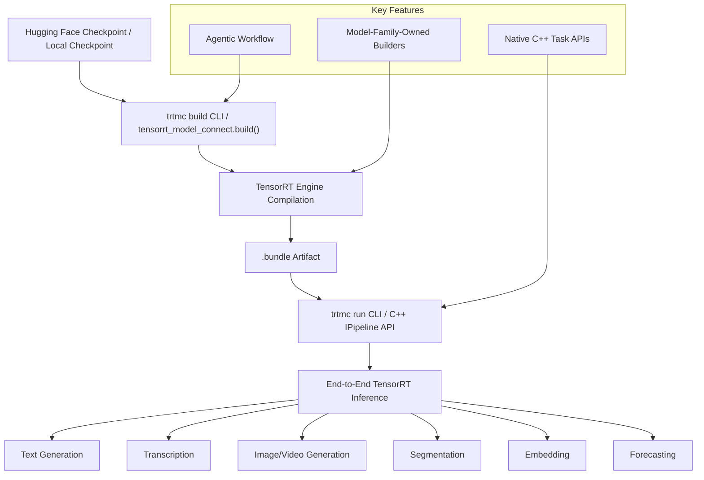
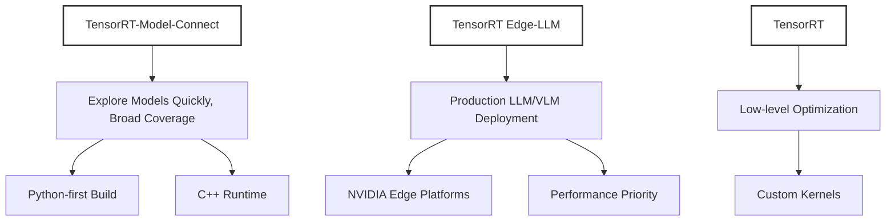

<!-- source: DeepWiki mcp.deepwiki.com · repo NVIDIA/TensorRT-Model-Connect · page 1 TensorRT-Model-Connect Overview · fetched 2026-10-26 -->

# TensorRT-Model-Connect Overview

Relevant source files

The following files were used as context for generating this wiki page:

- [.github/ISSUE_TEMPLATE/bug_report.yml](.github/ISSUE_TEMPLATE/bug_report.yml)
- [.github/ISSUE_TEMPLATE/config.yml](.github/ISSUE_TEMPLATE/config.yml)
- [.github/ISSUE_TEMPLATE/documentation_request.yml](.github/ISSUE_TEMPLATE/documentation_request.yml)
- [.github/ISSUE_TEMPLATE/feature_request.yml](.github/ISSUE_TEMPLATE/feature_request.yml)
- [.github/ISSUE_TEMPLATE/question.yml](.github/ISSUE_TEMPLATE/question.yml)
- [.github/workflows/pages.yml](.github/workflows/pages.yml)
- [.gitignore](.gitignore)
- [ASSET_LICENSES.md](ASSET_LICENSES.md)
- [NOTICE](NOTICE)
- [README.md](README.md)
- [plugins/trtmc-agent-skills/skills/pr-babysitter/SKILL.md](plugins/trtmc-agent-skills/skills/pr-babysitter/SKILL.md)
- [plugins/trtmc-agent-skills/skills/submit-github-pr/SKILL.md](plugins/trtmc-agent-skills/skills/submit-github-pr/SKILL.md)
- [src/cabi/api/README.md](src/cabi/api/README.md)
- [tests/model_checks/README.md](tests/model_checks/README.md)
- [tests/tools/test_github_issue_templates.py](tests/tools/test_github_issue_templates.py)
- [tests/tools/test_public_source_hygiene.py](tests/tools/test_public_source_hygiene.py)
- [tests/tools/test_release_package_legal.py](tests/tools/test_release_package_legal.py)
- [tools/test_impact_fallback_allowlist.txt](tools/test_impact_fallback_allowlist.txt)
- [tools/validation/README.md](tools/validation/README.md)
- [website/data/model-support-matrix.md](website/data/model-support-matrix.md)
- [website/docs/agent-guide.md](website/docs/agent-guide.md)
- [website/docs/getting-started/build-and-run.md](website/docs/getting-started/build-and-run.md)
- [website/docs/getting-started/environment-and-repro.md](website/docs/getting-started/environment-and-repro.md)
- [website/docs/getting-started/glossary.md](website/docs/getting-started/glossary.md)
- [website/docs/getting-started/installation.md](website/docs/getting-started/installation.md)
- [website/docs/getting-started/overview.md](website/docs/getting-started/overview.md)
- [website/docs/getting-started/project-overview.md](website/docs/getting-started/project-overview.md)
- [website/docs/getting-started/quick-start.md](website/docs/getting-started/quick-start.md)
- [website/docs/intro.md](website/docs/intro.md)
- [website/docs/learning-path.md](website/docs/learning-path.md)
- [website/docs/reference/source-layout.md](website/docs/reference/source-layout.md)
- [website/docs/reference/testing.md](website/docs/reference/testing.md)
- [website/docs/release-support/get-help.md](website/docs/release-support/get-help.md)
- [website/docs/tutorials/advanced/validation-and-benchmarking.md](website/docs/tutorials/advanced/validation-and-benchmarking.md)
- [website/docs/tutorials/beginner/inspect-bundles.md](website/docs/tutorials/beginner/inspect-bundles.md)
- [website/docs/tutorials/beginner/text-generation.md](website/docs/tutorials/beginner/text-generation.md)
- [website/docs/tutorials/intermediate/diffusion-and-time-series.md](website/docs/tutorials/intermediate/diffusion-and-time-series.md)
- [website/docs/tutorials/intermediate/multimodal-and-speech.md](website/docs/tutorials/intermediate/multimodal-and-speech.md)
- [website/docusaurus.config.js](website/docusaurus.config.js)
- [website/package-lock.json](website/package-lock.json)
- [website/package.json](website/package.json)
- [website/plugins/model-support-inventory/index.js](website/plugins/model-support-inventory/index.js)
- [website/plugins/model-support-inventory/index.test.js](website/plugins/model-support-inventory/index.test.js)
- [website/sidebars.js](website/sidebars.js)
- [website/src/components/ModelSupportInventory/index.js](website/src/components/ModelSupportInventory/index.js)
- [website/static/img/readme/model-connect-overview.png](website/static/img/readme/model-connect-overview.png)
- [website/static/img/readme/tensorrt-stack.png](website/static/img/readme/tensorrt-stack.png)

TensorRT-Model-Connect (TRTMC) is a framework designed to streamline the deployment of Hugging Face models for end-to-end NVIDIA TensorRT inference. It provides a collection of AI model reference implementations in C++ built on TensorRT, significantly reducing the effort and time required to integrate new models. This page offers a high-level introduction to TRTMC, its purpose, target audience, position within the broader TensorRT ecosystem, and the organization of its repository. For detailed information on specific topics, please refer to the linked child pages.

## What is TensorRT-Model-Connect?

TRTMC is an extensive collection of C++ reference implementations for AI models, leveraging NVIDIA TensorRT for optimized inference [README.md:31](). It enables users to take a supported Hugging Face or local checkpoint and build TensorRT engines directly, bypassing intermediate ONNX export steps [README.md:51-52](). The core output is a versioned `.bundle` artifact, which can then be used with native C++ task APIs for various AI tasks like text generation, transcription, image/video generation, segmentation, embedding, and forecasting [README.md:54-56]().

TRTMC is powered by an agentic workflow that continuously adds support for new models, aiming to drastically reduce integration effort and time to compatibility [README.md:32-33](). It provides model-family-owned builders, runtime pipelines, helper kernels, and validation contracts that serve as blueprints for customization [README.md:57-58]().

**Title: "TensorRT-Model-Connect Overview"**

Sources: [README.md:31-33](), [README.md:51-58]()

## Who is TensorRT-Model-Connect For?

TRTMC is designed for users who want to quickly explore models and evaluate broad model coverage using TensorRT [README.md:39-40](). It caters to developers and researchers who need to:
*   Rapidly convert and deploy Hugging Face models to TensorRT.
*   Utilize a unified `.bundle` artifact across Python-first build environments and native C++ runtime environments.
*   Access concrete blueprints for modifying and customizing model builders, runtime pipelines, and kernels.
*   Maintain native TensorRT execution and qualified optimized-runtime dispatch within a task-oriented application boundary [README.md:51-60]().

For production LLM/VLM deployment on NVIDIA edge platforms where performance is the primary concern, users are directed to [TensorRT Edge-LLM](https://github.com/NVIDIA/TensorRT-Edge-LLM) [README.md:41-44]().

**Title: "TensorRT Abstraction Layers"**

Sources: [README.md:39-45](), [README.md:51-60]()

## Getting Started with TensorRT-Model-Connect

New users can quickly get started with TRTMC by following a few simple steps. The recommended quick start involves using the `trtmc` command-line interface (CLI) to build and run models.

First, verify the `trtmc` CLI installation by running `trtmc version` [website/docs/getting-started/quick-start.md:11](). Then, a model like `Qwen/Qwen3-0.6B` can be built into a `.bundle` artifact using `trtmc build` [website/docs/getting-started/quick-start.md:24-27](). This bundle can then be inspected with `trtmc inspect` [website/docs/getting-started/quick-start.md:36-37]() and run for inference using `trtmc run` [website/docs/getting-started/quick-start.md:47-54](). The same `.bundle` artifact is also compatible with the C++ API [README.md:25-26]().

For detailed instructions on system requirements, installation methods (Docker or wheel), and the `trtmc` workflow, refer to the [Getting Started: Installation and Quick Start](#1.1) child page.

Sources: [README.md:25-26](), [website/docs/getting-started/quick-start.md:11](), [website/docs/getting-started/quick-start.md:24-27](), [website/docs/getting-started/quick-start.md:36-37](), [website/docs/getting-started/quick-start.md:47-54]()

## Repository Organization

The TRTMC repository is structured to support its multi-faceted development and deployment model. Key directories include `python/` for Python-related components, `src/` for the core C++ runtime, `tests/` for various testing layers, `tools/` for utility scripts, and `website/` for documentation [website/docs/reference/source-layout.md]() (though not explicitly cited in the provided content, this is a common pattern for such projects).

The codebase follows a "three-sided model ownership pattern" which involves Python family implementations, the C++ runtime, and end-to-end tests. This structure ensures that model support, core functionality, and validation are tightly integrated.

For a comprehensive map of the repository's top-level directories and their purposes, see the [Repository Source Layout](#1.2) child page.

Sources: [website/docs/reference/source-layout.md]() (implied)

## Further Exploration

This overview provides a starting point for understanding TensorRT-Model-Connect. To delve deeper into specific aspects of the project, please explore the following child pages:

*   **[Getting Started: Installation and Quick Start](#1.1)**: Provides step-by-step instructions for setting up TRTMC and running your first inference.
*   **[Repository Source Layout](#1.2)**: Details the directory structure and the purpose of each major component within the repository.

---

