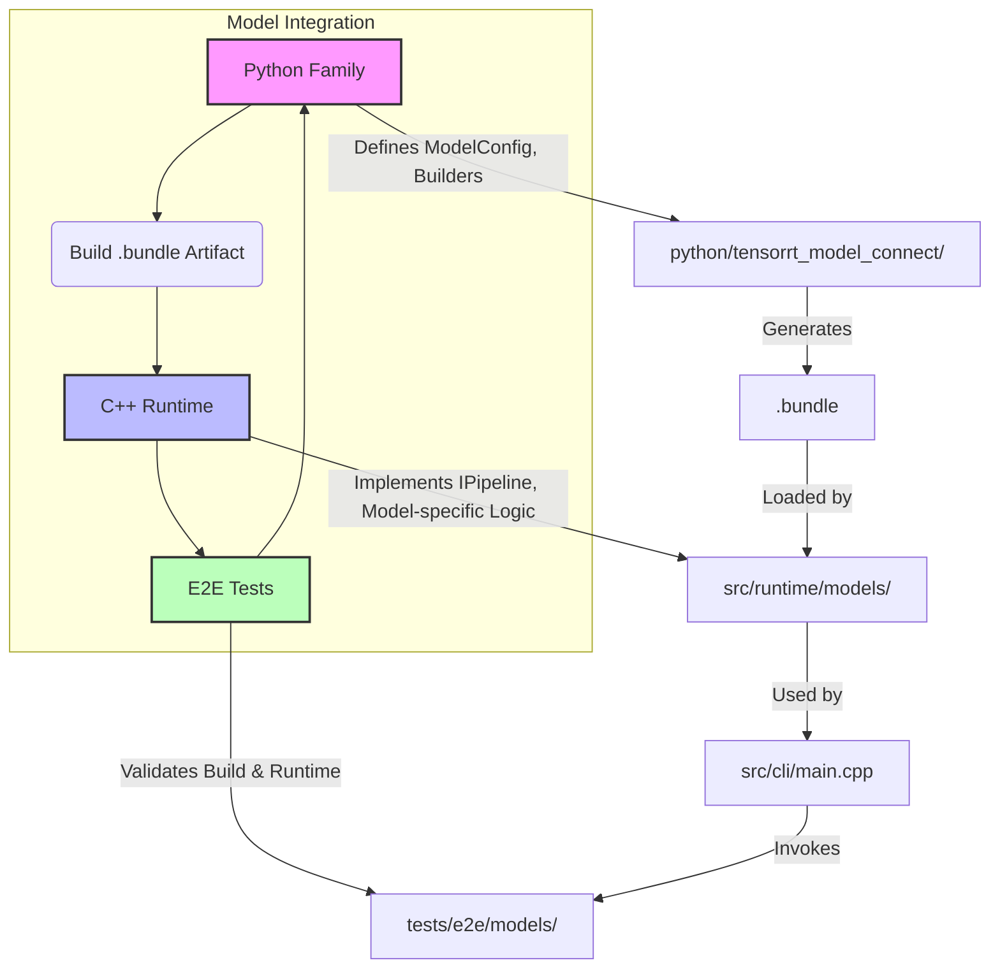
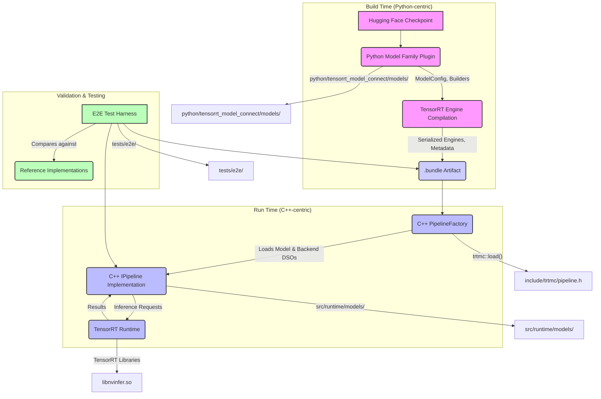

<!-- source: DeepWiki mcp.deepwiki.com · repo NVIDIA/TensorRT-Model-Connect · page 1.2 Repository Source Layout · fetched 2026-10-26 -->

# Repository Source Layout

Relevant source files

The following files were used as context for generating this wiki page:

- [.agents/plugins/marketplace.json](.agents/plugins/marketplace.json)
- [.github/ISSUE_TEMPLATE/bug_report.yml](.github/ISSUE_TEMPLATE/bug_report.yml)
- [.github/ISSUE_TEMPLATE/config.yml](.github/ISSUE_TEMPLATE/config.yml)
- [.github/ISSUE_TEMPLATE/documentation_request.yml](.github/ISSUE_TEMPLATE/documentation_request.yml)
- [.github/ISSUE_TEMPLATE/feature_request.yml](.github/ISSUE_TEMPLATE/feature_request.yml)
- [.github/ISSUE_TEMPLATE/question.yml](.github/ISSUE_TEMPLATE/question.yml)
- [.gitignore](.gitignore)
- [AGENTS.md](AGENTS.md)
- [ASSET_LICENSES.md](ASSET_LICENSES.md)
- [CMakeLists.txt](CMakeLists.txt)
- [NOTICE](NOTICE)
- [README.md](README.md)
- [examples/trtmc_benchmark_worker.cpp](examples/trtmc_benchmark_worker.cpp)
- [include/trtmc/pipeline.h](include/trtmc/pipeline.h)
- [plugins/trtmc-agent-skills/.codex-plugin/plugin.json](plugins/trtmc-agent-skills/.codex-plugin/plugin.json)
- [plugins/trtmc-agent-skills/skills/write-git-messages/SKILL.md](plugins/trtmc-agent-skills/skills/write-git-messages/SKILL.md)
- [plugins/trtmc-agent-skills/skills/write-git-messages/agents/openai.yaml](plugins/trtmc-agent-skills/skills/write-git-messages/agents/openai.yaml)
- [plugins/trtmc-agent-skills/skills/write-git-messages/references/source-notes.md](plugins/trtmc-agent-skills/skills/write-git-messages/references/source-notes.md)
- [src/cabi/api/README.md](src/cabi/api/README.md)
- [src/cli/args.cpp](src/cli/args.cpp)
- [src/cli/args.h](src/cli/args.h)
- [src/cli/main.cpp](src/cli/main.cpp)
- [src/runtime/models/dinov3/pipeline.cpp](src/runtime/models/dinov3/pipeline.cpp)
- [src/runtime/models/dinov3/pipeline.h](src/runtime/models/dinov3/pipeline.h)
- [src/runtime/providers/optimized_runtime_factory.h](src/runtime/providers/optimized_runtime_factory.h)
- [src/runtime/providers/optimized_runtime_host.cpp](src/runtime/providers/optimized_runtime_host.cpp)
- [tests/cpp/fakes/fake_optimized_runtime_provider.cpp](tests/cpp/fakes/fake_optimized_runtime_provider.cpp)
- [tests/cpp/models/dinov3/test_dinov3_pipeline.cpp](tests/cpp/models/dinov3/test_dinov3_pipeline.cpp)
- [tests/cpp/test_cli_args.cpp](tests/cpp/test_cli_args.cpp)
- [tests/cpp/test_pipeline_api.cpp](tests/cpp/test_pipeline_api.cpp)
- [tests/e2e/models/qwen/edge_llm_adapter/test_runtime_contract.py](tests/e2e/models/qwen/edge_llm_adapter/test_runtime_contract.py)
- [tests/model_checks/README.md](tests/model_checks/README.md)
- [tests/tools/test_github_issue_templates.py](tests/tools/test_github_issue_templates.py)
- [tests/tools/test_release_package_legal.py](tests/tools/test_release_package_legal.py)
- [tools/test_impact_fallback_allowlist.txt](tools/test_impact_fallback_allowlist.txt)
- [tools/validation/README.md](tools/validation/README.md)
- [website/docs/agent-guide.md](website/docs/agent-guide.md)
- [website/docs/getting-started/installation.md](website/docs/getting-started/installation.md)
- [website/docs/getting-started/quick-start.md](website/docs/getting-started/quick-start.md)
- [website/docs/reference/source-layout.md](website/docs/reference/source-layout.md)
- [website/docs/release-support/get-help.md](website/docs/release-support/get-help.md)
- [website/sidebars.js](website/sidebars.js)
- [website/static/img/readme/model-connect-overview.png](website/static/img/readme/model-connect-overview.png)
- [website/static/img/readme/tensorrt-stack.png](website/static/img/readme/tensorrt-stack.png)

This page details the top-level directory structure of the TensorRT-Model-Connect repository, explaining the purpose of each major component and how they contribute to the overall system. It also introduces the three-sided model ownership pattern, which is central to how models are integrated and tested within the project.

## Top-Level Directory Map

The TensorRT-Model-Connect repository is organized into several top-level directories, each serving a distinct purpose in the build, runtime, and testing ecosystem.

| Directory | Purpose | Key Contents |
| :-------- | :------ | :----------- |
| `python/` | Python-first build environment, Python API, and model family plugins. | `tensorrt_model_connect/` (Python package), `setup.py`, `pyproject.toml` |
| `src/` | C++ runtime, CLI executable, and core libraries. | `cli/`, `runtime/`, `cabi/`, `tokenizer/` |
| `tests/` | Comprehensive test suite, including unit, integration, and end-to-end tests. | `cpp/`, `python/`, `e2e/`, `model_checks/` |
| `tools/` | Utility scripts and internal development tools. | `test_impact.py`, `perf_matrix.py`, `validation/` |
| `scripts/` | Miscellaneous scripts for development, CI, and agent workflows. | `bootstrap_workspace.sh`, `new_family.py`, `agents/` |
| `website/` | Project documentation and Docusaurus site source. | `docs/`, `static/`, `sidebars.js` |
| `cmake/` | CMake modules and build system configurations. | Custom CMake functions, dependency finding scripts |
| `include/` | Public C++ API headers. | `trtmc/pipeline.h`, `trtmc/bundle.h` |
| `plugins/` | Agent skills and other extensible components. | `trtmc-agent-skills/` |

Sources: [CMakeLists.txt:1-200](), [README.md:1-140](), [website/docs/release-support/get-help.md:1-3](), [website/docs/agent-guide.md:1-3]()

## The Three-Sided Model Ownership Pattern

TensorRT-Model-Connect employs a "three-sided" model ownership pattern to ensure robust integration and validation of new models. This pattern dictates that for any supported model, there must be corresponding components in three distinct areas of the codebase:

1.  **Python Family Implementation:** This includes the Python-based build logic, model configuration, and any necessary Python-specific pre/post-processing. This is where the model's TensorRT graph is constructed from a Hugging Face checkpoint.
2.  **C++ Runtime Implementation:** This encompasses the C++ code responsible for loading the `.bundle` artifact, executing the TensorRT engines, and providing the public C++ API for inference. This often involves model-specific C++ pipeline implementations.
3.  **End-to-End (E2E) Tests:** A comprehensive set of E2E tests validates the entire pipeline, from model building to runtime inference, ensuring numerical parity and performance against reference implementations.

This pattern ensures that each model is thoroughly integrated and tested across the entire stack, from the Python-centric build environment to the high-performance C++ runtime.

### Diagram: Three-Sided Model Ownership

Sources: [src/cli/main.cpp:158-160](), [src/runtime/models/dinov3/pipeline.cpp:86-90](), [tests/e2e/models/qwen/edge_llm_adapter/test_runtime_contract.py:1-3]()

## Directory Breakdown

### `python/`

This directory contains the Python-centric parts of the TensorRT-Model-Connect project. It's primarily responsible for the build process, where Hugging Face models are converted into TensorRT engines and packaged into `.bundle` artifacts.

-   **`python/tensorrt_model_connect/`**: This is the main Python package. It includes:
    -   **Model Family Plugins**: Each supported model family (e.g., Qwen, LLaMA, Whisper) has its own Python package here, defining how to map Hugging Face checkpoints to TensorRT networks and how to build the `.bundle`.
    -   **Build Logic**: The core `build()` function and related utilities that orchestrate the TensorRT engine compilation.
    -   **Python API**: A Python interface for interacting with the build system and potentially for running inference (though the primary runtime is C++).
    -   **Configuration Schemas**: Python definitions for model-specific configurations.

Sources: [python/tensorrt_model_connect/config/cli_support.py:1-3](), [python/tensorrt_model_connect/config/schema_registry.py:1-3]()

### `src/`

The `src/` directory houses the C++ source code for the TensorRT-Model-Connect runtime and command-line interface (CLI). This is where the high-performance inference logic resides.

-   **`src/cli/`**: Contains the source code for the `trtmc` command-line executable. This includes argument parsing (`src/cli/args.cpp` [src/cli/args.cpp:1-187]()) and the main application logic (`src/cli/main.cpp` [src/cli/main.cpp:1-194]()) that dispatches to various commands like `build`, `run`, `inspect`, `transcribe`, etc.
-   **`src/runtime/`**: This is the core C++ runtime library.
    -   **`src/runtime/models/`**: Model-specific C++ pipeline implementations. For example, `src/runtime/models/dinov3/pipeline.cpp` [src/runtime/models/dinov3/pipeline.cpp:1-156]() implements the `Dinov3ImageFeaturePipeline` for the DINOv3 model. These pipelines interact with the underlying TensorRT engines.
    -   **`src/runtime/providers/`**: Contains implementations for different runtime backends, such as the standard TensorRT backend and potentially optimized runtimes. `src/runtime/providers/optimized_runtime_host.cpp` [src/runtime/providers/optimized_runtime_host.cpp:1-3]() is an example.
    -   **`src/runtime/pipeline_plugin_loader.cpp`**: Handles dynamic loading of model plugins at runtime.
-   **`src/cabi/`**: C Application Binary Interface (ABI) for interoperability.
-   **`src/tokenizer/`**: C++ implementation of tokenization logic, often used by various model pipelines.

Sources: [src/cli/main.cpp:1-194](), [src/cli/args.cpp:1-187](), [src/runtime/models/dinov3/pipeline.cpp:1-156](), [src/runtime/providers/optimized_runtime_host.cpp:1-3]()

### `tests/`

This directory contains the comprehensive test suite for the project, ensuring correctness and performance across different layers.

-   **`tests/cpp/`**: C++ unit and integration tests for the core runtime components and model pipelines. For example, `tests/cpp/models/dinov3/test_dinov3_pipeline.cpp` [tests/cpp/models/dinov3/test_dinov3_pipeline.cpp:1-160]() tests the DINOv3 C++ pipeline.
-   **`tests/python/`**: Python unit and integration tests for the build system, Python API, and model family plugins.
-   **`tests/e2e/`**: End-to-end tests that validate the entire build-to-runtime pipeline for various models. These tests often involve building a `.bundle` and then running inference, comparing results against a reference.
    -   **`tests/e2e/harness/`**: The E2E test harness, which orchestrates the execution and validation of E2E test cases.
    -   **`tests/e2e/models/`**: Model-specific E2E test cases and data.
-   **`tests/model_checks/`**: Contains scripts and configurations for model-specific checks and validations.

Sources: [tests/cpp/models/dinov3/test_dinov3_pipeline.cpp:1-160](), [tests/e2e/harness/orchestrator.py:1-3](), [tests/model_checks/README.md:1-3]()

### `tools/`

This directory contains various utility scripts and internal development tools.

-   **`tools/test_impact.py`**: A script used in CI to determine which tests are impacted by a given code change, optimizing test execution time.
-   **`tools/perf_matrix.py`**: Used for performance benchmarking, running a matrix of performance tests against reference implementations.
-   **`tools/validation/`**: Contains scripts and configurations related to the model validation framework.

Sources: [tools/test_impact_fallback_allowlist.txt:1-97](), [tools/validation/README.md:1-3]()

### `scripts/`

This directory holds miscellaneous scripts used for various development, CI, and agent-related tasks.

-   **`scripts/bootstrap_workspace.sh`**: A script to set up the development environment.
-   **`scripts/new_family.py`**: A utility script to help developers create the boilerplate for a new model family.
-   **`scripts/agents/`**: Scripts related to the agentic workflow, including prompt generation.

Sources: [scripts/agents/prompts/README.md:1-3](), [scripts/bootstrap_workspace.sh:1-3](), [scripts/new_family.py:1-3]()

### `website/`

This directory contains the source code for the project's documentation website, built using Docusaurus.

-   **`website/docs/`**: Markdown files for the documentation pages, including `website/docs/getting-started/quick-start.md` [website/docs/getting-started/quick-start.md:1-66]() and `website/docs/release-support/get-help.md` [website/docs/release-support/get-help.md:1-3]().
-   **`website/static/`**: Static assets like images, including `website/static/img/readme/model-connect-overview.png` [website/static/img/readme/model-connect-overview.png:1-1]() and `website/static/img/readme/tensorrt-stack.png` [website/static/img/readme/tensorrt-stack.png:1-1]().
-   **`website/sidebars.js`**: Configuration for the documentation sidebar navigation.

Sources: [website/docs/getting-started/quick-start.md:1-66](), [website/static/img/readme/model-connect-overview.png:1-1](), [website/sidebars.js:1-3]()

### `cmake/`

This directory contains custom CMake modules and configuration files used by the build system. These files define how the C++ components are built, linked, and packaged.

Sources: [CMakeLists.txt:1-200]()

### `include/`

This directory contains the public C++ API headers that users will include in their applications.

-   **`include/trtmc/pipeline.h`**: The main header for the C++ API, defining the `IPipeline` interface and various result/config structures like `TextResult`, `ImageResult`, `GenerateConfig`, etc. [include/trtmc/pipeline.h:1-300]()
-   **`include/trtmc/bundle.h`**: Defines structures and functions for interacting with `.bundle` artifacts.

Sources: [include/trtmc/pipeline.h:1-300]()

### `plugins/`

This directory is for extensible components, such as agent skills.

-   **`plugins/trtmc-agent-skills/`**: Contains the implementation for the `trtmc-agent-skills` Codex plugin, which provides AI agents with specific capabilities related to the TensorRT-Model-Connect codebase.

Sources: [plugins/trtmc-agent-skills/.codex-plugin/plugin.json:1-3](), [plugins/trtmc-agent-skills/skills/write-git-messages/SKILL.md:1-3]()

### Diagram: Core Component Interaction

Sources: [python/tensorrt_model_connect/models/qwen/builder.py:1-3](), [src/runtime/models/dinov3/pipeline.cpp:1-156](), [tests/e2e/harness/orchestrator.py:1-3](), [include/trtmc/pipeline.h:1-300]()

---

