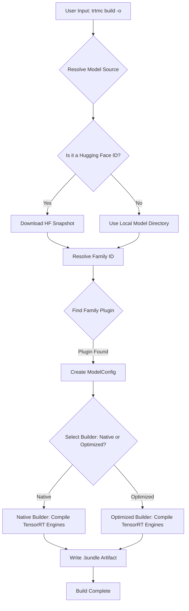

<!-- source: DeepWiki mcp.deepwiki.com · repo NVIDIA/TensorRT-Model-Connect · page 2.1 Build Pipeline: From Checkpoint to .bundle · fetched 2026-10-26 -->

# Build Pipeline: From Checkpoint to .bundle

<details>
<summary>Relevant source files</summary>

The following files were used as context for generating this wiki page:

- [CMakeLists.txt](CMakeLists.txt)
- [examples/trtmc_benchmark_worker.cpp](examples/trtmc_benchmark_worker.cpp)
- [include/trtmc/pipeline.h](include/trtmc/pipeline.h)
- [python/tensorrt_model_connect/build_cli.py](python/tensorrt_model_connect/build_cli.py)
- [python/tensorrt_model_connect/engine_builder.py](python/tensorrt_model_connect/engine_builder.py)
- [python/tensorrt_model_connect/families/sana_wm/MODEL.toml](python/tensorrt_model_connect/families/sana_wm/MODEL.toml)
- [python/tensorrt_model_connect/families/sana_wm/components/gemma/plugin.py](python/tensorrt_model_connect/families/sana_wm/components/gemma/plugin.py)
- [python/tensorrt_model_connect/hf_snapshot.py](python/tensorrt_model_connect/hf_snapshot.py)
- [scripts/warm_hf_cache.py](scripts/warm_hf_cache.py)
- [src/cli/args.cpp](src/cli/args.cpp)
- [src/cli/args.h](src/cli/args.h)
- [src/cli/main.cpp](src/cli/main.cpp)
- [src/runtime/models/dinov3/pipeline.cpp](src/runtime/models/dinov3/pipeline.cpp)
- [src/runtime/models/dinov3/pipeline.h](src/runtime/models/dinov3/pipeline.h)
- [src/runtime/models/whisper/pipeline.cpp](src/runtime/models/whisper/pipeline.cpp)
- [src/runtime/models/whisper/pipeline.h](src/runtime/models/whisper/pipeline.h)
- [src/runtime/models/whisper/plugin.cpp](src/runtime/models/whisper/plugin.cpp)
- [src/runtime/models/whisper/whisper_mel_spectrogram.cpp](src/runtime/models/whisper/whisper_mel_spectrogram.cpp)
- [src/runtime/models/whisper/whisper_mel_spectrogram.h](src/runtime/models/whisper/whisper_mel_spectrogram.h)
- [src/runtime/providers/optimized_runtime_factory.h](src/runtime/providers/optimized_runtime_factory.h)
- [src/runtime/providers/optimized_runtime_host.cpp](src/runtime/providers/optimized_runtime_host.cpp)
- [tests/builder/test_cli.py](tests/builder/test_cli.py)
- [tests/builder/test_engine_builder_extended.py](tests/builder/test_engine_builder_extended.py)
- [tests/builder/test_engine_builder_utils.py](tests/builder/test_engine_builder_utils.py)
- [tests/builder/test_families.py](tests/builder/test_families.py)
- [tests/builder/test_family_plugins.py](tests/builder/test_family_plugins.py)
- [tests/cpp/fakes/fake_optimized_runtime_provider.cpp](tests/cpp/fakes/fake_optimized_runtime_provider.cpp)
- [tests/cpp/models/dinov3/test_dinov3_pipeline.cpp](tests/cpp/models/dinov3/test_dinov3_pipeline.cpp)
- [tests/cpp/models/whisper/test_whisper_mel_spectrogram.cpp](tests/cpp/models/whisper/test_whisper_mel_spectrogram.cpp)
- [tests/cpp/test_cli_args.cpp](tests/cpp/test_cli_args.cpp)
- [tests/cpp/test_pipeline_api.cpp](tests/cpp/test_pipeline_api.cpp)
- [tests/cpp/test_tokenizer_edge_cases.cpp](tests/cpp/test_tokenizer_edge_cases.cpp)
- [tests/e2e/models/ltx_video/e2e_plugins/references/hf_diffusers.py](tests/e2e/models/ltx_video/e2e_plugins/references/hf_diffusers.py)
- [tests/e2e/models/ltx_video/test_ltx_video_hf_diffusers_reference.py](tests/e2e/models/ltx_video/test_ltx_video_hf_diffusers_reference.py)
- [tests/e2e/models/qwen/edge_llm_adapter/test_runtime_contract.py](tests/e2e/models/qwen/edge_llm_adapter/test_runtime_contract.py)
- [tests/e2e/models/sana_wm/test_sana_wm_warm_hf_cache_metadata.py](tests/e2e/models/sana_wm/test_sana_wm_warm_hf_cache_metadata.py)
- [tests/e2e_harness/comparators/text_to_audio.py](tests/e2e_harness/comparators/text_to_audio.py)
- [tests/e2e_harness/references/hf_transformers.py](tests/e2e_harness/references/hf_transformers.py)
- [tests/e2e_harness/runners/audio_speech.py](tests/e2e_harness/runners/audio_speech.py)
- [tests/e2e_harness/thresholds/defaults/text_to_audio.json](tests/e2e_harness/thresholds/defaults/text_to_audio.json)
- [tests/runtime_strategy_matrix.yaml](tests/runtime_strategy_matrix.yaml)
- [tests/tools/test_family_specialization.py](tests/tools/test_family_specialization.py)
- [tests/tools/test_warm_hf_cache_static.py](tests/tools/test_warm_hf_cache_static.py)
- [tests/validation/model_workloads.yaml](tests/validation/model_workloads.yaml)

</details>


This page details the build pipeline within TensorRT-Model-Connect (TRTMC), explaining how a Hugging Face checkpoint is transformed into a `.bundle` artifact. It covers the process from model resolution and family plugin selection to TensorRT engine compilation and bundle creation. Key components include `ModelConfig`, the `FamilyPlugin` protocol, and the build routing logic that determines whether a native or optimized builder is used.

## Overview of the Build Process

The `trtmc build` command or the `tensorrt_model_connect.build()` Python function initiates the build pipeline. This process involves several stages:

1.  **Model Resolution**: Identifying and downloading the Hugging Face model or resolving a local model directory.
2.  **Family Plugin Selection**: Determining the appropriate `FamilyPlugin` based on the model's characteristics.
3.  **Configuration Generation**: Creating a `ModelConfig` object that encapsulates all build parameters.
4.  **Engine Compilation**: Using either a native or optimized builder to compile TensorRT engines.
5.  **Bundle Creation**: Packaging the compiled engines and associated metadata into a `.bundle` artifact.

The build process is orchestrated primarily by the `engine_builder.py` module [python/tensorrt_model_connect/engine_builder.py]().

### Build Pipeline Flow

The following diagram illustrates the high-level flow of the build pipeline:


Sources:
- [python/tensorrt_model_connect/engine_builder.py]()

## Model Resolution and Hugging Face Integration

The first step in the build pipeline is to resolve the model source. This can be a Hugging Face model ID or a path to a local model directory.

### Hugging Face Snapshot Download

If a Hugging Face model ID is provided, TRTMC uses the `huggingface_hub` library to download the model snapshot. This process is managed by `hf_snapshot.py` [python/tensorrt_model_connect/hf_snapshot.py]().

The `_HF_ALLOW_PATTERNS` and `_HF_EXTRA_ALLOW_PATTERNS` lists define which files are allowed to be downloaded from Hugging Face. These patterns ensure that only necessary files (e.g., `config.json`, `model.safetensors`, tokenizer files) are fetched, optimizing download times and disk usage.
The `warm_hf_cache.py` script [scripts/warm_hf_cache.py]() is used to pre-warm the Hugging Face cache, especially in CI/CD environments, to avoid redundant downloads during parallel builds.

The `_raise_friendly_download_error` function [python/tensorrt_model_connect/engine_builder.py:212-220]() provides user-friendly error messages for common Hugging Face download issues like `RepositoryNotFound`.

Sources:
- [python/tensorrt_model_connect/engine_builder.py:212-220]()
- [python/tensorrt_model_connect/hf_snapshot.py]()
- [scripts/warm_hf_cache.py]()

## Family Plugin Selection

Once the model source is resolved, TRTMC needs to identify the correct `FamilyPlugin` to handle the model. This is a crucial step as the plugin dictates how the model is configured, built, and ultimately run.

### `FamilyPlugin` Protocol

The `FamilyPlugin` protocol defines the interface that all model family plugins must implement. These plugins are responsible for:
-   Matching a given model to its family.
-   Providing model-specific configuration and build logic.
-   Defining the runtime strategy.

The `families` module [python/tensorrt_model_connect/families/__init__.py]() manages the discovery and loading of these plugins. The `find_plugin` function [python/tensorrt_model_connect/families/__init__.py:100-100]() is central to this process. It attempts to match the model's characteristics (e.g., `model_type` from `config.json`) against the registered plugins.

The `_FamilyMetadata` dataclass [python/tensorrt_model_connect/families/__init__.py:120-130]() stores information about each family, including its ID, import module, aliases, and capabilities. This metadata is cached to speed up plugin lookup.

The `test_families.py` [tests/builder/test_families.py]() unit tests validate the `match()` logic and attribute correctness of all registered family plugins.

```mermaid
graph TD
    A[Model Source (HF ID or Local Path)] --> B{resolve_family_id()};
    B --> C[Model Metadata (e.g., config.json)];
    C --> D{_candidate_module_names()};
    D --> E[Iterate through candidate Family Plugins];
    E -- For each plugin --> F{plugin.match(model_metadata)};
    F -- Match Found --> G[Selected FamilyPlugin];
    F -- No Match --> H[Error: Unknown Model Family];
    G --> I[Proceed with ModelConfig creation];
```
Sources:
- [python/tensorrt_model_connect/families/__init__.py]()
- [python/tensorrt_model_connect/families/__init__.py:100-100]()
- [python/tensorrt_model_connect/families/__init__.py:120-130]()
- [tests/builder/test_families.py]()

## ModelConfig and Build Configuration

Once a `FamilyPlugin` is selected, a `ModelConfig` object is created. This object encapsulates all the parameters required for building the TensorRT engines.

The `ModelConfig` class [python/tensorrt_model_connect/config.py:100-100]() is a dataclass that holds various build-time options, such as precision (`fp16`, `int8`), quantization settings, parallelization strategy (`tensor_parallel_size`), and dynamic shape profiles.

The `build_cli.py` module [python/tensorrt_model_connect/build_cli.py]() handles parsing command-line arguments for the `trtmc build` command and populating the `ModelConfig` object.

### Dynamic KV Cache Profiles

For models with dynamic key-value (KV) caches, the `_compute_dynamic_kv_profile_rows` function [python/tensorrt_model_connect/engine_builder.py:117-150]() calculates the optimal TensorRT optimization profiles. This function generates a set of KV cache lengths (rows) that cover the specified `max_cache_length` and `kv_budget`, ensuring efficient memory usage and performance. The `_sanitize_dynamic_kv_profile_rows` function [python/tensorrt_model_connect/engine_builder.py:153-168]() validates and sorts these rows.

The `add_dynamic_batch_profile` function [python/tensorrt_model_connect/engine_builder.py:171-210]() is used by diffusion engine builders to attach optimization profiles with dynamic leading batch dimensions.

Sources:
- [python/tensorrt_model_connect/config.py:100-100]()
- [python/tensorrt_model_connect/engine_builder.py:117-150]()
- [python/tensorrt_model_connect/engine_builder.py:153-168]()
- [python/tensorrt_model_connect/engine_builder.py:171-210]()
- [python/tensorrt_model_connect/build_cli.py]()

## Builder Selection and Engine Compilation

TRTMC supports two primary build paths: native and optimized. The choice depends on the `runtime_strategy` defined by the `FamilyPlugin` and the capabilities of the system.

### Native Builder

The native builder path is typically used for models where the `FamilyPlugin` directly implements the TensorRT engine building logic in Python. This involves:
1.  Loading the model (e.g., from Hugging Face Transformers).
2.  Converting the model to an ONNX graph.
3.  Building TensorRT engines from the ONNX graph using `tensorrt.Builder`.

The `engine_builder.py` module [python/tensorrt_model_connect/engine_builder.py]() orchestrates this process. The `_setup_trt_import` function [python/tensorrt_model_connect/engine_builder.py:70-76]() ensures the correct TensorRT Python backend (e.g., RTX) is selected.

### Optimized Builder

For certain model families, TRTMC provides highly optimized C++ builders. These builders are often used for complex architectures or when maximum performance is required. The `FamilyPlugin` indicates if an optimized builder is preferred via `family_prefers_native_default_build` [python/tensorrt_model_connect/families/__init__.py:100-100]().

Optimized builders are typically implemented as C++ shared libraries (DSOs) and are loaded dynamically. The `optimized_runtime_factory.h` [src/runtime/providers/optimized_runtime_factory.h]() and `optimized_runtime_host.cpp` [src/runtime/providers/optimized_runtime_host.cpp]() define the interface for these optimized runtimes.

The `CMakeLists.txt` [CMakeLists.txt]() file plays a crucial role in configuring the build system to find and link against TensorRT and CUDA libraries, which are essential for both native and optimized builders.

### Build Timing and Budget Enforcement

The build process includes timing measurements to track the duration of various phases, such as weights loading and TensorRT compilation. Functions like `_add_build_timing`, `_new_build_timing`, and `_write_build_timing` [python/tensorrt_model_connect/engine_builder.py:21-24]() manage this.

The `enforce_single_full_bundle_build` function [python/tensorrt_model_connect/engine_builder.py:25-25]() ensures that only one full bundle build is performed, preventing redundant work.

Sources:
- [python/tensorrt_model_connect/engine_builder.py]()
- [python/tensorrt_model_connect/engine_builder.py:21-24]()
- [python/tensorrt_model_connect/engine_builder.py:25-25]()
- [python/tensorrt_model_connect/engine_builder.py:70-76]()
- [python/tensorrt_model_connect/families/__init__.py:100-100]()
- [src/runtime/providers/optimized_runtime_factory.h]()
- [src/runtime/providers/optimized_runtime_host.cpp]()
- [CMakeLists.txt]()

## .bundle Artifact Creation

After the TensorRT engines are compiled, they are packaged along with other necessary metadata into a `.bundle` artifact. This artifact is a self-contained unit that can be loaded and run by the TRTMC runtime.

The `bundle_writer.py` module [python/tensorrt_model_connect/bundle_writer.py]() is responsible for creating the `.bundle` file. It defines the `BundleInfo` and `BundleSection` classes, which describe the structure and contents of the bundle.

A `.bundle` file typically contains:
-   **Engines**: The compiled TensorRT engines for different model components (e.g., encoder, decoder).
-   **Tokenizer**: Tokenizer files (e.g., `tokenizer.json`, `vocab.txt`).
-   **Model Configuration**: The `ModelConfig` used during the build.
-   **Metadata**: Information about the build environment, TensorRT version, and other relevant details.

The `export_triattention_stats_section` function [python/tensorrt_model_connect/triattention_export.py:20-20]() can be used to include tri-attention statistics in the bundle, which can be useful for debugging and analysis.

The `trtmc inspect` CLI command [src/cli/main.cpp:29-30]() can be used to examine the contents of a `.bundle` file, listing its engines and other sections.

Sources:
- [python/tensorrt_model_connect/bundle_writer.py]()
- [python/tensorrt_model_connect/triattention_export.py:20-20]()
- [src/cli/main.cpp:29-30]()

## CLI Integration

The `trtmc build` command is the primary entry point for users to initiate the build pipeline. The `src/cli/main.cpp` [src/cli/main.cpp]() and `src/cli/args.cpp` [src/cli/args.cpp]() files define the command-line interface for TRTMC.

The `parse_args` function [src/cli/args.cpp:48-48]() in `args.cpp` handles parsing the command-line arguments, including the model ID, output bundle path, and various build options. These arguments are then used to construct the `ModelConfig` and drive the build process.

Sources:
- [src/cli/main.cpp]()
- [src/cli/args.cpp]()
- [src/cli/args.cpp:48-48]()

---

