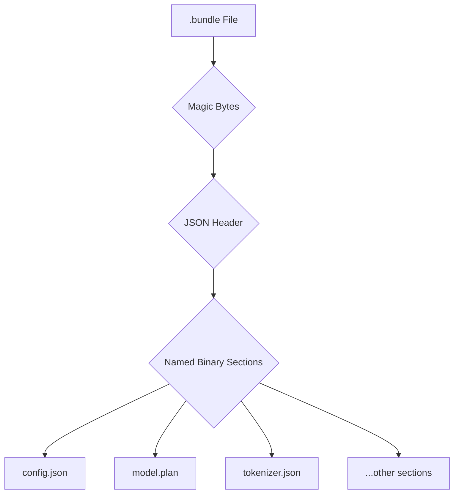
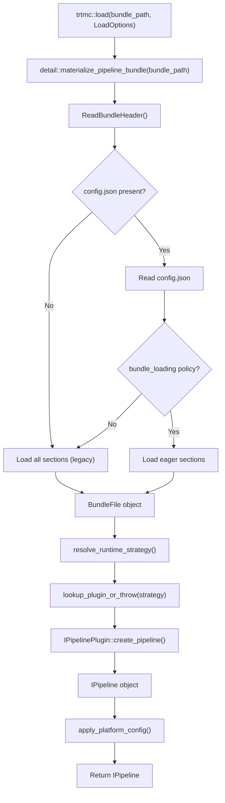
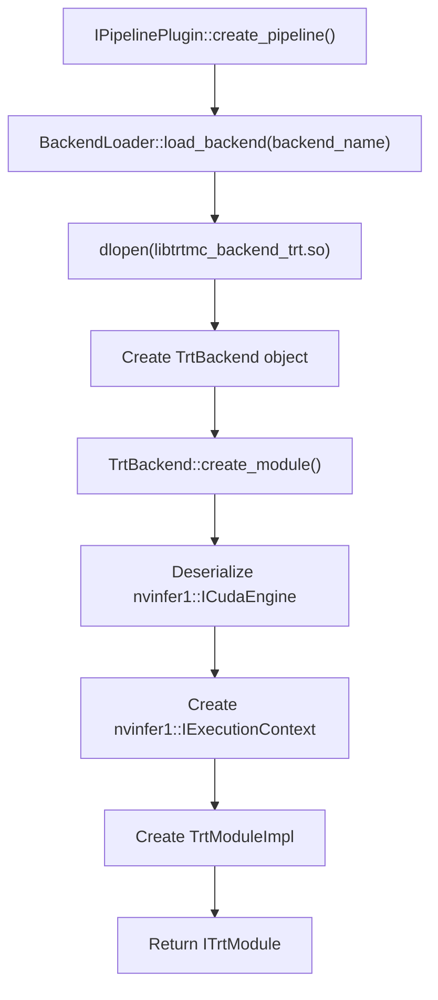
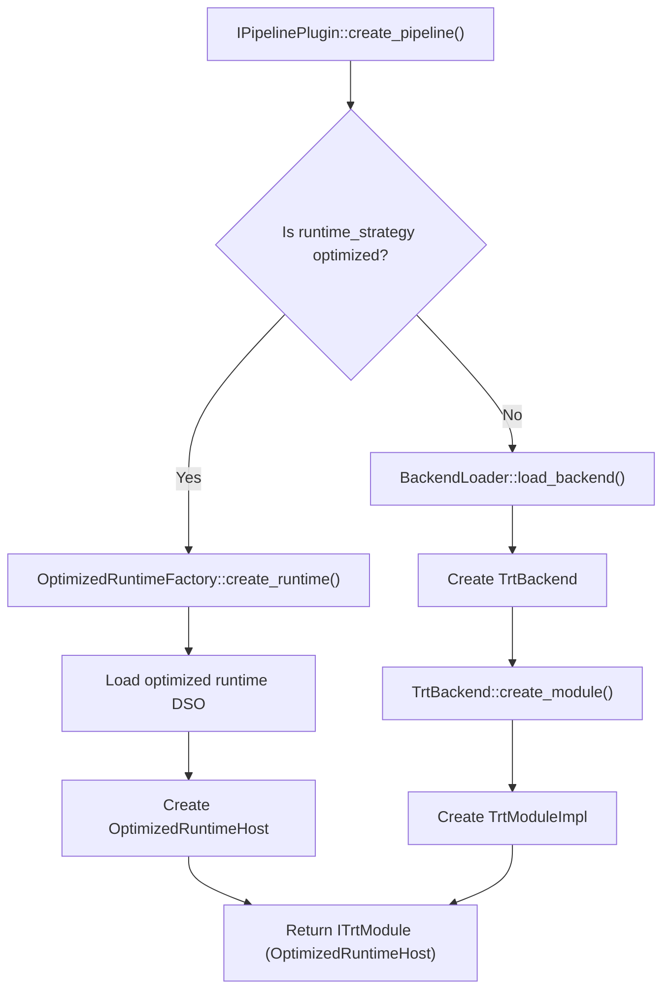

<!-- source: DeepWiki mcp.deepwiki.com · repo NVIDIA/TensorRT-Model-Connect · page 2.2 Bundle Format and Runtime Lifecycle · fetched 2026-10-26 -->

# Bundle Format and Runtime Lifecycle

<details>
<summary>Relevant source files</summary>

The following files were used as context for generating this wiki page:

- [CMakeLists.txt](CMakeLists.txt)
- [examples/trtmc_benchmark_worker.cpp](examples/trtmc_benchmark_worker.cpp)
- [include/trtmc/pipeline.h](include/trtmc/pipeline.h)
- [scripts/perf_evolve_prompt.py](scripts/perf_evolve_prompt.py)
- [src/cli/args.cpp](src/cli/args.cpp)
- [src/cli/args.h](src/cli/args.h)
- [src/cli/main.cpp](src/cli/main.cpp)
- [src/runtime/backend/backend_loader.cpp](src/runtime/backend/backend_loader.cpp)
- [src/runtime/backend/backend_loader.h](src/runtime/backend/backend_loader.h)
- [src/runtime/backend/rtx_backend.cpp](src/runtime/backend/rtx_backend.cpp)
- [src/runtime/backend/trt_backend.cpp](src/runtime/backend/trt_backend.cpp)
- [src/runtime/backend/trt_logger.cpp](src/runtime/backend/trt_logger.cpp)
- [src/runtime/backend/trt_logger.h](src/runtime/backend/trt_logger.h)
- [src/runtime/backend/trt_module_impl.cpp](src/runtime/backend/trt_module_impl.cpp)
- [src/runtime/backend/trt_module_impl.h](src/runtime/backend/trt_module_impl.h)
- [src/runtime/backend/trt_version.cpp](src/runtime/backend/trt_version.cpp)
- [src/runtime/backend/trt_version.h](src/runtime/backend/trt_version.h)
- [src/runtime/core/cuda_common.cpp](src/runtime/core/cuda_common.cpp)
- [src/runtime/core/cuda_common.h](src/runtime/core/cuda_common.h)
- [src/runtime/core/trt_common.cpp](src/runtime/core/trt_common.cpp)
- [src/runtime/core/trt_common.h](src/runtime/core/trt_common.h)
- [src/runtime/models/dinov3/pipeline.cpp](src/runtime/models/dinov3/pipeline.cpp)
- [src/runtime/models/dinov3/pipeline.h](src/runtime/models/dinov3/pipeline.h)
- [src/runtime/providers/optimized_runtime_factory.h](src/runtime/providers/optimized_runtime_factory.h)
- [src/runtime/providers/optimized_runtime_host.cpp](src/runtime/providers/optimized_runtime_host.cpp)
- [src/runtime/registry/pipeline_factory.cpp](src/runtime/registry/pipeline_factory.cpp)
- [src/utils/data_dir.cpp](src/utils/data_dir.cpp)
- [src/utils/data_dir.h](src/utils/data_dir.h)
- [src/utils/json_helpers.cpp](src/utils/json_helpers.cpp)
- [src/utils/json_helpers.h](src/utils/json_helpers.h)
- [tests/cpp/fakes/fake_optimized_runtime_provider.cpp](tests/cpp/fakes/fake_optimized_runtime_provider.cpp)
- [tests/cpp/models/dinov3/test_dinov3_pipeline.cpp](tests/cpp/models/dinov3/test_dinov3_pipeline.cpp)
- [tests/cpp/test_backend_loader.cpp](tests/cpp/test_backend_loader.cpp)
- [tests/cpp/test_cli_args.cpp](tests/cpp/test_cli_args.cpp)
- [tests/cpp/test_cuda_graph.cpp](tests/cpp/test_cuda_graph.cpp)
- [tests/cpp/test_data_dir.cpp](tests/cpp/test_data_dir.cpp)
- [tests/cpp/test_json_helpers.cpp](tests/cpp/test_json_helpers.cpp)
- [tests/cpp/test_pipeline_api.cpp](tests/cpp/test_pipeline_api.cpp)
- [tests/cpp/test_trt_logger.cpp](tests/cpp/test_trt_logger.cpp)
- [tests/cpp/test_trt_module.cpp](tests/cpp/test_trt_module.cpp)
- [tests/e2e/models/qwen/edge_llm_adapter/test_runtime_contract.py](tests/e2e/models/qwen/edge_llm_adapter/test_runtime_contract.py)
- [tools/auto_perf_tune.py](tools/auto_perf_tune.py)
- [tools/classify_bottleneck.py](tools/classify_bottleneck.py)

</details>


This page details the physical structure of the `.bundle` container and the lifecycle of loading and executing a model from such a bundle within the TensorRT-Model-Connect (TRTMC) runtime. It covers how the `PipelineFactory` loads a bundle, dispatches to the appropriate runtime strategy, loads necessary Dynamic Shared Objects (DSOs), and constructs a `PipelineContext`. Both native and optimized load paths are explained.

## Bundle Format

A `.bundle` file is a self-contained archive that encapsulates all necessary components for a TRTMC model to run. It is essentially a ZIP archive with a specific internal structure and a magic byte header.

### Physical Layout

The `.bundle` file begins with a magic byte sequence, followed by a JSON header, and then a series of named binary sections.


**Diagram: .bundle File Structure**

Sources:
- [src/runtime/registry/pipeline_factory.cpp:80-81]()

The `BundleInfo` struct [src/runtime/registry/pipeline_factory.cpp:80]() holds metadata about the bundle, including its sections. Each section is described by `BundleSectionInfo` [src/runtime/registry/pipeline_factory.cpp:80](), which contains its name, offset, and size within the bundle.

The `config.json` section is particularly important as it contains the `runtime_strategy` and other configuration parameters that guide the loading process.

Sources:
- [src/runtime/registry/pipeline_factory.cpp:44-50]()

### Staged Loading Policy

Bundles can specify a `bundle_loading` policy within their `config.json` to control which sections are loaded eagerly and which are loaded lazily. This is useful for optimizing memory usage and startup time, especially for large models.

```json
{
  "bundle_loading": {
    "mode": "staged",
    "eager_sections": ["config.json", "model.plan"],
    "lazy_sections": ["tokenizer.json", "vocab.json"]
  },
  "runtime_strategy": "my_model_strategy",
  "platform": {
    "trt_log_stderr": true,
    "trt_log_min_severity": "INFO"
  }
}
```

The `materialize_pipeline_bundle` function [src/runtime/registry/pipeline_factory.cpp:79-114]() is responsible for reading the bundle header and, if a `bundle_loading` policy is present, loading sections according to that policy. If no policy is specified, all sections are loaded eagerly.

Sources:
- [src/runtime/registry/pipeline_factory.cpp:79-114]()

## Runtime Lifecycle

The runtime lifecycle begins when a user requests to load a model, typically via `trtmc::load()` [include/trtmc/pipeline.h:10](). This function orchestrates the entire process, from bundle parsing to `IPipeline` object creation.

### `trtmc::load()` and `PipelineFactory`

The `trtmc::load()` function [src/cli/main.cpp:159]() is the entry point for loading a model bundle. It takes the bundle path and `LoadOptions` as input.


**Diagram: Pipeline Loading Flow**

Sources:
- [src/cli/main.cpp:159]()
- [src/runtime/registry/pipeline_factory.cpp:79-114]()
- [src/runtime/registry/pipeline_factory.cpp:120-137]()
- [src/runtime/registry/pipeline_factory.cpp:139-153]()
- [src/runtime/registry/pipeline_factory.cpp:155-169]()

1.  **Bundle Materialization**: `detail::materialize_pipeline_bundle()` [src/runtime/registry/pipeline_factory.cpp:79]() reads the `.bundle` file. It first reads the `BundleInfo` [src/runtime/registry/pipeline_factory.cpp:80]() (which includes the JSON header) and then decides which sections to load based on the `bundle_loading` policy in `config.json`.
2.  **Runtime Strategy Resolution**: The `resolve_runtime_strategy()` function [src/runtime/registry/pipeline_factory.cpp:120]() extracts the `runtime_strategy` from the bundle's `config.json`. If not found, it falls back to a default strategy. Legacy strategy aliases are also handled by `normalize_legacy_strategy()` [src/runtime/registry/pipeline_factory.cpp:120-123]().
3.  **Plugin Lookup**: `lookup_plugin_or_throw()` [src/runtime/registry/pipeline_factory.cpp:139]() uses the resolved `runtime_strategy` to find the corresponding `IPipelinePlugin`. This involves loading the model plugin DSO if it hasn't been loaded already via `load_model_plugin_for_strategy()` [src/runtime/registry/pipeline_factory.cpp:141]().
4.  **Pipeline Creation**: The identified `IPipelinePlugin`'s `create_pipeline()` method is called to construct the actual `IPipeline` object. This is where the model-specific logic resides.
5.  **Platform Configuration**: `apply_platform_config()` [src/runtime/registry/pipeline_factory.cpp:155]() applies any platform-specific settings (like TensorRT logging verbosity) defined in the bundle's configuration.

### Model and Backend DSO Loading

TRTMC uses Dynamic Shared Objects (DSOs) for both model-specific logic (model plugins) and backend implementations (e.g., TensorRT backend).

#### Model Plugin DSOs

Model plugin DSOs contain the C++ implementation of the `IPipelinePlugin` interface for a specific model family. These DSOs are loaded dynamically based on the `runtime_strategy`.

The `load_model_plugin_for_strategy()` function [src/runtime/registry/pipeline_factory.cpp:141]() is responsible for loading the correct model plugin DSO. It searches for the DSO in specified `model_plugin_search_paths` [src/cli/args.h:93]().

#### Backend DSOs

Backend DSOs provide the actual inference engine implementation. For example, `libtrtmc_backend_trt.so` contains the `TrtBackend` implementation for standard TensorRT.

The `TrtBackend` class [src/runtime/backend/trt_backend.cpp:64]() implements the `IBackend` interface. It is responsible for deserializing TensorRT engines (`nvinfer1::ICudaEngine`) from plan data and creating `ITrtModule` instances.


**Diagram: Backend and Module Loading**

Sources:
- [src/runtime/backend/trt_backend.cpp:64]()
- [src/runtime/backend/trt_backend.cpp:71-74]()
- [src/runtime/backend/trt_backend.cpp:86-93]()
- [src/runtime/backend/trt_module_impl.h:27-34]()

The `TrtModuleImpl` class [src/runtime/backend/trt_module_impl.h:27]() is the concrete implementation of `ITrtModule` that wraps a TensorRT engine and execution context. It manages buffer allocation, dynamic shapes, and CUDA graph execution.

Sources:
- [src/runtime/backend/trt_module_impl.h:27]()
- [src/runtime/backend/trt_module_impl.h:97-105]()
- [src/runtime/backend/trt_module_impl.h:118-119]()

### Native vs. Optimized Load Paths

TRTMC supports both native and optimized load paths, primarily differing in how the underlying inference engine is provided.

#### Native Load Path

In the native load path, the model is typically loaded as a TensorRT engine (`.plan` file) and executed directly by the `TrtBackend`. This is the most common path for models built with `trtmc build`.

The `TrtBackend` [src/runtime/backend/trt_backend.cpp:64]() handles the deserialization of the TensorRT engine and the creation of `TrtModuleImpl` instances.

#### Optimized Load Path

The optimized load path is used for models that leverage specialized, highly optimized runtimes, often implemented as separate DSOs. These runtimes might offer custom kernel implementations, advanced memory management, or specific hardware acceleration.

The `OptimizedRuntimeHost` [src/runtime/providers/optimized_runtime_host.h]() acts as a wrapper for these optimized runtimes. It implements the `ITrtModule` interface, allowing it to be used interchangeably with `TrtModuleImpl` within the `IPipeline`.


**Diagram: Native vs. Optimized Load Paths**

Sources:
- [src/runtime/providers/optimized_runtime_host.h]()
- [src/runtime/providers/optimized_runtime_factory.h]()

### `PipelineContext` Construction

Once the `IPipelinePlugin` creates the `IPipeline` object, it often encapsulates one or more `ITrtModule` instances within a `PipelineContext`. The `IPipeline` then uses this context to perform inference.

For example, the `Dinov3ImageFeaturePipeline` [src/runtime/models/dinov3/pipeline.h]() holds a `std::unique_ptr<TrtModule> model_` [src/runtime/models/dinov3/pipeline.cpp:87](), which is an `ITrtModule` instance. This `TrtModule` is then used in the `extract_image_features` method [src/runtime/models/dinov3/pipeline.cpp:118]() to perform the actual inference.

Sources:
- [src/runtime/models/dinov3/pipeline.h]()
- [src/runtime/models/dinov3/pipeline.cpp:87]()
- [src/runtime/models/dinov3/pipeline.cpp:118]()

The `IPipeline` interface [include/trtmc/pipeline.h:238]() defines the public API for interacting with the loaded model, offering methods like `generate()`, `transcribe()`, `embed()`, etc., depending on the model's capabilities.

Sources:
- [include/trtmc/pipeline.h:238]()

---

