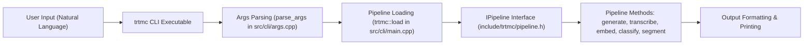

<!-- source: DeepWiki mcp.deepwiki.com · repo NVIDIA/TensorRT-Model-Connect · page 2.3 C++ Public API (IPipeline and CLI) · fetched 2026-10-26 -->

# C++ Public API (IPipeline and CLI)

<details>
<summary>Relevant source files</summary>

The following files were used as context for generating this wiki page:

- [CMakeLists.txt](CMakeLists.txt)
- [examples/trtmc_benchmark_worker.cpp](examples/trtmc_benchmark_worker.cpp)
- [include/trtmc/image_features.h](include/trtmc/image_features.h)
- [include/trtmc/pipeline.h](include/trtmc/pipeline.h)
- [python/tensorrt_model_connect/families/base.py](python/tensorrt_model_connect/families/base.py)
- [python/tensorrt_model_connect/families/wan2_2_ti2v/data/wan22-ti2v-5b-921dbaf3-fp8-scales.json](python/tensorrt_model_connect/families/wan2_2_ti2v/data/wan22-ti2v-5b-921dbaf3-fp8-scales.json)
- [python/tensorrt_model_connect/families/wan2_2_ti2v/fp8_profile.py](python/tensorrt_model_connect/families/wan2_2_ti2v/fp8_profile.py)
- [python/tensorrt_model_connect/families/wan2_2_ti2v/plugin.py](python/tensorrt_model_connect/families/wan2_2_ti2v/plugin.py)
- [python/tensorrt_model_connect/families/wan2_2_ti2v/tests/test_family.py](python/tensorrt_model_connect/families/wan2_2_ti2v/tests/test_family.py)
- [src/cli/args.cpp](src/cli/args.cpp)
- [src/cli/args.h](src/cli/args.h)
- [src/cli/main.cpp](src/cli/main.cpp)
- [src/runtime/config/cli_support.cpp](src/runtime/config/cli_support.cpp)
- [src/runtime/core/image_features.cpp](src/runtime/core/image_features.cpp)
- [src/runtime/models/dinov3/pipeline.cpp](src/runtime/models/dinov3/pipeline.cpp)
- [src/runtime/models/dinov3/pipeline.h](src/runtime/models/dinov3/pipeline.h)
- [src/runtime/models/nemotron_speech_streaming/audio_helpers.cpp](src/runtime/models/nemotron_speech_streaming/audio_helpers.cpp)
- [src/runtime/models/nemotron_speech_streaming/audio_helpers.h](src/runtime/models/nemotron_speech_streaming/audio_helpers.h)
- [src/runtime/models/nemotron_speech_streaming/pipeline.cpp](src/runtime/models/nemotron_speech_streaming/pipeline.cpp)
- [src/runtime/providers/optimized_runtime_factory.h](src/runtime/providers/optimized_runtime_factory.h)
- [src/runtime/providers/optimized_runtime_host.cpp](src/runtime/providers/optimized_runtime_host.cpp)
- [src/utils/sha256.h](src/utils/sha256.h)
- [src/utils/wav_reader.cpp](src/utils/wav_reader.cpp)
- [src/utils/wav_reader.h](src/utils/wav_reader.h)
- [tests/cpp/fakes/fake_optimized_runtime_provider.cpp](tests/cpp/fakes/fake_optimized_runtime_provider.cpp)
- [tests/cpp/models/dinov3/test_dinov3_pipeline.cpp](tests/cpp/models/dinov3/test_dinov3_pipeline.cpp)
- [tests/cpp/models/nemotron_speech_streaming/test_nemotron_speech_streaming_audio_helpers.cpp](tests/cpp/models/nemotron_speech_streaming/test_nemotron_speech_streaming_audio_helpers.cpp)
- [tests/cpp/test_bundle_format.cpp](tests/cpp/test_bundle_format.cpp)
- [tests/cpp/test_cli_args.cpp](tests/cpp/test_cli_args.cpp)
- [tests/cpp/test_config_cli_support.cpp](tests/cpp/test_config_cli_support.cpp)
- [tests/cpp/test_helpers.h](tests/cpp/test_helpers.h)
- [tests/cpp/test_pipeline_api.cpp](tests/cpp/test_pipeline_api.cpp)
- [tests/cpp/test_wav_reader.cpp](tests/cpp/test_wav_reader.cpp)
- [tests/e2e/models/qwen/edge_llm_adapter/test_runtime_contract.py](tests/e2e/models/qwen/edge_llm_adapter/test_runtime_contract.py)
- [website/docs/api/cli-reference.md](website/docs/api/cli-reference.md)
- [website/docs/api/cpp-api.md](website/docs/api/cpp-api.md)
- [website/docs/features/quantization.md](website/docs/features/quantization.md)
- [website/docs/tutorials/intermediate/canary-decoding.md](website/docs/tutorials/intermediate/canary-decoding.md)
- [website/docs/wiki/Pipeline-Deep-Dive.md](website/docs/wiki/Pipeline-Deep-Dive.md)

</details>


This section documents the core C++ public API for interacting with TensorRT-Model-Connect (TRTMC) models, focusing on the key `IPipeline` interface and the `trtmc` command-line interface (CLI). It provides detailed explanations of the API design, command dispatch, argument parsing, pipeline loading, and the set of commonly supported operations and modes, bridging the gap between natural language commands and their underlying code implementations.

The primary components covered here are:

- The `IPipeline` C++ interface as declared in `include/trtmc/pipeline.h`, which defines the high-level inference API.
- The CLI command dispatch and argument parsing implemented in `src/cli/main.cpp` and `src/cli/args.cpp/h`.
- How the CLI commands map to pipeline operations.
- Data flow and invocation patterns from user input to inference result output.
  
Users of the TRTMC C++ runtime or the `trtmc` CLI executable will find this page essential for understanding how to programmatically access model capabilities or run models from the command line.


## 1. Overview of the IPipeline Interface

The `IPipeline` interface is the fundamental C++ abstraction for a loaded TRTMC model runtime pipeline. It presents a unified API for model execution across various family types and modalities (text, image, audio, etc.).

### Key Points:

- Defined in `include/trtmc/pipeline.h`.
- Represents a loaded model bundle and exposes inference capabilities such as:
  - `generate` for text generation.
  - `transcribe` for audio-to-text.
  - `generate_image` for image generation.
  - `embed` for feature extraction embeddings.
  - Other modality-specific methods.
- Enforces a value-oriented design for input and output data, with user-owned result objects (e.g., `TextResult`, `ImageResult`).
- Supports rich configuration objects for inference parameters such as generation parameters, transcription configs, etc.

### Example Usage

```cpp
auto pipeline = trtmc::load("model.bundle");
auto gen_config = trtmc::GenerateConfig{};
gen_config.max_new_tokens = 20;
auto result = pipeline->generate("Hello, world", gen_config);
std::cout << "Generated text: " << result.text << std::endl;
```

This exemplifies typical use: loading a model bundle via `trtmc::load()` and invoking `generate()` with a prompt and configuration.

### Data Structures

- `TextResult`: Holds generated text, token IDs, and timing info.
- `TranscriptionSegment`: Time-aligned segments for transcription.
- `TranscriptionConfig`/`TranscriptionRequest`: Used to specify transcription parameters and input audio samples.
- `ImageResult`, `AudioResult`, `EmbeddingResult`, etc. provide modality-specific inference outputs.

### Design Notes

The pipeline interface abstracts the runtime strategy, model type, and backend details. Users do not interact with low-level tensors or engine details, instead using unified configuration/result structs.

Sources: `include/trtmc/pipeline.h:1-208`


## 2. The `trtmc` Command-Line Interface (CLI)

The `trtmc` CLI executable is the primary user-facing tool for interacting with TRTMC model bundles and performing common operations:

- `build` — Build .bundle files from Hugging Face checkpoints or directories.
- `run` — Run generative text/image/audio models.
- `transcribe` — Transcribe speech from audio files.
- `generate-video` — Generate video content.
- `classify`, `segment`, `embed` — Modality-specific model inference.
- `rerank`, `solve`, `inspect`, `version` — Auxiliary commands.

### Architecture and Flow

- The CLI entry point is implemented in `src/cli/main.cpp`.
- Command-line argument parsing and validation is in `src/cli/args.cpp` and `src/cli/args.h`.
- After parsing, the `trtmc` program dispatches to internal handlers that:
  - Load the model pipeline using `trtmc::load()` with configuration options from CLI flags.
  - Prepare input data and configuration structs.
  - Call the appropriate pipeline method (`generate`, `transcribe`, etc.).
  - Handle outputs (print to stdout, write images/files, JSON outputs).
- Supports runtime optimizations such as CUDA Graphs and kernel bindings.

### Argument Parsing

`CliArgs` struct captures all parsed command-line options, including:

- Command name (`build`, `run`, `transcribe`, etc.).
- Bundle path for loading the model.
- Prompt or input files (image/audio).
- Generation parameters (`max-new-tokens`, `temperature`, `top-k`, etc.).
- Output settings.
- Backend and plugin search paths.
- Other advanced flags (e.g., LoRA adapter paths, runtime cache, kernel bindings).

The parser rigorously validates argument formats (e.g., `parse_byte_size` for sizes, `parse_seed_csv` for seeds).

### Loading a Pipeline in CLI

Example snippet excerpted from `src/cli/main.cpp` shows pipeline loading with options extracted from `CliArgs`:

```cpp
std::unique_ptr<trtmc::IPipeline> load_pipeline(const CliArgs& args) {
  return trtmc::load(args.bundle_path, make_load_options(args), args.kernel_bindings_path);
}
```

Where `make_load_options` populates `LoadOptions` from CLI args such as runtime cache and CUDA graphs support.

This defers actual model loading and runtime strategy selection to the core runtime.

### Command Dispatched Operations

After parsing:

- `build`: passed to the Python builder subsystem.
- `run`: calls `pipeline->generate` or pipeline image/audio specific methods depending on flags.
- `transcribe`: calls `pipeline->transcribe` with audio input.
- `generate-video`: calls video generation pipeline methods.
- `classify` / `extract-features` / `detect`: run corresponding pipeline classifier/extractor/detector methods.
- `embed`: calls embedding extraction methods.
- `rerank` / `solve`: problem-specific logic.
- `inspect`: inspects bundle metadata.
- `version`: prints version info.

### Output and Benchmarks

- CLI supports benchmarking through `--benchmark` and warmup iterations.
- Output files, JSON, or stdout printing are handled transparently.
- Image outputs leverage `stb_image_write` for file formats like PNG.

Sources: `src/cli/main.cpp:1-74300`, `src/cli/args.cpp:1-184`, `src/cli/args.h:1-130`


## 3. Data Flow and API Interaction: From CLI Commands to Pipeline Calls

The following mermaid diagram relates the common CLI commands and the corresponding C++ pipeline methods invoked:

```mermaid
graph TD
  subgraph Natural Language Commands
    B1["trtmc build <model> -o <bundle> [args]"]
    B2["trtmc run <bundle> --prompt \"text\" [--flags]"]
    B3["trtmc transcribe <bundle> --audio FILE.wav [--flags]"]
    B4["trtmc generate-video <bundle> --prompt \"text\" [--flags]"]
    B5["trtmc classify <bundle> --image PATH [--flags]"]
    B6["trtmc embed <bundle> --image PATH [--flags]"]
    B7["trtmc inspect <bundle> [--list-engines]"]
    B8["trtmc version"]
  end

  subgraph C++ API Calls
    P1["trtmc::load(bundle_path, options)"]
    P2["IPipeline::generate(prompt, GenerateConfig)"]
    P3["IPipeline::transcribe(audio_samples, TranscriptionConfig)"]
    P4["IPipeline::generate_video(prompt, VideoConfig)"]
    P5["IPipeline::classify(image_pixels, ClassificationConfig)"]
    P6["IPipeline::embed(image_pixels, EmbeddingConfig)"]
    P7["trtmc::InspectBundle(bundle_path)"]
    P8["trtmc::version()"]
  end

  B1 -->|calls| P1
  B2 -->|calls| P1
  B2 -->|calls| P2
  B3 -->|calls| P1
  B3 -->|calls| P3
  B4 -->|calls| P1
  B4 -->|calls| P4
  B5 -->|calls| P1
  B5 -->|calls| P5
  B6 -->|calls| P1
  B6 -->|calls| P6
  B7 -->|calls| P7
  B8 -->|calls| P8
```

This diagram maps how user-facing `trtmc` CLI commands translate into API calls involving loading the pipeline and invoking the requested operation. For all commands except `build`, the loaded `IPipeline` instance is the key abstraction through which inputs and configuration are sent, and results retrieved.

Sources: `src/cli/main.cpp:10-40`, `include/trtmc/pipeline.h:11-50`


## 4. Argument Parsing and Load Options Configuration

The `CliArgs` struct defined in `src/cli/args.h` and parsed by `parse_args()` in `src/cli/args.cpp` gathers all runtime parameters. The CLI applies these arguments to configure the pipeline load and runtime behavior as follows:

- `bundle_path` — passed to `trtmc::load()`.
- `hf_python`, `runtime_cache`, `backend_search_paths`, `model_plugin_search_paths` — forwarded as `LoadOptions`.
- Flags such as `cuda_graphs`, `kv_cache_size_bytes` set pipeline internal runtime flags.
- Model plugin paths and backend libraries are dynamically discovered or explicitly specified here.

`make_load_options` in `src/cli/main.cpp` constructs the `LoadOptions` from CLI args for use in loading the pipeline, ensuring correct backend search paths and runtime optimizations.

Sources: `src/cli/args.h:15-111`, `src/cli/args.cpp:15-185`, `src/cli/main.cpp:140-160`


## 5. Example: Running a Text Generation Model

Typical `trtmc run` flow:

1. Parse args with prompt, max tokens, temperature, etc.
2. Load pipeline with `trtmc::load()`.
3. Construct `GenerateConfig` from flags.
4. Call `IPipeline::generate()`.
5. Retrieve `TextResult`, print output.

```cpp
auto args = parse_args(argc, argv);
auto pipeline = trtmc::load(args.bundle_path, make_load_options(args));
trtmc::GenerateConfig gen_config;
gen_config.max_new_tokens = args.max_new_tokens;
auto result = pipeline->generate(args.prompt, gen_config);
std::cout << result.text << std::endl;
```

The CLI orchestrates such flows internally, handling error reporting and output file writing.

Sources: `src/cli/main.cpp:75-160`


## 6. Example: Transcription Command

For `trtmc transcribe`, the CLI reads an audio file into a `TranscriptionRequest` and calls:

```cpp
auto request = trtmc::TranscriptionRequest{};
request.audio_samples = ReadWavSamples(args.audio_in);
request.config.max_output_tokens = args.max_new_tokens;
request.config.beam_size = args.beam_size;
// Set other config fields...

auto transcript = pipeline->transcribe(request);
OutputTranscript(transcript);
```

Here the `TranscriptionConfig` encapsulates beam search and language options, enabling flexible ASR/translation.

Sources: `include/trtmc/pipeline.h:56-103`, `src/cli/main.cpp:20-100`


## 7. Extending the Pipeline with New Commands or Modalities

The public API enables extending to new modalities by adding methods to the `IPipeline` interface. The CLI can dispatch new commands by:

- Parsing new flags into configuration structs.
- Calling new `IPipeline` methods.
- Formatting outputs accordingly.

The runtime load and plugin mechanism supports loading family plugin DSOs that implement new pipeline subclasses.

Sources: `include/trtmc/pipeline.h:20-200`, `src/cli/main.cpp`


## 8. Supporting Infrastructure

- The pipeline is a unique_ptr returned by `trtmc::load()`, which hides runtime details.
- The CLI may preload plugins for the runtime strategy via `trtmc::load_model_plugin_for_strategy()`.
- Kernel binding files and runtime caches support advanced backend optimization paths.
- The CLI supports advanced generation modes like diffusion, SDE, image negative prompts by forwarding parameters into `GenerateConfig`.

Sources: `src/cli/main.cpp:160-180`, `src/cli/args.cpp`, `include/trtmc/pipeline.h`


## 9. Summary Table: CLI Commands and IPipeline Methods

| CLI Command         | Core Pipeline API Method           | Input Type                 | Output Type            |
|---------------------|----------------------------------|----------------------------|------------------------|
| `build`             | Python builder subsystem (external) | HF checkpoint/directory    | Bundle artifact         |
| `run`               | `IPipeline::generate()`           | Prompt + `GenerateConfig`  | `TextResult`            |
| `transcribe`        | `IPipeline::transcribe()`         | `TranscriptionRequest`     | `TextResult`            |
| `generate-video`    | `IPipeline::generate_video()` (if supported) | Prompt + VideoConfig | Video frames or path    |
| `classify`          | `IPipeline::classify()`           | Image input                | `ClassificationResult`  |
| `embed`             | `IPipeline::embed()`              | Image or text              | `EmbeddingResult`       |
| `segment`           | `IPipeline::segment()`            | Image + Prompt             | `SegmentResult`         |
| `rerank`            | `IPipeline::rerank()`             | Document + query           | `TextResult`            |
| `solve`             | `IPipeline::solve()`              | Problem description        | Solution object         |
| `inspect`           | `trtmc::InspectBundle()`          | Bundle path                | Metadata info           |
| `version`           | `trtmc::version()`                | None                       | Version string          |

Sources: `src/cli/main.cpp`, `include/trtmc/pipeline.h`


## 10. C++ and CLI Integration Diagram: From Natural Language to Code Entities



This diagram illustrates the sequential system flow from user command input to final output, highlighting the key code units implementing each stage.

Sources: `src/cli/main.cpp`, `src/cli/args.cpp`, `include/trtmc/pipeline.h`


## 11. Advanced Details: LoadOptions and Runtime Strategy

The CLI supports advanced runtime customization through the `LoadOptions` structure built from parsed CLI flags:

- `hf_python` path: Used for interoperability with Hugging Face Python utilities.
- `runtime_cache_path`: Path for saving intermediate compiled kernel shaders or plan caches.
- `cuda_graphs`: Enables CUDA Graphs capture in TRT execution.
- `kv_cache_size_bytes`: Manages key-value cache memory sizing for Transformer decoders.
- Search paths for backend and model plugin DSOs dynamically control runtime behavior.

Pipeline load respects these options to instantiate the correct runtime strategy, potentially triggering plugin loads or optimized backends.

Sources: `src/cli/main.cpp:140-160`


## 12. Summary

This page detailed the TRTMC C++ public API and CLI internals, focusing on how users invoke various model capabilities either programmatically via `IPipeline` or through the `trtmc` CLI. We highlighted the core pipeline interface design, the argument parsing and command dispatch in the CLI, and showed the mapping from natural language user commands to concrete C++ methods. The documentation equips developers to build new CLI commands, extend pipeline modalities, or embed TRTMC runtime capabilities in custom C++ applications.


---

### Sources

- `include/trtmc/pipeline.h:1-208`  
- `src/cli/main.cpp:1-74300` (entire file excerpted, focus on lines 6-180 approx.)  
- `src/cli/args.cpp:1-184`  
- `src/cli/args.h:1-130`

---

