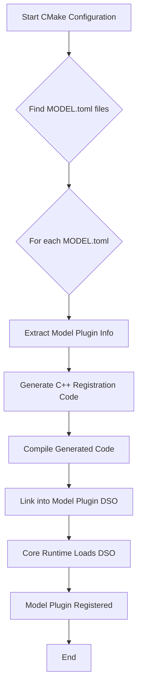
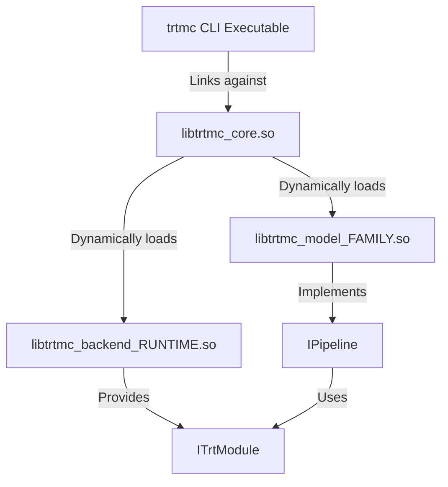
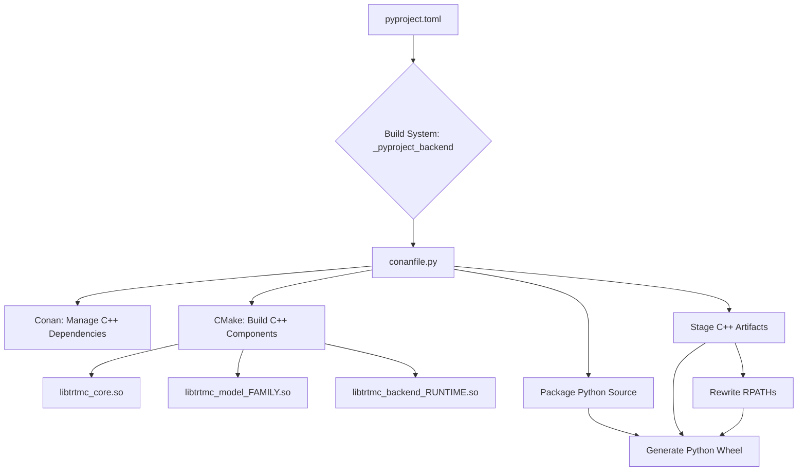

<!-- source: DeepWiki mcp.deepwiki.com · repo NVIDIA/TensorRT-Model-Connect · page 2.4 Build System: CMake, DSO Boundaries, and Packaging · fetched 2026-10-26 -->

# Build System: CMake, DSO Boundaries, and Packaging

<details>
<summary>Relevant source files</summary>

The following files were used as context for generating this wiki page:

- [CMakeLists.txt](CMakeLists.txt)
- [_pyproject_backend.py](_pyproject_backend.py)
- [conanfile.py](conanfile.py)
- [examples/trtmc_benchmark_worker.cpp](examples/trtmc_benchmark_worker.cpp)
- [include/trtmc/pipeline.h](include/trtmc/pipeline.h)
- [pyproject.toml](pyproject.toml)
- [src/cli/args.cpp](src/cli/args.cpp)
- [src/cli/args.h](src/cli/args.h)
- [src/cli/main.cpp](src/cli/main.cpp)
- [src/runtime/config/config_bundle.cpp](src/runtime/config/config_bundle.cpp)
- [src/runtime/config/schema_registry.cpp](src/runtime/config/schema_registry.cpp)
- [src/runtime/config/schemas/platform.cpp](src/runtime/config/schemas/platform.cpp)
- [src/runtime/config/schemas/runtime.cpp](src/runtime/config/schemas/runtime.cpp)
- [src/runtime/config/schemas/text_trace.cpp](src/runtime/config/schemas/text_trace.cpp)
- [src/runtime/config/schemas/triattention.cpp](src/runtime/config/schemas/triattention.cpp)
- [src/runtime/models/dinov3/pipeline.cpp](src/runtime/models/dinov3/pipeline.cpp)
- [src/runtime/models/dinov3/pipeline.h](src/runtime/models/dinov3/pipeline.h)
- [src/runtime/providers/optimized_runtime_factory.h](src/runtime/providers/optimized_runtime_factory.h)
- [src/runtime/providers/optimized_runtime_host.cpp](src/runtime/providers/optimized_runtime_host.cpp)
- [tests/builder/test_config_cli_support.py](tests/builder/test_config_cli_support.py)
- [tests/builder/test_config_isolation_demo.py](tests/builder/test_config_isolation_demo.py)
- [tests/builder/test_config_schema_registry.py](tests/builder/test_config_schema_registry.py)
- [tests/builder/test_config_schemas_crosslang.py](tests/builder/test_config_schemas_crosslang.py)
- [tests/cpp/fakes/fake_optimized_runtime_provider.cpp](tests/cpp/fakes/fake_optimized_runtime_provider.cpp)
- [tests/cpp/models/dinov3/test_dinov3_pipeline.cpp](tests/cpp/models/dinov3/test_dinov3_pipeline.cpp)
- [tests/cpp/test_cli_args.cpp](tests/cpp/test_cli_args.cpp)
- [tests/cpp/test_config_schema_registry.cpp](tests/cpp/test_config_schema_registry.cpp)
- [tests/cpp/test_config_schemas_triattention.cpp](tests/cpp/test_config_schemas_triattention.cpp)
- [tests/cpp/test_pipeline_api.cpp](tests/cpp/test_pipeline_api.cpp)
- [tests/e2e/models/qwen/edge_llm_adapter/test_runtime_contract.py](tests/e2e/models/qwen/edge_llm_adapter/test_runtime_contract.py)
- [tests/tools/test_optimized_runtime_packaging.py](tests/tools/test_optimized_runtime_packaging.py)
- [tests/tools/test_release_backend_abi.py](tests/tools/test_release_backend_abi.py)
- [tools/ci/package.py](tools/ci/package.py)
- [website/docs/architecture/build-system.md](website/docs/architecture/build-system.md)

</details>


This page details the build system of TensorRT-Model-Connect (TRTMC), focusing on how CMake orchestrates the compilation process, manages dynamically linked object (DSO) boundaries, and how the project is packaged for Python distribution. It covers the scanning of `MODEL.toml` descriptors for plugin registration, the native linking architecture (`trtmc_core`, model DSOs, backend DSOs), the Python packaging using `pyproject.toml` and `conanfile.py`, and the release wheel build process.

## CMake Build System and Model Plugin Registration

The TRTMC build system leverages CMake to manage the compilation of its C++ components. A key aspect of this system is the dynamic discovery and registration of model plugins.

### MODEL.toml Scanning and Plugin Generation

TRTMC uses `MODEL.toml` files to describe model families and their associated C++ runtime plugins. During the CMake configuration phase, these `MODEL.toml` files are scanned to identify available model plugins. This scanning process is crucial for generating the necessary C++ code to register these plugins with the core runtime.

The `CMakeLists.txt` [CMakeLists.txt:1-599]() file defines the overall project structure and includes various subdirectories. The `cmake/trtmc_model_plugin.cmake` [cmake/trtmc_model_plugin.cmake:1-100]() module is responsible for processing `MODEL.toml` files.

For each `MODEL.toml` file found, CMake generates a C++ source file that contains a registration function. This function, when called, registers the model's pipeline factory with the TRTMC runtime. This allows the core runtime to dynamically load and instantiate pipelines for different model families.


**Diagram: MODEL.toml Scanning and Plugin Registration**

Sources:
- [CMakeLists.txt:1-599]()
- [cmake/trtmc_model_plugin.cmake:1-100]()

### Native Link Boundaries

The TRTMC C++ runtime is structured around several dynamically linked object (DSO) boundaries to promote modularity and allow for flexible deployment. These boundaries include:

*   **`trtmc_core`**: This is the main core library, providing fundamental utilities, the `IPipeline` [include/trtmc/pipeline.h:24]() interface, and the `PipelineFactory` [src/runtime/providers/optimized_runtime_factory.h:24]() for loading bundles. It is designed to be lightweight and independent of specific model implementations or backend runtimes.
*   **Model DSOs**: Each model family's C++ runtime implementation is compiled into its own DSO (e.g., `libtrtmc_model_dinov3.so`). These DSOs contain the specific logic for preprocessing, postprocessing, and interacting with the underlying `ITrtModule` [tests/cpp/models/dinov3/test_dinov3_pipeline.cpp:27]() for a given model. The `MODEL.toml` files define these model-specific plugins.
*   **Backend DSOs**: These DSOs provide the actual inference backend implementations, such as the TensorRT backend (`libtrtmc_backend_trt.so`). The core runtime loads these DSOs based on the `runtime_strategy` specified in a bundle. This allows TRTMC to support different inference backends without recompiling the core library.

The `trtmc` CLI executable [src/cli/main.cpp:6]() links against `trtmc_core` and dynamically loads model and backend DSOs at runtime. The `trtmc::load_model_plugin_for_strategy` [src/cli/main.cpp:179]() function is responsible for loading the appropriate model plugin DSO.


**Diagram: Native Link Boundaries**

Sources:
- [src/cli/main.cpp:6]()
- [include/trtmc/pipeline.h:24]()
- [src/runtime/providers/optimized_runtime_factory.h:24]()
- [tests/cpp/models/dinov3/test_dinov3_pipeline.cpp:27]()
- [src/cli/main.cpp:179]()

## Python Packaging: `pyproject.toml` and `conanfile.py`

TRTMC uses a combination of `pyproject.toml` and `conanfile.py` for Python packaging, enabling the creation of distributable wheels that include both Python and native C++ components.

### `pyproject.toml`

The `pyproject.toml` [pyproject.toml:1-99]() file defines the project's metadata, build system requirements, and Python-specific configurations.

*   **Build System**: It specifies `_pyproject_backend` [pyproject.toml:6]() as the build backend, which is a custom backend that integrates with Conan for C++ dependency management.
*   **Dynamic Fields**: `version` and `dependencies` are marked as dynamic [pyproject.toml:11](), meaning their values are determined at build time. The `version` is derived from `TRTMC_PACKAGE_VERSION` environment variable [conanfile.py:166](), which is set by the build process.
*   **Package Metadata**: Includes `name`, `description`, `readme`, `license`, and `requires-python` [pyproject.toml:10-16]().
*   **`tool.tensorrt-model-connect.package`**: This section [pyproject.toml:18-34]() defines TRTMC-specific packaging options, such as `base-version` and `default-tensorrt-version`, and a list of Python `dependencies`.
*   **Optional Dependencies**: Defines groups of optional dependencies for features like `test`, `wan`, `fast-foundation-stereo`, `chronos`, `clip`, and `validation` [pyproject.toml:36-51]().
*   **`tool.conan-py-build.wheel` and `sdist`**: These sections [pyproject.toml:53-67]() specify which files and directories to include or exclude when building the Python wheel and source distribution (sdist). For example, the `sdist` includes `python`, `src/runtime/models/fast_foundation_stereo/native_plugins`, and `third_party` [pyproject.toml:57-59]().

### `conanfile.py`

The `conanfile.py` [conanfile.py:1-179]() script is central to managing C++ dependencies and integrating the native build with Python packaging. It uses Conan, a C/C++ package manager, to handle the compilation and packaging of the C++ components.

*   **`requirements()`**: Declares C++ dependencies, such as `nlohmann_json` [conanfile.py:172]().
*   **`layout()`**: Defines the build directory structure [conanfile.py:175]().
*   **`generate()`**: Configures CMake toolchains and dependencies [conanfile.py:177-180]().
*   **`build()`**: Invokes CMake to build the C++ project [conanfile.py:182-185](). This step compiles `trtmc_core`, model DSOs, and backend DSOs.
*   **`package()`**: This crucial method [conanfile.py:187-240]() stages the compiled C++ artifacts and Python source files into the final package structure. It copies executables (`trtmc`, `trtmc_benchmark_worker`), core libraries (`libtrtmc_core.so`), backend libraries (`libtrtmc_backend_trt.so`), and model-specific DSOs (e.g., `libtrtmc_model_example.so`) into the Python package. It also handles staging benchmark catalogs [conanfile.py:58-132]() and rewriting RPATHs [conanfile.py:148-160]() for distributable wheels.


**Diagram: Python Packaging Workflow**

Sources:
- [pyproject.toml:1-99]()
- [conanfile.py:1-179]()
- [conanfile.py:172]()
- [conanfile.py:175]()
- [conanfile.py:177-180]()
- [conanfile.py:182-185]()
- [conanfile.py:187-240]()
- [conanfile.py:58-132]()
- [conanfile.py:148-160]()
- [conanfile.py:166]()
- [pyproject.toml:6]()
- [pyproject.toml:11]()
- [pyproject.toml:10-16]()
- [pyproject.toml:18-34]()
- [pyproject.toml:36-51]()
- [pyproject.toml:53-67]()
- [pyproject.toml:57-59]()

## Release Wheel Build Process

The release wheel build process is orchestrated by the custom `_pyproject_backend.py` [_pyproject_backend.py:1-188]() and integrates with Conan to produce platform-specific Python wheels containing the compiled C++ libraries.

1.  **`get_requires_for_build_wheel()`**: This function [_pyproject_backend.py:42]() specifies build dependencies, including `conan-py-build`.
2.  **`build_wheel()`**: This is the core function [_pyproject_backend.py:69]() that triggers the Conan-based build. It sets environment variables like `TRTMC_PACKAGE_TENSORRT_VERSION` [tools/ci/package.py:35]() to specify the target TensorRT version, which influences the ABI of the compiled backend DSOs.
3.  **Conan Invocation**: The `_variant_conan_build_backend` context manager [_pyproject_backend.py:62]() ensures that Conan is invoked with the correct environment and configuration.
4.  **CMake Build**: Conan's `build()` method [conanfile.py:182-185]() executes CMake, which compiles the C++ sources, including `trtmc_core`, model plugins, and backend plugins. The `TRTMC_TRT_BACKEND_ABI` CMake variable [CMakeLists.txt:58]() is used to name the TensorRT backend DSO (e.g., `libtrtmc_backend_trt_11_15.so`) based on the detected TensorRT version.
5.  **Packaging**: Conan's `package()` method [conanfile.py:187-240]() collects the compiled binaries and Python files. It copies the `trtmc` executable, `libtrtmc_core.so`, and the versioned `libtrtmc_backend_trt_*.so` into the Python package structure.
6.  **RPATH Rewriting**: The `_set_wheel_runpath` function [conanfile.py:148-160]() uses `patchelf` to modify the RPATH of the native binaries within the wheel. This ensures that the DSOs can be found at runtime relative to the installed package, making the wheel distributable. The `CMAKE_BUILD_RPATH_USE_ORIGIN` [CMakeLists.txt:9]() is set to `TRUE` to facilitate this.
7.  **Metadata Validation**: The `tools/ci/package.py` [tools/ci/package.py:1-911]() script includes validation logic to ensure the correctness of the built wheel, checking for expected TensorRT versions and backend files. The `_validate_package_variant` [tools/ci/package.py:92]() and `_validate_backend_files` [tools/ci/package.py:126]() functions perform these checks.

```mermaid
graph TD
    A[Python Wheel Build Request] --> B[pyproject.toml];
    B --> C[_pyproject_backend.py];
    C --> D[Set TRTMC_PACKAGE_TENSORRT_VERSION];
    D --> E[conanfile.py];
    E --> F[Conan build() method];
    F --> G[CMake: Compile C++];
    G --> H[Generate libtrtmc_core.so];
    G --> I[Generate libtrtmc_model_FAMILY.so];
    G --> J[Generate libtrtmc_backend_trt_ABI.so];
    F --> K[Conan package() method];
    K --> L[Copy Binaries to Wheel];
    K --> M[Rewrite RPATH with patchelf];
    M --> N[Final Python Wheel];
    N --> O[Validate Wheel (tools/ci/package.py)];
```
**Diagram: Release Wheel Build Process**

Sources:
- [_pyproject_backend.py:1-188]()
- [_pyproject_backend.py:42]()
- [_pyproject_backend.py:69]()
- [tools/ci/package.py:35]()
- [_pyproject_backend.py:62]()
- [conanfile.py:182-185]()
- [CMakeLists.txt:58]()
- [conanfile.py:187-240]()
- [conanfile.py:148-160]()
- [CMakeLists.txt:9]()
- [tools/ci/package.py:1-911]()
- [tools/ci/package.py:92]()
- [tools/ci/package.py:126]()

---

