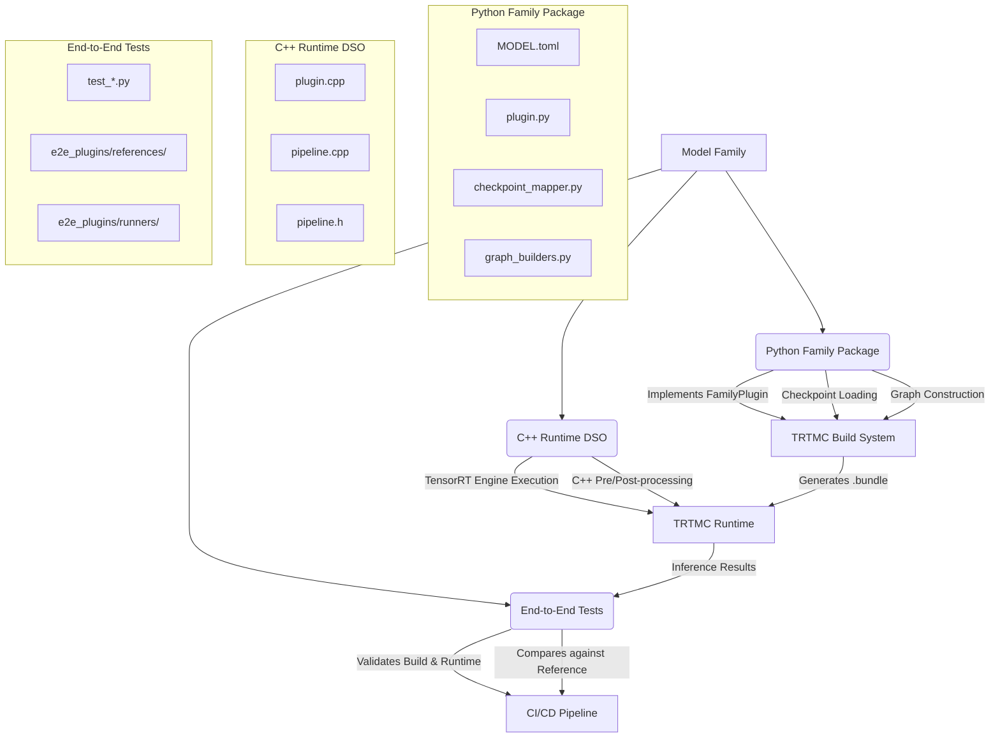

<!-- source: DeepWiki mcp.deepwiki.com · repo NVIDIA/TensorRT-Model-Connect · page 3 Model Family System · fetched 2026-10-26 -->

# Model Family System

<details>
<summary>Relevant source files</summary>

The following files were used as context for generating this wiki page:

- [python/tensorrt_model_connect/build_cli.py](python/tensorrt_model_connect/build_cli.py)
- [python/tensorrt_model_connect/engine_builder.py](python/tensorrt_model_connect/engine_builder.py)
- [python/tensorrt_model_connect/families/sana_wm/MODEL.toml](python/tensorrt_model_connect/families/sana_wm/MODEL.toml)
- [python/tensorrt_model_connect/families/sana_wm/components/gemma/plugin.py](python/tensorrt_model_connect/families/sana_wm/components/gemma/plugin.py)
- [python/tensorrt_model_connect/hf_snapshot.py](python/tensorrt_model_connect/hf_snapshot.py)
- [scripts/warm_hf_cache.py](scripts/warm_hf_cache.py)
- [src/runtime/models/whisper/pipeline.cpp](src/runtime/models/whisper/pipeline.cpp)
- [src/runtime/models/whisper/pipeline.h](src/runtime/models/whisper/pipeline.h)
- [src/runtime/models/whisper/plugin.cpp](src/runtime/models/whisper/plugin.cpp)
- [src/runtime/models/whisper/whisper_mel_spectrogram.cpp](src/runtime/models/whisper/whisper_mel_spectrogram.cpp)
- [src/runtime/models/whisper/whisper_mel_spectrogram.h](src/runtime/models/whisper/whisper_mel_spectrogram.h)
- [tests/builder/test_cli.py](tests/builder/test_cli.py)
- [tests/builder/test_engine_builder_extended.py](tests/builder/test_engine_builder_extended.py)
- [tests/builder/test_engine_builder_utils.py](tests/builder/test_engine_builder_utils.py)
- [tests/builder/test_families.py](tests/builder/test_families.py)
- [tests/builder/test_family_plugins.py](tests/builder/test_family_plugins.py)
- [tests/cpp/models/whisper/test_whisper_mel_spectrogram.cpp](tests/cpp/models/whisper/test_whisper_mel_spectrogram.cpp)
- [tests/cpp/test_tokenizer_edge_cases.cpp](tests/cpp/test_tokenizer_edge_cases.cpp)
- [tests/e2e/models/ltx_video/e2e_plugins/references/hf_diffusers.py](tests/e2e/models/ltx_video/e2e_plugins/references/hf_diffusers.py)
- [tests/e2e/models/ltx_video/test_ltx_video_hf_diffusers_reference.py](tests/e2e/models/ltx_video/test_ltx_video_hf_diffusers_reference.py)
- [tests/e2e/models/sana_wm/test_sana_wm_warm_hf_cache_metadata.py](tests/e2e/models/sana_wm/test_sana_wm_warm_hf_cache_metadata.py)
- [tests/e2e_harness/comparators/text_to_audio.py](tests/e2e_harness/comparators/text_to_audio.py)
- [tests/e2e_harness/references/hf_transformers.py](tests/e2e_harness/references/hf_transformers.py)
- [tests/e2e_harness/runners/audio_speech.py](tests/e2e_harness/runners/audio_speech.py)
- [tests/e2e_harness/thresholds/defaults/text_to_audio.json](tests/e2e_harness/thresholds/defaults/text_to_audio.json)
- [tests/runtime_strategy_matrix.yaml](tests/runtime_strategy_matrix.yaml)
- [tests/tools/test_family_specialization.py](tests/tools/test_family_specialization.py)
- [tests/tools/test_warm_hf_cache_static.py](tests/tools/test_warm_hf_cache_static.py)
- [tests/validation/model_workloads.yaml](tests/validation/model_workloads.yaml)

</details>


The Model Family System in TensorRT-Model-Connect (TRTMC) provides a structured approach to integrating diverse AI models. It defines how models are organized, discovered, and extended within the framework. This system is built around the `FamilyPlugin` protocol, `MODEL.toml` descriptors, and a three-sided ownership model, ensuring modularity, discoverability, and maintainability.

The core idea is to encapsulate model-specific logic—such as checkpoint loading, graph construction, and runtime adaptations—within distinct "family" modules. This allows TRTMC to support a wide array of models without becoming a monolithic application.

For detailed information on specific model groups and cross-cutting features, please refer to the child pages:
- [Text Generation Families (Decoders, MoE, Recurrent)](#3.1)
- [Vision-Language, Audio, and Speech Families](#3.2)
- [Diffusion, Perception, and Time-Series Families](#3.3)
- [Cross-Cutting Features: Quantization, Parallelism, and Tokenization](#3.4)

## FamilyPlugin Protocol

The `FamilyPlugin` protocol is the central interface for integrating new model architectures into TRTMC. Each model family implements this protocol, providing the necessary methods for TRTMC's build and runtime components to interact with the model. This protocol ensures that all model-specific logic is self-contained and adheres to a standardized interface.

The `FamilyPlugin` is responsible for:
*   **Model Discovery**: Defining how a model is identified as belonging to a specific family. This often involves inspecting `config.json` or `model_index.json` files within a Hugging Face model directory [python/tensorrt_model_connect/engine_builder.py:33-38]().
*   **Build Logic**: Providing the necessary components to construct the TensorRT engine(s) for the model. This includes defining graph builders and handling model-specific optimizations.
*   **Runtime Adaptations**: Specifying any unique runtime requirements or post-processing steps.

The `tensorrt_model_connect.families.find_plugin` function is used to locate the appropriate `FamilyPlugin` for a given model [python/tensorrt_model_connect/engine_builder.py:31](). This function relies on metadata defined within each family's `MODEL.toml` file.

Sources:
- [python/tensorrt_model_connect/engine_builder.py:31-38]()
- [tests/builder/test_families.py:10-12]()

## MODEL.toml Descriptors

Each model family is defined by a `MODEL.toml` descriptor file located within its Python package (e.g., `python/tensorrt_model_connect/families/sana_wm/MODEL.toml` [python/tensorrt_model_connect/families/sana_wm/MODEL.toml]()). These TOML files serve as declarative manifests, providing essential metadata about the model family.

Key information defined in `MODEL.toml` includes:
*   **`id`**: A unique identifier for the model family.
*   **`plugin`**: The Python module path to the `FamilyPlugin` implementation.
*   **`aliases`**: Alternative names or identifiers for the family, aiding in model discovery.
*   **`capabilities`**: A list of capabilities supported by the family (e.g., "text-generation", "image-to-image").
*   **`hf_warm_dependencies`**: Specifies Hugging Face model IDs and filenames that should be pre-cached during CI/CD processes [tests/tools/test_warm_hf_cache_static.py:174-180]().

This metadata is crucial for TRTMC's auto-discovery mechanism, allowing the system to dynamically load and utilize model families without explicit registration in code.

### Model Family Metadata Indexing

The `MODEL.toml` files are scanned and indexed to enable efficient lookup of model families. This indexing process creates a cache of `_FamilyMetadata` objects, which store parsed information from the TOML files.

```mermaid
graph TD
    A[Start] --> B{Scan python/tensorrt_model_connect/families/};
    B --> C{Find all MODEL.toml files};
    C --> D{Parse MODEL.toml into _FamilyMetadata};
    D --> E{Cache _FamilyMetadata objects};
    E --> F{Create _METADATA_INDEX_CACHE};
    F --> G{find_plugin(model_id)};
    G --> H{Use _METADATA_INDEX_CACHE to find candidate modules};
    H --> I{Load FamilyPlugin from module};
    I --> J[End];
```
Sources:
- [python/tensorrt_model_connect/families/sana_wm/MODEL.toml]()
- [tests/builder/test_families.py:70-114]()
- [tests/tools/test_warm_hf_cache_static.py:174-180]()

## Three-Sided Ownership Model

TRTMC employs a "three-sided ownership model" to manage the development and maintenance of model families. This model distributes responsibilities across three distinct components:

1.  **Python Family Package**: This side owns the model-specific Python logic, including the `FamilyPlugin` implementation, checkpoint loading, graph construction, and any Python-based pre/post-processing. It resides in `python/tensorrt_model_connect/families/`.
2.  **C++ Runtime DSO**: For performance-critical operations, a model family may have a corresponding C++ Dynamic Shared Object (DSO). This component handles the low-level TensorRT engine execution and C++-based runtime logic. These are typically found in `src/runtime/models/`. For example, the Whisper model has its C++ runtime components in `src/runtime/models/whisper/` [src/runtime/models/whisper/plugin.cpp](), [src/runtime/models/whisper/pipeline.cpp](), [src/runtime/models/whisper/pipeline.h]().
3.  **End-to-End (E2E) Tests**: Each model family is accompanied by a comprehensive suite of E2E tests. These tests validate the entire pipeline, from model loading and TensorRT engine compilation to inference and output verification against reference implementations (e.g., Hugging Face Transformers). These tests are located in `tests/e2e/models/`. For example, `tests/e2e/models/ltx_video/test_ltx_video_hf_diffusers_reference.py` [tests/e2e/models/ltx_video/test_ltx_video_hf_diffusers_reference.py]() tests the LTX-Video family against a Hugging Face Diffusers reference.

This ownership model ensures that each aspect of a model's integration is clearly defined and testable, promoting robustness and ease of extension.


Sources:
- [src/runtime/models/whisper/plugin.cpp]()
- [src/runtime/models/whisper/pipeline.cpp]()
- [src/runtime/models/whisper/pipeline.h]()
- [tests/e2e/models/ltx_video/test_ltx_video_hf_diffusers_reference.py]()
- [tests/e2e_harness/references/hf_transformers.py:4-8]()
- [tests/e2e_harness/runners/audio_speech.py:4-8]()
- [tests/builder/test_family_plugins.py:4-7]()

## Model Discovery and Resolution

TRTMC provides mechanisms to discover and resolve model families from various sources, including Hugging Face model IDs and local directories. The `engine_builder` module plays a key role in this process.

The `resolve_family_id` function identifies the appropriate family for a given model, while `resolve_config_from_model_dir` extracts configuration details. For Hugging Face models, `hf_snapshot_allow_patterns` defines which files are permitted for download [python/tensorrt_model_connect/hf_snapshot.py]().

```mermaid
graph TD
    A[User Input: Model Identifier] --> B{Is it a Hugging Face ID or Local Path?};

    B -- "Hugging Face ID" --> C[Resolve HF Model Directory];
    C --> C1{Download allowed files based on hf_snapshot_allow_patterns};
    C1 --> D[Detect Model Type from config.json/model_index.json];

    B -- "Local Path" --> D[Detect Model Type from config.json/model_index.json];

    D --> E{Call tensorrt_model_connect.families.find_plugin()};
    E -- "Matches MODEL.toml metadata" --> F[Load FamilyPlugin];
    F --> G[ModelConfig Object];
    G --> H[Build TensorRT Engine];
```
Sources:
- [python/tensorrt_model_connect/engine_builder.py:33-38]()
- [python/tensorrt_model_connect/hf_snapshot.py]()
- [tests/builder/test_engine_builder_utils.py:47-60]()
- [scripts/warm_hf_cache.py:58-101]()

## Extending Model Families

Adding a new model family involves creating a new Python package under `python/tensorrt_model_connect/families/`, defining its `MODEL.toml` descriptor, and implementing the `FamilyPlugin` protocol. This includes providing the necessary graph builders and potentially C++ runtime components.

The `tools/family_specialization.py` script can be used to audit model family implementations, identifying unreachable code, fixed strategy switches, and non-canonical model paths, which helps maintain code quality and adherence to TRTMC's architectural guidelines [tests/tools/test_family_specialization.py:9-10]().

For a detailed guide on adding new model families, refer to [Adding Model Families and Runtime Strategies](#6.1).

Sources:
- [tests/tools/test_family_specialization.py:9-10]()

---

