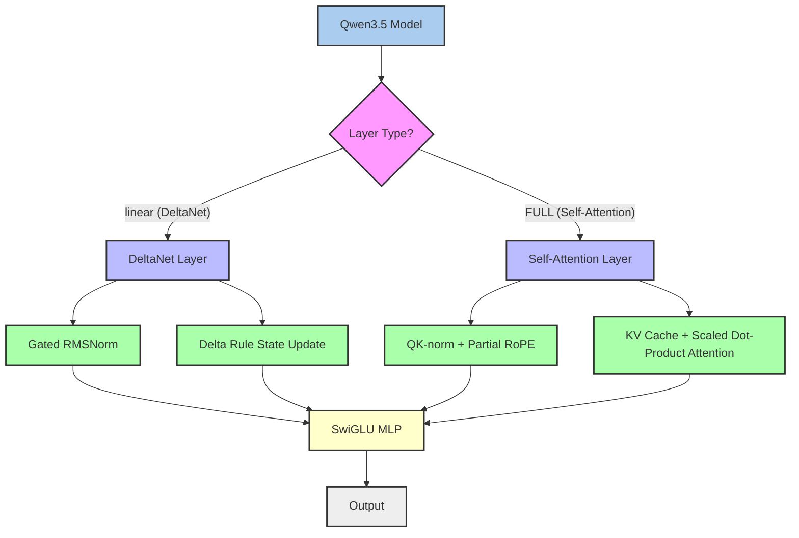

<!-- source: DeepWiki mcp.deepwiki.com · repo NVIDIA/TensorRT-Model-Connect · page 3.1 Text Generation Families (Decoders, MoE, Recurrent) · fetched 2026-10-26 -->

# Text Generation Families (Decoders, MoE, Recurrent)

<details>
<summary>Relevant source files</summary>

The following files were used as context for generating this wiki page:

- [include/trtmc/runtime/pipeline_plugin.h](include/trtmc/runtime/pipeline_plugin.h)
- [include/trtmc/runtime/trt_backend.h](include/trtmc/runtime/trt_backend.h)
- [python/tensorrt_model_connect/debug_runner.py](python/tensorrt_model_connect/debug_runner.py)
- [python/tensorrt_model_connect/families/__init__.py](python/tensorrt_model_connect/families/__init__.py)
- [python/tensorrt_model_connect/families/bloom/dual_profile_decoder_builder.py](python/tensorrt_model_connect/families/bloom/dual_profile_decoder_builder.py)
- [python/tensorrt_model_connect/families/bloom/dual_profile_decoder_tp_builder.py](python/tensorrt_model_connect/families/bloom/dual_profile_decoder_tp_builder.py)
- [python/tensorrt_model_connect/families/bloom/plugin.py](python/tensorrt_model_connect/families/bloom/plugin.py)
- [python/tensorrt_model_connect/families/bloom/standard_decoder_builder.py](python/tensorrt_model_connect/families/bloom/standard_decoder_builder.py)
- [python/tensorrt_model_connect/families/deepseek_v2/moe_routing.py](python/tensorrt_model_connect/families/deepseek_v2/moe_routing.py)
- [python/tensorrt_model_connect/families/deepseek_v2/plugin.py](python/tensorrt_model_connect/families/deepseek_v2/plugin.py)
- [python/tensorrt_model_connect/families/deepseek_v2/tp_builder.py](python/tensorrt_model_connect/families/deepseek_v2/tp_builder.py)
- [python/tensorrt_model_connect/families/gemma/debug_runner.py](python/tensorrt_model_connect/families/gemma/debug_runner.py)
- [python/tensorrt_model_connect/families/gemma/dual_profile_decoder_builder.py](python/tensorrt_model_connect/families/gemma/dual_profile_decoder_builder.py)
- [python/tensorrt_model_connect/families/gemma/dual_profile_decoder_tp_builder.py](python/tensorrt_model_connect/families/gemma/dual_profile_decoder_tp_builder.py)
- [python/tensorrt_model_connect/families/gemma/graph_blocks.py](python/tensorrt_model_connect/families/gemma/graph_blocks.py)
- [python/tensorrt_model_connect/families/gemma/plugin.py](python/tensorrt_model_connect/families/gemma/plugin.py)
- [python/tensorrt_model_connect/families/gemma/standard_decoder_builder.py](python/tensorrt_model_connect/families/gemma/standard_decoder_builder.py)
- [python/tensorrt_model_connect/families/gpt_oss/checkpoint_mapper.py](python/tensorrt_model_connect/families/gpt_oss/checkpoint_mapper.py)
- [python/tensorrt_model_connect/families/gpt_oss/debug_runner.py](python/tensorrt_model_connect/families/gpt_oss/debug_runner.py)
- [python/tensorrt_model_connect/families/gpt_oss/graph_blocks.py](python/tensorrt_model_connect/families/gpt_oss/graph_blocks.py)
- [python/tensorrt_model_connect/families/gpt_oss/graph_ops.py](python/tensorrt_model_connect/families/gpt_oss/graph_ops.py)
- [python/tensorrt_model_connect/families/gpt_oss/plugin.py](python/tensorrt_model_connect/families/gpt_oss/plugin.py)
- [python/tensorrt_model_connect/families/gpt_oss/tp_builder.py](python/tensorrt_model_connect/families/gpt_oss/tp_builder.py)
- [python/tensorrt_model_connect/families/gpt_oss/utils.py](python/tensorrt_model_connect/families/gpt_oss/utils.py)
- [python/tensorrt_model_connect/families/internlm/MODEL.toml](python/tensorrt_model_connect/families/internlm/MODEL.toml)
- [python/tensorrt_model_connect/families/internlm/plugin.py](python/tensorrt_model_connect/families/internlm/plugin.py)
- [python/tensorrt_model_connect/families/internlm/tokenizer_json.py](python/tensorrt_model_connect/families/internlm/tokenizer_json.py)
- [python/tensorrt_model_connect/families/llama/MODEL.toml](python/tensorrt_model_connect/families/llama/MODEL.toml)
- [python/tensorrt_model_connect/families/llama/build_routing.py](python/tensorrt_model_connect/families/llama/build_routing.py)
- [python/tensorrt_model_connect/families/llama/dual_profile_decoder_builder.py](python/tensorrt_model_connect/families/llama/dual_profile_decoder_builder.py)
- [python/tensorrt_model_connect/families/llama/graph_ops.py](python/tensorrt_model_connect/families/llama/graph_ops.py)
- [python/tensorrt_model_connect/families/llama/native_kv_contract.py](python/tensorrt_model_connect/families/llama/native_kv_contract.py)
- [python/tensorrt_model_connect/families/llama/plugin.py](python/tensorrt_model_connect/families/llama/plugin.py)
- [python/tensorrt_model_connect/families/llama/standard_decoder_builder.py](python/tensorrt_model_connect/families/llama/standard_decoder_builder.py)
- [python/tensorrt_model_connect/families/locateanything/__init__.py](python/tensorrt_model_connect/families/locateanything/__init__.py)
- [python/tensorrt_model_connect/families/locateanything/plugin.py](python/tensorrt_model_connect/families/locateanything/plugin.py)
- [python/tensorrt_model_connect/families/locateanything/vision_builder.py](python/tensorrt_model_connect/families/locateanything/vision_builder.py)
- [python/tensorrt_model_connect/families/mixtral/plugin.py](python/tensorrt_model_connect/families/mixtral/plugin.py)
- [python/tensorrt_model_connect/families/mixtral/tp_builder.py](python/tensorrt_model_connect/families/mixtral/tp_builder.py)
- [python/tensorrt_model_connect/families/modernbert/__init__.py](python/tensorrt_model_connect/families/modernbert/__init__.py)
- [python/tensorrt_model_connect/families/modernbert/config.py](python/tensorrt_model_connect/families/modernbert/config.py)
- [python/tensorrt_model_connect/families/modernbert/model/__init__.py](python/tensorrt_model_connect/families/modernbert/model/__init__.py)
- [python/tensorrt_model_connect/families/modernbert/model/model.py](python/tensorrt_model_connect/families/modernbert/model/model.py)
- [python/tensorrt_model_connect/families/modernbert/model/parallel.py](python/tensorrt_model_connect/families/modernbert/model/parallel.py)
- [python/tensorrt_model_connect/families/modernbert/plugin.py](python/tensorrt_model_connect/families/modernbert/plugin.py)
- [python/tensorrt_model_connect/families/olmo/dual_profile_decoder_tp_builder.py](python/tensorrt_model_connect/families/olmo/dual_profile_decoder_tp_builder.py)
- [python/tensorrt_model_connect/families/olmo/plugin.py](python/tensorrt_model_connect/families/olmo/plugin.py)
- [python/tensorrt_model_connect/families/olmo2/checkpoint_mapper.py](python/tensorrt_model_connect/families/olmo2/checkpoint_mapper.py)
- [python/tensorrt_model_connect/families/olmo2/debug_runner.py](python/tensorrt_model_connect/families/olmo2/debug_runner.py)
- [python/tensorrt_model_connect/families/olmo2/graph_blocks.py](python/tensorrt_model_connect/families/olmo2/graph_blocks.py)
- [python/tensorrt_model_connect/families/olmo2/graph_ops.py](python/tensorrt_model_connect/families/olmo2/graph_ops.py)
- [python/tensorrt_model_connect/families/olmo2/plugin.py](python/tensorrt_model_connect/families/olmo2/plugin.py)
- [python/tensorrt_model_connect/families/olmo2/prefill_builder.py](python/tensorrt_model_connect/families/olmo2/prefill_builder.py)
- [python/tensorrt_model_connect/families/olmo2/tp_builder.py](python/tensorrt_model_connect/families/olmo2/tp_builder.py)
- [python/tensorrt_model_connect/families/qwen/MODEL.toml](python/tensorrt_model_connect/families/qwen/MODEL.toml)
- [python/tensorrt_model_connect/families/qwen/builder_policy.py](python/tensorrt_model_connect/families/qwen/builder_policy.py)
- [python/tensorrt_model_connect/families/qwen/dual_profile_decoder_builder.py](python/tensorrt_model_connect/families/qwen/dual_profile_decoder_builder.py)
- [python/tensorrt_model_connect/families/qwen/dual_profile_decoder_tp_builder.py](python/tensorrt_model_connect/families/qwen/dual_profile_decoder_tp_builder.py)
- [python/tensorrt_model_connect/families/qwen/plugin.py](python/tensorrt_model_connect/families/qwen/plugin.py)
- [python/tensorrt_model_connect/families/qwen/standard_decoder_builder.py](python/tensorrt_model_connect/families/qwen/standard_decoder_builder.py)
- [python/tensorrt_model_connect/families/qwen3_5/plugin.py](python/tensorrt_model_connect/families/qwen3_5/plugin.py)
- [python/tensorrt_model_connect/families/qwen_moe/__init__.py](python/tensorrt_model_connect/families/qwen_moe/__init__.py)
- [src/runtime/models/gpt_neox/MODEL.toml](src/runtime/models/gpt_neox/MODEL.toml)
- [src/runtime/models/gpt_neox/kv_cache.cpp](src/runtime/models/gpt_neox/kv_cache.cpp)
- [src/runtime/models/internlm/MODEL.toml](src/runtime/models/internlm/MODEL.toml)
- [src/runtime/models/internlm/pipeline.cpp](src/runtime/models/internlm/pipeline.cpp)
- [src/runtime/models/internlm/pipeline.h](src/runtime/models/internlm/pipeline.h)
- [src/runtime/models/nemotron_h/MODEL.toml](src/runtime/models/nemotron_h/MODEL.toml)
- [src/runtime/models/nemotron_h/inference_state.h](src/runtime/models/nemotron_h/inference_state.h)
- [src/runtime/models/nemotron_h/pipeline.cpp](src/runtime/models/nemotron_h/pipeline.cpp)
- [src/runtime/models/nemotron_h/pipeline.h](src/runtime/models/nemotron_h/pipeline.h)
- [src/runtime/models/nemotron_h/recurrent_generation_plan.h](src/runtime/models/nemotron_h/recurrent_generation_plan.h)
- [src/runtime/models/nemotron_h/recurrent_state.cpp](src/runtime/models/nemotron_h/recurrent_state.cpp)
- [src/runtime/models/nemotron_h/recurrent_state.h](src/runtime/models/nemotron_h/recurrent_state.h)
- [src/runtime/models/qwen/pipeline.cpp](src/runtime/models/qwen/pipeline.cpp)
- [src/runtime/models/qwen/pipeline.h](src/runtime/models/qwen/pipeline.h)
- [src/runtime/models/starcoder2/MODEL.toml](src/runtime/models/starcoder2/MODEL.toml)
- [tests/builder/family_plugin_tester.py](tests/builder/family_plugin_tester.py)
- [tests/builder/test_debug_runner.py](tests/builder/test_debug_runner.py)
- [tests/builder/test_debug_runner_extended.py](tests/builder/test_debug_runner_extended.py)
- [tests/builder/test_family_plugins_extended2.py](tests/builder/test_family_plugins_extended2.py)
- [tests/builder/test_graph_ops_extended.py](tests/builder/test_graph_ops_extended.py)
- [tests/builder/test_quantization.py](tests/builder/test_quantization.py)
- [tests/builder/test_qwen_runtime_performance_contract.py](tests/builder/test_qwen_runtime_performance_contract.py)
- [tests/builder/test_split_decoder_builder_contract.py](tests/builder/test_split_decoder_builder_contract.py)
- [tests/cpp/models/gpt_neox/test_gpt_neox_attention_mask.cpp](tests/cpp/models/gpt_neox/test_gpt_neox_attention_mask.cpp)
- [tests/cpp/models/internlm/test_internlm_pipeline.cpp](tests/cpp/models/internlm/test_internlm_pipeline.cpp)
- [tests/cpp/models/nemotron_h/test_nemotron_h_recurrent_pipeline.cpp](tests/cpp/models/nemotron_h/test_nemotron_h_recurrent_pipeline.cpp)
- [tests/cpp/models/starcoder2/test_starcoder2_tokenizer_contract.cpp](tests/cpp/models/starcoder2/test_starcoder2_tokenizer_contract.cpp)
- [tests/e2e/models/deepseek_v2/e2e_plugins/references/hf_transformers.py](tests/e2e/models/deepseek_v2/e2e_plugins/references/hf_transformers.py)
- [tests/e2e/models/deepseek_v2/manifests/deepseek-v2-lite.json](tests/e2e/models/deepseek_v2/manifests/deepseek-v2-lite.json)
- [tests/e2e/models/deepseek_v2/manifests/deepseek-v2-tiny-tp2.json](tests/e2e/models/deepseek_v2/manifests/deepseek-v2-tiny-tp2.json)
- [tests/e2e/models/deepseek_v2/manifests/deepseek-v2-tiny.json](tests/e2e/models/deepseek_v2/manifests/deepseek-v2-tiny.json)
- [tests/e2e/models/deepseek_v2/test_deepseek_v2_builder_tp.py](tests/e2e/models/deepseek_v2/test_deepseek_v2_builder_tp.py)
- [tests/e2e/models/deepseek_v2/test_deepseek_v2_family_plugin.py](tests/e2e/models/deepseek_v2/test_deepseek_v2_family_plugin.py)
- [tests/e2e/models/deepseek_v2/test_deepseek_v2_hf_reference.py](tests/e2e/models/deepseek_v2/test_deepseek_v2_hf_reference.py)
- [tests/e2e/models/deepseek_v2/test_deepseek_v2_manifest_contract.py](tests/e2e/models/deepseek_v2/test_deepseek_v2_manifest_contract.py)
- [tests/e2e/models/gemma/test_gemma_builder_engine.py](tests/e2e/models/gemma/test_gemma_builder_engine.py)
- [tests/e2e/models/gpt_neox/e2e_plugins/contract.py](tests/e2e/models/gpt_neox/e2e_plugins/contract.py)
- [tests/e2e/models/gpt_neox/e2e_plugins/references/hf_transformers.py](tests/e2e/models/gpt_neox/e2e_plugins/references/hf_transformers.py)
- [tests/e2e/models/gpt_neox/manifests/pythia-70m.json](tests/e2e/models/gpt_neox/manifests/pythia-70m.json)
- [tests/e2e/models/gpt_neox/test_gpt_neox_accuracy_regression.py](tests/e2e/models/gpt_neox/test_gpt_neox_accuracy_regression.py)
- [tests/e2e/models/gpt_neox/thresholds/pythia-70m.json](tests/e2e/models/gpt_neox/thresholds/pythia-70m.json)
- [tests/e2e/models/gpt_oss/test_gpt_oss_rope_and_sliding.py](tests/e2e/models/gpt_oss/test_gpt_oss_rope_and_sliding.py)
- [tests/e2e/models/internlm/e2e_plugins/references/hf_transformers.py](tests/e2e/models/internlm/e2e_plugins/references/hf_transformers.py)
- [tests/e2e/models/internlm/manifests/internlm2-1.8b.json](tests/e2e/models/internlm/manifests/internlm2-1.8b.json)
- [tests/e2e/models/internlm/test_internlm_manifest_profiles.py](tests/e2e/models/internlm/test_internlm_manifest_profiles.py)
- [tests/e2e/models/internlm/test_internlm_reference_compat.py](tests/e2e/models/internlm/test_internlm_reference_compat.py)
- [tests/e2e/models/internlm/test_internlm_tokenizer_json.py](tests/e2e/models/internlm/test_internlm_tokenizer_json.py)
- [tests/e2e/models/internvl/manifests/internvl3-2b-tp2.json](tests/e2e/models/internvl/manifests/internvl3-2b-tp2.json)
- [tests/e2e/models/internvl/manifests/internvl3-2b.json](tests/e2e/models/internvl/manifests/internvl3-2b.json)
- [tests/e2e/models/internvl/manifests/internvl3-8b.json](tests/e2e/models/internvl/manifests/internvl3-8b.json)
- [tests/e2e/models/internvl/test_internvl_manifest_contract.py](tests/e2e/models/internvl/test_internvl_manifest_contract.py)
- [tests/e2e/models/llama/test_llama_builder_engine.py](tests/e2e/models/llama/test_llama_builder_engine.py)
- [tests/e2e/models/llama/test_llama_rope_scaling.py](tests/e2e/models/llama/test_llama_rope_scaling.py)
- [tests/e2e/models/mixtral/manifests/mixtral-stories-15m.json](tests/e2e/models/mixtral/manifests/mixtral-stories-15m.json)
- [tests/e2e/models/mixtral/test_mixtral_build_contract.py](tests/e2e/models/mixtral/test_mixtral_build_contract.py)
- [tests/e2e/models/mixtral/test_mixtral_router_precision.py](tests/e2e/models/mixtral/test_mixtral_router_precision.py)
- [tests/e2e/models/modernbert/manifests/modernbert-base-tp4.json](tests/e2e/models/modernbert/manifests/modernbert-base-tp4.json)
- [tests/e2e/models/modernbert/manifests/modernbert-base.json](tests/e2e/models/modernbert/manifests/modernbert-base.json)
- [tests/e2e/models/modernbert/test_modernbert_attention_contract.py](tests/e2e/models/modernbert/test_modernbert_attention_contract.py)
- [tests/e2e/models/modernbert/test_modernbert_build_contract.py](tests/e2e/models/modernbert/test_modernbert_build_contract.py)
- [tests/e2e/models/nemotron/manifests/nemotron-hindi-4b.json](tests/e2e/models/nemotron/manifests/nemotron-hindi-4b.json)
- [tests/e2e/models/nemotron/test_nemotron_manifest_contract.py](tests/e2e/models/nemotron/test_nemotron_manifest_contract.py)
- [tests/e2e/models/olmo2/test_olmo2_build_engine_integration.py](tests/e2e/models/olmo2/test_olmo2_build_engine_integration.py)
- [tests/e2e/models/olmo2/test_olmo2_builder_tp.py](tests/e2e/models/olmo2/test_olmo2_builder_tp.py)
- [tests/e2e/models/qwen/manifests/qwen3-0.6b-fp8.json](tests/e2e/models/qwen/manifests/qwen3-0.6b-fp8.json)
- [tests/e2e/models/qwen/test_qwen_builder_policy.py](tests/e2e/models/qwen/test_qwen_builder_policy.py)
- [tests/e2e/models/qwen/test_qwen_family_plugin_weights.py](tests/e2e/models/qwen/test_qwen_family_plugin_weights.py)
- [tests/e2e/models/qwen/test_qwen_fp8_quantization_contract.py](tests/e2e/models/qwen/test_qwen_fp8_quantization_contract.py)
- [tests/e2e/models/qwen/test_qwen_manifest_contract.py](tests/e2e/models/qwen/test_qwen_manifest_contract.py)
- [tests/e2e/models/qwen3_5/test_qwen3_5_family_plugin.py](tests/e2e/models/qwen3_5/test_qwen3_5_family_plugin.py)
- [tests/e2e/models/qwen_moe/manifests/qwen3-moe-30b-a3b.json](tests/e2e/models/qwen_moe/manifests/qwen3-moe-30b-a3b.json)
- [tests/e2e/models/qwen_moe/test_qwen_moe_builder_tp.py](tests/e2e/models/qwen_moe/test_qwen_moe_builder_tp.py)
- [tests/e2e/models/qwen_moe/test_qwen_moe_manifest_contract.py](tests/e2e/models/qwen_moe/test_qwen_moe_manifest_contract.py)
- [tests/e2e/models/starcoder2/manifests/starcoder2-3b.json](tests/e2e/models/starcoder2/manifests/starcoder2-3b.json)
- [tests/e2e/models/starcoder2/test_starcoder2_task_eval_tokenizer.py](tests/e2e/models/starcoder2/test_starcoder2_task_eval_tokenizer.py)
- [tools/ci/container.py](tools/ci/container.py)
- [tools/ci/environment.py](tools/ci/environment.py)
- [tools/ci/stage.py](tools/ci/stage.py)

</details>


This page details the implementation of various text generation model families within TensorRT-Model-Connect (TRTMC). It covers decoder-only architectures, Mixture-of-Experts (MoE) models, and recurrent/hybrid models. The focus is on how these families are integrated into the TRTMC build system, including dual-profile decoder builders, Tensor Parallelism (TP) builders, and graph operation patterns.

## Decoder-Only Families

Decoder-only models form a significant portion of the supported text generation architectures. These models typically consist of a stack of transformer decoder layers. TRTMC provides specialized builders and configurations to optimize their performance on NVIDIA GPUs using TensorRT.

Supported decoder-only families include:
*   Qwen
*   LLaMA
*   Mistral
*   GPT
*   OPT
*   Bloom
*   Gemma
*   Falcon
*   Granite
*   OLMo
*   Starcoder2
*   InternLM
*   Nemotron

### Dual-Profile Decoder Builders

Many decoder-only models leverage a dual-profile approach for their TensorRT engines. This involves building two distinct TensorRT engines: one optimized for the initial "prefill" phase (processing the input prompt) and another for the subsequent "decode" phase (generating new tokens one by one). This strategy is crucial for maximizing performance across varying input and output sequence lengths.

For example, the Qwen family utilizes `build_dual_profile_decoder_engine` [python/tensorrt_model_connect/families/qwen/plugin.py:128-137]() for its native KV path. This function takes a `profile_mode` argument, which can be either `"prefill"` or `"decode"`, to specify which engine profile is being built [python/tensorrt_model_connect/families/qwen/plugin.py:128-137]().

The `qwen_decoder_kv_cache` runtime strategy, defined in `QwenPlugin` [python/tensorrt_model_connect/families/qwen/plugin.py:28-28](), is designed to work with these dual profiles. The `supports_split_decoder_roles` method [python/tensorrt_model_connect/families/qwen/plugin.py:88-91]() indicates whether a model configuration can benefit from this split engine approach, typically returning `True` unless a quantized build is requested.

#### Qwen Dual-Profile Example

The `qwen3-0.6b-fp8.json` manifest [tests/e2e/models/qwen/manifests/qwen3-0.6b-fp8.json:1-42]() explicitly sets `"decoder_engine_layout": "dual_profile"` in its `build_args` [tests/e2e/models/qwen/manifests/qwen3-0.6b-fp8.json:11-11](). This indicates that the Qwen builder should generate separate prefill and decode engines.

The `test_qwen3_fp8_manifest_declares_hf_text_generation_contract` test [tests/e2e/models/qwen/test_qwen_manifest_contract.py:90-104]() verifies that the `build_args` correctly specify `"decoder_engine_layout": "dual_profile"` for FP8 Qwen models [tests/e2e/models/qwen/test_qwen_manifest_contract.py:132-134]().

```mermaid
graph TD
    A[Hugging Face Checkpoint] --> B{QwenPlugin.build_engine()};
    B -- "config.raw['_decoder_engine_role'] = 'prefill'" --> C[build_dual_profile_decoder_engine(profile_mode="prefill")];
    B -- "config.raw['_decoder_engine_role'] = 'decode'" --> D[build_dual_profile_decoder_engine(profile_mode="decode")];
    C --> E[TensorRT Prefill Engine];
    D --> F[TensorRT Decode Engine];
    E & F --> G[.bundle Artifact];

    style A fill:#ace,stroke:#333,stroke-width:2px;
    style B fill:#f9f,stroke:#333,stroke-width:2px;
    style C fill:#bbf,stroke:#333,stroke-width:2px;
    style D fill:#bbf,stroke:#333,stroke-width:2px;
    style E fill:#afa,stroke:#333,stroke-width:2px;
    style F fill:#afa,stroke:#333,stroke-width:2px;
    style G fill:#ffc,stroke:#333,stroke-width:2px;
```
**Diagram: Dual-Profile Decoder Engine Build Flow**
Sources: [python/tensorrt_model_connect/families/qwen/plugin.py:128-137](), [tests/e2e/models/qwen/manifests/qwen3-0.6b-fp8.json:11-11](), [tests/e2e/models/qwen/test_qwen_manifest_contract.py:132-134]()

### Tensor Parallelism (TP) Builders

For larger models, Tensor Parallelism (TP) is employed to distribute the model's layers or weights across multiple GPUs. TRTMC provides specialized TP builders that handle the partitioning and communication required for distributed inference.

The `QwenPlugin` includes `build_dual_profile_tp_decoder_engine` [python/tensorrt_model_connect/families/qwen/plugin.py:144-152]() for building TP-enabled engines. This builder is invoked when `parallel.enabled` is `True` [python/tensorrt_model_connect/families/qwen/plugin.py:141-142]().

An example of a TP-enabled manifest is `qwen3-0.6b-fp8-tp4.json`, which is tested in `test_qwen3_fp8_manifest_declares_hf_text_generation_contract` [tests/e2e/models/qwen/test_qwen_manifest_contract.py:90-104]().

### Graph Operations (graph_ops) Patterns

The `graph_ops` module (e.g., `python/tensorrt_model_connect/families/llama/graph_ops.py` and `python/tensorrt_model_connect/families/qwen3_5/graph_ops.py`) contains common TensorRT graph construction patterns used across various decoder families. These patterns encapsulate frequently used operations like attention, MLP blocks, and normalization layers, allowing for modular and reusable graph building logic.

For instance, the `Qwen35Plugin` uses `graph_ops` and `graph_blocks` [python/tensorrt_model_connect/families/qwen3_5/plugin.py:78-79]() to construct its hybrid DeltaNet and attention layers.

### Tokenization

Tokenization is a critical preprocessing step for text generation models. TRTMC handles tokenization through the `src/tokenizer/` module. The `_effective_bundle_tokenizer_payload` function [tests/e2e/models/starcoder2/test_starcoder2_task_eval_tokenizer.py:70-75]() demonstrates how tokenizer configurations are loaded and potentially refined from the bundle. The `test_input_contract_loads_effective_bundled_wrapper` test [tests/e2e/models/starcoder2/test_starcoder2_task_eval_tokenizer.py:115-147]() verifies that the correct tokenizer configuration is loaded from the bundle, including handling specific tokenizer classes like `GPT2Tokenizer` [tests/e2e/models/starcoder2/test_starcoder2_task_eval_tokenizer.py:126-127]().

## Mixture-of-Experts (MoE) Families

Mixture-of-Experts (MoE) models introduce a routing mechanism that dynamically selects a subset of "expert" networks for each input token. This allows for models with a very large number of parameters while keeping computational costs manageable.

Supported MoE families include:
*   Mixtral
*   Phi-MoE
*   Qwen-MoE
*   DeepSeek-V2

### Mixtral Example

The `mixtral-stories-15m.json` manifest [tests/e2e/models/mixtral/manifests/mixtral-stories-15m.json:1-29]() specifies `"family": "mixtral"` and `"runtime_strategy": "mixtral_decoder_moe"` [tests/e2e/models/mixtral/manifests/mixtral-stories-15m.json:5-6](). This indicates that the Mixtral-specific runtime strategy, which handles expert routing, should be used. The manifest also includes `fp32_layers` [tests/e2e/models/mixtral/manifests/mixtral-stories-15m.json:10-13]() to maintain precision for specific layers, as verified by `test_mmlu_continuation_build_stabilizes_first_divergence` [tests/e2e/models/mixtral/test_mixtral_build_contract.py:19-24]().

## Recurrent/Hybrid Families

Recurrent and hybrid architectures combine elements of recurrent neural networks (RNNs) or state-space models (SSMs) with transformer-like components. These models often aim for improved efficiency or different inductive biases.

Supported recurrent/hybrid families include:
*   Mamba
*   RWKV
*   Nemotron-H
*   Qwen3.5

### Qwen3.5 Hybrid Architecture

Qwen3.5 is a notable example of a hybrid architecture, combining Gated DeltaNet (a linear attention with delta rule, similar to SSMs) and standard self-attention layers [python/tensorrt_model_connect/families/qwen3_5/plugin.py:4-10](). The `Qwen35Plugin` [python/tensorrt_model_connect/families/qwen3_5/plugin.py:132-133]() handles the heterogeneous layer stack, where layers can be either `"linear"` (DeltaNet) or `"FULL"` (self-attention) [python/tensorrt_model_connect/families/qwen3_5/plugin.py:155-156]().

The `_prepare_runtime_inputs` function [python/tensorrt_model_connect/families/qwen3_5/plugin.py:96-130]() in the Qwen3.5 plugin demonstrates how recurrent states (like `ssm_state_inputs`) are handled, ensuring that the DeltaNet's recurrent state is preserved in FP32 even when other parts of the network are quantized [python/tensorrt_model_connect/families/qwen3_5/plugin.py:125-126]().


**Diagram: Qwen3.5 Hybrid Layer Architecture**
Sources: [python/tensorrt_model_connect/families/qwen3_5/plugin.py:4-10](), [python/tensorrt_model_connect/families/qwen3_5/plugin.py:155-156]()

### Nemotron-H Recurrent State

Nemotron-H is another hybrid model that utilizes recurrent states. The C++ runtime for Nemotron-H manages these states through `src/runtime/models/nemotron_h/recurrent_state.h` and `src/runtime/models/nemotron_h/recurrent_state.cpp`. The `test_nemotron_h_recurrent_pipeline.cpp` test [tests/cpp/models/nemotron_h/test_nemotron_h_recurrent_pipeline.cpp]() provides coverage for the recurrent pipeline.

## Builder Policy and Optimization

The `builder_policy.py` module (e.g., `python/tensorrt_model_connect/families/qwen/builder_policy.py`) defines specific policies for configuring the TensorRT builder for different model families and quantization formats. For example, `configure_qwen_builder` [python/tensorrt_model_connect/families/qwen/builder_policy.py:12-17]() applies accuracy-stable FP8 policies for Qwen models, potentially adjusting the `builder_optimization_level` and excluding certain layers from quantization to maintain numerical stability [python/tensorrt_model_connect/families/qwen/builder_policy.py:38-52](). This is particularly important for ensuring correctness in quantized models, as demonstrated in `test_qwen_fp8_uses_accuracy_stable_builder_level` [tests/e2e/models/qwen/test_qwen_builder_policy.py:22-36]().

Sources:
- [python/tensorrt_model_connect/families/qwen3_5/plugin.py:4-10]()
- [python/tensorrt_model_connect/families/qwen3_5/plugin.py:78-79]()
- [python/tensorrt_model_connect/families/qwen3_5/plugin.py:96-130]()
- [python/tensorrt_model_connect/families/qwen3_5/plugin.py:132-133]()
- [python/tensorrt_model_connect/families/qwen3_5/plugin.py:155-156]()
- [python/tensorrt_model_connect/families/qwen/builder_policy.py:12-17]()
- [python/tensorrt_model_connect/families/qwen/builder_policy.py:38-52]()
- [python/tensorrt_model_connect/families/qwen/plugin.py:28-28]()
- [python/tensorrt_model_connect/families/qwen/plugin.py:88-91]()
- [python/tensorrt_model_connect/families/qwen/plugin.py:128-137]()
- [python/tensorrt_model_connect/families/qwen/plugin.py:141-142]()
- [python/tensorrt_model_connect/families/qwen/plugin.py:144-152]()
- [src/runtime/models/nemotron_h/recurrent_state.cpp]()
- [src/runtime/models/nemotron_h/recurrent_state.h]()
- [src/tokenizer/]()
- [tests/cpp/models/internlm/test_internlm_pipeline.cpp:10-10]()
- [tests/cpp/models/nemotron_h/test_nemotron_h_recurrent_pipeline.cpp]()
- [tests/e2e/models/mixtral/manifests/mixtral-stories-15m.json:1-29]()
- [tests/e2e/models/mixtral/manifests/mixtral-stories-15m.json:5-6]()
- [tests/e2e/models/mixtral/manifests/mixtral-stories-15m.json:10-13]()
- [tests/e2e/models/mixtral/test_mixtral_build_contract.py:19-24]()
- [tests/e2e/models/qwen/manifests/qwen3-0.6b-fp8.json:1-42]()
- [tests/e2e/models/qwen/manifests/qwen3-0.6b-fp8.json:11-11]()
- [tests/e2e/models/qwen/test_qwen_builder_policy.py:22-36]()
- [tests/e2e/models/qwen/test_qwen_manifest_contract.py:90-104]()
- [tests/e2e/models/qwen/test_qwen_manifest_contract.py:132-134]()
- [tests/e2e/models/starcoder2/test_starcoder2_task_eval_tokenizer.py:70-75]()
- [tests/e2e/models/starcoder2/test_starcoder2_task_eval_tokenizer.py:115-147]()
- [tests/e2e/models/starcoder2/test_starcoder2_task_eval_tokenizer.py:126-127]()

---

