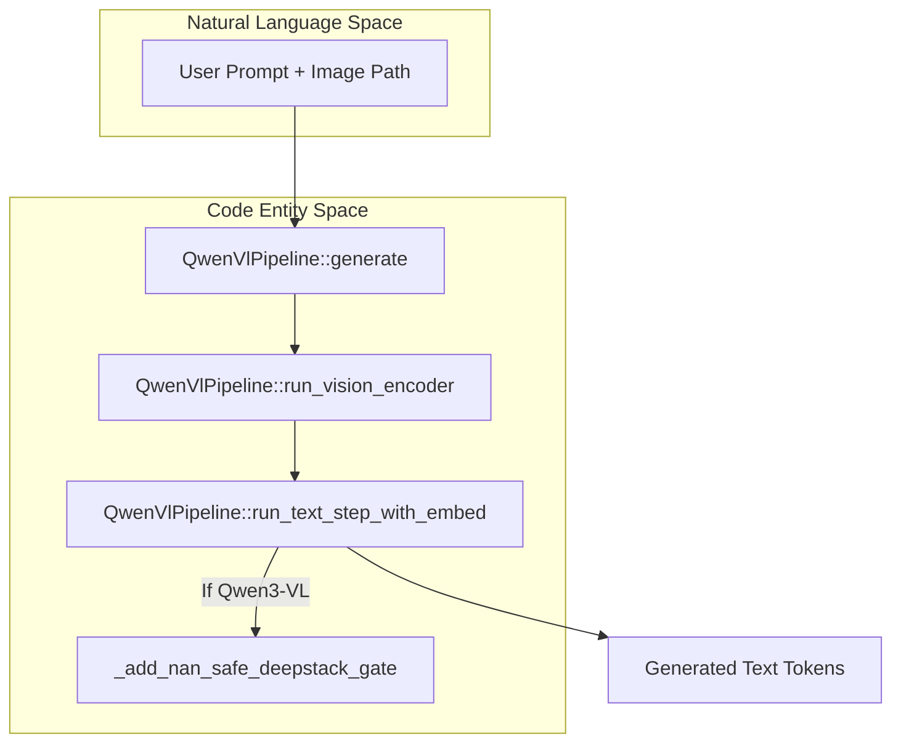
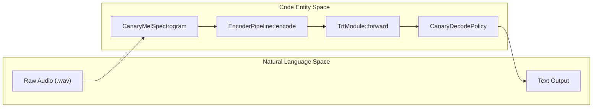

<!-- source: DeepWiki mcp.deepwiki.com · repo NVIDIA/TensorRT-Model-Connect · page 3.2 Vision-Language, Audio, and Speech Families · fetched 2026-10-26 -->

# Vision-Language, Audio, and Speech Families

Relevant source files

The following files were used as context for generating this wiki page:

- [python/tensorrt_model_connect/families/canary/MODEL.toml](python/tensorrt_model_connect/families/canary/MODEL.toml)
- [python/tensorrt_model_connect/families/canary/decoder_tp_builder.py](python/tensorrt_model_connect/families/canary/decoder_tp_builder.py)
- [python/tensorrt_model_connect/families/canary/nemo_archive.py](python/tensorrt_model_connect/families/canary/nemo_archive.py)
- [python/tensorrt_model_connect/families/canary/plugin.py](python/tensorrt_model_connect/families/canary/plugin.py)
- [python/tensorrt_model_connect/families/deepseek_ocr/plugin.py](python/tensorrt_model_connect/families/deepseek_ocr/plugin.py)
- [python/tensorrt_model_connect/families/deepseek_ocr/tp_builder.py](python/tensorrt_model_connect/families/deepseek_ocr/tp_builder.py)
- [python/tensorrt_model_connect/families/eagle_vlm/plugin.py](python/tensorrt_model_connect/families/eagle_vlm/plugin.py)
- [python/tensorrt_model_connect/families/eagle_vlm/tp_builder.py](python/tensorrt_model_connect/families/eagle_vlm/tp_builder.py)
- [python/tensorrt_model_connect/families/internvl/plugin.py](python/tensorrt_model_connect/families/internvl/plugin.py)
- [python/tensorrt_model_connect/families/internvl/tp_builder.py](python/tensorrt_model_connect/families/internvl/tp_builder.py)
- [python/tensorrt_model_connect/families/personaplex/MODEL.toml](python/tensorrt_model_connect/families/personaplex/MODEL.toml)
- [python/tensorrt_model_connect/families/personaplex/default_decoder.py](python/tensorrt_model_connect/families/personaplex/default_decoder.py)
- [python/tensorrt_model_connect/families/personaplex/plugin.py](python/tensorrt_model_connect/families/personaplex/plugin.py)
- [python/tensorrt_model_connect/families/personaplex/utils.py](python/tensorrt_model_connect/families/personaplex/utils.py)
- [python/tensorrt_model_connect/families/qwen3_omni/audio_runtime.py](python/tensorrt_model_connect/families/qwen3_omni/audio_runtime.py)
- [python/tensorrt_model_connect/families/qwen_vl/config.py](python/tensorrt_model_connect/families/qwen_vl/config.py)
- [python/tensorrt_model_connect/families/qwen_vl/decoder_tp_builder.py](python/tensorrt_model_connect/families/qwen_vl/decoder_tp_builder.py)
- [python/tensorrt_model_connect/families/qwen_vl/default_decoder.py](python/tensorrt_model_connect/families/qwen_vl/default_decoder.py)
- [python/tensorrt_model_connect/families/qwen_vl/default_dual_profile_decoder.py](python/tensorrt_model_connect/families/qwen_vl/default_dual_profile_decoder.py)
- [python/tensorrt_model_connect/families/qwen_vl/graph_blocks.py](python/tensorrt_model_connect/families/qwen_vl/graph_blocks.py)
- [python/tensorrt_model_connect/families/qwen_vl/graph_ops.py](python/tensorrt_model_connect/families/qwen_vl/graph_ops.py)
- [python/tensorrt_model_connect/families/qwen_vl/plugin.py](python/tensorrt_model_connect/families/qwen_vl/plugin.py)
- [python/tensorrt_model_connect/families/qwen_vl/qwen_vl_vision_builder.py](python/tensorrt_model_connect/families/qwen_vl/qwen_vl_vision_builder.py)
- [python/tensorrt_model_connect/families/qwen_vl/runtime_config_schema.py](python/tensorrt_model_connect/families/qwen_vl/runtime_config_schema.py)
- [python/tensorrt_model_connect/families/qwen_vl/vl_debug_runner.py](python/tensorrt_model_connect/families/qwen_vl/vl_debug_runner.py)
- [src/runtime/models/canary/canary_config.h](src/runtime/models/canary/canary_config.h)
- [src/runtime/models/canary/canary_cross_kv_plan.h](src/runtime/models/canary/canary_cross_kv_plan.h)
- [src/runtime/models/canary/canary_decode_policy.h](src/runtime/models/canary/canary_decode_policy.h)
- [src/runtime/models/canary/canary_mel_spectrogram.cpp](src/runtime/models/canary/canary_mel_spectrogram.cpp)
- [src/runtime/models/canary/canary_mel_spectrogram.h](src/runtime/models/canary/canary_mel_spectrogram.h)
- [src/runtime/models/canary/canary_request.h](src/runtime/models/canary/canary_request.h)
- [src/runtime/models/canary/pipeline.cpp](src/runtime/models/canary/pipeline.cpp)
- [src/runtime/models/canary/pipeline.h](src/runtime/models/canary/pipeline.h)
- [src/runtime/models/canary/plugin.cpp](src/runtime/models/canary/plugin.cpp)
- [src/runtime/models/eagle_vlm/pipeline.cpp](src/runtime/models/eagle_vlm/pipeline.cpp)
- [src/runtime/models/eagle_vlm/pipeline.h](src/runtime/models/eagle_vlm/pipeline.h)
- [src/runtime/models/eagle_vlm/plugin.cpp](src/runtime/models/eagle_vlm/plugin.cpp)
- [src/runtime/models/locateanything/pipeline.cpp](src/runtime/models/locateanything/pipeline.cpp)
- [src/runtime/models/locateanything/pipeline.h](src/runtime/models/locateanything/pipeline.h)
- [src/runtime/models/personaplex/MODEL.toml](src/runtime/models/personaplex/MODEL.toml)
- [src/runtime/models/personaplex/audio_helpers.cpp](src/runtime/models/personaplex/audio_helpers.cpp)
- [src/runtime/models/personaplex/audio_helpers.h](src/runtime/models/personaplex/audio_helpers.h)
- [src/runtime/models/personaplex/pipeline.cpp](src/runtime/models/personaplex/pipeline.cpp)
- [src/runtime/models/personaplex/pipeline.h](src/runtime/models/personaplex/pipeline.h)
- [src/runtime/models/personaplex/plugin.cpp](src/runtime/models/personaplex/plugin.cpp)
- [src/runtime/models/personaplex/sampling_kernels.cu](src/runtime/models/personaplex/sampling_kernels.cu)
- [src/runtime/models/personaplex/sampling_kernels.h](src/runtime/models/personaplex/sampling_kernels.h)
- [src/runtime/models/personaplex/speech_performance.h](src/runtime/models/personaplex/speech_performance.h)
- [src/runtime/models/qwen3_omni/pipeline.cpp](src/runtime/models/qwen3_omni/pipeline.cpp)
- [src/runtime/models/qwen3_omni/plugin.cpp](src/runtime/models/qwen3_omni/plugin.cpp)
- [src/runtime/models/qwen_vl/MODEL.toml](src/runtime/models/qwen_vl/MODEL.toml)
- [src/runtime/models/qwen_vl/image_preprocessor.cpp](src/runtime/models/qwen_vl/image_preprocessor.cpp)
- [src/runtime/models/qwen_vl/image_preprocessor.h](src/runtime/models/qwen_vl/image_preprocessor.h)
- [src/runtime/models/qwen_vl/kv_cache.cpp](src/runtime/models/qwen_vl/kv_cache.cpp)
- [src/runtime/models/qwen_vl/pipeline.cpp](src/runtime/models/qwen_vl/pipeline.cpp)
- [src/runtime/models/qwen_vl/pipeline.h](src/runtime/models/qwen_vl/pipeline.h)
- [src/runtime/models/qwen_vl/plugin.cpp](src/runtime/models/qwen_vl/plugin.cpp)
- [src/runtime/models/qwen_vl/sampler.cpp](src/runtime/models/qwen_vl/sampler.cpp)
- [src/runtime/models/qwen_vl/sampler.h](src/runtime/models/qwen_vl/sampler.h)
- [src/runtime/models/whisper/pipeline.cpp](src/runtime/models/whisper/pipeline.cpp)
- [src/runtime/models/whisper/pipeline.h](src/runtime/models/whisper/pipeline.h)
- [src/runtime/models/whisper/plugin.cpp](src/runtime/models/whisper/plugin.cpp)
- [src/runtime/models/whisper/whisper_mel_spectrogram.cpp](src/runtime/models/whisper/whisper_mel_spectrogram.cpp)
- [src/runtime/models/whisper/whisper_mel_spectrogram.h](src/runtime/models/whisper/whisper_mel_spectrogram.h)
- [tests/builder/test_families.py](tests/builder/test_families.py)
- [tests/builder/test_family_plugins.py](tests/builder/test_family_plugins.py)
- [tests/builder/test_graph_ops_native_attn.py](tests/builder/test_graph_ops_native_attn.py)
- [tests/cpp/models/canary/test_canary_decode_policy.cpp](tests/cpp/models/canary/test_canary_decode_policy.cpp)
- [tests/cpp/models/canary/test_canary_host_plan.cpp](tests/cpp/models/canary/test_canary_host_plan.cpp)
- [tests/cpp/models/canary/test_canary_mel_spectrogram.cpp](tests/cpp/models/canary/test_canary_mel_spectrogram.cpp)
- [tests/cpp/models/canary/test_canary_pipeline.cpp](tests/cpp/models/canary/test_canary_pipeline.cpp)
- [tests/cpp/models/eagle_vlm/test_eagle_vlm_encoder_pipeline.cpp](tests/cpp/models/eagle_vlm/test_eagle_vlm_encoder_pipeline.cpp)
- [tests/cpp/models/locateanything/test_locateanything_vl_pipeline.cpp](tests/cpp/models/locateanything/test_locateanything_vl_pipeline.cpp)
- [tests/cpp/models/personaplex/test_personaplex_sampling_kernels.cpp](tests/cpp/models/personaplex/test_personaplex_sampling_kernels.cpp)
- [tests/cpp/models/personaplex/test_personaplex_speech_performance.cpp](tests/cpp/models/personaplex/test_personaplex_speech_performance.cpp)
- [tests/cpp/models/personaplex/test_personaplex_speech_pipeline.cpp](tests/cpp/models/personaplex/test_personaplex_speech_pipeline.cpp)
- [tests/cpp/models/qwen3_omni/test_qwen3_omni_audio_plan.cpp](tests/cpp/models/qwen3_omni/test_qwen3_omni_audio_plan.cpp)
- [tests/cpp/models/qwen3_omni/test_qwen3_omni_pipeline.cpp](tests/cpp/models/qwen3_omni/test_qwen3_omni_pipeline.cpp)
- [tests/cpp/models/qwen_vl/test_qwen_vl_sampler.cpp](tests/cpp/models/qwen_vl/test_qwen_vl_sampler.cpp)
- [tests/cpp/models/qwen_vl/test_qwen_vl_vl_pipeline.cpp](tests/cpp/models/qwen_vl/test_qwen_vl_vl_pipeline.cpp)
- [tests/cpp/models/whisper/test_whisper_mel_spectrogram.cpp](tests/cpp/models/whisper/test_whisper_mel_spectrogram.cpp)
- [tests/e2e/models/canary/test_canary_family_plugin_weights.py](tests/e2e/models/canary/test_canary_family_plugin_weights.py)
- [tests/e2e/models/deepseek_ocr/data/deepseek_ocr_l0_golden.json](tests/e2e/models/deepseek_ocr/data/deepseek_ocr_l0_golden.json)
- [tests/e2e/models/deepseek_ocr/e2e_plugins/contract.py](tests/e2e/models/deepseek_ocr/e2e_plugins/contract.py)
- [tests/e2e/models/deepseek_ocr/manifests/deepseek-ocr-l0-tp2.json](tests/e2e/models/deepseek_ocr/manifests/deepseek-ocr-l0-tp2.json)
- [tests/e2e/models/deepseek_ocr/manifests/deepseek-ocr-l0.json](tests/e2e/models/deepseek_ocr/manifests/deepseek-ocr-l0.json)
- [tests/e2e/models/deepseek_ocr/manifests/deepseek-ocr.json](tests/e2e/models/deepseek_ocr/manifests/deepseek-ocr.json)
- [tests/e2e/models/deepseek_ocr/test_deepseek_ocr_builder_tp.py](tests/e2e/models/deepseek_ocr/test_deepseek_ocr_builder_tp.py)
- [tests/e2e/models/deepseek_ocr/test_ocr_contract.py](tests/e2e/models/deepseek_ocr/test_ocr_contract.py)
- [tests/e2e/models/eagle_vlm/manifests/nemotron-rerank-vl-1b-v2-tp4.json](tests/e2e/models/eagle_vlm/manifests/nemotron-rerank-vl-1b-v2-tp4.json)
- [tests/e2e/models/eagle_vlm/manifests/nemotron-rerank-vl-1b-v2.json](tests/e2e/models/eagle_vlm/manifests/nemotron-rerank-vl-1b-v2.json)
- [tests/e2e/models/eagle_vlm/test_eagle_vlm_builder_tp.py](tests/e2e/models/eagle_vlm/test_eagle_vlm_builder_tp.py)
- [tests/e2e/models/locateanything/e2e_plugins/comparator.py](tests/e2e/models/locateanything/e2e_plugins/comparator.py)
- [tests/e2e/models/locateanything/manifests/locateanything-3b.json](tests/e2e/models/locateanything/manifests/locateanything-3b.json)
- [tests/e2e/models/locateanything/test_locateanything_grounding_comparator.py](tests/e2e/models/locateanything/test_locateanything_grounding_comparator.py)
- [tests/e2e/models/locateanything/test_locateanything_manifest_contract.py](tests/e2e/models/locateanything/test_locateanything_manifest_contract.py)
- [tests/e2e/models/locateanything/thresholds/locateanything-3b.json](tests/e2e/models/locateanything/thresholds/locateanything-3b.json)
- [tests/e2e/models/personaplex/MODEL.toml](tests/e2e/models/personaplex/MODEL.toml)
- [tests/e2e/models/personaplex/e2e_plugins/contract.py](tests/e2e/models/personaplex/e2e_plugins/contract.py)
- [tests/e2e/models/personaplex/e2e_plugins/runners/audio_speech.py](tests/e2e/models/personaplex/e2e_plugins/runners/audio_speech.py)
- [tests/e2e/models/personaplex/manifests/personaplex-7b-l0.json](tests/e2e/models/personaplex/manifests/personaplex-7b-l0.json)
- [tests/e2e/models/personaplex/manifests/personaplex-7b.json](tests/e2e/models/personaplex/manifests/personaplex-7b.json)
- [tests/e2e/models/personaplex/test_personaplex_builder_lifetime.py](tests/e2e/models/personaplex/test_personaplex_builder_lifetime.py)
- [tests/e2e/models/personaplex/test_personaplex_builder_tp.py](tests/e2e/models/personaplex/test_personaplex_builder_tp.py)
- [tests/e2e/models/personaplex/test_personaplex_contract.py](tests/e2e/models/personaplex/test_personaplex_contract.py)
- [tests/e2e/models/personaplex/test_personaplex_reference_audio.py](tests/e2e/models/personaplex/test_personaplex_reference_audio.py)
- [tests/e2e/models/personaplex/test_personaplex_speech_runner.py](tests/e2e/models/personaplex/test_personaplex_speech_runner.py)
- [tests/e2e/models/qwen3_omni/e2e_plugins/comparators/omni.py](tests/e2e/models/qwen3_omni/e2e_plugins/comparators/omni.py)
- [tests/e2e/models/qwen3_omni/e2e_plugins/runners/omni.py](tests/e2e/models/qwen3_omni/e2e_plugins/runners/omni.py)
- [tests/e2e/models/qwen3_omni/test_hidden_state_flow.py](tests/e2e/models/qwen3_omni/test_hidden_state_flow.py)
- [tests/e2e/models/qwen3_omni/test_qwen3_omni_audio_runtime.py](tests/e2e/models/qwen3_omni/test_qwen3_omni_audio_runtime.py)
- [tests/e2e/models/qwen3_omni/test_qwen3_omni_comparator.py](tests/e2e/models/qwen3_omni/test_qwen3_omni_comparator.py)
- [tests/e2e/models/qwen3_omni/test_qwen3_omni_runner.py](tests/e2e/models/qwen3_omni/test_qwen3_omni_runner.py)
- [tests/e2e/models/qwen_vl/e2e_plugins/references/hf_transformers.py](tests/e2e/models/qwen_vl/e2e_plugins/references/hf_transformers.py)
- [tests/e2e/models/qwen_vl/e2e_plugins/runners/vl_debug_runner.py](tests/e2e/models/qwen_vl/e2e_plugins/runners/vl_debug_runner.py)
- [tests/e2e/models/qwen_vl/manifests/qwen25vl-3b.json](tests/e2e/models/qwen_vl/manifests/qwen25vl-3b.json)
- [tests/e2e/models/qwen_vl/manifests/qwen3-vl-2b.json](tests/e2e/models/qwen_vl/manifests/qwen3-vl-2b.json)
- [tests/e2e/models/qwen_vl/test_qwen3_vl_mrope_builder.py](tests/e2e/models/qwen_vl/test_qwen3_vl_mrope_builder.py)
- [tests/e2e/models/qwen_vl/test_qwen_vl_accuracy_contract.py](tests/e2e/models/qwen_vl/test_qwen_vl_accuracy_contract.py)
- [tests/e2e/models/qwen_vl/test_qwen_vl_bf16_precision_contract.py](tests/e2e/models/qwen_vl/test_qwen_vl_bf16_precision_contract.py)
- [tests/e2e/models/qwen_vl/test_qwen_vl_builder_tp.py](tests/e2e/models/qwen_vl/test_qwen_vl_builder_tp.py)
- [tests/e2e/models/qwen_vl/test_qwen_vl_debug_runner.py](tests/e2e/models/qwen_vl/test_qwen_vl_debug_runner.py)
- [tests/e2e/models/qwen_vl/test_qwen_vl_hf_transformers_reference.py](tests/e2e/models/qwen_vl/test_qwen_vl_hf_transformers_reference.py)
- [tests/e2e/models/qwen_vl/test_qwen_vl_prompt_contract.py](tests/e2e/models/qwen_vl/test_qwen_vl_prompt_contract.py)
- [tests/e2e_harness/comparators/text_to_audio.py](tests/e2e_harness/comparators/text_to_audio.py)
- [tests/e2e_harness/references/hf_transformers.py](tests/e2e_harness/references/hf_transformers.py)
- [tests/e2e_harness/runners/audio_speech.py](tests/e2e_harness/runners/audio_speech.py)
- [tests/e2e_harness/thresholds/defaults/text_to_audio.json](tests/e2e_harness/thresholds/defaults/text_to_audio.json)
- [tests/tools/test_deepseek_ocr_task_eval.py](tests/tools/test_deepseek_ocr_task_eval.py)
- [tools/reference/transformers_vlm.py](tools/reference/transformers_vlm.py)

This section covers the implementation and data flow for multimodal families, including Vision-Language (VL) models, audio processing, and speech-to-speech pipelines. These families extend the base text generation capabilities by incorporating specialized encoders (vision, audio) and complex runtime strategies to handle cross-modal feature injection.

## Vision-Language (VL) Families

The VL families, such as **Qwen-VL** and **Eagle-VLM**, utilize a multi-engine architecture typically consisting of a Vision Encoder (ViT-based) and a Text Decoder (Llama or Qwen-based).

### Qwen-VL Implementation
The `QwenVLPlugin` handles models ranging from Qwen2.5-VL to Qwen3-VL [python/tensorrt_model_connect/families/qwen_vl/plugin.py:145-148](). It supports two primary architectural patterns:
1.  **Qwen2.5-VL**: Uses a standard vision encoder with 3D RoPE and spatial merging. Features are injected via the `embed_input` mode of the text decoder [python/tensorrt_model_connect/families/qwen_vl/plugin.py:6-9]().
2.  **Qwen3-VL (DeepStack)**: Vision features are injected at specific internal layers of the text decoder, identified by `deepstack_visual_indexes` in the vision configuration [python/tensorrt_model_connect/families/qwen_vl/plugin.py:10-16]().

**Data Flow: Qwen-VL Vision-to-Text**

*Sources: [src/runtime/models/qwen_vl/pipeline.cpp:79-130](), [python/tensorrt_model_connect/families/qwen_vl/plugin.py:62-76](), [tests/cpp/models/qwen_vl/test_qwen_vl_vl_pipeline.cpp:16-27]()*

### Eagle-VLM (Llama-Nemotron)
The `EagleVLMPlugin` supports embedding and reranking variants (e.g., `embed-vl-1b-v2`). Unlike generative VL models, these focus on producing pooled vector representations or relevance scores [python/tensorrt_model_connect/families/eagle_vlm/plugin.py:4-11]().
*   **Embedding Mode**: Text and images are encoded, mean-pooled, and L2-normalized [src/runtime/models/eagle_vlm/pipeline.cpp:146-166]().
*   **Reranking Mode**: Uses a cross-encoder architecture to produce a relevance score from query-document pairs [src/runtime/models/eagle_vlm/pipeline.cpp:168-190]().

| Feature | Qwen-VL | Eagle-VLM |
| :--- | :--- | :--- |
| **Backbone** | Qwen2.5 / Qwen3 | Llama 3.2 |
| **Vision Encoder** | ViT w/ 3D RoPE | SigLIP-2 |
| **Injection Point** | Embed Input / DeepStack | MLP Projector to Hidden |
| **Precision** | FP16 / FP8 | FP16 (w/ FP32 tail for Reranker) |

*Sources: [python/tensorrt_model_connect/families/qwen_vl/plugin.py:4-16](), [python/tensorrt_model_connect/families/eagle_vlm/plugin.py:4-19](), [src/runtime/models/eagle_vlm/pipeline.cpp:137-144]()*

---

## Audio and Speech Families

Audio families like **Canary** and **Whisper** implement specialized front-ends for mel-spectrogram processing and encoder-decoder synchronization.

### Audio Pipeline Architecture
The `EncoderPipeline` (used by Canary and others) manages the transformation of raw audio waveforms into log-mel spectrograms before passing them to the TensorRT encoder engine [src/runtime/models/eagle_vlm/pipeline.cpp:137-144]().

**Entity Mapping: Audio Processing**

*Sources: [src/runtime/models/canary/pipeline.cpp](), [src/runtime/models/canary/canary_mel_spectrogram.h](), [src/runtime/models/canary/canary_decode_policy.h]()*

### Key Implementation Details
*   **Mel Spectrogram**: Handled by `CanaryMelSpectrogram` to ensure the signal processing matches the training-time distribution [src/runtime/models/canary/canary_mel_spectrogram.h]().
*   **Dual-Profile Decoders**: Similar to text models, audio decoders often use dual optimization profiles to handle the initial prefill of audio features and subsequent autoregressive token generation [python/tensorrt_model_connect/families/qwen_vl/default_dual_profile_decoder.py:4-17]().
*   **Speech-to-Speech**: Models like **Qwen3-Omni** utilize hidden-state flow between modalities, where audio tokens directly influence the text generation state [src/runtime/models/qwen3_omni/pipeline.cpp]().

---

## Shared Graph Operations
Multimodal families share a set of `graph_ops` for building TensorRT networks in Python. These operations ensure consistency between the Python builder and the C++ runtime.

*   **`add_rms_norm`**: Implements RMSNorm with an FP32 precision boundary for numerical stability [python/tensorrt_model_connect/families/qwen_vl/graph_ops.py:151-186]().
*   **`add_matmul_rhs_constant`**: Handles matrix multiplication where weights are constants, supporting FP32 accumulation for FP16/BF16 GEMMs [python/tensorrt_model_connect/families/qwen_vl/graph_ops.py:60-93]().
*   **`add_lora_delta`**: Computes `(lhs @ A) @ B` for dynamically bound LoRA adapters at runtime [python/tensorrt_model_connect/families/qwen_vl/graph_ops.py:117-130]().

*Sources: [python/tensorrt_model_connect/families/qwen_vl/graph_ops.py:1-186](), [python/tensorrt_model_connect/families/qwen_vl/graph_blocks.py]()*

---

