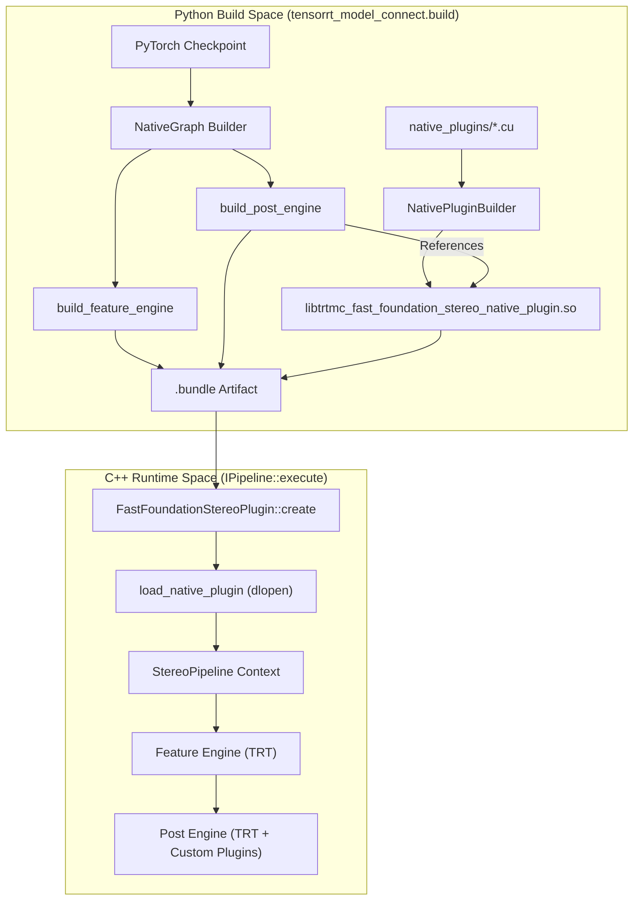

<!-- source: DeepWiki mcp.deepwiki.com · repo NVIDIA/TensorRT-Model-Connect · page 3.3 Diffusion, Perception, and Time-Series Families · fetched 2026-10-26 -->

# 3.3. Diffusion, Perception, and Time-Series Families

<details>
<summary>Relevant source files</summary>

The following files were used as context for generating this wiki page:

- [include/trtmc/bundle.h](include/trtmc/bundle.h)
- [include/trtmc/models/sam2_video.h](include/trtmc/models/sam2_video.h)
- [python/tensorrt_model_connect/families/dinov3/MODEL.toml](python/tensorrt_model_connect/families/dinov3/MODEL.toml)
- [python/tensorrt_model_connect/families/dinov3/checkpoint_mapper.py](python/tensorrt_model_connect/families/dinov3/checkpoint_mapper.py)
- [python/tensorrt_model_connect/families/dinov3/convnext_builder.py](python/tensorrt_model_connect/families/dinov3/convnext_builder.py)
- [python/tensorrt_model_connect/families/dinov3/graph_ops.py](python/tensorrt_model_connect/families/dinov3/graph_ops.py)
- [python/tensorrt_model_connect/families/dinov3/plugin.py](python/tensorrt_model_connect/families/dinov3/plugin.py)
- [python/tensorrt_model_connect/families/fast_foundation_stereo/MODEL.toml](python/tensorrt_model_connect/families/fast_foundation_stereo/MODEL.toml)
- [python/tensorrt_model_connect/families/fast_foundation_stereo/builder.py](python/tensorrt_model_connect/families/fast_foundation_stereo/builder.py)
- [python/tensorrt_model_connect/families/fast_foundation_stereo/native_feature.py](python/tensorrt_model_connect/families/fast_foundation_stereo/native_feature.py)
- [python/tensorrt_model_connect/families/fast_foundation_stereo/native_graph.py](python/tensorrt_model_connect/families/fast_foundation_stereo/native_graph.py)
- [python/tensorrt_model_connect/families/fast_foundation_stereo/native_plugin_builder.py](python/tensorrt_model_connect/families/fast_foundation_stereo/native_plugin_builder.py)
- [python/tensorrt_model_connect/families/fast_foundation_stereo/native_post.py](python/tensorrt_model_connect/families/fast_foundation_stereo/native_post.py)
- [python/tensorrt_model_connect/families/flux/flux_dit_builder.py](python/tensorrt_model_connect/families/flux/flux_dit_builder.py)
- [python/tensorrt_model_connect/families/flux/flux_vae_builder.py](python/tensorrt_model_connect/families/flux/flux_vae_builder.py)
- [python/tensorrt_model_connect/families/flux/mistral_encoder_builder.py](python/tensorrt_model_connect/families/flux/mistral_encoder_builder.py)
- [python/tensorrt_model_connect/families/flux/plugin.py](python/tensorrt_model_connect/families/flux/plugin.py)
- [python/tensorrt_model_connect/families/flux/t5_encoder_builder.py](python/tensorrt_model_connect/families/flux/t5_encoder_builder.py)
- [python/tensorrt_model_connect/families/flux/tests/test_family.py](python/tensorrt_model_connect/families/flux/tests/test_family.py)
- [python/tensorrt_model_connect/families/patchtst/checkpoint_mapper.py](python/tensorrt_model_connect/families/patchtst/checkpoint_mapper.py)
- [python/tensorrt_model_connect/families/patchtst/graph_ops.py](python/tensorrt_model_connect/families/patchtst/graph_ops.py)
- [python/tensorrt_model_connect/families/patchtst/time_series_trt.py](python/tensorrt_model_connect/families/patchtst/time_series_trt.py)
- [python/tensorrt_model_connect/families/pixart/plugin.py](python/tensorrt_model_connect/families/pixart/plugin.py)
- [python/tensorrt_model_connect/families/qwen_image/plugin.py](python/tensorrt_model_connect/families/qwen_image/plugin.py)
- [python/tensorrt_model_connect/families/qwen_image/qwen25_vl_text_encoder_builder.py](python/tensorrt_model_connect/families/qwen_image/qwen25_vl_text_encoder_builder.py)
- [python/tensorrt_model_connect/families/qwen_image/qwen_image_dit_builder.py](python/tensorrt_model_connect/families/qwen_image/qwen_image_dit_builder.py)
- [python/tensorrt_model_connect/families/qwen_image/qwen_image_vae_builder.py](python/tensorrt_model_connect/families/qwen_image/qwen_image_vae_builder.py)
- [python/tensorrt_model_connect/families/sam2/MODEL.toml](python/tensorrt_model_connect/families/sam2/MODEL.toml)
- [python/tensorrt_model_connect/families/sam2/__init__.py](python/tensorrt_model_connect/families/sam2/__init__.py)
- [python/tensorrt_model_connect/families/sam2/checkpoint_mapper.py](python/tensorrt_model_connect/families/sam2/checkpoint_mapper.py)
- [python/tensorrt_model_connect/families/sam2/float_math.py](python/tensorrt_model_connect/families/sam2/float_math.py)
- [python/tensorrt_model_connect/families/sam2/graph_ops.py](python/tensorrt_model_connect/families/sam2/graph_ops.py)
- [python/tensorrt_model_connect/families/sam2/image_builder.py](python/tensorrt_model_connect/families/sam2/image_builder.py)
- [python/tensorrt_model_connect/families/sam2/model_config.py](python/tensorrt_model_connect/families/sam2/model_config.py)
- [python/tensorrt_model_connect/families/sana_wm/builder_lifetime.py](python/tensorrt_model_connect/families/sana_wm/builder_lifetime.py)
- [python/tensorrt_model_connect/families/sana_wm/components/gemma/dual_profile_decoder_builder.py](python/tensorrt_model_connect/families/sana_wm/components/gemma/dual_profile_decoder_builder.py)
- [python/tensorrt_model_connect/families/sana_wm/components/gemma/dual_profile_decoder_tp_builder.py](python/tensorrt_model_connect/families/sana_wm/components/gemma/dual_profile_decoder_tp_builder.py)
- [python/tensorrt_model_connect/families/sana_wm/components/gemma/standard_decoder_builder.py](python/tensorrt_model_connect/families/sana_wm/components/gemma/standard_decoder_builder.py)
- [python/tensorrt_model_connect/families/sana_wm/components/gemma/utils.py](python/tensorrt_model_connect/families/sana_wm/components/gemma/utils.py)
- [python/tensorrt_model_connect/families/sana_wm/components/ltx_video/ltx_dit_builder.py](python/tensorrt_model_connect/families/sana_wm/components/ltx_video/ltx_dit_builder.py)
- [python/tensorrt_model_connect/families/sana_wm/components/ltx_video/ltx_vae_builder.py](python/tensorrt_model_connect/families/sana_wm/components/ltx_video/ltx_vae_builder.py)
- [python/tensorrt_model_connect/families/sana_wm/components/ltx_video/t5_encoder_builder.py](python/tensorrt_model_connect/families/sana_wm/components/ltx_video/t5_encoder_builder.py)
- [python/tensorrt_model_connect/families/sana_wm/components/ltx_video/utils.py](python/tensorrt_model_connect/families/sana_wm/components/ltx_video/utils.py)
- [python/tensorrt_model_connect/families/sana_wm/native_plugins/sana_wm_gdn_plugin.cu](python/tensorrt_model_connect/families/sana_wm/native_plugins/sana_wm_gdn_plugin.cu)
- [python/tensorrt_model_connect/families/sana_wm/native_plugins/sana_wm_gdn_plugin.h](python/tensorrt_model_connect/families/sana_wm/native_plugins/sana_wm_gdn_plugin.h)
- [python/tensorrt_model_connect/families/sana_wm/native_plugins/sana_wm_torch_conv2d_plugin.cpp](python/tensorrt_model_connect/families/sana_wm/native_plugins/sana_wm_torch_conv2d_plugin.cpp)
- [python/tensorrt_model_connect/families/sana_wm/plugin.py](python/tensorrt_model_connect/families/sana_wm/plugin.py)
- [python/tensorrt_model_connect/families/sana_wm/refiner_dit_builder.py](python/tensorrt_model_connect/families/sana_wm/refiner_dit_builder.py)
- [python/tensorrt_model_connect/families/sana_wm/refiner_text_connector_builder.py](python/tensorrt_model_connect/families/sana_wm/refiner_text_connector_builder.py)
- [python/tensorrt_model_connect/families/sana_wm/stage1_dit_builder.py](python/tensorrt_model_connect/families/sana_wm/stage1_dit_builder.py)
- [python/tensorrt_model_connect/families/sana_wm/tests/test_family.py](python/tensorrt_model_connect/families/sana_wm/tests/test_family.py)
- [python/tensorrt_model_connect/families/segformer/checkpoint_mapper.py](python/tensorrt_model_connect/families/segformer/checkpoint_mapper.py)
- [python/tensorrt_model_connect/families/segformer/graph_ops.py](python/tensorrt_model_connect/families/segformer/graph_ops.py)
- [python/tensorrt_model_connect/families/segformer/plugin.py](python/tensorrt_model_connect/families/segformer/plugin.py)
- [python/tensorrt_model_connect/families/segformer/segformer_tp_builder.py](python/tensorrt_model_connect/families/segformer/segformer_tp_builder.py)
- [python/tensorrt_model_connect/families/timesfm/checkpoint_mapper.py](python/tensorrt_model_connect/families/timesfm/checkpoint_mapper.py)
- [python/tensorrt_model_connect/families/timesfm/graph_ops.py](python/tensorrt_model_connect/families/timesfm/graph_ops.py)
- [python/tensorrt_model_connect/families/timesfm/plugin.py](python/tensorrt_model_connect/families/timesfm/plugin.py)
- [python/tensorrt_model_connect/families/timesfm/time_series_trt.py](python/tensorrt_model_connect/families/timesfm/time_series_trt.py)
- [python/tensorrt_model_connect/families/wan2_2_ti2v/runtime_config_schema.py](python/tensorrt_model_connect/families/wan2_2_ti2v/runtime_config_schema.py)
- [python/tensorrt_model_connect/families/wan2_2_ti2v/tests/test_ownership.py](python/tensorrt_model_connect/families/wan2_2_ti2v/tests/test_ownership.py)
- [python/tensorrt_model_connect/families/wan2_2_ti2v/tests/test_runtime_config_schema.py](python/tensorrt_model_connect/families/wan2_2_ti2v/tests/test_runtime_config_schema.py)
- [python/tensorrt_model_connect/families/wan_t2v/plugin.py](python/tensorrt_model_connect/families/wan_t2v/plugin.py)
- [python/tensorrt_model_connect/families/wan_t2v/standard_dit_cp_builder.py](python/tensorrt_model_connect/families/wan_t2v/standard_dit_cp_builder.py)
- [python/tensorrt_model_connect/families/z_image/plugin.py](python/tensorrt_model_connect/families/z_image/plugin.py)
- [python/tensorrt_model_connect/families/z_image/qwen3_encoder_builder.py](python/tensorrt_model_connect/families/z_image/qwen3_encoder_builder.py)
- [python/tensorrt_model_connect/families/z_image/z_image_dit_builder.py](python/tensorrt_model_connect/families/z_image/z_image_dit_builder.py)
- [scripts/generate_e2e_report.py](scripts/generate_e2e_report.py)
- [scripts/generate_e2e_report_assets/e2e_report.css](scripts/generate_e2e_report_assets/e2e_report.css)
- [scripts/generate_e2e_report_assets/e2e_report.js](scripts/generate_e2e_report_assets/e2e_report.js)
- [src/cabi/api/trtmc_c.cpp](src/cabi/api/trtmc_c.cpp)
- [src/runtime/models/fast_foundation_stereo/native_plugins/full_volume_leaky_plugin.cu](src/runtime/models/fast_foundation_stereo/native_plugins/full_volume_leaky_plugin.cu)
- [src/runtime/models/fast_foundation_stereo/native_plugins/post8_sum_plugin.cu](src/runtime/models/fast_foundation_stereo/native_plugins/post8_sum_plugin.cu)
- [src/runtime/models/fast_foundation_stereo/plugin.cpp](src/runtime/models/fast_foundation_stereo/plugin.cpp)
- [src/runtime/models/flux/flux_clip_helpers.h](src/runtime/models/flux/flux_clip_helpers.h)
- [src/runtime/models/flux/flux_rope_helpers.h](src/runtime/models/flux/flux_rope_helpers.h)
- [src/runtime/models/flux/flux_text_helpers.h](src/runtime/models/flux/flux_text_helpers.h)
- [src/runtime/models/flux/pipeline.cpp](src/runtime/models/flux/pipeline.cpp)
- [src/runtime/models/flux/pipeline.h](src/runtime/models/flux/pipeline.h)
- [src/runtime/models/pixart/diffusion_helpers.cpp](src/runtime/models/pixart/diffusion_helpers.cpp)
- [src/runtime/models/pixart/pipeline.cpp](src/runtime/models/pixart/pipeline.cpp)
- [src/runtime/models/pixart/pixart_diffusion_types.h](src/runtime/models/pixart/pixart_diffusion_types.h)
- [src/runtime/models/pixart/pixart_dpmsolver.h](src/runtime/models/pixart/pixart_dpmsolver.h)
- [src/runtime/models/pixart/pixart_generation_conditioning.h](src/runtime/models/pixart/pixart_generation_conditioning.h)
- [src/runtime/models/pixart/pixart_generation_plan.h](src/runtime/models/pixart/pixart_generation_plan.h)
- [src/runtime/models/qwen_image/pipeline.cpp](src/runtime/models/qwen_image/pipeline.cpp)
- [src/runtime/models/qwen_image/pipeline.h](src/runtime/models/qwen_image/pipeline.h)
- [src/runtime/models/sana_wm/plugin_helpers.cpp](src/runtime/models/sana_wm/plugin_helpers.cpp)
- [src/runtime/models/segformer/segformer_postprocess_cuda.cu](src/runtime/models/segformer/segformer_postprocess_cuda.cu)
- [src/runtime/models/segformer/segformer_postprocess_cuda.h](src/runtime/models/segformer/segformer_postprocess_cuda.h)
- [src/runtime/models/segformer/segformer_postprocess_seam.h](src/runtime/models/segformer/segformer_postprocess_seam.h)
- [src/runtime/models/segformer/segformer_preprocess_seam.cpp](src/runtime/models/segformer/segformer_preprocess_seam.cpp)
- [src/runtime/models/segformer/segment_pipeline.cpp](src/runtime/models/segformer/segment_pipeline.cpp)
- [src/runtime/models/segformer/segment_pipeline.h](src/runtime/models/segformer/segment_pipeline.h)
- [src/runtime/models/wan/pipeline.cpp](src/runtime/models/wan/pipeline.cpp)
- [src/runtime/models/wan/pipeline.h](src/runtime/models/wan/pipeline.h)
- [src/runtime/models/wan/plugin.cpp](src/runtime/models/wan/plugin.cpp)
- [src/runtime/models/wan2_2_ti2v/MODEL.toml](src/runtime/models/wan2_2_ti2v/MODEL.toml)
- [src/runtime/models/wan2_2_ti2v/config_schema.cpp](src/runtime/models/wan2_2_ti2v/config_schema.cpp)
- [src/runtime/models/wan2_2_ti2v/config_schema.h](src/runtime/models/wan2_2_ti2v/config_schema.h)
- [src/runtime/models/wan2_2_ti2v/easycache.cpp](src/runtime/models/wan2_2_ti2v/easycache.cpp)
- [src/runtime/models/wan2_2_ti2v/easycache.h](src/runtime/models/wan2_2_ti2v/easycache.h)
- [src/runtime/models/wan2_2_ti2v/pipeline.cpp](src/runtime/models/wan2_2_ti2v/pipeline.cpp)
- [src/runtime/models/wan2_2_ti2v/pipeline.h](src/runtime/models/wan2_2_ti2v/pipeline.h)
- [src/runtime/models/wan2_2_ti2v/plugin.cpp](src/runtime/models/wan2_2_ti2v/plugin.cpp)
- [src/runtime/models/z_image/MODEL.toml](src/runtime/models/z_image/MODEL.toml)
- [src/runtime/models/z_image/gpu_matmul.cpp](src/runtime/models/z_image/gpu_matmul.cpp)
- [src/runtime/models/z_image/gpu_matmul.h](src/runtime/models/z_image/gpu_matmul.h)
- [src/runtime/models/z_image/pipeline.cpp](src/runtime/models/z_image/pipeline.cpp)
- [src/runtime/models/z_image/pipeline.h](src/runtime/models/z_image/pipeline.h)
- [src/runtime/models/z_image/z_image_diffusion_types.h](src/runtime/models/z_image/z_image_diffusion_types.h)
- [tests/builder/test_sana_wm_builder_performance_contract.py](tests/builder/test_sana_wm_builder_performance_contract.py)
- [tests/cpp/models/flux/test_flux_pipeline.cpp](tests/cpp/models/flux/test_flux_pipeline.cpp)
- [tests/cpp/models/pixart/test_pixart_denoising_step_seam.cpp](tests/cpp/models/pixart/test_pixart_denoising_step_seam.cpp)
- [tests/cpp/models/sana_wm/test_sana_wm_pipeline.cpp](tests/cpp/models/sana_wm/test_sana_wm_pipeline.cpp)
- [tests/cpp/models/segformer/test_segformer_postprocess_seam.cpp](tests/cpp/models/segformer/test_segformer_postprocess_seam.cpp)
- [tests/cpp/models/segformer/test_segformer_preprocess_seam.cpp](tests/cpp/models/segformer/test_segformer_preprocess_seam.cpp)
- [tests/cpp/models/segformer/test_segformer_segment_pipeline.cpp](tests/cpp/models/segformer/test_segformer_segment_pipeline.cpp)
- [tests/cpp/models/wan2_2_ti2v/test_wan2_2_easycache.cpp](tests/cpp/models/wan2_2_ti2v/test_wan2_2_easycache.cpp)
- [tests/cpp/models/wan2_2_ti2v/test_wan2_2_staged_pipeline.cpp](tests/cpp/models/wan2_2_ti2v/test_wan2_2_staged_pipeline.cpp)
- [tests/cpp/models/z_image/test_z_image_gpu_matmul.cpp](tests/cpp/models/z_image/test_z_image_gpu_matmul.cpp)
- [tests/cpp/models/z_image/test_z_image_pipeline.cpp](tests/cpp/models/z_image/test_z_image_pipeline.cpp)
- [tests/e2e/models/bark/manifests/bark-small.json](tests/e2e/models/bark/manifests/bark-small.json)
- [tests/e2e/models/bark/test_bark_build_contract.py](tests/e2e/models/bark/test_bark_build_contract.py)
- [tests/e2e/models/bark/test_bark_hf_reference.py](tests/e2e/models/bark/test_bark_hf_reference.py)
- [tests/e2e/models/dinov3/MODEL.toml](tests/e2e/models/dinov3/MODEL.toml)
- [tests/e2e/models/dinov3/e2e_plugins/__init__.py](tests/e2e/models/dinov3/e2e_plugins/__init__.py)
- [tests/e2e/models/dinov3/e2e_plugins/comparator.py](tests/e2e/models/dinov3/e2e_plugins/comparator.py)
- [tests/e2e/models/dinov3/e2e_plugins/comparators/__init__.py](tests/e2e/models/dinov3/e2e_plugins/comparators/__init__.py)
- [tests/e2e/models/dinov3/e2e_plugins/reference.py](tests/e2e/models/dinov3/e2e_plugins/reference.py)
- [tests/e2e/models/dinov3/e2e_plugins/references/__init__.py](tests/e2e/models/dinov3/e2e_plugins/references/__init__.py)
- [tests/e2e/models/dinov3/e2e_plugins/runners/__init__.py](tests/e2e/models/dinov3/e2e_plugins/runners/__init__.py)
- [tests/e2e/models/dinov3/manifests/dinov3-convnext-tiny-pretrain-lvd1689m.json](tests/e2e/models/dinov3/manifests/dinov3-convnext-tiny-pretrain-lvd1689m.json)
- [tests/e2e/models/dinov3/manifests/dinov3-vits16-pretrain-lvd1689m.json](tests/e2e/models/dinov3/manifests/dinov3-vits16-pretrain-lvd1689m.json)
- [tests/e2e/models/dinov3/test_dinov3_e2e_static.py](tests/e2e/models/dinov3/test_dinov3_e2e_static.py)
- [tests/e2e/models/dinov3/test_dinov3_vit_builder.py](tests/e2e/models/dinov3/test_dinov3_vit_builder.py)
- [tests/e2e/models/elf_flow/data/elf-b-xsum-replay/artifact.json](tests/e2e/models/elf_flow/data/elf-b-xsum-replay/artifact.json)
- [tests/e2e/models/elf_flow/data/elf-b-xsum-replay/expected.jsonl](tests/e2e/models/elf_flow/data/elf-b-xsum-replay/expected.jsonl)
- [tests/e2e/models/elf_flow/data/elf-b-xsum-replay/initial_latents.f32](tests/e2e/models/elf_flow/data/elf-b-xsum-replay/initial_latents.f32)
- [tests/e2e/models/elf_flow/data/elf-b-xsum-replay/sampling_steps.f32](tests/e2e/models/elf_flow/data/elf-b-xsum-replay/sampling_steps.f32)
- [tests/e2e/models/elf_flow/manifests/elf-b-de-en-l0.json](tests/e2e/models/elf_flow/manifests/elf-b-de-en-l0.json)
- [tests/e2e/models/elf_flow/manifests/elf-b-owt-l0.json](tests/e2e/models/elf_flow/manifests/elf-b-owt-l0.json)
- [tests/e2e/models/elf_flow/manifests/elf-b-xsum-l0.json](tests/e2e/models/elf_flow/manifests/elf-b-xsum-l0.json)
- [tests/e2e/models/elf_flow/test_elf_flow_contract.py](tests/e2e/models/elf_flow/test_elf_flow_contract.py)
- [tests/e2e/models/fast_foundation_stereo/data/README.md](tests/e2e/models/fast_foundation_stereo/data/README.md)
- [tests/e2e/models/fast_foundation_stereo/data/office_left.png](tests/e2e/models/fast_foundation_stereo/data/office_left.png)
- [tests/e2e/models/fast_foundation_stereo/data/office_right.png](tests/e2e/models/fast_foundation_stereo/data/office_right.png)
- [tests/e2e/models/fast_foundation_stereo/e2e_plugins/comparator.py](tests/e2e/models/fast_foundation_stereo/e2e_plugins/comparator.py)
- [tests/e2e/models/fast_foundation_stereo/e2e_plugins/comparators/__init__.py](tests/e2e/models/fast_foundation_stereo/e2e_plugins/comparators/__init__.py)
- [tests/e2e/models/fast_foundation_stereo/e2e_plugins/reference.py](tests/e2e/models/fast_foundation_stereo/e2e_plugins/reference.py)
- [tests/e2e/models/fast_foundation_stereo/e2e_plugins/references/__init__.py](tests/e2e/models/fast_foundation_stereo/e2e_plugins/references/__init__.py)
- [tests/e2e/models/fast_foundation_stereo/e2e_plugins/report.py](tests/e2e/models/fast_foundation_stereo/e2e_plugins/report.py)
- [tests/e2e/models/fast_foundation_stereo/e2e_plugins/runner.py](tests/e2e/models/fast_foundation_stereo/e2e_plugins/runner.py)
- [tests/e2e/models/fast_foundation_stereo/e2e_plugins/runners/__init__.py](tests/e2e/models/fast_foundation_stereo/e2e_plugins/runners/__init__.py)
- [tests/e2e/models/fast_foundation_stereo/manifests/fast-foundation-stereo.json](tests/e2e/models/fast_foundation_stereo/manifests/fast-foundation-stereo.json)
- [tests/e2e/models/fast_foundation_stereo/official_reference.py](tests/e2e/models/fast_foundation_stereo/official_reference.py)
- [tests/e2e/models/fast_foundation_stereo/test_family.py](tests/e2e/models/fast_foundation_stereo/test_family.py)
- [tests/e2e/models/fast_foundation_stereo/test_fast_foundation_stereo_e2e.py](tests/e2e/models/fast_foundation_stereo/test_fast_foundation_stereo_e2e.py)
- [tests/e2e/models/fast_foundation_stereo/test_feature_decoder_fp16_preconcat.py](tests/e2e/models/fast_foundation_stereo/test_feature_decoder_fp16_preconcat.py)
- [tests/e2e/models/fast_foundation_stereo/test_native_plugin.py](tests/e2e/models/fast_foundation_stereo/test_native_plugin.py)
- [tests/e2e/models/fast_foundation_stereo/test_post8_sum_plugin.py](tests/e2e/models/fast_foundation_stereo/test_post8_sum_plugin.py)
- [tests/e2e/models/fast_foundation_stereo/test_stereo_report.py](tests/e2e/models/fast_foundation_stereo/test_stereo_report.py)
- [tests/e2e/models/fast_foundation_stereo/validation/fast-foundation-stereo.json](tests/e2e/models/fast_foundation_stereo/validation/fast-foundation-stereo.json)
- [tests/e2e/models/flux/test_flux_dit_batch_profile.py](tests/e2e/models/flux/test_flux_dit_batch_profile.py)
- [tests/e2e/models/patchtst/manifests/patchtst-etth1-regression-distribution.json](tests/e2e/models/patchtst/manifests/patchtst-etth1-regression-distribution.json)
- [tests/e2e/models/patchtst/manifests/patchtst-granite-official.json](tests/e2e/models/patchtst/manifests/patchtst-granite-official.json)
- [tests/e2e/models/patchtst/test_patchtst_build_contract.py](tests/e2e/models/patchtst/test_patchtst_build_contract.py)
- [tests/e2e/models/pixart/e2e_plugins/references/hf_diffusers.py](tests/e2e/models/pixart/e2e_plugins/references/hf_diffusers.py)
- [tests/e2e/models/pixart/manifests/pixart-sigma-1024-l0.json](tests/e2e/models/pixart/manifests/pixart-sigma-1024-l0.json)
- [tests/e2e/models/pixart/test_pixart_family_plugin.py](tests/e2e/models/pixart/test_pixart_family_plugin.py)
- [tests/e2e/models/pixart/test_pixart_hf_reference.py](tests/e2e/models/pixart/test_pixart_hf_reference.py)
- [tests/e2e/models/qwen3_omni/manifests/qwen3-omni-30b-a3b-instruct.json](tests/e2e/models/qwen3_omni/manifests/qwen3-omni-30b-a3b-instruct.json)
- [tests/e2e/models/sam/e2e_plugins/runners/segmentation.py](tests/e2e/models/sam/e2e_plugins/runners/segmentation.py)
- [tests/e2e/models/sam3/e2e_plugins/reference.py](tests/e2e/models/sam3/e2e_plugins/reference.py)
- [tests/e2e/models/sam3/e2e_plugins/references/hf_transformers.py](tests/e2e/models/sam3/e2e_plugins/references/hf_transformers.py)
- [tests/e2e/models/sam3/manifests/sam3.json](tests/e2e/models/sam3/manifests/sam3.json)
- [tests/e2e/models/sam3/test_sam3_build_contract.py](tests/e2e/models/sam3/test_sam3_build_contract.py)
- [tests/e2e/models/sam3/test_sam3_hf_reference.py](tests/e2e/models/sam3/test_sam3_hf_reference.py)
- [tests/e2e/models/sam3/test_sam3_hf_transformers_reference.py](tests/e2e/models/sam3/test_sam3_hf_transformers_reference.py)
- [tests/e2e/models/sana_wm/MODEL.toml](tests/e2e/models/sana_wm/MODEL.toml)
- [tests/e2e/models/sana_wm/e2e_plugins/commands.py](tests/e2e/models/sana_wm/e2e_plugins/commands.py)
- [tests/e2e/models/sana_wm/manifests/sana-wm-bidirectional.json](tests/e2e/models/sana_wm/manifests/sana-wm-bidirectional.json)
- [tests/e2e/models/sana_wm/reference/inference_sana_wm.py](tests/e2e/models/sana_wm/reference/inference_sana_wm.py)
- [tests/e2e/models/sana_wm/runner.py](tests/e2e/models/sana_wm/runner.py)
- [tests/e2e/models/sana_wm/test_inference_script.py](tests/e2e/models/sana_wm/test_inference_script.py)
- [tests/e2e/models/sana_wm/test_sana_wm_e2e_plugins.py](tests/e2e/models/sana_wm/test_sana_wm_e2e_plugins.py)
- [tests/e2e/models/sana_wm/test_sana_wm_manifest_contract.py](tests/e2e/models/sana_wm/test_sana_wm_manifest_contract.py)
- [tests/e2e/models/segformer/e2e_plugins/contract.py](tests/e2e/models/segformer/e2e_plugins/contract.py)
- [tests/e2e/models/segformer/e2e_plugins/references/hf_transformers.py](tests/e2e/models/segformer/e2e_plugins/references/hf_transformers.py)
- [tests/e2e/models/segformer/e2e_plugins/runners/segmentation.py](tests/e2e/models/segformer/e2e_plugins/runners/segmentation.py)
- [tests/e2e/models/segformer/test_segformer_builder_engine.py](tests/e2e/models/segformer/test_segformer_builder_engine.py)
- [tests/e2e/models/segformer/test_segformer_ci_evidence.py](tests/e2e/models/segformer/test_segformer_ci_evidence.py)
- [tests/e2e/models/segformer/test_segformer_numerical_contract.py](tests/e2e/models/segformer/test_segformer_numerical_contract.py)
- [tests/e2e/models/segformer/thresholds/segformer-b0-ade.json](tests/e2e/models/segformer/thresholds/segformer-b0-ade.json)
- [tests/e2e/models/timesfm/manifests/timesfm-2.0-500m-official.json](tests/e2e/models/timesfm/manifests/timesfm-2.0-500m-official.json)
- [tests/e2e/models/timesfm/test_timesfm_build_contract.py](tests/e2e/models/timesfm/test_timesfm_build_contract.py)
- [tests/e2e/models/timm_vit/e2e_plugins/runners/image_classification.py](tests/e2e/models/timm_vit/e2e_plugins/runners/image_classification.py)
- [tests/e2e/models/wan_t2v/MODEL.toml](tests/e2e/models/wan_t2v/MODEL.toml)
- [tests/e2e/models/wan_t2v/manifests/wan21-t2v-1.3b-l0-cp4.json](tests/e2e/models/wan_t2v/manifests/wan21-t2v-1.3b-l0-cp4.json)
- [tests/e2e/models/wan_t2v/manifests/wan21-t2v-1.3b-l0.json](tests/e2e/models/wan_t2v/manifests/wan21-t2v-1.3b-l0.json)
- [tests/e2e/models/wan_t2v/manifests/wan21-t2v-1.3b.json](tests/e2e/models/wan_t2v/manifests/wan21-t2v-1.3b.json)
- [tests/e2e/models/wan_t2v/test_wan_context_parallel.py](tests/e2e/models/wan_t2v/test_wan_context_parallel.py)
- [tests/e2e/models/wan_t2v/test_wan_precision_contract.py](tests/e2e/models/wan_t2v/test_wan_precision_contract.py)
- [tests/e2e/models/wan_t2v/test_wan_t2v_family_plugin.py](tests/e2e/models/wan_t2v/test_wan_t2v_family_plugin.py)
- [tests/e2e/models/wan_t2v/thresholds/wan21-t2v-1.3b-l0-cp4.json](tests/e2e/models/wan_t2v/thresholds/wan21-t2v-1.3b-l0-cp4.json)
- [tests/e2e/models/z_image/e2e_plugins/references/hf_diffusers.py](tests/e2e/models/z_image/e2e_plugins/references/hf_diffusers.py)
- [tests/e2e/models/z_image/manifests/z-image-turbo-l0.json](tests/e2e/models/z_image/manifests/z-image-turbo-l0.json)
- [tests/e2e/models/z_image/manifests/z-image-turbo.json](tests/e2e/models/z_image/manifests/z-image-turbo.json)
- [tests/e2e/models/z_image/test_z_image_build_contract.py](tests/e2e/models/z_image/test_z_image_build_contract.py)
- [tests/e2e/models/z_image/test_z_image_dit_batch_profile.py](tests/e2e/models/z_image/test_z_image_dit_batch_profile.py)
- [tests/e2e/models/z_image/test_z_image_family_plugin.py](tests/e2e/models/z_image/test_z_image_family_plugin.py)
- [tests/e2e/models/z_image/test_z_image_hf_diffusers_reference.py](tests/e2e/models/z_image/test_z_image_hf_diffusers_reference.py)
- [tests/tools/test_generate_report.py](tests/tools/test_generate_report.py)

</details>


This section covers the implementation and runtime strategies for non-text modalities, including high-resolution diffusion models (DiT), vision perception (segmentation and feature extraction), and time-series forecasting. These families frequently utilize **Native Graph Construction** (direct `INetworkDefinition` calls) and **Custom CUDA Plugins** to achieve performance targets that standard automated exporters cannot reach.

## Diffusion Families (DiT and Media Generation)

Diffusion models in TRTMC, such as **FLUX**, **Wan 2.1/2.2**, **LTX-Video**, and **SANA-WM**, primarily use Diffusion Transformer (DiT) architectures. Unlike decoder-only text models, these often require multi-engine pipelines (e.g., VAE, Text Encoder, and the DiT backbone).

### Key Implementation Patterns
*   **DIT Builders**: Specialized builders for transformer blocks that handle high-dimensional latent spaces. For example, `z_image_dit_builder.py` manages the construction of the Z-Image backbone [python/tensorrt_model_connect/families/z_image/z_image_dit_builder.py]().
*   **Multi-Modality Task Strategies**: Mapped via `diffusion_media_generation` or `diffusion_text_generation` [scripts/generate_e2e_report.py:90-92]().
*   **Assessment & Reporting**: Diffusion results include specialized VLM assessments and frame-gallery rendering in E2E reports [scripts/generate_e2e_report.py:38-40](), [scripts/generate_e2e_report.py:104-116]().

| Family | Task Strategy | Primary Builder / Plugin |
| :--- | :--- | :--- |
| **FLUX** | `diffusion_media_generation` | `families/flux/plugin.py` |
| **SANA-WM** | `diffusion_media_generation` | `families/sana_wm/plugin.py` |
| **Z-Image** | `diffusion_media_generation` | `z_image_dit_builder.py` |
| **Wan 2.1/2.2**| `diffusion_media_generation` | `families/wan2_2_ti2v/` |

**Sources:** [scripts/generate_e2e_report.py:88-109](), [python/tensorrt_model_connect/families/z_image/z_image_dit_builder.py](), [python/tensorrt_model_connect/families/sana_wm/plugin.py]().

---

## Perception Families (Vision & Stereo)

Perception families cover **SegFormer**, **SAM (1/2/3)**, **DINOv3**, and **Fast Foundation Stereo**. These models typically use a two-stage pipeline: a heavy Feature Extractor (Encoder) followed by a lightweight Task Head (Decoder/Post-processor).

### Fast Foundation Stereo: A Case Study in Native Plugins
The `fast_foundation_stereo` family demonstrates the "Native Plugin" pattern where C++ CUDA kernels are compiled on-the-fly during the build process to optimize cost-volume construction.

#### 1. Native Graph Construction
Instead of ONNX exports, the model is built by traversing the PyTorch module tree and emitting direct TensorRT API calls via a `NativeGraph` helper [python/tensorrt_model_connect/families/fast_foundation_stereo/native_graph.py:20-23]().
*   **Feature Engine**: Built in `build_feature_engine` [python/tensorrt_model_connect/families/fast_foundation_stereo/builder.py:162-170]().
*   **Post Engine**: Built in `build_post_engine`, which integrates the native plugins [python/tensorrt_model_connect/families/fast_foundation_stereo/builder.py:199-209]().

#### 2. Just-In-Time Plugin Compilation
The `NativePluginBuilder` manages the compilation of standalone `.so` files for custom kernels like `FastFoundationStereoCombinedVolume` [python/tensorrt_model_connect/families/fast_foundation_stereo/native_plugin_builder.py:22-26]().
*   **Cache Management**: Plugins are cached based on a source digest and the active TensorRT ABI [python/tensorrt_model_connect/families/fast_foundation_stereo/native_plugin_builder.py:110-128]().
*   **Build Lock**: `_exclusive_build_lock` ensures only one process compiles the plugin at a time [python/tensorrt_model_connect/families/fast_foundation_stereo/native_plugin_builder.py:131-142]().

#### Data Flow: Perception Pipeline

**Sources:** [python/tensorrt_model_connect/families/fast_foundation_stereo/builder.py:162-210](), [python/tensorrt_model_connect/families/fast_foundation_stereo/native_plugin_builder.py:145-187](), [src/runtime/models/fast_foundation_stereo/plugin.cpp:160-175]().

---

## Time-Series and Neural-Operator Families

Time-series families like **Chronos-Bolt**, **PatchTST**, and **TimesFM** treat sequences of numerical data as primary inputs. These are categorized under the `numeric` or `neural_operator` modalities in the reporting system [scripts/generate_e2e_report.py:100-103]().

### Implementation Specifics
*   **Task Strategy**: Mapped to `neural_operator` or `numeric` [scripts/generate_e2e_report.py:100-103]().
*   **ELF-Flow**: Implements neural operators for fluid dynamics or similar continuous physics simulations.
*   **Chronos-Bolt**: Optimized for fast local forecasting, often utilizing the same `NativeGraph` patterns to minimize overhead in small-batch inference.

**Sources:** [scripts/generate_e2e_report.py:88-109]().

---

## Technical Entities and Relationships

The following diagram maps the high-level perception system components to their specific code entities.

```mermaid
classDiagram
    class FastFoundationStereoPlugin {
        +name: "fast_foundation_stereo"
        +build_engine()
        +build_extra_engines()
    }
    class NativeGraph {
        +network: INetworkDefinition
        +conv2d()
        +constant()
        +cast()
    }
    class NativePluginBuilder {
        +ensure_native_plugin()
        +_plugin_cache_key()
    }
    class StereoPipeline {
        +execute(left, right)
    }

    FastFoundationStereoPlugin ..> NativeGraph : uses for engine construction
    FastFoundationStereoPlugin ..> NativePluginBuilder : triggers C++ compilation
    NativePluginBuilder ..> "libtrtmc_..._native_plugin.so" : produces
    StereoPipeline ..> "libtrtmc_..._native_plugin.so" : dlopens at runtime
```
**Sources:** [python/tensorrt_model_connect/families/fast_foundation_stereo/builder.py:162-170](), [python/tensorrt_model_connect/families/fast_foundation_stereo/native_graph.py:20-25](), [python/tensorrt_model_connect/families/fast_foundation_stereo/native_plugin_builder.py:145-155](), [src/runtime/models/fast_foundation_stereo/plugin.cpp:160-175]().

### Custom Plugin Registry
For families requiring custom ops, the runtime plugin [src/runtime/models/fast_foundation_stereo/plugin.cpp]() performs the following steps:
1.  **Resolve Path**: Locates the `.so` either from the `.bundle` section or an environment override [src/runtime/models/fast_foundation_stereo/plugin.cpp:97-107]().
2.  **Private Cache**: Writes the binary to a user-owned temporary directory with restricted permissions (`0700`) [src/runtime/models/fast_foundation_stereo/plugin.cpp:59-69]().
3.  **Dynamic Load**: Calls `dlopen` and executes a "force link" symbol to register the TRT plugins [src/runtime/models/fast_foundation_stereo/plugin.cpp:128-143]().

**Sources:** [src/runtime/models/fast_foundation_stereo/plugin.cpp:27-158]().

---

