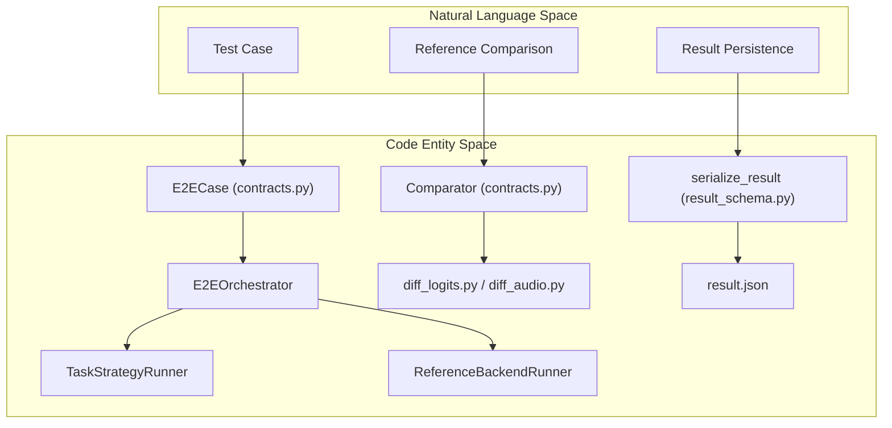
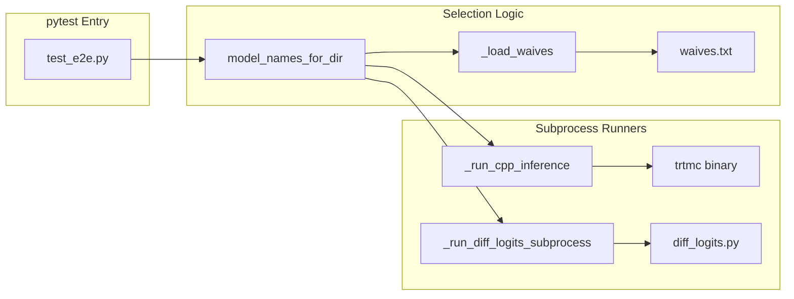

<!-- source: DeepWiki mcp.deepwiki.com · repo NVIDIA/TensorRT-Model-Connect · page 4 Testing Infrastructure · fetched 2026-10-26 -->

# Testing Infrastructure

Relevant source files

The following files were used as context for generating this wiki page:

- [conftest.py](conftest.py)
- [tests/e2e/test_full_pipeline.py](tests/e2e/test_full_pipeline.py)
- [tests/e2e/test_inference.py](tests/e2e/test_inference.py)
- [tests/e2e/test_logit_parity.py](tests/e2e/test_logit_parity.py)
- [tests/e2e/test_runner_parity.py](tests/e2e/test_runner_parity.py)
- [tests/e2e_harness/__init__.py](tests/e2e_harness/__init__.py)
- [tests/e2e_harness/model_selection.py](tests/e2e_harness/model_selection.py)
- [tests/e2e_harness/references/nemo_reference.py](tests/e2e_harness/references/nemo_reference.py)
- [tests/e2e_harness/result_schema.py](tests/e2e_harness/result_schema.py)
- [tests/e2e_harness/runtime_config.py](tests/e2e_harness/runtime_config.py)
- [tests/e2e_harness/test_model_selection.py](tests/e2e_harness/test_model_selection.py)
- [tests/test_e2e.py](tests/test_e2e.py)
- [tests/test_e2e_selection.py](tests/test_e2e_selection.py)
- [tests/tools/test_e2e_waives.py](tests/tools/test_e2e_waives.py)
- [tools/diff_audio.py](tools/diff_audio.py)

The TensorRT-Model-Connect (TRTMC) testing infrastructure is designed as a multi-layered "evidence ladder" that validates every stage of the model lifecycle, from Python-based engine building to C++ runtime execution and final end-to-end (E2E) parity against reference frameworks (e.g., Hugging Face, NeMo).

The core of the system is the **E2E Test Harness**, a pluggable framework that orchestrates complex multi-process validation tasks to ensure high-fidelity inference results across a wide variety of modalities (Text, Vision, Audio, Diffusion).

### The Evidence Ladder

TRTMC utilizes six distinct layers of testing to provide confidence in model releases:

1.  **Ownership/Static:** Validation of `MODEL.toml` descriptors and repository structure.
2.  **Python Builder:** Unit tests for `FamilyPlugin` implementations and engine building logic.
3.  **C++ Runtime:** Unit and integration tests for model-specific DSOs and the `IPipeline` interface.
4.  **Tooling:** Shared utilities like `diff_logits.py` and `perf_compare.py` for isolated component testing.
5.  **E2E Harness:** The `E2EOrchestrator` coordinating full build-and-run lifecycles.
6.  **Model E2E:** Specific manifests and plugins defining the expected behavior for every supported model.

---

### E2E Test Harness: Orchestrator and Runners
The `e2e_harness` package provides a Dependency Injection (DIP)-first framework where high-level orchestration depends on abstract contracts [tests/e2e_harness/__init__.py:4-11](). The `E2EOrchestrator` manages the lifecycle of an `E2ECase` [tests/e2e_harness/__init__.py:47](), which includes preflight checks, bundle building, TRT inference, reference inference, and comparison.

Execution is strictly isolated; GPU-heavy work (TRT and HF) runs in subprocesses to avoid OOM and context pollution [tests/e2e/test_full_pipeline.py:9-10]().

*   **For details, see [E2E Test Harness: Orchestrator, Manifests, and Runners](#4.1)**

**Sources:** [tests/e2e_harness/__init__.py:4-96](), [tests/e2e/test_full_pipeline.py:1-26]()

---

### E2E Report Generation and Model Manifests
TRTMC uses a manifest-driven approach for E2E testing. Each model family defines its test cases in `tests/e2e/models/`. These manifests specify parameters like `hf_id`, `runtime_strategy`, and `logit_atol` [tests/e2e/test_logit_parity.py:41-43](). Results are persisted as `result.json` files using a standardized schema [tests/e2e_harness/result_schema.py:104-109](), which are then aggregated into human-readable HTML reports.

*   **For details, see [E2E Report Generation and Model Manifests](#4.2)**

**Sources:** [tests/e2e_harness/result_schema.py:1-184](), [tests/e2e/test_logit_parity.py:24-55]()

---

### Validation Framework and Gate Policies
The validation framework extends simple parity checks into a robust qualification system. It utilizes `trtmc_validate` to resolve bindings and prepare datasets (e.g., MMLU). Gate policies allow the CI to distinguish between blocking failures and "observation only" regressions. The system also supports platform-specific waives via a `waives.txt` file, allowing models to be skipped or marked as `XFAIL` on specific hardware like `GB300` [tests/test_e2e.py:147-191]().

*   **For details, see [Validation Framework: trtmc_validate and Gate Policies](#4.3)**

**Sources:** [tests/test_e2e.py:147-191](), [tests/tools/test_e2e_waives.py:11-47]()

---

### Performance Benchmarking
Performance is validated alongside correctness. The `perf_compare.py` tool executes a matrix of TRTMC vs. Reference benchmarks, measuring latency and throughput [tests/e2e/test_full_pipeline.py:171-215](). These benchmarks are integrated into the E2E suite to ensure that optimizations do not regress over time.

*   **For details, see [Performance Benchmarking: perf_matrix and trtmc-bench](#4.4)**

**Sources:** [tests/e2e/test_full_pipeline.py:171-215]()

---

### Infrastructure Mapping

The following diagram illustrates how the natural language concept of an "E2E Test" maps to specific code entities and orchestration logic.

**E2E Orchestration Logic**

**Sources:** [tests/e2e_harness/contracts.py](), [tests/e2e_harness/result_schema.py:104-153](), [tools/diff_audio.py:5-12]()

**Test Execution Flow**

**Sources:** [tests/test_e2e.py:47-50](), [tests/test_e2e.py:147-155](), [tests/e2e/test_full_pipeline.py:61-90](), [tests/e2e/test_full_pipeline.py:92-132]()

### Summary Table of Test Types

| Test Type | Code Entry Point | Primary Goal | Subprocess Isolation |
| :--- | :--- | :--- | :--- |
| **Inference** | `test_inference_produces_text` | Verify C++ binary generates output | Yes |
| **Determinism** | `test_inference_deterministic` | Ensure identical outputs for same prompt | Yes |
| **Logit Parity** | `test_logit_parity` | Match HF logits within `atol` | Yes |
| **Runner Parity** | `test_runner_parity` | C++ vs Python token match | Yes |
| **Audio Diff** | `diff_audio.py` | Dispatch to family-specific audio diff | Yes |

**Sources:** [tests/e2e/test_inference.py:19-75](), [tests/e2e/test_logit_parity.py:24-55](), [tests/e2e/test_runner_parity.py:24-52](), [tools/diff_audio.py:66-91]()

---

