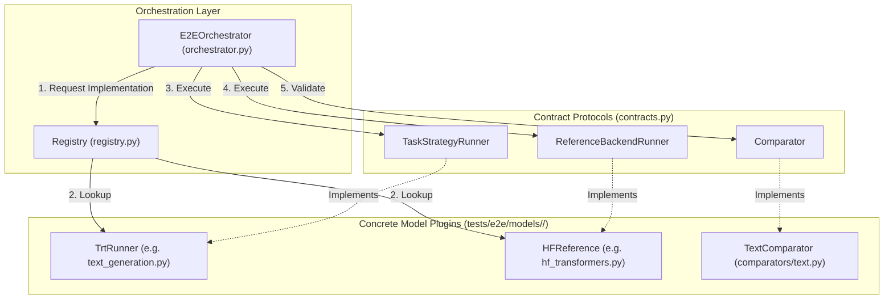
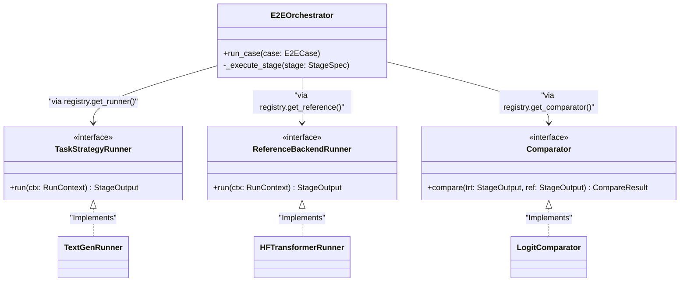

<!-- source: DeepWiki mcp.deepwiki.com · repo NVIDIA/TensorRT-Model-Connect · page 4.1 E2E Test Harness: Orchestrator, Manifests, and Runners · fetched 2026-10-26 -->

# E2E Test Harness: Orchestrator, Manifests, and Runners

Relevant source files

The following files were used as context for generating this wiki page:

- [conftest.py](conftest.py)
- [src/runtime/models/whisper/pipeline.cpp](src/runtime/models/whisper/pipeline.cpp)
- [src/runtime/models/whisper/pipeline.h](src/runtime/models/whisper/pipeline.h)
- [src/runtime/models/whisper/plugin.cpp](src/runtime/models/whisper/plugin.cpp)
- [src/runtime/models/whisper/whisper_mel_spectrogram.cpp](src/runtime/models/whisper/whisper_mel_spectrogram.cpp)
- [src/runtime/models/whisper/whisper_mel_spectrogram.h](src/runtime/models/whisper/whisper_mel_spectrogram.h)
- [tests/builder/test_families.py](tests/builder/test_families.py)
- [tests/builder/test_family_plugins.py](tests/builder/test_family_plugins.py)
- [tests/builder/test_graph_ops.py](tests/builder/test_graph_ops.py)
- [tests/builder/test_manifest_validation.py](tests/builder/test_manifest_validation.py)
- [tests/cpp/models/whisper/test_whisper_mel_spectrogram.cpp](tests/cpp/models/whisper/test_whisper_mel_spectrogram.cpp)
- [tests/e2e/models/elf_flow/thresholds/elf-b-owt-l0.json](tests/e2e/models/elf_flow/thresholds/elf-b-owt-l0.json)
- [tests/e2e/test_full_pipeline.py](tests/e2e/test_full_pipeline.py)
- [tests/e2e/test_inference.py](tests/e2e/test_inference.py)
- [tests/e2e/test_logit_parity.py](tests/e2e/test_logit_parity.py)
- [tests/e2e/test_runner_parity.py](tests/e2e/test_runner_parity.py)
- [tests/e2e/waives.txt](tests/e2e/waives.txt)
- [tests/e2e_harness/__init__.py](tests/e2e_harness/__init__.py)
- [tests/e2e_harness/artifact_sink.py](tests/e2e_harness/artifact_sink.py)
- [tests/e2e_harness/comparators/diffusion.py](tests/e2e_harness/comparators/diffusion.py)
- [tests/e2e_harness/comparators/embedding.py](tests/e2e_harness/comparators/embedding.py)
- [tests/e2e_harness/comparators/encoder_only.py](tests/e2e_harness/comparators/encoder_only.py)
- [tests/e2e_harness/comparators/neural_operator.py](tests/e2e_harness/comparators/neural_operator.py)
- [tests/e2e_harness/comparators/omni.py](tests/e2e_harness/comparators/omni.py)
- [tests/e2e_harness/comparators/reranking.py](tests/e2e_harness/comparators/reranking.py)
- [tests/e2e_harness/comparators/segmentation.py](tests/e2e_harness/comparators/segmentation.py)
- [tests/e2e_harness/comparators/speech_to_speech.py](tests/e2e_harness/comparators/speech_to_speech.py)
- [tests/e2e_harness/comparators/speech_to_text.py](tests/e2e_harness/comparators/speech_to_text.py)
- [tests/e2e_harness/comparators/text.py](tests/e2e_harness/comparators/text.py)
- [tests/e2e_harness/comparators/text_to_audio.py](tests/e2e_harness/comparators/text_to_audio.py)
- [tests/e2e_harness/contracts.py](tests/e2e_harness/contracts.py)
- [tests/e2e_harness/manifest_loader.py](tests/e2e_harness/manifest_loader.py)
- [tests/e2e_harness/model_runner.py](tests/e2e_harness/model_runner.py)
- [tests/e2e_harness/model_selection.py](tests/e2e_harness/model_selection.py)
- [tests/e2e_harness/orchestrator.py](tests/e2e_harness/orchestrator.py)
- [tests/e2e_harness/plugins/base.py](tests/e2e_harness/plugins/base.py)
- [tests/e2e_harness/plugins/causal_continuation.py](tests/e2e_harness/plugins/causal_continuation.py)
- [tests/e2e_harness/plugins/embedding.py](tests/e2e_harness/plugins/embedding.py)
- [tests/e2e_harness/plugins/encoder_features.py](tests/e2e_harness/plugins/encoder_features.py)
- [tests/e2e_harness/plugins/vl_qa.py](tests/e2e_harness/plugins/vl_qa.py)
- [tests/e2e_harness/references/hf_diffusers.py](tests/e2e_harness/references/hf_diffusers.py)
- [tests/e2e_harness/references/hf_transformers.py](tests/e2e_harness/references/hf_transformers.py)
- [tests/e2e_harness/references/nemo_reference.py](tests/e2e_harness/references/nemo_reference.py)
- [tests/e2e_harness/result_schema.py](tests/e2e_harness/result_schema.py)
- [tests/e2e_harness/runners/audio_speech.py](tests/e2e_harness/runners/audio_speech.py)
- [tests/e2e_harness/runners/diffusion.py](tests/e2e_harness/runners/diffusion.py)
- [tests/e2e_harness/runners/embedding.py](tests/e2e_harness/runners/embedding.py)
- [tests/e2e_harness/runners/encoder_only.py](tests/e2e_harness/runners/encoder_only.py)
- [tests/e2e_harness/runners/object_detection.py](tests/e2e_harness/runners/object_detection.py)
- [tests/e2e_harness/runners/reranking.py](tests/e2e_harness/runners/reranking.py)
- [tests/e2e_harness/runners/segmentation.py](tests/e2e_harness/runners/segmentation.py)
- [tests/e2e_harness/runners/text_generation.py](tests/e2e_harness/runners/text_generation.py)
- [tests/e2e_harness/runners/vision_language.py](tests/e2e_harness/runners/vision_language.py)
- [tests/e2e_harness/runtime_config.py](tests/e2e_harness/runtime_config.py)
- [tests/e2e_harness/test_model_selection.py](tests/e2e_harness/test_model_selection.py)
- [tests/e2e_harness/test_orchestrator_phases.py](tests/e2e_harness/test_orchestrator_phases.py)
- [tests/e2e_harness/thresholds/__init__.py](tests/e2e_harness/thresholds/__init__.py)
- [tests/e2e_harness/thresholds/defaults/diffusion_media_generation.json](tests/e2e_harness/thresholds/defaults/diffusion_media_generation.json)
- [tests/e2e_harness/thresholds/defaults/text_to_audio.json](tests/e2e_harness/thresholds/defaults/text_to_audio.json)
- [tests/test_e2e.py](tests/test_e2e.py)
- [tests/test_e2e_selection.py](tests/test_e2e_selection.py)
- [tests/tools/test_causal_continuation_plugin.py](tests/tools/test_causal_continuation_plugin.py)
- [tests/tools/test_diffusion_vlm_similarity_tool.py](tests/tools/test_diffusion_vlm_similarity_tool.py)
- [tests/tools/test_e2e_waives.py](tests/tools/test_e2e_waives.py)
- [tests/tools/test_embedding_contract_plugins.py](tests/tools/test_embedding_contract_plugins.py)
- [tests/tools/test_model_e2e_runner.py](tests/tools/test_model_e2e_runner.py)
- [tests/tools/test_plugin_runtime_context.py](tests/tools/test_plugin_runtime_context.py)
- [tools/diff_audio.py](tools/diff_audio.py)
- [tools/evaluate_diffusion_vlm_similarity.py](tools/evaluate_diffusion_vlm_similarity.py)
- [tools/legal_header_exceptions.toml](tools/legal_header_exceptions.toml)

The End-to-End (E2E) Test Harness is a decoupled, plugin-based system designed to coordinate the full lifecycle of a model test case. It ensures that a model can be built into a `.bundle`, executed via the TensorRT-Model-Connect (TRTMC) runtime, and verified against a reference implementation (typically Hugging Face Transformers or Diffusers) using configurable comparison logic.

## Core Orchestration Logic

The `E2EOrchestrator` is the central coordinator for a single test case. It follows the Dependency Inversion Principle, depending only on abstract protocols defined in `contracts.py` and resolving concrete implementations at runtime via a registry [tests/e2e_harness/orchestrator.py:6-9]().

### Test Lifecycle
The orchestrator executes the following sequence for every `E2ECase`:
1.  **Artifact Initialization**: Creates a unique directory for the test run and snapshots the case configuration [tests/e2e_harness/orchestrator.py:11]().
2.  **Preflight Checks**: Validates environment readiness (GPU memory, HF tokens, required assets, and Python modules) [tests/e2e_harness/orchestrator.py:100-200]().
3.  **Bundle Resolution**: Either builds a new `.bundle` artifact or resolves an existing one from the cache [tests/e2e_harness/orchestrator.py:13]().
4.  **Stage Execution**: For each stage defined in the manifest (e.g., prefill, decode):
    *   **TRT Runner**: Executes the model using the TRTMC runtime [tests/e2e_harness/orchestrator.py:15]().
    *   **Reference Runner**: Executes the ground-truth implementation [tests/e2e_harness/orchestrator.py:16]().
    *   **Comparison**: Invokes a `Comparator` to evaluate parity based on `ComparisonMode` [tests/e2e_harness/orchestrator.py:17]().
5.  **Persistence**: Aggregates timing, logs, and outputs into a `result.json` [tests/e2e_harness/orchestrator.py:21]().

### Data Flow: Orchestrator to Code Entities

The following diagram illustrates how the `E2EOrchestrator` interacts with the registry and contract-based plugins.

**Entity Mapping: Orchestration Flow**

*Sources: [tests/e2e_harness/orchestrator.py:44-67](), [tests/e2e_harness/contracts.py:23-25]()*

## Manifest System

The harness uses a two-tier manifest system to describe models and their associated test cases.

### E2EModel and E2ECase
*   **E2EModel**: Represents a buildable model configuration (e.g., Llama-3-8B FP8). It defines the `hf_id`, `family`, and build-time parameters [tests/e2e_harness/contracts.py:246-277]().
*   **E2ECase**: Represents a specific test scenario for an `E2EModel`. It includes input prompts, expected `StageSpec` sequences, and threshold profiles [tests/e2e_harness/contracts.py:279-317]().

### Manifest Loader
The `manifest_loader.py` is responsible for:
1.  **Discovery**: Scanning `tests/e2e/models/` for `MODEL.toml` and JSON manifests [tests/e2e_harness/manifest_loader.py:6-9]().
2.  **Normalization**: Resolving relative asset paths (like images or audio files) to absolute paths relative to the model's test directory [tests/e2e_harness/manifest_loader.py:80-95]().
3.  **Sidecar Loading**: Merging threshold overrides from `thresholds/<case>.json` files into the test case definition [tests/e2e_harness/manifest_loader.py:185-210]().

| Manifest Component | Description | Source |
| :--- | :--- | :--- |
| `StageSpec` | Defines output type (e.g., `TOKEN_IDS`) and comparison mode. | [tests/e2e_harness/contracts.py:218-244]() |
| `PreflightRequirement` | Environmental checks (e.g., `gpu_memory`, `hf_auth`). | [tests/e2e_harness/contracts.py:341-355]() |
| `ThresholdProfile` | Numeric tolerances for logit or pixel comparison. | [tests/e2e_harness/contracts.py:319-339]() |

*Sources: [tests/e2e_harness/manifest_loader.py:25-35](), [tests/e2e_harness/contracts.py:9-13]()*

## Runner and Comparator Protocols

The harness utilizes a plugin architecture where model families provide their own execution logic.

### TaskStrategyRunner
Executes the TRTMC runtime. While the orchestrator handles the process lifecycle, the runner plugin (e.g., `tests/e2e_harness/runners/text_generation.py`) defines how to format the CLI command for `trtmc run` and how to parse its stdout/stderr for timing and artifacts [tests/e2e_harness/contracts.py:440-455]().

### ReferenceBackendRunner
Provides the ground truth. Most models use `hf_transformers.py` or `hf_diffusers.py`. These runners typically execute in a separate Python process (the "HF Python" environment) to avoid library conflicts and OOM issues with the TRT process [tests/e2e_harness/orchestrator.py:435-460]().

### Comparator
Evaluates the `StageOutput` from both runners. 
*   **Exact Match**: Used for token IDs or text [tests/e2e_harness/contracts.py:160-162]().
*   **Numeric Tensor**: Compares logits or embeddings using `atol`/`rtol` [tests/e2e_harness/contracts.py:163]().
*   **Media Similarity**: Uses VLM-based or perceptual metrics for images/video [tests/e2e_harness/contracts.py:167]().

**System Map: Runner Dispatch**

*Sources: [tests/e2e_harness/contracts.py:440-510](), [tests/e2e_harness/registry.py:60-67]()*

## Pytest Integration

The harness is exposed to the developer via `tests/test_e2e.py`. This entrypoint parametrizes a single `test_e2e` function with all discovered manifests [tests/test_e2e.py:4-10]().

*   **Discovery**: `model_names_for_dir` scans the repository for testable models [tests/test_e2e.py:199-206]().
*   **Filtering**: Supports `--e2e-model`, `--e2e-task-strategy`, and `--e2e-core-only` to sub-select tests [tests/test_e2e.py:14-21]().
*   **Waives**: Integrates with `tests/e2e/waives.txt` to automatically skip or XFAIL tests based on the current platform (e.g., `GB300`) [tests/test_e2e.py:147-191]().
*   **Execution**: Delegates the actual execution to `model_runner.run_model_e2e`, which instantiates the `E2EOrchestrator` [tests/test_e2e.py:47-50]().

*Sources: [tests/test_e2e.py:39-50](), [tests/e2e_harness/model_runner.py:1-20]()*

---

