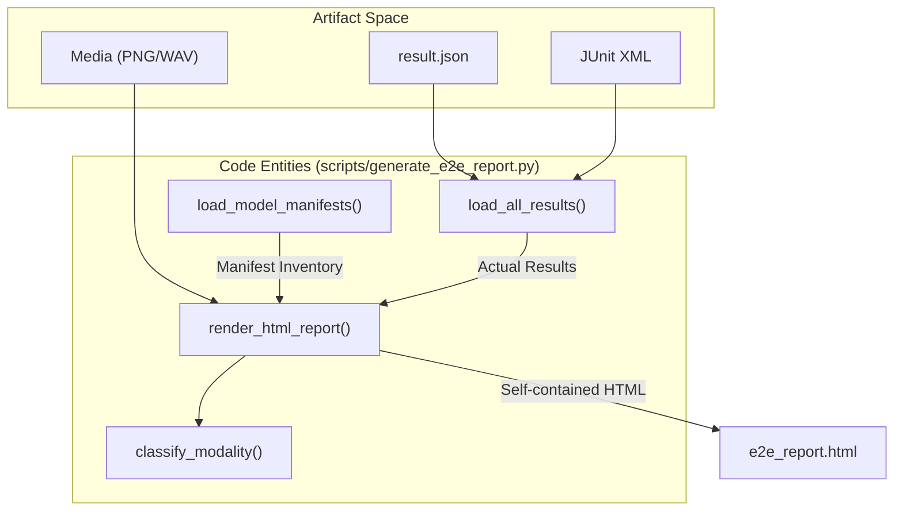
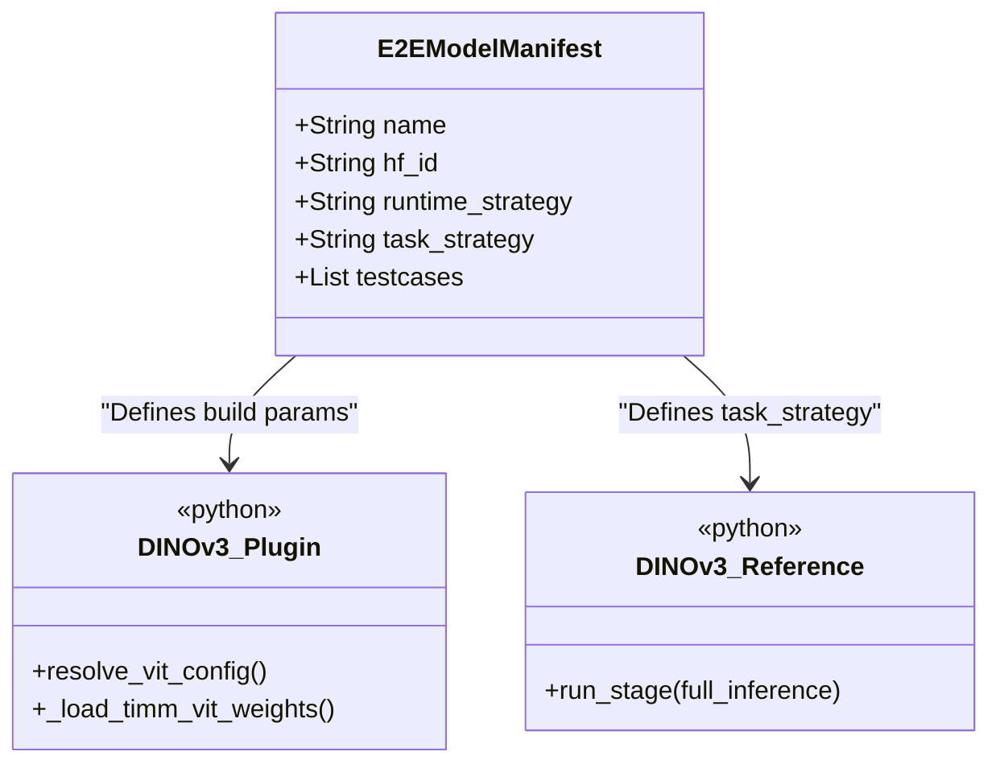

<!-- source: DeepWiki mcp.deepwiki.com · repo NVIDIA/TensorRT-Model-Connect · page 4.2 E2E Report Generation and Model Manifests · fetched 2026-10-26 -->

# E2E Report Generation and Model Manifests

Relevant source files

The following files were used as context for generating this wiki page:

- [python/tensorrt_model_connect/families/dinov3/MODEL.toml](python/tensorrt_model_connect/families/dinov3/MODEL.toml)
- [python/tensorrt_model_connect/families/dinov3/plugin.py](python/tensorrt_model_connect/families/dinov3/plugin.py)
- [python/tensorrt_model_connect/families/qwen/builder_policy.py](python/tensorrt_model_connect/families/qwen/builder_policy.py)
- [python/tensorrt_model_connect/families/qwen/dual_profile_decoder_builder.py](python/tensorrt_model_connect/families/qwen/dual_profile_decoder_builder.py)
- [python/tensorrt_model_connect/families/qwen/dual_profile_decoder_tp_builder.py](python/tensorrt_model_connect/families/qwen/dual_profile_decoder_tp_builder.py)
- [python/tensorrt_model_connect/families/qwen/standard_decoder_builder.py](python/tensorrt_model_connect/families/qwen/standard_decoder_builder.py)
- [scripts/generate_e2e_report.py](scripts/generate_e2e_report.py)
- [scripts/generate_e2e_report_assets/e2e_report.css](scripts/generate_e2e_report_assets/e2e_report.css)
- [scripts/generate_e2e_report_assets/e2e_report.js](scripts/generate_e2e_report_assets/e2e_report.js)
- [scripts/schedule_e2e.py](scripts/schedule_e2e.py)
- [src/runtime/models/qwen/pipeline.cpp](src/runtime/models/qwen/pipeline.cpp)
- [src/runtime/models/qwen/pipeline.h](src/runtime/models/qwen/pipeline.h)
- [tests/builder/test_qwen_runtime_performance_contract.py](tests/builder/test_qwen_runtime_performance_contract.py)
- [tests/builder/test_trt_compat_boundary.py](tests/builder/test_trt_compat_boundary.py)
- [tests/e2e/models/bert/test_bert_owned_encoder_builders_coverage.py](tests/e2e/models/bert/test_bert_owned_encoder_builders_coverage.py)
- [tests/e2e/models/dinov3/MODEL.toml](tests/e2e/models/dinov3/MODEL.toml)
- [tests/e2e/models/dinov3/e2e_plugins/reference.py](tests/e2e/models/dinov3/e2e_plugins/reference.py)
- [tests/e2e/models/dinov3/manifests/dinov3-convnext-tiny-pretrain-lvd1689m.json](tests/e2e/models/dinov3/manifests/dinov3-convnext-tiny-pretrain-lvd1689m.json)
- [tests/e2e/models/dinov3/manifests/dinov3-vits16-pretrain-lvd1689m.json](tests/e2e/models/dinov3/manifests/dinov3-vits16-pretrain-lvd1689m.json)
- [tests/e2e/models/dinov3/test_dinov3_e2e_static.py](tests/e2e/models/dinov3/test_dinov3_e2e_static.py)
- [tests/e2e/models/dinov3/test_dinov3_vit_builder.py](tests/e2e/models/dinov3/test_dinov3_vit_builder.py)
- [tests/e2e/models/flux/test_flux_owned_encoder_builders_coverage.py](tests/e2e/models/flux/test_flux_owned_encoder_builders_coverage.py)
- [tests/e2e/models/qwen/manifests/qwen3-0.6b-fp8.json](tests/e2e/models/qwen/manifests/qwen3-0.6b-fp8.json)
- [tests/e2e/models/qwen/test_qwen_builder_policy.py](tests/e2e/models/qwen/test_qwen_builder_policy.py)
- [tests/e2e/models/qwen/test_qwen_manifest_contract.py](tests/e2e/models/qwen/test_qwen_manifest_contract.py)
- [tests/e2e/models/z_image/test_z_image_qwen3_encoder_builder.py](tests/e2e/models/z_image/test_z_image_qwen3_encoder_builder.py)
- [tests/e2e/timing_estimates.json](tests/e2e/timing_estimates.json)
- [tests/tools/test_generate_report.py](tests/tools/test_generate_report.py)
- [tests/tools/test_schedule_e2e.py](tests/tools/test_schedule_e2e.py)
- [tools/ci/container.py](tools/ci/container.py)
- [tools/ci/environment.py](tools/ci/environment.py)
- [tools/ci/stage.py](tools/ci/stage.py)

The End-to-End (E2E) report generation system provides a unified interface for visualizing model validation results. It transforms raw structured output from the `E2EOrchestrator`—including `result.json` files, JUnit XML, and console logs—into a portable, self-contained HTML report containing embedded media and performance metrics.

## Report Generation Flow

The `generate_e2e_report.py` script serves as the primary entry point for aggregating test artifacts. It performs three major operations: data discovery via model manifests, outcome merging from Pytest execution, and modality-specific rendering of model outputs.

### Implementation and Data Flow

The reporting logic follows a multi-stage pipeline to reconcile what was *planned* (manifests) with what was *executed* (JUnit/JSON results).

1.  **Manifest Discovery**: The script crawls the `tests/e2e/models` directory, parsing `MODEL.toml` files to find JSON test manifests [scripts/generate_e2e_report.py:146-174]().
2.  **Artifact Collection**: It walks the provided `--artifacts-dir` to load `result.json` files produced by the E2E harness [scripts/generate_e2e_report.py:123-143]().
3.  **Pytest Reconciliation**: Information from JUnit XML files is used to determine the final status (e.g., `pass`, `fail`, `skip`) of each test case [scripts/generate_e2e_report.py:75-82]().
4.  **Modality Classification**: Results are classified into categories (e.g., `text`, `audio`, `diffusion`) to select appropriate HTML renderers [scripts/generate_e2e_report.py:88-116]().

### Visualizing the Reporting Pipeline

The following diagram bridges the "Natural Language Space" of test results to the "Code Entity Space" of the generation script.

**E2E Artifact Aggregation Diagram**

**Sources:** [scripts/generate_e2e_report.py:88-116](), [scripts/generate_e2e_report.py:123-143](), [scripts/generate_e2e_report.py:177-195]()

## Model Manifest Structure

Model manifests are JSON files that define the build configuration, runtime strategy, and test cases for a specific model. They act as the source of truth for the `E2EOrchestrator`.

### Worked Example: DINOv3 Manifest

The DINOv3 model (a perception model for image feature extraction) illustrates how manifests organize multi-stage validation.

| Key | Description | Example (DINOv3) |
| :--- | :--- | :--- |
| `name` | Unique identifier for the model configuration. | `"dinov3-vits16-pretrain-lvd1689m"` |
| `hf_id` | Hugging Face model repository. | `"facebook/dinov3-vits16-pretrain-lvd1689m"` |
| `runtime_strategy` | Dispatch key for the C++ runtime loader. | `"dinov3_image_feature_extraction"` |
| `task_strategy` | Strategy for inference and reference comparison. | `"image_feature_extraction"` |
| `testcases` | List of input prompts, images, and expected outcomes. | Includes image path and `num_register_tokens`. |

**DINOv3 Manifest Association Diagram**

**Sources:** [tests/e2e/models/dinov3/test_dinov3_e2e_static.py:91-126](), [python/tensorrt_model_connect/families/dinov3/plugin.py:115-150](), [tests/e2e/models/dinov3/e2e_plugins/reference.py:146-165]()

## Result Classification and Asset Handling

The reporter uses a mapping of `task_strategy` to `modality` to handle specialized assets like images from diffusion models or audio from speech models [scripts/generate_e2e_report.py:88-109]().

### Key Functions
*   `classify_modality()`: Returns a string (e.g., `vl`, `audio`, `diffusion`) based on the test case's `task_strategy` [scripts/generate_e2e_report.py:112-116]().
*   `_MAX_EMBED_BYTES`: Constants that prevent the generated HTML from becoming excessively large by capping inline Base64 embedding of binary assets [scripts/generate_e2e_report.py:42-46]().

### Timing Extraction
The reporter parses console logs using regex to extract high-resolution timing data for prefill, decode, and engine execution, which are then displayed in the "Timing Breakdown" section of the report [scripts/generate_e2e_report.py:51-68]().

**Sources:** [scripts/generate_e2e_report.py:51-68](), [scripts/generate_e2e_report.py:88-116](), [tests/tools/test_generate_report.py:188-200]()

---

