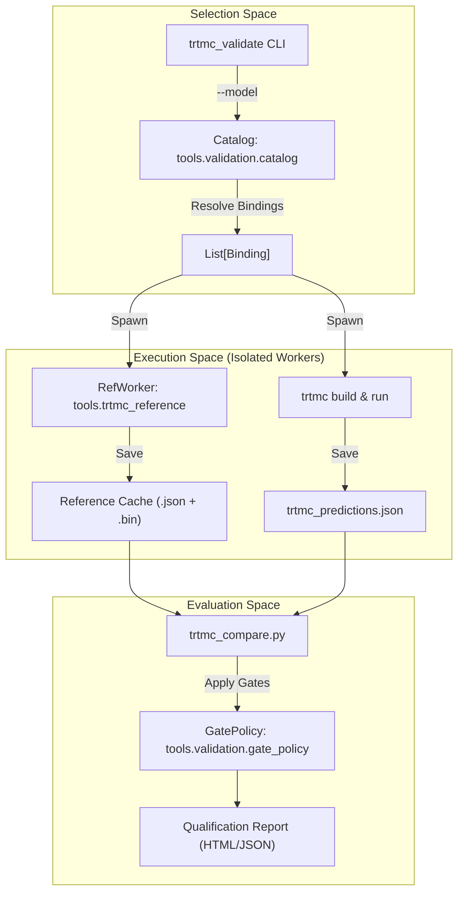
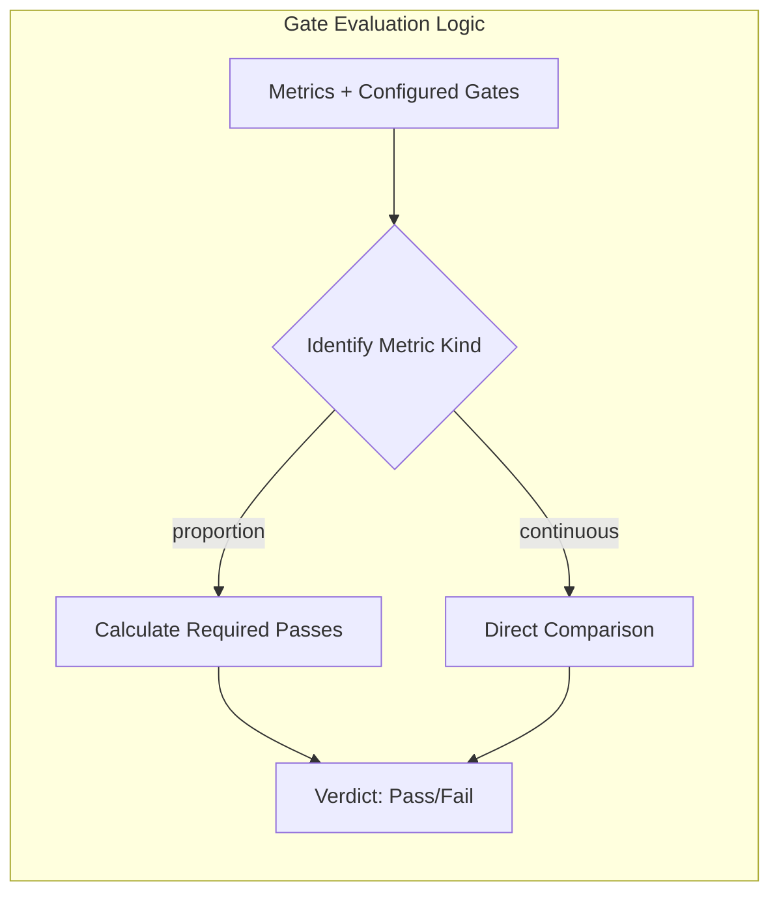

<!-- source: DeepWiki mcp.deepwiki.com · repo NVIDIA/TensorRT-Model-Connect · page 4.3 Validation Framework: trtmc_validate and Gate Policies · fetched 2026-10-26 -->

# Validation Framework: trtmc_validate and Gate Policies

Relevant source files

The following files were used as context for generating this wiki page:

- [python/tensorrt_model_connect/families/bart/debug_runner.py](python/tensorrt_model_connect/families/bart/debug_runner.py)
- [python/tensorrt_model_connect/families/bart/decoder_tp_builder.py](python/tensorrt_model_connect/families/bart/decoder_tp_builder.py)
- [python/tensorrt_model_connect/families/bart/graph_ops.py](python/tensorrt_model_connect/families/bart/graph_ops.py)
- [python/tensorrt_model_connect/families/bart/plugin.py](python/tensorrt_model_connect/families/bart/plugin.py)
- [src/runtime/models/bart/plugin.cpp](src/runtime/models/bart/plugin.cpp)
- [tests/e2e/models/bart/test_bart_build_engine_integration.py](tests/e2e/models/bart/test_bart_build_engine_integration.py)
- [tests/e2e/models/bart/test_bart_builder_tp.py](tests/e2e/models/bart/test_bart_builder_tp.py)
- [tests/e2e/models/bart/test_bart_debug_runner.py](tests/e2e/models/bart/test_bart_debug_runner.py)
- [tests/tools/test_transformers_text_reference.py](tests/tools/test_transformers_text_reference.py)
- [tests/tools/test_trtmc_reference.py](tests/tools/test_trtmc_reference.py)
- [tests/tools/test_trtmc_validate.py](tests/tools/test_trtmc_validate.py)
- [tests/tools/test_validation_engine.py](tests/tools/test_validation_engine.py)
- [tests/tools/test_validation_gate_policy.py](tests/tools/test_validation_gate_policy.py)
- [tests/validation/README.md](tests/validation/README.md)
- [tests/validation/workloads.yaml](tests/validation/workloads.yaml)
- [tools/qualification_report_assets/qualification-report.css](tools/qualification_report_assets/qualification-report.css)
- [tools/qualification_report_assets/qualification-report.js](tools/qualification_report_assets/qualification-report.js)
- [tools/reference/plugin_reference.py](tools/reference/plugin_reference.py)
- [tools/reference/transformers_text.py](tools/reference/transformers_text.py)
- [tools/trtmc_reference.py](tools/trtmc_reference.py)
- [tools/trtmc_validate.py](tools/trtmc_validate.py)
- [tools/validation/catalog.py](tools/validation/catalog.py)
- [tools/validation/engine.py](tools/validation/engine.py)
- [tools/validation/gate_census.py](tools/validation/gate_census.py)
- [tools/validation/gate_policy.py](tools/validation/gate_policy.py)

The **Validation Framework** provides a model-first workflow for ensuring functional and numerical consistency between TensorRT-Model-Connect (TRTMC) optimized artifacts (`.bundle`) and their original Hugging Face or reference implementations. Unlike standard E2E tests, the validation engine focuses on **aligned parity**: executing identical requests against two backends and evaluating the results against strict **Gate Policies**.

## Overview and Entry Points

The framework is primarily accessed via the `trtmc_validate.py` CLI tool. It manages binding resolution, environment preparation, isolated worker execution, and automated reporting.

*   **`trtmc_validate.py`**: The top-level orchestrator for Dev/QA. It resolves model names to specific workloads and manages the execution lifecycle [tools/trtmc_validate.py:9-30]().
*   **`trtmc_reference.py`**: A specialized worker that executes reference inference (e.g., Hugging Face Transformers) and caches the results to avoid redundant GPU compute [tools/trtmc_reference.py:5-20]().
*   **`trtmc_compare.py`**: Evaluates the output of a TRTMC run against the cached reference output using task-specific metrics.

### Execution Flow
The following diagram illustrates how `trtmc_validate` bridges the gap between a model name and a finalized qualification report.

**Validation Data Flow**

Sources: [tools/trtmc_validate.py:100-122](), [tools/trtmc_reference.py:96-108](), [tools/validation/gate_policy.py:189-200]()

## Binding Resolution and Catalog

The framework uses a two-tier catalog system to define what should be validated:
1.  **Workload Catalog (`model_workloads.yaml`)**: Maps models to specific benchmark suites and defines sample limits [tools/trtmc_validate.py:70-75]().
2.  **Suite Definitions (`workloads.yaml`)**: Defines the datasets, user contracts, generation parameters, and gate policies for a specific type of evaluation (e.g., `mmlu_five_shot_mcq`) [tests/validation/workloads.yaml:6-30]().

### Binding Logic
A `Binding` is a unique pair of `(model, workload)`. If a model is marked as `not_compared_reason` in the catalog, it is skipped with a recorded justification [tools/trtmc_validate.py:100-103]().

| Entity | Role | Source |
| :--- | :--- | :--- |
| `Binding` | Data class representing a model/workload task | [tools/trtmc_validate.py:100-105]() |
| `resolve_bindings` | Resolves CLI arguments into a list of runnable bindings | [tools/trtmc_validate.py:66-70]() |
| `sample_limits` | Defines how many samples to run per workload (e.g., 20 for MMLU) | [tests/validation/workloads.yaml:68-75]() |

Sources: [tools/trtmc_validate.py:100-115](), [tests/validation/workloads.yaml:7-30]()

## Isolated Worker Execution

To ensure numerical stability and prevent library conflicts (e.g., TRTMC vs. specific versions of PyTorch), the framework executes backends in isolated Python processes.

### Reference Execution (`trtmc_reference.py`)
This worker identifies the correct "reference family" (e.g., `causal`, `vlm`, `speech`) and invokes a corresponding runner script:
*   **Transformers Text**: `tools/reference/transformers_text.py` [tools/trtmc_reference.py:63]()
*   **Speech/ASR**: `tools/reference/speech.py` [tools/trtmc_reference.py:70]()
*   **Diffusion/Plugins**: `tools/reference/plugin_reference.py` [tools/trtmc_reference.py:67]()

The reference output is hashed based on the input manifest and generation parameters to allow caching [tools/trtmc_reference.py:141-160]().

### Dataset Preparation
The engine supports diverse modalities through specific preparers:
*   **MMLU**: `prepare_media_validation_datasets.py` [tests/tools/test_validation_engine.py:24]()
*   **DPG-Bench**: Diffusion Parity Gate Benchmarking.
*   **LibriSpeech**: Used for ASR (Automatic Speech Recognition) parity.
*   **Full Duplex Bench (FDB)**: Validates behavior parity for streaming speech-to-speech models like PersonaPlex [tests/tools/test_validation_engine.py:90-105]().

Sources: [tools/trtmc_reference.py:42-62](), [tests/tools/test_validation_engine.py:90-105]()

## Gate Policies and Evaluation

A **Gate Policy** defines the numerical thresholds a model must meet to be considered "Qualified." Policies can be `blocking` (failure stops the pipeline) or `observation_only` [tools/validation/gate_policy.py:200-210]().

### Gate Types
The framework distinguishes between different metric behaviors:
1.  **Proportion Gates**: Rates like `min_prediction_agreement` (e.g., 0.98). These are expanded into discrete pass/fail counts based on the sample size [tools/validation/gate_policy.py:149-159]().
2.  **Proportion Drop Gates**: Accuracy deltas like `max_accuracy_drop_from_hf` (e.g., 0.01) [tools/validation/gate_policy.py:30-34]().
3.  **Continuous Gates**: Float thresholds like `min_psnr` or `min_ssim` for diffusion [tools/validation/gate_policy.py:35-47]().

### Implementation: `evaluate_shadow_gates`
This function performs a sample-aware analysis. For a rate gate of 0.98 with 20 samples, it calculates that 20/20 passes are required [tools/validation/gate_policy.py:149-160]().

Sources: [tools/validation/gate_policy.py:125-160](), [tests/tools/test_validation_gate_policy.py:11-41]()

## Reporting and Census Tools

The final output of the validation framework is a **Qualification Report**.

*   **`report.json`**: The machine-readable contract containing all metrics, gate evaluations, and worker logs [tools/trtmc_validate.py:142-150]().
*   **`report.html`**: A self-contained static renderer that visualizes the JSON data using `qualification-report.js` and `qualification-report.css` [tools/qualification_report_assets/qualification-report.js:1-20]().
*   **Gate Census Tool**: `gate_census.py` aggregates gate performance across the entire model catalog to identify global regressions or overly strict thresholds [tools/trtmc_validate.py:62]().

### Qualification Report Structure
The report tracks "Operational Coverage"—the percentage of selected models that successfully completed both reference and TRTMC execution without infrastructure failure [tools/qualification_report_assets/qualification-report.js:80-84]().

| Column | Purpose | Source |
| :--- | :--- | :--- |
| **Status** | Green/Yellow/Red signal based on gate verdict | [tools/qualification_report_assets/qualification-report.js:28-31]() |
| **Agreement** | Exact token or response match rate | [tools/qualification_report_assets/qualification-report.js:124-128]() |
| **Gate Check** | Visual breakdown of effective pass/fail counts | [tools/qualification_report_assets/qualification-report.css:59-65]() |

Sources: [tools/trtmc_validate.py:142-157](), [tools/qualification_report_assets/qualification-report.js:56-92](), [tools/qualification_report_assets/qualification-report.css:7-40]()

---

