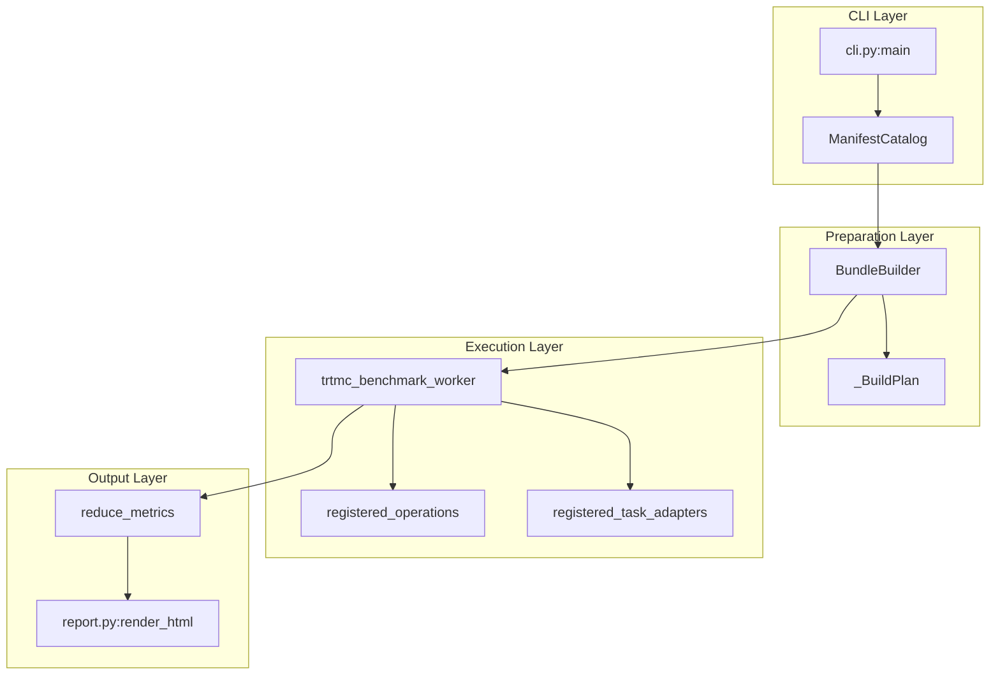
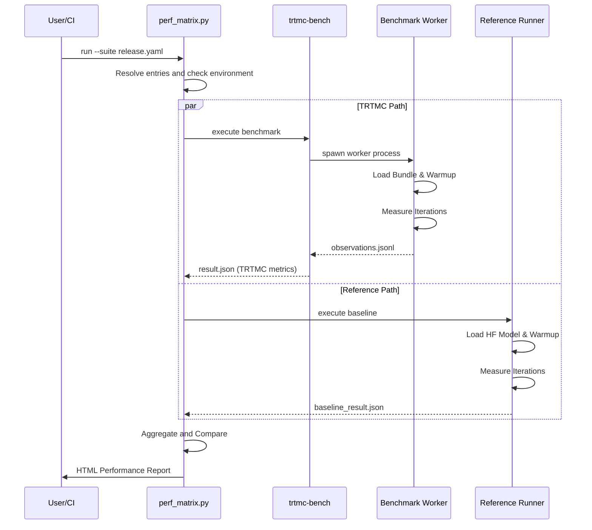

<!-- source: DeepWiki mcp.deepwiki.com · repo NVIDIA/TensorRT-Model-Connect · page 4.4 Performance Benchmarking: perf_matrix and trtmc-bench · fetched 2026-10-26 -->

# Performance Benchmarking: perf_matrix and trtmc-bench

Relevant source files

The following files were used as context for generating this wiki page:

- [benchmarks/performance/README.md](benchmarks/performance/README.md)
- [benchmarks/performance/baselines/task_reference.py](benchmarks/performance/baselines/task_reference.py)
- [benchmarks/performance/release.yaml](benchmarks/performance/release.yaml)
- [python/tensorrt_model_connect/benchmark/builder.py](python/tensorrt_model_connect/benchmark/builder.py)
- [python/tensorrt_model_connect/benchmark/catalog.py](python/tensorrt_model_connect/benchmark/catalog.py)
- [python/tensorrt_model_connect/benchmark/cli.py](python/tensorrt_model_connect/benchmark/cli.py)
- [python/tensorrt_model_connect/benchmark/metrics.py](python/tensorrt_model_connect/benchmark/metrics.py)
- [python/tensorrt_model_connect/benchmark/operations.py](python/tensorrt_model_connect/benchmark/operations.py)
- [python/tensorrt_model_connect/benchmark/report.py](python/tensorrt_model_connect/benchmark/report.py)
- [python/tensorrt_model_connect/benchmark/task_adapters.py](python/tensorrt_model_connect/benchmark/task_adapters.py)
- [python/tensorrt_model_connect/benchmark/types.py](python/tensorrt_model_connect/benchmark/types.py)
- [scripts/perf_evolve_prompt.py](scripts/perf_evolve_prompt.py)
- [src/runtime/backend/trt_module_impl.cpp](src/runtime/backend/trt_module_impl.cpp)
- [src/runtime/backend/trt_module_impl.h](src/runtime/backend/trt_module_impl.h)
- [tests/builder/test_engine_builder.py](tests/builder/test_engine_builder.py)
- [tests/cpp/test_cuda_graph.cpp](tests/cpp/test_cuda_graph.cpp)
- [tests/cpp/test_trt_module.cpp](tests/cpp/test_trt_module.cpp)
- [tests/tools/test_perf_matrix.py](tests/tools/test_perf_matrix.py)
- [tests/tools/test_trtmc_bench.py](tests/tools/test_trtmc_bench.py)
- [tools/__init__.py](tools/__init__.py)
- [tools/auto_perf_tune.py](tools/auto_perf_tune.py)
- [tools/classify_bottleneck.py](tools/classify_bottleneck.py)
- [tools/debug_diffusion_pipeline.py](tools/debug_diffusion_pipeline.py)
- [tools/diff_layers.py](tools/diff_layers.py)
- [tools/diff_logits.py](tools/diff_logits.py)
- [tools/diff_vl.py](tools/diff_vl.py)
- [tools/diffusion_helpers.py](tools/diffusion_helpers.py)
- [tools/perf_compare.py](tools/perf_compare.py)
- [tools/perf_matrix.py](tools/perf_matrix.py)
- [tools/validate_dit.py](tools/validate_dit.py)
- [tools/validate_t5.py](tools/validate_t5.py)
- [website/docs/reference/benchmarking.md](website/docs/reference/benchmarking.md)

Performance benchmarking in TensorRT-Model-Connect (TRTMC) is divided into two layers: `trtmc-bench`, a high-level CLI for executing standardized benchmark workloads with automated bundle management, and `tools/perf_matrix.py`, an orchestrator that runs TRTMC against reference backends (e.g., Hugging Face Transformers) to generate comparative performance reports.

## The Benchmark Suite: release.yaml

The benchmarking process is driven by a suite configuration, typically `benchmarks/performance/release.yaml`. This file defines the "ground truth" for performance comparisons across the repository [benchmarks/performance/release.yaml:4-31]().

### Suite Structure
*   **Defaults**: Global settings for `warmup` and `iterations` [benchmarks/performance/release.yaml:7-19]().
*   **Entries**: Individual comparison rows mapping a `family` and `operation` to a specific `model` profile [benchmarks/performance/release.yaml:31-41]().
*   **Workload**: Specifies the `testcase` (from the ManifestCatalog) and optional `request` overrides (e.g., `max_new_tokens`) [benchmarks/performance/release.yaml:36-41]().
*   **Baseline**: Defines the reference runner (e.g., `hf-transformers`, `task-reference`), the execution `mode` (e.g., `torch-compile`, `hf-eager`), and the `timing_scope` [benchmarks/performance/release.yaml:38-41]().

Sources: [benchmarks/performance/release.yaml:1-245](), [benchmarks/performance/README.md:98-126]()

---

## perf_matrix.py: Orchestration and Comparison

`tools/perf_matrix.py` is the top-level tool used to validate and run the performance matrix. It manages the lifecycle of both TRTMC measurements and reference baseline measurements [tools/perf_matrix.py:5-31]().

### Key Commands
| Command | Description |
| :--- | :--- |
| `check` | Validates that all selected models have corresponding suite entries and that environment paths are correct [tools/perf_matrix.py:152-152](). |
| `run` | Executes the matrix. It calls `trtmc-bench` for TRTMC metrics and separate reference scripts for baselines [tools/perf_matrix.py:153-153](). |
| `resume` | Continues an interrupted run, retrying only failed or missing entries [tools/perf_matrix.py:188-188](). |
| `report` | Aggregates `result.json` files and preparation evidence into a comparative HTML report [tools/perf_matrix.py:195-204](). |

### Reference Execution
Reference benchmarks are executed in isolated Python processes to prevent dependency pollution [benchmarks/performance/README.md:8-11]().
*   **HF Transformers**: Handled by `benchmarks/performance/baselines/hf_transformers.py`.
*   **Task Reference**: Handled by `benchmarks/performance/baselines/task_reference.py` for non-text modalities like Audio (Whisper/Canary) or Vision (DINOv3) [benchmarks/performance/baselines/task_reference.py:5-24]().

Sources: [tools/perf_matrix.py:1-225](), [benchmarks/performance/README.md:23-97](), [benchmarks/performance/baselines/task_reference.py:1-120]()

---

## trtmc-bench: The TRTMC Benchmark Engine

The `trtmc-bench` CLI (implemented in `tensorrt_model_connect.benchmark.cli`) provides a standardized interface for measuring TRTMC performance. It handles model resolution, bundle building, and metric collection.

### Component Association

Title: trtmc-bench Code Entity Space

Sources: [python/tensorrt_model_connect/benchmark/cli.py:1-30](), [python/tensorrt_model_connect/benchmark/builder.py:86-104](), [tests/tools/test_trtmc_bench.py:174-211]()

### Bundle Resolution and Caching
`BundleBuilder` ensures that the required `.bundle` artifact exists before benchmarking starts. It uses a `cache_key` derived from the model identity, manifest hash, and build options to avoid redundant builds [python/tensorrt_model_connect/benchmark/builder.py:86-130]().

*   **Cache Identity**: The `cache_key` includes `builder_sources_sha256`, `platform`, and `build_settings` [python/tensorrt_model_connect/benchmark/builder.py:172-190]().
*   **Build Isolation**: Builds are performed via subprocess calls to the `trtmc build` CLI to ensure the build environment does not affect the measurement process [python/tensorrt_model_connect/benchmark/builder.py:191-200]().

### Benchmark Worker Execution
Measurements are performed by a `trtmc_benchmark_worker`. This worker:
1.  Loads the `.bundle` using the TRTMC C++ API.
2.  Performs `warmup` iterations to prime CUDA graphs and allocators [tests/tools/test_trtmc_bench.py:60-67]().
3.  Executes `iterations` and records `observations.jsonl` containing per-iteration wall-clock time and output metadata [tests/tools/test_trtmc_bench.py:68-78]().

Sources: [python/tensorrt_model_connect/benchmark/builder.py:1-200](), [tests/tools/test_trtmc_bench.py:38-83]()

---

## Data Flow: From Request to Report

The following diagram illustrates the data flow from a user command to the final performance report.

Title: Performance Data Flow

Sources: [tools/perf_matrix.py:127-205](), [tests/tools/test_perf_matrix.py:76-142](), [benchmarks/performance/baselines/task_reference.py:98-120]()

---

## Metrics and Timing Scopes

TRTMC supports multiple timing scopes to ensure fair comparisons with different frameworks.

### Measurement Policy
The measurement policy, defined in the benchmark run schema, determines what is included in the latency metrics [tests/tools/test_perf_matrix.py:123-130]().

*   **public_pipeline_call_wall**: Measures the full time spent in the C++ `IPipeline` call, including H2D/D2H transfers and input preparation [src/runtime/backend/trt_module_impl.cpp:125-158]().
*   **task-model-call-wall**: Used for reference runners where only the model forward pass is timed, excluding tokenization or post-processing [benchmarks/performance/release.yaml:56-57]().
*   **asset_loading_included**: A boolean flag indicating if weights/engine loading time is part of the benchmark (usually false for steady-state throughput tests) [tests/tools/test_perf_matrix.py:109-110]().

### Metric Reduction
`reduce_metrics` calculates statistical aggregates from the iteration observations [tests/tools/test_trtmc_bench.py:27-27]().
*   **Latency**: p50, p90, p95, and p99 percentiles [tests/tools/test_trtmc_bench.py:136-137]().
*   **Throughput**: Tokens per second (for LLMs) or Samples per second (for Vision/Audio) [tests/tools/test_trtmc_bench.py:138-138]().

Sources: [src/runtime/backend/trt_module_impl.cpp:125-160](), [tests/tools/test_trtmc_bench.py:117-157](), [python/tensorrt_model_connect/benchmark/metrics.py:1-20]()

---

