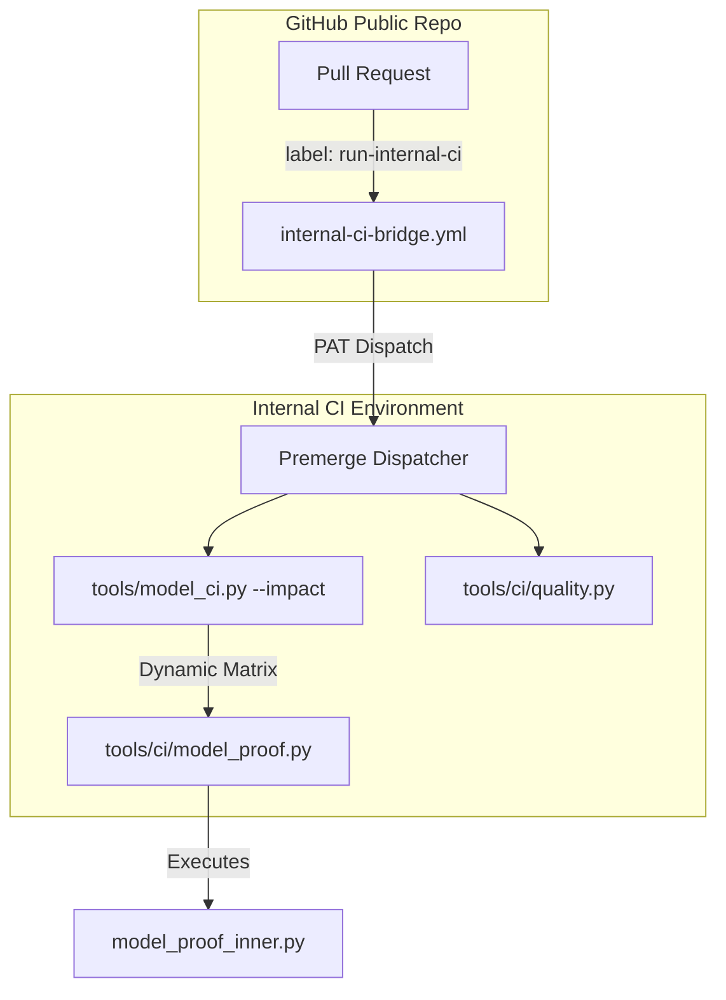
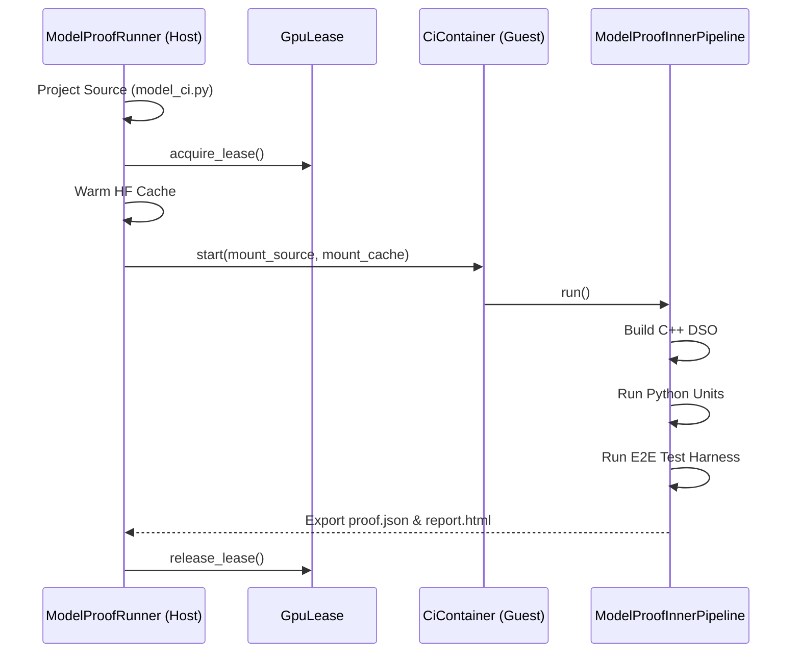

<!-- source: DeepWiki mcp.deepwiki.com · repo NVIDIA/TensorRT-Model-Connect · page 5 CI/CD Infrastructure · fetched 2026-10-26 -->

# CI/CD Infrastructure

Relevant source files

The following files were used as context for generating this wiki page:

- [.github/workflows/internal-ci-bridge.yml](.github/workflows/internal-ci-bridge.yml)
- [Dockerfile](Dockerfile)
- [Dockerfile.dev.aarch64](Dockerfile.dev.aarch64)
- [Dockerfile.dev.x86](Dockerfile.dev.x86)
- [tests/e2e/conftest.py](tests/e2e/conftest.py)
- [tests/e2e/models/minimax_h3/e2e_plugins/__init__.py](tests/e2e/models/minimax_h3/e2e_plugins/__init__.py)
- [tests/e2e/models/minimax_h3/test_minimax_h3_e2e.py](tests/e2e/models/minimax_h3/test_minimax_h3_e2e.py)
- [tests/e2e/models/qwen/test_perf_parity.py](tests/e2e/models/qwen/test_perf_parity.py)
- [tests/tools/test_github_actions_ci.py](tests/tools/test_github_actions_ci.py)
- [tests/tools/test_model_ci.py](tests/tools/test_model_ci.py)
- [tests/tools/test_model_proof_runner.py](tests/tools/test_model_proof_runner.py)
- [tests/tools/test_selected_wheel_runtime.py](tests/tools/test_selected_wheel_runtime.py)
- [tests/tools/test_test_impact.py](tests/tools/test_test_impact.py)
- [tools/ci/README.md](tools/ci/README.md)
- [tools/ci/__main__.py](tools/ci/__main__.py)
- [tools/ci/gpu_lease.py](tools/ci/gpu_lease.py)
- [tools/ci/model_proof.py](tools/ci/model_proof.py)
- [tools/ci/model_proof_inner.py](tools/ci/model_proof_inner.py)
- [tools/ci/quality.py](tools/ci/quality.py)
- [tools/ci/selected_wheel.py](tools/ci/selected_wheel.py)
- [tools/model_ci.py](tools/model_ci.py)
- [tools/test_impact.py](tools/test_impact.py)
- [website/docs/getting-started/source-build.md](website/docs/getting-started/source-build.md)

The TensorRT-Model-Connect CI/CD infrastructure is designed to provide high-confidence validation for a diverse set of model families while maintaining developer velocity through selective test execution. The system bridges public GitHub Actions with private high-performance GPU runners, ensuring that every code change is certified through a hermetic "Model Proof" process.

## Architecture Overview

The CI pipeline follows a tiered execution strategy:
1.  **Authorization**: A trusted bridge validates the PR metadata and dispatches work to the internal infrastructure.
2.  **Selection**: Impact analysis identifies exactly which models and unit tests are affected by the diff.
3.  **Source Quality**: Parallel CPU-bound checks for linting, formatting, and static contracts.
4.  **Model Proofs**: Isolated, containerized jobs that build and test specific models on hardware.

### CI/CD System Bridge
The following diagram illustrates the flow from a GitHub Pull Request to the execution of internal CI tasks.

**CI Dispatch and Execution Flow**

Sources: [tools/ci/README.md:17-30](), [.github/workflows/internal-ci-bridge.yml:29-41]()

---

## GitHub Actions and Test Impact Analysis

The entry point for CI is the `internal-ci-bridge.yml` workflow. It acts as a security boundary, ensuring that only trusted maintainers can trigger GPU-heavy internal jobs by adding the `run-internal-ci` label.

Once triggered, the system uses `test_impact.py` and `model_ci.py` to minimize the test surface:
*   **Zero-False-Negative Guarantee**: Any file not matching a known "no-impact" rule triggers a fallback to a broader test set.
*   **Model Ownership**: Files within a model's ownership root (e.g., `src/runtime/models/<name>`) are mapped directly to that model's proof job.
*   **Source Projection**: The CI creates a "positive projection" of the repository, including only the platform core and the specific model under test, preventing hidden dependencies between model families.

For details on dispatch logic and selection rules, see [GitHub Actions Workflows and Test Impact Analysis](#5.1).

Sources: [tools/test_impact.py:5-17](), [tools/model_ci.py:5-13](), [.github/workflows/internal-ci-bridge.yml:53-102]()

---

## Model Proof: Hermetic Certification

A "Model Proof" is an isolated job that certifies a single model family against a specific code revision. This is managed by the `ModelProofRunner` (host-side) and `ModelProofInnerPipeline` (container-side).

Key components include:
*   **GpuLease**: A coordination mechanism to acquire either a whole GPU or specific slots for testing.
*   **HF Cache Warmer**: Pre-fetches required Hugging Face checkpoints to the host to avoid network bottlenecks and redundant downloads during container execution.
*   **Hermetic Environment**: The model is built and tested in a clean container where only approved source files and dependencies are visible.

**Model Proof Internal Sequence**

Sources: [tools/ci/model_proof.py:29-35](), [tools/ci/README.md:163-183]()

For details on the proof lifecycle and lease management, see [Model Proof: Hermetic Certification Pipeline](#5.2).

---

## Docker Environments and Python Profiles

The CI infrastructure maintains standardized build environments via `Dockerfile` (ARM64) and `Dockerfile.dev.x86`. These images provide the necessary TensorRT, CUDA, and Python stacks.

The system manages complexity through:
*   **Python Profiles**: Defined in `python_profiles.py`, these manage varying dependency requirements for different model families (e.g., specialized audio or vision libraries).
*   **SelectedWheelRuntime**: A mechanism to validate the generated wheels by installing them into a clean environment and running tests against the installed artifacts rather than the source tree.

For details on image management and dependency profiling, see [Docker Environments and Python Profiles](#5.3).

Sources: [Dockerfile:4-9](), [tools/ci/selected_wheel.py:21-22](), [website/docs/getting-started/source-build.md:9-32]()

---

## Primary CI Subsystems

| Subsystem | Primary Code Entities | Purpose |
| :--- | :--- | :--- |
| **Bridge** | `internal-ci-bridge.yml` | Authorization and PAT-based dispatch. |
| **Selection** | `test_impact.py`, `model_ci.py` | Change detection and source projection. |
| **Orchestration** | `CiPipeline`, `ContainerStageRunner` | Host-to-guest execution flow. |
| **Certification** | `ModelProofRunner`, `ModelProofInnerPipeline` | Hermetic model building and E2E validation. |
| **Resources** | `GpuLease`, `CiContainer` | GPU slot management and container isolation. |

Sources: [tools/ci/README.md:15-30](), [tools/ci/stage.py:23-23](), [tools/ci/pipeline.py:12-13]()

---

