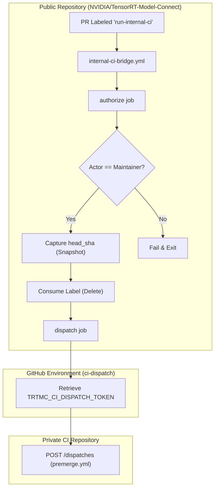
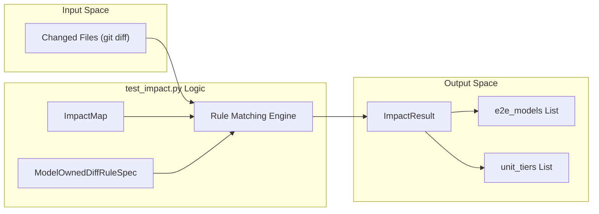

<!-- source: DeepWiki mcp.deepwiki.com · repo NVIDIA/TensorRT-Model-Connect · page 5.1 GitHub Actions Workflows and Test Impact Analysis · fetched 2026-10-26 -->

# GitHub Actions Workflows and Test Impact Analysis

Relevant source files

The following files were used as context for generating this wiki page:

- [.github/workflows/internal-ci-bridge.yml](.github/workflows/internal-ci-bridge.yml)
- [Dockerfile](Dockerfile)
- [Dockerfile.dev.aarch64](Dockerfile.dev.aarch64)
- [Dockerfile.dev.x86](Dockerfile.dev.x86)
- [tests/tools/test_coverage_map.py](tests/tools/test_coverage_map.py)
- [tests/tools/test_github_actions_ci.py](tests/tools/test_github_actions_ci.py)
- [tests/tools/test_model_ci.py](tests/tools/test_model_ci.py)
- [tests/tools/test_test_impact.py](tests/tools/test_test_impact.py)
- [tools/coverage_map/__init__.py](tools/coverage_map/__init__.py)
- [tools/coverage_map/cpp_collector.py](tools/coverage_map/cpp_collector.py)
- [tools/coverage_map/fetch_latest.py](tools/coverage_map/fetch_latest.py)
- [tools/coverage_map/generate.py](tools/coverage_map/generate.py)
- [tools/coverage_map/python_collector.py](tools/coverage_map/python_collector.py)
- [tools/coverage_map/select_tests.py](tools/coverage_map/select_tests.py)
- [tools/model_ci.py](tools/model_ci.py)
- [tools/test_impact.py](tools/test_impact.py)
- [website/docs/getting-started/source-build.md](website/docs/getting-started/source-build.md)

The TensorRT-Model-Connect CI infrastructure is designed to provide high-confidence validation for a large and diverse set of model families while maintaining fast turnaround times for developers. This is achieved through a multi-stage dispatch system and a rigorous **Test Impact Analysis (TIA)** that identifies the minimal set of tests required for any given code change.

## Internal CI Bridge and Dispatch

The repository uses a bridge pattern to securely trigger internal CI jobs from public pull requests. This ensures that sensitive resources (like internal GPU clusters) are protected while allowing community contributions to be validated.

### Authorization and Snapshotting
The `internal-ci-bridge.yml` workflow acts as the gatekeeper. It is triggered by the `run-internal-ci` label on a pull request or via manual `workflow_dispatch` [.github/workflows/internal-ci-bridge.yml:9-19]().

1.  **Authorization**: The `authorize` job verifies that the actor has `maintain` or `admin` permissions [.github/workflows/internal-ci-bridge.yml:67-78]().
2.  **Snapshotting**: The workflow captures the exact `head_sha` of the PR to prevent race conditions where a PR is updated after the CI label is applied [.github/workflows/internal-ci-bridge.yml:53-102]().
3.  **Label Cleanup**: The `run-internal-ci` label is automatically removed after authorization [.github/workflows/internal-ci-bridge.yml:104-112]().

### PAT-Based Dispatch
Once authorized, the `dispatch` job uses a fine-grained Personal Access Token (PAT) stored in a protected environment to trigger the actual CI pipeline in a private repository [.github/workflows/internal-ci-bridge.yml:125-154]().

### Bridge Workflow Data Flow
The following diagram illustrates the flow from a GitHub event to the internal CI dispatch.

**Workflow: CI Dispatch Bridge**

**Sources:** [.github/workflows/internal-ci-bridge.yml:4-154](), [tests/tools/test_github_actions_ci.py:101-181]()

---

## Test Impact Analysis (TIA)

The `test_impact.py` tool is the core engine for selective CI execution. It implements a "zero false negative" guarantee: any file that does not match a known safety rule or specific model ownership path triggers the full suite of tests [.tools/test_impact.py:8-10]().

### Implementation Logic
The analyzer maps changed files to specific "impacted" entities:
*   **Model Families**: Changes to `python/tensorrt_model_connect/families/<name>/` map to that specific family [.tools/model_ci.py:32]().
*   **Runtime Strategies**: Changes to C++ model plugins in `src/runtime/models/<name>/` map to the corresponding runtime strategy [.tools/model_ci.py:33]().
*   **Shared Helpers**: Changes to shared C++ files (e.g., `diffusion_helpers`) trigger all related task strategies (e.g., all diffusion models) [.tools/test_impact.py:100-116]().
*   **No-Impact Patterns**: Documentation, agent skills, and license files are explicitly ignored [.tools/test_impact.py:129-145]().

### Key Data Structures
| Class | Purpose |
| :--- | :--- |
| `ImpactMap` | Aggregates mappings from families, strategies, and paths to specific model lists [.tools/test_impact.py:180-203](). |
| `ImpactResult` | The final selection of E2E models, unit test tiers, and C++ rebuild flags [.tools/test_impact.py:206-218](). |
| `RuleMatch` | Records why a specific test was selected (the rule and the matching file) [.tools/test_impact.py:163-168](). |

**Code Entity Space: Test Impact Resolution**

**Sources:** [.tools/test_impact.py:19-218](), [tests/tools/test_test_impact.py:80-167]()

---

## Model Ownership and Source Projection

To ensure hermetic builds and clear boundaries, the codebase uses a `MODEL.toml` ownership pattern. The `model_ci.py` tool validates this ownership and handles "source projection"—creating a minimal source tree for a specific model's CI job.

### Ownership Validation
Ownership is determined by the directory structure below four main roots:
1.  `python/tensorrt_model_connect/families/`
2.  `src/runtime/models/`
3.  `tests/e2e/models/`
4.  `tests/cpp/models/`

Each model directory must contain a `MODEL.toml` that identifies its logical ID [.tools/model_ci.py:31-36]().

### Positive Source Projection
When a CI job runs for a specific model (e.g., Qwen), `model_ci.py` projects the source tree such that only the platform core and the specific model's files are visible. This prevents cross-model dependencies from leaking into the build.

*   **Platform Projection**: A hardcoded allowlist of core files (CMakeLists.txt, core runtime, etc.) that every model needs [.tools/model_ci.py:49-121]().
*   **Model Projection**: Only files belonging to the specific model's ownership directories are included [.tools/model_ci.py:161-195]().

**Sources:** [.tools/model_ci.py:5-121](), [tests/tools/test_model_ci.py:45-98]()

---

## Coverage-Based Selection

In addition to static rule-based impact analysis, the system supports dynamic selection via coverage maps.

### Collector Pipeline
1.  **Python Collector**: Parses `.coverage` SQLite databases generated by `pytest-cov`. It maps source files to the specific test functions that executed them [.tools/coverage_map/python_collector.py:22-72]().
2.  **C++ Collector**: Parses `gcovr` JSON reports to identify which source files were touched by C++ unit tests [.tools/coverage_map/cpp_collector.py:23-158]().
3.  **Map Generation**: `generate.py` merges these into a unified `coverage_map.json` [.tools/coverage_map/generate.py:23-29]().

### Selection Logic
The `select_tests.py` script takes a list of changed files and queries the coverage map to find all tests that previously exercised those files. This provides a fine-grained alternative to the broad fallback rules in `test_impact.py` [.tools/coverage_map/select_tests.py:25]().

**Sources:** [.tools/coverage_map/generate.py:1-174](), [tests/tools/test_coverage_map.py:29-163]()

---

