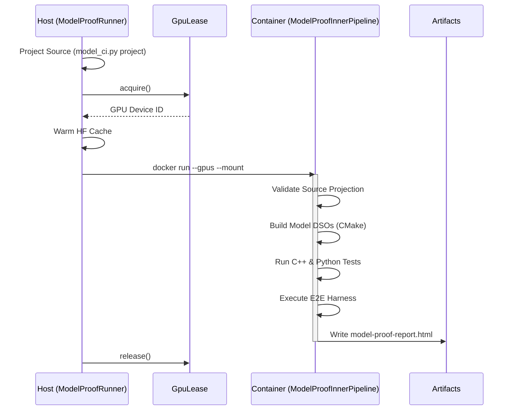
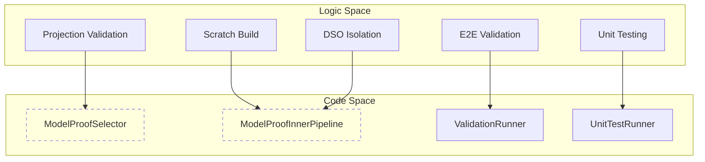

<!-- source: DeepWiki mcp.deepwiki.com · repo NVIDIA/TensorRT-Model-Connect · page 5.2 Model Proof: Hermetic Certification Pipeline · fetched 2026-10-26 -->

# Model Proof: Hermetic Certification Pipeline

Relevant source files

The following files were used as context for generating this wiki page:

- [.github/scripts/build-python-profiles.py](.github/scripts/build-python-profiles.py)
- [python/tensorrt_model_connect/families/personaplex/full_duplex_evaluator_verify.py](python/tensorrt_model_connect/families/personaplex/full_duplex_evaluator_verify.py)
- [python/tensorrt_model_connect/families/personaplex/mimi_streaming_encoder.py](python/tensorrt_model_connect/families/personaplex/mimi_streaming_encoder.py)
- [python/tensorrt_model_connect/families/personaplex/mimi_weights.py](python/tensorrt_model_connect/families/personaplex/mimi_weights.py)
- [python/tensorrt_model_connect/families/personaplex/python_profile_requirements/full_duplex_evaluator.lock.txt](python/tensorrt_model_connect/families/personaplex/python_profile_requirements/full_duplex_evaluator.lock.txt)
- [python/tensorrt_model_connect/families/qwen/builder_policy.py](python/tensorrt_model_connect/families/qwen/builder_policy.py)
- [python/tensorrt_model_connect/families/qwen/dual_profile_decoder_builder.py](python/tensorrt_model_connect/families/qwen/dual_profile_decoder_builder.py)
- [python/tensorrt_model_connect/families/qwen/dual_profile_decoder_tp_builder.py](python/tensorrt_model_connect/families/qwen/dual_profile_decoder_tp_builder.py)
- [python/tensorrt_model_connect/families/qwen/standard_decoder_builder.py](python/tensorrt_model_connect/families/qwen/standard_decoder_builder.py)
- [python/tensorrt_model_connect/python_profiles.py](python/tensorrt_model_connect/python_profiles.py)
- [src/runtime/models/qwen/pipeline.cpp](src/runtime/models/qwen/pipeline.cpp)
- [src/runtime/models/qwen/pipeline.h](src/runtime/models/qwen/pipeline.h)
- [tests/builder/test_qwen_runtime_performance_contract.py](tests/builder/test_qwen_runtime_performance_contract.py)
- [tests/e2e/conftest.py](tests/e2e/conftest.py)
- [tests/e2e/models/minimax_h3/e2e_plugins/__init__.py](tests/e2e/models/minimax_h3/e2e_plugins/__init__.py)
- [tests/e2e/models/minimax_h3/test_minimax_h3_e2e.py](tests/e2e/models/minimax_h3/test_minimax_h3_e2e.py)
- [tests/e2e/models/qwen/manifests/qwen3-0.6b-fp8.json](tests/e2e/models/qwen/manifests/qwen3-0.6b-fp8.json)
- [tests/e2e/models/qwen/test_perf_parity.py](tests/e2e/models/qwen/test_perf_parity.py)
- [tests/e2e/models/qwen/test_qwen_builder_policy.py](tests/e2e/models/qwen/test_qwen_builder_policy.py)
- [tests/e2e/models/qwen/test_qwen_manifest_contract.py](tests/e2e/models/qwen/test_qwen_manifest_contract.py)
- [tests/tools/test_e2e_python_profiles.py](tests/tools/test_e2e_python_profiles.py)
- [tests/tools/test_ensure_ci_docker_image.py](tests/tools/test_ensure_ci_docker_image.py)
- [tests/tools/test_model_proof_runner.py](tests/tools/test_model_proof_runner.py)
- [tests/tools/test_selected_wheel_runtime.py](tests/tools/test_selected_wheel_runtime.py)
- [tools/ci/README.md](tools/ci/README.md)
- [tools/ci/__main__.py](tools/ci/__main__.py)
- [tools/ci/container.py](tools/ci/container.py)
- [tools/ci/docker_image.py](tools/ci/docker_image.py)
- [tools/ci/environment.py](tools/ci/environment.py)
- [tools/ci/gpu_lease.py](tools/ci/gpu_lease.py)
- [tools/ci/model_proof.py](tools/ci/model_proof.py)
- [tools/ci/model_proof_inner.py](tools/ci/model_proof_inner.py)
- [tools/ci/quality.py](tools/ci/quality.py)
- [tools/ci/selected_wheel.py](tools/ci/selected_wheel.py)
- [tools/ci/stage.py](tools/ci/stage.py)

The Model Proof is a critical CI stage designed to certify individual model families in isolation. It ensures that a change to one model's logic cannot break another by enforcing a strict "hermetic" boundary through source projection, containerized execution, and private resource leasing.

## Pipeline Architecture

The pipeline is split into a host-side orchestrator (`ModelProofRunner`) and a container-side executor (`ModelProofInnerPipeline`). This separation ensures that sensitive host operations (like GPU lease acquisition and source projection) are decoupled from the model's build and test environment.

### System Orchestration Flow

The following diagram illustrates the transition from the host environment to the isolated proof container.

**Title: Model Proof Execution Flow**

Sources: [tools/ci/model_proof.py:34-150](), [tools/ci/model_proof_inner.py:142-190](), [tools/ci/gpu_lease.py:14-60]()

## Host-Side: ModelProofRunner

The `ModelProofRunner` manages the pre-flight environment for a specific model proof request.

### Source Projection
To prevent cross-model contamination, the runner uses `tools/model_ci.py project` to create a temporary directory containing only:
1. The core `trtmc` framework code.
2. The specific model family being tested (e.g., `python/tensorrt_model_connect/families/qwen`).
3. The specific E2E tests for that model.
Any peer model directories are excluded from the mount.
Sources: [tools/ci/model_proof.py:165-190](), [tools/ci/README.md:174-185]()

### GPU Lease Management
The `GpuLease` class provides a concurrency-safe mechanism for acquiring GPU resources in a multi-tenant CI environment.
- **`GpuLease.acquire()`**: Uses file-based locking (`fcntl`) on `/tmp/trtmc-gpu-leases` to find and claim an available GPU index [tools/ci/gpu_lease.py:75-120]().
- **Evidence**: The lease state is recorded in `gpu-lease.json` and passed into the container to set `NVIDIA_VISIBLE_DEVICES` [tools/ci/model_proof.py:215-230]().

### Selected Wheel Runtime
In nightly or release workflows, the pipeline can use `SelectedWheelRuntime` to test against a pre-built wheel instead of local source.
- It identifies the correct wheel via `TRTMC_SELECTED_WHEEL_DIR`.
- It installs the wheel into a temporary `site-packages` within the container.
- It sets `TRTMC_TEST_INSTALLED_WHEEL=1` to force the E2E harness to import from the installed package rather than the source tree [tests/tools/test_selected_wheel_runtime.py:65-126](), [tests/e2e/conftest.py:23-32]().

Sources: [tools/ci/model_proof.py:15-30](), [tools/ci/gpu_lease.py:10-50](), [tools/ci/selected_wheel.py:12-45]()

## Container-Side: ModelProofInnerPipeline

Once the container starts, `ModelProofInnerPipeline` executes a linear sequence of stages, persisting progress to `model-proof-status.json`.

### Implementation Entities
The following diagram maps the logical proof stages to the specific classes and files responsible for their execution.

**Title: Inner Pipeline Entity Mapping**

Sources: [tools/ci/model_proof_inner.py:142-250](), [tools/ci/model_proof_selection.py:20-80](), [tools/ci/quality.py:30-100](), [tools/ci/validation.py:15-60]()

### Execution Stages

| Stage | Description | Key Artifacts |
| :--- | :--- | :--- |
| **Projection Validation** | Ensures no files from other model families leaked into the `/src` mount. | `source-projection.json` |
| **Scratch Build** | Performs a clean CMake configure and build of the model's C++ DSOs. | `build.log`, `libtrtmc_model_*.so` |
| **DSO Isolation** | Verifies that the model plugin does not have unauthorized dynamic links. | `model-dsos.txt` |
| **Python Tests** | Runs `pytest` on the model-specific builder and utility tests. | `python-model-tests.xml` |
| **E2E Reference** | Runs the E2E harness to build bundles and compare against references (HF or Golden). | `e2e/junit.xml`, `result.json` |
| **Report Generation** | Aggregates all logs and JSON evidence into a single HTML file. | `model-proof-report.html` |

Sources: [tools/ci/model_proof_inner.py:56-73](), [tools/ci/model_proof_inner.py:155-187]()

## Data Flow and Evidence

The pipeline is designed to be "evidence-producing." Every stage must emit a machine-readable artifact that the `ProofStatus` class tracks.

### ProofStatus Lifecycle
1. **Initialization**: Records the model ID, source revision, and GPU lease [tools/ci/model_proof_inner.py:75-98]().
2. **Step Updates**: As `ModelProofInnerPipeline` completes stages, it calls `status.step(name, "passed")` [tools/ci/model_proof_inner.py:100-106]().
3. **Finalization**: Captures the exit codes and a list of up to 200 evidence files to be bundled with the CI artifacts [tools/ci/model_proof_inner.py:111-140]().

### E2E Proof Kinds
The pipeline classifies E2E results into three categories via `_classify_e2e_proof_kinds`:
- `functional_invariant`: The model matches its own expected internal state.
- `reference`: The model matches a Hugging Face Transformers or other reference backend.
- `snapshot_regression`: The model matches a previously recorded "golden" output.

Sources: [tools/ci/model_proof_inner.py:27-54](), [tools/ci/model_proof_inner.py:81-97]()

## Tools and Module Structure

The `tools/ci/` directory is organized by responsibility:

- `__main__.py`: CLI entry point for all CI tasks (e.g., `python3 -m tools.ci model-proof`) [tools/ci/__main__.py:1-50]().
- `model_proof.py`: Host-side orchestration [tools/ci/model_proof.py:1-200]().
- `model_proof_inner.py`: Container-side execution [tools/ci/model_proof_inner.py:1-300]().
- `gpu_lease.py`: GPU resource arbitration [tools/ci/gpu_lease.py:1-150]().
- `docker_image.py`: CI image fingerprinting and verification [tools/ci/docker_image.py:1-100]().
- `python_profiles.py`: Management of specialized venvs for different model families [python/tensorrt_model_connect/python_profiles.py:1-150]().

Sources: [tools/ci/README.md:8-14](), [tools/ci/README.md:37-48]()

---

