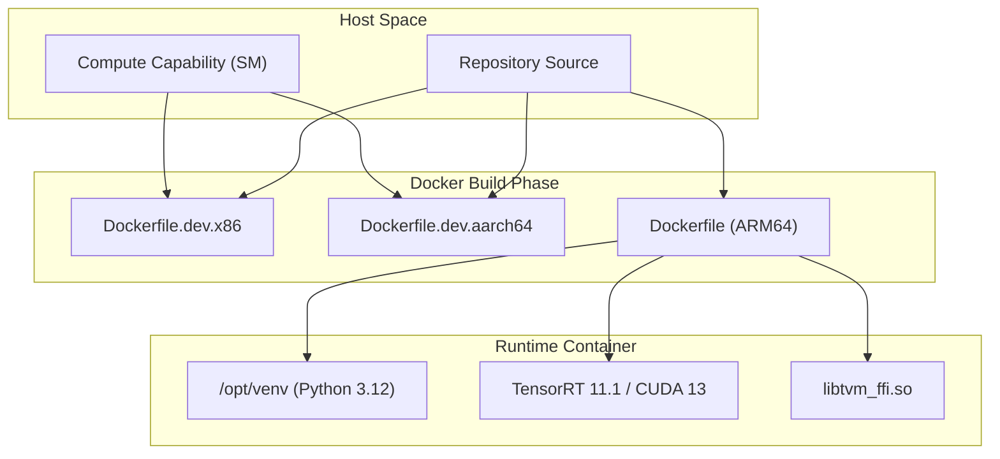
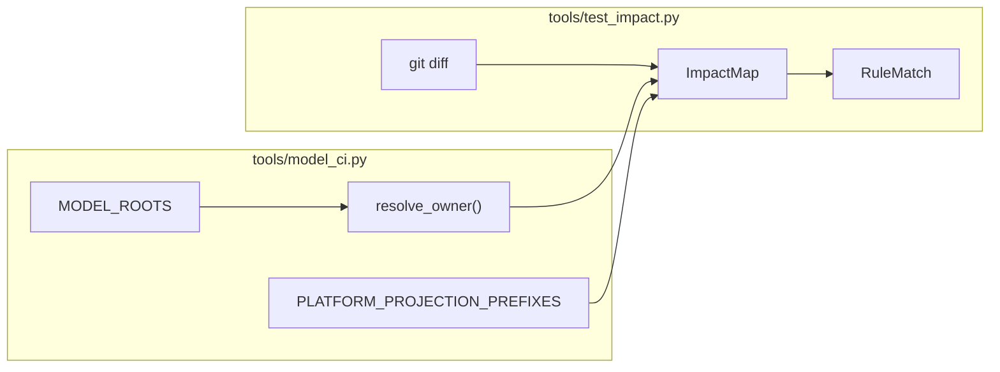

<!-- source: DeepWiki mcp.deepwiki.com · repo NVIDIA/TensorRT-Model-Connect · page 5.3 Docker Environments and Python Profiles · fetched 2026-10-26 -->

# Docker Environments and Python Profiles

Relevant source files

The following files were used as context for generating this wiki page:

- [.github/scripts/build-python-profiles.py](.github/scripts/build-python-profiles.py)
- [.github/workflows/internal-ci-bridge.yml](.github/workflows/internal-ci-bridge.yml)
- [Dockerfile](Dockerfile)
- [Dockerfile.dev.aarch64](Dockerfile.dev.aarch64)
- [Dockerfile.dev.x86](Dockerfile.dev.x86)
- [python/tensorrt_model_connect/families/personaplex/full_duplex_evaluator_verify.py](python/tensorrt_model_connect/families/personaplex/full_duplex_evaluator_verify.py)
- [python/tensorrt_model_connect/families/personaplex/mimi_streaming_encoder.py](python/tensorrt_model_connect/families/personaplex/mimi_streaming_encoder.py)
- [python/tensorrt_model_connect/families/personaplex/mimi_weights.py](python/tensorrt_model_connect/families/personaplex/mimi_weights.py)
- [python/tensorrt_model_connect/families/personaplex/python_profile_requirements/full_duplex_evaluator.lock.txt](python/tensorrt_model_connect/families/personaplex/python_profile_requirements/full_duplex_evaluator.lock.txt)
- [python/tensorrt_model_connect/families/sana_wm/MODEL.toml](python/tensorrt_model_connect/families/sana_wm/MODEL.toml)
- [python/tensorrt_model_connect/families/sana_wm/components/gemma/plugin.py](python/tensorrt_model_connect/families/sana_wm/components/gemma/plugin.py)
- [python/tensorrt_model_connect/python_profiles.py](python/tensorrt_model_connect/python_profiles.py)
- [scripts/warm_hf_cache.py](scripts/warm_hf_cache.py)
- [tests/e2e/models/sana_wm/test_sana_wm_warm_hf_cache_metadata.py](tests/e2e/models/sana_wm/test_sana_wm_warm_hf_cache_metadata.py)
- [tests/runtime_strategy_matrix.yaml](tests/runtime_strategy_matrix.yaml)
- [tests/tools/test_e2e_python_profiles.py](tests/tools/test_e2e_python_profiles.py)
- [tests/tools/test_ensure_ci_docker_image.py](tests/tools/test_ensure_ci_docker_image.py)
- [tests/tools/test_family_specialization.py](tests/tools/test_family_specialization.py)
- [tests/tools/test_github_actions_ci.py](tests/tools/test_github_actions_ci.py)
- [tests/tools/test_model_ci.py](tests/tools/test_model_ci.py)
- [tests/tools/test_test_impact.py](tests/tools/test_test_impact.py)
- [tests/tools/test_warm_hf_cache_static.py](tests/tools/test_warm_hf_cache_static.py)
- [tests/validation/model_workloads.yaml](tests/validation/model_workloads.yaml)
- [tools/ci/docker_image.py](tools/ci/docker_image.py)
- [tools/model_ci.py](tools/model_ci.py)
- [tools/test_impact.py](tools/test_impact.py)
- [website/docs/getting-started/source-build.md](website/docs/getting-started/source-build.md)

This section details the infrastructure used to build, validate, and isolate the execution environments for TensorRT-Model-Connect (TRTMC). The system relies on a tiered Docker strategy to support both high-performance C++ runtime development and heterogeneous Python dependency profiles required by various model families.

## Docker Build Environments

TRTMC maintains three primary Docker environments to support different stages of the development lifecycle and hardware architectures.

### CI Base Image (`Dockerfile`)
The repository-wide development container is defined in `Dockerfile` [Dockerfile:4-7](). It serves as the authoritative environment for ARM64 development, providing the TensorRT 11.1, CUDA 13.0, and Python 3.12 stacks [Dockerfile:9-14](). 

Key characteristics include:
* **System Stack**: Built on `nvcr.io/nvidia/tensorrt:26.07-py3` [Dockerfile:9-10]().
* **Tooling**: Includes `ninja-build`, `cmake`, `patchelf`, and `lcov` for C++ development and coverage analysis [Dockerfile:24-39]().
* **Python Virtual Environment**: Located at `/opt/venv`, inheriting the official TensorRT bindings from the base image [Dockerfile:58-66]().
* **Kernel Bridge**: Installs `apache-tvm-ffi` to allow compiled CUDA modules (like FlashInfer) to be called from TensorRT plugins without Python overhead [Dockerfile:72-77]().

### Development Images (`Dockerfile.dev.x86` and `Dockerfile.dev.aarch64`)
For local development and quick-start paths, specialized Dockerfiles are provided to match the host architecture and specific GPU compute capabilities (SM) [website/docs/getting-started/source-build.md:24-32](). These images are designed to skip CI-only profiles and unrelated model DSOs to reduce build times [website/docs/getting-started/source-build.md:73-74]().

**Docker Environment Data Flow**

Sources: [Dockerfile:9-77](), [website/docs/getting-started/source-build.md:24-43]()

## Python Profile Management

Model families often require conflicting third-party dependencies (e.g., different versions of `transformers` or specialized libraries like `nemo_toolkit`). TRTMC manages this via **Python Profiles**.

### Profile Resolution
Profiles are defined in `python_profiles.py` and are used to create isolated environments for validation workers. The `python_profile_requirements/` directory contains lock files that define the exact dependency set for a given profile, such as the `full_duplex_evaluator` for the PersonaPlex family [python/tensorrt_model_connect/families/personaplex/python_profile_requirements/full_duplex_evaluator.lock.txt:1-1]().

### CI Image Management
The `tools/ci/docker_image.py` utility manages the lifecycle of CI images. It includes a `WorkflowImageLock` class to prevent race conditions when multiple CI runners attempt to rebuild or update the same image [tools/ci/docker_image.py:15-15]().

**Key Functions in `docker_image.py`:**
* `WorkflowImageLock`: A context manager that uses a lock file to synchronize image access across runners [tests/tools/test_ensure_ci_docker_image.py:49-50]().
* `ensure`: Validates that the current environment matches the required profile fingerprints and rebuilds the image if necessary [tests/tools/test_ensure_ci_docker_image.py:214-214]().

Sources: [python/tensorrt_model_connect/python_profiles.py:1-1](), [tools/ci/docker_image.py:15-15](), [tests/tools/test_ensure_ci_docker_image.py:49-74]()

## Reference Environment Validation

To ensure the accuracy of TensorRT models, TRTMC compares them against "Golden" reference implementations (typically Hugging Face Transformers or PyTorch).

### HF Cache Warming
To avoid rate-limiting and ensure deterministic builds in isolated CI environments, the `scripts/warm_hf_cache.py` tool populates a local Hugging Face cache [scripts/warm_hf_cache.py:5-12]().
* **Nightly Mode**: Sequentially downloads all models required for the E2E suite [scripts/warm_hf_cache.py:9-14]().
* **PR CI Mode**: Only downloads models missing from the cache, based on a provided models file [scripts/warm_hf_cache.py:16-22]().

### Dependency Projection
The `tools/model_ci.py` script handles **Positive Source Projection**. It identifies the minimal set of files (Git blobs) required to build and test a specific model family, ensuring that sibling model files are excluded from the isolated build environment [tools/model_ci.py:5-12]().

**Source Projection and Impact Logic**

Sources: [tools/model_ci.py:31-121](), [tools/test_impact.py:5-9](), [tools/test_impact.py:162-203]()

## CI Docker Image Management Tool

The `tools/ci/docker_image.py` script is the primary entry point for managing the CI environment. It performs the following:

| Task | Code Entity | Description |
| :--- | :--- | :--- |
| **Locking** | `WorkflowImageLock` | Uses `flock`-style semantics to ensure only one runner builds an image at a time [tests/tools/test_ensure_ci_docker_image.py:49-74](). |
| **Fingerprinting** | `get_fingerprint()` | Computes a hash of the `Dockerfile` and associated requirements to detect if a rebuild is needed. |
| **Validation** | `check_capability()` | Verifies if the current container has specific capabilities, such as `EncDecRNNTBPEModelWithPrompt` support in NeMo [Dockerfile:135-137](). |

Sources: [tools/ci/docker_image.py:15-15](), [tests/tools/test_ensure_ci_docker_image.py:15-15](), [Dockerfile:135-137]()

---

