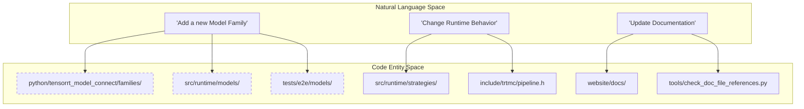
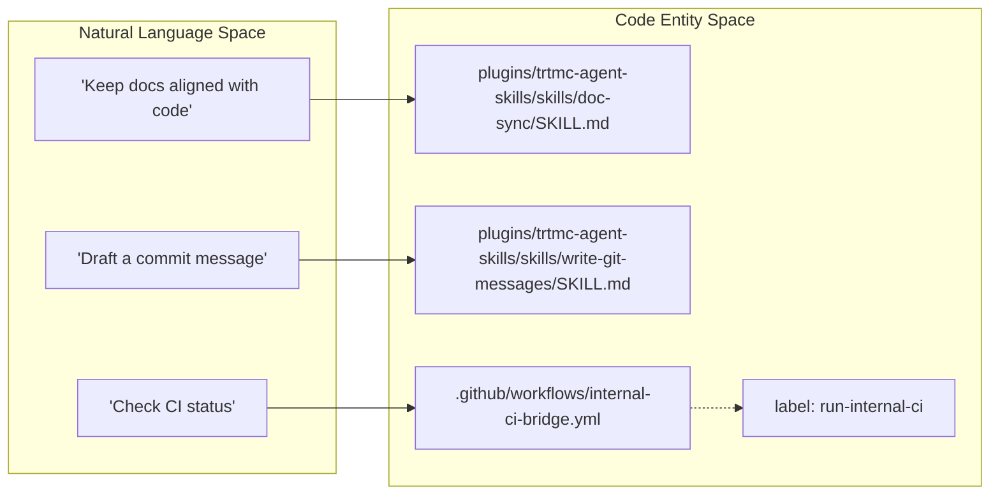

<!-- source: DeepWiki mcp.deepwiki.com · repo NVIDIA/TensorRT-Model-Connect · page 6 Developer and Agent Guide · fetched 2026-10-26 -->

# Developer and Agent Guide

Relevant source files

The following files were used as context for generating this wiki page:

- [.agents/plugins/marketplace.json](.agents/plugins/marketplace.json)
- [.github/workflows/pages.yml](.github/workflows/pages.yml)
- [AGENTS.md](AGENTS.md)
- [CONTRIBUTING.md](CONTRIBUTING.md)
- [plugins/trtmc-agent-skills/.codex-plugin/plugin.json](plugins/trtmc-agent-skills/.codex-plugin/plugin.json)
- [plugins/trtmc-agent-skills/skills/debug-trt-mismatch/SKILL.md](plugins/trtmc-agent-skills/skills/debug-trt-mismatch/SKILL.md)
- [plugins/trtmc-agent-skills/skills/debug-trt-mismatch/agents/openai.yaml](plugins/trtmc-agent-skills/skills/debug-trt-mismatch/agents/openai.yaml)
- [plugins/trtmc-agent-skills/skills/doc-sync/SKILL.md](plugins/trtmc-agent-skills/skills/doc-sync/SKILL.md)
- [plugins/trtmc-agent-skills/skills/doc-sync/agents/openai.yaml](plugins/trtmc-agent-skills/skills/doc-sync/agents/openai.yaml)
- [plugins/trtmc-agent-skills/skills/write-git-messages/SKILL.md](plugins/trtmc-agent-skills/skills/write-git-messages/SKILL.md)
- [plugins/trtmc-agent-skills/skills/write-git-messages/agents/openai.yaml](plugins/trtmc-agent-skills/skills/write-git-messages/agents/openai.yaml)
- [plugins/trtmc-agent-skills/skills/write-git-messages/references/source-notes.md](plugins/trtmc-agent-skills/skills/write-git-messages/references/source-notes.md)
- [website/data/model-support-matrix.md](website/data/model-support-matrix.md)
- [website/docs/extend/contributing.md](website/docs/extend/contributing.md)
- [website/docs/getting-started/overview.md](website/docs/getting-started/overview.md)
- [website/docs/getting-started/project-overview.md](website/docs/getting-started/project-overview.md)
- [website/docs/intro.md](website/docs/intro.md)
- [website/docusaurus.config.js](website/docusaurus.config.js)
- [website/package-lock.json](website/package-lock.json)
- [website/package.json](website/package.json)
- [website/plugins/model-support-inventory/index.js](website/plugins/model-support-inventory/index.js)
- [website/plugins/model-support-inventory/index.test.js](website/plugins/model-support-inventory/index.test.js)
- [website/src/components/ModelSupportInventory/index.js](website/src/components/ModelSupportInventory/index.js)

This guide provides a high-level entry point for technical contributors and AI agents working within the TensorRT-Model-Connect (TRTMC) repository. It covers the standards for extending the framework, utilizing repo-local agent skills, and maintaining the documentation ecosystem.

TRTMC follows a strict **three-sided ownership model** where model-specific knowledge is distributed across Python builders, C++ runtimes, and E2E validation manifests [website/docs/getting-started/project-overview.md:101-111](). Contributors are expected to identify the narrowest owner for their changes to maintain repository modularity [website/docs/extend/contributing.md:37-54]().

## Extension and Contribution

TRTMC is designed to be extensible by study and adaptation of existing reference implementations [website/docs/getting-started/project-overview.md:12-16](). Developers can contribute new model families, optimize existing ones, or refine the core runtime strategies.

### Development Workflow
The contribution process requires a focused branch-and-PR flow [CONTRIBUTING.md:12-158]():
1. **Fork & Clone**: Use a personal fork and track `upstream` [CONTRIBUTING.md:14-25]().
2. **Identify Owner**: Determine if the change belongs to a Python family, C++ runtime, or shared infrastructure [CONTRIBUTING.md:42-57]().
3. **Local Validation**: Run consistency checks using `tools/model_ci.py` and `tools/test_impact.py` [CONTRIBUTING.md:64-80]().
4. **Sign-off**: Every commit must include a DCO sign-off (`git commit --signoff`) [CONTRIBUTING.md:97-101]().
5. **CI Trigger**: Mention maintainers to apply the `run-internal-ci` label [CONTRIBUTING.md:133-152]().

For a detailed walkthrough on adding specific components, see **[Adding Model Families and Runtime Strategies](#6.1)**.

### Natural Language to Code Entity Mapping: Contribution

**Sources:** [website/docs/extend/contributing.md:37-54](), [CONTRIBUTING.md:42-57](), [plugins/trtmc-agent-skills/skills/doc-sync/SKILL.md:94-98]()

---

## Agentic Workflow and Skills

TRTMC includes specialized instructions and tools for AI agents (such as GitHub Copilot or Codex-based agents) to ensure safety and alignment with repository standards. These are defined in `AGENTS.md` and packaged as the `trtmc-agent-skills` plugin [AGENTS.md:1-45]().

### Repo Skills
The `trtmc-agent-skills` plugin provides repo-local automation guidance located in `plugins/trtmc-agent-skills/skills/` [AGENTS.md:36-39](). Key skills include:
*   **`doc-sync`**: Scans for documentation drift against implementation and produces focused PRs [plugins/trtmc-agent-skills/skills/doc-sync/SKILL.md:1-9]().
*   **`write-git-messages`**: Drafts commit messages and PR descriptions following the repository's Conventional Commit style [AGENTS.md:40-44]().
*   **`debug-trt-mismatch`**: Assists in identifying discrepancies between TensorRT engine output and reference implementations.

For full details on agent boundaries and the machine-readable index, see **[Agent Skills and Agentic Workflow](#6.2)**.

### Natural Language to Code Entity Mapping: Agent Skills

**Sources:** [AGENTS.md:34-45](), [plugins/trtmc-agent-skills/skills/doc-sync/SKILL.md:1-9](), [CONTRIBUTING.md:133-152]()

---

## Documentation Website

The TRTMC documentation is built using **Docusaurus** and hosted via GitHub Pages [website/docusaurus.config.js:9-37](). It features a dynamic model support inventory generated from model-owned metadata [website/docs/intro.md:87-92]().

### Build and Deployment
The documentation site is managed in the `website/` directory and deployed via the `pages.yml` workflow [website/package.json:1-27](), [.github/workflows/pages.yml:1-17]().

| Task | Command | File Reference |
| :--- | :--- | :--- |
| **Install Dependencies** | `npm install` | [website/package.json:14-23]() |
| **Build Site** | `npm run build` | [website/package.json:6]() |
| **Render Diagrams** | `npm run diagrams:build` | [website/package.json:8]() |
| **Test Inventory** | `npm run test:model-support` | [website/package.json:12]() |
| **Local Preview** | `npm run start` | [website/package.json:11]() |

### Content Structure
The website sources are organized into six primary sections to maintain a consistent newcomer path [plugins/trtmc-agent-skills/skills/doc-sync/SKILL.md:36-48]():
*   **Getting Started**: `website/docs/getting-started/`
*   **Learn & Tutorials**: `website/docs/tutorials/`
*   **API Reference**: `website/docs/api/`
*   **Architecture & Design**: `website/docs/architecture/`
*   **Contribute & Extend**: `website/docs/extend/`
*   **Feature Reference**: `website/docs/features/`

**Sources:** [website/package.json:1-27](), [.github/workflows/pages.yml:1-86](), [plugins/trtmc-agent-skills/skills/doc-sync/SKILL.md:36-54]()

---

