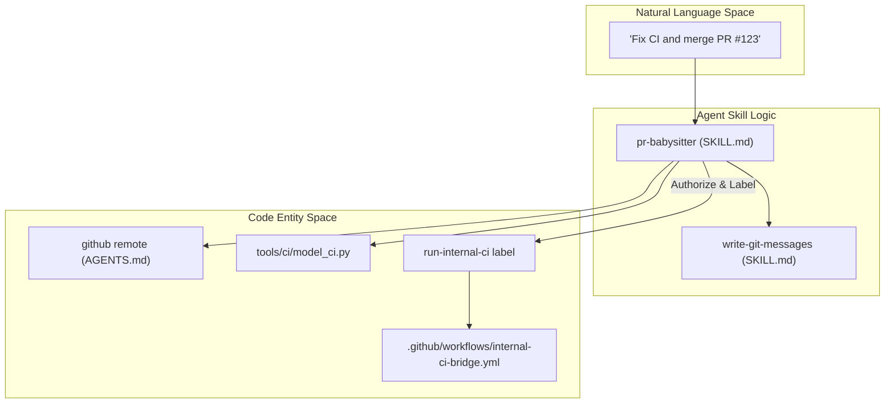
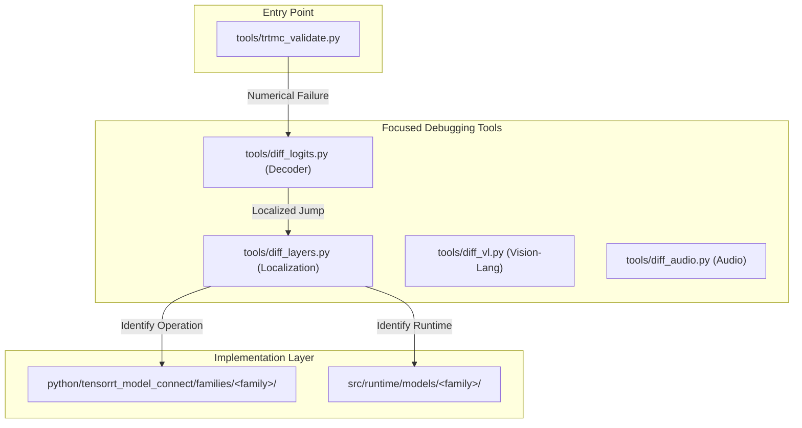

<!-- source: DeepWiki mcp.deepwiki.com · repo NVIDIA/TensorRT-Model-Connect · page 6.2 Agent Skills and Agentic Workflow · fetched 2026-10-26 -->

# Agent Skills and Agentic Workflow

Relevant source files

The following files were used as context for generating this wiki page:

- [.agents/plugins/marketplace.json](.agents/plugins/marketplace.json)
- [AGENTS.md](AGENTS.md)
- [plugins/trtmc-agent-skills/.codex-plugin/plugin.json](plugins/trtmc-agent-skills/.codex-plugin/plugin.json)
- [plugins/trtmc-agent-skills/skills/debug-trt-mismatch/SKILL.md](plugins/trtmc-agent-skills/skills/debug-trt-mismatch/SKILL.md)
- [plugins/trtmc-agent-skills/skills/debug-trt-mismatch/agents/openai.yaml](plugins/trtmc-agent-skills/skills/debug-trt-mismatch/agents/openai.yaml)
- [plugins/trtmc-agent-skills/skills/doc-sync/SKILL.md](plugins/trtmc-agent-skills/skills/doc-sync/SKILL.md)
- [plugins/trtmc-agent-skills/skills/doc-sync/agents/openai.yaml](plugins/trtmc-agent-skills/skills/doc-sync/agents/openai.yaml)
- [plugins/trtmc-agent-skills/skills/pr-babysitter/SKILL.md](plugins/trtmc-agent-skills/skills/pr-babysitter/SKILL.md)
- [plugins/trtmc-agent-skills/skills/submit-github-pr/SKILL.md](plugins/trtmc-agent-skills/skills/submit-github-pr/SKILL.md)
- [plugins/trtmc-agent-skills/skills/write-git-messages/SKILL.md](plugins/trtmc-agent-skills/skills/write-git-messages/SKILL.md)
- [plugins/trtmc-agent-skills/skills/write-git-messages/agents/openai.yaml](plugins/trtmc-agent-skills/skills/write-git-messages/agents/openai.yaml)
- [plugins/trtmc-agent-skills/skills/write-git-messages/references/source-notes.md](plugins/trtmc-agent-skills/skills/write-git-messages/references/source-notes.md)
- [tests/tools/test_public_source_hygiene.py](tests/tools/test_public_source_hygiene.py)
- [website/docs/getting-started/build-and-run.md](website/docs/getting-started/build-and-run.md)
- [website/docs/getting-started/environment-and-repro.md](website/docs/getting-started/environment-and-repro.md)
- [website/docs/getting-started/glossary.md](website/docs/getting-started/glossary.md)
- [website/docs/learning-path.md](website/docs/learning-path.md)
- [website/docs/reference/testing.md](website/docs/reference/testing.md)
- [website/docs/tutorials/advanced/validation-and-benchmarking.md](website/docs/tutorials/advanced/validation-and-benchmarking.md)
- [website/docs/tutorials/beginner/inspect-bundles.md](website/docs/tutorials/beginner/inspect-bundles.md)
- [website/docs/tutorials/beginner/text-generation.md](website/docs/tutorials/beginner/text-generation.md)
- [website/docs/tutorials/intermediate/diffusion-and-time-series.md](website/docs/tutorials/intermediate/diffusion-and-time-series.md)
- [website/docs/tutorials/intermediate/multimodal-and-speech.md](website/docs/tutorials/intermediate/multimodal-and-speech.md)

This page describes the `trtmc-agent-skills` Codex plugin, the available repository-local skills, and the agentic workflow rules defined in `AGENTS.md`. These tools allow AI agents to perform complex tasks such as debugging TensorRT mismatches, managing GitHub PR lifecycles, and maintaining documentation while adhering to the repository's safety and privacy boundaries.

## Repository Skills Overview

TensorRT-Model-Connect provides a suite of specialized skills for AI agents, registered through `.agents/plugins/marketplace.json` and implemented in `plugins/trtmc-agent-skills/skills/` [AGENTS.md:36-39](). These skills enable a "machine-readable" interface to the codebase, allowing agents to act as automated maintainers.

### Core Skill Inventory

| Skill Name | Purpose | Key File |
| :--- | :--- | :--- |
| `write-git-messages` | Drafts Conventional Commits and PR descriptions without using banned terms like "Claude". | [plugins/trtmc-agent-skills/skills/write-git-messages/SKILL.md:1-7]() |
| `pr-babysitter` | Monitors CI, performs rebases, and applies minimal fixes to green-up PRs. | [plugins/trtmc-agent-skills/skills/pr-babysitter/SKILL.md:1-7]() |
| `submit-github-pr` | Publishes local changes, verifies diff scope, and triggers authorized Internal CI. | [plugins/trtmc-agent-skills/skills/submit-github-pr/SKILL.md:1-8]() |
| `debug-trt-mismatch` | Localizes numerical divergence between TensorRT and reference implementations. | [plugins/trtmc-agent-skills/skills/debug-trt-mismatch/SKILL.md:1-9]() |
| `doc-sync` | Scans for documentation drift and maintains architectural ADRs and website routes. | [plugins/trtmc-agent-skills/skills/doc-sync/SKILL.md:1-9]() |

**Sources:** [AGENTS.md:36-44](), [plugins/trtmc-agent-skills/skills/pr-babysitter/SKILL.md:1-15]()

---

## Agentic Workflow and Safety Boundaries

The `AGENTS.md` file defines the "Ground Rules" for any agent operating on the repository. These rules ensure that automated actions do not compromise repository integrity or expose private Internal CI data.

### Interaction Model: Natural Language to Code Entity Space

The following diagram illustrates how an agent maps a natural language request (e.g., "Fix this PR") to specific code entities and skills.

**Agent Dispatch and Execution Flow**

**Sources:** [AGENTS.md:5-20](), [plugins/trtmc-agent-skills/skills/pr-babysitter/SKILL.md:17-36]()

### The Internal CI Boundary
A critical constraint for agents is the **Source/Internal CI Boundary**. The public repository contains the `internal-ci-bridge.yml` workflow, but the actual premerge tests, legal compliance, and hardware execution happen in a private environment [website/docs/reference/testing.md:7-10]().

*   **Triggering CI:** Agents must use the `run-internal-ci` label to dispatch the bridge [plugins/trtmc-agent-skills/skills/pr-babysitter/SKILL.md:88-91]().
*   **Privacy:** Agents are strictly forbidden from copying private logs, artifacts, or internal URLs into public PR comments or documentation [plugins/trtmc-agent-skills/skills/pr-babysitter/SKILL.md:102-104]().
*   **Evidence:** A successful bridge dispatch is **not** a test pass. Only a `trtmc/premerge/required=PASS` status on the exact head SHA constitutes evidence of a successful check [plugins/trtmc-agent-skills/skills/pr-babysitter/SKILL.md:97-100]().

**Sources:** [website/docs/reference/testing.md:7-17](), [plugins/trtmc-agent-skills/skills/pr-babysitter/SKILL.md:37-70]()

---

## Technical Implementation: `debug-trt-mismatch`

The `debug-trt-mismatch` skill provides a structured escalation path for numerical investigations. It bridges the gap between high-level validation failures and low-level TensorRT graph issues.

**Numerical Mismatch Escalation Path**

**Sources:** [plugins/trtmc-agent-skills/skills/debug-trt-mismatch/SKILL.md:42-74](), [website/docs/reference/testing.md:107-115]()

### Key Functions and Logic
1.  **Reproduce:** The agent uses `tools/trtmc_validate.py` with the specific `<model> <workload>` to confirm the failure [plugins/trtmc-agent-skills/skills/debug-trt-mismatch/SKILL.md:43-52]().
2.  **Logits Analysis:** For decoders, `tools/diff_logits.py` is used to identify if the divergence happens at Step 0 (weights/config) or grows over time (precision/normalization) [plugins/trtmc-agent-skills/skills/debug-trt-mismatch/SKILL.md:80-103]().
3.  **Layer Localization:** `tools/diff_layers.py` compares intermediate TensorRT activations against reference framework activations to find the first divergent operation [plugins/trtmc-agent-skills/skills/debug-trt-mismatch/SKILL.md:104-112]().

**Sources:** [plugins/trtmc-agent-skills/skills/debug-trt-mismatch/SKILL.md:80-115]()

---

## Documentation and Repository Maintenance

The `doc-sync` skill automates the maintenance of the documentation website and repo-local skills. It ensures that changes in the model family descriptors (`MODEL.toml`) are reflected in the tutorials and API references.

### Maintenance Workflow
1.  **Drift Detection:** The agent scans `website/docs/` and compares it against the implementation using `tools/check_doc_file_references.py --strict` [plugins/trtmc-agent-skills/skills/doc-sync/SKILL.md:120-133]().
2.  **Evidence Tiers:** The skill enforces a strict hierarchy of claims:
    *   Tier 1: Symbol/Path exists.
    *   Tier 2: Static/Doc checks pass.
    *   Tier 3: CPU tests pass.
    *   Tier 4: Target-hardware execution passes.
    *   Tier 5: Model parity/performance proven [plugins/trtmc-agent-skills/skills/doc-sync/SKILL.md:28-35]().
3.  **PR Generation:** Automated PRs are created using the `docs(scope)` type, ensuring the `last_scan_sha` marker is updated only upon successful completion [plugins/trtmc-agent-skills/skills/doc-sync/SKILL.md:145-160]().

**Sources:** [plugins/trtmc-agent-skills/skills/doc-sync/SKILL.md:11-35](), [plugins/trtmc-agent-skills/skills/doc-sync/SKILL.md:120-160]()

---

