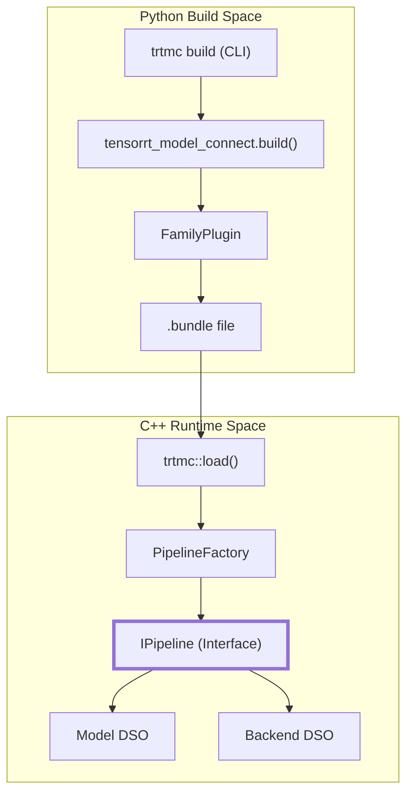
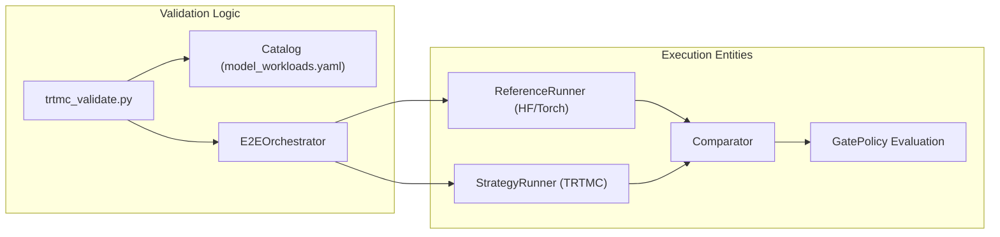

<!-- source: DeepWiki mcp.deepwiki.com · repo NVIDIA/TensorRT-Model-Connect · page 7 Glossary · fetched 2026-10-26 -->

# Glossary

Relevant source files

The following files were used as context for generating this wiki page:

- [.gitignore](.gitignore)
- [ASSET_LICENSES.md](ASSET_LICENSES.md)
- [CMakeLists.txt](CMakeLists.txt)
- [NOTICE](NOTICE)
- [README.md](README.md)
- [_pyproject_backend.py](_pyproject_backend.py)
- [benchmarks/performance/README.md](benchmarks/performance/README.md)
- [benchmarks/performance/baselines/task_reference.py](benchmarks/performance/baselines/task_reference.py)
- [benchmarks/performance/release.yaml](benchmarks/performance/release.yaml)
- [conanfile.py](conanfile.py)
- [examples/trtmc_benchmark_worker.cpp](examples/trtmc_benchmark_worker.cpp)
- [include/trtmc/pipeline.h](include/trtmc/pipeline.h)
- [pyproject.toml](pyproject.toml)
- [python/tensorrt_model_connect/benchmark/builder.py](python/tensorrt_model_connect/benchmark/builder.py)
- [python/tensorrt_model_connect/benchmark/catalog.py](python/tensorrt_model_connect/benchmark/catalog.py)
- [python/tensorrt_model_connect/benchmark/cli.py](python/tensorrt_model_connect/benchmark/cli.py)
- [python/tensorrt_model_connect/benchmark/metrics.py](python/tensorrt_model_connect/benchmark/metrics.py)
- [python/tensorrt_model_connect/benchmark/operations.py](python/tensorrt_model_connect/benchmark/operations.py)
- [python/tensorrt_model_connect/benchmark/report.py](python/tensorrt_model_connect/benchmark/report.py)
- [python/tensorrt_model_connect/benchmark/task_adapters.py](python/tensorrt_model_connect/benchmark/task_adapters.py)
- [python/tensorrt_model_connect/benchmark/types.py](python/tensorrt_model_connect/benchmark/types.py)
- [python/tensorrt_model_connect/fp8_calibrate.py](python/tensorrt_model_connect/fp8_calibrate.py)
- [python/tensorrt_model_connect/quantization/formats.py](python/tensorrt_model_connect/quantization/formats.py)
- [python/tensorrt_model_connect/quantization/plan.py](python/tensorrt_model_connect/quantization/plan.py)
- [python/tensorrt_model_connect/quantization/scale_providers.py](python/tensorrt_model_connect/quantization/scale_providers.py)
- [python/tensorrt_model_connect/quantization/scales.py](python/tensorrt_model_connect/quantization/scales.py)
- [scripts/repro_trt_fp8_mha.py](scripts/repro_trt_fp8_mha.py)
- [src/cli/args.cpp](src/cli/args.cpp)
- [src/cli/args.h](src/cli/args.h)
- [src/cli/main.cpp](src/cli/main.cpp)
- [src/runtime/backend/backend_loader.cpp](src/runtime/backend/backend_loader.cpp)
- [src/runtime/backend/backend_loader.h](src/runtime/backend/backend_loader.h)
- [src/runtime/backend/rtx_backend.cpp](src/runtime/backend/rtx_backend.cpp)
- [src/runtime/backend/trt_backend.cpp](src/runtime/backend/trt_backend.cpp)
- [src/runtime/backend/trt_logger.cpp](src/runtime/backend/trt_logger.cpp)
- [src/runtime/backend/trt_logger.h](src/runtime/backend/trt_logger.h)
- [src/runtime/backend/trt_version.cpp](src/runtime/backend/trt_version.cpp)
- [src/runtime/backend/trt_version.h](src/runtime/backend/trt_version.h)
- [src/runtime/core/cuda_common.cpp](src/runtime/core/cuda_common.cpp)
- [src/runtime/core/cuda_common.h](src/runtime/core/cuda_common.h)
- [src/runtime/core/trt_common.cpp](src/runtime/core/trt_common.cpp)
- [src/runtime/core/trt_common.h](src/runtime/core/trt_common.h)
- [src/runtime/models/dinov3/pipeline.cpp](src/runtime/models/dinov3/pipeline.cpp)
- [src/runtime/models/dinov3/pipeline.h](src/runtime/models/dinov3/pipeline.h)
- [src/runtime/providers/optimized_runtime_factory.h](src/runtime/providers/optimized_runtime_factory.h)
- [src/runtime/providers/optimized_runtime_host.cpp](src/runtime/providers/optimized_runtime_host.cpp)
- [tests/builder/test_engine_builder.py](tests/builder/test_engine_builder.py)
- [tests/builder/test_family_plugins_extended.py](tests/builder/test_family_plugins_extended.py)
- [tests/builder/test_manifest_validation.py](tests/builder/test_manifest_validation.py)
- [tests/cpp/fakes/fake_optimized_runtime_provider.cpp](tests/cpp/fakes/fake_optimized_runtime_provider.cpp)
- [tests/cpp/models/dinov3/test_dinov3_pipeline.cpp](tests/cpp/models/dinov3/test_dinov3_pipeline.cpp)
- [tests/cpp/test_backend_loader.cpp](tests/cpp/test_backend_loader.cpp)
- [tests/cpp/test_cli_args.cpp](tests/cpp/test_cli_args.cpp)
- [tests/cpp/test_pipeline_api.cpp](tests/cpp/test_pipeline_api.cpp)
- [tests/cpp/test_trt_logger.cpp](tests/cpp/test_trt_logger.cpp)
- [tests/e2e/conftest.py](tests/e2e/conftest.py)
- [tests/e2e/models/elf_flow/thresholds/elf-b-owt-l0.json](tests/e2e/models/elf_flow/thresholds/elf-b-owt-l0.json)
- [tests/e2e/models/minimax_h3/e2e_plugins/__init__.py](tests/e2e/models/minimax_h3/e2e_plugins/__init__.py)
- [tests/e2e/models/minimax_h3/test_minimax_h3_e2e.py](tests/e2e/models/minimax_h3/test_minimax_h3_e2e.py)
- [tests/e2e/models/qwen/edge_llm_adapter/test_runtime_contract.py](tests/e2e/models/qwen/edge_llm_adapter/test_runtime_contract.py)
- [tests/e2e/models/qwen/test_perf_parity.py](tests/e2e/models/qwen/test_perf_parity.py)
- [tests/e2e_harness/contracts.py](tests/e2e_harness/contracts.py)
- [tests/e2e_harness/manifest_loader.py](tests/e2e_harness/manifest_loader.py)
- [tests/e2e_harness/model_runner.py](tests/e2e_harness/model_runner.py)
- [tests/e2e_harness/orchestrator.py](tests/e2e_harness/orchestrator.py)
- [tests/e2e_harness/references/hf_diffusers.py](tests/e2e_harness/references/hf_diffusers.py)
- [tests/e2e_harness/runners/diffusion.py](tests/e2e_harness/runners/diffusion.py)
- [tests/e2e_harness/test_orchestrator_phases.py](tests/e2e_harness/test_orchestrator_phases.py)
- [tests/tools/test_model_e2e_runner.py](tests/tools/test_model_e2e_runner.py)
- [tests/tools/test_model_proof_runner.py](tests/tools/test_model_proof_runner.py)
- [tests/tools/test_optimized_runtime_packaging.py](tests/tools/test_optimized_runtime_packaging.py)
- [tests/tools/test_perf_matrix.py](tests/tools/test_perf_matrix.py)
- [tests/tools/test_release_backend_abi.py](tests/tools/test_release_backend_abi.py)
- [tests/tools/test_release_package_legal.py](tests/tools/test_release_package_legal.py)
- [tests/tools/test_selected_wheel_runtime.py](tests/tools/test_selected_wheel_runtime.py)
- [tests/tools/test_trtmc_bench.py](tests/tools/test_trtmc_bench.py)
- [tests/tools/test_trtmc_validate.py](tests/tools/test_trtmc_validate.py)
- [tests/tools/test_validation_engine.py](tests/tools/test_validation_engine.py)
- [tests/tools/test_validation_gate_policy.py](tests/tools/test_validation_gate_policy.py)
- [tests/validation/README.md](tests/validation/README.md)
- [tests/validation/workloads.yaml](tests/validation/workloads.yaml)
- [tools/ci/README.md](tools/ci/README.md)
- [tools/ci/__main__.py](tools/ci/__main__.py)
- [tools/ci/gpu_lease.py](tools/ci/gpu_lease.py)
- [tools/ci/model_proof.py](tools/ci/model_proof.py)
- [tools/ci/model_proof_inner.py](tools/ci/model_proof_inner.py)
- [tools/ci/package.py](tools/ci/package.py)
- [tools/ci/quality.py](tools/ci/quality.py)
- [tools/ci/selected_wheel.py](tools/ci/selected_wheel.py)
- [tools/legal_header_exceptions.toml](tools/legal_header_exceptions.toml)
- [tools/perf_matrix.py](tools/perf_matrix.py)
- [tools/qualification_report_assets/qualification-report.css](tools/qualification_report_assets/qualification-report.css)
- [tools/qualification_report_assets/qualification-report.js](tools/qualification_report_assets/qualification-report.js)
- [tools/test_impact_fallback_allowlist.txt](tools/test_impact_fallback_allowlist.txt)
- [tools/trtmc_validate.py](tools/trtmc_validate.py)
- [tools/validation/catalog.py](tools/validation/catalog.py)
- [tools/validation/engine.py](tools/validation/engine.py)
- [tools/validation/gate_census.py](tools/validation/gate_census.py)
- [tools/validation/gate_policy.py](tools/validation/gate_policy.py)
- [website/docs/agent-guide.md](website/docs/agent-guide.md)
- [website/docs/architecture/build-system.md](website/docs/architecture/build-system.md)
- [website/docs/getting-started/installation.md](website/docs/getting-started/installation.md)
- [website/docs/getting-started/quick-start.md](website/docs/getting-started/quick-start.md)
- [website/docs/reference/benchmarking.md](website/docs/reference/benchmarking.md)
- [website/static/img/readme/model-connect-overview.png](website/static/img/readme/model-connect-overview.png)
- [website/static/img/readme/tensorrt-stack.png](website/static/img/readme/tensorrt-stack.png)

This glossary defines technical terms, abbreviations, and domain-specific concepts used throughout the **TensorRT-Model-Connect (TRTMC)** codebase.

## Core Concepts

### .bundle
The primary distribution artifact of TRTMC. It is a single binary file containing a JSON header, model configuration, and multiple binary sections (such as TensorRT engines and weights).
*   **Implementation**: The format includes a "BUNDLE" magic string followed by a version byte and a 64-bit header size [tests/tools/test_validation_engine.py:47-65]().
*   **Usage**: Bundles are generated by `trtmc build` and consumed by the C++ `trtmc::load()` API [README.md:16-27]().

### Backend DSO
A Dynamic Shared Object (DSO) that implements a specific execution backend, such as the standard TensorRT runtime.
*   **Implementation**: `src/runtime/backend/trt_backend.cpp` [src/runtime/backend/trt_backend.cpp:1-10]().
*   **Build Logic**: Controlled via `TRTMC_BUILD_BACKEND_TRT` in CMake [CMakeLists.txt:49-49]().

### Model DSO
A model-specific Dynamic Shared Object containing the runtime logic (e.g., pre-processing, post-processing, and execution orchestration) for a particular model family.
*   **Example**: The DINOv3 implementation in `src/runtime/models/dinov3/` [src/runtime/models/dinov3/pipeline.cpp:1-10]().

### Family Plugin
A Python-based protocol that defines how a model family is built, including checkpoint mapping and TensorRT graph construction.
*   **Role**: Resolves Hugging Face checkpoints and selects the appropriate builder path (Native vs. Optimized).

## Architecture & Data Flow

The following diagram illustrates the relationship between Natural Language concepts and the C++ / Python entities in the codebase.

### System Mapping: Build to Runtime

**Sources**: [README.md:16-27](), [CMakeLists.txt:48-50](), [include/trtmc/pipeline.h:1-20]()

## Validation & Testing Terms

### E2E (End-to-End) Harness
The infrastructure used to validate model accuracy and parity between TensorRT and a reference implementation (usually Hugging Face Transformers).
*   **Orchestrator**: Coordinates the lifecycle of a test case, including building the bundle, running inference, and comparing results [tests/e2e_harness/orchestrator.py:10-23]().
*   **Contracts**: Defined in `tests/e2e_harness/contracts.py` to ensure consistent interfaces between runners and comparators [tests/e2e_harness/orchestrator.py:44-56]().

### Reference Backend Runner
A component of the E2E harness that executes the baseline (reference) model to generate "ground truth" for parity checks.
*   **Implementation**: Dispatched via the registry in the orchestrator [tests/e2e_harness/orchestrator.py:60-67]().

### Gate Policy
A set of criteria used during validation to determine if a model passes or fails based on accuracy metrics or performance deltas.
*   **Implementation**: `tools/validation/gate_policy.py` [tools/trtmc_validate.py:67-67]().
*   **Example**: `max_accuracy_drop_from_hf` or `min_prediction_agreement` [tests/validation/workloads.yaml:85-86]().

### System Mapping: Validation Flow

**Sources**: [tools/trtmc_validate.py:5-31](), [tests/e2e_harness/orchestrator.py:10-23](), [tests/validation/workloads.yaml:6-12]()

## Infrastructure Terms

### Model Proof
A hermetic CI pipeline that certifies a model's source tree and runtime integrity in an isolated environment.
*   **Runner**: `ModelProofRunner` handles host-side source projection and GPU lease acquisition [tests/tools/test_model_proof_runner.py:29-35]().

### Python Profile
A managed execution environment (often a virtualenv or container image) tailored for specific model families to avoid dependency conflicts.
*   **Implementation**: Managed via `tensorrt_model_connect.python_profiles` [tools/trtmc_validate.py:42-47]().

### Test Impact Analysis (TIA)
A system to identify the minimal set of tests required for a specific code change to optimize CI turnaround time.
*   **Tool**: `tools/test_impact.py` uses fallback rules defined in `tools/test_impact_fallback_allowlist.txt` [tools/test_impact_fallback_allowlist.txt:1-10]().

## Abbreviations

| Abbreviation | Meaning | Code Context |
| :--- | :--- | :--- |
| **DSO** | Dynamic Shared Object | Refers to `trtmc_core`, backend, and model libraries [CMakeLists.txt:48-50]() |
| **TP** | Tensor Parallelism | Configuration for multi-GPU execution [tests/trtmc_validate.py:154-158]() |
| **HF** | Hugging Face | Primary source for checkpoints and reference implementations [README.md:5-7]() |
| **MMLU** | Massive Multitask Language Understanding | Standard benchmark suite used in `workloads.yaml` [tests/validation/workloads.yaml:7-12]() |
| **BPE** | Byte Pair Encoding | Tokenizer implementation used in the runtime [CMakeLists.txt:188-193]() |

**Sources**: [README.md:1-60](), [CMakeLists.txt:1-193](), [tests/e2e_harness/orchestrator.py:1-90](), [tools/trtmc_validate.py:1-115](), [tests/validation/workloads.yaml:1-100]()