# Page: TensorRT-Model-Connect Overview

# TensorRT-Model-Connect Overview

<details>
<summary>Relevant source files</summary>

The following files were used as context for generating this wiki page:

- [.github/ISSUE_TEMPLATE/bug_report.yml](.github/ISSUE_TEMPLATE/bug_report.yml)
- [.github/ISSUE_TEMPLATE/config.yml](.github/ISSUE_TEMPLATE/config.yml)
- [.github/ISSUE_TEMPLATE/documentation_request.yml](.github/ISSUE_TEMPLATE/documentation_request.yml)
- [.github/ISSUE_TEMPLATE/feature_request.yml](.github/ISSUE_TEMPLATE/feature_request.yml)
- [.github/ISSUE_TEMPLATE/question.yml](.github/ISSUE_TEMPLATE/question.yml)
- [.github/workflows/pages.yml](.github/workflows/pages.yml)
- [.gitignore](.gitignore)
- [ASSET_LICENSES.md](ASSET_LICENSES.md)
- [NOTICE](NOTICE)
- [README.md](README.md)
- [plugins/trtmc-agent-skills/skills/pr-babysitter/SKILL.md](plugins/trtmc-agent-skills/skills/pr-babysitter/SKILL.md)
- [plugins/trtmc-agent-skills/skills/submit-github-pr/SKILL.md](plugins/trtmc-agent-skills/skills/submit-github-pr/SKILL.md)
- [src/cabi/api/README.md](src/cabi/api/README.md)
- [tests/model_checks/README.md](tests/model_checks/README.md)
- [tests/tools/test_github_issue_templates.py](tests/tools/test_github_issue_templates.py)
- [tests/tools/test_public_source_hygiene.py](tests/tools/test_public_source_hygiene.py)
- [tests/tools/test_release_package_legal.py](tests/tools/test_release_package_legal.py)
- [tools/test_impact_fallback_allowlist.txt](tools/test_impact_fallback_allowlist.txt)
- [tools/validation/README.md](tools/validation/README.md)
- [website/data/model-support-matrix.md](website/data/model-support-matrix.md)
- [website/docs/agent-guide.md](website/docs/agent-guide.md)
- [website/docs/getting-started/build-and-run.md](website/docs/getting-started/build-and-run.md)
- [website/docs/getting-started/environment-and-repro.md](website/docs/getting-started/environment-and-repro.md)
- [website/docs/getting-started/glossary.md](website/docs/getting-started/glossary.md)
- [website/docs/getting-started/installation.md](website/docs/getting-started/installation.md)
- [website/docs/getting-started/overview.md](website/docs/getting-started/overview.md)
- [website/docs/getting-started/project-overview.md](website/docs/getting-started/project-overview.md)
- [website/docs/getting-started/quick-start.md](website/docs/getting-started/quick-start.md)
- [website/docs/intro.md](website/docs/intro.md)
- [website/docs/learning-path.md](website/docs/learning-path.md)
- [website/docs/reference/source-layout.md](website/docs/reference/source-layout.md)
- [website/docs/reference/testing.md](website/docs/reference/testing.md)
- [website/docs/release-support/get-help.md](website/docs/release-support/get-help.md)
- [website/docs/tutorials/advanced/validation-and-benchmarking.md](website/docs/tutorials/advanced/validation-and-benchmarking.md)
- [website/docs/tutorials/beginner/inspect-bundles.md](website/docs/tutorials/beginner/inspect-bundles.md)
- [website/docs/tutorials/beginner/text-generation.md](website/docs/tutorials/beginner/text-generation.md)
- [website/docs/tutorials/intermediate/diffusion-and-time-series.md](website/docs/tutorials/intermediate/diffusion-and-time-series.md)
- [website/docs/tutorials/intermediate/multimodal-and-speech.md](website/docs/tutorials/intermediate/multimodal-and-speech.md)
- [website/docusaurus.config.js](website/docusaurus.config.js)
- [website/package-lock.json](website/package-lock.json)
- [website/package.json](website/package.json)
- [website/plugins/model-support-inventory/index.js](website/plugins/model-support-inventory/index.js)
- [website/plugins/model-support-inventory/index.test.js](website/plugins/model-support-inventory/index.test.js)
- [website/sidebars.js](website/sidebars.js)
- [website/src/components/ModelSupportInventory/index.js](website/src/components/ModelSupportInventory/index.js)
- [website/static/img/readme/model-connect-overview.png](website/static/img/readme/model-connect-overview.png)
- [website/static/img/readme/tensorrt-stack.png](website/static/img/readme/tensorrt-stack.png)

</details>


TensorRT-Model-Connect (TRTMC) is a framework designed to streamline the deployment of Hugging Face models for end-to-end NVIDIA TensorRT inference. It provides a collection of AI model reference implementations in C++ built on TensorRT, significantly reducing the effort and time required to integrate new models. This page offers a high-level introduction to TRTMC, its purpose, target audience, position within the broader TensorRT ecosystem, and the organization of its repository. For detailed information on specific topics, please refer to the linked child pages.

## What is TensorRT-Model-Connect?

TRTMC is an extensive collection of C++ reference implementations for AI models, leveraging NVIDIA TensorRT for optimized inference [README.md:31](). It enables users to take a supported Hugging Face or local checkpoint and build TensorRT engines directly, bypassing intermediate ONNX export steps [README.md:51-52](). The core output is a versioned `.bundle` artifact, which can then be used with native C++ task APIs for various AI tasks like text generation, transcription, image/video generation, segmentation, embedding, and forecasting [README.md:54-56]().

TRTMC is powered by an agentic workflow that continuously adds support for new models, aiming to drastically reduce integration effort and time to compatibility [README.md:32-33](). It provides model-family-owned builders, runtime pipelines, helper kernels, and validation contracts that serve as blueprints for customization [README.md:57-58]().

**Title: "TensorRT-Model-Connect Overview"**
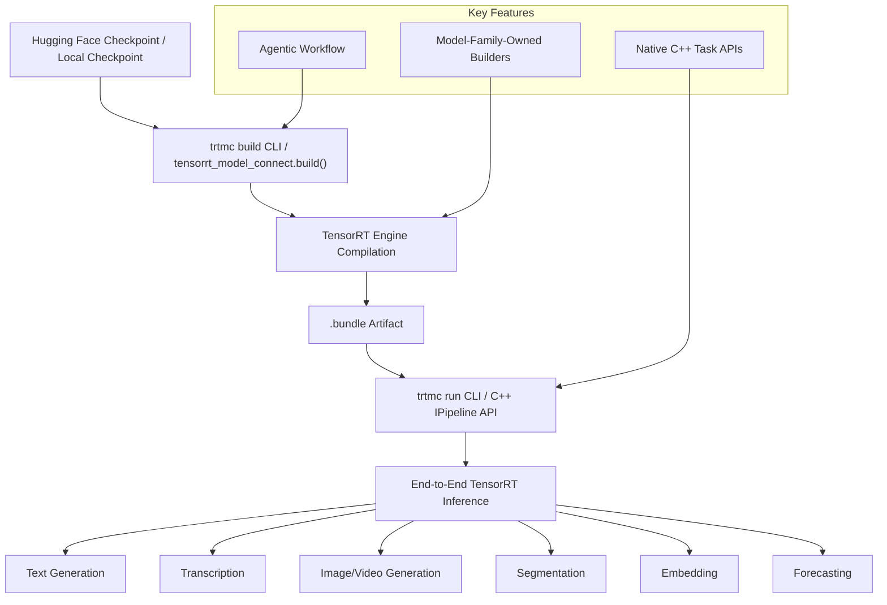
Sources: [README.md:31-33](), [README.md:51-58]()

## Who is TensorRT-Model-Connect For?

TRTMC is designed for users who want to quickly explore models and evaluate broad model coverage using TensorRT [README.md:39-40](). It caters to developers and researchers who need to:
*   Rapidly convert and deploy Hugging Face models to TensorRT.
*   Utilize a unified `.bundle` artifact across Python-first build environments and native C++ runtime environments.
*   Access concrete blueprints for modifying and customizing model builders, runtime pipelines, and kernels.
*   Maintain native TensorRT execution and qualified optimized-runtime dispatch within a task-oriented application boundary [README.md:51-60]().

For production LLM/VLM deployment on NVIDIA edge platforms where performance is the primary concern, users are directed to [TensorRT Edge-LLM](https://github.com/NVIDIA/TensorRT-Edge-LLM) [README.md:41-44]().

**Title: "TensorRT Abstraction Layers"**
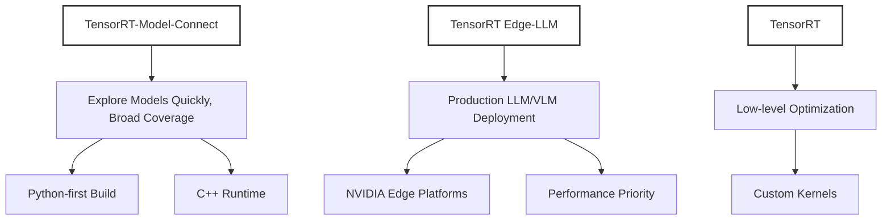
Sources: [README.md:39-45](), [README.md:51-60]()

## Getting Started with TensorRT-Model-Connect

New users can quickly get started with TRTMC by following a few simple steps. The recommended quick start involves using the `trtmc` command-line interface (CLI) to build and run models.

First, verify the `trtmc` CLI installation by running `trtmc version` [website/docs/getting-started/quick-start.md:11](). Then, a model like `Qwen/Qwen3-0.6B` can be built into a `.bundle` artifact using `trtmc build` [website/docs/getting-started/quick-start.md:24-27](). This bundle can then be inspected with `trtmc inspect` [website/docs/getting-started/quick-start.md:36-37]() and run for inference using `trtmc run` [website/docs/getting-started/quick-start.md:47-54](). The same `.bundle` artifact is also compatible with the C++ API [README.md:25-26]().

For detailed instructions on system requirements, installation methods (Docker or wheel), and the `trtmc` workflow, refer to the [Getting Started: Installation and Quick Start](#1.1) child page.

Sources: [README.md:25-26](), [website/docs/getting-started/quick-start.md:11](), [website/docs/getting-started/quick-start.md:24-27](), [website/docs/getting-started/quick-start.md:36-37](), [website/docs/getting-started/quick-start.md:47-54]()

## Repository Organization

The TRTMC repository is structured to support its multi-faceted development and deployment model. Key directories include `python/` for Python-related components, `src/` for the core C++ runtime, `tests/` for various testing layers, `tools/` for utility scripts, and `website/` for documentation [website/docs/reference/source-layout.md]() (though not explicitly cited in the provided content, this is a common pattern for such projects).

The codebase follows a "three-sided model ownership pattern" which involves Python family implementations, the C++ runtime, and end-to-end tests. This structure ensures that model support, core functionality, and validation are tightly integrated.

For a comprehensive map of the repository's top-level directories and their purposes, see the [Repository Source Layout](#1.2) child page.

Sources: [website/docs/reference/source-layout.md]() (implied)

## Further Exploration

This overview provides a starting point for understanding TensorRT-Model-Connect. To delve deeper into specific aspects of the project, please explore the following child pages:

*   **[Getting Started: Installation and Quick Start](#1.1)**: Provides step-by-step instructions for setting up TRTMC and running your first inference.
*   **[Repository Source Layout](#1.2)**: Details the directory structure and the purpose of each major component within the repository.

---

# Page: Getting Started: Installation and Quick Start

# Getting Started: Installation and Quick Start

<details>
<summary>Relevant source files</summary>

The following files were used as context for generating this wiki page:

- [.github/workflows/pages.yml](.github/workflows/pages.yml)
- [.gitignore](.gitignore)
- [ASSET_LICENSES.md](ASSET_LICENSES.md)
- [NOTICE](NOTICE)
- [README.md](README.md)
- [plugins/trtmc-agent-skills/skills/pr-babysitter/SKILL.md](plugins/trtmc-agent-skills/skills/pr-babysitter/SKILL.md)
- [plugins/trtmc-agent-skills/skills/submit-github-pr/SKILL.md](plugins/trtmc-agent-skills/skills/submit-github-pr/SKILL.md)
- [tests/tools/test_public_source_hygiene.py](tests/tools/test_public_source_hygiene.py)
- [tests/tools/test_release_package_legal.py](tests/tools/test_release_package_legal.py)
- [tools/test_impact_fallback_allowlist.txt](tools/test_impact_fallback_allowlist.txt)
- [website/data/model-support-matrix.md](website/data/model-support-matrix.md)
- [website/docs/agent-guide.md](website/docs/agent-guide.md)
- [website/docs/getting-started/build-and-run.md](website/docs/getting-started/build-and-run.md)
- [website/docs/getting-started/environment-and-repro.md](website/docs/getting-started/environment-and-repro.md)
- [website/docs/getting-started/glossary.md](website/docs/getting-started/glossary.md)
- [website/docs/getting-started/installation.md](website/docs/getting-started/installation.md)
- [website/docs/getting-started/overview.md](website/docs/getting-started/overview.md)
- [website/docs/getting-started/project-overview.md](website/docs/getting-started/project-overview.md)
- [website/docs/getting-started/quick-start.md](website/docs/getting-started/quick-start.md)
- [website/docs/intro.md](website/docs/intro.md)
- [website/docs/learning-path.md](website/docs/learning-path.md)
- [website/docs/reference/testing.md](website/docs/reference/testing.md)
- [website/docs/tutorials/advanced/validation-and-benchmarking.md](website/docs/tutorials/advanced/validation-and-benchmarking.md)
- [website/docs/tutorials/beginner/inspect-bundles.md](website/docs/tutorials/beginner/inspect-bundles.md)
- [website/docs/tutorials/beginner/text-generation.md](website/docs/tutorials/beginner/text-generation.md)
- [website/docs/tutorials/intermediate/diffusion-and-time-series.md](website/docs/tutorials/intermediate/diffusion-and-time-series.md)
- [website/docs/tutorials/intermediate/multimodal-and-speech.md](website/docs/tutorials/intermediate/multimodal-and-speech.md)
- [website/docusaurus.config.js](website/docusaurus.config.js)
- [website/package-lock.json](website/package-lock.json)
- [website/package.json](website/package.json)
- [website/plugins/model-support-inventory/index.js](website/plugins/model-support-inventory/index.js)
- [website/plugins/model-support-inventory/index.test.js](website/plugins/model-support-inventory/index.test.js)
- [website/src/components/ModelSupportInventory/index.js](website/src/components/ModelSupportInventory/index.js)
- [website/static/img/readme/model-connect-overview.png](website/static/img/readme/model-connect-overview.png)
- [website/static/img/readme/tensorrt-stack.png](website/static/img/readme/tensorrt-stack.png)

</details>


This page provides a step-by-step guide for new users to get started with TensorRT-Model-Connect (TRTMC). It covers system requirements, installation methods (Docker and Python wheel), the core `trtmc build`, `trtmc inspect`, and `trtmc run` workflow, and a C++ API "hello-world" example.

## System Requirements

Before installing TRTMC, ensure your system meets the necessary hardware and software prerequisites. TRTMC requires a compatible NVIDIA GPU software stack.

There are two primary installation paths, each with specific requirements:

| Path | Current Boundary |
|---|---|
| Release wheel | Linux aarch64, Python 3.10 or 3.12, glibc 2.39 or newer, and official TensorRT 11.1.0.106. |
| Source build | Linux x86_64 or aarch64 with Docker, NVIDIA Container Toolkit, and enough disk space for the image and bundle. |

[website/docs/getting-started/environment-and-repro.md:9-13]()

Currently, release wheels only support `aarch64`. For `x86_64` systems, the source build path is recommended. [website/docs/getting-started/installation.md:12-13]()

### Checking Your System

You can verify your system's configuration using the following commands:

**All users:**
```bash
uname -m
nvidia-smi
```

**Source users (additionally):**
```bash
docker --version
```

**Wheel users (additionally, for Python 3.12 path):**
```bash
getconf GNU_LIBC_VERSION
python3.12 --version
```
[website/docs/getting-started/environment-and-repro.md:21-37]()

Ensure that:
*   The host architecture matches your chosen installation path.
*   Your NVIDIA driver correctly detects the target GPU.
*   Docker and NVIDIA Container Toolkit are installed and configured if you plan to build from source.
*   The Python and glibc versions meet the requirements for wheel installation.
[website/docs/getting-started/environment-and-repro.md:39-45]()

It is crucial not to mix binaries, bundles, or TensorRT libraries from different TensorRT cohorts or architectures. [website/docs/getting-started/environment-and-repro.md:47-48]()

Sources:
*   [website/docs/getting-started/environment-and-repro.md]()
*   [website/docs/getting-started/installation.md]()

## Installation

Choose one of the following installation methods based on your system and preferences.

### Install a Release Wheel

This path is suitable for `aarch64` systems with Python 3.10 or 3.12.

1.  **Download the wheel:** Obtain the `+trt111` `py312` (or `py310`) `.whl` asset from the [latest GitHub release](https://github.com/NVIDIA/TensorRT-Model-Connect/releases/latest). [website/docs/getting-started/installation.md:17-18]()
2.  **Create and activate a virtual environment:**
    ```bash
    python3.12 -m venv .venv-trtmc
    . .venv-trtmc/bin/activate
    ```
    [website/docs/getting-started/installation.md:22-24]()
3.  **Install the wheel:**
    ```bash
    WHEEL=/path/to/downloaded-wheel.whl
    python -m pip install "$WHEEL"
    ```
    [website/docs/getting-started/installation.md:26-27]()

Keep this virtual environment active for subsequent steps.

### Build and Run from Source

For `x86_64` systems or if a release wheel is not available, you should build from source. This involves using a Docker container. Refer to the "Build from Source" documentation for detailed instructions on preparing the source container. The source-built CLI will be added to your `PATH` within the container. [website/docs/getting-started/installation.md:32-35]()

Sources:
*   [website/docs/getting-started/installation.md]()

## Quick Start Workflow

This section guides you through the basic `trtmc` CLI workflow: checking the CLI, building a model bundle, inspecting it, and running inference.

### 1. Check the CLI

After installation, verify that the `trtmc` command-line interface is accessible and functioning correctly.

```bash
trtmc version
```
[website/docs/getting-started/quick-start.md:11]()

Expected output should resemble:
```text
trtmc 0.1.0
TRT support: yes
```
[website/docs/getting-started/quick-start.md:16-18]()

### 2. Build a Model Bundle

The `trtmc build` command compiles a supported Hugging Face model into a TensorRT-Model-Connect bundle (`.bundle` artifact). This example builds the `Qwen/Qwen3-0.6B` model with BF16 precision and a specified cache length.

```bash
trtmc build Qwen/Qwen3-0.6B \
  --precision bf16 \
  --max-cache-length 16384 \
  --output qwen3-0.6b.bundle
```
[website/docs/getting-started/quick-start.md:23-27]()

The first build may involve downloading model files and compiling TensorRT engines, which can take some time. The output `qwen3-0.6b.bundle` is the runnable artifact. [website/docs/getting-started/quick-start.md:30-31]()

### 3. Inspect the Bundle

The `trtmc inspect` command allows you to examine the contents and configuration of a `.bundle` artifact.

```bash
trtmc inspect ./qwen3-0.6b.bundle
trtmc inspect ./qwen3-0.6b.bundle --list-engines
```
[website/docs/getting-started/quick-start.md:36-37]()

For this example, confirm that the inspection output shows the `qwen` family, `qwen_decoder_kv_cache` runtime strategy, BF16 precision, the configured cache length, and two listed engine plans. [website/docs/getting-started/quick-start.md:40-42]()

### 4. Run Inference

The `trtmc run` command executes inference using a built `.bundle` artifact.

```bash
trtmc run ./qwen3-0.6b.bundle \
  --prompt "What is the capital of France? Answer in one word." \
  --chat-template \
  --no-thinking \
  --max-new-tokens 64 \
  --temperature 0.7 \
  --top-k 20 \
  --top-p 0.8 \
  --seed 42
```
[website/docs/getting-started/quick-start.md:47-55]()

A successful run will return `Paris`. If you encounter errors, refer to the troubleshooting guide. [website/docs/getting-started/quick-start.md:57-59]()

Sources:
*   [website/docs/getting-started/quick-start.md]()

## C++ API Hello World

The `.bundle` artifact generated by the Python-first build environment is designed to be directly consumable by the native C++ task APIs. This allows for seamless integration into C++ applications.

The following C++ code snippet demonstrates how to load the previously built `qwen3-0.6b.bundle` and perform text generation.

```cpp
auto pipeline = trtmc::load("./qwen3-0.6b.bundle");
std::cout << pipeline->generate("What is the capital of France? Answer in one word.").text << '\n';
```
[README.md:25-27]()

This example showcases the `trtmc::load()` function to load the bundle and the `pipeline->generate()` method to perform inference, retrieving the generated text from the `text` member of the result.

### C++ API Workflow Diagram

The following diagram illustrates the interaction between the `trtmc` CLI, the `.bundle` artifact, and the C++ API.

```mermaid
graph TD
    subgraph "Python-first Build Environment"
        A[Hugging Face Checkpoint] --> B(trtmc build)
        B --> C[qwen3-0.6b.bundle]
    end

    subgraph "C++ Runtime Environment"
        C --> D(trtmc::load("./qwen3-0.6b.bundle"))
        D --> E[IPipeline Object]
        E -- "generate(\"...\")" --> F[Inference Result]
        F --> G[std::cout << .text]
    end

    style A fill:#fff,stroke:#333,stroke-width:2px
    style B fill:#fff,stroke:#333,stroke-width:2px
    style C fill:#fff,stroke:#333,stroke-width:2px
    style D fill:#fff,stroke:#333,stroke-width:2px
    style E fill:#fff,stroke:#333,stroke-width:2px
    style F fill:#fff,stroke:#333,stroke-width:2px
    style G fill:#fff,stroke:#333,stroke-width:2px
```
**Diagram: C++ API Integration Workflow**

Sources:
*   [README.md]()

---

# Page: Repository Source Layout

# Repository Source Layout

<details>
<summary>Relevant source files</summary>

The following files were used as context for generating this wiki page:

- [.agents/plugins/marketplace.json](.agents/plugins/marketplace.json)
- [.github/ISSUE_TEMPLATE/bug_report.yml](.github/ISSUE_TEMPLATE/bug_report.yml)
- [.github/ISSUE_TEMPLATE/config.yml](.github/ISSUE_TEMPLATE/config.yml)
- [.github/ISSUE_TEMPLATE/documentation_request.yml](.github/ISSUE_TEMPLATE/documentation_request.yml)
- [.github/ISSUE_TEMPLATE/feature_request.yml](.github/ISSUE_TEMPLATE/feature_request.yml)
- [.github/ISSUE_TEMPLATE/question.yml](.github/ISSUE_TEMPLATE/question.yml)
- [.gitignore](.gitignore)
- [AGENTS.md](AGENTS.md)
- [ASSET_LICENSES.md](ASSET_LICENSES.md)
- [CMakeLists.txt](CMakeLists.txt)
- [NOTICE](NOTICE)
- [README.md](README.md)
- [examples/trtmc_benchmark_worker.cpp](examples/trtmc_benchmark_worker.cpp)
- [include/trtmc/pipeline.h](include/trtmc/pipeline.h)
- [plugins/trtmc-agent-skills/.codex-plugin/plugin.json](plugins/trtmc-agent-skills/.codex-plugin/plugin.json)
- [plugins/trtmc-agent-skills/skills/write-git-messages/SKILL.md](plugins/trtmc-agent-skills/skills/write-git-messages/SKILL.md)
- [plugins/trtmc-agent-skills/skills/write-git-messages/agents/openai.yaml](plugins/trtmc-agent-skills/skills/write-git-messages/agents/openai.yaml)
- [plugins/trtmc-agent-skills/skills/write-git-messages/references/source-notes.md](plugins/trtmc-agent-skills/skills/write-git-messages/references/source-notes.md)
- [src/cabi/api/README.md](src/cabi/api/README.md)
- [src/cli/args.cpp](src/cli/args.cpp)
- [src/cli/args.h](src/cli/args.h)
- [src/cli/main.cpp](src/cli/main.cpp)
- [src/runtime/models/dinov3/pipeline.cpp](src/runtime/models/dinov3/pipeline.cpp)
- [src/runtime/models/dinov3/pipeline.h](src/runtime/models/dinov3/pipeline.h)
- [src/runtime/providers/optimized_runtime_factory.h](src/runtime/providers/optimized_runtime_factory.h)
- [src/runtime/providers/optimized_runtime_host.cpp](src/runtime/providers/optimized_runtime_host.cpp)
- [tests/cpp/fakes/fake_optimized_runtime_provider.cpp](tests/cpp/fakes/fake_optimized_runtime_provider.cpp)
- [tests/cpp/models/dinov3/test_dinov3_pipeline.cpp](tests/cpp/models/dinov3/test_dinov3_pipeline.cpp)
- [tests/cpp/test_cli_args.cpp](tests/cpp/test_cli_args.cpp)
- [tests/cpp/test_pipeline_api.cpp](tests/cpp/test_pipeline_api.cpp)
- [tests/e2e/models/qwen/edge_llm_adapter/test_runtime_contract.py](tests/e2e/models/qwen/edge_llm_adapter/test_runtime_contract.py)
- [tests/model_checks/README.md](tests/model_checks/README.md)
- [tests/tools/test_github_issue_templates.py](tests/tools/test_github_issue_templates.py)
- [tests/tools/test_release_package_legal.py](tests/tools/test_release_package_legal.py)
- [tools/test_impact_fallback_allowlist.txt](tools/test_impact_fallback_allowlist.txt)
- [tools/validation/README.md](tools/validation/README.md)
- [website/docs/agent-guide.md](website/docs/agent-guide.md)
- [website/docs/getting-started/installation.md](website/docs/getting-started/installation.md)
- [website/docs/getting-started/quick-start.md](website/docs/getting-started/quick-start.md)
- [website/docs/reference/source-layout.md](website/docs/reference/source-layout.md)
- [website/docs/release-support/get-help.md](website/docs/release-support/get-help.md)
- [website/sidebars.js](website/sidebars.js)
- [website/static/img/readme/model-connect-overview.png](website/static/img/readme/model-connect-overview.png)
- [website/static/img/readme/tensorrt-stack.png](website/static/img/readme/tensorrt-stack.png)

</details>


This page details the top-level directory structure of the TensorRT-Model-Connect repository, explaining the purpose of each major component and how they contribute to the overall system. It also introduces the three-sided model ownership pattern, which is central to how models are integrated and tested within the project.

## Top-Level Directory Map

The TensorRT-Model-Connect repository is organized into several top-level directories, each serving a distinct purpose in the build, runtime, and testing ecosystem.

| Directory | Purpose | Key Contents |
| :-------- | :------ | :----------- |
| `python/` | Python-first build environment, Python API, and model family plugins. | `tensorrt_model_connect/` (Python package), `setup.py`, `pyproject.toml` |
| `src/` | C++ runtime, CLI executable, and core libraries. | `cli/`, `runtime/`, `cabi/`, `tokenizer/` |
| `tests/` | Comprehensive test suite, including unit, integration, and end-to-end tests. | `cpp/`, `python/`, `e2e/`, `model_checks/` |
| `tools/` | Utility scripts and internal development tools. | `test_impact.py`, `perf_matrix.py`, `validation/` |
| `scripts/` | Miscellaneous scripts for development, CI, and agent workflows. | `bootstrap_workspace.sh`, `new_family.py`, `agents/` |
| `website/` | Project documentation and Docusaurus site source. | `docs/`, `static/`, `sidebars.js` |
| `cmake/` | CMake modules and build system configurations. | Custom CMake functions, dependency finding scripts |
| `include/` | Public C++ API headers. | `trtmc/pipeline.h`, `trtmc/bundle.h` |
| `plugins/` | Agent skills and other extensible components. | `trtmc-agent-skills/` |

Sources: [CMakeLists.txt:1-200](), [README.md:1-140](), [website/docs/release-support/get-help.md:1-3](), [website/docs/agent-guide.md:1-3]()

## The Three-Sided Model Ownership Pattern

TensorRT-Model-Connect employs a "three-sided" model ownership pattern to ensure robust integration and validation of new models. This pattern dictates that for any supported model, there must be corresponding components in three distinct areas of the codebase:

1.  **Python Family Implementation:** This includes the Python-based build logic, model configuration, and any necessary Python-specific pre/post-processing. This is where the model's TensorRT graph is constructed from a Hugging Face checkpoint.
2.  **C++ Runtime Implementation:** This encompasses the C++ code responsible for loading the `.bundle` artifact, executing the TensorRT engines, and providing the public C++ API for inference. This often involves model-specific C++ pipeline implementations.
3.  **End-to-End (E2E) Tests:** A comprehensive set of E2E tests validates the entire pipeline, from model building to runtime inference, ensuring numerical parity and performance against reference implementations.

This pattern ensures that each model is thoroughly integrated and tested across the entire stack, from the Python-centric build environment to the high-performance C++ runtime.

### Diagram: Three-Sided Model Ownership

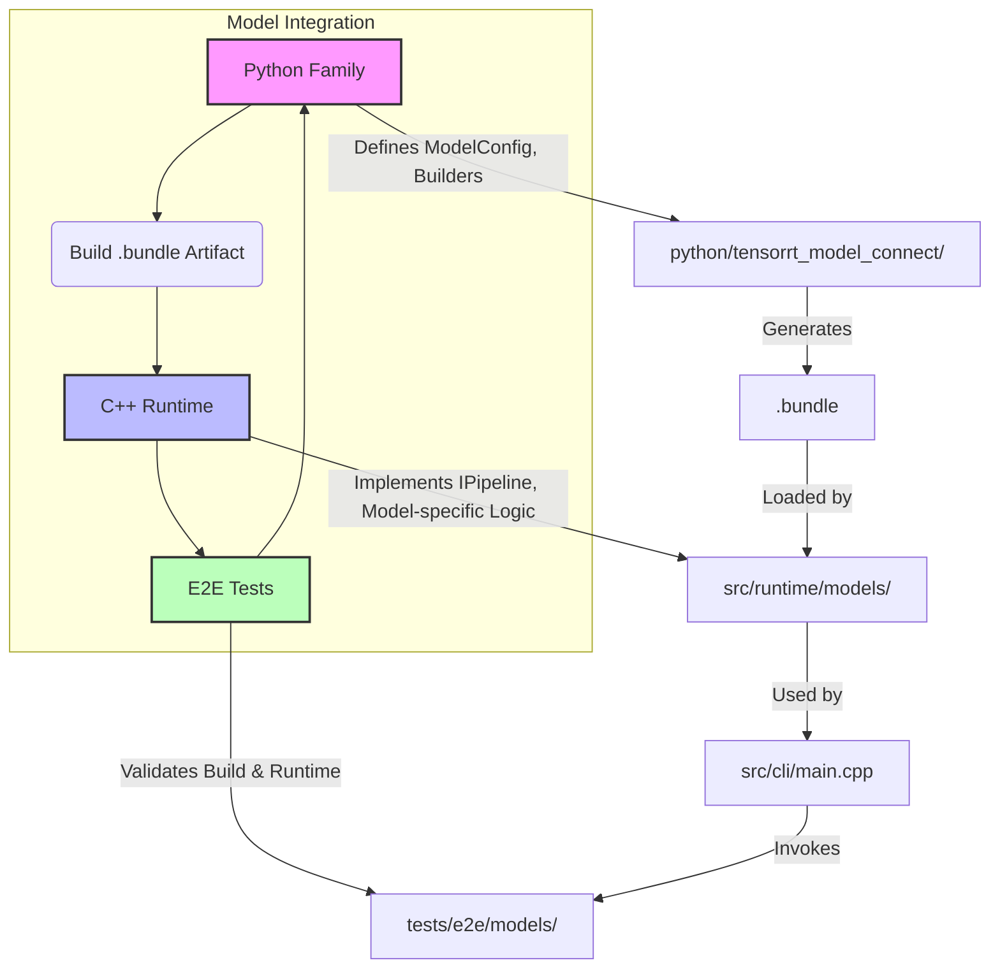
Sources: [src/cli/main.cpp:158-160](), [src/runtime/models/dinov3/pipeline.cpp:86-90](), [tests/e2e/models/qwen/edge_llm_adapter/test_runtime_contract.py:1-3]()

## Directory Breakdown

### `python/`

This directory contains the Python-centric parts of the TensorRT-Model-Connect project. It's primarily responsible for the build process, where Hugging Face models are converted into TensorRT engines and packaged into `.bundle` artifacts.

-   **`python/tensorrt_model_connect/`**: This is the main Python package. It includes:
    -   **Model Family Plugins**: Each supported model family (e.g., Qwen, LLaMA, Whisper) has its own Python package here, defining how to map Hugging Face checkpoints to TensorRT networks and how to build the `.bundle`.
    -   **Build Logic**: The core `build()` function and related utilities that orchestrate the TensorRT engine compilation.
    -   **Python API**: A Python interface for interacting with the build system and potentially for running inference (though the primary runtime is C++).
    -   **Configuration Schemas**: Python definitions for model-specific configurations.

Sources: [python/tensorrt_model_connect/config/cli_support.py:1-3](), [python/tensorrt_model_connect/config/schema_registry.py:1-3]()

### `src/`

The `src/` directory houses the C++ source code for the TensorRT-Model-Connect runtime and command-line interface (CLI). This is where the high-performance inference logic resides.

-   **`src/cli/`**: Contains the source code for the `trtmc` command-line executable. This includes argument parsing (`src/cli/args.cpp` [src/cli/args.cpp:1-187]()) and the main application logic (`src/cli/main.cpp` [src/cli/main.cpp:1-194]()) that dispatches to various commands like `build`, `run`, `inspect`, `transcribe`, etc.
-   **`src/runtime/`**: This is the core C++ runtime library.
    -   **`src/runtime/models/`**: Model-specific C++ pipeline implementations. For example, `src/runtime/models/dinov3/pipeline.cpp` [src/runtime/models/dinov3/pipeline.cpp:1-156]() implements the `Dinov3ImageFeaturePipeline` for the DINOv3 model. These pipelines interact with the underlying TensorRT engines.
    -   **`src/runtime/providers/`**: Contains implementations for different runtime backends, such as the standard TensorRT backend and potentially optimized runtimes. `src/runtime/providers/optimized_runtime_host.cpp` [src/runtime/providers/optimized_runtime_host.cpp:1-3]() is an example.
    -   **`src/runtime/pipeline_plugin_loader.cpp`**: Handles dynamic loading of model plugins at runtime.
-   **`src/cabi/`**: C Application Binary Interface (ABI) for interoperability.
-   **`src/tokenizer/`**: C++ implementation of tokenization logic, often used by various model pipelines.

Sources: [src/cli/main.cpp:1-194](), [src/cli/args.cpp:1-187](), [src/runtime/models/dinov3/pipeline.cpp:1-156](), [src/runtime/providers/optimized_runtime_host.cpp:1-3]()

### `tests/`

This directory contains the comprehensive test suite for the project, ensuring correctness and performance across different layers.

-   **`tests/cpp/`**: C++ unit and integration tests for the core runtime components and model pipelines. For example, `tests/cpp/models/dinov3/test_dinov3_pipeline.cpp` [tests/cpp/models/dinov3/test_dinov3_pipeline.cpp:1-160]() tests the DINOv3 C++ pipeline.
-   **`tests/python/`**: Python unit and integration tests for the build system, Python API, and model family plugins.
-   **`tests/e2e/`**: End-to-end tests that validate the entire build-to-runtime pipeline for various models. These tests often involve building a `.bundle` and then running inference, comparing results against a reference.
    -   **`tests/e2e/harness/`**: The E2E test harness, which orchestrates the execution and validation of E2E test cases.
    -   **`tests/e2e/models/`**: Model-specific E2E test cases and data.
-   **`tests/model_checks/`**: Contains scripts and configurations for model-specific checks and validations.

Sources: [tests/cpp/models/dinov3/test_dinov3_pipeline.cpp:1-160](), [tests/e2e/harness/orchestrator.py:1-3](), [tests/model_checks/README.md:1-3]()

### `tools/`

This directory contains various utility scripts and internal development tools.

-   **`tools/test_impact.py`**: A script used in CI to determine which tests are impacted by a given code change, optimizing test execution time.
-   **`tools/perf_matrix.py`**: Used for performance benchmarking, running a matrix of performance tests against reference implementations.
-   **`tools/validation/`**: Contains scripts and configurations related to the model validation framework.

Sources: [tools/test_impact_fallback_allowlist.txt:1-97](), [tools/validation/README.md:1-3]()

### `scripts/`

This directory holds miscellaneous scripts used for various development, CI, and agent-related tasks.

-   **`scripts/bootstrap_workspace.sh`**: A script to set up the development environment.
-   **`scripts/new_family.py`**: A utility script to help developers create the boilerplate for a new model family.
-   **`scripts/agents/`**: Scripts related to the agentic workflow, including prompt generation.

Sources: [scripts/agents/prompts/README.md:1-3](), [scripts/bootstrap_workspace.sh:1-3](), [scripts/new_family.py:1-3]()

### `website/`

This directory contains the source code for the project's documentation website, built using Docusaurus.

-   **`website/docs/`**: Markdown files for the documentation pages, including `website/docs/getting-started/quick-start.md` [website/docs/getting-started/quick-start.md:1-66]() and `website/docs/release-support/get-help.md` [website/docs/release-support/get-help.md:1-3]().
-   **`website/static/`**: Static assets like images, including `website/static/img/readme/model-connect-overview.png` [website/static/img/readme/model-connect-overview.png:1-1]() and `website/static/img/readme/tensorrt-stack.png` [website/static/img/readme/tensorrt-stack.png:1-1]().
-   **`website/sidebars.js`**: Configuration for the documentation sidebar navigation.

Sources: [website/docs/getting-started/quick-start.md:1-66](), [website/static/img/readme/model-connect-overview.png:1-1](), [website/sidebars.js:1-3]()

### `cmake/`

This directory contains custom CMake modules and configuration files used by the build system. These files define how the C++ components are built, linked, and packaged.

Sources: [CMakeLists.txt:1-200]()

### `include/`

This directory contains the public C++ API headers that users will include in their applications.

-   **`include/trtmc/pipeline.h`**: The main header for the C++ API, defining the `IPipeline` interface and various result/config structures like `TextResult`, `ImageResult`, `GenerateConfig`, etc. [include/trtmc/pipeline.h:1-300]()
-   **`include/trtmc/bundle.h`**: Defines structures and functions for interacting with `.bundle` artifacts.

Sources: [include/trtmc/pipeline.h:1-300]()

### `plugins/`

This directory is for extensible components, such as agent skills.

-   **`plugins/trtmc-agent-skills/`**: Contains the implementation for the `trtmc-agent-skills` Codex plugin, which provides AI agents with specific capabilities related to the TensorRT-Model-Connect codebase.

Sources: [plugins/trtmc-agent-skills/.codex-plugin/plugin.json:1-3](), [plugins/trtmc-agent-skills/skills/write-git-messages/SKILL.md:1-3]()

### Diagram: Core Component Interaction

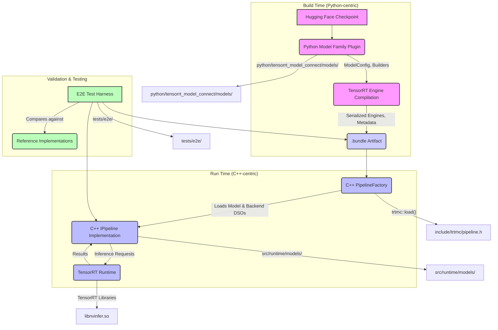
Sources: [python/tensorrt_model_connect/models/qwen/builder.py:1-3](), [src/runtime/models/dinov3/pipeline.cpp:1-156](), [tests/e2e/harness/orchestrator.py:1-3](), [include/trtmc/pipeline.h:1-300]()

---

# Page: Core Architecture

# Core Architecture

<details>
<summary>Relevant source files</summary>

The following files were used as context for generating this wiki page:

- [CMakeLists.txt](CMakeLists.txt)
- [examples/trtmc_benchmark_worker.cpp](examples/trtmc_benchmark_worker.cpp)
- [include/trtmc/pipeline.h](include/trtmc/pipeline.h)
- [src/cli/args.cpp](src/cli/args.cpp)
- [src/cli/args.h](src/cli/args.h)
- [src/cli/main.cpp](src/cli/main.cpp)
- [src/runtime/backend/backend_loader.cpp](src/runtime/backend/backend_loader.cpp)
- [src/runtime/backend/backend_loader.h](src/runtime/backend/backend_loader.h)
- [src/runtime/backend/rtx_backend.cpp](src/runtime/backend/rtx_backend.cpp)
- [src/runtime/backend/trt_backend.cpp](src/runtime/backend/trt_backend.cpp)
- [src/runtime/backend/trt_logger.cpp](src/runtime/backend/trt_logger.cpp)
- [src/runtime/backend/trt_logger.h](src/runtime/backend/trt_logger.h)
- [src/runtime/backend/trt_version.cpp](src/runtime/backend/trt_version.cpp)
- [src/runtime/backend/trt_version.h](src/runtime/backend/trt_version.h)
- [src/runtime/core/cuda_common.cpp](src/runtime/core/cuda_common.cpp)
- [src/runtime/core/cuda_common.h](src/runtime/core/cuda_common.h)
- [src/runtime/core/trt_common.cpp](src/runtime/core/trt_common.cpp)
- [src/runtime/core/trt_common.h](src/runtime/core/trt_common.h)
- [src/runtime/models/dinov3/pipeline.cpp](src/runtime/models/dinov3/pipeline.cpp)
- [src/runtime/models/dinov3/pipeline.h](src/runtime/models/dinov3/pipeline.h)
- [src/runtime/providers/optimized_runtime_factory.h](src/runtime/providers/optimized_runtime_factory.h)
- [src/runtime/providers/optimized_runtime_host.cpp](src/runtime/providers/optimized_runtime_host.cpp)
- [src/runtime/registry/pipeline_factory.cpp](src/runtime/registry/pipeline_factory.cpp)
- [src/utils/data_dir.cpp](src/utils/data_dir.cpp)
- [src/utils/data_dir.h](src/utils/data_dir.h)
- [src/utils/json_helpers.cpp](src/utils/json_helpers.cpp)
- [src/utils/json_helpers.h](src/utils/json_helpers.h)
- [tests/cpp/fakes/fake_optimized_runtime_provider.cpp](tests/cpp/fakes/fake_optimized_runtime_provider.cpp)
- [tests/cpp/models/dinov3/test_dinov3_pipeline.cpp](tests/cpp/models/dinov3/test_dinov3_pipeline.cpp)
- [tests/cpp/test_backend_loader.cpp](tests/cpp/test_backend_loader.cpp)
- [tests/cpp/test_cli_args.cpp](tests/cpp/test_cli_args.cpp)
- [tests/cpp/test_data_dir.cpp](tests/cpp/test_data_dir.cpp)
- [tests/cpp/test_json_helpers.cpp](tests/cpp/test_json_helpers.cpp)
- [tests/cpp/test_pipeline_api.cpp](tests/cpp/test_pipeline_api.cpp)
- [tests/cpp/test_trt_logger.cpp](tests/cpp/test_trt_logger.cpp)
- [tests/e2e/models/qwen/edge_llm_adapter/test_runtime_contract.py](tests/e2e/models/qwen/edge_llm_adapter/test_runtime_contract.py)

</details>


TensorRT-Model-Connect (TRTMC) provides a streamlined build-to-runtime pipeline for deploying optimized AI models. This page offers a high-level overview of the core architectural components, focusing on the `.bundle` artifact as the central boundary between the build and runtime phases, and the two primary bundle shapes: native and optimized.

The TRTMC workflow begins with model definition and configuration, proceeds through a build process that generates a `.bundle` file, and culminates in the loading and execution of this bundle by the TRTMC runtime. Each of these stages involves distinct components and processes, which are detailed in linked child pages.

## Build Pipeline: From Checkpoint to .bundle

The build pipeline is responsible for taking a source model (typically a Hugging Face checkpoint) and transforming it into an optimized `.bundle` artifact. This process involves several key steps: resolving the model, selecting an appropriate "family plugin" for model-specific optimizations, routing to either a native or optimized builder, compiling TensorRT engines, and finally packaging everything into the `.bundle` file.

The `trtmc build` CLI command [src/cli/main.cpp:9-9]() or the `tensorrt_model_connect.build()` Python API orchestrates this process. Model configurations are managed through `ModelConfig` objects, and the `FamilyPlugin` protocol defines how different model architectures integrate into the build system. The choice between native and optimized builders depends on the desired level of optimization and the target deployment environment.

For a detailed explanation of how models are resolved, plugins are selected, and TensorRT engines are compiled, see [Build Pipeline: From Checkpoint to .bundle](#2.1).

Sources:
- [src/cli/main.cpp:9-9]()

## Bundle Format and Runtime Lifecycle

The `.bundle` file is the self-contained artifact produced by the build pipeline. It encapsulates all necessary components for model inference, including TensorRT engines, configuration data, and any required assets. TRTMC supports two main "bundle shapes":

1.  **Native Bundles**: These bundles contain TensorRT engines and rely on the TRTMC C++ runtime to load and execute them directly. They are typically used for maximum performance and control.
2.  **Optimized Bundles**: These bundles leverage external optimized runtimes (e.g., TVM, ONNX Runtime) for execution. They might contain intermediate representations or specialized engine formats tailored for these runtimes.

The `PipelineFactory` is responsible for loading a `.bundle` file. It first inspects the bundle's header to determine its `runtime_strategy` [src/runtime/registry/pipeline_factory.cpp:125-125]() and then dispatches to the appropriate loading mechanism. This involves loading necessary Dynamic Shared Objects (DSOs) for model-specific logic and backend runtimes, and constructing a `PipelineContext` to manage the inference lifecycle.

For an in-depth look at the `.bundle` file structure, the loading process, and the differences between native and optimized load paths, see [Bundle Format and Runtime Lifecycle](#2.2).

Sources:
- [src/runtime/registry/pipeline_factory.cpp:125-125]()

## C++ Public API (IPipeline and CLI)

TRTMC provides both a command-line interface (CLI) and a C++ public API for interacting with models.

The `trtmc` CLI [src/cli/main.cpp:6-30]() offers a range of commands for common tasks such as `build`, `run`, `transcribe`, `generate-video`, `classify`, `segment`, `embed`, `rerank`, `solve`, `inspect`, and `version`. These commands provide a convenient way to interact with TRTMC models without writing custom code. The CLI arguments are parsed by `trtmc::cli::parse_args` [src/cli/args.cpp:127-127]().

The C++ `IPipeline` API [include/trtmc/pipeline.h:8-12]() is the programmatic interface for integrating TRTMC models into C++ applications. It defines methods like `generate`, `transcribe`, `generate_image`, `embed`, etc., allowing developers to load bundles and perform inference directly within their C++ code. An example of a concrete pipeline implementation is `Dinov3ImageFeaturePipeline` [src/runtime/models/dinov3/pipeline.h:20-21](), which implements `IPipeline` and `IImageFeatureExtractor`.

For a comprehensive guide to the `trtmc` CLI commands and the C++ `IPipeline` API, including usage examples and available functionalities, see [C++ Public API (IPipeline and CLI)](#2.3).

Sources:
- [src/cli/main.cpp:6-30]()
- [src/cli/args.cpp:127-127]()
- [include/trtmc/pipeline.h:8-12]()
- [src/runtime/models/dinov3/pipeline.h:20-21]()

## Build System: CMake, DSO Boundaries, and Packaging

The TRTMC build system is primarily managed by CMake [CMakeLists.txt:4-5](). It handles the compilation of C++ components, the generation of Dynamic Shared Objects (DSOs), and the packaging of the final release artifacts.

A key aspect of the build system is the scanning of `MODEL.toml` descriptors. These files define model-specific metadata and are used to generate model plugin registrations, allowing the TRTMC runtime to discover and load model-specific logic.

The native link boundary defines the separation between `trtmc_core`, model DSOs, and backend DSOs. This modular design allows for flexible integration of different models and TensorRT versions. For instance, `libtrtmc_backend_trt.so` [src/runtime/backend/trt_backend.cpp:6-6]() provides the standard TensorRT backend, while `libtrtmc_backend_rtx.so` [src/runtime/backend/rtx_backend.cpp:6-6]() provides the TensorRT-RTX backend.

Python packaging is handled via `pyproject.toml` and `conanfile.py`, which define the dependencies and build steps for the Python wheel. The release wheel build process ensures that all necessary components are correctly packaged for distribution.

For a detailed breakdown of the CMake build process, DSO boundaries, and the Python packaging mechanisms, see [Build System: CMake, DSO Boundaries, and Packaging](#2.4).

Sources:
- [CMakeLists.txt:4-5]()
- [src/runtime/backend/trt_backend.cpp:6-6]()
- [src/runtime/backend/rtx_backend.cpp:6-6]()

## Architectural Overview

The following diagram illustrates the high-level architecture of TensorRT-Model-Connect, showing the relationship between the build and runtime components and the central role of the `.bundle` artifact.

```mermaid
graph TD
    subgraph "Build Time"
        A[Hugging Face Checkpoint] --> B(ModelConfig)
        B --> C{FamilyPlugin Selection}
        C --> D{Native Builder}
        C --> E{Optimized Builder}
        D --> F[Compile TensorRT Engines]
        E --> F
        F --> G[.bundle Artifact]
    end

    subgraph "Run Time"
        G --> H(PipelineFactory.load())
        H --> I{runtime_strategy}
        I --> J[Load Model DSOs]
        I --> K[Load Backend DSOs]
        J --> L(PipelineContext)
        K --> L
        L --> M[IPipeline API / trtmc CLI]
    end

    style A fill:#f9f,stroke:#333,stroke-width:2px
    style B fill:#bbf,stroke:#333,stroke-width:2px
    style C fill:#bbf,stroke:#333,stroke-width:2px
    style D fill:#bbf,stroke:#333,stroke-width:2px
    style E fill:#bbf,stroke:#333,stroke-width:2px
    style F fill:#bbf,stroke:#333,stroke-width:2px
    style G fill:#f9f,stroke:#333,stroke-width:2px
    style H fill:#bbf,stroke:#333,stroke-width:2px
    style I fill:#bbf,stroke:#333,stroke-width:2px
    style J fill:#bbf,stroke:#333,stroke-width:2px
    style K fill:#bbf,stroke:#333,stroke-width:2px
    style L fill:#bbf,stroke:#333,stroke-width:2px
    style M fill:#f9f,stroke:#333,stroke-width:2px
```
Sources:
- [src/cli/main.cpp]()
- [src/runtime/registry/pipeline_factory.cpp]()
- [include/trtmc/pipeline.h]()

## Code Entity Map: CLI to C++ API

This diagram illustrates how the `trtmc` CLI commands map to the underlying C++ `IPipeline` API and its implementations.

```mermaid
graph TD
    subgraph "trtmc CLI (src/cli/main.cpp)"
        CLI_BUILD["trtmc build"] --> Cpp_BUILD_LOGIC[Build Logic]
        CLI_RUN["trtmc run"] --> Cpp_LOAD_PIPELINE[trtmc::load()]
        CLI_TRANSCRIBE["trtmc transcribe"] --> Cpp_LOAD_PIPELINE
        CLI_GENERATE_VIDEO["trtmc generate-video"] --> Cpp_LOAD_PIPELINE
        CLI_CLASSIFY["trtmc classify"] --> Cpp_LOAD_PIPELINE
        CLI_EXTRACT_FEATURES["trtmc extract-features"] --> Cpp_LOAD_PIPELINE
        CLI_DETECT["trtmc detect"] --> Cpp_LOAD_PIPELINE
        CLI_INSPECT["trtmc inspect"] --> Cpp_INSPECT_BUNDLE[trtmc::InspectBundle()]
        CLI_VERSION["trtmc version"] --> Cpp_VERSION_INFO[Version Info]
    end

    subgraph "C++ API (include/trtmc/pipeline.h)"
        Cpp_LOAD_PIPELINE --> IPipeline_LOAD[trtmc::load(bundle_path, LoadOptions)]
        IPipeline_LOAD --> IPipeline_INTERFACE[IPipeline*]
        IPipeline_INTERFACE --> IPipeline_GENERATE[generate()]
        IPipeline_INTERFACE --> IPipeline_TRANSCRIBE[transcribe()]
        IPipeline_INTERFACE --> IPipeline_GENERATE_IMAGE[generate_image()]
        IPipeline_INTERFACE --> IPipeline_EMBED[embed()]
        IPipeline_INTERFACE --> IPipeline_EXTRACT_IMAGE_FEATURES[IImageFeatureExtractor::extract_image_features()]
    end

    subgraph "C++ Implementations"
        IPipeline_GENERATE --> ConcretePipeline_GENERATE[e.g., TextGenerationPipeline::generate()]
        IPipeline_TRANSCRIBE --> ConcretePipeline_TRANSCRIBE[e.g., WhisperPipeline::transcribe()]
        IPipeline_EXTRACT_IMAGE_FEATURES --> Dinov3Pipeline_EXTRACT[Dinov3ImageFeaturePipeline::extract_image_features()]
        Dinov3Pipeline_EXTRACT --> TrtModule_FORWARD[TrtModule::forward()]
    end

    style CLI_BUILD fill:#f9f,stroke:#333,stroke-width:2px
    style CLI_RUN fill:#f9f,stroke:#333,stroke-width:2px
    style CLI_TRANSCRIBE fill:#f9f,stroke:#333,stroke-width:2px
    style CLI_GENERATE_VIDEO fill:#f9f,stroke:#333,stroke-width:2px
    style CLI_CLASSIFY fill:#f9f,stroke:#333,stroke-width:2px
    style CLI_EXTRACT_FEATURES fill:#f9f,stroke:#333,stroke-width:2px
    style CLI_DETECT fill:#f9f,stroke:#333,stroke-width:2px
    style CLI_INSPECT fill:#f9f,stroke:#333,stroke-width:2px
    style CLI_VERSION fill:#f9f,stroke:#333,stroke-width:2px

    style Cpp_BUILD_LOGIC fill:#bbf,stroke:#333,stroke-width:2px
    style Cpp_LOAD_PIPELINE fill:#bbf,stroke:#333,stroke-width:2px
    style Cpp_INSPECT_BUNDLE fill:#bbf,stroke:#333,stroke-width:2px
    style Cpp_VERSION_INFO fill:#bbf,stroke:#333,stroke-width:2px

    style IPipeline_LOAD fill:#bbf,stroke:#333,stroke-width:2px
    style IPipeline_INTERFACE fill:#bbf,stroke:#333,stroke-width:2px
    style IPipeline_GENERATE fill:#bbf,stroke:#333,stroke-width:2px
    style IPipeline_TRANSCRIBE fill:#bbf,stroke:#333,stroke-width:2px
    style IPipeline_GENERATE_IMAGE fill:#bbf,stroke:#333,stroke-width:2px
    style IPipeline_EMBED fill:#bbf,stroke:#333,stroke-width:2px
    style IPipeline_EXTRACT_IMAGE_FEATURES fill:#bbf,stroke:#333,stroke-width:2px

    style ConcretePipeline_GENERATE fill:#bbf,stroke:#333,stroke-width:2px
    style ConcretePipeline_TRANSCRIBE fill:#bbf,stroke:#333,stroke-width:2px
    style Dinov3Pipeline_EXTRACT fill:#bbf,stroke:#333,stroke-width:2px
    style TrtModule_FORWARD fill:#bbf,stroke:#333,stroke-width:2px
```
Sources:
- [src/cli/main.cpp]()
- [src/cli/args.cpp]()
- [include/trtmc/pipeline.h]()
- [src/runtime/models/dinov3/pipeline.h]()
- [src/runtime/models/dinov3/pipeline.cpp]()

---

# Page: Build Pipeline: From Checkpoint to .bundle

# Build Pipeline: From Checkpoint to .bundle

<details>
<summary>Relevant source files</summary>

The following files were used as context for generating this wiki page:

- [CMakeLists.txt](CMakeLists.txt)
- [examples/trtmc_benchmark_worker.cpp](examples/trtmc_benchmark_worker.cpp)
- [include/trtmc/pipeline.h](include/trtmc/pipeline.h)
- [python/tensorrt_model_connect/build_cli.py](python/tensorrt_model_connect/build_cli.py)
- [python/tensorrt_model_connect/engine_builder.py](python/tensorrt_model_connect/engine_builder.py)
- [python/tensorrt_model_connect/families/sana_wm/MODEL.toml](python/tensorrt_model_connect/families/sana_wm/MODEL.toml)
- [python/tensorrt_model_connect/families/sana_wm/components/gemma/plugin.py](python/tensorrt_model_connect/families/sana_wm/components/gemma/plugin.py)
- [python/tensorrt_model_connect/hf_snapshot.py](python/tensorrt_model_connect/hf_snapshot.py)
- [scripts/warm_hf_cache.py](scripts/warm_hf_cache.py)
- [src/cli/args.cpp](src/cli/args.cpp)
- [src/cli/args.h](src/cli/args.h)
- [src/cli/main.cpp](src/cli/main.cpp)
- [src/runtime/models/dinov3/pipeline.cpp](src/runtime/models/dinov3/pipeline.cpp)
- [src/runtime/models/dinov3/pipeline.h](src/runtime/models/dinov3/pipeline.h)
- [src/runtime/models/whisper/pipeline.cpp](src/runtime/models/whisper/pipeline.cpp)
- [src/runtime/models/whisper/pipeline.h](src/runtime/models/whisper/pipeline.h)
- [src/runtime/models/whisper/plugin.cpp](src/runtime/models/whisper/plugin.cpp)
- [src/runtime/models/whisper/whisper_mel_spectrogram.cpp](src/runtime/models/whisper/whisper_mel_spectrogram.cpp)
- [src/runtime/models/whisper/whisper_mel_spectrogram.h](src/runtime/models/whisper/whisper_mel_spectrogram.h)
- [src/runtime/providers/optimized_runtime_factory.h](src/runtime/providers/optimized_runtime_factory.h)
- [src/runtime/providers/optimized_runtime_host.cpp](src/runtime/providers/optimized_runtime_host.cpp)
- [tests/builder/test_cli.py](tests/builder/test_cli.py)
- [tests/builder/test_engine_builder_extended.py](tests/builder/test_engine_builder_extended.py)
- [tests/builder/test_engine_builder_utils.py](tests/builder/test_engine_builder_utils.py)
- [tests/builder/test_families.py](tests/builder/test_families.py)
- [tests/builder/test_family_plugins.py](tests/builder/test_family_plugins.py)
- [tests/cpp/fakes/fake_optimized_runtime_provider.cpp](tests/cpp/fakes/fake_optimized_runtime_provider.cpp)
- [tests/cpp/models/dinov3/test_dinov3_pipeline.cpp](tests/cpp/models/dinov3/test_dinov3_pipeline.cpp)
- [tests/cpp/models/whisper/test_whisper_mel_spectrogram.cpp](tests/cpp/models/whisper/test_whisper_mel_spectrogram.cpp)
- [tests/cpp/test_cli_args.cpp](tests/cpp/test_cli_args.cpp)
- [tests/cpp/test_pipeline_api.cpp](tests/cpp/test_pipeline_api.cpp)
- [tests/cpp/test_tokenizer_edge_cases.cpp](tests/cpp/test_tokenizer_edge_cases.cpp)
- [tests/e2e/models/ltx_video/e2e_plugins/references/hf_diffusers.py](tests/e2e/models/ltx_video/e2e_plugins/references/hf_diffusers.py)
- [tests/e2e/models/ltx_video/test_ltx_video_hf_diffusers_reference.py](tests/e2e/models/ltx_video/test_ltx_video_hf_diffusers_reference.py)
- [tests/e2e/models/qwen/edge_llm_adapter/test_runtime_contract.py](tests/e2e/models/qwen/edge_llm_adapter/test_runtime_contract.py)
- [tests/e2e/models/sana_wm/test_sana_wm_warm_hf_cache_metadata.py](tests/e2e/models/sana_wm/test_sana_wm_warm_hf_cache_metadata.py)
- [tests/e2e_harness/comparators/text_to_audio.py](tests/e2e_harness/comparators/text_to_audio.py)
- [tests/e2e_harness/references/hf_transformers.py](tests/e2e_harness/references/hf_transformers.py)
- [tests/e2e_harness/runners/audio_speech.py](tests/e2e_harness/runners/audio_speech.py)
- [tests/e2e_harness/thresholds/defaults/text_to_audio.json](tests/e2e_harness/thresholds/defaults/text_to_audio.json)
- [tests/runtime_strategy_matrix.yaml](tests/runtime_strategy_matrix.yaml)
- [tests/tools/test_family_specialization.py](tests/tools/test_family_specialization.py)
- [tests/tools/test_warm_hf_cache_static.py](tests/tools/test_warm_hf_cache_static.py)
- [tests/validation/model_workloads.yaml](tests/validation/model_workloads.yaml)

</details>


This page details the build pipeline within TensorRT-Model-Connect (TRTMC), explaining how a Hugging Face checkpoint is transformed into a `.bundle` artifact. It covers the process from model resolution and family plugin selection to TensorRT engine compilation and bundle creation. Key components include `ModelConfig`, the `FamilyPlugin` protocol, and the build routing logic that determines whether a native or optimized builder is used.

## Overview of the Build Process

The `trtmc build` command or the `tensorrt_model_connect.build()` Python function initiates the build pipeline. This process involves several stages:

1.  **Model Resolution**: Identifying and downloading the Hugging Face model or resolving a local model directory.
2.  **Family Plugin Selection**: Determining the appropriate `FamilyPlugin` based on the model's characteristics.
3.  **Configuration Generation**: Creating a `ModelConfig` object that encapsulates all build parameters.
4.  **Engine Compilation**: Using either a native or optimized builder to compile TensorRT engines.
5.  **Bundle Creation**: Packaging the compiled engines and associated metadata into a `.bundle` artifact.

The build process is orchestrated primarily by the `engine_builder.py` module [python/tensorrt_model_connect/engine_builder.py]().

### Build Pipeline Flow

The following diagram illustrates the high-level flow of the build pipeline:

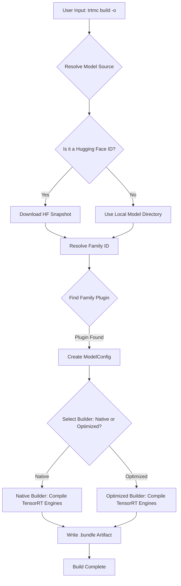
Sources:
- [python/tensorrt_model_connect/engine_builder.py]()

## Model Resolution and Hugging Face Integration

The first step in the build pipeline is to resolve the model source. This can be a Hugging Face model ID or a path to a local model directory.

### Hugging Face Snapshot Download

If a Hugging Face model ID is provided, TRTMC uses the `huggingface_hub` library to download the model snapshot. This process is managed by `hf_snapshot.py` [python/tensorrt_model_connect/hf_snapshot.py]().

The `_HF_ALLOW_PATTERNS` and `_HF_EXTRA_ALLOW_PATTERNS` lists define which files are allowed to be downloaded from Hugging Face. These patterns ensure that only necessary files (e.g., `config.json`, `model.safetensors`, tokenizer files) are fetched, optimizing download times and disk usage.
The `warm_hf_cache.py` script [scripts/warm_hf_cache.py]() is used to pre-warm the Hugging Face cache, especially in CI/CD environments, to avoid redundant downloads during parallel builds.

The `_raise_friendly_download_error` function [python/tensorrt_model_connect/engine_builder.py:212-220]() provides user-friendly error messages for common Hugging Face download issues like `RepositoryNotFound`.

Sources:
- [python/tensorrt_model_connect/engine_builder.py:212-220]()
- [python/tensorrt_model_connect/hf_snapshot.py]()
- [scripts/warm_hf_cache.py]()

## Family Plugin Selection

Once the model source is resolved, TRTMC needs to identify the correct `FamilyPlugin` to handle the model. This is a crucial step as the plugin dictates how the model is configured, built, and ultimately run.

### `FamilyPlugin` Protocol

The `FamilyPlugin` protocol defines the interface that all model family plugins must implement. These plugins are responsible for:
-   Matching a given model to its family.
-   Providing model-specific configuration and build logic.
-   Defining the runtime strategy.

The `families` module [python/tensorrt_model_connect/families/__init__.py]() manages the discovery and loading of these plugins. The `find_plugin` function [python/tensorrt_model_connect/families/__init__.py:100-100]() is central to this process. It attempts to match the model's characteristics (e.g., `model_type` from `config.json`) against the registered plugins.

The `_FamilyMetadata` dataclass [python/tensorrt_model_connect/families/__init__.py:120-130]() stores information about each family, including its ID, import module, aliases, and capabilities. This metadata is cached to speed up plugin lookup.

The `test_families.py` [tests/builder/test_families.py]() unit tests validate the `match()` logic and attribute correctness of all registered family plugins.

```mermaid
graph TD
    A[Model Source (HF ID or Local Path)] --> B{resolve_family_id()};
    B --> C[Model Metadata (e.g., config.json)];
    C --> D{_candidate_module_names()};
    D --> E[Iterate through candidate Family Plugins];
    E -- For each plugin --> F{plugin.match(model_metadata)};
    F -- Match Found --> G[Selected FamilyPlugin];
    F -- No Match --> H[Error: Unknown Model Family];
    G --> I[Proceed with ModelConfig creation];
```
Sources:
- [python/tensorrt_model_connect/families/__init__.py]()
- [python/tensorrt_model_connect/families/__init__.py:100-100]()
- [python/tensorrt_model_connect/families/__init__.py:120-130]()
- [tests/builder/test_families.py]()

## ModelConfig and Build Configuration

Once a `FamilyPlugin` is selected, a `ModelConfig` object is created. This object encapsulates all the parameters required for building the TensorRT engines.

The `ModelConfig` class [python/tensorrt_model_connect/config.py:100-100]() is a dataclass that holds various build-time options, such as precision (`fp16`, `int8`), quantization settings, parallelization strategy (`tensor_parallel_size`), and dynamic shape profiles.

The `build_cli.py` module [python/tensorrt_model_connect/build_cli.py]() handles parsing command-line arguments for the `trtmc build` command and populating the `ModelConfig` object.

### Dynamic KV Cache Profiles

For models with dynamic key-value (KV) caches, the `_compute_dynamic_kv_profile_rows` function [python/tensorrt_model_connect/engine_builder.py:117-150]() calculates the optimal TensorRT optimization profiles. This function generates a set of KV cache lengths (rows) that cover the specified `max_cache_length` and `kv_budget`, ensuring efficient memory usage and performance. The `_sanitize_dynamic_kv_profile_rows` function [python/tensorrt_model_connect/engine_builder.py:153-168]() validates and sorts these rows.

The `add_dynamic_batch_profile` function [python/tensorrt_model_connect/engine_builder.py:171-210]() is used by diffusion engine builders to attach optimization profiles with dynamic leading batch dimensions.

Sources:
- [python/tensorrt_model_connect/config.py:100-100]()
- [python/tensorrt_model_connect/engine_builder.py:117-150]()
- [python/tensorrt_model_connect/engine_builder.py:153-168]()
- [python/tensorrt_model_connect/engine_builder.py:171-210]()
- [python/tensorrt_model_connect/build_cli.py]()

## Builder Selection and Engine Compilation

TRTMC supports two primary build paths: native and optimized. The choice depends on the `runtime_strategy` defined by the `FamilyPlugin` and the capabilities of the system.

### Native Builder

The native builder path is typically used for models where the `FamilyPlugin` directly implements the TensorRT engine building logic in Python. This involves:
1.  Loading the model (e.g., from Hugging Face Transformers).
2.  Converting the model to an ONNX graph.
3.  Building TensorRT engines from the ONNX graph using `tensorrt.Builder`.

The `engine_builder.py` module [python/tensorrt_model_connect/engine_builder.py]() orchestrates this process. The `_setup_trt_import` function [python/tensorrt_model_connect/engine_builder.py:70-76]() ensures the correct TensorRT Python backend (e.g., RTX) is selected.

### Optimized Builder

For certain model families, TRTMC provides highly optimized C++ builders. These builders are often used for complex architectures or when maximum performance is required. The `FamilyPlugin` indicates if an optimized builder is preferred via `family_prefers_native_default_build` [python/tensorrt_model_connect/families/__init__.py:100-100]().

Optimized builders are typically implemented as C++ shared libraries (DSOs) and are loaded dynamically. The `optimized_runtime_factory.h` [src/runtime/providers/optimized_runtime_factory.h]() and `optimized_runtime_host.cpp` [src/runtime/providers/optimized_runtime_host.cpp]() define the interface for these optimized runtimes.

The `CMakeLists.txt` [CMakeLists.txt]() file plays a crucial role in configuring the build system to find and link against TensorRT and CUDA libraries, which are essential for both native and optimized builders.

### Build Timing and Budget Enforcement

The build process includes timing measurements to track the duration of various phases, such as weights loading and TensorRT compilation. Functions like `_add_build_timing`, `_new_build_timing`, and `_write_build_timing` [python/tensorrt_model_connect/engine_builder.py:21-24]() manage this.

The `enforce_single_full_bundle_build` function [python/tensorrt_model_connect/engine_builder.py:25-25]() ensures that only one full bundle build is performed, preventing redundant work.

Sources:
- [python/tensorrt_model_connect/engine_builder.py]()
- [python/tensorrt_model_connect/engine_builder.py:21-24]()
- [python/tensorrt_model_connect/engine_builder.py:25-25]()
- [python/tensorrt_model_connect/engine_builder.py:70-76]()
- [python/tensorrt_model_connect/families/__init__.py:100-100]()
- [src/runtime/providers/optimized_runtime_factory.h]()
- [src/runtime/providers/optimized_runtime_host.cpp]()
- [CMakeLists.txt]()

## .bundle Artifact Creation

After the TensorRT engines are compiled, they are packaged along with other necessary metadata into a `.bundle` artifact. This artifact is a self-contained unit that can be loaded and run by the TRTMC runtime.

The `bundle_writer.py` module [python/tensorrt_model_connect/bundle_writer.py]() is responsible for creating the `.bundle` file. It defines the `BundleInfo` and `BundleSection` classes, which describe the structure and contents of the bundle.

A `.bundle` file typically contains:
-   **Engines**: The compiled TensorRT engines for different model components (e.g., encoder, decoder).
-   **Tokenizer**: Tokenizer files (e.g., `tokenizer.json`, `vocab.txt`).
-   **Model Configuration**: The `ModelConfig` used during the build.
-   **Metadata**: Information about the build environment, TensorRT version, and other relevant details.

The `export_triattention_stats_section` function [python/tensorrt_model_connect/triattention_export.py:20-20]() can be used to include tri-attention statistics in the bundle, which can be useful for debugging and analysis.

The `trtmc inspect` CLI command [src/cli/main.cpp:29-30]() can be used to examine the contents of a `.bundle` file, listing its engines and other sections.

Sources:
- [python/tensorrt_model_connect/bundle_writer.py]()
- [python/tensorrt_model_connect/triattention_export.py:20-20]()
- [src/cli/main.cpp:29-30]()

## CLI Integration

The `trtmc build` command is the primary entry point for users to initiate the build pipeline. The `src/cli/main.cpp` [src/cli/main.cpp]() and `src/cli/args.cpp` [src/cli/args.cpp]() files define the command-line interface for TRTMC.

The `parse_args` function [src/cli/args.cpp:48-48]() in `args.cpp` handles parsing the command-line arguments, including the model ID, output bundle path, and various build options. These arguments are then used to construct the `ModelConfig` and drive the build process.

Sources:
- [src/cli/main.cpp]()
- [src/cli/args.cpp]()
- [src/cli/args.cpp:48-48]()

---

# Page: Bundle Format and Runtime Lifecycle

# Bundle Format and Runtime Lifecycle

<details>
<summary>Relevant source files</summary>

The following files were used as context for generating this wiki page:

- [CMakeLists.txt](CMakeLists.txt)
- [examples/trtmc_benchmark_worker.cpp](examples/trtmc_benchmark_worker.cpp)
- [include/trtmc/pipeline.h](include/trtmc/pipeline.h)
- [scripts/perf_evolve_prompt.py](scripts/perf_evolve_prompt.py)
- [src/cli/args.cpp](src/cli/args.cpp)
- [src/cli/args.h](src/cli/args.h)
- [src/cli/main.cpp](src/cli/main.cpp)
- [src/runtime/backend/backend_loader.cpp](src/runtime/backend/backend_loader.cpp)
- [src/runtime/backend/backend_loader.h](src/runtime/backend/backend_loader.h)
- [src/runtime/backend/rtx_backend.cpp](src/runtime/backend/rtx_backend.cpp)
- [src/runtime/backend/trt_backend.cpp](src/runtime/backend/trt_backend.cpp)
- [src/runtime/backend/trt_logger.cpp](src/runtime/backend/trt_logger.cpp)
- [src/runtime/backend/trt_logger.h](src/runtime/backend/trt_logger.h)
- [src/runtime/backend/trt_module_impl.cpp](src/runtime/backend/trt_module_impl.cpp)
- [src/runtime/backend/trt_module_impl.h](src/runtime/backend/trt_module_impl.h)
- [src/runtime/backend/trt_version.cpp](src/runtime/backend/trt_version.cpp)
- [src/runtime/backend/trt_version.h](src/runtime/backend/trt_version.h)
- [src/runtime/core/cuda_common.cpp](src/runtime/core/cuda_common.cpp)
- [src/runtime/core/cuda_common.h](src/runtime/core/cuda_common.h)
- [src/runtime/core/trt_common.cpp](src/runtime/core/trt_common.cpp)
- [src/runtime/core/trt_common.h](src/runtime/core/trt_common.h)
- [src/runtime/models/dinov3/pipeline.cpp](src/runtime/models/dinov3/pipeline.cpp)
- [src/runtime/models/dinov3/pipeline.h](src/runtime/models/dinov3/pipeline.h)
- [src/runtime/providers/optimized_runtime_factory.h](src/runtime/providers/optimized_runtime_factory.h)
- [src/runtime/providers/optimized_runtime_host.cpp](src/runtime/providers/optimized_runtime_host.cpp)
- [src/runtime/registry/pipeline_factory.cpp](src/runtime/registry/pipeline_factory.cpp)
- [src/utils/data_dir.cpp](src/utils/data_dir.cpp)
- [src/utils/data_dir.h](src/utils/data_dir.h)
- [src/utils/json_helpers.cpp](src/utils/json_helpers.cpp)
- [src/utils/json_helpers.h](src/utils/json_helpers.h)
- [tests/cpp/fakes/fake_optimized_runtime_provider.cpp](tests/cpp/fakes/fake_optimized_runtime_provider.cpp)
- [tests/cpp/models/dinov3/test_dinov3_pipeline.cpp](tests/cpp/models/dinov3/test_dinov3_pipeline.cpp)
- [tests/cpp/test_backend_loader.cpp](tests/cpp/test_backend_loader.cpp)
- [tests/cpp/test_cli_args.cpp](tests/cpp/test_cli_args.cpp)
- [tests/cpp/test_cuda_graph.cpp](tests/cpp/test_cuda_graph.cpp)
- [tests/cpp/test_data_dir.cpp](tests/cpp/test_data_dir.cpp)
- [tests/cpp/test_json_helpers.cpp](tests/cpp/test_json_helpers.cpp)
- [tests/cpp/test_pipeline_api.cpp](tests/cpp/test_pipeline_api.cpp)
- [tests/cpp/test_trt_logger.cpp](tests/cpp/test_trt_logger.cpp)
- [tests/cpp/test_trt_module.cpp](tests/cpp/test_trt_module.cpp)
- [tests/e2e/models/qwen/edge_llm_adapter/test_runtime_contract.py](tests/e2e/models/qwen/edge_llm_adapter/test_runtime_contract.py)
- [tools/auto_perf_tune.py](tools/auto_perf_tune.py)
- [tools/classify_bottleneck.py](tools/classify_bottleneck.py)

</details>


This page details the physical structure of the `.bundle` container and the lifecycle of loading and executing a model from such a bundle within the TensorRT-Model-Connect (TRTMC) runtime. It covers how the `PipelineFactory` loads a bundle, dispatches to the appropriate runtime strategy, loads necessary Dynamic Shared Objects (DSOs), and constructs a `PipelineContext`. Both native and optimized load paths are explained.

## Bundle Format

A `.bundle` file is a self-contained archive that encapsulates all necessary components for a TRTMC model to run. It is essentially a ZIP archive with a specific internal structure and a magic byte header.

### Physical Layout

The `.bundle` file begins with a magic byte sequence, followed by a JSON header, and then a series of named binary sections.

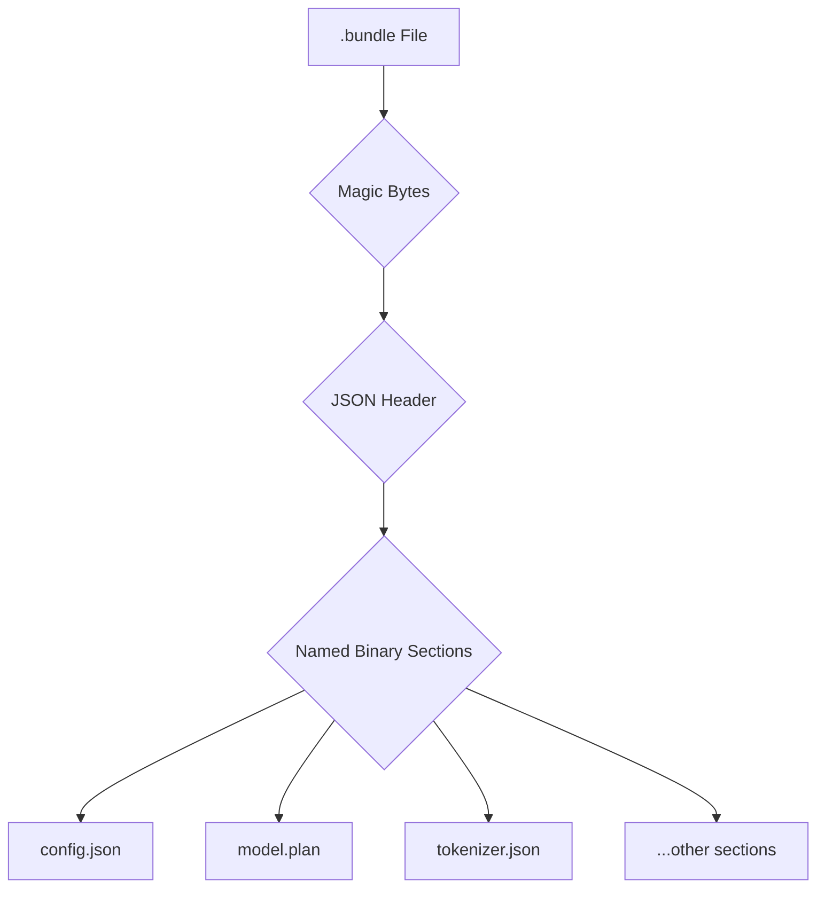
**Diagram: .bundle File Structure**

Sources:
- [src/runtime/registry/pipeline_factory.cpp:80-81]()

The `BundleInfo` struct [src/runtime/registry/pipeline_factory.cpp:80]() holds metadata about the bundle, including its sections. Each section is described by `BundleSectionInfo` [src/runtime/registry/pipeline_factory.cpp:80](), which contains its name, offset, and size within the bundle.

The `config.json` section is particularly important as it contains the `runtime_strategy` and other configuration parameters that guide the loading process.

Sources:
- [src/runtime/registry/pipeline_factory.cpp:44-50]()

### Staged Loading Policy

Bundles can specify a `bundle_loading` policy within their `config.json` to control which sections are loaded eagerly and which are loaded lazily. This is useful for optimizing memory usage and startup time, especially for large models.

```json
{
  "bundle_loading": {
    "mode": "staged",
    "eager_sections": ["config.json", "model.plan"],
    "lazy_sections": ["tokenizer.json", "vocab.json"]
  },
  "runtime_strategy": "my_model_strategy",
  "platform": {
    "trt_log_stderr": true,
    "trt_log_min_severity": "INFO"
  }
}
```

The `materialize_pipeline_bundle` function [src/runtime/registry/pipeline_factory.cpp:79-114]() is responsible for reading the bundle header and, if a `bundle_loading` policy is present, loading sections according to that policy. If no policy is specified, all sections are loaded eagerly.

Sources:
- [src/runtime/registry/pipeline_factory.cpp:79-114]()

## Runtime Lifecycle

The runtime lifecycle begins when a user requests to load a model, typically via `trtmc::load()` [include/trtmc/pipeline.h:10](). This function orchestrates the entire process, from bundle parsing to `IPipeline` object creation.

### `trtmc::load()` and `PipelineFactory`

The `trtmc::load()` function [src/cli/main.cpp:159]() is the entry point for loading a model bundle. It takes the bundle path and `LoadOptions` as input.

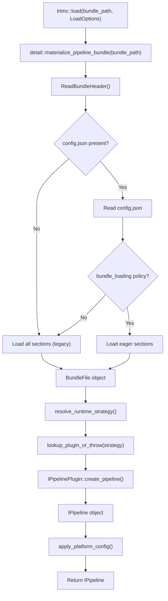
**Diagram: Pipeline Loading Flow**

Sources:
- [src/cli/main.cpp:159]()
- [src/runtime/registry/pipeline_factory.cpp:79-114]()
- [src/runtime/registry/pipeline_factory.cpp:120-137]()
- [src/runtime/registry/pipeline_factory.cpp:139-153]()
- [src/runtime/registry/pipeline_factory.cpp:155-169]()

1.  **Bundle Materialization**: `detail::materialize_pipeline_bundle()` [src/runtime/registry/pipeline_factory.cpp:79]() reads the `.bundle` file. It first reads the `BundleInfo` [src/runtime/registry/pipeline_factory.cpp:80]() (which includes the JSON header) and then decides which sections to load based on the `bundle_loading` policy in `config.json`.
2.  **Runtime Strategy Resolution**: The `resolve_runtime_strategy()` function [src/runtime/registry/pipeline_factory.cpp:120]() extracts the `runtime_strategy` from the bundle's `config.json`. If not found, it falls back to a default strategy. Legacy strategy aliases are also handled by `normalize_legacy_strategy()` [src/runtime/registry/pipeline_factory.cpp:120-123]().
3.  **Plugin Lookup**: `lookup_plugin_or_throw()` [src/runtime/registry/pipeline_factory.cpp:139]() uses the resolved `runtime_strategy` to find the corresponding `IPipelinePlugin`. This involves loading the model plugin DSO if it hasn't been loaded already via `load_model_plugin_for_strategy()` [src/runtime/registry/pipeline_factory.cpp:141]().
4.  **Pipeline Creation**: The identified `IPipelinePlugin`'s `create_pipeline()` method is called to construct the actual `IPipeline` object. This is where the model-specific logic resides.
5.  **Platform Configuration**: `apply_platform_config()` [src/runtime/registry/pipeline_factory.cpp:155]() applies any platform-specific settings (like TensorRT logging verbosity) defined in the bundle's configuration.

### Model and Backend DSO Loading

TRTMC uses Dynamic Shared Objects (DSOs) for both model-specific logic (model plugins) and backend implementations (e.g., TensorRT backend).

#### Model Plugin DSOs

Model plugin DSOs contain the C++ implementation of the `IPipelinePlugin` interface for a specific model family. These DSOs are loaded dynamically based on the `runtime_strategy`.

The `load_model_plugin_for_strategy()` function [src/runtime/registry/pipeline_factory.cpp:141]() is responsible for loading the correct model plugin DSO. It searches for the DSO in specified `model_plugin_search_paths` [src/cli/args.h:93]().

#### Backend DSOs

Backend DSOs provide the actual inference engine implementation. For example, `libtrtmc_backend_trt.so` contains the `TrtBackend` implementation for standard TensorRT.

The `TrtBackend` class [src/runtime/backend/trt_backend.cpp:64]() implements the `IBackend` interface. It is responsible for deserializing TensorRT engines (`nvinfer1::ICudaEngine`) from plan data and creating `ITrtModule` instances.

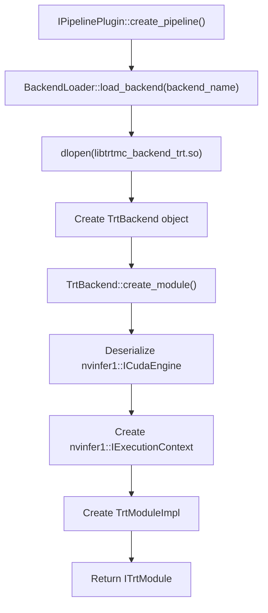
**Diagram: Backend and Module Loading**

Sources:
- [src/runtime/backend/trt_backend.cpp:64]()
- [src/runtime/backend/trt_backend.cpp:71-74]()
- [src/runtime/backend/trt_backend.cpp:86-93]()
- [src/runtime/backend/trt_module_impl.h:27-34]()

The `TrtModuleImpl` class [src/runtime/backend/trt_module_impl.h:27]() is the concrete implementation of `ITrtModule` that wraps a TensorRT engine and execution context. It manages buffer allocation, dynamic shapes, and CUDA graph execution.

Sources:
- [src/runtime/backend/trt_module_impl.h:27]()
- [src/runtime/backend/trt_module_impl.h:97-105]()
- [src/runtime/backend/trt_module_impl.h:118-119]()

### Native vs. Optimized Load Paths

TRTMC supports both native and optimized load paths, primarily differing in how the underlying inference engine is provided.

#### Native Load Path

In the native load path, the model is typically loaded as a TensorRT engine (`.plan` file) and executed directly by the `TrtBackend`. This is the most common path for models built with `trtmc build`.

The `TrtBackend` [src/runtime/backend/trt_backend.cpp:64]() handles the deserialization of the TensorRT engine and the creation of `TrtModuleImpl` instances.

#### Optimized Load Path

The optimized load path is used for models that leverage specialized, highly optimized runtimes, often implemented as separate DSOs. These runtimes might offer custom kernel implementations, advanced memory management, or specific hardware acceleration.

The `OptimizedRuntimeHost` [src/runtime/providers/optimized_runtime_host.h]() acts as a wrapper for these optimized runtimes. It implements the `ITrtModule` interface, allowing it to be used interchangeably with `TrtModuleImpl` within the `IPipeline`.

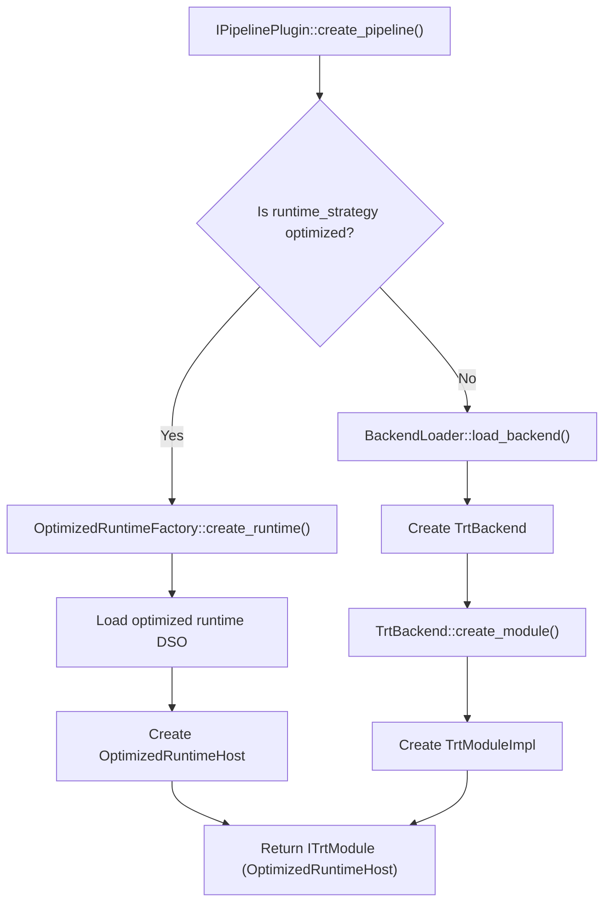
**Diagram: Native vs. Optimized Load Paths**

Sources:
- [src/runtime/providers/optimized_runtime_host.h]()
- [src/runtime/providers/optimized_runtime_factory.h]()

### `PipelineContext` Construction

Once the `IPipelinePlugin` creates the `IPipeline` object, it often encapsulates one or more `ITrtModule` instances within a `PipelineContext`. The `IPipeline` then uses this context to perform inference.

For example, the `Dinov3ImageFeaturePipeline` [src/runtime/models/dinov3/pipeline.h]() holds a `std::unique_ptr<TrtModule> model_` [src/runtime/models/dinov3/pipeline.cpp:87](), which is an `ITrtModule` instance. This `TrtModule` is then used in the `extract_image_features` method [src/runtime/models/dinov3/pipeline.cpp:118]() to perform the actual inference.

Sources:
- [src/runtime/models/dinov3/pipeline.h]()
- [src/runtime/models/dinov3/pipeline.cpp:87]()
- [src/runtime/models/dinov3/pipeline.cpp:118]()

The `IPipeline` interface [include/trtmc/pipeline.h:238]() defines the public API for interacting with the loaded model, offering methods like `generate()`, `transcribe()`, `embed()`, etc., depending on the model's capabilities.

Sources:
- [include/trtmc/pipeline.h:238]()

---

# Page: C++ Public API (IPipeline and CLI)

# C++ Public API (IPipeline and CLI)

<details>
<summary>Relevant source files</summary>

The following files were used as context for generating this wiki page:

- [CMakeLists.txt](CMakeLists.txt)
- [examples/trtmc_benchmark_worker.cpp](examples/trtmc_benchmark_worker.cpp)
- [include/trtmc/image_features.h](include/trtmc/image_features.h)
- [include/trtmc/pipeline.h](include/trtmc/pipeline.h)
- [python/tensorrt_model_connect/families/base.py](python/tensorrt_model_connect/families/base.py)
- [python/tensorrt_model_connect/families/wan2_2_ti2v/data/wan22-ti2v-5b-921dbaf3-fp8-scales.json](python/tensorrt_model_connect/families/wan2_2_ti2v/data/wan22-ti2v-5b-921dbaf3-fp8-scales.json)
- [python/tensorrt_model_connect/families/wan2_2_ti2v/fp8_profile.py](python/tensorrt_model_connect/families/wan2_2_ti2v/fp8_profile.py)
- [python/tensorrt_model_connect/families/wan2_2_ti2v/plugin.py](python/tensorrt_model_connect/families/wan2_2_ti2v/plugin.py)
- [python/tensorrt_model_connect/families/wan2_2_ti2v/tests/test_family.py](python/tensorrt_model_connect/families/wan2_2_ti2v/tests/test_family.py)
- [src/cli/args.cpp](src/cli/args.cpp)
- [src/cli/args.h](src/cli/args.h)
- [src/cli/main.cpp](src/cli/main.cpp)
- [src/runtime/config/cli_support.cpp](src/runtime/config/cli_support.cpp)
- [src/runtime/core/image_features.cpp](src/runtime/core/image_features.cpp)
- [src/runtime/models/dinov3/pipeline.cpp](src/runtime/models/dinov3/pipeline.cpp)
- [src/runtime/models/dinov3/pipeline.h](src/runtime/models/dinov3/pipeline.h)
- [src/runtime/models/nemotron_speech_streaming/audio_helpers.cpp](src/runtime/models/nemotron_speech_streaming/audio_helpers.cpp)
- [src/runtime/models/nemotron_speech_streaming/audio_helpers.h](src/runtime/models/nemotron_speech_streaming/audio_helpers.h)
- [src/runtime/models/nemotron_speech_streaming/pipeline.cpp](src/runtime/models/nemotron_speech_streaming/pipeline.cpp)
- [src/runtime/providers/optimized_runtime_factory.h](src/runtime/providers/optimized_runtime_factory.h)
- [src/runtime/providers/optimized_runtime_host.cpp](src/runtime/providers/optimized_runtime_host.cpp)
- [src/utils/sha256.h](src/utils/sha256.h)
- [src/utils/wav_reader.cpp](src/utils/wav_reader.cpp)
- [src/utils/wav_reader.h](src/utils/wav_reader.h)
- [tests/cpp/fakes/fake_optimized_runtime_provider.cpp](tests/cpp/fakes/fake_optimized_runtime_provider.cpp)
- [tests/cpp/models/dinov3/test_dinov3_pipeline.cpp](tests/cpp/models/dinov3/test_dinov3_pipeline.cpp)
- [tests/cpp/models/nemotron_speech_streaming/test_nemotron_speech_streaming_audio_helpers.cpp](tests/cpp/models/nemotron_speech_streaming/test_nemotron_speech_streaming_audio_helpers.cpp)
- [tests/cpp/test_bundle_format.cpp](tests/cpp/test_bundle_format.cpp)
- [tests/cpp/test_cli_args.cpp](tests/cpp/test_cli_args.cpp)
- [tests/cpp/test_config_cli_support.cpp](tests/cpp/test_config_cli_support.cpp)
- [tests/cpp/test_helpers.h](tests/cpp/test_helpers.h)
- [tests/cpp/test_pipeline_api.cpp](tests/cpp/test_pipeline_api.cpp)
- [tests/cpp/test_wav_reader.cpp](tests/cpp/test_wav_reader.cpp)
- [tests/e2e/models/qwen/edge_llm_adapter/test_runtime_contract.py](tests/e2e/models/qwen/edge_llm_adapter/test_runtime_contract.py)
- [website/docs/api/cli-reference.md](website/docs/api/cli-reference.md)
- [website/docs/api/cpp-api.md](website/docs/api/cpp-api.md)
- [website/docs/features/quantization.md](website/docs/features/quantization.md)
- [website/docs/tutorials/intermediate/canary-decoding.md](website/docs/tutorials/intermediate/canary-decoding.md)
- [website/docs/wiki/Pipeline-Deep-Dive.md](website/docs/wiki/Pipeline-Deep-Dive.md)

</details>


This section documents the core C++ public API for interacting with TensorRT-Model-Connect (TRTMC) models, focusing on the key `IPipeline` interface and the `trtmc` command-line interface (CLI). It provides detailed explanations of the API design, command dispatch, argument parsing, pipeline loading, and the set of commonly supported operations and modes, bridging the gap between natural language commands and their underlying code implementations.

The primary components covered here are:

- The `IPipeline` C++ interface as declared in `include/trtmc/pipeline.h`, which defines the high-level inference API.
- The CLI command dispatch and argument parsing implemented in `src/cli/main.cpp` and `src/cli/args.cpp/h`.
- How the CLI commands map to pipeline operations.
- Data flow and invocation patterns from user input to inference result output.
  
Users of the TRTMC C++ runtime or the `trtmc` CLI executable will find this page essential for understanding how to programmatically access model capabilities or run models from the command line.


## 1. Overview of the IPipeline Interface

The `IPipeline` interface is the fundamental C++ abstraction for a loaded TRTMC model runtime pipeline. It presents a unified API for model execution across various family types and modalities (text, image, audio, etc.).

### Key Points:

- Defined in `include/trtmc/pipeline.h`.
- Represents a loaded model bundle and exposes inference capabilities such as:
  - `generate` for text generation.
  - `transcribe` for audio-to-text.
  - `generate_image` for image generation.
  - `embed` for feature extraction embeddings.
  - Other modality-specific methods.
- Enforces a value-oriented design for input and output data, with user-owned result objects (e.g., `TextResult`, `ImageResult`).
- Supports rich configuration objects for inference parameters such as generation parameters, transcription configs, etc.

### Example Usage

```cpp
auto pipeline = trtmc::load("model.bundle");
auto gen_config = trtmc::GenerateConfig{};
gen_config.max_new_tokens = 20;
auto result = pipeline->generate("Hello, world", gen_config);
std::cout << "Generated text: " << result.text << std::endl;
```

This exemplifies typical use: loading a model bundle via `trtmc::load()` and invoking `generate()` with a prompt and configuration.

### Data Structures

- `TextResult`: Holds generated text, token IDs, and timing info.
- `TranscriptionSegment`: Time-aligned segments for transcription.
- `TranscriptionConfig`/`TranscriptionRequest`: Used to specify transcription parameters and input audio samples.
- `ImageResult`, `AudioResult`, `EmbeddingResult`, etc. provide modality-specific inference outputs.

### Design Notes

The pipeline interface abstracts the runtime strategy, model type, and backend details. Users do not interact with low-level tensors or engine details, instead using unified configuration/result structs.

Sources: `include/trtmc/pipeline.h:1-208`


## 2. The `trtmc` Command-Line Interface (CLI)

The `trtmc` CLI executable is the primary user-facing tool for interacting with TRTMC model bundles and performing common operations:

- `build` — Build .bundle files from Hugging Face checkpoints or directories.
- `run` — Run generative text/image/audio models.
- `transcribe` — Transcribe speech from audio files.
- `generate-video` — Generate video content.
- `classify`, `segment`, `embed` — Modality-specific model inference.
- `rerank`, `solve`, `inspect`, `version` — Auxiliary commands.

### Architecture and Flow

- The CLI entry point is implemented in `src/cli/main.cpp`.
- Command-line argument parsing and validation is in `src/cli/args.cpp` and `src/cli/args.h`.
- After parsing, the `trtmc` program dispatches to internal handlers that:
  - Load the model pipeline using `trtmc::load()` with configuration options from CLI flags.
  - Prepare input data and configuration structs.
  - Call the appropriate pipeline method (`generate`, `transcribe`, etc.).
  - Handle outputs (print to stdout, write images/files, JSON outputs).
- Supports runtime optimizations such as CUDA Graphs and kernel bindings.

### Argument Parsing

`CliArgs` struct captures all parsed command-line options, including:

- Command name (`build`, `run`, `transcribe`, etc.).
- Bundle path for loading the model.
- Prompt or input files (image/audio).
- Generation parameters (`max-new-tokens`, `temperature`, `top-k`, etc.).
- Output settings.
- Backend and plugin search paths.
- Other advanced flags (e.g., LoRA adapter paths, runtime cache, kernel bindings).

The parser rigorously validates argument formats (e.g., `parse_byte_size` for sizes, `parse_seed_csv` for seeds).

### Loading a Pipeline in CLI

Example snippet excerpted from `src/cli/main.cpp` shows pipeline loading with options extracted from `CliArgs`:

```cpp
std::unique_ptr<trtmc::IPipeline> load_pipeline(const CliArgs& args) {
  return trtmc::load(args.bundle_path, make_load_options(args), args.kernel_bindings_path);
}
```

Where `make_load_options` populates `LoadOptions` from CLI args such as runtime cache and CUDA graphs support.

This defers actual model loading and runtime strategy selection to the core runtime.

### Command Dispatched Operations

After parsing:

- `build`: passed to the Python builder subsystem.
- `run`: calls `pipeline->generate` or pipeline image/audio specific methods depending on flags.
- `transcribe`: calls `pipeline->transcribe` with audio input.
- `generate-video`: calls video generation pipeline methods.
- `classify` / `extract-features` / `detect`: run corresponding pipeline classifier/extractor/detector methods.
- `embed`: calls embedding extraction methods.
- `rerank` / `solve`: problem-specific logic.
- `inspect`: inspects bundle metadata.
- `version`: prints version info.

### Output and Benchmarks

- CLI supports benchmarking through `--benchmark` and warmup iterations.
- Output files, JSON, or stdout printing are handled transparently.
- Image outputs leverage `stb_image_write` for file formats like PNG.

Sources: `src/cli/main.cpp:1-74300`, `src/cli/args.cpp:1-184`, `src/cli/args.h:1-130`


## 3. Data Flow and API Interaction: From CLI Commands to Pipeline Calls

The following mermaid diagram relates the common CLI commands and the corresponding C++ pipeline methods invoked:

```mermaid
graph TD
  subgraph Natural Language Commands
    B1["trtmc build <model> -o <bundle> [args]"]
    B2["trtmc run <bundle> --prompt \"text\" [--flags]"]
    B3["trtmc transcribe <bundle> --audio FILE.wav [--flags]"]
    B4["trtmc generate-video <bundle> --prompt \"text\" [--flags]"]
    B5["trtmc classify <bundle> --image PATH [--flags]"]
    B6["trtmc embed <bundle> --image PATH [--flags]"]
    B7["trtmc inspect <bundle> [--list-engines]"]
    B8["trtmc version"]
  end

  subgraph C++ API Calls
    P1["trtmc::load(bundle_path, options)"]
    P2["IPipeline::generate(prompt, GenerateConfig)"]
    P3["IPipeline::transcribe(audio_samples, TranscriptionConfig)"]
    P4["IPipeline::generate_video(prompt, VideoConfig)"]
    P5["IPipeline::classify(image_pixels, ClassificationConfig)"]
    P6["IPipeline::embed(image_pixels, EmbeddingConfig)"]
    P7["trtmc::InspectBundle(bundle_path)"]
    P8["trtmc::version()"]
  end

  B1 -->|calls| P1
  B2 -->|calls| P1
  B2 -->|calls| P2
  B3 -->|calls| P1
  B3 -->|calls| P3
  B4 -->|calls| P1
  B4 -->|calls| P4
  B5 -->|calls| P1
  B5 -->|calls| P5
  B6 -->|calls| P1
  B6 -->|calls| P6
  B7 -->|calls| P7
  B8 -->|calls| P8
```

This diagram maps how user-facing `trtmc` CLI commands translate into API calls involving loading the pipeline and invoking the requested operation. For all commands except `build`, the loaded `IPipeline` instance is the key abstraction through which inputs and configuration are sent, and results retrieved.

Sources: `src/cli/main.cpp:10-40`, `include/trtmc/pipeline.h:11-50`


## 4. Argument Parsing and Load Options Configuration

The `CliArgs` struct defined in `src/cli/args.h` and parsed by `parse_args()` in `src/cli/args.cpp` gathers all runtime parameters. The CLI applies these arguments to configure the pipeline load and runtime behavior as follows:

- `bundle_path` — passed to `trtmc::load()`.
- `hf_python`, `runtime_cache`, `backend_search_paths`, `model_plugin_search_paths` — forwarded as `LoadOptions`.
- Flags such as `cuda_graphs`, `kv_cache_size_bytes` set pipeline internal runtime flags.
- Model plugin paths and backend libraries are dynamically discovered or explicitly specified here.

`make_load_options` in `src/cli/main.cpp` constructs the `LoadOptions` from CLI args for use in loading the pipeline, ensuring correct backend search paths and runtime optimizations.

Sources: `src/cli/args.h:15-111`, `src/cli/args.cpp:15-185`, `src/cli/main.cpp:140-160`


## 5. Example: Running a Text Generation Model

Typical `trtmc run` flow:

1. Parse args with prompt, max tokens, temperature, etc.
2. Load pipeline with `trtmc::load()`.
3. Construct `GenerateConfig` from flags.
4. Call `IPipeline::generate()`.
5. Retrieve `TextResult`, print output.

```cpp
auto args = parse_args(argc, argv);
auto pipeline = trtmc::load(args.bundle_path, make_load_options(args));
trtmc::GenerateConfig gen_config;
gen_config.max_new_tokens = args.max_new_tokens;
auto result = pipeline->generate(args.prompt, gen_config);
std::cout << result.text << std::endl;
```

The CLI orchestrates such flows internally, handling error reporting and output file writing.

Sources: `src/cli/main.cpp:75-160`


## 6. Example: Transcription Command

For `trtmc transcribe`, the CLI reads an audio file into a `TranscriptionRequest` and calls:

```cpp
auto request = trtmc::TranscriptionRequest{};
request.audio_samples = ReadWavSamples(args.audio_in);
request.config.max_output_tokens = args.max_new_tokens;
request.config.beam_size = args.beam_size;
// Set other config fields...

auto transcript = pipeline->transcribe(request);
OutputTranscript(transcript);
```

Here the `TranscriptionConfig` encapsulates beam search and language options, enabling flexible ASR/translation.

Sources: `include/trtmc/pipeline.h:56-103`, `src/cli/main.cpp:20-100`


## 7. Extending the Pipeline with New Commands or Modalities

The public API enables extending to new modalities by adding methods to the `IPipeline` interface. The CLI can dispatch new commands by:

- Parsing new flags into configuration structs.
- Calling new `IPipeline` methods.
- Formatting outputs accordingly.

The runtime load and plugin mechanism supports loading family plugin DSOs that implement new pipeline subclasses.

Sources: `include/trtmc/pipeline.h:20-200`, `src/cli/main.cpp`


## 8. Supporting Infrastructure

- The pipeline is a unique_ptr returned by `trtmc::load()`, which hides runtime details.
- The CLI may preload plugins for the runtime strategy via `trtmc::load_model_plugin_for_strategy()`.
- Kernel binding files and runtime caches support advanced backend optimization paths.
- The CLI supports advanced generation modes like diffusion, SDE, image negative prompts by forwarding parameters into `GenerateConfig`.

Sources: `src/cli/main.cpp:160-180`, `src/cli/args.cpp`, `include/trtmc/pipeline.h`


## 9. Summary Table: CLI Commands and IPipeline Methods

| CLI Command         | Core Pipeline API Method           | Input Type                 | Output Type            |
|---------------------|----------------------------------|----------------------------|------------------------|
| `build`             | Python builder subsystem (external) | HF checkpoint/directory    | Bundle artifact         |
| `run`               | `IPipeline::generate()`           | Prompt + `GenerateConfig`  | `TextResult`            |
| `transcribe`        | `IPipeline::transcribe()`         | `TranscriptionRequest`     | `TextResult`            |
| `generate-video`    | `IPipeline::generate_video()` (if supported) | Prompt + VideoConfig | Video frames or path    |
| `classify`          | `IPipeline::classify()`           | Image input                | `ClassificationResult`  |
| `embed`             | `IPipeline::embed()`              | Image or text              | `EmbeddingResult`       |
| `segment`           | `IPipeline::segment()`            | Image + Prompt             | `SegmentResult`         |
| `rerank`            | `IPipeline::rerank()`             | Document + query           | `TextResult`            |
| `solve`             | `IPipeline::solve()`              | Problem description        | Solution object         |
| `inspect`           | `trtmc::InspectBundle()`          | Bundle path                | Metadata info           |
| `version`           | `trtmc::version()`                | None                       | Version string          |

Sources: `src/cli/main.cpp`, `include/trtmc/pipeline.h`


## 10. C++ and CLI Integration Diagram: From Natural Language to Code Entities

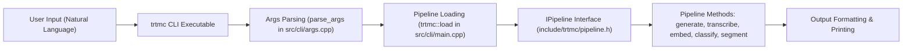

This diagram illustrates the sequential system flow from user command input to final output, highlighting the key code units implementing each stage.

Sources: `src/cli/main.cpp`, `src/cli/args.cpp`, `include/trtmc/pipeline.h`


## 11. Advanced Details: LoadOptions and Runtime Strategy

The CLI supports advanced runtime customization through the `LoadOptions` structure built from parsed CLI flags:

- `hf_python` path: Used for interoperability with Hugging Face Python utilities.
- `runtime_cache_path`: Path for saving intermediate compiled kernel shaders or plan caches.
- `cuda_graphs`: Enables CUDA Graphs capture in TRT execution.
- `kv_cache_size_bytes`: Manages key-value cache memory sizing for Transformer decoders.
- Search paths for backend and model plugin DSOs dynamically control runtime behavior.

Pipeline load respects these options to instantiate the correct runtime strategy, potentially triggering plugin loads or optimized backends.

Sources: `src/cli/main.cpp:140-160`


## 12. Summary

This page detailed the TRTMC C++ public API and CLI internals, focusing on how users invoke various model capabilities either programmatically via `IPipeline` or through the `trtmc` CLI. We highlighted the core pipeline interface design, the argument parsing and command dispatch in the CLI, and showed the mapping from natural language user commands to concrete C++ methods. The documentation equips developers to build new CLI commands, extend pipeline modalities, or embed TRTMC runtime capabilities in custom C++ applications.


---

### Sources

- `include/trtmc/pipeline.h:1-208`  
- `src/cli/main.cpp:1-74300` (entire file excerpted, focus on lines 6-180 approx.)  
- `src/cli/args.cpp:1-184`  
- `src/cli/args.h:1-130`

---

# Page: Build System: CMake, DSO Boundaries, and Packaging

# Build System: CMake, DSO Boundaries, and Packaging

<details>
<summary>Relevant source files</summary>

The following files were used as context for generating this wiki page:

- [CMakeLists.txt](CMakeLists.txt)
- [_pyproject_backend.py](_pyproject_backend.py)
- [conanfile.py](conanfile.py)
- [examples/trtmc_benchmark_worker.cpp](examples/trtmc_benchmark_worker.cpp)
- [include/trtmc/pipeline.h](include/trtmc/pipeline.h)
- [pyproject.toml](pyproject.toml)
- [src/cli/args.cpp](src/cli/args.cpp)
- [src/cli/args.h](src/cli/args.h)
- [src/cli/main.cpp](src/cli/main.cpp)
- [src/runtime/config/config_bundle.cpp](src/runtime/config/config_bundle.cpp)
- [src/runtime/config/schema_registry.cpp](src/runtime/config/schema_registry.cpp)
- [src/runtime/config/schemas/platform.cpp](src/runtime/config/schemas/platform.cpp)
- [src/runtime/config/schemas/runtime.cpp](src/runtime/config/schemas/runtime.cpp)
- [src/runtime/config/schemas/text_trace.cpp](src/runtime/config/schemas/text_trace.cpp)
- [src/runtime/config/schemas/triattention.cpp](src/runtime/config/schemas/triattention.cpp)
- [src/runtime/models/dinov3/pipeline.cpp](src/runtime/models/dinov3/pipeline.cpp)
- [src/runtime/models/dinov3/pipeline.h](src/runtime/models/dinov3/pipeline.h)
- [src/runtime/providers/optimized_runtime_factory.h](src/runtime/providers/optimized_runtime_factory.h)
- [src/runtime/providers/optimized_runtime_host.cpp](src/runtime/providers/optimized_runtime_host.cpp)
- [tests/builder/test_config_cli_support.py](tests/builder/test_config_cli_support.py)
- [tests/builder/test_config_isolation_demo.py](tests/builder/test_config_isolation_demo.py)
- [tests/builder/test_config_schema_registry.py](tests/builder/test_config_schema_registry.py)
- [tests/builder/test_config_schemas_crosslang.py](tests/builder/test_config_schemas_crosslang.py)
- [tests/cpp/fakes/fake_optimized_runtime_provider.cpp](tests/cpp/fakes/fake_optimized_runtime_provider.cpp)
- [tests/cpp/models/dinov3/test_dinov3_pipeline.cpp](tests/cpp/models/dinov3/test_dinov3_pipeline.cpp)
- [tests/cpp/test_cli_args.cpp](tests/cpp/test_cli_args.cpp)
- [tests/cpp/test_config_schema_registry.cpp](tests/cpp/test_config_schema_registry.cpp)
- [tests/cpp/test_config_schemas_triattention.cpp](tests/cpp/test_config_schemas_triattention.cpp)
- [tests/cpp/test_pipeline_api.cpp](tests/cpp/test_pipeline_api.cpp)
- [tests/e2e/models/qwen/edge_llm_adapter/test_runtime_contract.py](tests/e2e/models/qwen/edge_llm_adapter/test_runtime_contract.py)
- [tests/tools/test_optimized_runtime_packaging.py](tests/tools/test_optimized_runtime_packaging.py)
- [tests/tools/test_release_backend_abi.py](tests/tools/test_release_backend_abi.py)
- [tools/ci/package.py](tools/ci/package.py)
- [website/docs/architecture/build-system.md](website/docs/architecture/build-system.md)

</details>


This page details the build system of TensorRT-Model-Connect (TRTMC), focusing on how CMake orchestrates the compilation process, manages dynamically linked object (DSO) boundaries, and how the project is packaged for Python distribution. It covers the scanning of `MODEL.toml` descriptors for plugin registration, the native linking architecture (`trtmc_core`, model DSOs, backend DSOs), the Python packaging using `pyproject.toml` and `conanfile.py`, and the release wheel build process.

## CMake Build System and Model Plugin Registration

The TRTMC build system leverages CMake to manage the compilation of its C++ components. A key aspect of this system is the dynamic discovery and registration of model plugins.

### MODEL.toml Scanning and Plugin Generation

TRTMC uses `MODEL.toml` files to describe model families and their associated C++ runtime plugins. During the CMake configuration phase, these `MODEL.toml` files are scanned to identify available model plugins. This scanning process is crucial for generating the necessary C++ code to register these plugins with the core runtime.

The `CMakeLists.txt` [CMakeLists.txt:1-599]() file defines the overall project structure and includes various subdirectories. The `cmake/trtmc_model_plugin.cmake` [cmake/trtmc_model_plugin.cmake:1-100]() module is responsible for processing `MODEL.toml` files.

For each `MODEL.toml` file found, CMake generates a C++ source file that contains a registration function. This function, when called, registers the model's pipeline factory with the TRTMC runtime. This allows the core runtime to dynamically load and instantiate pipelines for different model families.

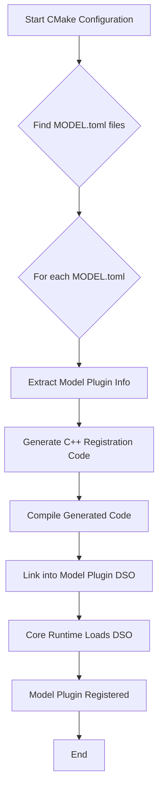
**Diagram: MODEL.toml Scanning and Plugin Registration**

Sources:
- [CMakeLists.txt:1-599]()
- [cmake/trtmc_model_plugin.cmake:1-100]()

### Native Link Boundaries

The TRTMC C++ runtime is structured around several dynamically linked object (DSO) boundaries to promote modularity and allow for flexible deployment. These boundaries include:

*   **`trtmc_core`**: This is the main core library, providing fundamental utilities, the `IPipeline` [include/trtmc/pipeline.h:24]() interface, and the `PipelineFactory` [src/runtime/providers/optimized_runtime_factory.h:24]() for loading bundles. It is designed to be lightweight and independent of specific model implementations or backend runtimes.
*   **Model DSOs**: Each model family's C++ runtime implementation is compiled into its own DSO (e.g., `libtrtmc_model_dinov3.so`). These DSOs contain the specific logic for preprocessing, postprocessing, and interacting with the underlying `ITrtModule` [tests/cpp/models/dinov3/test_dinov3_pipeline.cpp:27]() for a given model. The `MODEL.toml` files define these model-specific plugins.
*   **Backend DSOs**: These DSOs provide the actual inference backend implementations, such as the TensorRT backend (`libtrtmc_backend_trt.so`). The core runtime loads these DSOs based on the `runtime_strategy` specified in a bundle. This allows TRTMC to support different inference backends without recompiling the core library.

The `trtmc` CLI executable [src/cli/main.cpp:6]() links against `trtmc_core` and dynamically loads model and backend DSOs at runtime. The `trtmc::load_model_plugin_for_strategy` [src/cli/main.cpp:179]() function is responsible for loading the appropriate model plugin DSO.

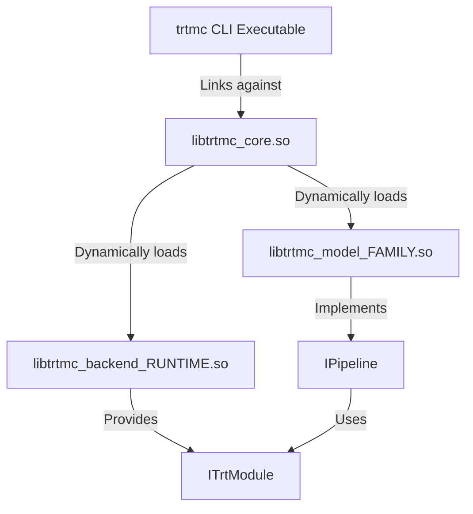
**Diagram: Native Link Boundaries**

Sources:
- [src/cli/main.cpp:6]()
- [include/trtmc/pipeline.h:24]()
- [src/runtime/providers/optimized_runtime_factory.h:24]()
- [tests/cpp/models/dinov3/test_dinov3_pipeline.cpp:27]()
- [src/cli/main.cpp:179]()

## Python Packaging: `pyproject.toml` and `conanfile.py`

TRTMC uses a combination of `pyproject.toml` and `conanfile.py` for Python packaging, enabling the creation of distributable wheels that include both Python and native C++ components.

### `pyproject.toml`

The `pyproject.toml` [pyproject.toml:1-99]() file defines the project's metadata, build system requirements, and Python-specific configurations.

*   **Build System**: It specifies `_pyproject_backend` [pyproject.toml:6]() as the build backend, which is a custom backend that integrates with Conan for C++ dependency management.
*   **Dynamic Fields**: `version` and `dependencies` are marked as dynamic [pyproject.toml:11](), meaning their values are determined at build time. The `version` is derived from `TRTMC_PACKAGE_VERSION` environment variable [conanfile.py:166](), which is set by the build process.
*   **Package Metadata**: Includes `name`, `description`, `readme`, `license`, and `requires-python` [pyproject.toml:10-16]().
*   **`tool.tensorrt-model-connect.package`**: This section [pyproject.toml:18-34]() defines TRTMC-specific packaging options, such as `base-version` and `default-tensorrt-version`, and a list of Python `dependencies`.
*   **Optional Dependencies**: Defines groups of optional dependencies for features like `test`, `wan`, `fast-foundation-stereo`, `chronos`, `clip`, and `validation` [pyproject.toml:36-51]().
*   **`tool.conan-py-build.wheel` and `sdist`**: These sections [pyproject.toml:53-67]() specify which files and directories to include or exclude when building the Python wheel and source distribution (sdist). For example, the `sdist` includes `python`, `src/runtime/models/fast_foundation_stereo/native_plugins`, and `third_party` [pyproject.toml:57-59]().

### `conanfile.py`

The `conanfile.py` [conanfile.py:1-179]() script is central to managing C++ dependencies and integrating the native build with Python packaging. It uses Conan, a C/C++ package manager, to handle the compilation and packaging of the C++ components.

*   **`requirements()`**: Declares C++ dependencies, such as `nlohmann_json` [conanfile.py:172]().
*   **`layout()`**: Defines the build directory structure [conanfile.py:175]().
*   **`generate()`**: Configures CMake toolchains and dependencies [conanfile.py:177-180]().
*   **`build()`**: Invokes CMake to build the C++ project [conanfile.py:182-185](). This step compiles `trtmc_core`, model DSOs, and backend DSOs.
*   **`package()`**: This crucial method [conanfile.py:187-240]() stages the compiled C++ artifacts and Python source files into the final package structure. It copies executables (`trtmc`, `trtmc_benchmark_worker`), core libraries (`libtrtmc_core.so`), backend libraries (`libtrtmc_backend_trt.so`), and model-specific DSOs (e.g., `libtrtmc_model_example.so`) into the Python package. It also handles staging benchmark catalogs [conanfile.py:58-132]() and rewriting RPATHs [conanfile.py:148-160]() for distributable wheels.

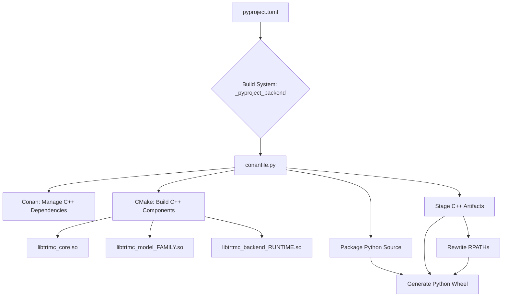
**Diagram: Python Packaging Workflow**

Sources:
- [pyproject.toml:1-99]()
- [conanfile.py:1-179]()
- [conanfile.py:172]()
- [conanfile.py:175]()
- [conanfile.py:177-180]()
- [conanfile.py:182-185]()
- [conanfile.py:187-240]()
- [conanfile.py:58-132]()
- [conanfile.py:148-160]()
- [conanfile.py:166]()
- [pyproject.toml:6]()
- [pyproject.toml:11]()
- [pyproject.toml:10-16]()
- [pyproject.toml:18-34]()
- [pyproject.toml:36-51]()
- [pyproject.toml:53-67]()
- [pyproject.toml:57-59]()

## Release Wheel Build Process

The release wheel build process is orchestrated by the custom `_pyproject_backend.py` [_pyproject_backend.py:1-188]() and integrates with Conan to produce platform-specific Python wheels containing the compiled C++ libraries.

1.  **`get_requires_for_build_wheel()`**: This function [_pyproject_backend.py:42]() specifies build dependencies, including `conan-py-build`.
2.  **`build_wheel()`**: This is the core function [_pyproject_backend.py:69]() that triggers the Conan-based build. It sets environment variables like `TRTMC_PACKAGE_TENSORRT_VERSION` [tools/ci/package.py:35]() to specify the target TensorRT version, which influences the ABI of the compiled backend DSOs.
3.  **Conan Invocation**: The `_variant_conan_build_backend` context manager [_pyproject_backend.py:62]() ensures that Conan is invoked with the correct environment and configuration.
4.  **CMake Build**: Conan's `build()` method [conanfile.py:182-185]() executes CMake, which compiles the C++ sources, including `trtmc_core`, model plugins, and backend plugins. The `TRTMC_TRT_BACKEND_ABI` CMake variable [CMakeLists.txt:58]() is used to name the TensorRT backend DSO (e.g., `libtrtmc_backend_trt_11_15.so`) based on the detected TensorRT version.
5.  **Packaging**: Conan's `package()` method [conanfile.py:187-240]() collects the compiled binaries and Python files. It copies the `trtmc` executable, `libtrtmc_core.so`, and the versioned `libtrtmc_backend_trt_*.so` into the Python package structure.
6.  **RPATH Rewriting**: The `_set_wheel_runpath` function [conanfile.py:148-160]() uses `patchelf` to modify the RPATH of the native binaries within the wheel. This ensures that the DSOs can be found at runtime relative to the installed package, making the wheel distributable. The `CMAKE_BUILD_RPATH_USE_ORIGIN` [CMakeLists.txt:9]() is set to `TRUE` to facilitate this.
7.  **Metadata Validation**: The `tools/ci/package.py` [tools/ci/package.py:1-911]() script includes validation logic to ensure the correctness of the built wheel, checking for expected TensorRT versions and backend files. The `_validate_package_variant` [tools/ci/package.py:92]() and `_validate_backend_files` [tools/ci/package.py:126]() functions perform these checks.

```mermaid
graph TD
    A[Python Wheel Build Request] --> B[pyproject.toml];
    B --> C[_pyproject_backend.py];
    C --> D[Set TRTMC_PACKAGE_TENSORRT_VERSION];
    D --> E[conanfile.py];
    E --> F[Conan build() method];
    F --> G[CMake: Compile C++];
    G --> H[Generate libtrtmc_core.so];
    G --> I[Generate libtrtmc_model_FAMILY.so];
    G --> J[Generate libtrtmc_backend_trt_ABI.so];
    F --> K[Conan package() method];
    K --> L[Copy Binaries to Wheel];
    K --> M[Rewrite RPATH with patchelf];
    M --> N[Final Python Wheel];
    N --> O[Validate Wheel (tools/ci/package.py)];
```
**Diagram: Release Wheel Build Process**

Sources:
- [_pyproject_backend.py:1-188]()
- [_pyproject_backend.py:42]()
- [_pyproject_backend.py:69]()
- [tools/ci/package.py:35]()
- [_pyproject_backend.py:62]()
- [conanfile.py:182-185]()
- [CMakeLists.txt:58]()
- [conanfile.py:187-240]()
- [conanfile.py:148-160]()
- [CMakeLists.txt:9]()
- [tools/ci/package.py:1-911]()
- [tools/ci/package.py:92]()
- [tools/ci/package.py:126]()

---

# Page: Model Family System

# Model Family System

<details>
<summary>Relevant source files</summary>

The following files were used as context for generating this wiki page:

- [python/tensorrt_model_connect/build_cli.py](python/tensorrt_model_connect/build_cli.py)
- [python/tensorrt_model_connect/engine_builder.py](python/tensorrt_model_connect/engine_builder.py)
- [python/tensorrt_model_connect/families/sana_wm/MODEL.toml](python/tensorrt_model_connect/families/sana_wm/MODEL.toml)
- [python/tensorrt_model_connect/families/sana_wm/components/gemma/plugin.py](python/tensorrt_model_connect/families/sana_wm/components/gemma/plugin.py)
- [python/tensorrt_model_connect/hf_snapshot.py](python/tensorrt_model_connect/hf_snapshot.py)
- [scripts/warm_hf_cache.py](scripts/warm_hf_cache.py)
- [src/runtime/models/whisper/pipeline.cpp](src/runtime/models/whisper/pipeline.cpp)
- [src/runtime/models/whisper/pipeline.h](src/runtime/models/whisper/pipeline.h)
- [src/runtime/models/whisper/plugin.cpp](src/runtime/models/whisper/plugin.cpp)
- [src/runtime/models/whisper/whisper_mel_spectrogram.cpp](src/runtime/models/whisper/whisper_mel_spectrogram.cpp)
- [src/runtime/models/whisper/whisper_mel_spectrogram.h](src/runtime/models/whisper/whisper_mel_spectrogram.h)
- [tests/builder/test_cli.py](tests/builder/test_cli.py)
- [tests/builder/test_engine_builder_extended.py](tests/builder/test_engine_builder_extended.py)
- [tests/builder/test_engine_builder_utils.py](tests/builder/test_engine_builder_utils.py)
- [tests/builder/test_families.py](tests/builder/test_families.py)
- [tests/builder/test_family_plugins.py](tests/builder/test_family_plugins.py)
- [tests/cpp/models/whisper/test_whisper_mel_spectrogram.cpp](tests/cpp/models/whisper/test_whisper_mel_spectrogram.cpp)
- [tests/cpp/test_tokenizer_edge_cases.cpp](tests/cpp/test_tokenizer_edge_cases.cpp)
- [tests/e2e/models/ltx_video/e2e_plugins/references/hf_diffusers.py](tests/e2e/models/ltx_video/e2e_plugins/references/hf_diffusers.py)
- [tests/e2e/models/ltx_video/test_ltx_video_hf_diffusers_reference.py](tests/e2e/models/ltx_video/test_ltx_video_hf_diffusers_reference.py)
- [tests/e2e/models/sana_wm/test_sana_wm_warm_hf_cache_metadata.py](tests/e2e/models/sana_wm/test_sana_wm_warm_hf_cache_metadata.py)
- [tests/e2e_harness/comparators/text_to_audio.py](tests/e2e_harness/comparators/text_to_audio.py)
- [tests/e2e_harness/references/hf_transformers.py](tests/e2e_harness/references/hf_transformers.py)
- [tests/e2e_harness/runners/audio_speech.py](tests/e2e_harness/runners/audio_speech.py)
- [tests/e2e_harness/thresholds/defaults/text_to_audio.json](tests/e2e_harness/thresholds/defaults/text_to_audio.json)
- [tests/runtime_strategy_matrix.yaml](tests/runtime_strategy_matrix.yaml)
- [tests/tools/test_family_specialization.py](tests/tools/test_family_specialization.py)
- [tests/tools/test_warm_hf_cache_static.py](tests/tools/test_warm_hf_cache_static.py)
- [tests/validation/model_workloads.yaml](tests/validation/model_workloads.yaml)

</details>


The Model Family System in TensorRT-Model-Connect (TRTMC) provides a structured approach to integrating diverse AI models. It defines how models are organized, discovered, and extended within the framework. This system is built around the `FamilyPlugin` protocol, `MODEL.toml` descriptors, and a three-sided ownership model, ensuring modularity, discoverability, and maintainability.

The core idea is to encapsulate model-specific logic—such as checkpoint loading, graph construction, and runtime adaptations—within distinct "family" modules. This allows TRTMC to support a wide array of models without becoming a monolithic application.

For detailed information on specific model groups and cross-cutting features, please refer to the child pages:
- [Text Generation Families (Decoders, MoE, Recurrent)](#3.1)
- [Vision-Language, Audio, and Speech Families](#3.2)
- [Diffusion, Perception, and Time-Series Families](#3.3)
- [Cross-Cutting Features: Quantization, Parallelism, and Tokenization](#3.4)

## FamilyPlugin Protocol

The `FamilyPlugin` protocol is the central interface for integrating new model architectures into TRTMC. Each model family implements this protocol, providing the necessary methods for TRTMC's build and runtime components to interact with the model. This protocol ensures that all model-specific logic is self-contained and adheres to a standardized interface.

The `FamilyPlugin` is responsible for:
*   **Model Discovery**: Defining how a model is identified as belonging to a specific family. This often involves inspecting `config.json` or `model_index.json` files within a Hugging Face model directory [python/tensorrt_model_connect/engine_builder.py:33-38]().
*   **Build Logic**: Providing the necessary components to construct the TensorRT engine(s) for the model. This includes defining graph builders and handling model-specific optimizations.
*   **Runtime Adaptations**: Specifying any unique runtime requirements or post-processing steps.

The `tensorrt_model_connect.families.find_plugin` function is used to locate the appropriate `FamilyPlugin` for a given model [python/tensorrt_model_connect/engine_builder.py:31](). This function relies on metadata defined within each family's `MODEL.toml` file.

Sources:
- [python/tensorrt_model_connect/engine_builder.py:31-38]()
- [tests/builder/test_families.py:10-12]()

## MODEL.toml Descriptors

Each model family is defined by a `MODEL.toml` descriptor file located within its Python package (e.g., `python/tensorrt_model_connect/families/sana_wm/MODEL.toml` [python/tensorrt_model_connect/families/sana_wm/MODEL.toml]()). These TOML files serve as declarative manifests, providing essential metadata about the model family.

Key information defined in `MODEL.toml` includes:
*   **`id`**: A unique identifier for the model family.
*   **`plugin`**: The Python module path to the `FamilyPlugin` implementation.
*   **`aliases`**: Alternative names or identifiers for the family, aiding in model discovery.
*   **`capabilities`**: A list of capabilities supported by the family (e.g., "text-generation", "image-to-image").
*   **`hf_warm_dependencies`**: Specifies Hugging Face model IDs and filenames that should be pre-cached during CI/CD processes [tests/tools/test_warm_hf_cache_static.py:174-180]().

This metadata is crucial for TRTMC's auto-discovery mechanism, allowing the system to dynamically load and utilize model families without explicit registration in code.

### Model Family Metadata Indexing

The `MODEL.toml` files are scanned and indexed to enable efficient lookup of model families. This indexing process creates a cache of `_FamilyMetadata` objects, which store parsed information from the TOML files.

```mermaid
graph TD
    A[Start] --> B{Scan python/tensorrt_model_connect/families/};
    B --> C{Find all MODEL.toml files};
    C --> D{Parse MODEL.toml into _FamilyMetadata};
    D --> E{Cache _FamilyMetadata objects};
    E --> F{Create _METADATA_INDEX_CACHE};
    F --> G{find_plugin(model_id)};
    G --> H{Use _METADATA_INDEX_CACHE to find candidate modules};
    H --> I{Load FamilyPlugin from module};
    I --> J[End];
```
Sources:
- [python/tensorrt_model_connect/families/sana_wm/MODEL.toml]()
- [tests/builder/test_families.py:70-114]()
- [tests/tools/test_warm_hf_cache_static.py:174-180]()

## Three-Sided Ownership Model

TRTMC employs a "three-sided ownership model" to manage the development and maintenance of model families. This model distributes responsibilities across three distinct components:

1.  **Python Family Package**: This side owns the model-specific Python logic, including the `FamilyPlugin` implementation, checkpoint loading, graph construction, and any Python-based pre/post-processing. It resides in `python/tensorrt_model_connect/families/`.
2.  **C++ Runtime DSO**: For performance-critical operations, a model family may have a corresponding C++ Dynamic Shared Object (DSO). This component handles the low-level TensorRT engine execution and C++-based runtime logic. These are typically found in `src/runtime/models/`. For example, the Whisper model has its C++ runtime components in `src/runtime/models/whisper/` [src/runtime/models/whisper/plugin.cpp](), [src/runtime/models/whisper/pipeline.cpp](), [src/runtime/models/whisper/pipeline.h]().
3.  **End-to-End (E2E) Tests**: Each model family is accompanied by a comprehensive suite of E2E tests. These tests validate the entire pipeline, from model loading and TensorRT engine compilation to inference and output verification against reference implementations (e.g., Hugging Face Transformers). These tests are located in `tests/e2e/models/`. For example, `tests/e2e/models/ltx_video/test_ltx_video_hf_diffusers_reference.py` [tests/e2e/models/ltx_video/test_ltx_video_hf_diffusers_reference.py]() tests the LTX-Video family against a Hugging Face Diffusers reference.

This ownership model ensures that each aspect of a model's integration is clearly defined and testable, promoting robustness and ease of extension.

```mermaid
graph TD
    A[Model Family] --> B(Python Family Package);
    A --> C(C++ Runtime DSO);
    A --> D(End-to-End Tests);

    B -- "Implements FamilyPlugin" --> E[TRTMC Build System];
    B -- "Checkpoint Loading" --> E;
    B -- "Graph Construction" --> E;
    C -- "TensorRT Engine Execution" --> F[TRTMC Runtime];
    C -- "C++ Pre/Post-processing" --> F;
    D -- "Validates Build & Runtime" --> G[CI/CD Pipeline];
    D -- "Compares against Reference" --> G;

    subgraph Python Family Package
        B1[MODEL.toml]
        B2[plugin.py]
        B3[checkpoint_mapper.py]
        B4[graph_builders.py]
    end

    subgraph C++ Runtime DSO
        C1[plugin.cpp]
        C2[pipeline.cpp]
        C3[pipeline.h]
    end

    subgraph End-to-End Tests
        D1[test_*.py]
        D2[e2e_plugins/references/]
        D3[e2e_plugins/runners/]
    end

    E -- "Generates .bundle" --> F;
    F -- "Inference Results" --> D;
```
Sources:
- [src/runtime/models/whisper/plugin.cpp]()
- [src/runtime/models/whisper/pipeline.cpp]()
- [src/runtime/models/whisper/pipeline.h]()
- [tests/e2e/models/ltx_video/test_ltx_video_hf_diffusers_reference.py]()
- [tests/e2e_harness/references/hf_transformers.py:4-8]()
- [tests/e2e_harness/runners/audio_speech.py:4-8]()
- [tests/builder/test_family_plugins.py:4-7]()

## Model Discovery and Resolution

TRTMC provides mechanisms to discover and resolve model families from various sources, including Hugging Face model IDs and local directories. The `engine_builder` module plays a key role in this process.

The `resolve_family_id` function identifies the appropriate family for a given model, while `resolve_config_from_model_dir` extracts configuration details. For Hugging Face models, `hf_snapshot_allow_patterns` defines which files are permitted for download [python/tensorrt_model_connect/hf_snapshot.py]().

```mermaid
graph TD
    A[User Input: Model Identifier] --> B{Is it a Hugging Face ID or Local Path?};

    B -- "Hugging Face ID" --> C[Resolve HF Model Directory];
    C --> C1{Download allowed files based on hf_snapshot_allow_patterns};
    C1 --> D[Detect Model Type from config.json/model_index.json];

    B -- "Local Path" --> D[Detect Model Type from config.json/model_index.json];

    D --> E{Call tensorrt_model_connect.families.find_plugin()};
    E -- "Matches MODEL.toml metadata" --> F[Load FamilyPlugin];
    F --> G[ModelConfig Object];
    G --> H[Build TensorRT Engine];
```
Sources:
- [python/tensorrt_model_connect/engine_builder.py:33-38]()
- [python/tensorrt_model_connect/hf_snapshot.py]()
- [tests/builder/test_engine_builder_utils.py:47-60]()
- [scripts/warm_hf_cache.py:58-101]()

## Extending Model Families

Adding a new model family involves creating a new Python package under `python/tensorrt_model_connect/families/`, defining its `MODEL.toml` descriptor, and implementing the `FamilyPlugin` protocol. This includes providing the necessary graph builders and potentially C++ runtime components.

The `tools/family_specialization.py` script can be used to audit model family implementations, identifying unreachable code, fixed strategy switches, and non-canonical model paths, which helps maintain code quality and adherence to TRTMC's architectural guidelines [tests/tools/test_family_specialization.py:9-10]().

For a detailed guide on adding new model families, refer to [Adding Model Families and Runtime Strategies](#6.1).

Sources:
- [tests/tools/test_family_specialization.py:9-10]()

---

# Page: Text Generation Families (Decoders, MoE, Recurrent)

# Text Generation Families (Decoders, MoE, Recurrent)

<details>
<summary>Relevant source files</summary>

The following files were used as context for generating this wiki page:

- [include/trtmc/runtime/pipeline_plugin.h](include/trtmc/runtime/pipeline_plugin.h)
- [include/trtmc/runtime/trt_backend.h](include/trtmc/runtime/trt_backend.h)
- [python/tensorrt_model_connect/debug_runner.py](python/tensorrt_model_connect/debug_runner.py)
- [python/tensorrt_model_connect/families/__init__.py](python/tensorrt_model_connect/families/__init__.py)
- [python/tensorrt_model_connect/families/bloom/dual_profile_decoder_builder.py](python/tensorrt_model_connect/families/bloom/dual_profile_decoder_builder.py)
- [python/tensorrt_model_connect/families/bloom/dual_profile_decoder_tp_builder.py](python/tensorrt_model_connect/families/bloom/dual_profile_decoder_tp_builder.py)
- [python/tensorrt_model_connect/families/bloom/plugin.py](python/tensorrt_model_connect/families/bloom/plugin.py)
- [python/tensorrt_model_connect/families/bloom/standard_decoder_builder.py](python/tensorrt_model_connect/families/bloom/standard_decoder_builder.py)
- [python/tensorrt_model_connect/families/deepseek_v2/moe_routing.py](python/tensorrt_model_connect/families/deepseek_v2/moe_routing.py)
- [python/tensorrt_model_connect/families/deepseek_v2/plugin.py](python/tensorrt_model_connect/families/deepseek_v2/plugin.py)
- [python/tensorrt_model_connect/families/deepseek_v2/tp_builder.py](python/tensorrt_model_connect/families/deepseek_v2/tp_builder.py)
- [python/tensorrt_model_connect/families/gemma/debug_runner.py](python/tensorrt_model_connect/families/gemma/debug_runner.py)
- [python/tensorrt_model_connect/families/gemma/dual_profile_decoder_builder.py](python/tensorrt_model_connect/families/gemma/dual_profile_decoder_builder.py)
- [python/tensorrt_model_connect/families/gemma/dual_profile_decoder_tp_builder.py](python/tensorrt_model_connect/families/gemma/dual_profile_decoder_tp_builder.py)
- [python/tensorrt_model_connect/families/gemma/graph_blocks.py](python/tensorrt_model_connect/families/gemma/graph_blocks.py)
- [python/tensorrt_model_connect/families/gemma/plugin.py](python/tensorrt_model_connect/families/gemma/plugin.py)
- [python/tensorrt_model_connect/families/gemma/standard_decoder_builder.py](python/tensorrt_model_connect/families/gemma/standard_decoder_builder.py)
- [python/tensorrt_model_connect/families/gpt_oss/checkpoint_mapper.py](python/tensorrt_model_connect/families/gpt_oss/checkpoint_mapper.py)
- [python/tensorrt_model_connect/families/gpt_oss/debug_runner.py](python/tensorrt_model_connect/families/gpt_oss/debug_runner.py)
- [python/tensorrt_model_connect/families/gpt_oss/graph_blocks.py](python/tensorrt_model_connect/families/gpt_oss/graph_blocks.py)
- [python/tensorrt_model_connect/families/gpt_oss/graph_ops.py](python/tensorrt_model_connect/families/gpt_oss/graph_ops.py)
- [python/tensorrt_model_connect/families/gpt_oss/plugin.py](python/tensorrt_model_connect/families/gpt_oss/plugin.py)
- [python/tensorrt_model_connect/families/gpt_oss/tp_builder.py](python/tensorrt_model_connect/families/gpt_oss/tp_builder.py)
- [python/tensorrt_model_connect/families/gpt_oss/utils.py](python/tensorrt_model_connect/families/gpt_oss/utils.py)
- [python/tensorrt_model_connect/families/internlm/MODEL.toml](python/tensorrt_model_connect/families/internlm/MODEL.toml)
- [python/tensorrt_model_connect/families/internlm/plugin.py](python/tensorrt_model_connect/families/internlm/plugin.py)
- [python/tensorrt_model_connect/families/internlm/tokenizer_json.py](python/tensorrt_model_connect/families/internlm/tokenizer_json.py)
- [python/tensorrt_model_connect/families/llama/MODEL.toml](python/tensorrt_model_connect/families/llama/MODEL.toml)
- [python/tensorrt_model_connect/families/llama/build_routing.py](python/tensorrt_model_connect/families/llama/build_routing.py)
- [python/tensorrt_model_connect/families/llama/dual_profile_decoder_builder.py](python/tensorrt_model_connect/families/llama/dual_profile_decoder_builder.py)
- [python/tensorrt_model_connect/families/llama/graph_ops.py](python/tensorrt_model_connect/families/llama/graph_ops.py)
- [python/tensorrt_model_connect/families/llama/native_kv_contract.py](python/tensorrt_model_connect/families/llama/native_kv_contract.py)
- [python/tensorrt_model_connect/families/llama/plugin.py](python/tensorrt_model_connect/families/llama/plugin.py)
- [python/tensorrt_model_connect/families/llama/standard_decoder_builder.py](python/tensorrt_model_connect/families/llama/standard_decoder_builder.py)
- [python/tensorrt_model_connect/families/locateanything/__init__.py](python/tensorrt_model_connect/families/locateanything/__init__.py)
- [python/tensorrt_model_connect/families/locateanything/plugin.py](python/tensorrt_model_connect/families/locateanything/plugin.py)
- [python/tensorrt_model_connect/families/locateanything/vision_builder.py](python/tensorrt_model_connect/families/locateanything/vision_builder.py)
- [python/tensorrt_model_connect/families/mixtral/plugin.py](python/tensorrt_model_connect/families/mixtral/plugin.py)
- [python/tensorrt_model_connect/families/mixtral/tp_builder.py](python/tensorrt_model_connect/families/mixtral/tp_builder.py)
- [python/tensorrt_model_connect/families/modernbert/__init__.py](python/tensorrt_model_connect/families/modernbert/__init__.py)
- [python/tensorrt_model_connect/families/modernbert/config.py](python/tensorrt_model_connect/families/modernbert/config.py)
- [python/tensorrt_model_connect/families/modernbert/model/__init__.py](python/tensorrt_model_connect/families/modernbert/model/__init__.py)
- [python/tensorrt_model_connect/families/modernbert/model/model.py](python/tensorrt_model_connect/families/modernbert/model/model.py)
- [python/tensorrt_model_connect/families/modernbert/model/parallel.py](python/tensorrt_model_connect/families/modernbert/model/parallel.py)
- [python/tensorrt_model_connect/families/modernbert/plugin.py](python/tensorrt_model_connect/families/modernbert/plugin.py)
- [python/tensorrt_model_connect/families/olmo/dual_profile_decoder_tp_builder.py](python/tensorrt_model_connect/families/olmo/dual_profile_decoder_tp_builder.py)
- [python/tensorrt_model_connect/families/olmo/plugin.py](python/tensorrt_model_connect/families/olmo/plugin.py)
- [python/tensorrt_model_connect/families/olmo2/checkpoint_mapper.py](python/tensorrt_model_connect/families/olmo2/checkpoint_mapper.py)
- [python/tensorrt_model_connect/families/olmo2/debug_runner.py](python/tensorrt_model_connect/families/olmo2/debug_runner.py)
- [python/tensorrt_model_connect/families/olmo2/graph_blocks.py](python/tensorrt_model_connect/families/olmo2/graph_blocks.py)
- [python/tensorrt_model_connect/families/olmo2/graph_ops.py](python/tensorrt_model_connect/families/olmo2/graph_ops.py)
- [python/tensorrt_model_connect/families/olmo2/plugin.py](python/tensorrt_model_connect/families/olmo2/plugin.py)
- [python/tensorrt_model_connect/families/olmo2/prefill_builder.py](python/tensorrt_model_connect/families/olmo2/prefill_builder.py)
- [python/tensorrt_model_connect/families/olmo2/tp_builder.py](python/tensorrt_model_connect/families/olmo2/tp_builder.py)
- [python/tensorrt_model_connect/families/qwen/MODEL.toml](python/tensorrt_model_connect/families/qwen/MODEL.toml)
- [python/tensorrt_model_connect/families/qwen/builder_policy.py](python/tensorrt_model_connect/families/qwen/builder_policy.py)
- [python/tensorrt_model_connect/families/qwen/dual_profile_decoder_builder.py](python/tensorrt_model_connect/families/qwen/dual_profile_decoder_builder.py)
- [python/tensorrt_model_connect/families/qwen/dual_profile_decoder_tp_builder.py](python/tensorrt_model_connect/families/qwen/dual_profile_decoder_tp_builder.py)
- [python/tensorrt_model_connect/families/qwen/plugin.py](python/tensorrt_model_connect/families/qwen/plugin.py)
- [python/tensorrt_model_connect/families/qwen/standard_decoder_builder.py](python/tensorrt_model_connect/families/qwen/standard_decoder_builder.py)
- [python/tensorrt_model_connect/families/qwen3_5/plugin.py](python/tensorrt_model_connect/families/qwen3_5/plugin.py)
- [python/tensorrt_model_connect/families/qwen_moe/__init__.py](python/tensorrt_model_connect/families/qwen_moe/__init__.py)
- [src/runtime/models/gpt_neox/MODEL.toml](src/runtime/models/gpt_neox/MODEL.toml)
- [src/runtime/models/gpt_neox/kv_cache.cpp](src/runtime/models/gpt_neox/kv_cache.cpp)
- [src/runtime/models/internlm/MODEL.toml](src/runtime/models/internlm/MODEL.toml)
- [src/runtime/models/internlm/pipeline.cpp](src/runtime/models/internlm/pipeline.cpp)
- [src/runtime/models/internlm/pipeline.h](src/runtime/models/internlm/pipeline.h)
- [src/runtime/models/nemotron_h/MODEL.toml](src/runtime/models/nemotron_h/MODEL.toml)
- [src/runtime/models/nemotron_h/inference_state.h](src/runtime/models/nemotron_h/inference_state.h)
- [src/runtime/models/nemotron_h/pipeline.cpp](src/runtime/models/nemotron_h/pipeline.cpp)
- [src/runtime/models/nemotron_h/pipeline.h](src/runtime/models/nemotron_h/pipeline.h)
- [src/runtime/models/nemotron_h/recurrent_generation_plan.h](src/runtime/models/nemotron_h/recurrent_generation_plan.h)
- [src/runtime/models/nemotron_h/recurrent_state.cpp](src/runtime/models/nemotron_h/recurrent_state.cpp)
- [src/runtime/models/nemotron_h/recurrent_state.h](src/runtime/models/nemotron_h/recurrent_state.h)
- [src/runtime/models/qwen/pipeline.cpp](src/runtime/models/qwen/pipeline.cpp)
- [src/runtime/models/qwen/pipeline.h](src/runtime/models/qwen/pipeline.h)
- [src/runtime/models/starcoder2/MODEL.toml](src/runtime/models/starcoder2/MODEL.toml)
- [tests/builder/family_plugin_tester.py](tests/builder/family_plugin_tester.py)
- [tests/builder/test_debug_runner.py](tests/builder/test_debug_runner.py)
- [tests/builder/test_debug_runner_extended.py](tests/builder/test_debug_runner_extended.py)
- [tests/builder/test_family_plugins_extended2.py](tests/builder/test_family_plugins_extended2.py)
- [tests/builder/test_graph_ops_extended.py](tests/builder/test_graph_ops_extended.py)
- [tests/builder/test_quantization.py](tests/builder/test_quantization.py)
- [tests/builder/test_qwen_runtime_performance_contract.py](tests/builder/test_qwen_runtime_performance_contract.py)
- [tests/builder/test_split_decoder_builder_contract.py](tests/builder/test_split_decoder_builder_contract.py)
- [tests/cpp/models/gpt_neox/test_gpt_neox_attention_mask.cpp](tests/cpp/models/gpt_neox/test_gpt_neox_attention_mask.cpp)
- [tests/cpp/models/internlm/test_internlm_pipeline.cpp](tests/cpp/models/internlm/test_internlm_pipeline.cpp)
- [tests/cpp/models/nemotron_h/test_nemotron_h_recurrent_pipeline.cpp](tests/cpp/models/nemotron_h/test_nemotron_h_recurrent_pipeline.cpp)
- [tests/cpp/models/starcoder2/test_starcoder2_tokenizer_contract.cpp](tests/cpp/models/starcoder2/test_starcoder2_tokenizer_contract.cpp)
- [tests/e2e/models/deepseek_v2/e2e_plugins/references/hf_transformers.py](tests/e2e/models/deepseek_v2/e2e_plugins/references/hf_transformers.py)
- [tests/e2e/models/deepseek_v2/manifests/deepseek-v2-lite.json](tests/e2e/models/deepseek_v2/manifests/deepseek-v2-lite.json)
- [tests/e2e/models/deepseek_v2/manifests/deepseek-v2-tiny-tp2.json](tests/e2e/models/deepseek_v2/manifests/deepseek-v2-tiny-tp2.json)
- [tests/e2e/models/deepseek_v2/manifests/deepseek-v2-tiny.json](tests/e2e/models/deepseek_v2/manifests/deepseek-v2-tiny.json)
- [tests/e2e/models/deepseek_v2/test_deepseek_v2_builder_tp.py](tests/e2e/models/deepseek_v2/test_deepseek_v2_builder_tp.py)
- [tests/e2e/models/deepseek_v2/test_deepseek_v2_family_plugin.py](tests/e2e/models/deepseek_v2/test_deepseek_v2_family_plugin.py)
- [tests/e2e/models/deepseek_v2/test_deepseek_v2_hf_reference.py](tests/e2e/models/deepseek_v2/test_deepseek_v2_hf_reference.py)
- [tests/e2e/models/deepseek_v2/test_deepseek_v2_manifest_contract.py](tests/e2e/models/deepseek_v2/test_deepseek_v2_manifest_contract.py)
- [tests/e2e/models/gemma/test_gemma_builder_engine.py](tests/e2e/models/gemma/test_gemma_builder_engine.py)
- [tests/e2e/models/gpt_neox/e2e_plugins/contract.py](tests/e2e/models/gpt_neox/e2e_plugins/contract.py)
- [tests/e2e/models/gpt_neox/e2e_plugins/references/hf_transformers.py](tests/e2e/models/gpt_neox/e2e_plugins/references/hf_transformers.py)
- [tests/e2e/models/gpt_neox/manifests/pythia-70m.json](tests/e2e/models/gpt_neox/manifests/pythia-70m.json)
- [tests/e2e/models/gpt_neox/test_gpt_neox_accuracy_regression.py](tests/e2e/models/gpt_neox/test_gpt_neox_accuracy_regression.py)
- [tests/e2e/models/gpt_neox/thresholds/pythia-70m.json](tests/e2e/models/gpt_neox/thresholds/pythia-70m.json)
- [tests/e2e/models/gpt_oss/test_gpt_oss_rope_and_sliding.py](tests/e2e/models/gpt_oss/test_gpt_oss_rope_and_sliding.py)
- [tests/e2e/models/internlm/e2e_plugins/references/hf_transformers.py](tests/e2e/models/internlm/e2e_plugins/references/hf_transformers.py)
- [tests/e2e/models/internlm/manifests/internlm2-1.8b.json](tests/e2e/models/internlm/manifests/internlm2-1.8b.json)
- [tests/e2e/models/internlm/test_internlm_manifest_profiles.py](tests/e2e/models/internlm/test_internlm_manifest_profiles.py)
- [tests/e2e/models/internlm/test_internlm_reference_compat.py](tests/e2e/models/internlm/test_internlm_reference_compat.py)
- [tests/e2e/models/internlm/test_internlm_tokenizer_json.py](tests/e2e/models/internlm/test_internlm_tokenizer_json.py)
- [tests/e2e/models/internvl/manifests/internvl3-2b-tp2.json](tests/e2e/models/internvl/manifests/internvl3-2b-tp2.json)
- [tests/e2e/models/internvl/manifests/internvl3-2b.json](tests/e2e/models/internvl/manifests/internvl3-2b.json)
- [tests/e2e/models/internvl/manifests/internvl3-8b.json](tests/e2e/models/internvl/manifests/internvl3-8b.json)
- [tests/e2e/models/internvl/test_internvl_manifest_contract.py](tests/e2e/models/internvl/test_internvl_manifest_contract.py)
- [tests/e2e/models/llama/test_llama_builder_engine.py](tests/e2e/models/llama/test_llama_builder_engine.py)
- [tests/e2e/models/llama/test_llama_rope_scaling.py](tests/e2e/models/llama/test_llama_rope_scaling.py)
- [tests/e2e/models/mixtral/manifests/mixtral-stories-15m.json](tests/e2e/models/mixtral/manifests/mixtral-stories-15m.json)
- [tests/e2e/models/mixtral/test_mixtral_build_contract.py](tests/e2e/models/mixtral/test_mixtral_build_contract.py)
- [tests/e2e/models/mixtral/test_mixtral_router_precision.py](tests/e2e/models/mixtral/test_mixtral_router_precision.py)
- [tests/e2e/models/modernbert/manifests/modernbert-base-tp4.json](tests/e2e/models/modernbert/manifests/modernbert-base-tp4.json)
- [tests/e2e/models/modernbert/manifests/modernbert-base.json](tests/e2e/models/modernbert/manifests/modernbert-base.json)
- [tests/e2e/models/modernbert/test_modernbert_attention_contract.py](tests/e2e/models/modernbert/test_modernbert_attention_contract.py)
- [tests/e2e/models/modernbert/test_modernbert_build_contract.py](tests/e2e/models/modernbert/test_modernbert_build_contract.py)
- [tests/e2e/models/nemotron/manifests/nemotron-hindi-4b.json](tests/e2e/models/nemotron/manifests/nemotron-hindi-4b.json)
- [tests/e2e/models/nemotron/test_nemotron_manifest_contract.py](tests/e2e/models/nemotron/test_nemotron_manifest_contract.py)
- [tests/e2e/models/olmo2/test_olmo2_build_engine_integration.py](tests/e2e/models/olmo2/test_olmo2_build_engine_integration.py)
- [tests/e2e/models/olmo2/test_olmo2_builder_tp.py](tests/e2e/models/olmo2/test_olmo2_builder_tp.py)
- [tests/e2e/models/qwen/manifests/qwen3-0.6b-fp8.json](tests/e2e/models/qwen/manifests/qwen3-0.6b-fp8.json)
- [tests/e2e/models/qwen/test_qwen_builder_policy.py](tests/e2e/models/qwen/test_qwen_builder_policy.py)
- [tests/e2e/models/qwen/test_qwen_family_plugin_weights.py](tests/e2e/models/qwen/test_qwen_family_plugin_weights.py)
- [tests/e2e/models/qwen/test_qwen_fp8_quantization_contract.py](tests/e2e/models/qwen/test_qwen_fp8_quantization_contract.py)
- [tests/e2e/models/qwen/test_qwen_manifest_contract.py](tests/e2e/models/qwen/test_qwen_manifest_contract.py)
- [tests/e2e/models/qwen3_5/test_qwen3_5_family_plugin.py](tests/e2e/models/qwen3_5/test_qwen3_5_family_plugin.py)
- [tests/e2e/models/qwen_moe/manifests/qwen3-moe-30b-a3b.json](tests/e2e/models/qwen_moe/manifests/qwen3-moe-30b-a3b.json)
- [tests/e2e/models/qwen_moe/test_qwen_moe_builder_tp.py](tests/e2e/models/qwen_moe/test_qwen_moe_builder_tp.py)
- [tests/e2e/models/qwen_moe/test_qwen_moe_manifest_contract.py](tests/e2e/models/qwen_moe/test_qwen_moe_manifest_contract.py)
- [tests/e2e/models/starcoder2/manifests/starcoder2-3b.json](tests/e2e/models/starcoder2/manifests/starcoder2-3b.json)
- [tests/e2e/models/starcoder2/test_starcoder2_task_eval_tokenizer.py](tests/e2e/models/starcoder2/test_starcoder2_task_eval_tokenizer.py)
- [tools/ci/container.py](tools/ci/container.py)
- [tools/ci/environment.py](tools/ci/environment.py)
- [tools/ci/stage.py](tools/ci/stage.py)

</details>


This page details the implementation of various text generation model families within TensorRT-Model-Connect (TRTMC). It covers decoder-only architectures, Mixture-of-Experts (MoE) models, and recurrent/hybrid models. The focus is on how these families are integrated into the TRTMC build system, including dual-profile decoder builders, Tensor Parallelism (TP) builders, and graph operation patterns.

## Decoder-Only Families

Decoder-only models form a significant portion of the supported text generation architectures. These models typically consist of a stack of transformer decoder layers. TRTMC provides specialized builders and configurations to optimize their performance on NVIDIA GPUs using TensorRT.

Supported decoder-only families include:
*   Qwen
*   LLaMA
*   Mistral
*   GPT
*   OPT
*   Bloom
*   Gemma
*   Falcon
*   Granite
*   OLMo
*   Starcoder2
*   InternLM
*   Nemotron

### Dual-Profile Decoder Builders

Many decoder-only models leverage a dual-profile approach for their TensorRT engines. This involves building two distinct TensorRT engines: one optimized for the initial "prefill" phase (processing the input prompt) and another for the subsequent "decode" phase (generating new tokens one by one). This strategy is crucial for maximizing performance across varying input and output sequence lengths.

For example, the Qwen family utilizes `build_dual_profile_decoder_engine` [python/tensorrt_model_connect/families/qwen/plugin.py:128-137]() for its native KV path. This function takes a `profile_mode` argument, which can be either `"prefill"` or `"decode"`, to specify which engine profile is being built [python/tensorrt_model_connect/families/qwen/plugin.py:128-137]().

The `qwen_decoder_kv_cache` runtime strategy, defined in `QwenPlugin` [python/tensorrt_model_connect/families/qwen/plugin.py:28-28](), is designed to work with these dual profiles. The `supports_split_decoder_roles` method [python/tensorrt_model_connect/families/qwen/plugin.py:88-91]() indicates whether a model configuration can benefit from this split engine approach, typically returning `True` unless a quantized build is requested.

#### Qwen Dual-Profile Example

The `qwen3-0.6b-fp8.json` manifest [tests/e2e/models/qwen/manifests/qwen3-0.6b-fp8.json:1-42]() explicitly sets `"decoder_engine_layout": "dual_profile"` in its `build_args` [tests/e2e/models/qwen/manifests/qwen3-0.6b-fp8.json:11-11](). This indicates that the Qwen builder should generate separate prefill and decode engines.

The `test_qwen3_fp8_manifest_declares_hf_text_generation_contract` test [tests/e2e/models/qwen/test_qwen_manifest_contract.py:90-104]() verifies that the `build_args` correctly specify `"decoder_engine_layout": "dual_profile"` for FP8 Qwen models [tests/e2e/models/qwen/test_qwen_manifest_contract.py:132-134]().

```mermaid
graph TD
    A[Hugging Face Checkpoint] --> B{QwenPlugin.build_engine()};
    B -- "config.raw['_decoder_engine_role'] = 'prefill'" --> C[build_dual_profile_decoder_engine(profile_mode="prefill")];
    B -- "config.raw['_decoder_engine_role'] = 'decode'" --> D[build_dual_profile_decoder_engine(profile_mode="decode")];
    C --> E[TensorRT Prefill Engine];
    D --> F[TensorRT Decode Engine];
    E & F --> G[.bundle Artifact];

    style A fill:#ace,stroke:#333,stroke-width:2px;
    style B fill:#f9f,stroke:#333,stroke-width:2px;
    style C fill:#bbf,stroke:#333,stroke-width:2px;
    style D fill:#bbf,stroke:#333,stroke-width:2px;
    style E fill:#afa,stroke:#333,stroke-width:2px;
    style F fill:#afa,stroke:#333,stroke-width:2px;
    style G fill:#ffc,stroke:#333,stroke-width:2px;
```
**Diagram: Dual-Profile Decoder Engine Build Flow**
Sources: [python/tensorrt_model_connect/families/qwen/plugin.py:128-137](), [tests/e2e/models/qwen/manifests/qwen3-0.6b-fp8.json:11-11](), [tests/e2e/models/qwen/test_qwen_manifest_contract.py:132-134]()

### Tensor Parallelism (TP) Builders

For larger models, Tensor Parallelism (TP) is employed to distribute the model's layers or weights across multiple GPUs. TRTMC provides specialized TP builders that handle the partitioning and communication required for distributed inference.

The `QwenPlugin` includes `build_dual_profile_tp_decoder_engine` [python/tensorrt_model_connect/families/qwen/plugin.py:144-152]() for building TP-enabled engines. This builder is invoked when `parallel.enabled` is `True` [python/tensorrt_model_connect/families/qwen/plugin.py:141-142]().

An example of a TP-enabled manifest is `qwen3-0.6b-fp8-tp4.json`, which is tested in `test_qwen3_fp8_manifest_declares_hf_text_generation_contract` [tests/e2e/models/qwen/test_qwen_manifest_contract.py:90-104]().

### Graph Operations (graph_ops) Patterns

The `graph_ops` module (e.g., `python/tensorrt_model_connect/families/llama/graph_ops.py` and `python/tensorrt_model_connect/families/qwen3_5/graph_ops.py`) contains common TensorRT graph construction patterns used across various decoder families. These patterns encapsulate frequently used operations like attention, MLP blocks, and normalization layers, allowing for modular and reusable graph building logic.

For instance, the `Qwen35Plugin` uses `graph_ops` and `graph_blocks` [python/tensorrt_model_connect/families/qwen3_5/plugin.py:78-79]() to construct its hybrid DeltaNet and attention layers.

### Tokenization

Tokenization is a critical preprocessing step for text generation models. TRTMC handles tokenization through the `src/tokenizer/` module. The `_effective_bundle_tokenizer_payload` function [tests/e2e/models/starcoder2/test_starcoder2_task_eval_tokenizer.py:70-75]() demonstrates how tokenizer configurations are loaded and potentially refined from the bundle. The `test_input_contract_loads_effective_bundled_wrapper` test [tests/e2e/models/starcoder2/test_starcoder2_task_eval_tokenizer.py:115-147]() verifies that the correct tokenizer configuration is loaded from the bundle, including handling specific tokenizer classes like `GPT2Tokenizer` [tests/e2e/models/starcoder2/test_starcoder2_task_eval_tokenizer.py:126-127]().

## Mixture-of-Experts (MoE) Families

Mixture-of-Experts (MoE) models introduce a routing mechanism that dynamically selects a subset of "expert" networks for each input token. This allows for models with a very large number of parameters while keeping computational costs manageable.

Supported MoE families include:
*   Mixtral
*   Phi-MoE
*   Qwen-MoE
*   DeepSeek-V2

### Mixtral Example

The `mixtral-stories-15m.json` manifest [tests/e2e/models/mixtral/manifests/mixtral-stories-15m.json:1-29]() specifies `"family": "mixtral"` and `"runtime_strategy": "mixtral_decoder_moe"` [tests/e2e/models/mixtral/manifests/mixtral-stories-15m.json:5-6](). This indicates that the Mixtral-specific runtime strategy, which handles expert routing, should be used. The manifest also includes `fp32_layers` [tests/e2e/models/mixtral/manifests/mixtral-stories-15m.json:10-13]() to maintain precision for specific layers, as verified by `test_mmlu_continuation_build_stabilizes_first_divergence` [tests/e2e/models/mixtral/test_mixtral_build_contract.py:19-24]().

## Recurrent/Hybrid Families

Recurrent and hybrid architectures combine elements of recurrent neural networks (RNNs) or state-space models (SSMs) with transformer-like components. These models often aim for improved efficiency or different inductive biases.

Supported recurrent/hybrid families include:
*   Mamba
*   RWKV
*   Nemotron-H
*   Qwen3.5

### Qwen3.5 Hybrid Architecture

Qwen3.5 is a notable example of a hybrid architecture, combining Gated DeltaNet (a linear attention with delta rule, similar to SSMs) and standard self-attention layers [python/tensorrt_model_connect/families/qwen3_5/plugin.py:4-10](). The `Qwen35Plugin` [python/tensorrt_model_connect/families/qwen3_5/plugin.py:132-133]() handles the heterogeneous layer stack, where layers can be either `"linear"` (DeltaNet) or `"FULL"` (self-attention) [python/tensorrt_model_connect/families/qwen3_5/plugin.py:155-156]().

The `_prepare_runtime_inputs` function [python/tensorrt_model_connect/families/qwen3_5/plugin.py:96-130]() in the Qwen3.5 plugin demonstrates how recurrent states (like `ssm_state_inputs`) are handled, ensuring that the DeltaNet's recurrent state is preserved in FP32 even when other parts of the network are quantized [python/tensorrt_model_connect/families/qwen3_5/plugin.py:125-126]().

```mermaid
graph TD
    A[Qwen3.5 Model] --> B{Layer Type?};
    B -- "linear (DeltaNet)" --> C[DeltaNet Layer];
    B -- "FULL (Self-Attention)" --> D[Self-Attention Layer];
    C --> E[Gated RMSNorm];
    C --> F[Delta Rule State Update];
    D --> G[QK-norm + Partial RoPE];
    D --> H[KV Cache + Scaled Dot-Product Attention];
    E & F & G & H --> I[SwiGLU MLP];
    I --> J[Output];

    style A fill:#ace,stroke:#333,stroke-width:2px;
    style B fill:#f9f,stroke:#333,stroke-width:2px;
    style C fill:#bbf,stroke:#333,stroke-width:2px;
    style D fill:#bbf,stroke:#333,stroke-width:2px;
    style E fill:#afa,stroke:#333,stroke-width:2px;
    style F fill:#afa,stroke:#333,stroke-width:2px;
    style G fill:#afa,stroke:#333,stroke-width:2px;
    style H fill:#afa,stroke:#333,stroke-width:2px;
    style I fill:#ffc,stroke:#333,stroke-width:2px;
    style J fill:#eee,stroke:#333,stroke-width:2px;
```
**Diagram: Qwen3.5 Hybrid Layer Architecture**
Sources: [python/tensorrt_model_connect/families/qwen3_5/plugin.py:4-10](), [python/tensorrt_model_connect/families/qwen3_5/plugin.py:155-156]()

### Nemotron-H Recurrent State

Nemotron-H is another hybrid model that utilizes recurrent states. The C++ runtime for Nemotron-H manages these states through `src/runtime/models/nemotron_h/recurrent_state.h` and `src/runtime/models/nemotron_h/recurrent_state.cpp`. The `test_nemotron_h_recurrent_pipeline.cpp` test [tests/cpp/models/nemotron_h/test_nemotron_h_recurrent_pipeline.cpp]() provides coverage for the recurrent pipeline.

## Builder Policy and Optimization

The `builder_policy.py` module (e.g., `python/tensorrt_model_connect/families/qwen/builder_policy.py`) defines specific policies for configuring the TensorRT builder for different model families and quantization formats. For example, `configure_qwen_builder` [python/tensorrt_model_connect/families/qwen/builder_policy.py:12-17]() applies accuracy-stable FP8 policies for Qwen models, potentially adjusting the `builder_optimization_level` and excluding certain layers from quantization to maintain numerical stability [python/tensorrt_model_connect/families/qwen/builder_policy.py:38-52](). This is particularly important for ensuring correctness in quantized models, as demonstrated in `test_qwen_fp8_uses_accuracy_stable_builder_level` [tests/e2e/models/qwen/test_qwen_builder_policy.py:22-36]().

Sources:
- [python/tensorrt_model_connect/families/qwen3_5/plugin.py:4-10]()
- [python/tensorrt_model_connect/families/qwen3_5/plugin.py:78-79]()
- [python/tensorrt_model_connect/families/qwen3_5/plugin.py:96-130]()
- [python/tensorrt_model_connect/families/qwen3_5/plugin.py:132-133]()
- [python/tensorrt_model_connect/families/qwen3_5/plugin.py:155-156]()
- [python/tensorrt_model_connect/families/qwen/builder_policy.py:12-17]()
- [python/tensorrt_model_connect/families/qwen/builder_policy.py:38-52]()
- [python/tensorrt_model_connect/families/qwen/plugin.py:28-28]()
- [python/tensorrt_model_connect/families/qwen/plugin.py:88-91]()
- [python/tensorrt_model_connect/families/qwen/plugin.py:128-137]()
- [python/tensorrt_model_connect/families/qwen/plugin.py:141-142]()
- [python/tensorrt_model_connect/families/qwen/plugin.py:144-152]()
- [src/runtime/models/nemotron_h/recurrent_state.cpp]()
- [src/runtime/models/nemotron_h/recurrent_state.h]()
- [src/tokenizer/]()
- [tests/cpp/models/internlm/test_internlm_pipeline.cpp:10-10]()
- [tests/cpp/models/nemotron_h/test_nemotron_h_recurrent_pipeline.cpp]()
- [tests/e2e/models/mixtral/manifests/mixtral-stories-15m.json:1-29]()
- [tests/e2e/models/mixtral/manifests/mixtral-stories-15m.json:5-6]()
- [tests/e2e/models/mixtral/manifests/mixtral-stories-15m.json:10-13]()
- [tests/e2e/models/mixtral/test_mixtral_build_contract.py:19-24]()
- [tests/e2e/models/qwen/manifests/qwen3-0.6b-fp8.json:1-42]()
- [tests/e2e/models/qwen/manifests/qwen3-0.6b-fp8.json:11-11]()
- [tests/e2e/models/qwen/test_qwen_builder_policy.py:22-36]()
- [tests/e2e/models/qwen/test_qwen_manifest_contract.py:90-104]()
- [tests/e2e/models/qwen/test_qwen_manifest_contract.py:132-134]()
- [tests/e2e/models/starcoder2/test_starcoder2_task_eval_tokenizer.py:70-75]()
- [tests/e2e/models/starcoder2/test_starcoder2_task_eval_tokenizer.py:115-147]()
- [tests/e2e/models/starcoder2/test_starcoder2_task_eval_tokenizer.py:126-127]()

---

# Page: Vision-Language, Audio, and Speech Families

# Vision-Language, Audio, and Speech Families

<details>
<summary>Relevant source files</summary>

The following files were used as context for generating this wiki page:

- [python/tensorrt_model_connect/families/canary/MODEL.toml](python/tensorrt_model_connect/families/canary/MODEL.toml)
- [python/tensorrt_model_connect/families/canary/decoder_tp_builder.py](python/tensorrt_model_connect/families/canary/decoder_tp_builder.py)
- [python/tensorrt_model_connect/families/canary/nemo_archive.py](python/tensorrt_model_connect/families/canary/nemo_archive.py)
- [python/tensorrt_model_connect/families/canary/plugin.py](python/tensorrt_model_connect/families/canary/plugin.py)
- [python/tensorrt_model_connect/families/deepseek_ocr/plugin.py](python/tensorrt_model_connect/families/deepseek_ocr/plugin.py)
- [python/tensorrt_model_connect/families/deepseek_ocr/tp_builder.py](python/tensorrt_model_connect/families/deepseek_ocr/tp_builder.py)
- [python/tensorrt_model_connect/families/eagle_vlm/plugin.py](python/tensorrt_model_connect/families/eagle_vlm/plugin.py)
- [python/tensorrt_model_connect/families/eagle_vlm/tp_builder.py](python/tensorrt_model_connect/families/eagle_vlm/tp_builder.py)
- [python/tensorrt_model_connect/families/internvl/plugin.py](python/tensorrt_model_connect/families/internvl/plugin.py)
- [python/tensorrt_model_connect/families/internvl/tp_builder.py](python/tensorrt_model_connect/families/internvl/tp_builder.py)
- [python/tensorrt_model_connect/families/personaplex/MODEL.toml](python/tensorrt_model_connect/families/personaplex/MODEL.toml)
- [python/tensorrt_model_connect/families/personaplex/default_decoder.py](python/tensorrt_model_connect/families/personaplex/default_decoder.py)
- [python/tensorrt_model_connect/families/personaplex/plugin.py](python/tensorrt_model_connect/families/personaplex/plugin.py)
- [python/tensorrt_model_connect/families/personaplex/utils.py](python/tensorrt_model_connect/families/personaplex/utils.py)
- [python/tensorrt_model_connect/families/qwen3_omni/audio_runtime.py](python/tensorrt_model_connect/families/qwen3_omni/audio_runtime.py)
- [python/tensorrt_model_connect/families/qwen_vl/config.py](python/tensorrt_model_connect/families/qwen_vl/config.py)
- [python/tensorrt_model_connect/families/qwen_vl/decoder_tp_builder.py](python/tensorrt_model_connect/families/qwen_vl/decoder_tp_builder.py)
- [python/tensorrt_model_connect/families/qwen_vl/default_decoder.py](python/tensorrt_model_connect/families/qwen_vl/default_decoder.py)
- [python/tensorrt_model_connect/families/qwen_vl/default_dual_profile_decoder.py](python/tensorrt_model_connect/families/qwen_vl/default_dual_profile_decoder.py)
- [python/tensorrt_model_connect/families/qwen_vl/graph_blocks.py](python/tensorrt_model_connect/families/qwen_vl/graph_blocks.py)
- [python/tensorrt_model_connect/families/qwen_vl/graph_ops.py](python/tensorrt_model_connect/families/qwen_vl/graph_ops.py)
- [python/tensorrt_model_connect/families/qwen_vl/plugin.py](python/tensorrt_model_connect/families/qwen_vl/plugin.py)
- [python/tensorrt_model_connect/families/qwen_vl/qwen_vl_vision_builder.py](python/tensorrt_model_connect/families/qwen_vl/qwen_vl_vision_builder.py)
- [python/tensorrt_model_connect/families/qwen_vl/runtime_config_schema.py](python/tensorrt_model_connect/families/qwen_vl/runtime_config_schema.py)
- [python/tensorrt_model_connect/families/qwen_vl/vl_debug_runner.py](python/tensorrt_model_connect/families/qwen_vl/vl_debug_runner.py)
- [src/runtime/models/canary/canary_config.h](src/runtime/models/canary/canary_config.h)
- [src/runtime/models/canary/canary_cross_kv_plan.h](src/runtime/models/canary/canary_cross_kv_plan.h)
- [src/runtime/models/canary/canary_decode_policy.h](src/runtime/models/canary/canary_decode_policy.h)
- [src/runtime/models/canary/canary_mel_spectrogram.cpp](src/runtime/models/canary/canary_mel_spectrogram.cpp)
- [src/runtime/models/canary/canary_mel_spectrogram.h](src/runtime/models/canary/canary_mel_spectrogram.h)
- [src/runtime/models/canary/canary_request.h](src/runtime/models/canary/canary_request.h)
- [src/runtime/models/canary/pipeline.cpp](src/runtime/models/canary/pipeline.cpp)
- [src/runtime/models/canary/pipeline.h](src/runtime/models/canary/pipeline.h)
- [src/runtime/models/canary/plugin.cpp](src/runtime/models/canary/plugin.cpp)
- [src/runtime/models/eagle_vlm/pipeline.cpp](src/runtime/models/eagle_vlm/pipeline.cpp)
- [src/runtime/models/eagle_vlm/pipeline.h](src/runtime/models/eagle_vlm/pipeline.h)
- [src/runtime/models/eagle_vlm/plugin.cpp](src/runtime/models/eagle_vlm/plugin.cpp)
- [src/runtime/models/locateanything/pipeline.cpp](src/runtime/models/locateanything/pipeline.cpp)
- [src/runtime/models/locateanything/pipeline.h](src/runtime/models/locateanything/pipeline.h)
- [src/runtime/models/personaplex/MODEL.toml](src/runtime/models/personaplex/MODEL.toml)
- [src/runtime/models/personaplex/audio_helpers.cpp](src/runtime/models/personaplex/audio_helpers.cpp)
- [src/runtime/models/personaplex/audio_helpers.h](src/runtime/models/personaplex/audio_helpers.h)
- [src/runtime/models/personaplex/pipeline.cpp](src/runtime/models/personaplex/pipeline.cpp)
- [src/runtime/models/personaplex/pipeline.h](src/runtime/models/personaplex/pipeline.h)
- [src/runtime/models/personaplex/plugin.cpp](src/runtime/models/personaplex/plugin.cpp)
- [src/runtime/models/personaplex/sampling_kernels.cu](src/runtime/models/personaplex/sampling_kernels.cu)
- [src/runtime/models/personaplex/sampling_kernels.h](src/runtime/models/personaplex/sampling_kernels.h)
- [src/runtime/models/personaplex/speech_performance.h](src/runtime/models/personaplex/speech_performance.h)
- [src/runtime/models/qwen3_omni/pipeline.cpp](src/runtime/models/qwen3_omni/pipeline.cpp)
- [src/runtime/models/qwen3_omni/plugin.cpp](src/runtime/models/qwen3_omni/plugin.cpp)
- [src/runtime/models/qwen_vl/MODEL.toml](src/runtime/models/qwen_vl/MODEL.toml)
- [src/runtime/models/qwen_vl/image_preprocessor.cpp](src/runtime/models/qwen_vl/image_preprocessor.cpp)
- [src/runtime/models/qwen_vl/image_preprocessor.h](src/runtime/models/qwen_vl/image_preprocessor.h)
- [src/runtime/models/qwen_vl/kv_cache.cpp](src/runtime/models/qwen_vl/kv_cache.cpp)
- [src/runtime/models/qwen_vl/pipeline.cpp](src/runtime/models/qwen_vl/pipeline.cpp)
- [src/runtime/models/qwen_vl/pipeline.h](src/runtime/models/qwen_vl/pipeline.h)
- [src/runtime/models/qwen_vl/plugin.cpp](src/runtime/models/qwen_vl/plugin.cpp)
- [src/runtime/models/qwen_vl/sampler.cpp](src/runtime/models/qwen_vl/sampler.cpp)
- [src/runtime/models/qwen_vl/sampler.h](src/runtime/models/qwen_vl/sampler.h)
- [src/runtime/models/whisper/pipeline.cpp](src/runtime/models/whisper/pipeline.cpp)
- [src/runtime/models/whisper/pipeline.h](src/runtime/models/whisper/pipeline.h)
- [src/runtime/models/whisper/plugin.cpp](src/runtime/models/whisper/plugin.cpp)
- [src/runtime/models/whisper/whisper_mel_spectrogram.cpp](src/runtime/models/whisper/whisper_mel_spectrogram.cpp)
- [src/runtime/models/whisper/whisper_mel_spectrogram.h](src/runtime/models/whisper/whisper_mel_spectrogram.h)
- [tests/builder/test_families.py](tests/builder/test_families.py)
- [tests/builder/test_family_plugins.py](tests/builder/test_family_plugins.py)
- [tests/builder/test_graph_ops_native_attn.py](tests/builder/test_graph_ops_native_attn.py)
- [tests/cpp/models/canary/test_canary_decode_policy.cpp](tests/cpp/models/canary/test_canary_decode_policy.cpp)
- [tests/cpp/models/canary/test_canary_host_plan.cpp](tests/cpp/models/canary/test_canary_host_plan.cpp)
- [tests/cpp/models/canary/test_canary_mel_spectrogram.cpp](tests/cpp/models/canary/test_canary_mel_spectrogram.cpp)
- [tests/cpp/models/canary/test_canary_pipeline.cpp](tests/cpp/models/canary/test_canary_pipeline.cpp)
- [tests/cpp/models/eagle_vlm/test_eagle_vlm_encoder_pipeline.cpp](tests/cpp/models/eagle_vlm/test_eagle_vlm_encoder_pipeline.cpp)
- [tests/cpp/models/locateanything/test_locateanything_vl_pipeline.cpp](tests/cpp/models/locateanything/test_locateanything_vl_pipeline.cpp)
- [tests/cpp/models/personaplex/test_personaplex_sampling_kernels.cpp](tests/cpp/models/personaplex/test_personaplex_sampling_kernels.cpp)
- [tests/cpp/models/personaplex/test_personaplex_speech_performance.cpp](tests/cpp/models/personaplex/test_personaplex_speech_performance.cpp)
- [tests/cpp/models/personaplex/test_personaplex_speech_pipeline.cpp](tests/cpp/models/personaplex/test_personaplex_speech_pipeline.cpp)
- [tests/cpp/models/qwen3_omni/test_qwen3_omni_audio_plan.cpp](tests/cpp/models/qwen3_omni/test_qwen3_omni_audio_plan.cpp)
- [tests/cpp/models/qwen3_omni/test_qwen3_omni_pipeline.cpp](tests/cpp/models/qwen3_omni/test_qwen3_omni_pipeline.cpp)
- [tests/cpp/models/qwen_vl/test_qwen_vl_sampler.cpp](tests/cpp/models/qwen_vl/test_qwen_vl_sampler.cpp)
- [tests/cpp/models/qwen_vl/test_qwen_vl_vl_pipeline.cpp](tests/cpp/models/qwen_vl/test_qwen_vl_vl_pipeline.cpp)
- [tests/cpp/models/whisper/test_whisper_mel_spectrogram.cpp](tests/cpp/models/whisper/test_whisper_mel_spectrogram.cpp)
- [tests/e2e/models/canary/test_canary_family_plugin_weights.py](tests/e2e/models/canary/test_canary_family_plugin_weights.py)
- [tests/e2e/models/deepseek_ocr/data/deepseek_ocr_l0_golden.json](tests/e2e/models/deepseek_ocr/data/deepseek_ocr_l0_golden.json)
- [tests/e2e/models/deepseek_ocr/e2e_plugins/contract.py](tests/e2e/models/deepseek_ocr/e2e_plugins/contract.py)
- [tests/e2e/models/deepseek_ocr/manifests/deepseek-ocr-l0-tp2.json](tests/e2e/models/deepseek_ocr/manifests/deepseek-ocr-l0-tp2.json)
- [tests/e2e/models/deepseek_ocr/manifests/deepseek-ocr-l0.json](tests/e2e/models/deepseek_ocr/manifests/deepseek-ocr-l0.json)
- [tests/e2e/models/deepseek_ocr/manifests/deepseek-ocr.json](tests/e2e/models/deepseek_ocr/manifests/deepseek-ocr.json)
- [tests/e2e/models/deepseek_ocr/test_deepseek_ocr_builder_tp.py](tests/e2e/models/deepseek_ocr/test_deepseek_ocr_builder_tp.py)
- [tests/e2e/models/deepseek_ocr/test_ocr_contract.py](tests/e2e/models/deepseek_ocr/test_ocr_contract.py)
- [tests/e2e/models/eagle_vlm/manifests/nemotron-rerank-vl-1b-v2-tp4.json](tests/e2e/models/eagle_vlm/manifests/nemotron-rerank-vl-1b-v2-tp4.json)
- [tests/e2e/models/eagle_vlm/manifests/nemotron-rerank-vl-1b-v2.json](tests/e2e/models/eagle_vlm/manifests/nemotron-rerank-vl-1b-v2.json)
- [tests/e2e/models/eagle_vlm/test_eagle_vlm_builder_tp.py](tests/e2e/models/eagle_vlm/test_eagle_vlm_builder_tp.py)
- [tests/e2e/models/locateanything/e2e_plugins/comparator.py](tests/e2e/models/locateanything/e2e_plugins/comparator.py)
- [tests/e2e/models/locateanything/manifests/locateanything-3b.json](tests/e2e/models/locateanything/manifests/locateanything-3b.json)
- [tests/e2e/models/locateanything/test_locateanything_grounding_comparator.py](tests/e2e/models/locateanything/test_locateanything_grounding_comparator.py)
- [tests/e2e/models/locateanything/test_locateanything_manifest_contract.py](tests/e2e/models/locateanything/test_locateanything_manifest_contract.py)
- [tests/e2e/models/locateanything/thresholds/locateanything-3b.json](tests/e2e/models/locateanything/thresholds/locateanything-3b.json)
- [tests/e2e/models/personaplex/MODEL.toml](tests/e2e/models/personaplex/MODEL.toml)
- [tests/e2e/models/personaplex/e2e_plugins/contract.py](tests/e2e/models/personaplex/e2e_plugins/contract.py)
- [tests/e2e/models/personaplex/e2e_plugins/runners/audio_speech.py](tests/e2e/models/personaplex/e2e_plugins/runners/audio_speech.py)
- [tests/e2e/models/personaplex/manifests/personaplex-7b-l0.json](tests/e2e/models/personaplex/manifests/personaplex-7b-l0.json)
- [tests/e2e/models/personaplex/manifests/personaplex-7b.json](tests/e2e/models/personaplex/manifests/personaplex-7b.json)
- [tests/e2e/models/personaplex/test_personaplex_builder_lifetime.py](tests/e2e/models/personaplex/test_personaplex_builder_lifetime.py)
- [tests/e2e/models/personaplex/test_personaplex_builder_tp.py](tests/e2e/models/personaplex/test_personaplex_builder_tp.py)
- [tests/e2e/models/personaplex/test_personaplex_contract.py](tests/e2e/models/personaplex/test_personaplex_contract.py)
- [tests/e2e/models/personaplex/test_personaplex_reference_audio.py](tests/e2e/models/personaplex/test_personaplex_reference_audio.py)
- [tests/e2e/models/personaplex/test_personaplex_speech_runner.py](tests/e2e/models/personaplex/test_personaplex_speech_runner.py)
- [tests/e2e/models/qwen3_omni/e2e_plugins/comparators/omni.py](tests/e2e/models/qwen3_omni/e2e_plugins/comparators/omni.py)
- [tests/e2e/models/qwen3_omni/e2e_plugins/runners/omni.py](tests/e2e/models/qwen3_omni/e2e_plugins/runners/omni.py)
- [tests/e2e/models/qwen3_omni/test_hidden_state_flow.py](tests/e2e/models/qwen3_omni/test_hidden_state_flow.py)
- [tests/e2e/models/qwen3_omni/test_qwen3_omni_audio_runtime.py](tests/e2e/models/qwen3_omni/test_qwen3_omni_audio_runtime.py)
- [tests/e2e/models/qwen3_omni/test_qwen3_omni_comparator.py](tests/e2e/models/qwen3_omni/test_qwen3_omni_comparator.py)
- [tests/e2e/models/qwen3_omni/test_qwen3_omni_runner.py](tests/e2e/models/qwen3_omni/test_qwen3_omni_runner.py)
- [tests/e2e/models/qwen_vl/e2e_plugins/references/hf_transformers.py](tests/e2e/models/qwen_vl/e2e_plugins/references/hf_transformers.py)
- [tests/e2e/models/qwen_vl/e2e_plugins/runners/vl_debug_runner.py](tests/e2e/models/qwen_vl/e2e_plugins/runners/vl_debug_runner.py)
- [tests/e2e/models/qwen_vl/manifests/qwen25vl-3b.json](tests/e2e/models/qwen_vl/manifests/qwen25vl-3b.json)
- [tests/e2e/models/qwen_vl/manifests/qwen3-vl-2b.json](tests/e2e/models/qwen_vl/manifests/qwen3-vl-2b.json)
- [tests/e2e/models/qwen_vl/test_qwen3_vl_mrope_builder.py](tests/e2e/models/qwen_vl/test_qwen3_vl_mrope_builder.py)
- [tests/e2e/models/qwen_vl/test_qwen_vl_accuracy_contract.py](tests/e2e/models/qwen_vl/test_qwen_vl_accuracy_contract.py)
- [tests/e2e/models/qwen_vl/test_qwen_vl_bf16_precision_contract.py](tests/e2e/models/qwen_vl/test_qwen_vl_bf16_precision_contract.py)
- [tests/e2e/models/qwen_vl/test_qwen_vl_builder_tp.py](tests/e2e/models/qwen_vl/test_qwen_vl_builder_tp.py)
- [tests/e2e/models/qwen_vl/test_qwen_vl_debug_runner.py](tests/e2e/models/qwen_vl/test_qwen_vl_debug_runner.py)
- [tests/e2e/models/qwen_vl/test_qwen_vl_hf_transformers_reference.py](tests/e2e/models/qwen_vl/test_qwen_vl_hf_transformers_reference.py)
- [tests/e2e/models/qwen_vl/test_qwen_vl_prompt_contract.py](tests/e2e/models/qwen_vl/test_qwen_vl_prompt_contract.py)
- [tests/e2e_harness/comparators/text_to_audio.py](tests/e2e_harness/comparators/text_to_audio.py)
- [tests/e2e_harness/references/hf_transformers.py](tests/e2e_harness/references/hf_transformers.py)
- [tests/e2e_harness/runners/audio_speech.py](tests/e2e_harness/runners/audio_speech.py)
- [tests/e2e_harness/thresholds/defaults/text_to_audio.json](tests/e2e_harness/thresholds/defaults/text_to_audio.json)
- [tests/tools/test_deepseek_ocr_task_eval.py](tests/tools/test_deepseek_ocr_task_eval.py)
- [tools/reference/transformers_vlm.py](tools/reference/transformers_vlm.py)

</details>


This section covers the implementation and data flow for multimodal families, including Vision-Language (VL) models, audio processing, and speech-to-speech pipelines. These families extend the base text generation capabilities by incorporating specialized encoders (vision, audio) and complex runtime strategies to handle cross-modal feature injection.

## Vision-Language (VL) Families

The VL families, such as **Qwen-VL** and **Eagle-VLM**, utilize a multi-engine architecture typically consisting of a Vision Encoder (ViT-based) and a Text Decoder (Llama or Qwen-based).

### Qwen-VL Implementation
The `QwenVLPlugin` handles models ranging from Qwen2.5-VL to Qwen3-VL [python/tensorrt_model_connect/families/qwen_vl/plugin.py:145-148](). It supports two primary architectural patterns:
1.  **Qwen2.5-VL**: Uses a standard vision encoder with 3D RoPE and spatial merging. Features are injected via the `embed_input` mode of the text decoder [python/tensorrt_model_connect/families/qwen_vl/plugin.py:6-9]().
2.  **Qwen3-VL (DeepStack)**: Vision features are injected at specific internal layers of the text decoder, identified by `deepstack_visual_indexes` in the vision configuration [python/tensorrt_model_connect/families/qwen_vl/plugin.py:10-16]().

**Data Flow: Qwen-VL Vision-to-Text**
```mermaid
graph TD
    subgraph "Natural Language Space"
        Input["User Prompt + Image Path"]
    end

    subgraph "Code Entity Space"
        P["QwenVlPipeline::generate"] 
        V["QwenVlPipeline::run_vision_encoder"]
        D["QwenVlPipeline::run_text_step_with_embed"]
        DS["_add_nan_safe_deepstack_gate"]
    end

    Input --> P
    P --> V
    V --> D
    D -- "If Qwen3-VL" --> DS
    D --> Output["Generated Text Tokens"]
```
*Sources: [src/runtime/models/qwen_vl/pipeline.cpp:79-130](), [python/tensorrt_model_connect/families/qwen_vl/plugin.py:62-76](), [tests/cpp/models/qwen_vl/test_qwen_vl_vl_pipeline.cpp:16-27]()*

### Eagle-VLM (Llama-Nemotron)
The `EagleVLMPlugin` supports embedding and reranking variants (e.g., `embed-vl-1b-v2`). Unlike generative VL models, these focus on producing pooled vector representations or relevance scores [python/tensorrt_model_connect/families/eagle_vlm/plugin.py:4-11]().
*   **Embedding Mode**: Text and images are encoded, mean-pooled, and L2-normalized [src/runtime/models/eagle_vlm/pipeline.cpp:146-166]().
*   **Reranking Mode**: Uses a cross-encoder architecture to produce a relevance score from query-document pairs [src/runtime/models/eagle_vlm/pipeline.cpp:168-190]().

| Feature | Qwen-VL | Eagle-VLM |
| :--- | :--- | :--- |
| **Backbone** | Qwen2.5 / Qwen3 | Llama 3.2 |
| **Vision Encoder** | ViT w/ 3D RoPE | SigLIP-2 |
| **Injection Point** | Embed Input / DeepStack | MLP Projector to Hidden |
| **Precision** | FP16 / FP8 | FP16 (w/ FP32 tail for Reranker) |

*Sources: [python/tensorrt_model_connect/families/qwen_vl/plugin.py:4-16](), [python/tensorrt_model_connect/families/eagle_vlm/plugin.py:4-19](), [src/runtime/models/eagle_vlm/pipeline.cpp:137-144]()*

---

## Audio and Speech Families

Audio families like **Canary** and **Whisper** implement specialized front-ends for mel-spectrogram processing and encoder-decoder synchronization.

### Audio Pipeline Architecture
The `EncoderPipeline` (used by Canary and others) manages the transformation of raw audio waveforms into log-mel spectrograms before passing them to the TensorRT encoder engine [src/runtime/models/eagle_vlm/pipeline.cpp:137-144]().

**Entity Mapping: Audio Processing**
```mermaid
graph LR
    subgraph "Natural Language Space"
        Audio["Raw Audio (.wav)"]
        Transcription["Text Output"]
    end

    subgraph "Code Entity Space"
        Mel["CanaryMelSpectrogram"]
        EP["EncoderPipeline::encode"]
        TM["TrtModule::forward"]
        Dec["CanaryDecodePolicy"]
    end

    Audio --> Mel
    Mel --> EP
    EP --> TM
    TM --> Dec
    Dec --> Transcription
```
*Sources: [src/runtime/models/canary/pipeline.cpp](), [src/runtime/models/canary/canary_mel_spectrogram.h](), [src/runtime/models/canary/canary_decode_policy.h]()*

### Key Implementation Details
*   **Mel Spectrogram**: Handled by `CanaryMelSpectrogram` to ensure the signal processing matches the training-time distribution [src/runtime/models/canary/canary_mel_spectrogram.h]().
*   **Dual-Profile Decoders**: Similar to text models, audio decoders often use dual optimization profiles to handle the initial prefill of audio features and subsequent autoregressive token generation [python/tensorrt_model_connect/families/qwen_vl/default_dual_profile_decoder.py:4-17]().
*   **Speech-to-Speech**: Models like **Qwen3-Omni** utilize hidden-state flow between modalities, where audio tokens directly influence the text generation state [src/runtime/models/qwen3_omni/pipeline.cpp]().

---

## Shared Graph Operations
Multimodal families share a set of `graph_ops` for building TensorRT networks in Python. These operations ensure consistency between the Python builder and the C++ runtime.

*   **`add_rms_norm`**: Implements RMSNorm with an FP32 precision boundary for numerical stability [python/tensorrt_model_connect/families/qwen_vl/graph_ops.py:151-186]().
*   **`add_matmul_rhs_constant`**: Handles matrix multiplication where weights are constants, supporting FP32 accumulation for FP16/BF16 GEMMs [python/tensorrt_model_connect/families/qwen_vl/graph_ops.py:60-93]().
*   **`add_lora_delta`**: Computes `(lhs @ A) @ B` for dynamically bound LoRA adapters at runtime [python/tensorrt_model_connect/families/qwen_vl/graph_ops.py:117-130]().

*Sources: [python/tensorrt_model_connect/families/qwen_vl/graph_ops.py:1-186](), [python/tensorrt_model_connect/families/qwen_vl/graph_blocks.py]()*

---

# Page: Diffusion, Perception, and Time-Series Families

# 3.3. Diffusion, Perception, and Time-Series Families

<details>
<summary>Relevant source files</summary>

The following files were used as context for generating this wiki page:

- [include/trtmc/bundle.h](include/trtmc/bundle.h)
- [include/trtmc/models/sam2_video.h](include/trtmc/models/sam2_video.h)
- [python/tensorrt_model_connect/families/dinov3/MODEL.toml](python/tensorrt_model_connect/families/dinov3/MODEL.toml)
- [python/tensorrt_model_connect/families/dinov3/checkpoint_mapper.py](python/tensorrt_model_connect/families/dinov3/checkpoint_mapper.py)
- [python/tensorrt_model_connect/families/dinov3/convnext_builder.py](python/tensorrt_model_connect/families/dinov3/convnext_builder.py)
- [python/tensorrt_model_connect/families/dinov3/graph_ops.py](python/tensorrt_model_connect/families/dinov3/graph_ops.py)
- [python/tensorrt_model_connect/families/dinov3/plugin.py](python/tensorrt_model_connect/families/dinov3/plugin.py)
- [python/tensorrt_model_connect/families/fast_foundation_stereo/MODEL.toml](python/tensorrt_model_connect/families/fast_foundation_stereo/MODEL.toml)
- [python/tensorrt_model_connect/families/fast_foundation_stereo/builder.py](python/tensorrt_model_connect/families/fast_foundation_stereo/builder.py)
- [python/tensorrt_model_connect/families/fast_foundation_stereo/native_feature.py](python/tensorrt_model_connect/families/fast_foundation_stereo/native_feature.py)
- [python/tensorrt_model_connect/families/fast_foundation_stereo/native_graph.py](python/tensorrt_model_connect/families/fast_foundation_stereo/native_graph.py)
- [python/tensorrt_model_connect/families/fast_foundation_stereo/native_plugin_builder.py](python/tensorrt_model_connect/families/fast_foundation_stereo/native_plugin_builder.py)
- [python/tensorrt_model_connect/families/fast_foundation_stereo/native_post.py](python/tensorrt_model_connect/families/fast_foundation_stereo/native_post.py)
- [python/tensorrt_model_connect/families/flux/flux_dit_builder.py](python/tensorrt_model_connect/families/flux/flux_dit_builder.py)
- [python/tensorrt_model_connect/families/flux/flux_vae_builder.py](python/tensorrt_model_connect/families/flux/flux_vae_builder.py)
- [python/tensorrt_model_connect/families/flux/mistral_encoder_builder.py](python/tensorrt_model_connect/families/flux/mistral_encoder_builder.py)
- [python/tensorrt_model_connect/families/flux/plugin.py](python/tensorrt_model_connect/families/flux/plugin.py)
- [python/tensorrt_model_connect/families/flux/t5_encoder_builder.py](python/tensorrt_model_connect/families/flux/t5_encoder_builder.py)
- [python/tensorrt_model_connect/families/flux/tests/test_family.py](python/tensorrt_model_connect/families/flux/tests/test_family.py)
- [python/tensorrt_model_connect/families/patchtst/checkpoint_mapper.py](python/tensorrt_model_connect/families/patchtst/checkpoint_mapper.py)
- [python/tensorrt_model_connect/families/patchtst/graph_ops.py](python/tensorrt_model_connect/families/patchtst/graph_ops.py)
- [python/tensorrt_model_connect/families/patchtst/time_series_trt.py](python/tensorrt_model_connect/families/patchtst/time_series_trt.py)
- [python/tensorrt_model_connect/families/pixart/plugin.py](python/tensorrt_model_connect/families/pixart/plugin.py)
- [python/tensorrt_model_connect/families/qwen_image/plugin.py](python/tensorrt_model_connect/families/qwen_image/plugin.py)
- [python/tensorrt_model_connect/families/qwen_image/qwen25_vl_text_encoder_builder.py](python/tensorrt_model_connect/families/qwen_image/qwen25_vl_text_encoder_builder.py)
- [python/tensorrt_model_connect/families/qwen_image/qwen_image_dit_builder.py](python/tensorrt_model_connect/families/qwen_image/qwen_image_dit_builder.py)
- [python/tensorrt_model_connect/families/qwen_image/qwen_image_vae_builder.py](python/tensorrt_model_connect/families/qwen_image/qwen_image_vae_builder.py)
- [python/tensorrt_model_connect/families/sam2/MODEL.toml](python/tensorrt_model_connect/families/sam2/MODEL.toml)
- [python/tensorrt_model_connect/families/sam2/__init__.py](python/tensorrt_model_connect/families/sam2/__init__.py)
- [python/tensorrt_model_connect/families/sam2/checkpoint_mapper.py](python/tensorrt_model_connect/families/sam2/checkpoint_mapper.py)
- [python/tensorrt_model_connect/families/sam2/float_math.py](python/tensorrt_model_connect/families/sam2/float_math.py)
- [python/tensorrt_model_connect/families/sam2/graph_ops.py](python/tensorrt_model_connect/families/sam2/graph_ops.py)
- [python/tensorrt_model_connect/families/sam2/image_builder.py](python/tensorrt_model_connect/families/sam2/image_builder.py)
- [python/tensorrt_model_connect/families/sam2/model_config.py](python/tensorrt_model_connect/families/sam2/model_config.py)
- [python/tensorrt_model_connect/families/sana_wm/builder_lifetime.py](python/tensorrt_model_connect/families/sana_wm/builder_lifetime.py)
- [python/tensorrt_model_connect/families/sana_wm/components/gemma/dual_profile_decoder_builder.py](python/tensorrt_model_connect/families/sana_wm/components/gemma/dual_profile_decoder_builder.py)
- [python/tensorrt_model_connect/families/sana_wm/components/gemma/dual_profile_decoder_tp_builder.py](python/tensorrt_model_connect/families/sana_wm/components/gemma/dual_profile_decoder_tp_builder.py)
- [python/tensorrt_model_connect/families/sana_wm/components/gemma/standard_decoder_builder.py](python/tensorrt_model_connect/families/sana_wm/components/gemma/standard_decoder_builder.py)
- [python/tensorrt_model_connect/families/sana_wm/components/gemma/utils.py](python/tensorrt_model_connect/families/sana_wm/components/gemma/utils.py)
- [python/tensorrt_model_connect/families/sana_wm/components/ltx_video/ltx_dit_builder.py](python/tensorrt_model_connect/families/sana_wm/components/ltx_video/ltx_dit_builder.py)
- [python/tensorrt_model_connect/families/sana_wm/components/ltx_video/ltx_vae_builder.py](python/tensorrt_model_connect/families/sana_wm/components/ltx_video/ltx_vae_builder.py)
- [python/tensorrt_model_connect/families/sana_wm/components/ltx_video/t5_encoder_builder.py](python/tensorrt_model_connect/families/sana_wm/components/ltx_video/t5_encoder_builder.py)
- [python/tensorrt_model_connect/families/sana_wm/components/ltx_video/utils.py](python/tensorrt_model_connect/families/sana_wm/components/ltx_video/utils.py)
- [python/tensorrt_model_connect/families/sana_wm/native_plugins/sana_wm_gdn_plugin.cu](python/tensorrt_model_connect/families/sana_wm/native_plugins/sana_wm_gdn_plugin.cu)
- [python/tensorrt_model_connect/families/sana_wm/native_plugins/sana_wm_gdn_plugin.h](python/tensorrt_model_connect/families/sana_wm/native_plugins/sana_wm_gdn_plugin.h)
- [python/tensorrt_model_connect/families/sana_wm/native_plugins/sana_wm_torch_conv2d_plugin.cpp](python/tensorrt_model_connect/families/sana_wm/native_plugins/sana_wm_torch_conv2d_plugin.cpp)
- [python/tensorrt_model_connect/families/sana_wm/plugin.py](python/tensorrt_model_connect/families/sana_wm/plugin.py)
- [python/tensorrt_model_connect/families/sana_wm/refiner_dit_builder.py](python/tensorrt_model_connect/families/sana_wm/refiner_dit_builder.py)
- [python/tensorrt_model_connect/families/sana_wm/refiner_text_connector_builder.py](python/tensorrt_model_connect/families/sana_wm/refiner_text_connector_builder.py)
- [python/tensorrt_model_connect/families/sana_wm/stage1_dit_builder.py](python/tensorrt_model_connect/families/sana_wm/stage1_dit_builder.py)
- [python/tensorrt_model_connect/families/sana_wm/tests/test_family.py](python/tensorrt_model_connect/families/sana_wm/tests/test_family.py)
- [python/tensorrt_model_connect/families/segformer/checkpoint_mapper.py](python/tensorrt_model_connect/families/segformer/checkpoint_mapper.py)
- [python/tensorrt_model_connect/families/segformer/graph_ops.py](python/tensorrt_model_connect/families/segformer/graph_ops.py)
- [python/tensorrt_model_connect/families/segformer/plugin.py](python/tensorrt_model_connect/families/segformer/plugin.py)
- [python/tensorrt_model_connect/families/segformer/segformer_tp_builder.py](python/tensorrt_model_connect/families/segformer/segformer_tp_builder.py)
- [python/tensorrt_model_connect/families/timesfm/checkpoint_mapper.py](python/tensorrt_model_connect/families/timesfm/checkpoint_mapper.py)
- [python/tensorrt_model_connect/families/timesfm/graph_ops.py](python/tensorrt_model_connect/families/timesfm/graph_ops.py)
- [python/tensorrt_model_connect/families/timesfm/plugin.py](python/tensorrt_model_connect/families/timesfm/plugin.py)
- [python/tensorrt_model_connect/families/timesfm/time_series_trt.py](python/tensorrt_model_connect/families/timesfm/time_series_trt.py)
- [python/tensorrt_model_connect/families/wan2_2_ti2v/runtime_config_schema.py](python/tensorrt_model_connect/families/wan2_2_ti2v/runtime_config_schema.py)
- [python/tensorrt_model_connect/families/wan2_2_ti2v/tests/test_ownership.py](python/tensorrt_model_connect/families/wan2_2_ti2v/tests/test_ownership.py)
- [python/tensorrt_model_connect/families/wan2_2_ti2v/tests/test_runtime_config_schema.py](python/tensorrt_model_connect/families/wan2_2_ti2v/tests/test_runtime_config_schema.py)
- [python/tensorrt_model_connect/families/wan_t2v/plugin.py](python/tensorrt_model_connect/families/wan_t2v/plugin.py)
- [python/tensorrt_model_connect/families/wan_t2v/standard_dit_cp_builder.py](python/tensorrt_model_connect/families/wan_t2v/standard_dit_cp_builder.py)
- [python/tensorrt_model_connect/families/z_image/plugin.py](python/tensorrt_model_connect/families/z_image/plugin.py)
- [python/tensorrt_model_connect/families/z_image/qwen3_encoder_builder.py](python/tensorrt_model_connect/families/z_image/qwen3_encoder_builder.py)
- [python/tensorrt_model_connect/families/z_image/z_image_dit_builder.py](python/tensorrt_model_connect/families/z_image/z_image_dit_builder.py)
- [scripts/generate_e2e_report.py](scripts/generate_e2e_report.py)
- [scripts/generate_e2e_report_assets/e2e_report.css](scripts/generate_e2e_report_assets/e2e_report.css)
- [scripts/generate_e2e_report_assets/e2e_report.js](scripts/generate_e2e_report_assets/e2e_report.js)
- [src/cabi/api/trtmc_c.cpp](src/cabi/api/trtmc_c.cpp)
- [src/runtime/models/fast_foundation_stereo/native_plugins/full_volume_leaky_plugin.cu](src/runtime/models/fast_foundation_stereo/native_plugins/full_volume_leaky_plugin.cu)
- [src/runtime/models/fast_foundation_stereo/native_plugins/post8_sum_plugin.cu](src/runtime/models/fast_foundation_stereo/native_plugins/post8_sum_plugin.cu)
- [src/runtime/models/fast_foundation_stereo/plugin.cpp](src/runtime/models/fast_foundation_stereo/plugin.cpp)
- [src/runtime/models/flux/flux_clip_helpers.h](src/runtime/models/flux/flux_clip_helpers.h)
- [src/runtime/models/flux/flux_rope_helpers.h](src/runtime/models/flux/flux_rope_helpers.h)
- [src/runtime/models/flux/flux_text_helpers.h](src/runtime/models/flux/flux_text_helpers.h)
- [src/runtime/models/flux/pipeline.cpp](src/runtime/models/flux/pipeline.cpp)
- [src/runtime/models/flux/pipeline.h](src/runtime/models/flux/pipeline.h)
- [src/runtime/models/pixart/diffusion_helpers.cpp](src/runtime/models/pixart/diffusion_helpers.cpp)
- [src/runtime/models/pixart/pipeline.cpp](src/runtime/models/pixart/pipeline.cpp)
- [src/runtime/models/pixart/pixart_diffusion_types.h](src/runtime/models/pixart/pixart_diffusion_types.h)
- [src/runtime/models/pixart/pixart_dpmsolver.h](src/runtime/models/pixart/pixart_dpmsolver.h)
- [src/runtime/models/pixart/pixart_generation_conditioning.h](src/runtime/models/pixart/pixart_generation_conditioning.h)
- [src/runtime/models/pixart/pixart_generation_plan.h](src/runtime/models/pixart/pixart_generation_plan.h)
- [src/runtime/models/qwen_image/pipeline.cpp](src/runtime/models/qwen_image/pipeline.cpp)
- [src/runtime/models/qwen_image/pipeline.h](src/runtime/models/qwen_image/pipeline.h)
- [src/runtime/models/sana_wm/plugin_helpers.cpp](src/runtime/models/sana_wm/plugin_helpers.cpp)
- [src/runtime/models/segformer/segformer_postprocess_cuda.cu](src/runtime/models/segformer/segformer_postprocess_cuda.cu)
- [src/runtime/models/segformer/segformer_postprocess_cuda.h](src/runtime/models/segformer/segformer_postprocess_cuda.h)
- [src/runtime/models/segformer/segformer_postprocess_seam.h](src/runtime/models/segformer/segformer_postprocess_seam.h)
- [src/runtime/models/segformer/segformer_preprocess_seam.cpp](src/runtime/models/segformer/segformer_preprocess_seam.cpp)
- [src/runtime/models/segformer/segment_pipeline.cpp](src/runtime/models/segformer/segment_pipeline.cpp)
- [src/runtime/models/segformer/segment_pipeline.h](src/runtime/models/segformer/segment_pipeline.h)
- [src/runtime/models/wan/pipeline.cpp](src/runtime/models/wan/pipeline.cpp)
- [src/runtime/models/wan/pipeline.h](src/runtime/models/wan/pipeline.h)
- [src/runtime/models/wan/plugin.cpp](src/runtime/models/wan/plugin.cpp)
- [src/runtime/models/wan2_2_ti2v/MODEL.toml](src/runtime/models/wan2_2_ti2v/MODEL.toml)
- [src/runtime/models/wan2_2_ti2v/config_schema.cpp](src/runtime/models/wan2_2_ti2v/config_schema.cpp)
- [src/runtime/models/wan2_2_ti2v/config_schema.h](src/runtime/models/wan2_2_ti2v/config_schema.h)
- [src/runtime/models/wan2_2_ti2v/easycache.cpp](src/runtime/models/wan2_2_ti2v/easycache.cpp)
- [src/runtime/models/wan2_2_ti2v/easycache.h](src/runtime/models/wan2_2_ti2v/easycache.h)
- [src/runtime/models/wan2_2_ti2v/pipeline.cpp](src/runtime/models/wan2_2_ti2v/pipeline.cpp)
- [src/runtime/models/wan2_2_ti2v/pipeline.h](src/runtime/models/wan2_2_ti2v/pipeline.h)
- [src/runtime/models/wan2_2_ti2v/plugin.cpp](src/runtime/models/wan2_2_ti2v/plugin.cpp)
- [src/runtime/models/z_image/MODEL.toml](src/runtime/models/z_image/MODEL.toml)
- [src/runtime/models/z_image/gpu_matmul.cpp](src/runtime/models/z_image/gpu_matmul.cpp)
- [src/runtime/models/z_image/gpu_matmul.h](src/runtime/models/z_image/gpu_matmul.h)
- [src/runtime/models/z_image/pipeline.cpp](src/runtime/models/z_image/pipeline.cpp)
- [src/runtime/models/z_image/pipeline.h](src/runtime/models/z_image/pipeline.h)
- [src/runtime/models/z_image/z_image_diffusion_types.h](src/runtime/models/z_image/z_image_diffusion_types.h)
- [tests/builder/test_sana_wm_builder_performance_contract.py](tests/builder/test_sana_wm_builder_performance_contract.py)
- [tests/cpp/models/flux/test_flux_pipeline.cpp](tests/cpp/models/flux/test_flux_pipeline.cpp)
- [tests/cpp/models/pixart/test_pixart_denoising_step_seam.cpp](tests/cpp/models/pixart/test_pixart_denoising_step_seam.cpp)
- [tests/cpp/models/sana_wm/test_sana_wm_pipeline.cpp](tests/cpp/models/sana_wm/test_sana_wm_pipeline.cpp)
- [tests/cpp/models/segformer/test_segformer_postprocess_seam.cpp](tests/cpp/models/segformer/test_segformer_postprocess_seam.cpp)
- [tests/cpp/models/segformer/test_segformer_preprocess_seam.cpp](tests/cpp/models/segformer/test_segformer_preprocess_seam.cpp)
- [tests/cpp/models/segformer/test_segformer_segment_pipeline.cpp](tests/cpp/models/segformer/test_segformer_segment_pipeline.cpp)
- [tests/cpp/models/wan2_2_ti2v/test_wan2_2_easycache.cpp](tests/cpp/models/wan2_2_ti2v/test_wan2_2_easycache.cpp)
- [tests/cpp/models/wan2_2_ti2v/test_wan2_2_staged_pipeline.cpp](tests/cpp/models/wan2_2_ti2v/test_wan2_2_staged_pipeline.cpp)
- [tests/cpp/models/z_image/test_z_image_gpu_matmul.cpp](tests/cpp/models/z_image/test_z_image_gpu_matmul.cpp)
- [tests/cpp/models/z_image/test_z_image_pipeline.cpp](tests/cpp/models/z_image/test_z_image_pipeline.cpp)
- [tests/e2e/models/bark/manifests/bark-small.json](tests/e2e/models/bark/manifests/bark-small.json)
- [tests/e2e/models/bark/test_bark_build_contract.py](tests/e2e/models/bark/test_bark_build_contract.py)
- [tests/e2e/models/bark/test_bark_hf_reference.py](tests/e2e/models/bark/test_bark_hf_reference.py)
- [tests/e2e/models/dinov3/MODEL.toml](tests/e2e/models/dinov3/MODEL.toml)
- [tests/e2e/models/dinov3/e2e_plugins/__init__.py](tests/e2e/models/dinov3/e2e_plugins/__init__.py)
- [tests/e2e/models/dinov3/e2e_plugins/comparator.py](tests/e2e/models/dinov3/e2e_plugins/comparator.py)
- [tests/e2e/models/dinov3/e2e_plugins/comparators/__init__.py](tests/e2e/models/dinov3/e2e_plugins/comparators/__init__.py)
- [tests/e2e/models/dinov3/e2e_plugins/reference.py](tests/e2e/models/dinov3/e2e_plugins/reference.py)
- [tests/e2e/models/dinov3/e2e_plugins/references/__init__.py](tests/e2e/models/dinov3/e2e_plugins/references/__init__.py)
- [tests/e2e/models/dinov3/e2e_plugins/runners/__init__.py](tests/e2e/models/dinov3/e2e_plugins/runners/__init__.py)
- [tests/e2e/models/dinov3/manifests/dinov3-convnext-tiny-pretrain-lvd1689m.json](tests/e2e/models/dinov3/manifests/dinov3-convnext-tiny-pretrain-lvd1689m.json)
- [tests/e2e/models/dinov3/manifests/dinov3-vits16-pretrain-lvd1689m.json](tests/e2e/models/dinov3/manifests/dinov3-vits16-pretrain-lvd1689m.json)
- [tests/e2e/models/dinov3/test_dinov3_e2e_static.py](tests/e2e/models/dinov3/test_dinov3_e2e_static.py)
- [tests/e2e/models/dinov3/test_dinov3_vit_builder.py](tests/e2e/models/dinov3/test_dinov3_vit_builder.py)
- [tests/e2e/models/elf_flow/data/elf-b-xsum-replay/artifact.json](tests/e2e/models/elf_flow/data/elf-b-xsum-replay/artifact.json)
- [tests/e2e/models/elf_flow/data/elf-b-xsum-replay/expected.jsonl](tests/e2e/models/elf_flow/data/elf-b-xsum-replay/expected.jsonl)
- [tests/e2e/models/elf_flow/data/elf-b-xsum-replay/initial_latents.f32](tests/e2e/models/elf_flow/data/elf-b-xsum-replay/initial_latents.f32)
- [tests/e2e/models/elf_flow/data/elf-b-xsum-replay/sampling_steps.f32](tests/e2e/models/elf_flow/data/elf-b-xsum-replay/sampling_steps.f32)
- [tests/e2e/models/elf_flow/manifests/elf-b-de-en-l0.json](tests/e2e/models/elf_flow/manifests/elf-b-de-en-l0.json)
- [tests/e2e/models/elf_flow/manifests/elf-b-owt-l0.json](tests/e2e/models/elf_flow/manifests/elf-b-owt-l0.json)
- [tests/e2e/models/elf_flow/manifests/elf-b-xsum-l0.json](tests/e2e/models/elf_flow/manifests/elf-b-xsum-l0.json)
- [tests/e2e/models/elf_flow/test_elf_flow_contract.py](tests/e2e/models/elf_flow/test_elf_flow_contract.py)
- [tests/e2e/models/fast_foundation_stereo/data/README.md](tests/e2e/models/fast_foundation_stereo/data/README.md)
- [tests/e2e/models/fast_foundation_stereo/data/office_left.png](tests/e2e/models/fast_foundation_stereo/data/office_left.png)
- [tests/e2e/models/fast_foundation_stereo/data/office_right.png](tests/e2e/models/fast_foundation_stereo/data/office_right.png)
- [tests/e2e/models/fast_foundation_stereo/e2e_plugins/comparator.py](tests/e2e/models/fast_foundation_stereo/e2e_plugins/comparator.py)
- [tests/e2e/models/fast_foundation_stereo/e2e_plugins/comparators/__init__.py](tests/e2e/models/fast_foundation_stereo/e2e_plugins/comparators/__init__.py)
- [tests/e2e/models/fast_foundation_stereo/e2e_plugins/reference.py](tests/e2e/models/fast_foundation_stereo/e2e_plugins/reference.py)
- [tests/e2e/models/fast_foundation_stereo/e2e_plugins/references/__init__.py](tests/e2e/models/fast_foundation_stereo/e2e_plugins/references/__init__.py)
- [tests/e2e/models/fast_foundation_stereo/e2e_plugins/report.py](tests/e2e/models/fast_foundation_stereo/e2e_plugins/report.py)
- [tests/e2e/models/fast_foundation_stereo/e2e_plugins/runner.py](tests/e2e/models/fast_foundation_stereo/e2e_plugins/runner.py)
- [tests/e2e/models/fast_foundation_stereo/e2e_plugins/runners/__init__.py](tests/e2e/models/fast_foundation_stereo/e2e_plugins/runners/__init__.py)
- [tests/e2e/models/fast_foundation_stereo/manifests/fast-foundation-stereo.json](tests/e2e/models/fast_foundation_stereo/manifests/fast-foundation-stereo.json)
- [tests/e2e/models/fast_foundation_stereo/official_reference.py](tests/e2e/models/fast_foundation_stereo/official_reference.py)
- [tests/e2e/models/fast_foundation_stereo/test_family.py](tests/e2e/models/fast_foundation_stereo/test_family.py)
- [tests/e2e/models/fast_foundation_stereo/test_fast_foundation_stereo_e2e.py](tests/e2e/models/fast_foundation_stereo/test_fast_foundation_stereo_e2e.py)
- [tests/e2e/models/fast_foundation_stereo/test_feature_decoder_fp16_preconcat.py](tests/e2e/models/fast_foundation_stereo/test_feature_decoder_fp16_preconcat.py)
- [tests/e2e/models/fast_foundation_stereo/test_native_plugin.py](tests/e2e/models/fast_foundation_stereo/test_native_plugin.py)
- [tests/e2e/models/fast_foundation_stereo/test_post8_sum_plugin.py](tests/e2e/models/fast_foundation_stereo/test_post8_sum_plugin.py)
- [tests/e2e/models/fast_foundation_stereo/test_stereo_report.py](tests/e2e/models/fast_foundation_stereo/test_stereo_report.py)
- [tests/e2e/models/fast_foundation_stereo/validation/fast-foundation-stereo.json](tests/e2e/models/fast_foundation_stereo/validation/fast-foundation-stereo.json)
- [tests/e2e/models/flux/test_flux_dit_batch_profile.py](tests/e2e/models/flux/test_flux_dit_batch_profile.py)
- [tests/e2e/models/patchtst/manifests/patchtst-etth1-regression-distribution.json](tests/e2e/models/patchtst/manifests/patchtst-etth1-regression-distribution.json)
- [tests/e2e/models/patchtst/manifests/patchtst-granite-official.json](tests/e2e/models/patchtst/manifests/patchtst-granite-official.json)
- [tests/e2e/models/patchtst/test_patchtst_build_contract.py](tests/e2e/models/patchtst/test_patchtst_build_contract.py)
- [tests/e2e/models/pixart/e2e_plugins/references/hf_diffusers.py](tests/e2e/models/pixart/e2e_plugins/references/hf_diffusers.py)
- [tests/e2e/models/pixart/manifests/pixart-sigma-1024-l0.json](tests/e2e/models/pixart/manifests/pixart-sigma-1024-l0.json)
- [tests/e2e/models/pixart/test_pixart_family_plugin.py](tests/e2e/models/pixart/test_pixart_family_plugin.py)
- [tests/e2e/models/pixart/test_pixart_hf_reference.py](tests/e2e/models/pixart/test_pixart_hf_reference.py)
- [tests/e2e/models/qwen3_omni/manifests/qwen3-omni-30b-a3b-instruct.json](tests/e2e/models/qwen3_omni/manifests/qwen3-omni-30b-a3b-instruct.json)
- [tests/e2e/models/sam/e2e_plugins/runners/segmentation.py](tests/e2e/models/sam/e2e_plugins/runners/segmentation.py)
- [tests/e2e/models/sam3/e2e_plugins/reference.py](tests/e2e/models/sam3/e2e_plugins/reference.py)
- [tests/e2e/models/sam3/e2e_plugins/references/hf_transformers.py](tests/e2e/models/sam3/e2e_plugins/references/hf_transformers.py)
- [tests/e2e/models/sam3/manifests/sam3.json](tests/e2e/models/sam3/manifests/sam3.json)
- [tests/e2e/models/sam3/test_sam3_build_contract.py](tests/e2e/models/sam3/test_sam3_build_contract.py)
- [tests/e2e/models/sam3/test_sam3_hf_reference.py](tests/e2e/models/sam3/test_sam3_hf_reference.py)
- [tests/e2e/models/sam3/test_sam3_hf_transformers_reference.py](tests/e2e/models/sam3/test_sam3_hf_transformers_reference.py)
- [tests/e2e/models/sana_wm/MODEL.toml](tests/e2e/models/sana_wm/MODEL.toml)
- [tests/e2e/models/sana_wm/e2e_plugins/commands.py](tests/e2e/models/sana_wm/e2e_plugins/commands.py)
- [tests/e2e/models/sana_wm/manifests/sana-wm-bidirectional.json](tests/e2e/models/sana_wm/manifests/sana-wm-bidirectional.json)
- [tests/e2e/models/sana_wm/reference/inference_sana_wm.py](tests/e2e/models/sana_wm/reference/inference_sana_wm.py)
- [tests/e2e/models/sana_wm/runner.py](tests/e2e/models/sana_wm/runner.py)
- [tests/e2e/models/sana_wm/test_inference_script.py](tests/e2e/models/sana_wm/test_inference_script.py)
- [tests/e2e/models/sana_wm/test_sana_wm_e2e_plugins.py](tests/e2e/models/sana_wm/test_sana_wm_e2e_plugins.py)
- [tests/e2e/models/sana_wm/test_sana_wm_manifest_contract.py](tests/e2e/models/sana_wm/test_sana_wm_manifest_contract.py)
- [tests/e2e/models/segformer/e2e_plugins/contract.py](tests/e2e/models/segformer/e2e_plugins/contract.py)
- [tests/e2e/models/segformer/e2e_plugins/references/hf_transformers.py](tests/e2e/models/segformer/e2e_plugins/references/hf_transformers.py)
- [tests/e2e/models/segformer/e2e_plugins/runners/segmentation.py](tests/e2e/models/segformer/e2e_plugins/runners/segmentation.py)
- [tests/e2e/models/segformer/test_segformer_builder_engine.py](tests/e2e/models/segformer/test_segformer_builder_engine.py)
- [tests/e2e/models/segformer/test_segformer_ci_evidence.py](tests/e2e/models/segformer/test_segformer_ci_evidence.py)
- [tests/e2e/models/segformer/test_segformer_numerical_contract.py](tests/e2e/models/segformer/test_segformer_numerical_contract.py)
- [tests/e2e/models/segformer/thresholds/segformer-b0-ade.json](tests/e2e/models/segformer/thresholds/segformer-b0-ade.json)
- [tests/e2e/models/timesfm/manifests/timesfm-2.0-500m-official.json](tests/e2e/models/timesfm/manifests/timesfm-2.0-500m-official.json)
- [tests/e2e/models/timesfm/test_timesfm_build_contract.py](tests/e2e/models/timesfm/test_timesfm_build_contract.py)
- [tests/e2e/models/timm_vit/e2e_plugins/runners/image_classification.py](tests/e2e/models/timm_vit/e2e_plugins/runners/image_classification.py)
- [tests/e2e/models/wan_t2v/MODEL.toml](tests/e2e/models/wan_t2v/MODEL.toml)
- [tests/e2e/models/wan_t2v/manifests/wan21-t2v-1.3b-l0-cp4.json](tests/e2e/models/wan_t2v/manifests/wan21-t2v-1.3b-l0-cp4.json)
- [tests/e2e/models/wan_t2v/manifests/wan21-t2v-1.3b-l0.json](tests/e2e/models/wan_t2v/manifests/wan21-t2v-1.3b-l0.json)
- [tests/e2e/models/wan_t2v/manifests/wan21-t2v-1.3b.json](tests/e2e/models/wan_t2v/manifests/wan21-t2v-1.3b.json)
- [tests/e2e/models/wan_t2v/test_wan_context_parallel.py](tests/e2e/models/wan_t2v/test_wan_context_parallel.py)
- [tests/e2e/models/wan_t2v/test_wan_precision_contract.py](tests/e2e/models/wan_t2v/test_wan_precision_contract.py)
- [tests/e2e/models/wan_t2v/test_wan_t2v_family_plugin.py](tests/e2e/models/wan_t2v/test_wan_t2v_family_plugin.py)
- [tests/e2e/models/wan_t2v/thresholds/wan21-t2v-1.3b-l0-cp4.json](tests/e2e/models/wan_t2v/thresholds/wan21-t2v-1.3b-l0-cp4.json)
- [tests/e2e/models/z_image/e2e_plugins/references/hf_diffusers.py](tests/e2e/models/z_image/e2e_plugins/references/hf_diffusers.py)
- [tests/e2e/models/z_image/manifests/z-image-turbo-l0.json](tests/e2e/models/z_image/manifests/z-image-turbo-l0.json)
- [tests/e2e/models/z_image/manifests/z-image-turbo.json](tests/e2e/models/z_image/manifests/z-image-turbo.json)
- [tests/e2e/models/z_image/test_z_image_build_contract.py](tests/e2e/models/z_image/test_z_image_build_contract.py)
- [tests/e2e/models/z_image/test_z_image_dit_batch_profile.py](tests/e2e/models/z_image/test_z_image_dit_batch_profile.py)
- [tests/e2e/models/z_image/test_z_image_family_plugin.py](tests/e2e/models/z_image/test_z_image_family_plugin.py)
- [tests/e2e/models/z_image/test_z_image_hf_diffusers_reference.py](tests/e2e/models/z_image/test_z_image_hf_diffusers_reference.py)
- [tests/tools/test_generate_report.py](tests/tools/test_generate_report.py)

</details>


This section covers the implementation and runtime strategies for non-text modalities, including high-resolution diffusion models (DiT), vision perception (segmentation and feature extraction), and time-series forecasting. These families frequently utilize **Native Graph Construction** (direct `INetworkDefinition` calls) and **Custom CUDA Plugins** to achieve performance targets that standard automated exporters cannot reach.

## Diffusion Families (DiT and Media Generation)

Diffusion models in TRTMC, such as **FLUX**, **Wan 2.1/2.2**, **LTX-Video**, and **SANA-WM**, primarily use Diffusion Transformer (DiT) architectures. Unlike decoder-only text models, these often require multi-engine pipelines (e.g., VAE, Text Encoder, and the DiT backbone).

### Key Implementation Patterns
*   **DIT Builders**: Specialized builders for transformer blocks that handle high-dimensional latent spaces. For example, `z_image_dit_builder.py` manages the construction of the Z-Image backbone [python/tensorrt_model_connect/families/z_image/z_image_dit_builder.py]().
*   **Multi-Modality Task Strategies**: Mapped via `diffusion_media_generation` or `diffusion_text_generation` [scripts/generate_e2e_report.py:90-92]().
*   **Assessment & Reporting**: Diffusion results include specialized VLM assessments and frame-gallery rendering in E2E reports [scripts/generate_e2e_report.py:38-40](), [scripts/generate_e2e_report.py:104-116]().

| Family | Task Strategy | Primary Builder / Plugin |
| :--- | :--- | :--- |
| **FLUX** | `diffusion_media_generation` | `families/flux/plugin.py` |
| **SANA-WM** | `diffusion_media_generation` | `families/sana_wm/plugin.py` |
| **Z-Image** | `diffusion_media_generation` | `z_image_dit_builder.py` |
| **Wan 2.1/2.2**| `diffusion_media_generation` | `families/wan2_2_ti2v/` |

**Sources:** [scripts/generate_e2e_report.py:88-109](), [python/tensorrt_model_connect/families/z_image/z_image_dit_builder.py](), [python/tensorrt_model_connect/families/sana_wm/plugin.py]().

---

## Perception Families (Vision & Stereo)

Perception families cover **SegFormer**, **SAM (1/2/3)**, **DINOv3**, and **Fast Foundation Stereo**. These models typically use a two-stage pipeline: a heavy Feature Extractor (Encoder) followed by a lightweight Task Head (Decoder/Post-processor).

### Fast Foundation Stereo: A Case Study in Native Plugins
The `fast_foundation_stereo` family demonstrates the "Native Plugin" pattern where C++ CUDA kernels are compiled on-the-fly during the build process to optimize cost-volume construction.

#### 1. Native Graph Construction
Instead of ONNX exports, the model is built by traversing the PyTorch module tree and emitting direct TensorRT API calls via a `NativeGraph` helper [python/tensorrt_model_connect/families/fast_foundation_stereo/native_graph.py:20-23]().
*   **Feature Engine**: Built in `build_feature_engine` [python/tensorrt_model_connect/families/fast_foundation_stereo/builder.py:162-170]().
*   **Post Engine**: Built in `build_post_engine`, which integrates the native plugins [python/tensorrt_model_connect/families/fast_foundation_stereo/builder.py:199-209]().

#### 2. Just-In-Time Plugin Compilation
The `NativePluginBuilder` manages the compilation of standalone `.so` files for custom kernels like `FastFoundationStereoCombinedVolume` [python/tensorrt_model_connect/families/fast_foundation_stereo/native_plugin_builder.py:22-26]().
*   **Cache Management**: Plugins are cached based on a source digest and the active TensorRT ABI [python/tensorrt_model_connect/families/fast_foundation_stereo/native_plugin_builder.py:110-128]().
*   **Build Lock**: `_exclusive_build_lock` ensures only one process compiles the plugin at a time [python/tensorrt_model_connect/families/fast_foundation_stereo/native_plugin_builder.py:131-142]().

#### Data Flow: Perception Pipeline
```mermaid
graph TD
    subgraph "Python Build Space (tensorrt_model_connect.build)"
        A["PyTorch Checkpoint"] --> B["NativeGraph Builder"]
        B --> C["build_feature_engine"]
        B --> D["build_post_engine"]
        E["native_plugins/*.cu"] --> F["NativePluginBuilder"]
        F --> G["libtrtmc_fast_foundation_stereo_native_plugin.so"]
        D -- "References" --> G
        C & D & G --> H[".bundle Artifact"]
    end

    subgraph "C++ Runtime Space (IPipeline::execute)"
        H --> I["FastFoundationStereoPlugin::create"]
        I --> J["load_native_plugin (dlopen)"]
        J --> K["StereoPipeline Context"]
        K --> L["Feature Engine (TRT)"]
        L --> M["Post Engine (TRT + Custom Plugins)"]
    end
```
**Sources:** [python/tensorrt_model_connect/families/fast_foundation_stereo/builder.py:162-210](), [python/tensorrt_model_connect/families/fast_foundation_stereo/native_plugin_builder.py:145-187](), [src/runtime/models/fast_foundation_stereo/plugin.cpp:160-175]().

---

## Time-Series and Neural-Operator Families

Time-series families like **Chronos-Bolt**, **PatchTST**, and **TimesFM** treat sequences of numerical data as primary inputs. These are categorized under the `numeric` or `neural_operator` modalities in the reporting system [scripts/generate_e2e_report.py:100-103]().

### Implementation Specifics
*   **Task Strategy**: Mapped to `neural_operator` or `numeric` [scripts/generate_e2e_report.py:100-103]().
*   **ELF-Flow**: Implements neural operators for fluid dynamics or similar continuous physics simulations.
*   **Chronos-Bolt**: Optimized for fast local forecasting, often utilizing the same `NativeGraph` patterns to minimize overhead in small-batch inference.

**Sources:** [scripts/generate_e2e_report.py:88-109]().

---

## Technical Entities and Relationships

The following diagram maps the high-level perception system components to their specific code entities.

```mermaid
classDiagram
    class FastFoundationStereoPlugin {
        +name: "fast_foundation_stereo"
        +build_engine()
        +build_extra_engines()
    }
    class NativeGraph {
        +network: INetworkDefinition
        +conv2d()
        +constant()
        +cast()
    }
    class NativePluginBuilder {
        +ensure_native_plugin()
        +_plugin_cache_key()
    }
    class StereoPipeline {
        +execute(left, right)
    }

    FastFoundationStereoPlugin ..> NativeGraph : uses for engine construction
    FastFoundationStereoPlugin ..> NativePluginBuilder : triggers C++ compilation
    NativePluginBuilder ..> "libtrtmc_..._native_plugin.so" : produces
    StereoPipeline ..> "libtrtmc_..._native_plugin.so" : dlopens at runtime
```
**Sources:** [python/tensorrt_model_connect/families/fast_foundation_stereo/builder.py:162-170](), [python/tensorrt_model_connect/families/fast_foundation_stereo/native_graph.py:20-25](), [python/tensorrt_model_connect/families/fast_foundation_stereo/native_plugin_builder.py:145-155](), [src/runtime/models/fast_foundation_stereo/plugin.cpp:160-175]().

### Custom Plugin Registry
For families requiring custom ops, the runtime plugin [src/runtime/models/fast_foundation_stereo/plugin.cpp]() performs the following steps:
1.  **Resolve Path**: Locates the `.so` either from the `.bundle` section or an environment override [src/runtime/models/fast_foundation_stereo/plugin.cpp:97-107]().
2.  **Private Cache**: Writes the binary to a user-owned temporary directory with restricted permissions (`0700`) [src/runtime/models/fast_foundation_stereo/plugin.cpp:59-69]().
3.  **Dynamic Load**: Calls `dlopen` and executes a "force link" symbol to register the TRT plugins [src/runtime/models/fast_foundation_stereo/plugin.cpp:128-143]().

**Sources:** [src/runtime/models/fast_foundation_stereo/plugin.cpp:27-158]().

---

# Page: Cross-Cutting Features: Quantization, Parallelism, and Tokenization

# Cross-Cutting Features: Quantization, Parallelism, and Tokenization

<details>
<summary>Relevant source files</summary>

The following files were used as context for generating this wiki page:

- [python/tensorrt_model_connect/families/flux/flux_dit_cp_builder.py](python/tensorrt_model_connect/families/flux/flux_dit_cp_builder.py)
- [python/tensorrt_model_connect/fp8_calibrate.py](python/tensorrt_model_connect/fp8_calibrate.py)
- [python/tensorrt_model_connect/parallel_config.py](python/tensorrt_model_connect/parallel_config.py)
- [python/tensorrt_model_connect/quantization/formats.py](python/tensorrt_model_connect/quantization/formats.py)
- [python/tensorrt_model_connect/quantization/plan.py](python/tensorrt_model_connect/quantization/plan.py)
- [python/tensorrt_model_connect/quantization/scale_providers.py](python/tensorrt_model_connect/quantization/scale_providers.py)
- [python/tensorrt_model_connect/quantization/scales.py](python/tensorrt_model_connect/quantization/scales.py)
- [scripts/repro_trt_fp8_mha.py](scripts/repro_trt_fp8_mha.py)
- [src/runtime/models/flux/plugin.cpp](src/runtime/models/flux/plugin.cpp)
- [src/tokenizer/bpe_tokenizer.cpp](src/tokenizer/bpe_tokenizer.cpp)
- [tests/builder/test_family_plugins_extended.py](tests/builder/test_family_plugins_extended.py)
- [tests/builder/test_optimized_runtime_public_routing.py](tests/builder/test_optimized_runtime_public_routing.py)
- [tests/builder/test_parallel_config.py](tests/builder/test_parallel_config.py)
- [tests/cpp/test_bpe_tokenizer.cpp](tests/cpp/test_bpe_tokenizer.cpp)
- [tests/e2e/models/flux/MODEL.toml](tests/e2e/models/flux/MODEL.toml)
- [tests/e2e/models/flux/manifests/flux-schnell-l0-cp4.json](tests/e2e/models/flux/manifests/flux-schnell-l0-cp4.json)
- [tests/e2e/models/flux/test_flux_dit_cp_layout.py](tests/e2e/models/flux/test_flux_dit_cp_layout.py)
- [tests/e2e/models/flux/test_flux_manifest_contract.py](tests/e2e/models/flux/test_flux_manifest_contract.py)
- [tests/e2e/models/qwen/edge_llm_adapter/test_adapter.py](tests/e2e/models/qwen/edge_llm_adapter/test_adapter.py)

</details>


This section describes the shared infrastructure used across model families to implement high-performance quantization, distributed inference (Tensor and Context Parallelism), and efficient text tokenization. These features are centralized in `python/tensorrt_model_connect/quantization/`, `python/tensorrt_model_connect/parallel_config.py`, and `src/tokenizer/`.

## 1. Quantization Infrastructure

The quantization subsystem provides a unified interface for applying various numerical formats to models during the TensorRT engine build process. It decouples the **Quantization Format** (how nodes are inserted) from the **Scale Provider** (how calibration data is obtained).

### 1.1 Quantization Formats (`QuantFormat`)

Each quantization scheme is implemented as a class following the `QuantFormat` protocol [python/tensorrt_model_connect/quantization/formats.py:29-64](). These classes encapsulate the logic for inserting `IQuantizeLayer` (Q) and `IDequantizeLayer` (DQ) nodes into the TensorRT graph.

| Format | Identifier | Description | Implementation |
| :--- | :--- | :--- | :--- |
| **FP8** | `fp8` | E4M3 per-tensor quantization for weights and activations. | `FP8Format` [python/tensorrt_model_connect/quantization/formats.py:109-182]() |
| **INT8 SQ** | `int8_sq` | SmoothQuant-style INT8 with per-channel weight scales and per-tensor activation scales. | `INT8SmoothQuantFormat` [python/tensorrt_model_connect/quantization/formats.py:185-267]() |
| **INT4 AWQ** | `int4_awq` | Activation-aware Weight Quantization (Weight-only INT4). | `INT4AWQFormat` [python/tensorrt_model_connect/quantization/formats.py:270-344]() |
| **NVFP4** | `nvfp4` | NVIDIA Blackwell-native FP4 format using double-quantization. | `NVFP4Format` [python/tensorrt_model_connect/quantization/formats.py:347-466]() |

**Data Flow: Matmul Wrapping**
When a model builder encounters a linear layer, it calls `wrap_matmul`. The format implementation handles necessary casts to avoid overflows (e.g., accumulating FP8 in FP32 for FP16-base models [python/tensorrt_model_connect/quantization/formats.py:136-143]()) and inserts the Q/DQ nodes that TensorRT will later fuse into optimized kernels.

### 1.2 Scale Providers and Calibration

Scales (amax values) are required to map floating-point ranges to quantized integer/narrow-float ranges. The `ScaleProvider` protocol [python/tensorrt_model_connect/quantization/scale_providers.py:40-52]() defines how these are acquired.

*   **ModelOpt Calibration:** Uses `nvidia-modelopt` to run PTQ (Post-Training Quantization). It performs a calibration forward pass to collect statistics [python/tensorrt_model_connect/quantization/scale_providers.py:78-180]().
*   **Precomputed JSON:** Loads scales from a static sidecar file, allowing for offline calibration [python/tensorrt_model_connect/quantization/scale_providers.py:60-75]().
*   **Scale Mapping:** The `CalibrationAdapter` maps internal PyTorch layer names to the weight names used in the TensorRT graph [python/tensorrt_model_connect/quantization/scale_providers.py:196-205]().

### 1.3 Logic Bridge: Quantization Entities

The following diagram maps the logical quantization concepts to their implementation classes.

```mermaid
graph TD
    subgraph "Quantization Control Space"
        A["QuantPlan"] -- "Defines" --> B["QuantFormat"]
        A -- "Directs" --> C["ScaleProvider"]
    end

    subgraph "Code Entity Space"
        B --> B1["FP8Format"]
        B --> B2["NVFP4Format"]
        C --> C1["ModelOptCalibrationProvider"]
        C --> C2["PrecomputedJsonProvider"]
    end

    subgraph "Data Structures"
        D["LayerScales"] -- "Contained in" --> E["QuantScaleMap"]
        C1 -- "Produces" --> E
        B1 -- "Consumes" --> D
    end

    style A stroke-width:2px
    style B stroke-width:2px
    style C stroke-width:2px
```
**Sources:** [python/tensorrt_model_connect/quantization/plan.py:24-64](), [python/tensorrt_model_connect/quantization/formats.py:29-109](), [python/tensorrt_model_connect/quantization/scale_providers.py:40-78](), [python/tensorrt_model_connect/quantization/scales.py:21-67]()

---

## 2. Parallelism (TP and CP)

The repository supports two primary forms of distributed inference: **Tensor Parallelism (TP)** and **Context Parallelism (CP)**. These are managed via the `ParallelConfig` class [python/tensorrt_model_connect/parallel_config.py:20-104]().

### 2.1 Configuration and Validation
`ParallelConfig` tracks the world size, current rank, and parallel mode. It enforces architectural constraints, such as requiring TensorRT 11.0+ for distributed features [python/tensorrt_model_connect/parallel_config.py:124-154]().

*   **Tensor Parallelism:** Shards weights and activations across multiple GPUs. Builders must validate that dimensions (e.g., `num_attention_heads`) are divisible by `tp_size` [python/tensorrt_model_connect/parallel_config.py:167-180]().
*   **Context Parallelism:** Shards the sequence dimension. This is often used in Diffusion models (e.g., FLUX) to handle high-resolution images by splitting the DiT (Diffusion Transformer) context [python/tensorrt_model_connect/parallel_config.py:37-43]().

### 2.2 Weight Sharding
For TP, weights must be sharded at build time. The `shard_standard_decoder_weights` function provides a reference implementation for sharding QKV matrices and MLP layers [python/tensorrt_model_connect/parallel_config.py:209-270]().

| Layer Type | Sharding Strategy |
| :--- | :--- |
| **Column Parallel** | Split along the output dimension (e.g., `w_qkv`, `w_fc1`). |
| **Row Parallel** | Split along the input dimension (e.g., `w_out`, `w_fc2`). |

**Sources:** [python/tensorrt_model_connect/parallel_config.py:20-104](), [python/tensorrt_model_connect/parallel_config.py:209-270](), [tests/builder/test_parallel_config.py:36-59]()

---

## 3. Tokenization

The repository includes a high-performance C++ implementation of the Byte Pair Encoding (BPE) tokenizer, located in `src/tokenizer/`. This allows the runtime to perform text encoding/decoding without a Python dependency.

### 3.1 Implementation Details
The `BpeTokenizer` class implements the standard BPE algorithm with support for multiple pre-tokenizer variants used by popular models.

*   **UTF-8 Handling:** Custom helpers for UTF-8/UTF-32 conversion and GPT-2 style byte encoding [src/tokenizer/bpe_tokenizer.cpp:29-145]().
*   **Pre-tokenization Variants:** The tokenizer supports `GPT-2`, `Qwen3` (LLaMA-3 style), `Bloom`, `DeepSeek`, and `CLIP` regex variants [src/tokenizer/bpe_tokenizer.cpp:161-163]().
*   **Merge Formats:** Supports both `Array` (JSON list of pairs) and `String` (space-separated) merge formats found in Hugging Face `tokenizer.json` files [tests/cpp/test_bpe_tokenizer.cpp:36-103]().

### 3.2 Tokenizer Logic Bridge

The following diagram maps the C++ tokenizer implementation to its functional components.

```mermaid
graph LR
    subgraph "Tokenizer API"
        API["trtmc::BpeTokenizer"]
    end

    subgraph "Internal Processing"
        PT["pretok::Variant"] -- "Determines Regex" --> RE["Regex Engine"]
        BE["ByteEncoderTables"] -- "Maps Bytes to Unicode" --> PT
        BPE["BPE Merge Logic"] -- "Applies" --> API
    end

    subgraph "Data Inputs"
        JSON["tokenizer.json"] -- "Parsed by" --> API
    end

    API --> |"Encode"| IDs["Token IDs"]
    API --> |"Decode"| Text["UTF-8 String"]

    style API stroke-width:2px
```

**Sources:** [src/tokenizer/bpe_tokenizer.cpp:6-23](), [src/tokenizer/bpe_tokenizer.cpp:116-145](), [src/tokenizer/bpe_tokenizer.cpp:161-163](), [tests/cpp/test_bpe_tokenizer.cpp:36-68]()

---

# Page: Testing Infrastructure

# Testing Infrastructure

<details>
<summary>Relevant source files</summary>

The following files were used as context for generating this wiki page:

- [conftest.py](conftest.py)
- [tests/e2e/test_full_pipeline.py](tests/e2e/test_full_pipeline.py)
- [tests/e2e/test_inference.py](tests/e2e/test_inference.py)
- [tests/e2e/test_logit_parity.py](tests/e2e/test_logit_parity.py)
- [tests/e2e/test_runner_parity.py](tests/e2e/test_runner_parity.py)
- [tests/e2e_harness/__init__.py](tests/e2e_harness/__init__.py)
- [tests/e2e_harness/model_selection.py](tests/e2e_harness/model_selection.py)
- [tests/e2e_harness/references/nemo_reference.py](tests/e2e_harness/references/nemo_reference.py)
- [tests/e2e_harness/result_schema.py](tests/e2e_harness/result_schema.py)
- [tests/e2e_harness/runtime_config.py](tests/e2e_harness/runtime_config.py)
- [tests/e2e_harness/test_model_selection.py](tests/e2e_harness/test_model_selection.py)
- [tests/test_e2e.py](tests/test_e2e.py)
- [tests/test_e2e_selection.py](tests/test_e2e_selection.py)
- [tests/tools/test_e2e_waives.py](tests/tools/test_e2e_waives.py)
- [tools/diff_audio.py](tools/diff_audio.py)

</details>


The TensorRT-Model-Connect (TRTMC) testing infrastructure is designed as a multi-layered "evidence ladder" that validates every stage of the model lifecycle, from Python-based engine building to C++ runtime execution and final end-to-end (E2E) parity against reference frameworks (e.g., Hugging Face, NeMo).

The core of the system is the **E2E Test Harness**, a pluggable framework that orchestrates complex multi-process validation tasks to ensure high-fidelity inference results across a wide variety of modalities (Text, Vision, Audio, Diffusion).

### The Evidence Ladder

TRTMC utilizes six distinct layers of testing to provide confidence in model releases:

1.  **Ownership/Static:** Validation of `MODEL.toml` descriptors and repository structure.
2.  **Python Builder:** Unit tests for `FamilyPlugin` implementations and engine building logic.
3.  **C++ Runtime:** Unit and integration tests for model-specific DSOs and the `IPipeline` interface.
4.  **Tooling:** Shared utilities like `diff_logits.py` and `perf_compare.py` for isolated component testing.
5.  **E2E Harness:** The `E2EOrchestrator` coordinating full build-and-run lifecycles.
6.  **Model E2E:** Specific manifests and plugins defining the expected behavior for every supported model.

---

### E2E Test Harness: Orchestrator and Runners
The `e2e_harness` package provides a Dependency Injection (DIP)-first framework where high-level orchestration depends on abstract contracts [tests/e2e_harness/__init__.py:4-11](). The `E2EOrchestrator` manages the lifecycle of an `E2ECase` [tests/e2e_harness/__init__.py:47](), which includes preflight checks, bundle building, TRT inference, reference inference, and comparison.

Execution is strictly isolated; GPU-heavy work (TRT and HF) runs in subprocesses to avoid OOM and context pollution [tests/e2e/test_full_pipeline.py:9-10]().

*   **For details, see [E2E Test Harness: Orchestrator, Manifests, and Runners](#4.1)**

**Sources:** [tests/e2e_harness/__init__.py:4-96](), [tests/e2e/test_full_pipeline.py:1-26]()

---

### E2E Report Generation and Model Manifests
TRTMC uses a manifest-driven approach for E2E testing. Each model family defines its test cases in `tests/e2e/models/`. These manifests specify parameters like `hf_id`, `runtime_strategy`, and `logit_atol` [tests/e2e/test_logit_parity.py:41-43](). Results are persisted as `result.json` files using a standardized schema [tests/e2e_harness/result_schema.py:104-109](), which are then aggregated into human-readable HTML reports.

*   **For details, see [E2E Report Generation and Model Manifests](#4.2)**

**Sources:** [tests/e2e_harness/result_schema.py:1-184](), [tests/e2e/test_logit_parity.py:24-55]()

---

### Validation Framework and Gate Policies
The validation framework extends simple parity checks into a robust qualification system. It utilizes `trtmc_validate` to resolve bindings and prepare datasets (e.g., MMLU). Gate policies allow the CI to distinguish between blocking failures and "observation only" regressions. The system also supports platform-specific waives via a `waives.txt` file, allowing models to be skipped or marked as `XFAIL` on specific hardware like `GB300` [tests/test_e2e.py:147-191]().

*   **For details, see [Validation Framework: trtmc_validate and Gate Policies](#4.3)**

**Sources:** [tests/test_e2e.py:147-191](), [tests/tools/test_e2e_waives.py:11-47]()

---

### Performance Benchmarking
Performance is validated alongside correctness. The `perf_compare.py` tool executes a matrix of TRTMC vs. Reference benchmarks, measuring latency and throughput [tests/e2e/test_full_pipeline.py:171-215](). These benchmarks are integrated into the E2E suite to ensure that optimizations do not regress over time.

*   **For details, see [Performance Benchmarking: perf_matrix and trtmc-bench](#4.4)**

**Sources:** [tests/e2e/test_full_pipeline.py:171-215]()

---

### Infrastructure Mapping

The following diagram illustrates how the natural language concept of an "E2E Test" maps to specific code entities and orchestration logic.

**E2E Orchestration Logic**
```mermaid
graph TD
    subgraph "Natural Language Space"
        A["Test Case"]
        B["Reference Comparison"]
        C["Result Persistence"]
    end

    subgraph "Code Entity Space"
        A --> D["E2ECase (contracts.py)"]
        D --> E["E2EOrchestrator"]
        E --> F["TaskStrategyRunner"]
        E --> G["ReferenceBackendRunner"]
        B --> H["Comparator (contracts.py)"]
        H --> I["diff_logits.py / diff_audio.py"]
        C --> J["serialize_result (result_schema.py)"]
        J --> K["result.json"]
    end
```
**Sources:** [tests/e2e_harness/contracts.py](), [tests/e2e_harness/result_schema.py:104-153](), [tools/diff_audio.py:5-12]()

**Test Execution Flow**
```mermaid
graph LR
    subgraph "pytest Entry"
        T1["test_e2e.py"]
    end

    subgraph "Selection Logic"
        T1 --> S1["model_names_for_dir"]
        S1 --> S2["_load_waives"]
        S2 --> S3["waives.txt"]
    end

    subgraph "Subprocess Runners"
        S1 --> R1["_run_cpp_inference"]
        S1 --> R2["_run_diff_logits_subprocess"]
        R1 --> B1["trtmc binary"]
        R2 --> P1["diff_logits.py"]
    end
```
**Sources:** [tests/test_e2e.py:47-50](), [tests/test_e2e.py:147-155](), [tests/e2e/test_full_pipeline.py:61-90](), [tests/e2e/test_full_pipeline.py:92-132]()

### Summary Table of Test Types

| Test Type | Code Entry Point | Primary Goal | Subprocess Isolation |
| :--- | :--- | :--- | :--- |
| **Inference** | `test_inference_produces_text` | Verify C++ binary generates output | Yes |
| **Determinism** | `test_inference_deterministic` | Ensure identical outputs for same prompt | Yes |
| **Logit Parity** | `test_logit_parity` | Match HF logits within `atol` | Yes |
| **Runner Parity** | `test_runner_parity` | C++ vs Python token match | Yes |
| **Audio Diff** | `diff_audio.py` | Dispatch to family-specific audio diff | Yes |

**Sources:** [tests/e2e/test_inference.py:19-75](), [tests/e2e/test_logit_parity.py:24-55](), [tests/e2e/test_runner_parity.py:24-52](), [tools/diff_audio.py:66-91]()

---

# Page: E2E Test Harness: Orchestrator, Manifests, and Runners

# E2E Test Harness: Orchestrator, Manifests, and Runners

<details>
<summary>Relevant source files</summary>

The following files were used as context for generating this wiki page:

- [conftest.py](conftest.py)
- [src/runtime/models/whisper/pipeline.cpp](src/runtime/models/whisper/pipeline.cpp)
- [src/runtime/models/whisper/pipeline.h](src/runtime/models/whisper/pipeline.h)
- [src/runtime/models/whisper/plugin.cpp](src/runtime/models/whisper/plugin.cpp)
- [src/runtime/models/whisper/whisper_mel_spectrogram.cpp](src/runtime/models/whisper/whisper_mel_spectrogram.cpp)
- [src/runtime/models/whisper/whisper_mel_spectrogram.h](src/runtime/models/whisper/whisper_mel_spectrogram.h)
- [tests/builder/test_families.py](tests/builder/test_families.py)
- [tests/builder/test_family_plugins.py](tests/builder/test_family_plugins.py)
- [tests/builder/test_graph_ops.py](tests/builder/test_graph_ops.py)
- [tests/builder/test_manifest_validation.py](tests/builder/test_manifest_validation.py)
- [tests/cpp/models/whisper/test_whisper_mel_spectrogram.cpp](tests/cpp/models/whisper/test_whisper_mel_spectrogram.cpp)
- [tests/e2e/models/elf_flow/thresholds/elf-b-owt-l0.json](tests/e2e/models/elf_flow/thresholds/elf-b-owt-l0.json)
- [tests/e2e/test_full_pipeline.py](tests/e2e/test_full_pipeline.py)
- [tests/e2e/test_inference.py](tests/e2e/test_inference.py)
- [tests/e2e/test_logit_parity.py](tests/e2e/test_logit_parity.py)
- [tests/e2e/test_runner_parity.py](tests/e2e/test_runner_parity.py)
- [tests/e2e/waives.txt](tests/e2e/waives.txt)
- [tests/e2e_harness/__init__.py](tests/e2e_harness/__init__.py)
- [tests/e2e_harness/artifact_sink.py](tests/e2e_harness/artifact_sink.py)
- [tests/e2e_harness/comparators/diffusion.py](tests/e2e_harness/comparators/diffusion.py)
- [tests/e2e_harness/comparators/embedding.py](tests/e2e_harness/comparators/embedding.py)
- [tests/e2e_harness/comparators/encoder_only.py](tests/e2e_harness/comparators/encoder_only.py)
- [tests/e2e_harness/comparators/neural_operator.py](tests/e2e_harness/comparators/neural_operator.py)
- [tests/e2e_harness/comparators/omni.py](tests/e2e_harness/comparators/omni.py)
- [tests/e2e_harness/comparators/reranking.py](tests/e2e_harness/comparators/reranking.py)
- [tests/e2e_harness/comparators/segmentation.py](tests/e2e_harness/comparators/segmentation.py)
- [tests/e2e_harness/comparators/speech_to_speech.py](tests/e2e_harness/comparators/speech_to_speech.py)
- [tests/e2e_harness/comparators/speech_to_text.py](tests/e2e_harness/comparators/speech_to_text.py)
- [tests/e2e_harness/comparators/text.py](tests/e2e_harness/comparators/text.py)
- [tests/e2e_harness/comparators/text_to_audio.py](tests/e2e_harness/comparators/text_to_audio.py)
- [tests/e2e_harness/contracts.py](tests/e2e_harness/contracts.py)
- [tests/e2e_harness/manifest_loader.py](tests/e2e_harness/manifest_loader.py)
- [tests/e2e_harness/model_runner.py](tests/e2e_harness/model_runner.py)
- [tests/e2e_harness/model_selection.py](tests/e2e_harness/model_selection.py)
- [tests/e2e_harness/orchestrator.py](tests/e2e_harness/orchestrator.py)
- [tests/e2e_harness/plugins/base.py](tests/e2e_harness/plugins/base.py)
- [tests/e2e_harness/plugins/causal_continuation.py](tests/e2e_harness/plugins/causal_continuation.py)
- [tests/e2e_harness/plugins/embedding.py](tests/e2e_harness/plugins/embedding.py)
- [tests/e2e_harness/plugins/encoder_features.py](tests/e2e_harness/plugins/encoder_features.py)
- [tests/e2e_harness/plugins/vl_qa.py](tests/e2e_harness/plugins/vl_qa.py)
- [tests/e2e_harness/references/hf_diffusers.py](tests/e2e_harness/references/hf_diffusers.py)
- [tests/e2e_harness/references/hf_transformers.py](tests/e2e_harness/references/hf_transformers.py)
- [tests/e2e_harness/references/nemo_reference.py](tests/e2e_harness/references/nemo_reference.py)
- [tests/e2e_harness/result_schema.py](tests/e2e_harness/result_schema.py)
- [tests/e2e_harness/runners/audio_speech.py](tests/e2e_harness/runners/audio_speech.py)
- [tests/e2e_harness/runners/diffusion.py](tests/e2e_harness/runners/diffusion.py)
- [tests/e2e_harness/runners/embedding.py](tests/e2e_harness/runners/embedding.py)
- [tests/e2e_harness/runners/encoder_only.py](tests/e2e_harness/runners/encoder_only.py)
- [tests/e2e_harness/runners/object_detection.py](tests/e2e_harness/runners/object_detection.py)
- [tests/e2e_harness/runners/reranking.py](tests/e2e_harness/runners/reranking.py)
- [tests/e2e_harness/runners/segmentation.py](tests/e2e_harness/runners/segmentation.py)
- [tests/e2e_harness/runners/text_generation.py](tests/e2e_harness/runners/text_generation.py)
- [tests/e2e_harness/runners/vision_language.py](tests/e2e_harness/runners/vision_language.py)
- [tests/e2e_harness/runtime_config.py](tests/e2e_harness/runtime_config.py)
- [tests/e2e_harness/test_model_selection.py](tests/e2e_harness/test_model_selection.py)
- [tests/e2e_harness/test_orchestrator_phases.py](tests/e2e_harness/test_orchestrator_phases.py)
- [tests/e2e_harness/thresholds/__init__.py](tests/e2e_harness/thresholds/__init__.py)
- [tests/e2e_harness/thresholds/defaults/diffusion_media_generation.json](tests/e2e_harness/thresholds/defaults/diffusion_media_generation.json)
- [tests/e2e_harness/thresholds/defaults/text_to_audio.json](tests/e2e_harness/thresholds/defaults/text_to_audio.json)
- [tests/test_e2e.py](tests/test_e2e.py)
- [tests/test_e2e_selection.py](tests/test_e2e_selection.py)
- [tests/tools/test_causal_continuation_plugin.py](tests/tools/test_causal_continuation_plugin.py)
- [tests/tools/test_diffusion_vlm_similarity_tool.py](tests/tools/test_diffusion_vlm_similarity_tool.py)
- [tests/tools/test_e2e_waives.py](tests/tools/test_e2e_waives.py)
- [tests/tools/test_embedding_contract_plugins.py](tests/tools/test_embedding_contract_plugins.py)
- [tests/tools/test_model_e2e_runner.py](tests/tools/test_model_e2e_runner.py)
- [tests/tools/test_plugin_runtime_context.py](tests/tools/test_plugin_runtime_context.py)
- [tools/diff_audio.py](tools/diff_audio.py)
- [tools/evaluate_diffusion_vlm_similarity.py](tools/evaluate_diffusion_vlm_similarity.py)
- [tools/legal_header_exceptions.toml](tools/legal_header_exceptions.toml)

</details>


The End-to-End (E2E) Test Harness is a decoupled, plugin-based system designed to coordinate the full lifecycle of a model test case. It ensures that a model can be built into a `.bundle`, executed via the TensorRT-Model-Connect (TRTMC) runtime, and verified against a reference implementation (typically Hugging Face Transformers or Diffusers) using configurable comparison logic.

## Core Orchestration Logic

The `E2EOrchestrator` is the central coordinator for a single test case. It follows the Dependency Inversion Principle, depending only on abstract protocols defined in `contracts.py` and resolving concrete implementations at runtime via a registry [tests/e2e_harness/orchestrator.py:6-9]().

### Test Lifecycle
The orchestrator executes the following sequence for every `E2ECase`:
1.  **Artifact Initialization**: Creates a unique directory for the test run and snapshots the case configuration [tests/e2e_harness/orchestrator.py:11]().
2.  **Preflight Checks**: Validates environment readiness (GPU memory, HF tokens, required assets, and Python modules) [tests/e2e_harness/orchestrator.py:100-200]().
3.  **Bundle Resolution**: Either builds a new `.bundle` artifact or resolves an existing one from the cache [tests/e2e_harness/orchestrator.py:13]().
4.  **Stage Execution**: For each stage defined in the manifest (e.g., prefill, decode):
    *   **TRT Runner**: Executes the model using the TRTMC runtime [tests/e2e_harness/orchestrator.py:15]().
    *   **Reference Runner**: Executes the ground-truth implementation [tests/e2e_harness/orchestrator.py:16]().
    *   **Comparison**: Invokes a `Comparator` to evaluate parity based on `ComparisonMode` [tests/e2e_harness/orchestrator.py:17]().
5.  **Persistence**: Aggregates timing, logs, and outputs into a `result.json` [tests/e2e_harness/orchestrator.py:21]().

### Data Flow: Orchestrator to Code Entities

The following diagram illustrates how the `E2EOrchestrator` interacts with the registry and contract-based plugins.

**Entity Mapping: Orchestration Flow**
```mermaid
graph TD
    subgraph "Orchestration Layer"
        ORC["E2EOrchestrator (orchestrator.py)"]
        REG["Registry (registry.py)"]
    end

    subgraph "Contract Protocols (contracts.py)"
        TSR["TaskStrategyRunner"]
        RBR["ReferenceBackendRunner"]
        CMP["Comparator"]
    end

    subgraph "Concrete Model Plugins (tests/e2e/models/<family>/)"
        TRT_R["TrtRunner (e.g. text_generation.py)"]
        HF_R["HFReference (e.g. hf_transformers.py)"]
        TEXT_C["TextComparator (comparators/text.py)"]
    end

    ORC -->|1. Request Implementation| REG
    REG -->|2. Lookup| TRT_R
    REG -->|2. Lookup| HF_R
    
    ORC -->|3. Execute| TSR
    ORC -->|4. Execute| RBR
    ORC -->|5. Validate| CMP

    TSR -.->|Implements| TRT_R
    RBR -.->|Implements| HF_R
    CMP -.->|Implements| TEXT_C
```
*Sources: [tests/e2e_harness/orchestrator.py:44-67](), [tests/e2e_harness/contracts.py:23-25]()*

## Manifest System

The harness uses a two-tier manifest system to describe models and their associated test cases.

### E2EModel and E2ECase
*   **E2EModel**: Represents a buildable model configuration (e.g., Llama-3-8B FP8). It defines the `hf_id`, `family`, and build-time parameters [tests/e2e_harness/contracts.py:246-277]().
*   **E2ECase**: Represents a specific test scenario for an `E2EModel`. It includes input prompts, expected `StageSpec` sequences, and threshold profiles [tests/e2e_harness/contracts.py:279-317]().

### Manifest Loader
The `manifest_loader.py` is responsible for:
1.  **Discovery**: Scanning `tests/e2e/models/` for `MODEL.toml` and JSON manifests [tests/e2e_harness/manifest_loader.py:6-9]().
2.  **Normalization**: Resolving relative asset paths (like images or audio files) to absolute paths relative to the model's test directory [tests/e2e_harness/manifest_loader.py:80-95]().
3.  **Sidecar Loading**: Merging threshold overrides from `thresholds/<case>.json` files into the test case definition [tests/e2e_harness/manifest_loader.py:185-210]().

| Manifest Component | Description | Source |
| :--- | :--- | :--- |
| `StageSpec` | Defines output type (e.g., `TOKEN_IDS`) and comparison mode. | [tests/e2e_harness/contracts.py:218-244]() |
| `PreflightRequirement` | Environmental checks (e.g., `gpu_memory`, `hf_auth`). | [tests/e2e_harness/contracts.py:341-355]() |
| `ThresholdProfile` | Numeric tolerances for logit or pixel comparison. | [tests/e2e_harness/contracts.py:319-339]() |

*Sources: [tests/e2e_harness/manifest_loader.py:25-35](), [tests/e2e_harness/contracts.py:9-13]()*

## Runner and Comparator Protocols

The harness utilizes a plugin architecture where model families provide their own execution logic.

### TaskStrategyRunner
Executes the TRTMC runtime. While the orchestrator handles the process lifecycle, the runner plugin (e.g., `tests/e2e_harness/runners/text_generation.py`) defines how to format the CLI command for `trtmc run` and how to parse its stdout/stderr for timing and artifacts [tests/e2e_harness/contracts.py:440-455]().

### ReferenceBackendRunner
Provides the ground truth. Most models use `hf_transformers.py` or `hf_diffusers.py`. These runners typically execute in a separate Python process (the "HF Python" environment) to avoid library conflicts and OOM issues with the TRT process [tests/e2e_harness/orchestrator.py:435-460]().

### Comparator
Evaluates the `StageOutput` from both runners. 
*   **Exact Match**: Used for token IDs or text [tests/e2e_harness/contracts.py:160-162]().
*   **Numeric Tensor**: Compares logits or embeddings using `atol`/`rtol` [tests/e2e_harness/contracts.py:163]().
*   **Media Similarity**: Uses VLM-based or perceptual metrics for images/video [tests/e2e_harness/contracts.py:167]().

**System Map: Runner Dispatch**
```mermaid
classDiagram
    class E2EOrchestrator {
        +run_case(case: E2ECase)
        -_execute_stage(stage: StageSpec)
    }
    class TaskStrategyRunner {
        <<interface>>
        +run(ctx: RunContext) StageOutput
    }
    class ReferenceBackendRunner {
        <<interface>>
        +run(ctx: RunContext) StageOutput
    }
    class Comparator {
        <<interface>>
        +compare(trt: StageOutput, ref: StageOutput) CompareResult
    }

    E2EOrchestrator --> TaskStrategyRunner : "via registry.get_runner()"
    E2EOrchestrator --> ReferenceBackendRunner : "via registry.get_reference()"
    E2EOrchestrator --> Comparator : "via registry.get_comparator()"

    TaskStrategyRunner <|.. TextGenRunner : "Implements"
    ReferenceBackendRunner <|.. HFTransformerRunner : "Implements"
    Comparator <|.. LogitComparator : "Implements"
```
*Sources: [tests/e2e_harness/contracts.py:440-510](), [tests/e2e_harness/registry.py:60-67]()*

## Pytest Integration

The harness is exposed to the developer via `tests/test_e2e.py`. This entrypoint parametrizes a single `test_e2e` function with all discovered manifests [tests/test_e2e.py:4-10]().

*   **Discovery**: `model_names_for_dir` scans the repository for testable models [tests/test_e2e.py:199-206]().
*   **Filtering**: Supports `--e2e-model`, `--e2e-task-strategy`, and `--e2e-core-only` to sub-select tests [tests/test_e2e.py:14-21]().
*   **Waives**: Integrates with `tests/e2e/waives.txt` to automatically skip or XFAIL tests based on the current platform (e.g., `GB300`) [tests/test_e2e.py:147-191]().
*   **Execution**: Delegates the actual execution to `model_runner.run_model_e2e`, which instantiates the `E2EOrchestrator` [tests/test_e2e.py:47-50]().

*Sources: [tests/test_e2e.py:39-50](), [tests/e2e_harness/model_runner.py:1-20]()*

---

# Page: E2E Report Generation and Model Manifests

# E2E Report Generation and Model Manifests

<details>
<summary>Relevant source files</summary>

The following files were used as context for generating this wiki page:

- [python/tensorrt_model_connect/families/dinov3/MODEL.toml](python/tensorrt_model_connect/families/dinov3/MODEL.toml)
- [python/tensorrt_model_connect/families/dinov3/plugin.py](python/tensorrt_model_connect/families/dinov3/plugin.py)
- [python/tensorrt_model_connect/families/qwen/builder_policy.py](python/tensorrt_model_connect/families/qwen/builder_policy.py)
- [python/tensorrt_model_connect/families/qwen/dual_profile_decoder_builder.py](python/tensorrt_model_connect/families/qwen/dual_profile_decoder_builder.py)
- [python/tensorrt_model_connect/families/qwen/dual_profile_decoder_tp_builder.py](python/tensorrt_model_connect/families/qwen/dual_profile_decoder_tp_builder.py)
- [python/tensorrt_model_connect/families/qwen/standard_decoder_builder.py](python/tensorrt_model_connect/families/qwen/standard_decoder_builder.py)
- [scripts/generate_e2e_report.py](scripts/generate_e2e_report.py)
- [scripts/generate_e2e_report_assets/e2e_report.css](scripts/generate_e2e_report_assets/e2e_report.css)
- [scripts/generate_e2e_report_assets/e2e_report.js](scripts/generate_e2e_report_assets/e2e_report.js)
- [scripts/schedule_e2e.py](scripts/schedule_e2e.py)
- [src/runtime/models/qwen/pipeline.cpp](src/runtime/models/qwen/pipeline.cpp)
- [src/runtime/models/qwen/pipeline.h](src/runtime/models/qwen/pipeline.h)
- [tests/builder/test_qwen_runtime_performance_contract.py](tests/builder/test_qwen_runtime_performance_contract.py)
- [tests/builder/test_trt_compat_boundary.py](tests/builder/test_trt_compat_boundary.py)
- [tests/e2e/models/bert/test_bert_owned_encoder_builders_coverage.py](tests/e2e/models/bert/test_bert_owned_encoder_builders_coverage.py)
- [tests/e2e/models/dinov3/MODEL.toml](tests/e2e/models/dinov3/MODEL.toml)
- [tests/e2e/models/dinov3/e2e_plugins/reference.py](tests/e2e/models/dinov3/e2e_plugins/reference.py)
- [tests/e2e/models/dinov3/manifests/dinov3-convnext-tiny-pretrain-lvd1689m.json](tests/e2e/models/dinov3/manifests/dinov3-convnext-tiny-pretrain-lvd1689m.json)
- [tests/e2e/models/dinov3/manifests/dinov3-vits16-pretrain-lvd1689m.json](tests/e2e/models/dinov3/manifests/dinov3-vits16-pretrain-lvd1689m.json)
- [tests/e2e/models/dinov3/test_dinov3_e2e_static.py](tests/e2e/models/dinov3/test_dinov3_e2e_static.py)
- [tests/e2e/models/dinov3/test_dinov3_vit_builder.py](tests/e2e/models/dinov3/test_dinov3_vit_builder.py)
- [tests/e2e/models/flux/test_flux_owned_encoder_builders_coverage.py](tests/e2e/models/flux/test_flux_owned_encoder_builders_coverage.py)
- [tests/e2e/models/qwen/manifests/qwen3-0.6b-fp8.json](tests/e2e/models/qwen/manifests/qwen3-0.6b-fp8.json)
- [tests/e2e/models/qwen/test_qwen_builder_policy.py](tests/e2e/models/qwen/test_qwen_builder_policy.py)
- [tests/e2e/models/qwen/test_qwen_manifest_contract.py](tests/e2e/models/qwen/test_qwen_manifest_contract.py)
- [tests/e2e/models/z_image/test_z_image_qwen3_encoder_builder.py](tests/e2e/models/z_image/test_z_image_qwen3_encoder_builder.py)
- [tests/e2e/timing_estimates.json](tests/e2e/timing_estimates.json)
- [tests/tools/test_generate_report.py](tests/tools/test_generate_report.py)
- [tests/tools/test_schedule_e2e.py](tests/tools/test_schedule_e2e.py)
- [tools/ci/container.py](tools/ci/container.py)
- [tools/ci/environment.py](tools/ci/environment.py)
- [tools/ci/stage.py](tools/ci/stage.py)

</details>


The End-to-End (E2E) report generation system provides a unified interface for visualizing model validation results. It transforms raw structured output from the `E2EOrchestrator`—including `result.json` files, JUnit XML, and console logs—into a portable, self-contained HTML report containing embedded media and performance metrics.

## Report Generation Flow

The `generate_e2e_report.py` script serves as the primary entry point for aggregating test artifacts. It performs three major operations: data discovery via model manifests, outcome merging from Pytest execution, and modality-specific rendering of model outputs.

### Implementation and Data Flow

The reporting logic follows a multi-stage pipeline to reconcile what was *planned* (manifests) with what was *executed* (JUnit/JSON results).

1.  **Manifest Discovery**: The script crawls the `tests/e2e/models` directory, parsing `MODEL.toml` files to find JSON test manifests [scripts/generate_e2e_report.py:146-174]().
2.  **Artifact Collection**: It walks the provided `--artifacts-dir` to load `result.json` files produced by the E2E harness [scripts/generate_e2e_report.py:123-143]().
3.  **Pytest Reconciliation**: Information from JUnit XML files is used to determine the final status (e.g., `pass`, `fail`, `skip`) of each test case [scripts/generate_e2e_report.py:75-82]().
4.  **Modality Classification**: Results are classified into categories (e.g., `text`, `audio`, `diffusion`) to select appropriate HTML renderers [scripts/generate_e2e_report.py:88-116]().

### Visualizing the Reporting Pipeline

The following diagram bridges the "Natural Language Space" of test results to the "Code Entity Space" of the generation script.

**E2E Artifact Aggregation Diagram**
```mermaid
graph TD
    subgraph "Artifact Space"
        A["result.json"]
        B["JUnit XML"]
        C["Media (PNG/WAV)"]
    end

    subgraph "Code Entities (scripts/generate_e2e_report.py)"
        LR["load_all_results()"]
        LM["load_model_manifests()"]
        CM["classify_modality()"]
        RH["render_html_report()"]
    end

    A --> LR
    B --> LR
    C --> RH
    
    LM -->|"Manifest Inventory"| RH
    LR -->|"Actual Results"| RH
    RH --> CM
    RH -->|"Self-contained HTML"| Output[e2e_report.html]
```
**Sources:** [scripts/generate_e2e_report.py:88-116](), [scripts/generate_e2e_report.py:123-143](), [scripts/generate_e2e_report.py:177-195]()

## Model Manifest Structure

Model manifests are JSON files that define the build configuration, runtime strategy, and test cases for a specific model. They act as the source of truth for the `E2EOrchestrator`.

### Worked Example: DINOv3 Manifest

The DINOv3 model (a perception model for image feature extraction) illustrates how manifests organize multi-stage validation.

| Key | Description | Example (DINOv3) |
| :--- | :--- | :--- |
| `name` | Unique identifier for the model configuration. | `"dinov3-vits16-pretrain-lvd1689m"` |
| `hf_id` | Hugging Face model repository. | `"facebook/dinov3-vits16-pretrain-lvd1689m"` |
| `runtime_strategy` | Dispatch key for the C++ runtime loader. | `"dinov3_image_feature_extraction"` |
| `task_strategy` | Strategy for inference and reference comparison. | `"image_feature_extraction"` |
| `testcases` | List of input prompts, images, and expected outcomes. | Includes image path and `num_register_tokens`. |

**DINOv3 Manifest Association Diagram**
```mermaid
classDiagram
    class E2EModelManifest {
        +String name
        +String hf_id
        +String runtime_strategy
        +String task_strategy
        +List testcases
    }
    class DINOv3_Plugin {
        <<python>>
        +resolve_vit_config()
        +_load_timm_vit_weights()
    }
    class DINOv3_Reference {
        <<python>>
        +run_stage(full_inference)
    }
    
    E2EModelManifest --> DINOv3_Plugin : "Defines build params"
    E2EModelManifest --> DINOv3_Reference : "Defines task_strategy"
```
**Sources:** [tests/e2e/models/dinov3/test_dinov3_e2e_static.py:91-126](), [python/tensorrt_model_connect/families/dinov3/plugin.py:115-150](), [tests/e2e/models/dinov3/e2e_plugins/reference.py:146-165]()

## Result Classification and Asset Handling

The reporter uses a mapping of `task_strategy` to `modality` to handle specialized assets like images from diffusion models or audio from speech models [scripts/generate_e2e_report.py:88-109]().

### Key Functions
*   `classify_modality()`: Returns a string (e.g., `vl`, `audio`, `diffusion`) based on the test case's `task_strategy` [scripts/generate_e2e_report.py:112-116]().
*   `_MAX_EMBED_BYTES`: Constants that prevent the generated HTML from becoming excessively large by capping inline Base64 embedding of binary assets [scripts/generate_e2e_report.py:42-46]().

### Timing Extraction
The reporter parses console logs using regex to extract high-resolution timing data for prefill, decode, and engine execution, which are then displayed in the "Timing Breakdown" section of the report [scripts/generate_e2e_report.py:51-68]().

**Sources:** [scripts/generate_e2e_report.py:51-68](), [scripts/generate_e2e_report.py:88-116](), [tests/tools/test_generate_report.py:188-200]()

---

# Page: Validation Framework: trtmc_validate and Gate Policies

# Validation Framework: trtmc_validate and Gate Policies

<details>
<summary>Relevant source files</summary>

The following files were used as context for generating this wiki page:

- [python/tensorrt_model_connect/families/bart/debug_runner.py](python/tensorrt_model_connect/families/bart/debug_runner.py)
- [python/tensorrt_model_connect/families/bart/decoder_tp_builder.py](python/tensorrt_model_connect/families/bart/decoder_tp_builder.py)
- [python/tensorrt_model_connect/families/bart/graph_ops.py](python/tensorrt_model_connect/families/bart/graph_ops.py)
- [python/tensorrt_model_connect/families/bart/plugin.py](python/tensorrt_model_connect/families/bart/plugin.py)
- [src/runtime/models/bart/plugin.cpp](src/runtime/models/bart/plugin.cpp)
- [tests/e2e/models/bart/test_bart_build_engine_integration.py](tests/e2e/models/bart/test_bart_build_engine_integration.py)
- [tests/e2e/models/bart/test_bart_builder_tp.py](tests/e2e/models/bart/test_bart_builder_tp.py)
- [tests/e2e/models/bart/test_bart_debug_runner.py](tests/e2e/models/bart/test_bart_debug_runner.py)
- [tests/tools/test_transformers_text_reference.py](tests/tools/test_transformers_text_reference.py)
- [tests/tools/test_trtmc_reference.py](tests/tools/test_trtmc_reference.py)
- [tests/tools/test_trtmc_validate.py](tests/tools/test_trtmc_validate.py)
- [tests/tools/test_validation_engine.py](tests/tools/test_validation_engine.py)
- [tests/tools/test_validation_gate_policy.py](tests/tools/test_validation_gate_policy.py)
- [tests/validation/README.md](tests/validation/README.md)
- [tests/validation/workloads.yaml](tests/validation/workloads.yaml)
- [tools/qualification_report_assets/qualification-report.css](tools/qualification_report_assets/qualification-report.css)
- [tools/qualification_report_assets/qualification-report.js](tools/qualification_report_assets/qualification-report.js)
- [tools/reference/plugin_reference.py](tools/reference/plugin_reference.py)
- [tools/reference/transformers_text.py](tools/reference/transformers_text.py)
- [tools/trtmc_reference.py](tools/trtmc_reference.py)
- [tools/trtmc_validate.py](tools/trtmc_validate.py)
- [tools/validation/catalog.py](tools/validation/catalog.py)
- [tools/validation/engine.py](tools/validation/engine.py)
- [tools/validation/gate_census.py](tools/validation/gate_census.py)
- [tools/validation/gate_policy.py](tools/validation/gate_policy.py)

</details>


The **Validation Framework** provides a model-first workflow for ensuring functional and numerical consistency between TensorRT-Model-Connect (TRTMC) optimized artifacts (`.bundle`) and their original Hugging Face or reference implementations. Unlike standard E2E tests, the validation engine focuses on **aligned parity**: executing identical requests against two backends and evaluating the results against strict **Gate Policies**.

## Overview and Entry Points

The framework is primarily accessed via the `trtmc_validate.py` CLI tool. It manages binding resolution, environment preparation, isolated worker execution, and automated reporting.

*   **`trtmc_validate.py`**: The top-level orchestrator for Dev/QA. It resolves model names to specific workloads and manages the execution lifecycle [tools/trtmc_validate.py:9-30]().
*   **`trtmc_reference.py`**: A specialized worker that executes reference inference (e.g., Hugging Face Transformers) and caches the results to avoid redundant GPU compute [tools/trtmc_reference.py:5-20]().
*   **`trtmc_compare.py`**: Evaluates the output of a TRTMC run against the cached reference output using task-specific metrics.

### Execution Flow
The following diagram illustrates how `trtmc_validate` bridges the gap between a model name and a finalized qualification report.

**Validation Data Flow**
```mermaid
graph TD
    subgraph "Selection Space"
        CLI["trtmc_validate CLI"] -- "--model" --> Catalog["model_workloads.yaml"]
        Catalog -- "Resolve Bindings" --> Bindings["List[Binding]"]
    end

    subgraph "Execution Space (Isolated Workers)"
        Bindings -- "Spawn" --> RefWorker["trtmc_reference.py"]
        Bindings -- "Spawn" --> TRTWorker["trtmc build & run"]
        
        RefWorker -- "Save" --> RefCache["Reference Cache (.json + .bin)"]
        TRTWorker -- "Save" --> TRTPreds["trtmc_predictions.json"]
    end

    subgraph "Evaluation Space"
        RefCache --> Comp["trtmc_compare.py"]
        TRTPreds --> Comp
        Comp -- "Apply Gates" --> GatePolicy["GatePolicy.evaluate_shadow_gates"]
        GatePolicy --> Report["Qualification Report (HTML/JSON)"]
    end

    Catalog["Catalog: tools.validation.catalog"]
    GatePolicy["GatePolicy: tools.validation.gate_policy"]
    RefWorker["RefWorker: tools.trtmc_reference"]
```
Sources: [tools/trtmc_validate.py:100-122](), [tools/trtmc_reference.py:96-108](), [tools/validation/gate_policy.py:189-200]()

## Binding Resolution and Catalog

The framework uses a two-tier catalog system to define what should be validated:
1.  **Workload Catalog (`model_workloads.yaml`)**: Maps models to specific benchmark suites and defines sample limits [tools/trtmc_validate.py:70-75]().
2.  **Suite Definitions (`workloads.yaml`)**: Defines the datasets, user contracts, generation parameters, and gate policies for a specific type of evaluation (e.g., `mmlu_five_shot_mcq`) [tests/validation/workloads.yaml:6-30]().

### Binding Logic
A `Binding` is a unique pair of `(model, workload)`. If a model is marked as `not_compared_reason` in the catalog, it is skipped with a recorded justification [tools/trtmc_validate.py:100-103]().

| Entity | Role | Source |
| :--- | :--- | :--- |
| `Binding` | Data class representing a model/workload task | [tools/trtmc_validate.py:100-105]() |
| `resolve_bindings` | Resolves CLI arguments into a list of runnable bindings | [tools/trtmc_validate.py:66-70]() |
| `sample_limits` | Defines how many samples to run per workload (e.g., 20 for MMLU) | [tests/validation/workloads.yaml:68-75]() |

Sources: [tools/trtmc_validate.py:100-115](), [tests/validation/workloads.yaml:7-30]()

## Isolated Worker Execution

To ensure numerical stability and prevent library conflicts (e.g., TRTMC vs. specific versions of PyTorch), the framework executes backends in isolated Python processes.

### Reference Execution (`trtmc_reference.py`)
This worker identifies the correct "reference family" (e.g., `causal`, `vlm`, `speech`) and invokes a corresponding runner script:
*   **Transformers Text**: `tools/reference/transformers_text.py` [tools/trtmc_reference.py:63]()
*   **Speech/ASR**: `tools/reference/speech.py` [tools/trtmc_reference.py:70]()
*   **Diffusion/Plugins**: `tools/reference/plugin_reference.py` [tools/trtmc_reference.py:67]()

The reference output is hashed based on the input manifest and generation parameters to allow caching [tools/trtmc_reference.py:141-160]().

### Dataset Preparation
The engine supports diverse modalities through specific preparers:
*   **MMLU**: `prepare_media_validation_datasets.py` [tests/tools/test_validation_engine.py:24]()
*   **DPG-Bench**: Diffusion Parity Gate Benchmarking.
*   **LibriSpeech**: Used for ASR (Automatic Speech Recognition) parity.
*   **Full Duplex Bench (FDB)**: Validates behavior parity for streaming speech-to-speech models like PersonaPlex [tests/tools/test_validation_engine.py:90-105]().

Sources: [tools/trtmc_reference.py:42-62](), [tests/tools/test_validation_engine.py:90-105]()

## Gate Policies and Evaluation

A **Gate Policy** defines the numerical thresholds a model must meet to be considered "Qualified." Policies can be `blocking` (failure stops the pipeline) or `observation_only` [tools/validation/gate_policy.py:200-210]().

### Gate Types
The framework distinguishes between different metric behaviors:
1.  **Proportion Gates**: Rates like `min_prediction_agreement` (e.g., 0.98). These are expanded into discrete pass/fail counts based on the sample size [tools/validation/gate_policy.py:149-159]().
2.  **Proportion Drop Gates**: Accuracy deltas like `max_accuracy_drop_from_hf` (e.g., 0.01) [tools/validation/gate_policy.py:30-34]().
3.  **Continuous Gates**: Float thresholds like `min_psnr` or `min_ssim` for diffusion [tools/validation/gate_policy.py:35-47]().

### Implementation: `evaluate_shadow_gates`
This function performs a sample-aware analysis. For a rate gate of 0.98 with 20 samples, it calculates that 20/20 passes are required [tools/validation/gate_policy.py:149-160]().

```mermaid
graph LR
    subgraph "Gate Evaluation Logic"
        Input["Metrics + Configured Gates"] --> Kind{"Identify Metric Kind"}
        Kind -- "proportion" --> Prop["Calculate Required Passes"]
        Kind -- "continuous" --> Cont["Direct Comparison"]
        
        Prop --> Verdict["Verdict: Pass/Fail"]
        Cont --> Verdict
    end
```
Sources: [tools/validation/gate_policy.py:125-160](), [tests/tools/test_validation_gate_policy.py:11-41]()

## Reporting and Census Tools

The final output of the validation framework is a **Qualification Report**.

*   **`report.json`**: The machine-readable contract containing all metrics, gate evaluations, and worker logs [tools/trtmc_validate.py:142-150]().
*   **`report.html`**: A self-contained static renderer that visualizes the JSON data using `qualification-report.js` and `qualification-report.css` [tools/qualification_report_assets/qualification-report.js:1-20]().
*   **Gate Census Tool**: `gate_census.py` aggregates gate performance across the entire model catalog to identify global regressions or overly strict thresholds [tools/trtmc_validate.py:62]().

### Qualification Report Structure
The report tracks "Operational Coverage"—the percentage of selected models that successfully completed both reference and TRTMC execution without infrastructure failure [tools/qualification_report_assets/qualification-report.js:80-84]().

| Column | Purpose | Source |
| :--- | :--- | :--- |
| **Status** | Green/Yellow/Red signal based on gate verdict | [tools/qualification_report_assets/qualification-report.js:28-31]() |
| **Agreement** | Exact token or response match rate | [tools/qualification_report_assets/qualification-report.js:124-128]() |
| **Gate Check** | Visual breakdown of effective pass/fail counts | [tools/qualification_report_assets/qualification-report.css:59-65]() |

Sources: [tools/trtmc_validate.py:142-157](), [tools/qualification_report_assets/qualification-report.js:56-92](), [tools/qualification_report_assets/qualification-report.css:7-40]()

---

# Page: Performance Benchmarking: perf_matrix and trtmc-bench

# Performance Benchmarking: perf_matrix and trtmc-bench

<details>
<summary>Relevant source files</summary>

The following files were used as context for generating this wiki page:

- [benchmarks/performance/README.md](benchmarks/performance/README.md)
- [benchmarks/performance/baselines/task_reference.py](benchmarks/performance/baselines/task_reference.py)
- [benchmarks/performance/release.yaml](benchmarks/performance/release.yaml)
- [python/tensorrt_model_connect/benchmark/builder.py](python/tensorrt_model_connect/benchmark/builder.py)
- [python/tensorrt_model_connect/benchmark/catalog.py](python/tensorrt_model_connect/benchmark/catalog.py)
- [python/tensorrt_model_connect/benchmark/cli.py](python/tensorrt_model_connect/benchmark/cli.py)
- [python/tensorrt_model_connect/benchmark/metrics.py](python/tensorrt_model_connect/benchmark/metrics.py)
- [python/tensorrt_model_connect/benchmark/operations.py](python/tensorrt_model_connect/benchmark/operations.py)
- [python/tensorrt_model_connect/benchmark/report.py](python/tensorrt_model_connect/benchmark/report.py)
- [python/tensorrt_model_connect/benchmark/task_adapters.py](python/tensorrt_model_connect/benchmark/task_adapters.py)
- [python/tensorrt_model_connect/benchmark/types.py](python/tensorrt_model_connect/benchmark/types.py)
- [scripts/perf_evolve_prompt.py](scripts/perf_evolve_prompt.py)
- [src/runtime/backend/trt_module_impl.cpp](src/runtime/backend/trt_module_impl.cpp)
- [src/runtime/backend/trt_module_impl.h](src/runtime/backend/trt_module_impl.h)
- [tests/builder/test_engine_builder.py](tests/builder/test_engine_builder.py)
- [tests/cpp/test_cuda_graph.cpp](tests/cpp/test_cuda_graph.cpp)
- [tests/cpp/test_trt_module.cpp](tests/cpp/test_trt_module.cpp)
- [tests/tools/test_perf_matrix.py](tests/tools/test_perf_matrix.py)
- [tests/tools/test_trtmc_bench.py](tests/tools/test_trtmc_bench.py)
- [tools/__init__.py](tools/__init__.py)
- [tools/auto_perf_tune.py](tools/auto_perf_tune.py)
- [tools/classify_bottleneck.py](tools/classify_bottleneck.py)
- [tools/debug_diffusion_pipeline.py](tools/debug_diffusion_pipeline.py)
- [tools/diff_layers.py](tools/diff_layers.py)
- [tools/diff_logits.py](tools/diff_logits.py)
- [tools/diff_vl.py](tools/diff_vl.py)
- [tools/diffusion_helpers.py](tools/diffusion_helpers.py)
- [tools/perf_compare.py](tools/perf_compare.py)
- [tools/perf_matrix.py](tools/perf_matrix.py)
- [tools/validate_dit.py](tools/validate_dit.py)
- [tools/validate_t5.py](tools/validate_t5.py)
- [website/docs/reference/benchmarking.md](website/docs/reference/benchmarking.md)

</details>


Performance benchmarking in TensorRT-Model-Connect (TRTMC) is divided into two layers: `trtmc-bench`, a high-level CLI for executing standardized benchmark workloads with automated bundle management, and `tools/perf_matrix.py`, an orchestrator that runs TRTMC against reference backends (e.g., Hugging Face Transformers) to generate comparative performance reports.

## The Benchmark Suite: release.yaml

The benchmarking process is driven by a suite configuration, typically `benchmarks/performance/release.yaml`. This file defines the "ground truth" for performance comparisons across the repository [benchmarks/performance/release.yaml:4-31]().

### Suite Structure
*   **Defaults**: Global settings for `warmup` and `iterations` [benchmarks/performance/release.yaml:7-19]().
*   **Entries**: Individual comparison rows mapping a `family` and `operation` to a specific `model` profile [benchmarks/performance/release.yaml:31-41]().
*   **Workload**: Specifies the `testcase` (from the ManifestCatalog) and optional `request` overrides (e.g., `max_new_tokens`) [benchmarks/performance/release.yaml:36-41]().
*   **Baseline**: Defines the reference runner (e.g., `hf-transformers`, `task-reference`), the execution `mode` (e.g., `torch-compile`, `hf-eager`), and the `timing_scope` [benchmarks/performance/release.yaml:38-41]().

Sources: [benchmarks/performance/release.yaml:1-245](), [benchmarks/performance/README.md:98-126]()

---

## perf_matrix.py: Orchestration and Comparison

`tools/perf_matrix.py` is the top-level tool used to validate and run the performance matrix. It manages the lifecycle of both TRTMC measurements and reference baseline measurements [tools/perf_matrix.py:5-31]().

### Key Commands
| Command | Description |
| :--- | :--- |
| `check` | Validates that all selected models have corresponding suite entries and that environment paths are correct [tools/perf_matrix.py:152-152](). |
| `run` | Executes the matrix. It calls `trtmc-bench` for TRTMC metrics and separate reference scripts for baselines [tools/perf_matrix.py:153-153](). |
| `resume` | Continues an interrupted run, retrying only failed or missing entries [tools/perf_matrix.py:188-188](). |
| `report` | Aggregates `result.json` files and preparation evidence into a comparative HTML report [tools/perf_matrix.py:195-204](). |

### Reference Execution
Reference benchmarks are executed in isolated Python processes to prevent dependency pollution [benchmarks/performance/README.md:8-11]().
*   **HF Transformers**: Handled by `benchmarks/performance/baselines/hf_transformers.py`.
*   **Task Reference**: Handled by `benchmarks/performance/baselines/task_reference.py` for non-text modalities like Audio (Whisper/Canary) or Vision (DINOv3) [benchmarks/performance/baselines/task_reference.py:5-24]().

Sources: [tools/perf_matrix.py:1-225](), [benchmarks/performance/README.md:23-97](), [benchmarks/performance/baselines/task_reference.py:1-120]()

---

## trtmc-bench: The TRTMC Benchmark Engine

The `trtmc-bench` CLI (implemented in `tensorrt_model_connect.benchmark.cli`) provides a standardized interface for measuring TRTMC performance. It handles model resolution, bundle building, and metric collection.

### Component Association

Title: trtmc-bench Code Entity Space
```mermaid
graph TD
    subgraph "CLI Layer"
        CLI["cli.py:main"] --> Catalog["ManifestCatalog"]
    end

    subgraph "Preparation Layer"
        Catalog --> BBuilder["BundleBuilder"]
        BBuilder --> BPlan["_BuildPlan"]
    end

    subgraph "Execution Layer"
        BBuilder --> Worker["trtmc_benchmark_worker"]
        Worker --> Ops["registered_operations"]
        Worker --> Adapters["registered_task_adapters"]
    end

    subgraph "Output Layer"
        Worker --> Reducer["reduce_metrics"]
        Reducer --> Report["report.py:render_html"]
    end
```
Sources: [python/tensorrt_model_connect/benchmark/cli.py:1-30](), [python/tensorrt_model_connect/benchmark/builder.py:86-104](), [tests/tools/test_trtmc_bench.py:174-211]()

### Bundle Resolution and Caching
`BundleBuilder` ensures that the required `.bundle` artifact exists before benchmarking starts. It uses a `cache_key` derived from the model identity, manifest hash, and build options to avoid redundant builds [python/tensorrt_model_connect/benchmark/builder.py:86-130]().

*   **Cache Identity**: The `cache_key` includes `builder_sources_sha256`, `platform`, and `build_settings` [python/tensorrt_model_connect/benchmark/builder.py:172-190]().
*   **Build Isolation**: Builds are performed via subprocess calls to the `trtmc build` CLI to ensure the build environment does not affect the measurement process [python/tensorrt_model_connect/benchmark/builder.py:191-200]().

### Benchmark Worker Execution
Measurements are performed by a `trtmc_benchmark_worker`. This worker:
1.  Loads the `.bundle` using the TRTMC C++ API.
2.  Performs `warmup` iterations to prime CUDA graphs and allocators [tests/tools/test_trtmc_bench.py:60-67]().
3.  Executes `iterations` and records `observations.jsonl` containing per-iteration wall-clock time and output metadata [tests/tools/test_trtmc_bench.py:68-78]().

Sources: [python/tensorrt_model_connect/benchmark/builder.py:1-200](), [tests/tools/test_trtmc_bench.py:38-83]()

---

## Data Flow: From Request to Report

The following diagram illustrates the data flow from a user command to the final performance report.

Title: Performance Data Flow
```mermaid
sequenceDiagram
    participant U as User/CI
    participant PM as perf_matrix.py
    participant TB as trtmc-bench
    participant W as Benchmark Worker
    participant R as Reference Runner

    U->>PM: run --suite release.yaml
    PM->>PM: Resolve entries and check environment
    
    par TRTMC Path
        PM->>TB: execute benchmark
        TB->>W: spawn worker process
        W->>W: Load Bundle & Warmup
        W->>W: Measure Iterations
        W-->>TB: observations.jsonl
        TB-->>PM: result.json (TRTMC metrics)
    and Reference Path
        PM->>R: execute baseline
        R->>R: Load HF Model & Warmup
        R->>R: Measure Iterations
        R-->>PM: baseline_result.json
    end

    PM->>PM: Aggregate and Compare
    PM->>U: HTML Performance Report
```
Sources: [tools/perf_matrix.py:127-205](), [tests/tools/test_perf_matrix.py:76-142](), [benchmarks/performance/baselines/task_reference.py:98-120]()

---

## Metrics and Timing Scopes

TRTMC supports multiple timing scopes to ensure fair comparisons with different frameworks.

### Measurement Policy
The measurement policy, defined in the benchmark run schema, determines what is included in the latency metrics [tests/tools/test_perf_matrix.py:123-130]().

*   **public_pipeline_call_wall**: Measures the full time spent in the C++ `IPipeline` call, including H2D/D2H transfers and input preparation [src/runtime/backend/trt_module_impl.cpp:125-158]().
*   **task-model-call-wall**: Used for reference runners where only the model forward pass is timed, excluding tokenization or post-processing [benchmarks/performance/release.yaml:56-57]().
*   **asset_loading_included**: A boolean flag indicating if weights/engine loading time is part of the benchmark (usually false for steady-state throughput tests) [tests/tools/test_perf_matrix.py:109-110]().

### Metric Reduction
`reduce_metrics` calculates statistical aggregates from the iteration observations [tests/tools/test_trtmc_bench.py:27-27]().
*   **Latency**: p50, p90, p95, and p99 percentiles [tests/tools/test_trtmc_bench.py:136-137]().
*   **Throughput**: Tokens per second (for LLMs) or Samples per second (for Vision/Audio) [tests/tools/test_trtmc_bench.py:138-138]().

Sources: [src/runtime/backend/trt_module_impl.cpp:125-160](), [tests/tools/test_trtmc_bench.py:117-157](), [python/tensorrt_model_connect/benchmark/metrics.py:1-20]()

---

# Page: CI/CD Infrastructure

# CI/CD Infrastructure

<details>
<summary>Relevant source files</summary>

The following files were used as context for generating this wiki page:

- [.github/workflows/internal-ci-bridge.yml](.github/workflows/internal-ci-bridge.yml)
- [Dockerfile](Dockerfile)
- [Dockerfile.dev.aarch64](Dockerfile.dev.aarch64)
- [Dockerfile.dev.x86](Dockerfile.dev.x86)
- [tests/e2e/conftest.py](tests/e2e/conftest.py)
- [tests/e2e/models/minimax_h3/e2e_plugins/__init__.py](tests/e2e/models/minimax_h3/e2e_plugins/__init__.py)
- [tests/e2e/models/minimax_h3/test_minimax_h3_e2e.py](tests/e2e/models/minimax_h3/test_minimax_h3_e2e.py)
- [tests/e2e/models/qwen/test_perf_parity.py](tests/e2e/models/qwen/test_perf_parity.py)
- [tests/tools/test_github_actions_ci.py](tests/tools/test_github_actions_ci.py)
- [tests/tools/test_model_ci.py](tests/tools/test_model_ci.py)
- [tests/tools/test_model_proof_runner.py](tests/tools/test_model_proof_runner.py)
- [tests/tools/test_selected_wheel_runtime.py](tests/tools/test_selected_wheel_runtime.py)
- [tests/tools/test_test_impact.py](tests/tools/test_test_impact.py)
- [tools/ci/README.md](tools/ci/README.md)
- [tools/ci/__main__.py](tools/ci/__main__.py)
- [tools/ci/gpu_lease.py](tools/ci/gpu_lease.py)
- [tools/ci/model_proof.py](tools/ci/model_proof.py)
- [tools/ci/model_proof_inner.py](tools/ci/model_proof_inner.py)
- [tools/ci/quality.py](tools/ci/quality.py)
- [tools/ci/selected_wheel.py](tools/ci/selected_wheel.py)
- [tools/model_ci.py](tools/model_ci.py)
- [tools/test_impact.py](tools/test_impact.py)
- [website/docs/getting-started/source-build.md](website/docs/getting-started/source-build.md)

</details>


The TensorRT-Model-Connect CI/CD infrastructure is designed to provide high-confidence validation for a diverse set of model families while maintaining developer velocity through selective test execution. The system bridges public GitHub Actions with private high-performance GPU runners, ensuring that every code change is certified through a hermetic "Model Proof" process.

## Architecture Overview

The CI pipeline follows a tiered execution strategy:
1.  **Authorization**: A trusted bridge validates the PR metadata and dispatches work to the internal infrastructure.
2.  **Selection**: Impact analysis identifies exactly which models and unit tests are affected by the diff.
3.  **Source Quality**: Parallel CPU-bound checks for linting, formatting, and static contracts.
4.  **Model Proofs**: Isolated, containerized jobs that build and test specific models on hardware.

### CI/CD System Bridge
The following diagram illustrates the flow from a GitHub Pull Request to the execution of internal CI tasks.

**CI Dispatch and Execution Flow**
```mermaid
graph TD
    subgraph "GitHub Public Repo"
        PR["Pull Request"]
        Bridge["internal-ci-bridge.yml"]
    end

    subgraph "Internal CI Environment"
        Dispatch["Premerge Dispatcher"]
        Impact["tools/model_ci.py --impact"]
        Quality["tools/ci/quality.py"]
        ProofRunner["tools/ci/model_proof.py"]
    end

    PR -->|label: run-internal-ci| Bridge
    Bridge -->|PAT Dispatch| Dispatch
    Dispatch --> Impact
    Dispatch --> Quality
    Impact -->|Dynamic Matrix| ProofRunner
    ProofRunner -->|Executes| InnerPipeline["model_proof_inner.py"]
```
Sources: [tools/ci/README.md:17-30](), [.github/workflows/internal-ci-bridge.yml:29-41]()

---

## GitHub Actions and Test Impact Analysis

The entry point for CI is the `internal-ci-bridge.yml` workflow. It acts as a security boundary, ensuring that only trusted maintainers can trigger GPU-heavy internal jobs by adding the `run-internal-ci` label.

Once triggered, the system uses `test_impact.py` and `model_ci.py` to minimize the test surface:
*   **Zero-False-Negative Guarantee**: Any file not matching a known "no-impact" rule triggers a fallback to a broader test set.
*   **Model Ownership**: Files within a model's ownership root (e.g., `src/runtime/models/<name>`) are mapped directly to that model's proof job.
*   **Source Projection**: The CI creates a "positive projection" of the repository, including only the platform core and the specific model under test, preventing hidden dependencies between model families.

For details on dispatch logic and selection rules, see [GitHub Actions Workflows and Test Impact Analysis](#5.1).

Sources: [tools/test_impact.py:5-17](), [tools/model_ci.py:5-13](), [.github/workflows/internal-ci-bridge.yml:53-102]()

---

## Model Proof: Hermetic Certification

A "Model Proof" is an isolated job that certifies a single model family against a specific code revision. This is managed by the `ModelProofRunner` (host-side) and `ModelProofInnerPipeline` (container-side).

Key components include:
*   **GpuLease**: A coordination mechanism to acquire either a whole GPU or specific slots for testing.
*   **HF Cache Warmer**: Pre-fetches required Hugging Face checkpoints to the host to avoid network bottlenecks and redundant downloads during container execution.
*   **Hermetic Environment**: The model is built and tested in a clean container where only approved source files and dependencies are visible.

**Model Proof Internal Sequence**
```mermaid
sequenceDiagram
    participant H as ModelProofRunner (Host)
    participant G as GpuLease
    participant C as CiContainer (Guest)
    participant P as ModelProofInnerPipeline

    H->>H: Project Source (model_ci.py)
    H->>G: acquire_lease()
    H->>H: Warm HF Cache
    H->>C: start(mount_source, mount_cache)
    C->>P: run()
    P->>P: Build C++ DSO
    P->>P: Run Python Units
    P->>P: Run E2E Test Harness
    P-->>H: Export proof.json & report.html
    H->>G: release_lease()
```
Sources: [tools/ci/model_proof.py:29-35](), [tools/ci/README.md:163-183]()

For details on the proof lifecycle and lease management, see [Model Proof: Hermetic Certification Pipeline](#5.2).

---

## Docker Environments and Python Profiles

The CI infrastructure maintains standardized build environments via `Dockerfile` (ARM64) and `Dockerfile.dev.x86`. These images provide the necessary TensorRT, CUDA, and Python stacks.

The system manages complexity through:
*   **Python Profiles**: Defined in `python_profiles.py`, these manage varying dependency requirements for different model families (e.g., specialized audio or vision libraries).
*   **SelectedWheelRuntime**: A mechanism to validate the generated wheels by installing them into a clean environment and running tests against the installed artifacts rather than the source tree.

For details on image management and dependency profiling, see [Docker Environments and Python Profiles](#5.3).

Sources: [Dockerfile:4-9](), [tools/ci/selected_wheel.py:21-22](), [website/docs/getting-started/source-build.md:9-32]()

---

## Primary CI Subsystems

| Subsystem | Primary Code Entities | Purpose |
| :--- | :--- | :--- |
| **Bridge** | `internal-ci-bridge.yml` | Authorization and PAT-based dispatch. |
| **Selection** | `test_impact.py`, `model_ci.py` | Change detection and source projection. |
| **Orchestration** | `CiPipeline`, `ContainerStageRunner` | Host-to-guest execution flow. |
| **Certification** | `ModelProofRunner`, `ModelProofInnerPipeline` | Hermetic model building and E2E validation. |
| **Resources** | `GpuLease`, `CiContainer` | GPU slot management and container isolation. |

Sources: [tools/ci/README.md:15-30](), [tools/ci/stage.py:23-23](), [tools/ci/pipeline.py:12-13]()

---

# Page: GitHub Actions Workflows and Test Impact Analysis

# GitHub Actions Workflows and Test Impact Analysis

<details>
<summary>Relevant source files</summary>

The following files were used as context for generating this wiki page:

- [.github/workflows/internal-ci-bridge.yml](.github/workflows/internal-ci-bridge.yml)
- [Dockerfile](Dockerfile)
- [Dockerfile.dev.aarch64](Dockerfile.dev.aarch64)
- [Dockerfile.dev.x86](Dockerfile.dev.x86)
- [tests/tools/test_coverage_map.py](tests/tools/test_coverage_map.py)
- [tests/tools/test_github_actions_ci.py](tests/tools/test_github_actions_ci.py)
- [tests/tools/test_model_ci.py](tests/tools/test_model_ci.py)
- [tests/tools/test_test_impact.py](tests/tools/test_test_impact.py)
- [tools/coverage_map/__init__.py](tools/coverage_map/__init__.py)
- [tools/coverage_map/cpp_collector.py](tools/coverage_map/cpp_collector.py)
- [tools/coverage_map/fetch_latest.py](tools/coverage_map/fetch_latest.py)
- [tools/coverage_map/generate.py](tools/coverage_map/generate.py)
- [tools/coverage_map/python_collector.py](tools/coverage_map/python_collector.py)
- [tools/coverage_map/select_tests.py](tools/coverage_map/select_tests.py)
- [tools/model_ci.py](tools/model_ci.py)
- [tools/test_impact.py](tools/test_impact.py)
- [website/docs/getting-started/source-build.md](website/docs/getting-started/source-build.md)

</details>


The TensorRT-Model-Connect CI infrastructure is designed to provide high-confidence validation for a large and diverse set of model families while maintaining fast turnaround times for developers. This is achieved through a multi-stage dispatch system and a rigorous **Test Impact Analysis (TIA)** that identifies the minimal set of tests required for any given code change.

## Internal CI Bridge and Dispatch

The repository uses a bridge pattern to securely trigger internal CI jobs from public pull requests. This ensures that sensitive resources (like internal GPU clusters) are protected while allowing community contributions to be validated.

### Authorization and Snapshotting
The `internal-ci-bridge.yml` workflow acts as the gatekeeper. It is triggered by the `run-internal-ci` label on a pull request or via manual `workflow_dispatch` [.github/workflows/internal-ci-bridge.yml:9-19]().

1.  **Authorization**: The `authorize` job verifies that the actor has `maintain` or `admin` permissions [.github/workflows/internal-ci-bridge.yml:67-78]().
2.  **Snapshotting**: The workflow captures the exact `head_sha` of the PR to prevent race conditions where a PR is updated after the CI label is applied [.github/workflows/internal-ci-bridge.yml:53-102]().
3.  **Label Cleanup**: The `run-internal-ci` label is automatically removed after authorization [.github/workflows/internal-ci-bridge.yml:104-112]().

### PAT-Based Dispatch
Once authorized, the `dispatch` job uses a fine-grained Personal Access Token (PAT) stored in a protected environment to trigger the actual CI pipeline in a private repository [.github/workflows/internal-ci-bridge.yml:125-154]().

### Bridge Workflow Data Flow
The following diagram illustrates the flow from a GitHub event to the internal CI dispatch.

**Workflow: CI Dispatch Bridge**
```mermaid
graph TD
    subgraph "Public Repository (NVIDIA/TensorRT-Model-Connect)"
        A["PR Labeled 'run-internal-ci'"] --> B["internal-ci-bridge.yml"]
        B --> C["authorize job"]
        C --> D{"Actor == Maintainer?"}
        D -- "Yes" --> E["Capture head_sha (Snapshot)"]
        D -- "No" --> F["Fail & Exit"]
        E --> G["Consume Label (Delete)"]
        G --> H["dispatch job"]
    end

    subgraph "GitHub Environment (ci-dispatch)"
        H --> I["Retrieve TRTMC_CI_DISPATCH_TOKEN"]
    end

    subgraph "Private CI Repository"
        I --> J["POST /dispatches (premerge.yml)"]
    end
```
**Sources:** [.github/workflows/internal-ci-bridge.yml:4-154](), [tests/tools/test_github_actions_ci.py:101-181]()

---

## Test Impact Analysis (TIA)

The `test_impact.py` tool is the core engine for selective CI execution. It implements a "zero false negative" guarantee: any file that does not match a known safety rule or specific model ownership path triggers the full suite of tests [.tools/test_impact.py:8-10]().

### Implementation Logic
The analyzer maps changed files to specific "impacted" entities:
*   **Model Families**: Changes to `python/tensorrt_model_connect/families/<name>/` map to that specific family [.tools/model_ci.py:32]().
*   **Runtime Strategies**: Changes to C++ model plugins in `src/runtime/models/<name>/` map to the corresponding runtime strategy [.tools/model_ci.py:33]().
*   **Shared Helpers**: Changes to shared C++ files (e.g., `diffusion_helpers`) trigger all related task strategies (e.g., all diffusion models) [.tools/test_impact.py:100-116]().
*   **No-Impact Patterns**: Documentation, agent skills, and license files are explicitly ignored [.tools/test_impact.py:129-145]().

### Key Data Structures
| Class | Purpose |
| :--- | :--- |
| `ImpactMap` | Aggregates mappings from families, strategies, and paths to specific model lists [.tools/test_impact.py:180-203](). |
| `ImpactResult` | The final selection of E2E models, unit test tiers, and C++ rebuild flags [.tools/test_impact.py:206-218](). |
| `RuleMatch` | Records why a specific test was selected (the rule and the matching file) [.tools/test_impact.py:163-168](). |

**Code Entity Space: Test Impact Resolution**
```mermaid
graph LR
    subgraph "Input Space"
        F["Changed Files (git diff)"]
    end

    subgraph "test_impact.py Logic"
        M["ImpactMap"]
        R["Rule Matching Engine"]
        S["ModelOwnedDiffRuleSpec"]
    end

    subgraph "Output Space"
        IR["ImpactResult"]
        E2E["e2e_models List"]
        UT["unit_tiers List"]
    end

    F --> R
    M --> R
    S --> R
    R --> IR
    IR --> E2E
    IR --> UT
```
**Sources:** [.tools/test_impact.py:19-218](), [tests/tools/test_test_impact.py:80-167]()

---

## Model Ownership and Source Projection

To ensure hermetic builds and clear boundaries, the codebase uses a `MODEL.toml` ownership pattern. The `model_ci.py` tool validates this ownership and handles "source projection"—creating a minimal source tree for a specific model's CI job.

### Ownership Validation
Ownership is determined by the directory structure below four main roots:
1.  `python/tensorrt_model_connect/families/`
2.  `src/runtime/models/`
3.  `tests/e2e/models/`
4.  `tests/cpp/models/`

Each model directory must contain a `MODEL.toml` that identifies its logical ID [.tools/model_ci.py:31-36]().

### Positive Source Projection
When a CI job runs for a specific model (e.g., Qwen), `model_ci.py` projects the source tree such that only the platform core and the specific model's files are visible. This prevents cross-model dependencies from leaking into the build.

*   **Platform Projection**: A hardcoded allowlist of core files (CMakeLists.txt, core runtime, etc.) that every model needs [.tools/model_ci.py:49-121]().
*   **Model Projection**: Only files belonging to the specific model's ownership directories are included [.tools/model_ci.py:161-195]().

**Sources:** [.tools/model_ci.py:5-121](), [tests/tools/test_model_ci.py:45-98]()

---

## Coverage-Based Selection

In addition to static rule-based impact analysis, the system supports dynamic selection via coverage maps.

### Collector Pipeline
1.  **Python Collector**: Parses `.coverage` SQLite databases generated by `pytest-cov`. It maps source files to the specific test functions that executed them [.tools/coverage_map/python_collector.py:22-72]().
2.  **C++ Collector**: Parses `gcovr` JSON reports to identify which source files were touched by C++ unit tests [.tools/coverage_map/cpp_collector.py:23-158]().
3.  **Map Generation**: `generate.py` merges these into a unified `coverage_map.json` [.tools/coverage_map/generate.py:23-29]().

### Selection Logic
The `select_tests.py` script takes a list of changed files and queries the coverage map to find all tests that previously exercised those files. This provides a fine-grained alternative to the broad fallback rules in `test_impact.py` [.tools/coverage_map/select_tests.py:25]().

**Sources:** [.tools/coverage_map/generate.py:1-174](), [tests/tools/test_coverage_map.py:29-163]()

---

# Page: Model Proof: Hermetic Certification Pipeline

# Model Proof: Hermetic Certification Pipeline

<details>
<summary>Relevant source files</summary>

The following files were used as context for generating this wiki page:

- [.github/scripts/build-python-profiles.py](.github/scripts/build-python-profiles.py)
- [python/tensorrt_model_connect/families/personaplex/full_duplex_evaluator_verify.py](python/tensorrt_model_connect/families/personaplex/full_duplex_evaluator_verify.py)
- [python/tensorrt_model_connect/families/personaplex/mimi_streaming_encoder.py](python/tensorrt_model_connect/families/personaplex/mimi_streaming_encoder.py)
- [python/tensorrt_model_connect/families/personaplex/mimi_weights.py](python/tensorrt_model_connect/families/personaplex/mimi_weights.py)
- [python/tensorrt_model_connect/families/personaplex/python_profile_requirements/full_duplex_evaluator.lock.txt](python/tensorrt_model_connect/families/personaplex/python_profile_requirements/full_duplex_evaluator.lock.txt)
- [python/tensorrt_model_connect/families/qwen/builder_policy.py](python/tensorrt_model_connect/families/qwen/builder_policy.py)
- [python/tensorrt_model_connect/families/qwen/dual_profile_decoder_builder.py](python/tensorrt_model_connect/families/qwen/dual_profile_decoder_builder.py)
- [python/tensorrt_model_connect/families/qwen/dual_profile_decoder_tp_builder.py](python/tensorrt_model_connect/families/qwen/dual_profile_decoder_tp_builder.py)
- [python/tensorrt_model_connect/families/qwen/standard_decoder_builder.py](python/tensorrt_model_connect/families/qwen/standard_decoder_builder.py)
- [python/tensorrt_model_connect/python_profiles.py](python/tensorrt_model_connect/python_profiles.py)
- [src/runtime/models/qwen/pipeline.cpp](src/runtime/models/qwen/pipeline.cpp)
- [src/runtime/models/qwen/pipeline.h](src/runtime/models/qwen/pipeline.h)
- [tests/builder/test_qwen_runtime_performance_contract.py](tests/builder/test_qwen_runtime_performance_contract.py)
- [tests/e2e/conftest.py](tests/e2e/conftest.py)
- [tests/e2e/models/minimax_h3/e2e_plugins/__init__.py](tests/e2e/models/minimax_h3/e2e_plugins/__init__.py)
- [tests/e2e/models/minimax_h3/test_minimax_h3_e2e.py](tests/e2e/models/minimax_h3/test_minimax_h3_e2e.py)
- [tests/e2e/models/qwen/manifests/qwen3-0.6b-fp8.json](tests/e2e/models/qwen/manifests/qwen3-0.6b-fp8.json)
- [tests/e2e/models/qwen/test_perf_parity.py](tests/e2e/models/qwen/test_perf_parity.py)
- [tests/e2e/models/qwen/test_qwen_builder_policy.py](tests/e2e/models/qwen/test_qwen_builder_policy.py)
- [tests/e2e/models/qwen/test_qwen_manifest_contract.py](tests/e2e/models/qwen/test_qwen_manifest_contract.py)
- [tests/tools/test_e2e_python_profiles.py](tests/tools/test_e2e_python_profiles.py)
- [tests/tools/test_ensure_ci_docker_image.py](tests/tools/test_ensure_ci_docker_image.py)
- [tests/tools/test_model_proof_runner.py](tests/tools/test_model_proof_runner.py)
- [tests/tools/test_selected_wheel_runtime.py](tests/tools/test_selected_wheel_runtime.py)
- [tools/ci/README.md](tools/ci/README.md)
- [tools/ci/__main__.py](tools/ci/__main__.py)
- [tools/ci/container.py](tools/ci/container.py)
- [tools/ci/docker_image.py](tools/ci/docker_image.py)
- [tools/ci/environment.py](tools/ci/environment.py)
- [tools/ci/gpu_lease.py](tools/ci/gpu_lease.py)
- [tools/ci/model_proof.py](tools/ci/model_proof.py)
- [tools/ci/model_proof_inner.py](tools/ci/model_proof_inner.py)
- [tools/ci/quality.py](tools/ci/quality.py)
- [tools/ci/selected_wheel.py](tools/ci/selected_wheel.py)
- [tools/ci/stage.py](tools/ci/stage.py)

</details>


The Model Proof is a critical CI stage designed to certify individual model families in isolation. It ensures that a change to one model's logic cannot break another by enforcing a strict "hermetic" boundary through source projection, containerized execution, and private resource leasing.

## Pipeline Architecture

The pipeline is split into a host-side orchestrator (`ModelProofRunner`) and a container-side executor (`ModelProofInnerPipeline`). This separation ensures that sensitive host operations (like GPU lease acquisition and source projection) are decoupled from the model's build and test environment.

### System Orchestration Flow

The following diagram illustrates the transition from the host environment to the isolated proof container.

**Title: Model Proof Execution Flow**
```mermaid
sequenceDiagram
    participant H as Host (ModelProofRunner)
    participant L as GpuLease
    participant C as Container (ModelProofInnerPipeline)
    participant A as Artifacts

    H->>H: Project Source (model_ci.py project)
    H->>L: acquire()
    L-->>H: GPU Device ID
    H->>H: Warm HF Cache
    H->>C: docker run --gpus --mount
    activate C
    C->>C: Validate Source Projection
    C->>C: Build Model DSOs (CMake)
    C->>C: Run C++ & Python Tests
    C->>C: Execute E2E Harness
    C->>A: Write model-proof-report.html
    deactivate C
    H->>L: release()
```
Sources: [tools/ci/model_proof.py:34-150](), [tools/ci/model_proof_inner.py:142-190](), [tools/ci/gpu_lease.py:14-60]()

## Host-Side: ModelProofRunner

The `ModelProofRunner` manages the pre-flight environment for a specific model proof request.

### Source Projection
To prevent cross-model contamination, the runner uses `tools/model_ci.py project` to create a temporary directory containing only:
1. The core `trtmc` framework code.
2. The specific model family being tested (e.g., `python/tensorrt_model_connect/families/qwen`).
3. The specific E2E tests for that model.
Any peer model directories are excluded from the mount.
Sources: [tools/ci/model_proof.py:165-190](), [tools/ci/README.md:174-185]()

### GPU Lease Management
The `GpuLease` class provides a concurrency-safe mechanism for acquiring GPU resources in a multi-tenant CI environment.
- **`GpuLease.acquire()`**: Uses file-based locking (`fcntl`) on `/tmp/trtmc-gpu-leases` to find and claim an available GPU index [tools/ci/gpu_lease.py:75-120]().
- **Evidence**: The lease state is recorded in `gpu-lease.json` and passed into the container to set `NVIDIA_VISIBLE_DEVICES` [tools/ci/model_proof.py:215-230]().

### Selected Wheel Runtime
In nightly or release workflows, the pipeline can use `SelectedWheelRuntime` to test against a pre-built wheel instead of local source.
- It identifies the correct wheel via `TRTMC_SELECTED_WHEEL_DIR`.
- It installs the wheel into a temporary `site-packages` within the container.
- It sets `TRTMC_TEST_INSTALLED_WHEEL=1` to force the E2E harness to import from the installed package rather than the source tree [tests/tools/test_selected_wheel_runtime.py:65-126](), [tests/e2e/conftest.py:23-32]().

Sources: [tools/ci/model_proof.py:15-30](), [tools/ci/gpu_lease.py:10-50](), [tools/ci/selected_wheel.py:12-45]()

## Container-Side: ModelProofInnerPipeline

Once the container starts, `ModelProofInnerPipeline` executes a linear sequence of stages, persisting progress to `model-proof-status.json`.

### Implementation Entities
The following diagram maps the logical proof stages to the specific classes and files responsible for their execution.

**Title: Inner Pipeline Entity Mapping**
```mermaid
graph TD
    subgraph "Logic Space"
        PV["Projection Validation"]
        SB["Scratch Build"]
        DI["DSO Isolation"]
        UT["Unit Testing"]
        E2E["E2E Validation"]
    end

    subgraph "Code Space"
        Selector["ModelProofSelector"]
        Inner["ModelProofInnerPipeline"]
        ValRunner["ValidationRunner"]
        UTRunner["UnitTestRunner"]
    end

    PV --> Selector
    SB --> Inner
    DI --> Inner
    UT --> UTRunner
    E2E --> ValRunner

    style Inner fill:none,stroke-dasharray: 5 5
    style Selector fill:none,stroke-dasharray: 5 5
```
Sources: [tools/ci/model_proof_inner.py:142-250](), [tools/ci/model_proof_selection.py:20-80](), [tools/ci/quality.py:30-100](), [tools/ci/validation.py:15-60]()

### Execution Stages

| Stage | Description | Key Artifacts |
| :--- | :--- | :--- |
| **Projection Validation** | Ensures no files from other model families leaked into the `/src` mount. | `source-projection.json` |
| **Scratch Build** | Performs a clean CMake configure and build of the model's C++ DSOs. | `build.log`, `libtrtmc_model_*.so` |
| **DSO Isolation** | Verifies that the model plugin does not have unauthorized dynamic links. | `model-dsos.txt` |
| **Python Tests** | Runs `pytest` on the model-specific builder and utility tests. | `python-model-tests.xml` |
| **E2E Reference** | Runs the E2E harness to build bundles and compare against references (HF or Golden). | `e2e/junit.xml`, `result.json` |
| **Report Generation** | Aggregates all logs and JSON evidence into a single HTML file. | `model-proof-report.html` |

Sources: [tools/ci/model_proof_inner.py:56-73](), [tools/ci/model_proof_inner.py:155-187]()

## Data Flow and Evidence

The pipeline is designed to be "evidence-producing." Every stage must emit a machine-readable artifact that the `ProofStatus` class tracks.

### ProofStatus Lifecycle
1. **Initialization**: Records the model ID, source revision, and GPU lease [tools/ci/model_proof_inner.py:75-98]().
2. **Step Updates**: As `ModelProofInnerPipeline` completes stages, it calls `status.step(name, "passed")` [tools/ci/model_proof_inner.py:100-106]().
3. **Finalization**: Captures the exit codes and a list of up to 200 evidence files to be bundled with the CI artifacts [tools/ci/model_proof_inner.py:111-140]().

### E2E Proof Kinds
The pipeline classifies E2E results into three categories via `_classify_e2e_proof_kinds`:
- `functional_invariant`: The model matches its own expected internal state.
- `reference`: The model matches a Hugging Face Transformers or other reference backend.
- `snapshot_regression`: The model matches a previously recorded "golden" output.

Sources: [tools/ci/model_proof_inner.py:27-54](), [tools/ci/model_proof_inner.py:81-97]()

## Tools and Module Structure

The `tools/ci/` directory is organized by responsibility:

- `__main__.py`: CLI entry point for all CI tasks (e.g., `python3 -m tools.ci model-proof`) [tools/ci/__main__.py:1-50]().
- `model_proof.py`: Host-side orchestration [tools/ci/model_proof.py:1-200]().
- `model_proof_inner.py`: Container-side execution [tools/ci/model_proof_inner.py:1-300]().
- `gpu_lease.py`: GPU resource arbitration [tools/ci/gpu_lease.py:1-150]().
- `docker_image.py`: CI image fingerprinting and verification [tools/ci/docker_image.py:1-100]().
- `python_profiles.py`: Management of specialized venvs for different model families [python/tensorrt_model_connect/python_profiles.py:1-150]().

Sources: [tools/ci/README.md:8-14](), [tools/ci/README.md:37-48]()

---

# Page: Docker Environments and Python Profiles

# Docker Environments and Python Profiles

<details>
<summary>Relevant source files</summary>

The following files were used as context for generating this wiki page:

- [.github/scripts/build-python-profiles.py](.github/scripts/build-python-profiles.py)
- [.github/workflows/internal-ci-bridge.yml](.github/workflows/internal-ci-bridge.yml)
- [Dockerfile](Dockerfile)
- [Dockerfile.dev.aarch64](Dockerfile.dev.aarch64)
- [Dockerfile.dev.x86](Dockerfile.dev.x86)
- [python/tensorrt_model_connect/families/personaplex/full_duplex_evaluator_verify.py](python/tensorrt_model_connect/families/personaplex/full_duplex_evaluator_verify.py)
- [python/tensorrt_model_connect/families/personaplex/mimi_streaming_encoder.py](python/tensorrt_model_connect/families/personaplex/mimi_streaming_encoder.py)
- [python/tensorrt_model_connect/families/personaplex/mimi_weights.py](python/tensorrt_model_connect/families/personaplex/mimi_weights.py)
- [python/tensorrt_model_connect/families/personaplex/python_profile_requirements/full_duplex_evaluator.lock.txt](python/tensorrt_model_connect/families/personaplex/python_profile_requirements/full_duplex_evaluator.lock.txt)
- [python/tensorrt_model_connect/families/sana_wm/MODEL.toml](python/tensorrt_model_connect/families/sana_wm/MODEL.toml)
- [python/tensorrt_model_connect/families/sana_wm/components/gemma/plugin.py](python/tensorrt_model_connect/families/sana_wm/components/gemma/plugin.py)
- [python/tensorrt_model_connect/python_profiles.py](python/tensorrt_model_connect/python_profiles.py)
- [scripts/warm_hf_cache.py](scripts/warm_hf_cache.py)
- [tests/e2e/models/sana_wm/test_sana_wm_warm_hf_cache_metadata.py](tests/e2e/models/sana_wm/test_sana_wm_warm_hf_cache_metadata.py)
- [tests/runtime_strategy_matrix.yaml](tests/runtime_strategy_matrix.yaml)
- [tests/tools/test_e2e_python_profiles.py](tests/tools/test_e2e_python_profiles.py)
- [tests/tools/test_ensure_ci_docker_image.py](tests/tools/test_ensure_ci_docker_image.py)
- [tests/tools/test_family_specialization.py](tests/tools/test_family_specialization.py)
- [tests/tools/test_github_actions_ci.py](tests/tools/test_github_actions_ci.py)
- [tests/tools/test_model_ci.py](tests/tools/test_model_ci.py)
- [tests/tools/test_test_impact.py](tests/tools/test_test_impact.py)
- [tests/tools/test_warm_hf_cache_static.py](tests/tools/test_warm_hf_cache_static.py)
- [tests/validation/model_workloads.yaml](tests/validation/model_workloads.yaml)
- [tools/ci/docker_image.py](tools/ci/docker_image.py)
- [tools/model_ci.py](tools/model_ci.py)
- [tools/test_impact.py](tools/test_impact.py)
- [website/docs/getting-started/source-build.md](website/docs/getting-started/source-build.md)

</details>


This section details the infrastructure used to build, validate, and isolate the execution environments for TensorRT-Model-Connect (TRTMC). The system relies on a tiered Docker strategy to support both high-performance C++ runtime development and heterogeneous Python dependency profiles required by various model families.

## Docker Build Environments

TRTMC maintains three primary Docker environments to support different stages of the development lifecycle and hardware architectures.

### CI Base Image (`Dockerfile`)
The repository-wide development container is defined in `Dockerfile` [Dockerfile:4-7](). It serves as the authoritative environment for ARM64 development, providing the TensorRT 11.1, CUDA 13.0, and Python 3.12 stacks [Dockerfile:9-14](). 

Key characteristics include:
* **System Stack**: Built on `nvcr.io/nvidia/tensorrt:26.07-py3` [Dockerfile:9-10]().
* **Tooling**: Includes `ninja-build`, `cmake`, `patchelf`, and `lcov` for C++ development and coverage analysis [Dockerfile:24-39]().
* **Python Virtual Environment**: Located at `/opt/venv`, inheriting the official TensorRT bindings from the base image [Dockerfile:58-66]().
* **Kernel Bridge**: Installs `apache-tvm-ffi` to allow compiled CUDA modules (like FlashInfer) to be called from TensorRT plugins without Python overhead [Dockerfile:72-77]().

### Development Images (`Dockerfile.dev.x86` and `Dockerfile.dev.aarch64`)
For local development and quick-start paths, specialized Dockerfiles are provided to match the host architecture and specific GPU compute capabilities (SM) [website/docs/getting-started/source-build.md:24-32](). These images are designed to skip CI-only profiles and unrelated model DSOs to reduce build times [website/docs/getting-started/source-build.md:73-74]().

**Docker Environment Data Flow**
```mermaid
graph TD
    subgraph "Host Space"
        SRC["Repository Source"]
        SM["Compute Capability (SM)"]
    end

    subgraph "Docker Build Phase"
        DF_X86["Dockerfile.dev.x86"]
        DF_ARM["Dockerfile.dev.aarch64"]
        DF_CI["Dockerfile (ARM64)"]
    end

    subgraph "Runtime Container"
        VENV["/opt/venv (Python 3.12)"]
        TRT["TensorRT 11.1 / CUDA 13"]
        TVM["libtvm_ffi.so"]
    end

    SRC --> DF_X86
    SRC --> DF_ARM
    SRC --> DF_CI
    SM --> DF_X86
    SM --> DF_ARM
    
    DF_CI --> VENV
    DF_CI --> TRT
    DF_CI --> TVM
```
Sources: [Dockerfile:9-77](), [website/docs/getting-started/source-build.md:24-43]()

## Python Profile Management

Model families often require conflicting third-party dependencies (e.g., different versions of `transformers` or specialized libraries like `nemo_toolkit`). TRTMC manages this via **Python Profiles**.

### Profile Resolution
Profiles are defined in `python_profiles.py` and are used to create isolated environments for validation workers. The `python_profile_requirements/` directory contains lock files that define the exact dependency set for a given profile, such as the `full_duplex_evaluator` for the PersonaPlex family [python/tensorrt_model_connect/families/personaplex/python_profile_requirements/full_duplex_evaluator.lock.txt:1-1]().

### CI Image Management
The `tools/ci/docker_image.py` utility manages the lifecycle of CI images. It includes a `WorkflowImageLock` class to prevent race conditions when multiple CI runners attempt to rebuild or update the same image [tools/ci/docker_image.py:15-15]().

**Key Functions in `docker_image.py`:**
* `WorkflowImageLock`: A context manager that uses a lock file to synchronize image access across runners [tests/tools/test_ensure_ci_docker_image.py:49-50]().
* `ensure`: Validates that the current environment matches the required profile fingerprints and rebuilds the image if necessary [tests/tools/test_ensure_ci_docker_image.py:214-214]().

Sources: [python/tensorrt_model_connect/python_profiles.py:1-1](), [tools/ci/docker_image.py:15-15](), [tests/tools/test_ensure_ci_docker_image.py:49-74]()

## Reference Environment Validation

To ensure the accuracy of TensorRT models, TRTMC compares them against "Golden" reference implementations (typically Hugging Face Transformers or PyTorch).

### HF Cache Warming
To avoid rate-limiting and ensure deterministic builds in isolated CI environments, the `scripts/warm_hf_cache.py` tool populates a local Hugging Face cache [scripts/warm_hf_cache.py:5-12]().
* **Nightly Mode**: Sequentially downloads all models required for the E2E suite [scripts/warm_hf_cache.py:9-14]().
* **PR CI Mode**: Only downloads models missing from the cache, based on a provided models file [scripts/warm_hf_cache.py:16-22]().

### Dependency Projection
The `tools/model_ci.py` script handles **Positive Source Projection**. It identifies the minimal set of files (Git blobs) required to build and test a specific model family, ensuring that sibling model files are excluded from the isolated build environment [tools/model_ci.py:5-12]().

**Source Projection and Impact Logic**
```mermaid
graph LR
    subgraph "tools/model_ci.py"
        ROOTS["MODEL_ROOTS"]
        PLATFORM["PLATFORM_PROJECTION_PREFIXES"]
        OWNER["resolve_owner()"]
    end

    subgraph "tools/test_impact.py"
        DIFF["git diff"]
        RULES["RuleMatch"]
        IMPACT["ImpactMap"]
    end

    DIFF --> IMPACT
    IMPACT --> RULES
    ROOTS --> OWNER
    OWNER --> IMPACT
    PLATFORM --> IMPACT
```
Sources: [tools/model_ci.py:31-121](), [tools/test_impact.py:5-9](), [tools/test_impact.py:162-203]()

## CI Docker Image Management Tool

The `tools/ci/docker_image.py` script is the primary entry point for managing the CI environment. It performs the following:

| Task | Code Entity | Description |
| :--- | :--- | :--- |
| **Locking** | `WorkflowImageLock` | Uses `flock`-style semantics to ensure only one runner builds an image at a time [tests/tools/test_ensure_ci_docker_image.py:49-74](). |
| **Fingerprinting** | `get_fingerprint()` | Computes a hash of the `Dockerfile` and associated requirements to detect if a rebuild is needed. |
| **Validation** | `check_capability()` | Verifies if the current container has specific capabilities, such as `EncDecRNNTBPEModelWithPrompt` support in NeMo [Dockerfile:135-137](). |

Sources: [tools/ci/docker_image.py:15-15](), [tests/tools/test_ensure_ci_docker_image.py:15-15](), [Dockerfile:135-137]()

---

# Page: Developer and Agent Guide

# Developer and Agent Guide

<details>
<summary>Relevant source files</summary>

The following files were used as context for generating this wiki page:

- [.agents/plugins/marketplace.json](.agents/plugins/marketplace.json)
- [.github/workflows/pages.yml](.github/workflows/pages.yml)
- [AGENTS.md](AGENTS.md)
- [CONTRIBUTING.md](CONTRIBUTING.md)
- [plugins/trtmc-agent-skills/.codex-plugin/plugin.json](plugins/trtmc-agent-skills/.codex-plugin/plugin.json)
- [plugins/trtmc-agent-skills/skills/debug-trt-mismatch/SKILL.md](plugins/trtmc-agent-skills/skills/debug-trt-mismatch/SKILL.md)
- [plugins/trtmc-agent-skills/skills/debug-trt-mismatch/agents/openai.yaml](plugins/trtmc-agent-skills/skills/debug-trt-mismatch/agents/openai.yaml)
- [plugins/trtmc-agent-skills/skills/doc-sync/SKILL.md](plugins/trtmc-agent-skills/skills/doc-sync/SKILL.md)
- [plugins/trtmc-agent-skills/skills/doc-sync/agents/openai.yaml](plugins/trtmc-agent-skills/skills/doc-sync/agents/openai.yaml)
- [plugins/trtmc-agent-skills/skills/write-git-messages/SKILL.md](plugins/trtmc-agent-skills/skills/write-git-messages/SKILL.md)
- [plugins/trtmc-agent-skills/skills/write-git-messages/agents/openai.yaml](plugins/trtmc-agent-skills/skills/write-git-messages/agents/openai.yaml)
- [plugins/trtmc-agent-skills/skills/write-git-messages/references/source-notes.md](plugins/trtmc-agent-skills/skills/write-git-messages/references/source-notes.md)
- [website/data/model-support-matrix.md](website/data/model-support-matrix.md)
- [website/docs/extend/contributing.md](website/docs/extend/contributing.md)
- [website/docs/getting-started/overview.md](website/docs/getting-started/overview.md)
- [website/docs/getting-started/project-overview.md](website/docs/getting-started/project-overview.md)
- [website/docs/intro.md](website/docs/intro.md)
- [website/docusaurus.config.js](website/docusaurus.config.js)
- [website/package-lock.json](website/package-lock.json)
- [website/package.json](website/package.json)
- [website/plugins/model-support-inventory/index.js](website/plugins/model-support-inventory/index.js)
- [website/plugins/model-support-inventory/index.test.js](website/plugins/model-support-inventory/index.test.js)
- [website/src/components/ModelSupportInventory/index.js](website/src/components/ModelSupportInventory/index.js)

</details>


This guide provides a high-level entry point for technical contributors and AI agents working within the TensorRT-Model-Connect (TRTMC) repository. It covers the standards for extending the framework, utilizing repo-local agent skills, and maintaining the documentation ecosystem.

TRTMC follows a strict **three-sided ownership model** where model-specific knowledge is distributed across Python builders, C++ runtimes, and E2E validation manifests [website/docs/getting-started/project-overview.md:101-111](). Contributors are expected to identify the narrowest owner for their changes to maintain repository modularity [website/docs/extend/contributing.md:37-54]().

## Extension and Contribution

TRTMC is designed to be extensible by study and adaptation of existing reference implementations [website/docs/getting-started/project-overview.md:12-16](). Developers can contribute new model families, optimize existing ones, or refine the core runtime strategies.

### Development Workflow
The contribution process requires a focused branch-and-PR flow [CONTRIBUTING.md:12-158]():
1. **Fork & Clone**: Use a personal fork and track `upstream` [CONTRIBUTING.md:14-25]().
2. **Identify Owner**: Determine if the change belongs to a Python family, C++ runtime, or shared infrastructure [CONTRIBUTING.md:42-57]().
3. **Local Validation**: Run consistency checks using `tools/model_ci.py` and `tools/test_impact.py` [CONTRIBUTING.md:64-80]().
4. **Sign-off**: Every commit must include a DCO sign-off (`git commit --signoff`) [CONTRIBUTING.md:97-101]().
5. **CI Trigger**: Mention maintainers to apply the `run-internal-ci` label [CONTRIBUTING.md:133-152]().

For a detailed walkthrough on adding specific components, see **[Adding Model Families and Runtime Strategies](#6.1)**.

### Natural Language to Code Entity Mapping: Contribution

```mermaid
graph TD
    subgraph "Natural Language Space"
        A["'Add a new Model Family'"]
        B["'Change Runtime Behavior'"]
        C["'Update Documentation'"]
    end

    subgraph "Code Entity Space"
        A --> A1["python/tensorrt_model_connect/families/"]
        A --> A2["src/runtime/models/"]
        A --> A3["tests/e2e/models/"]
        B --> B1["src/runtime/strategies/"]
        B --> B2["include/trtmc/pipeline.h"]
        C --> C1["website/docs/"]
        C --> C2["tools/check_doc_file_references.py"]
    end

    style A1 stroke-dasharray: 5 5
    style A2 stroke-dasharray: 5 5
    style A3 stroke-dasharray: 5 5
```
**Sources:** [website/docs/extend/contributing.md:37-54](), [CONTRIBUTING.md:42-57](), [plugins/trtmc-agent-skills/skills/doc-sync/SKILL.md:94-98]()

---

## Agentic Workflow and Skills

TRTMC includes specialized instructions and tools for AI agents (such as GitHub Copilot or Codex-based agents) to ensure safety and alignment with repository standards. These are defined in `AGENTS.md` and packaged as the `trtmc-agent-skills` plugin [AGENTS.md:1-45]().

### Repo Skills
The `trtmc-agent-skills` plugin provides repo-local automation guidance located in `plugins/trtmc-agent-skills/skills/` [AGENTS.md:36-39](). Key skills include:
*   **`doc-sync`**: Scans for documentation drift against implementation and produces focused PRs [plugins/trtmc-agent-skills/skills/doc-sync/SKILL.md:1-9]().
*   **`write-git-messages`**: Drafts commit messages and PR descriptions following the repository's Conventional Commit style [AGENTS.md:40-44]().
*   **`debug-trt-mismatch`**: Assists in identifying discrepancies between TensorRT engine output and reference implementations.

For full details on agent boundaries and the machine-readable index, see **[Agent Skills and Agentic Workflow](#6.2)**.

### Natural Language to Code Entity Mapping: Agent Skills

```mermaid
graph LR
    subgraph "Natural Language Space"
        S1["'Keep docs aligned with code'"]
        S2["'Draft a commit message'"]
        S3["'Check CI status'"]
    end

    subgraph "Code Entity Space"
        S1 --> P1["plugins/trtmc-agent-skills/skills/doc-sync/SKILL.md"]
        S2 --> P2["plugins/trtmc-agent-skills/skills/write-git-messages/SKILL.md"]
        S3 --> P3[".github/workflows/internal-ci-bridge.yml"]
        P3 -.-> L["label: run-internal-ci"]
    end
```
**Sources:** [AGENTS.md:34-45](), [plugins/trtmc-agent-skills/skills/doc-sync/SKILL.md:1-9](), [CONTRIBUTING.md:133-152]()

---

## Documentation Website

The TRTMC documentation is built using **Docusaurus** and hosted via GitHub Pages [website/docusaurus.config.js:9-37](). It features a dynamic model support inventory generated from model-owned metadata [website/docs/intro.md:87-92]().

### Build and Deployment
The documentation site is managed in the `website/` directory and deployed via the `pages.yml` workflow [website/package.json:1-27](), [.github/workflows/pages.yml:1-17]().

| Task | Command | File Reference |
| :--- | :--- | :--- |
| **Install Dependencies** | `npm install` | [website/package.json:14-23]() |
| **Build Site** | `npm run build` | [website/package.json:6]() |
| **Render Diagrams** | `npm run diagrams:build` | [website/package.json:8]() |
| **Test Inventory** | `npm run test:model-support` | [website/package.json:12]() |
| **Local Preview** | `npm run start` | [website/package.json:11]() |

### Content Structure
The website sources are organized into six primary sections to maintain a consistent newcomer path [plugins/trtmc-agent-skills/skills/doc-sync/SKILL.md:36-48]():
*   **Getting Started**: `website/docs/getting-started/`
*   **Learn & Tutorials**: `website/docs/tutorials/`
*   **API Reference**: `website/docs/api/`
*   **Architecture & Design**: `website/docs/architecture/`
*   **Contribute & Extend**: `website/docs/extend/`
*   **Feature Reference**: `website/docs/features/`

**Sources:** [website/package.json:1-27](), [.github/workflows/pages.yml:1-86](), [plugins/trtmc-agent-skills/skills/doc-sync/SKILL.md:36-54]()

---

# Page: Adding Model Families and Runtime Strategies

# Adding Model Families and Runtime Strategies

<details>
<summary>Relevant source files</summary>

The following files were used as context for generating this wiki page:

- [CONTRIBUTING.md](CONTRIBUTING.md)
- [python/tensorrt_model_connect/build_cli.py](python/tensorrt_model_connect/build_cli.py)
- [python/tensorrt_model_connect/engine_builder.py](python/tensorrt_model_connect/engine_builder.py)
- [python/tensorrt_model_connect/hf_snapshot.py](python/tensorrt_model_connect/hf_snapshot.py)
- [src/runtime/models/whisper/pipeline.cpp](src/runtime/models/whisper/pipeline.cpp)
- [src/runtime/models/whisper/pipeline.h](src/runtime/models/whisper/pipeline.h)
- [src/runtime/models/whisper/plugin.cpp](src/runtime/models/whisper/plugin.cpp)
- [src/runtime/models/whisper/whisper_mel_spectrogram.cpp](src/runtime/models/whisper/whisper_mel_spectrogram.cpp)
- [src/runtime/models/whisper/whisper_mel_spectrogram.h](src/runtime/models/whisper/whisper_mel_spectrogram.h)
- [tests/builder/test_cli.py](tests/builder/test_cli.py)
- [tests/builder/test_engine_builder_extended.py](tests/builder/test_engine_builder_extended.py)
- [tests/builder/test_engine_builder_utils.py](tests/builder/test_engine_builder_utils.py)
- [tests/builder/test_families.py](tests/builder/test_families.py)
- [tests/builder/test_family_plugins.py](tests/builder/test_family_plugins.py)
- [tests/cpp/models/whisper/test_whisper_mel_spectrogram.cpp](tests/cpp/models/whisper/test_whisper_mel_spectrogram.cpp)
- [tests/cpp/test_tokenizer_edge_cases.cpp](tests/cpp/test_tokenizer_edge_cases.cpp)
- [tests/e2e/models/ltx_video/e2e_plugins/references/hf_diffusers.py](tests/e2e/models/ltx_video/e2e_plugins/references/hf_diffusers.py)
- [tests/e2e/models/ltx_video/test_ltx_video_hf_diffusers_reference.py](tests/e2e/models/ltx_video/test_ltx_video_hf_diffusers_reference.py)
- [tests/e2e_harness/comparators/text_to_audio.py](tests/e2e_harness/comparators/text_to_audio.py)
- [tests/e2e_harness/references/hf_transformers.py](tests/e2e_harness/references/hf_transformers.py)
- [tests/e2e_harness/runners/audio_speech.py](tests/e2e_harness/runners/audio_speech.py)
- [tests/e2e_harness/thresholds/defaults/text_to_audio.json](tests/e2e_harness/thresholds/defaults/text_to_audio.json)
- [tests/tools/test_model_plugin_encapsulation_static.py](tests/tools/test_model_plugin_encapsulation_static.py)
- [website/docs/extend/contributing.md](website/docs/extend/contributing.md)

</details>


This page provides a step-by-step guide for extending the TensorRT-Model-Connect (TRTMC) codebase by adding new model families and new runtime strategies to existing families. It covers the necessary Python and C++ components, including `MODEL.toml` descriptors, plugin implementations, graph builders, and E2E test manifests.

## 1. Understanding the Three-Sided Ownership Model

TRTMC employs a "three-sided ownership" model for each model family, which ensures independent testability and clear boundaries between components [tests/tools/test_model_plugin_encapsulation_static.py:6-10](). This model consists of:

1.  **Python Family Package**: Handles model loading, graph construction, and TensorRT engine building.
2.  **C++ Runtime DSO**: Implements the inference pipeline and integrates with the TRTMC C++ API.
3.  **End-to-End (E2E) Tests**: Validates the entire build-to-runtime pipeline and ensures correctness against reference implementations.

## 2. Adding a New Model Family

Adding a new model family involves creating components for each side of the ownership model.

### 2.1. Python Family Package

The Python family package is responsible for defining how a model is loaded, its graph is built, and TensorRT engines are generated.

#### 2.1.1. `MODEL.toml` Descriptor

Each model family requires a `MODEL.toml` file to describe its metadata and capabilities. This file is crucial for the TRTMC build system to discover and register the family plugin [tests/builder/test_families.py:46-49]().

**Example `MODEL.toml` structure:**

```toml
# python/tensorrt_model_connect/families/whisper/MODEL.toml
id = "whisper"
plugin = "whisper"
aliases = ["openai/whisper-tiny", "openai/whisper-base"]
prefixes = ["openai/whisper-"]
capabilities = ["speech_to_text"]
nemo_target_patterns = ["nemo.collections.asr.models.EncDecCTCModel"]
nemo_model_type = "whisper_ctc"
```

Key fields in `MODEL.toml`:

*   `id`: A unique identifier for the model family.
*   `plugin`: The Python module name containing the family plugin.
*   `aliases`: A list of Hugging Face model IDs or local paths that this family can handle [python/tensorrt_model_connect/engine_builder.py:34-37]().
*   `prefixes`: A list of Hugging Face model ID prefixes.
*   `capabilities`: A list of capabilities provided by this model (e.g., `speech_to_text`, `text_generation`). These capabilities are used for dispatching to appropriate builders and runners [tests/builder/test_families.py:123-124]().
*   `nemo_target_patterns`: Patterns to match for NVIDIA NeMo models.
*   `nemo_model_type`: The corresponding NeMo model type.

Sources:
* [python/tensorrt_model_connect/families/whisper/MODEL.toml]()
* [tests/builder/test_families.py:46-49]()
* [tests/builder/test_families.py:123-124]()
* [python/tensorrt_model_connect/engine_builder.py:34-37]()

#### 2.1.2. `plugin.py`

This file defines the Python `FamilyPlugin` for the new model family. It implements the logic for matching models, loading checkpoints, and providing builder-specific configurations.

**Key responsibilities of `plugin.py`:**

*   **`match()` method**: Determines if a given model (Hugging Face ID or local path) belongs to this family [tests/builder/test_families.py:10-11]().
*   **`load_checkpoint()`**: Loads the model weights from the checkpoint.
*   **`get_builder_config()`**: Provides configuration specific to the builder.
*   **`get_tokenizer_config()`**: Provides tokenizer-specific configurations.

**Example `plugin.py` structure:**

```python
# python/tensorrt_model_connect/families/whisper/plugin.py
from __future__ import annotations

from pathlib import Path
from typing import Any

from tensorrt_model_connect.config import ModelConfig
from tensorrt_model_connect.families.plugin import FamilyPlugin
from tensorrt_model_connect.hf_snapshot import hf_snapshot_allow_patterns
from tensorrt_model_connect.quantization import QuantizationConfig
from tensorrt_model_connect.runtime_config import RuntimeConfig
from tensorrt_model_connect.tokenizer import TokenizerConfig


class WhisperFamily(FamilyPlugin):
    name = "whisper"
    runtime_strategy = "whisper_speech_to_text"
    embed_input = True

    def match(self, model_id: str, config: dict[str, Any]) -> bool:
        return config.get("model_type") == "whisper"

    def load_checkpoint(
        self,
        model_dir: Path,
        config: ModelConfig,
        quantization_config: QuantizationConfig,
    ) -> Any:
        # Load Hugging Face model
        from transformers import WhisperForConditionalGeneration

        return WhisperForConditionalGeneration.from_pretrained(
            model_dir,
            torch_dtype=config.torch_dtype,
            trust_remote_code=config.trust_remote_code,
        )

    def get_builder_config(
        self,
        model_dir: Path,
        config: ModelConfig,
        quantization_config: QuantizationConfig,
    ) -> dict[str, Any]:
        # Builder-specific configuration
        return {
            "encoder_max_input_length": 3000,
            "decoder_max_output_length": 448,
        }

    def get_tokenizer_config(
        self,
        model_dir: Path,
        config: ModelConfig,
    ) -> TokenizerConfig:
        # Tokenizer configuration
        return TokenizerConfig(
            add_special_tokens=False,
            tokenizer_json_bundle_override=None,
            special_frame_prefix_ids=[],
            special_frame_suffix_ids=[],
        )

    def hf_allow_patterns(self, config: ModelConfig) -> list[str]:
        return hf_snapshot_allow_patterns(
            config,
            ["*.json", "*.txt", "*.py", "*.bin", "*.model", "*.safetensors"],
        )
```

Sources:
* [python/tensorrt_model_connect/families/whisper/plugin.py]()
* [tests/builder/test_families.py:10-11]()

#### 2.1.3. `checkpoint_mapper.py` (if needed)

If the model's checkpoint format requires custom mapping to a TensorRT-friendly structure, a `checkpoint_mapper.py` file can be added. This file typically contains functions to adapt the loaded model's weights or architecture.

Sources:
* [tests/tools/test_model_plugin_encapsulation_static.py:36]()

#### 2.1.4. Graph Builders

Graph builders are Python modules that define how to construct the TensorRT network from the loaded model. These are typically located within the family's directory or a `builders` subdirectory.

**Key aspects of graph builders:**

*   **ONNX Export**: Often involves exporting the PyTorch model to ONNX format.
*   **TensorRT Network Construction**: Using the `tensorrt` Python API to build the TensorRT network. This may involve custom layers or plugins.
*   **Optimization Profiles**: Defining optimization profiles for dynamic shapes (e.g., dynamic batch size, sequence length) [python/tensorrt_model_connect/engine_builder.py:170-209]().

**Example (simplified) graph builder logic:**

```python
# python/tensorrt_model_connect/families/whisper/builder.py
import tensorrt as trt
import torch
from transformers import WhisperForConditionalGeneration

def build_whisper_encoder(
    model: WhisperForConditionalGeneration,
    config: ModelConfig,
    builder: trt.Builder,
    network: trt.INetworkDefinition,
    builder_config: trt.IBuilderConfig,
    input_shape: tuple[int, ...],
) -> None:
    # ... ONNX export and TensorRT network construction for encoder ...
    # Example: add input tensor
    input_tensor = network.add_input(
        name="input_features",
        dtype=trt.float32,
        shape=input_shape,
    )
    # ... add layers ...

def build_whisper_decoder(
    model: WhisperForConditionalGeneration,
    config: ModelConfig,
    builder: trt.Builder,
    network: trt.INetworkDefinition,
    builder_config: trt.IBuilderConfig,
    input_shapes: dict[str, tuple[int, ...]],
) -> None:
    # ... ONNX export and TensorRT network construction for decoder ...
    # Example: add input tensors
    input_ids = network.add_input(
        name="input_ids",
        dtype=trt.int32,
        shape=input_shapes["input_ids"],
    )
    # ... add layers ...
```

Sources:
* [python/tensorrt_model_connect/engine_builder.py:170-209]()

### 2.2. C++ Runtime DSO

The C++ runtime DSO (Dynamic Shared Object) provides the high-performance inference implementation for the model family.

#### 2.2.1. `MODEL.toml` Descriptor

Similar to the Python side, the C++ runtime also uses a `MODEL.toml` to register its components. This `MODEL.toml` is typically located in `src/runtime/models/<family>/MODEL.toml`.

**Example `MODEL.toml` for C++ runtime:**

```toml
# src/runtime/models/whisper/MODEL.toml
id = "whisper"
plugin = "whisper"
```

Sources:
* [src/runtime/models/whisper/MODEL.toml]()

#### 2.2.2. `plugin.cpp`

This file implements the C++ `PipelinePlugin` interface, which registers the model's runtime components with the TRTMC C++ runtime.

**Key responsibilities of `plugin.cpp`:**

*   **`register_pipeline_components()`**: Registers the `IPipeline` implementation and any custom components (e.g., pre/post-processors) for the model family.
*   **`create_pipeline()`**: Instantiates the model's `IPipeline` object.

**Example `plugin.cpp` structure:**

```cpp
// src/runtime/models/whisper/plugin.cpp
#include "trtmc/runtime/pipeline_registry.h"
#include "trtmc/runtime/pipeline_plugin.h"
#include "pipeline.h" // Custom pipeline for Whisper

namespace trtmc::runtime::whisper {

class WhisperPipelinePlugin : public IPipelinePlugin {
public:
    std::string get_id() const override {
        return "whisper";
    }

    void register_pipeline_components(PipelineRegistry& registry) override {
        registry.register_pipeline_factory(
            "whisper_speech_to_text",
            [](PipelineContext const& context) {
                return std::make_unique<WhisperPipeline>(context);
            }
        );
        // Register any custom pre/post-processors here
        registry.register_preprocessor_factory(
            "whisper_mel_spectrogram",
            [](PipelineContext const& context) {
                return std::make_unique<WhisperMelSpectrogramPreprocessor>(context);
            }
        );
    }
};

} // namespace trtmc::runtime::whisper

// Export the plugin
extern "C" TRTMC_EXPORT trtmc::runtime::IPipelinePlugin* create_plugin() {
    return new trtmc::runtime::whisper::WhisperPipelinePlugin();
}
```

Sources:
* [src/runtime/models/whisper/plugin.cpp]()
* [src/runtime/models/whisper/pipeline.h]()
* [src/runtime/models/whisper/whisper_mel_spectrogram.h]()
* [src/runtime/models/whisper/whisper_mel_spectrogram.cpp]()

#### 2.2.3. `pipeline.cpp` and `pipeline.h`

These files define the core C++ inference pipeline for the model. This is where the TensorRT engines are loaded and executed, and any pre/post-processing logic is implemented.

**Key responsibilities:**

*   **`IPipeline` implementation**: The `WhisperPipeline` class (or similar) inherits from `trtmc::runtime::IPipeline` and implements methods like `transcribe()`, `generate()`, etc., depending on the model's modality.
*   **Engine Loading**: Loading the TensorRT engines from the `.bundle` artifact.
*   **Input/Output Handling**: Managing input tensors, executing the engines, and processing output tensors.
*   **Custom Pre/Post-processing**: Implementing any model-specific data transformations.

**Example `pipeline.h` structure:**

```cpp
// src/runtime/models/whisper/pipeline.h
#pragma once

#include "trtmc/runtime/pipeline.h"
#include "trtmc/runtime/pipeline_context.h"
#include "trtmc/runtime/preprocessor.h"
#include "trtmc/runtime/postprocessor.h"
#include "whisper_mel_spectrogram.h" // Custom preprocessor

namespace trtmc::runtime::whisper {

class WhisperPipeline : public trtmc::runtime::IPipeline {
public:
    explicit WhisperPipeline(trtmc::runtime::PipelineContext const& context);

    std::vector<std::string> transcribe(
        std::vector<std::vector<float>> const& audio_data,
        TranscribeOptions const& options
    ) override;

private:
    trtmc::runtime::PipelineContext m_Context;
    std::unique_ptr<trtmc::runtime::IPreprocessor> m_MelSpectrogramPreprocessor;
    // ... other members like TRT engines, tokenizer ...
};

} // namespace trtmc::runtime::whisper
```

**Example `pipeline.cpp` structure:**

```cpp
// src/runtime/models/whisper/pipeline.cpp
#include "pipeline.h"
#include "trtmc/bundle.h"
#include "trtmc/runtime/engine.h"
#include "trtmc/runtime/tokenizer.h"

namespace trtmc::runtime::whisper {

WhisperPipeline::WhisperPipeline(trtmc::runtime::PipelineContext const& context)
    : m_Context(context)
{
    // Load preprocessor
    m_MelSpectrogramPreprocessor = m_Context.get_preprocessor("whisper_mel_spectrogram");

    // Load engines
    auto encoder_engine_data = m_Context.bundle().get_section("encoder_engine");
    m_EncoderEngine = std::make_unique<trtmc::runtime::Engine>(encoder_engine_data);

    auto decoder_engine_data = m_Context.bundle().get_section("decoder_engine");
    m_DecoderEngine = std::make_unique<trtmc::runtime::Engine>(decoder_engine_data);

    // Load tokenizer
    m_Tokenizer = m_Context.get_tokenizer();
}

std::vector<std::string> WhisperPipeline::transcribe(
    std::vector<std::vector<float>> const& audio_data,
    TranscribeOptions const& options
) {
    // 1. Pre-process audio data using m_MelSpectrogramPreprocessor
    // 2. Run encoder engine
    // 3. Run decoder engine (with beam search or greedy decoding)
    // 4. Post-process and decode tokens using m_Tokenizer
    // 5. Return transcribed text
    return {"transcribed text"};
}

} // namespace trtmc::runtime::whisper
```

Sources:
* [src/runtime/models/whisper/pipeline.h]()
* [src/runtime/models/whisper/pipeline.cpp]()
* [src/runtime/models/whisper/whisper_mel_spectrogram.h]()

### 2.3. E2E Descriptor and Manifests

End-to-End tests are crucial for validating the entire pipeline.

#### 2.3.1. E2E Model Manifest

An E2E model manifest (`.json` file) describes the model, its configuration, and the expected behavior for testing. These are typically located in `tests/e2e/models/<family>/`.

**Example E2E manifest:**

```json
// tests/e2e/models/whisper/whisper-tiny.json
{
    "model_id": "openai/whisper-tiny",
    "model_type": "whisper",
    "task": "transcribe",
    "runtime_strategy": "whisper_speech_to_text",
    "test_cases": [
        {
            "name": "simple_audio_transcription",
            "input_data": {
                "audio_file": "audio_samples/sample.wav"
            },
            "expected_output": {
                "text": "Hello, this is a test."
            },
            "thresholds": {
                "wer": 0.05
            }
        }
    ]
}
```

Sources:
* [tests/e2e_harness/manifest_loader.py]()

#### 2.3.2. E2E Plugins (References and Runners)

For each model family, you'll typically need:

*   **Reference Implementation**: A Python script (e.g., `hf_transformers.py` or `torch_reference.py`) that uses the original framework (e.g., Hugging Face Transformers, PyTorch) to generate reference outputs. This is used by the E2E harness to compare against TRTMC's output [tests/e2e_harness/references/hf_transformers.py:6-7]().
*   **Runner**: A Python script (e.g., `audio_speech.py`) that defines how to execute the TRTMC pipeline for the specific model type and task [tests/e2e_harness/runners/audio_speech.py:6-7]().

These are usually located in `tests/e2e/models/<family>/e2e_plugins/references/` and `tests/e2e/models/<family>/e2e_plugins/runners/`.

Sources:
* [tests/e2e_harness/references/hf_transformers.py:6-7]()
* [tests/e2e_harness/runners/audio_speech.py:6-7]()
* [tests/e2e_harness/comparators/text_to_audio.py]()
* [tests/e2e_harness/thresholds/defaults/text_to_audio.json]()

### 2.4. Integration with Build System

The new model family needs to be integrated into the CMake build system to ensure its C++ components are compiled and linked correctly.

*   **`CMakeLists.txt`**: Add the new model family's directory to the `add_subdirectory` calls in `src/runtime/models/CMakeLists.txt`.
*   **`src/runtime/models/<family>/CMakeLists.txt`**: Create a `CMakeLists.txt` within the new family's directory to define its source files, headers, and how to build its shared library.

Sources:
* [tests/tools/test_model_plugin_encapsulation_static.py:24]()

## 3. Adding a New Runtime Strategy to an Existing Family

A runtime strategy defines a specific way a model can be executed (e.g., `whisper_speech_to_text`, `mamba_ssm_recurrent`). Adding a new strategy typically involves modifying the C++ runtime and potentially the Python family plugin.

### 3.1. Update Python Family `plugin.py`

If the new runtime strategy is a variant of an existing family, the `plugin.py` might need to be updated to expose this new strategy. This could involve:

*   Adding a new `runtime_strategy` attribute if it's a distinct pipeline.
*   Modifying `get_builder_config()` to provide different build parameters based on the chosen strategy.

### 3.2. Modify C++ Runtime `plugin.cpp`

The `plugin.cpp` for the existing family needs to register the new runtime strategy.

```cpp
// src/runtime/models/whisper/plugin.cpp (modified)
#include "trtmc/runtime/pipeline_registry.h"
#include "trtmc/runtime/pipeline_plugin.h"
#include "pipeline.h" // Custom pipeline for Whisper

namespace trtmc::runtime::whisper {

class WhisperPipelinePlugin : public IPipelinePlugin {
public:
    std::string get_id() const override {
        return "whisper";
    }

    void register_pipeline_components(PipelineRegistry& registry) override {
        registry.register_pipeline_factory(
            "whisper_speech_to_text", // Existing strategy
            [](PipelineContext const& context) {
                return std::make_unique<WhisperPipeline>(context);
            }
        );
        registry.register_pipeline_factory(
            "whisper_streaming_speech_to_text", // New strategy
            [](PipelineContext const& context) {
                return std::make_unique<WhisperStreamingPipeline>(context); // New pipeline implementation
            }
        );
        // ... other registrations ...
    }
};

} // namespace trtmc::runtime::whisper

// Export the plugin
extern "C" TRTMC_EXPORT trtmc::runtime::IPipelinePlugin* create_plugin() {
    return new trtmc::runtime::whisper::WhisperPipelinePlugin();
}
```

Sources:
* [src/runtime/models/whisper/plugin.cpp]()

### 3.3. Implement New C++ Pipeline (if needed)

If the new runtime strategy requires a significantly different inference flow, a new C++ pipeline implementation (e.g., `WhisperStreamingPipeline` in the example above) might be necessary. This new pipeline would also inherit from `trtmc::runtime::IPipeline` and handle the specific logic for the new strategy.

### 3.4. Update E2E Manifests

Existing E2E manifests or new ones should be created to test the new runtime strategy. The `runtime_strategy` field in the manifest would point to the newly added strategy.

```json
// tests/e2e/models/whisper/whisper-tiny-streaming.json
{
    "model_id": "openai/whisper-tiny",
    "model_type": "whisper",
    "task": "transcribe",
    "runtime_strategy": "whisper_streaming_speech_to_text", // New strategy
    "test_cases": [
        {
            "name": "streaming_audio_transcription",
            "input_data": {
                "audio_stream": "audio_samples/stream.wav"
            },
            "expected_output": {
                "text": "Hello, this is a streaming test."
            },
            "thresholds": {
                "wer": 0.08
            }
        }
    ]
}
```

## 4. Data Flow and Key Components

The following diagrams illustrate the data flow and interaction between key components when adding a new model family or runtime strategy.

### Diagram: Model Family Build Process

```mermaid
graph TD
    subgraph "Python Build Environment"
        A[User calls `trtmc build <model_id>`] --> B{Resolve Model Family};
        B -- "Finds MODEL.toml" --> C[Load Python Family Plugin (`plugin.py`)];
        C -- "Calls `match()`" --> D{Model Matches Family?};
        D -- "Yes" --> E[Load Checkpoint (`load_checkpoint()`)];
        E --> F[Get Builder Config (`get_builder_config()`)];
        F --> G[Graph Builder (e.g., `builder.py`)];
        G -- "Builds TRT Network" --> H[TensorRT Engine Builder];
        H -- "Generates Engines" --> I[Bundle Writer];
        I -- "Creates .bundle artifact" --> J[Output .bundle file];
    end

    subgraph "C++ Runtime Environment"
        K[User loads .bundle file] --> L[PipelineFactory (`pipeline_factory.cpp`)];
        L -- "Reads Bundle Header" --> M{Resolve Runtime Strategy};
        M -- "Finds C++ Plugin (`plugin.cpp`)" --> N[Load C++ Pipeline Plugin];
        N -- "Calls `register_pipeline_components()`" --> O[PipelineRegistry];
        O -- "Calls `create_pipeline()`" --> P[Instantiate C++ Pipeline (`pipeline.cpp`)];
        P -- "Loads Engines from Bundle" --> Q[TRT Inference Runtime];
        Q -- "Performs Inference" --> R[Results];
    end

    J -- "Consumed by" --> K;

    style A fill:#f9f,stroke:#333,stroke-width:2px
    style B fill:#bbf,stroke:#333,stroke-width:2px
    style C fill:#bbf,stroke:#333,stroke-width:2px
    style D fill:#bbf,stroke:#333,stroke-width:2px
    style E fill:#bbf,stroke:#333,stroke-width:2px
    style F fill:#bbf,stroke:#333,stroke-width:2px
    style G fill:#bbf,stroke:#333,stroke-width:2px
    style H fill:#bbf,stroke:#333,stroke-width:2px
    style I fill:#bbf,stroke:#333,stroke-width:2px
    style J fill:#f9f,stroke:#333,stroke-width:2px
    style K fill:#f9f,stroke:#333,stroke-width:2px
    style L fill:#bbf,stroke:#333,stroke-width:2px
    style M fill:#bbf,stroke:#333,stroke-width:2px
    style N fill:#bbf,stroke:#333,stroke-width:2px
    style O fill:#bbf,stroke:#333,stroke-width:2px
    style P fill:#bbf,stroke:#333,stroke-width:2px
    style Q fill:#bbf,stroke:#333,stroke-width:2px
    style R fill:#f9f,stroke:#333,stroke-width:2px
```
Sources:
* [python/tensorrt_model_connect/engine_builder.py]()
* [python/tensorrt_model_connect/build_cli.py]()
* [src/runtime/registry/pipeline_factory.cpp]()
* [src/runtime/registry/pipeline_plugin.cpp]()
* [src/runtime/models/whisper/plugin.cpp]()
* [src/runtime/models/whisper/pipeline.cpp]()

### Diagram: E2E Test Workflow

```mermaid
graph TD
    subgraph "E2E Test Harness"
        A[E2EOrchestrator (`orchestrator.py`)] --> B{Load E2ECase/E2EModel Manifests};
        B -- "Manifests (`.json`)" --> C[Build Bundle (`trtmc build`)];
        C -- "Output .bundle" --> D[TRT Inference (`TaskStrategyRunner`)];
        D -- "TRT Output" --> E[Reference Inference (`ReferenceBackendRunner`)];
        E -- "Reference Output" --> F[Comparator (`comparators/`)];
        F -- "Comparison Results" --> G[Threshold Policy];
        G -- "Pass/Fail" --> H[Report Generation];
    end

    subgraph "Model Family Specific Components"
        C -- "Uses Python Family Plugin" --> C_PY[Python `plugin.py`];
        D -- "Uses C++ Runtime Strategy" --> D_CPP[C++ `pipeline.cpp`];
        E -- "Uses HF/Torch Reference" --> E_REF[Python `hf_transformers.py` / `torch_reference.py`];
        F -- "Uses Model-Specific Comparator" --> F_COMP[Python `comparators/<family>.py`];
    end

    style A fill:#bbf,stroke:#333,stroke-width:2px
    style B fill:#bbf,stroke:#333,stroke-width:2px
    style C fill:#bbf,stroke:#333,stroke-width:2px
    style D fill:#bbf,stroke:#333,stroke-width:2px
    style E fill:#bbf,stroke:#333,stroke-width:2px
    style F fill:#bbf,stroke:#333,stroke-width:2px
    style G fill:#bbf,stroke:#333,stroke-width:2px
    style H fill:#bbf,stroke:#333,stroke-width:2px
    style C_PY fill:#ddf,stroke:#333,stroke-width:2px
    style D_CPP fill:#ddf,stroke:#333,stroke-width:2px
    style E_REF fill:#ddf,stroke:#333,stroke-width:2px
    style F_COMP fill:#ddf,stroke:#333,stroke-width:2px
```
Sources:
* [tests/e2e_harness/orchestrator.py]()
* [tests/e2e_harness/manifest_loader.py]()
* [tests/e2e_harness/references/hf_transformers.py]()
* [tests/e2e_harness/comparators/text_to_audio.py]()
* [tests/e2e_harness/runners/audio_speech.py]()

## 5. Development Workflow and Best Practices

*   **Start Small**: Begin with a minimal implementation for the new family or strategy and gradually add complexity.
*   **Follow Ownership**: Ensure that model-specific logic and tests reside within the model family's directory [CONTRIBUTING.md:45-46]().
*   **Test Thoroughly**: Implement unit tests for Python components and E2E tests for the full pipeline.
*   **Use Mocks**: For Python builder tests, use mocks for TensorRT and GPU interactions to enable pure Python testing [tests/builder/test_engine_builder_extended.py:4-5]().
*   **Consult Existing Examples**: Refer to existing model families (e.g., `whisper`, `llama`) for implementation patterns.
*   **Build System Integration**: Ensure `CMakeLists.txt` files are correctly updated for new C++ components.
*   **Documentation**: Document the new family or strategy, including its capabilities, configuration options, and any specific requirements.

Sources:
* [CONTRIBUTING.md:45-46]()
* [tests/builder/test_engine_builder_extended.py:4-5]()
* [website/docs/extend/contributing.md:39-47]()

---

# Page: Agent Skills and Agentic Workflow

# Agent Skills and Agentic Workflow

<details>
<summary>Relevant source files</summary>

The following files were used as context for generating this wiki page:

- [.agents/plugins/marketplace.json](.agents/plugins/marketplace.json)
- [AGENTS.md](AGENTS.md)
- [plugins/trtmc-agent-skills/.codex-plugin/plugin.json](plugins/trtmc-agent-skills/.codex-plugin/plugin.json)
- [plugins/trtmc-agent-skills/skills/debug-trt-mismatch/SKILL.md](plugins/trtmc-agent-skills/skills/debug-trt-mismatch/SKILL.md)
- [plugins/trtmc-agent-skills/skills/debug-trt-mismatch/agents/openai.yaml](plugins/trtmc-agent-skills/skills/debug-trt-mismatch/agents/openai.yaml)
- [plugins/trtmc-agent-skills/skills/doc-sync/SKILL.md](plugins/trtmc-agent-skills/skills/doc-sync/SKILL.md)
- [plugins/trtmc-agent-skills/skills/doc-sync/agents/openai.yaml](plugins/trtmc-agent-skills/skills/doc-sync/agents/openai.yaml)
- [plugins/trtmc-agent-skills/skills/pr-babysitter/SKILL.md](plugins/trtmc-agent-skills/skills/pr-babysitter/SKILL.md)
- [plugins/trtmc-agent-skills/skills/submit-github-pr/SKILL.md](plugins/trtmc-agent-skills/skills/submit-github-pr/SKILL.md)
- [plugins/trtmc-agent-skills/skills/write-git-messages/SKILL.md](plugins/trtmc-agent-skills/skills/write-git-messages/SKILL.md)
- [plugins/trtmc-agent-skills/skills/write-git-messages/agents/openai.yaml](plugins/trtmc-agent-skills/skills/write-git-messages/agents/openai.yaml)
- [plugins/trtmc-agent-skills/skills/write-git-messages/references/source-notes.md](plugins/trtmc-agent-skills/skills/write-git-messages/references/source-notes.md)
- [tests/tools/test_public_source_hygiene.py](tests/tools/test_public_source_hygiene.py)
- [website/docs/getting-started/build-and-run.md](website/docs/getting-started/build-and-run.md)
- [website/docs/getting-started/environment-and-repro.md](website/docs/getting-started/environment-and-repro.md)
- [website/docs/getting-started/glossary.md](website/docs/getting-started/glossary.md)
- [website/docs/learning-path.md](website/docs/learning-path.md)
- [website/docs/reference/testing.md](website/docs/reference/testing.md)
- [website/docs/tutorials/advanced/validation-and-benchmarking.md](website/docs/tutorials/advanced/validation-and-benchmarking.md)
- [website/docs/tutorials/beginner/inspect-bundles.md](website/docs/tutorials/beginner/inspect-bundles.md)
- [website/docs/tutorials/beginner/text-generation.md](website/docs/tutorials/beginner/text-generation.md)
- [website/docs/tutorials/intermediate/diffusion-and-time-series.md](website/docs/tutorials/intermediate/diffusion-and-time-series.md)
- [website/docs/tutorials/intermediate/multimodal-and-speech.md](website/docs/tutorials/intermediate/multimodal-and-speech.md)

</details>


This page describes the `trtmc-agent-skills` Codex plugin, the available repository-local skills, and the agentic workflow rules defined in `AGENTS.md`. These tools allow AI agents to perform complex tasks such as debugging TensorRT mismatches, managing GitHub PR lifecycles, and maintaining documentation while adhering to the repository's safety and privacy boundaries.

## Repository Skills Overview

TensorRT-Model-Connect provides a suite of specialized skills for AI agents, registered through `.agents/plugins/marketplace.json` and implemented in `plugins/trtmc-agent-skills/skills/` [AGENTS.md:36-39](). These skills enable a "machine-readable" interface to the codebase, allowing agents to act as automated maintainers.

### Core Skill Inventory

| Skill Name | Purpose | Key File |
| :--- | :--- | :--- |
| `write-git-messages` | Drafts Conventional Commits and PR descriptions without using banned terms like "Claude". | [plugins/trtmc-agent-skills/skills/write-git-messages/SKILL.md:1-7]() |
| `pr-babysitter` | Monitors CI, performs rebases, and applies minimal fixes to green-up PRs. | [plugins/trtmc-agent-skills/skills/pr-babysitter/SKILL.md:1-7]() |
| `submit-github-pr` | Publishes local changes, verifies diff scope, and triggers authorized Internal CI. | [plugins/trtmc-agent-skills/skills/submit-github-pr/SKILL.md:1-8]() |
| `debug-trt-mismatch` | Localizes numerical divergence between TensorRT and reference implementations. | [plugins/trtmc-agent-skills/skills/debug-trt-mismatch/SKILL.md:1-9]() |
| `doc-sync` | Scans for documentation drift and maintains architectural ADRs and website routes. | [plugins/trtmc-agent-skills/skills/doc-sync/SKILL.md:1-9]() |

**Sources:** [AGENTS.md:36-44](), [plugins/trtmc-agent-skills/skills/pr-babysitter/SKILL.md:1-15]()

---

## Agentic Workflow and Safety Boundaries

The `AGENTS.md` file defines the "Ground Rules" for any agent operating on the repository. These rules ensure that automated actions do not compromise repository integrity or expose private Internal CI data.

### Interaction Model: Natural Language to Code Entity Space

The following diagram illustrates how an agent maps a natural language request (e.g., "Fix this PR") to specific code entities and skills.

**Agent Dispatch and Execution Flow**
```mermaid
graph TD
    subgraph "Natural Language Space"
        UserReq["'Fix CI and merge PR #123'"]
    end

    subgraph "Agent Skill Logic"
        Skill_PB["pr-babysitter (SKILL.md)"]
        Skill_WGM["write-git-messages (SKILL.md)"]
    end

    subgraph "Code Entity Space"
        GitRemote["github remote (AGENTS.md)"]
        BridgeWF[".github/workflows/internal-ci-bridge.yml"]
        Tool_CI["tools/ci/model_ci.py"]
        LabelTrigger["run-internal-ci label"]
    end

    UserReq --> Skill_PB
    Skill_PB --> GitRemote
    Skill_PB --> Tool_CI
    Skill_PB --> Skill_WGM
    Skill_PB -- "Authorize & Label" --> LabelTrigger
    LabelTrigger --> BridgeWF
```
**Sources:** [AGENTS.md:5-20](), [plugins/trtmc-agent-skills/skills/pr-babysitter/SKILL.md:17-36]()

### The Internal CI Boundary
A critical constraint for agents is the **Source/Internal CI Boundary**. The public repository contains the `internal-ci-bridge.yml` workflow, but the actual premerge tests, legal compliance, and hardware execution happen in a private environment [website/docs/reference/testing.md:7-10]().

*   **Triggering CI:** Agents must use the `run-internal-ci` label to dispatch the bridge [plugins/trtmc-agent-skills/skills/pr-babysitter/SKILL.md:88-91]().
*   **Privacy:** Agents are strictly forbidden from copying private logs, artifacts, or internal URLs into public PR comments or documentation [plugins/trtmc-agent-skills/skills/pr-babysitter/SKILL.md:102-104]().
*   **Evidence:** A successful bridge dispatch is **not** a test pass. Only a `trtmc/premerge/required=PASS` status on the exact head SHA constitutes evidence of a successful check [plugins/trtmc-agent-skills/skills/pr-babysitter/SKILL.md:97-100]().

**Sources:** [website/docs/reference/testing.md:7-17](), [plugins/trtmc-agent-skills/skills/pr-babysitter/SKILL.md:37-70]()

---

## Technical Implementation: `debug-trt-mismatch`

The `debug-trt-mismatch` skill provides a structured escalation path for numerical investigations. It bridges the gap between high-level validation failures and low-level TensorRT graph issues.

**Numerical Mismatch Escalation Path**
```mermaid
graph TD
    subgraph "Entry Point"
        ValEngine["tools/trtmc_validate.py"]
    end

    subgraph "Focused Debugging Tools"
        DiffLogits["tools/diff_logits.py (Decoder)"]
        DiffLayers["tools/diff_layers.py (Localization)"]
        DiffVL["tools/diff_vl.py (Vision-Lang)"]
        DiffAudio["tools/diff_audio.py (Audio)"]
    end

    subgraph "Implementation Layer"
        FamilyPlugin["python/tensorrt_model_connect/families/&lt;family&gt;/"]
        ModelDSO["src/runtime/models/&lt;family&gt;/"]
    end

    ValEngine -- "Numerical Failure" --> DiffLogits
    DiffLogits -- "Localized Jump" --> DiffLayers
    DiffLayers -- "Identify Operation" --> FamilyPlugin
    DiffLayers -- "Identify Runtime" --> ModelDSO
```
**Sources:** [plugins/trtmc-agent-skills/skills/debug-trt-mismatch/SKILL.md:42-74](), [website/docs/reference/testing.md:107-115]()

### Key Functions and Logic
1.  **Reproduce:** The agent uses `tools/trtmc_validate.py` with the specific `<model> <workload>` to confirm the failure [plugins/trtmc-agent-skills/skills/debug-trt-mismatch/SKILL.md:43-52]().
2.  **Logits Analysis:** For decoders, `tools/diff_logits.py` is used to identify if the divergence happens at Step 0 (weights/config) or grows over time (precision/normalization) [plugins/trtmc-agent-skills/skills/debug-trt-mismatch/SKILL.md:80-103]().
3.  **Layer Localization:** `tools/diff_layers.py` compares intermediate TensorRT activations against reference framework activations to find the first divergent operation [plugins/trtmc-agent-skills/skills/debug-trt-mismatch/SKILL.md:104-112]().

**Sources:** [plugins/trtmc-agent-skills/skills/debug-trt-mismatch/SKILL.md:80-115]()

---

## Documentation and Repository Maintenance

The `doc-sync` skill automates the maintenance of the documentation website and repo-local skills. It ensures that changes in the model family descriptors (`MODEL.toml`) are reflected in the tutorials and API references.

### Maintenance Workflow
1.  **Drift Detection:** The agent scans `website/docs/` and compares it against the implementation using `tools/check_doc_file_references.py --strict` [plugins/trtmc-agent-skills/skills/doc-sync/SKILL.md:120-133]().
2.  **Evidence Tiers:** The skill enforces a strict hierarchy of claims:
    *   Tier 1: Symbol/Path exists.
    *   Tier 2: Static/Doc checks pass.
    *   Tier 3: CPU tests pass.
    *   Tier 4: Target-hardware execution passes.
    *   Tier 5: Model parity/performance proven [plugins/trtmc-agent-skills/skills/doc-sync/SKILL.md:28-35]().
3.  **PR Generation:** Automated PRs are created using the `docs(scope)` type, ensuring the `last_scan_sha` marker is updated only upon successful completion [plugins/trtmc-agent-skills/skills/doc-sync/SKILL.md:145-160]().

**Sources:** [plugins/trtmc-agent-skills/skills/doc-sync/SKILL.md:11-35](), [plugins/trtmc-agent-skills/skills/doc-sync/SKILL.md:120-160]()

---

# Page: Glossary

# Glossary

<details>
<summary>Relevant source files</summary>

The following files were used as context for generating this wiki page:

- [.gitignore](.gitignore)
- [ASSET_LICENSES.md](ASSET_LICENSES.md)
- [CMakeLists.txt](CMakeLists.txt)
- [NOTICE](NOTICE)
- [README.md](README.md)
- [_pyproject_backend.py](_pyproject_backend.py)
- [benchmarks/performance/README.md](benchmarks/performance/README.md)
- [benchmarks/performance/baselines/task_reference.py](benchmarks/performance/baselines/task_reference.py)
- [benchmarks/performance/release.yaml](benchmarks/performance/release.yaml)
- [conanfile.py](conanfile.py)
- [examples/trtmc_benchmark_worker.cpp](examples/trtmc_benchmark_worker.cpp)
- [include/trtmc/pipeline.h](include/trtmc/pipeline.h)
- [pyproject.toml](pyproject.toml)
- [python/tensorrt_model_connect/benchmark/builder.py](python/tensorrt_model_connect/benchmark/builder.py)
- [python/tensorrt_model_connect/benchmark/catalog.py](python/tensorrt_model_connect/benchmark/catalog.py)
- [python/tensorrt_model_connect/benchmark/cli.py](python/tensorrt_model_connect/benchmark/cli.py)
- [python/tensorrt_model_connect/benchmark/metrics.py](python/tensorrt_model_connect/benchmark/metrics.py)
- [python/tensorrt_model_connect/benchmark/operations.py](python/tensorrt_model_connect/benchmark/operations.py)
- [python/tensorrt_model_connect/benchmark/report.py](python/tensorrt_model_connect/benchmark/report.py)
- [python/tensorrt_model_connect/benchmark/task_adapters.py](python/tensorrt_model_connect/benchmark/task_adapters.py)
- [python/tensorrt_model_connect/benchmark/types.py](python/tensorrt_model_connect/benchmark/types.py)
- [python/tensorrt_model_connect/fp8_calibrate.py](python/tensorrt_model_connect/fp8_calibrate.py)
- [python/tensorrt_model_connect/quantization/formats.py](python/tensorrt_model_connect/quantization/formats.py)
- [python/tensorrt_model_connect/quantization/plan.py](python/tensorrt_model_connect/quantization/plan.py)
- [python/tensorrt_model_connect/quantization/scale_providers.py](python/tensorrt_model_connect/quantization/scale_providers.py)
- [python/tensorrt_model_connect/quantization/scales.py](python/tensorrt_model_connect/quantization/scales.py)
- [scripts/repro_trt_fp8_mha.py](scripts/repro_trt_fp8_mha.py)
- [src/cli/args.cpp](src/cli/args.cpp)
- [src/cli/args.h](src/cli/args.h)
- [src/cli/main.cpp](src/cli/main.cpp)
- [src/runtime/backend/backend_loader.cpp](src/runtime/backend/backend_loader.cpp)
- [src/runtime/backend/backend_loader.h](src/runtime/backend/backend_loader.h)
- [src/runtime/backend/rtx_backend.cpp](src/runtime/backend/rtx_backend.cpp)
- [src/runtime/backend/trt_backend.cpp](src/runtime/backend/trt_backend.cpp)
- [src/runtime/backend/trt_logger.cpp](src/runtime/backend/trt_logger.cpp)
- [src/runtime/backend/trt_logger.h](src/runtime/backend/trt_logger.h)
- [src/runtime/backend/trt_version.cpp](src/runtime/backend/trt_version.cpp)
- [src/runtime/backend/trt_version.h](src/runtime/backend/trt_version.h)
- [src/runtime/core/cuda_common.cpp](src/runtime/core/cuda_common.cpp)
- [src/runtime/core/cuda_common.h](src/runtime/core/cuda_common.h)
- [src/runtime/core/trt_common.cpp](src/runtime/core/trt_common.cpp)
- [src/runtime/core/trt_common.h](src/runtime/core/trt_common.h)
- [src/runtime/models/dinov3/pipeline.cpp](src/runtime/models/dinov3/pipeline.cpp)
- [src/runtime/models/dinov3/pipeline.h](src/runtime/models/dinov3/pipeline.h)
- [src/runtime/providers/optimized_runtime_factory.h](src/runtime/providers/optimized_runtime_factory.h)
- [src/runtime/providers/optimized_runtime_host.cpp](src/runtime/providers/optimized_runtime_host.cpp)
- [tests/builder/test_engine_builder.py](tests/builder/test_engine_builder.py)
- [tests/builder/test_family_plugins_extended.py](tests/builder/test_family_plugins_extended.py)
- [tests/builder/test_manifest_validation.py](tests/builder/test_manifest_validation.py)
- [tests/cpp/fakes/fake_optimized_runtime_provider.cpp](tests/cpp/fakes/fake_optimized_runtime_provider.cpp)
- [tests/cpp/models/dinov3/test_dinov3_pipeline.cpp](tests/cpp/models/dinov3/test_dinov3_pipeline.cpp)
- [tests/cpp/test_backend_loader.cpp](tests/cpp/test_backend_loader.cpp)
- [tests/cpp/test_cli_args.cpp](tests/cpp/test_cli_args.cpp)
- [tests/cpp/test_pipeline_api.cpp](tests/cpp/test_pipeline_api.cpp)
- [tests/cpp/test_trt_logger.cpp](tests/cpp/test_trt_logger.cpp)
- [tests/e2e/conftest.py](tests/e2e/conftest.py)
- [tests/e2e/models/elf_flow/thresholds/elf-b-owt-l0.json](tests/e2e/models/elf_flow/thresholds/elf-b-owt-l0.json)
- [tests/e2e/models/minimax_h3/e2e_plugins/__init__.py](tests/e2e/models/minimax_h3/e2e_plugins/__init__.py)
- [tests/e2e/models/minimax_h3/test_minimax_h3_e2e.py](tests/e2e/models/minimax_h3/test_minimax_h3_e2e.py)
- [tests/e2e/models/qwen/edge_llm_adapter/test_runtime_contract.py](tests/e2e/models/qwen/edge_llm_adapter/test_runtime_contract.py)
- [tests/e2e/models/qwen/test_perf_parity.py](tests/e2e/models/qwen/test_perf_parity.py)
- [tests/e2e_harness/contracts.py](tests/e2e_harness/contracts.py)
- [tests/e2e_harness/manifest_loader.py](tests/e2e_harness/manifest_loader.py)
- [tests/e2e_harness/model_runner.py](tests/e2e_harness/model_runner.py)
- [tests/e2e_harness/orchestrator.py](tests/e2e_harness/orchestrator.py)
- [tests/e2e_harness/references/hf_diffusers.py](tests/e2e_harness/references/hf_diffusers.py)
- [tests/e2e_harness/runners/diffusion.py](tests/e2e_harness/runners/diffusion.py)
- [tests/e2e_harness/test_orchestrator_phases.py](tests/e2e_harness/test_orchestrator_phases.py)
- [tests/tools/test_model_e2e_runner.py](tests/tools/test_model_e2e_runner.py)
- [tests/tools/test_model_proof_runner.py](tests/tools/test_model_proof_runner.py)
- [tests/tools/test_optimized_runtime_packaging.py](tests/tools/test_optimized_runtime_packaging.py)
- [tests/tools/test_perf_matrix.py](tests/tools/test_perf_matrix.py)
- [tests/tools/test_release_backend_abi.py](tests/tools/test_release_backend_abi.py)
- [tests/tools/test_release_package_legal.py](tests/tools/test_release_package_legal.py)
- [tests/tools/test_selected_wheel_runtime.py](tests/tools/test_selected_wheel_runtime.py)
- [tests/tools/test_trtmc_bench.py](tests/tools/test_trtmc_bench.py)
- [tests/tools/test_trtmc_validate.py](tests/tools/test_trtmc_validate.py)
- [tests/tools/test_validation_engine.py](tests/tools/test_validation_engine.py)
- [tests/tools/test_validation_gate_policy.py](tests/tools/test_validation_gate_policy.py)
- [tests/validation/README.md](tests/validation/README.md)
- [tests/validation/workloads.yaml](tests/validation/workloads.yaml)
- [tools/ci/README.md](tools/ci/README.md)
- [tools/ci/__main__.py](tools/ci/__main__.py)
- [tools/ci/gpu_lease.py](tools/ci/gpu_lease.py)
- [tools/ci/model_proof.py](tools/ci/model_proof.py)
- [tools/ci/model_proof_inner.py](tools/ci/model_proof_inner.py)
- [tools/ci/package.py](tools/ci/package.py)
- [tools/ci/quality.py](tools/ci/quality.py)
- [tools/ci/selected_wheel.py](tools/ci/selected_wheel.py)
- [tools/legal_header_exceptions.toml](tools/legal_header_exceptions.toml)
- [tools/perf_matrix.py](tools/perf_matrix.py)
- [tools/qualification_report_assets/qualification-report.css](tools/qualification_report_assets/qualification-report.css)
- [tools/qualification_report_assets/qualification-report.js](tools/qualification_report_assets/qualification-report.js)
- [tools/test_impact_fallback_allowlist.txt](tools/test_impact_fallback_allowlist.txt)
- [tools/trtmc_validate.py](tools/trtmc_validate.py)
- [tools/validation/catalog.py](tools/validation/catalog.py)
- [tools/validation/engine.py](tools/validation/engine.py)
- [tools/validation/gate_census.py](tools/validation/gate_census.py)
- [tools/validation/gate_policy.py](tools/validation/gate_policy.py)
- [website/docs/agent-guide.md](website/docs/agent-guide.md)
- [website/docs/architecture/build-system.md](website/docs/architecture/build-system.md)
- [website/docs/getting-started/installation.md](website/docs/getting-started/installation.md)
- [website/docs/getting-started/quick-start.md](website/docs/getting-started/quick-start.md)
- [website/docs/reference/benchmarking.md](website/docs/reference/benchmarking.md)
- [website/static/img/readme/model-connect-overview.png](website/static/img/readme/model-connect-overview.png)
- [website/static/img/readme/tensorrt-stack.png](website/static/img/readme/tensorrt-stack.png)

</details>


This glossary defines technical terms, abbreviations, and domain-specific concepts used throughout the **TensorRT-Model-Connect (TRTMC)** codebase.

## Core Concepts

### .bundle
The primary distribution artifact of TRTMC. It is a single binary file containing a JSON header, model configuration, and multiple binary sections (such as TensorRT engines and weights).
*   **Implementation**: The format includes a "BUNDLE" magic string followed by a version byte and a 64-bit header size [tests/tools/test_validation_engine.py:47-65]().
*   **Usage**: Bundles are generated by `trtmc build` and consumed by the C++ `trtmc::load()` API [README.md:16-27]().

### Backend DSO
A Dynamic Shared Object (DSO) that implements a specific execution backend, such as the standard TensorRT runtime.
*   **Implementation**: `src/runtime/backend/trt_backend.cpp` [src/runtime/backend/trt_backend.cpp:1-10]().
*   **Build Logic**: Controlled via `TRTMC_BUILD_BACKEND_TRT` in CMake [CMakeLists.txt:49-49]().

### Model DSO
A model-specific Dynamic Shared Object containing the runtime logic (e.g., pre-processing, post-processing, and execution orchestration) for a particular model family.
*   **Example**: The DINOv3 implementation in `src/runtime/models/dinov3/` [src/runtime/models/dinov3/pipeline.cpp:1-10]().

### Family Plugin
A Python-based protocol that defines how a model family is built, including checkpoint mapping and TensorRT graph construction.
*   **Role**: Resolves Hugging Face checkpoints and selects the appropriate builder path (Native vs. Optimized).

## Architecture & Data Flow

The following diagram illustrates the relationship between Natural Language concepts and the C++ / Python entities in the codebase.

### System Mapping: Build to Runtime
```mermaid
graph TD
    subgraph "Python Build Space"
        A["trtmc build (CLI)"] --> B["tensorrt_model_connect.build()"]
        B --> C["FamilyPlugin"]
        C --> D[".bundle file"]
    end

    subgraph "C++ Runtime Space"
        D --> E["trtmc::load()"]
        E --> F["PipelineFactory"]
        F --> G["IPipeline (Interface)"]
        G --> H["Model DSO"]
        G --> I["Backend DSO"]
    end

    style G stroke-width:4px
```
**Sources**: [README.md:16-27](), [CMakeLists.txt:48-50](), [include/trtmc/pipeline.h:1-20]()

## Validation & Testing Terms

### E2E (End-to-End) Harness
The infrastructure used to validate model accuracy and parity between TensorRT and a reference implementation (usually Hugging Face Transformers).
*   **Orchestrator**: Coordinates the lifecycle of a test case, including building the bundle, running inference, and comparing results [tests/e2e_harness/orchestrator.py:10-23]().
*   **Contracts**: Defined in `tests/e2e_harness/contracts.py` to ensure consistent interfaces between runners and comparators [tests/e2e_harness/orchestrator.py:44-56]().

### Reference Backend Runner
A component of the E2E harness that executes the baseline (reference) model to generate "ground truth" for parity checks.
*   **Implementation**: Dispatched via the registry in the orchestrator [tests/e2e_harness/orchestrator.py:60-67]().

### Gate Policy
A set of criteria used during validation to determine if a model passes or fails based on accuracy metrics or performance deltas.
*   **Implementation**: `tools/validation/gate_policy.py` [tools/trtmc_validate.py:67-67]().
*   **Example**: `max_accuracy_drop_from_hf` or `min_prediction_agreement` [tests/validation/workloads.yaml:85-86]().

### System Mapping: Validation Flow
```mermaid
graph LR
    subgraph "Validation Logic"
        V["trtmc_validate.py"] --> C["Catalog (model_workloads.yaml)"]
        V --> O["E2EOrchestrator"]
    end

    subgraph "Execution Entities"
        O --> R["ReferenceRunner (HF/Torch)"]
        O --> S["StrategyRunner (TRTMC)"]
        R --> CMP["Comparator"]
        S --> CMP
        CMP --> G["GatePolicy Evaluation"]
    end
```
**Sources**: [tools/trtmc_validate.py:5-31](), [tests/e2e_harness/orchestrator.py:10-23](), [tests/validation/workloads.yaml:6-12]()

## Infrastructure Terms

### Model Proof
A hermetic CI pipeline that certifies a model's source tree and runtime integrity in an isolated environment.
*   **Runner**: `ModelProofRunner` handles host-side source projection and GPU lease acquisition [tests/tools/test_model_proof_runner.py:29-35]().

### Python Profile
A managed execution environment (often a virtualenv or container image) tailored for specific model families to avoid dependency conflicts.
*   **Implementation**: Managed via `tensorrt_model_connect.python_profiles` [tools/trtmc_validate.py:42-47]().

### Test Impact Analysis (TIA)
A system to identify the minimal set of tests required for a specific code change to optimize CI turnaround time.
*   **Tool**: `tools/test_impact.py` uses fallback rules defined in `tools/test_impact_fallback_allowlist.txt` [tools/test_impact_fallback_allowlist.txt:1-10]().

## Abbreviations

| Abbreviation | Meaning | Code Context |
| :--- | :--- | :--- |
| **DSO** | Dynamic Shared Object | Refers to `trtmc_core`, backend, and model libraries [CMakeLists.txt:48-50]() |
| **TP** | Tensor Parallelism | Configuration for multi-GPU execution [tests/trtmc_validate.py:154-158]() |
| **HF** | Hugging Face | Primary source for checkpoints and reference implementations [README.md:5-7]() |
| **MMLU** | Massive Multitask Language Understanding | Standard benchmark suite used in `workloads.yaml` [tests/validation/workloads.yaml:7-12]() |
| **BPE** | Byte Pair Encoding | Tokenizer implementation used in the runtime [CMakeLists.txt:188-193]() |

**Sources**: [README.md:1-60](), [CMakeLists.txt:1-193](), [tests/e2e_harness/orchestrator.py:1-90](), [tools/trtmc_validate.py:1-115](), [tests/validation/workloads.yaml:1-100]()