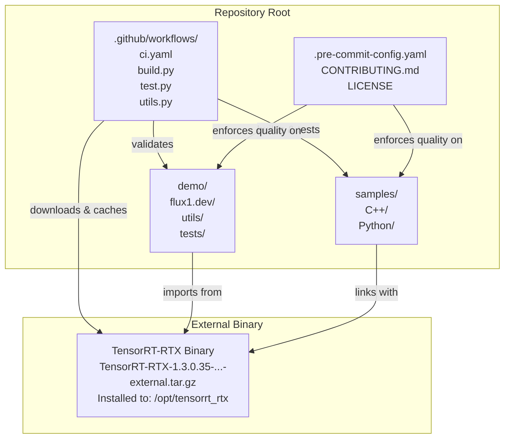
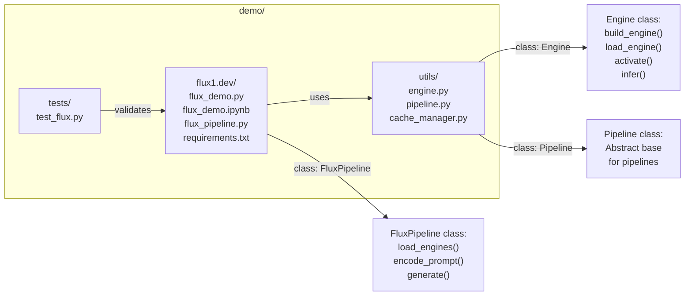
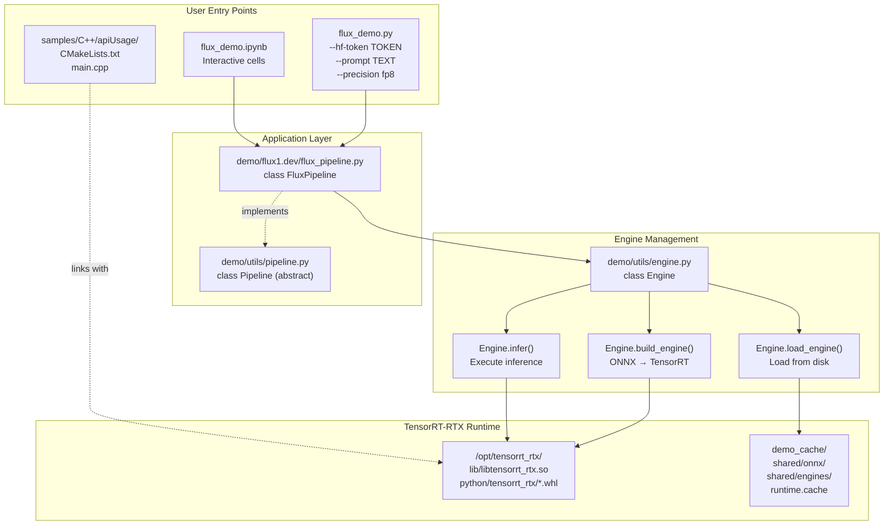
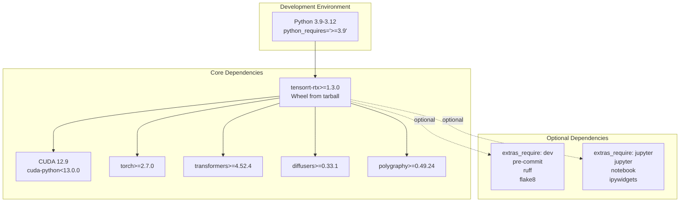
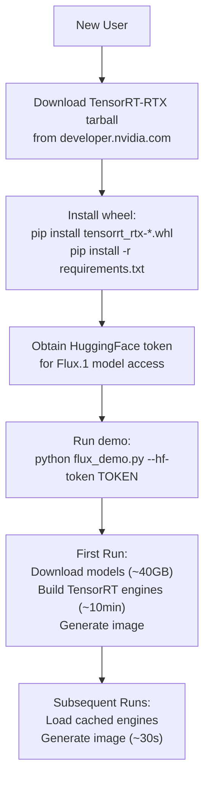
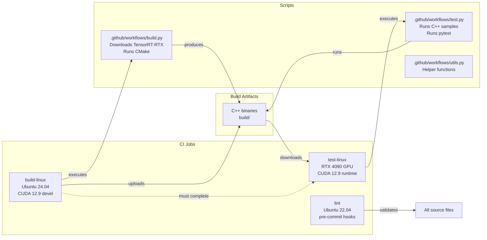

<!-- source: DeepWiki mcp.deepwiki.com · repo NVIDIA/TensorRT-RTX · page 1 TensorRT-RTX Overview · fetched 2026-10-26 -->

# TensorRT-RTX Overview

<details>
<summary>Relevant source files</summary>

The following files were used as context for generating this wiki page:

- [.github/workflows/ci.yaml](.github/workflows/ci.yaml)
- [demo/README.md](demo/README.md)
- [demo/setup.py](demo/setup.py)

</details>


## Purpose and Scope

This document provides a high-level introduction to the TensorRT-RTX repository structure, explaining its purpose as a framework for optimizing deep learning inference on NVIDIA RTX GPUs. It covers the major subsystems—CI/CD infrastructure, demonstration applications, sample code, and core utilities—and how they relate to each other.

For detailed setup instructions, see [Installation](#2.1). For step-by-step tutorials, see [Quick Start Guide](#2.2). For deep dives into specific demonstrations, see [Flux.1 Text-to-Image Demo](#4.1). For API reference and framework internals, see [Core Framework](#5).

**Sources:** [demo/README.md:1-10]()

## What is TensorRT-RTX

TensorRT-RTX is NVIDIA's framework for accelerating deep learning inference on RTX GPUs, with specialized support for Ada and Blackwell architectures. The framework provides:

- **Advanced Precision Support**: FP8 and FP4 quantization for Ada/Blackwell GPUs, with BF16 support for Ampere and newer architectures
- **Runtime Optimization**: JIT compilation with persistent kernel caching to reduce subsequent compilation times
- **Dynamic Shape Support**: Flexible input dimensions without engine recompilation
- **Memory Management**: Low-VRAM modes for memory-constrained environments

The repository packages TensorRT-RTX as a binary release (`TensorRT-RTX-1.3.0.35-Linux-x86_64-cuda-12.9-Release-external.tar.gz`) with both C++ and Python APIs, accompanied by demonstration pipelines and sample applications.

**Sources:** [.github/workflows/ci.yaml:7-8](), [demo/README.md:38-158]()

## Repository Structure

The repository is organized into five major directories, each serving a distinct purpose:

| Directory | Purpose | Key Components |
|-----------|---------|----------------|
| `.github/workflows/` | CI/CD automation | `ci.yaml` workflow, build/test/utils Python scripts |
| `demo/` | Demonstration pipelines | Flux.1 text-to-image demo, utility modules, test suite |
| `samples/` | Minimal API examples | C++ and Python helloWorld and apiUsage samples |
| `.pre-commit-config.yaml` | Code quality enforcement | Formatting, linting, spell checking hooks |
| Root configuration files | Project setup | `CONTRIBUTING.md`, `LICENSE`, issue templates |



**Sources:** [.github/workflows/ci.yaml:1-92](), [demo/README.md:1-10]()

## Core Components

### CI/CD Infrastructure

The continuous integration system orchestrates building, testing, and validation through three GitHub Actions jobs defined in `.github/workflows/ci.yaml`:

- **`build-linux`**: Compiles C++ samples using CMake, runs on Ubuntu 24.04 with CUDA 12.9 development container
- **`lint`**: Validates code formatting and style using pre-commit hooks
- **`test-linux`**: Executes C++ binaries and Python tests on RTX 4090 GPU hardware

The workflow caches the TensorRT-RTX binary at `/opt/tensorrt_rtx` to avoid redundant downloads across jobs.

**Sources:** [.github/workflows/ci.yaml:12-92]()

### Demonstration System

The `demo/` directory contains the Flux.1 text-to-image generation pipeline, showcasing TensorRT-RTX capabilities:



The `flux_demo.py` script provides command-line access while `flux_demo.ipynb` offers an interactive tutorial environment.

**Sources:** [demo/README.md:24-32](), [demo/README.md:34-110]()

### Sample Applications

Minimal examples demonstrating core API patterns:

| Sample Type | Location | Purpose |
|-------------|----------|---------|
| C++ helloWorld | `samples/C++/helloWorld/` | Basic TensorRT-RTX initialization |
| C++ apiUsage | `samples/C++/apiUsage/` | Engine building and inference |
| Python helloWorld | `samples/Python/helloWorld/` | Python API basics |
| Python apiUsage | `samples/Python/apiUsage/` | Python engine management |

These samples are built by the CI system and executed during the `test-linux` job to validate the TensorRT-RTX installation.

**Sources:** [.github/workflows/ci.yaml:34-44](), [.github/workflows/ci.yaml:81-91]()

## System Architecture: Code Entity Mapping

The following diagram maps high-level concepts to specific code entities in the repository:



**Sources:** [demo/README.md:27-31](), [.github/workflows/ci.yaml:7-8](), [demo/README.md:189-200]()

## Dependency Chain and Installation

The repository requires external dependencies managed through multiple systems:



The package is installed via pip from the wheel file included in the TensorRT-RTX tarball:

```bash
python -m pip install path/to/tensorrt_rtx-1.3.0.35-cp312-none-linux_x86_64.whl
python -m pip install -r demo/flux1.dev/requirements.txt
```

**Sources:** [demo/setup.py:18-55](), [demo/README.md:15-22]()

## Quick Start Paths

The repository provides multiple entry points depending on user goals:

| User Goal | Entry Point | Next Steps |
|-----------|-------------|------------|
| **Try the demo** | `demo/flux1.dev/flux_demo.py` | See [Quick Start Guide](#2.2) |
| **Learn interactively** | `demo/flux1.dev/flux_demo.ipynb` | Open in Jupyter |
| **Study minimal examples** | `samples/C++/helloWorld/` or `samples/Python/helloWorld/` | See [Sample Applications](#4.2) |
| **Build custom pipelines** | `demo/utils/pipeline.py` | See [Pipeline Architecture](#5.2) |
| **Contribute code** | `CONTRIBUTING.md` | See [Contributing to TensorRT-RTX](#6.1) |

### Typical First-Time User Flow



**Sources:** [demo/README.md:7-32](), [demo/README.md:42-46]()

## CI/CD Workflow

The automated build and test pipeline ensures code quality before merging:



The `build-linux` job runs independently, while `test-linux` depends on its completion to download artifacts. The `lint` job runs in parallel to provide fast feedback on code style issues.

**Sources:** [.github/workflows/ci.yaml:12-54](), [.github/workflows/ci.yaml:56-92]()

## Precision and GPU Architecture Support

TensorRT-RTX supports multiple precision modes tailored to specific GPU architectures:

| Precision | GPU Architecture | VRAM Usage (Default) | VRAM Usage (Low-VRAM) | Code Reference |
|-----------|------------------|----------------------|-----------------------|----------------|
| BF16 | Ampere, Ada, Blackwell | 32.1 GB | 23.1 GB | `--precision bf16` |
| FP8 | Ada, Blackwell | 21.6 GB | 12.0 GB | `--precision fp8` (default) |
| FP4 | Blackwell | 20.5 GB | 11.0 GB | `--precision fp4` |

The precision is configured at engine load time via the `transformer_precision` parameter in `FluxPipeline.load_engines()` or through the `--precision` command-line flag in `flux_demo.py`.

**Sources:** [demo/README.md:120-163]()

## Cache Management Strategy

The demonstration system implements a two-level caching strategy:

1. **Disk Cache** (`demo_cache/`): Stores ONNX models and compiled TensorRT engines, organized by model ID and precision
2. **Runtime Cache** (`runtime.cache`): Stores JIT-compiled CUDA kernels for faster subsequent runs

Cache modes control disk space usage:
- **`full`** (default): Retains all cached models and engines
- **`lean`**: Automatically removes unused models to save disk space

The cache directory structure is defined in the `CacheManager` class and tracked via `.cache_state.json`.

**Sources:** [demo/README.md:70-75](), [demo/README.md:189-200](), [demo/README.md:217-220]()

---

