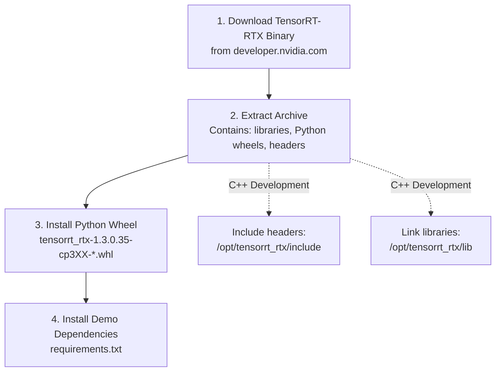
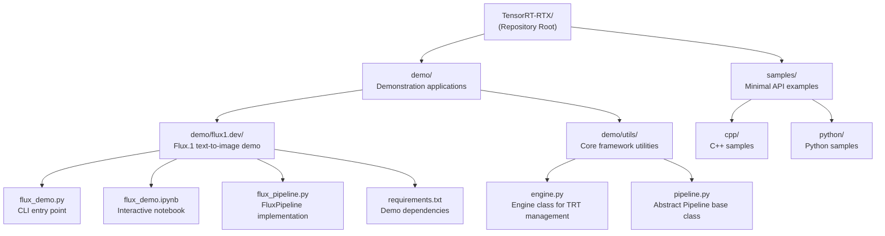
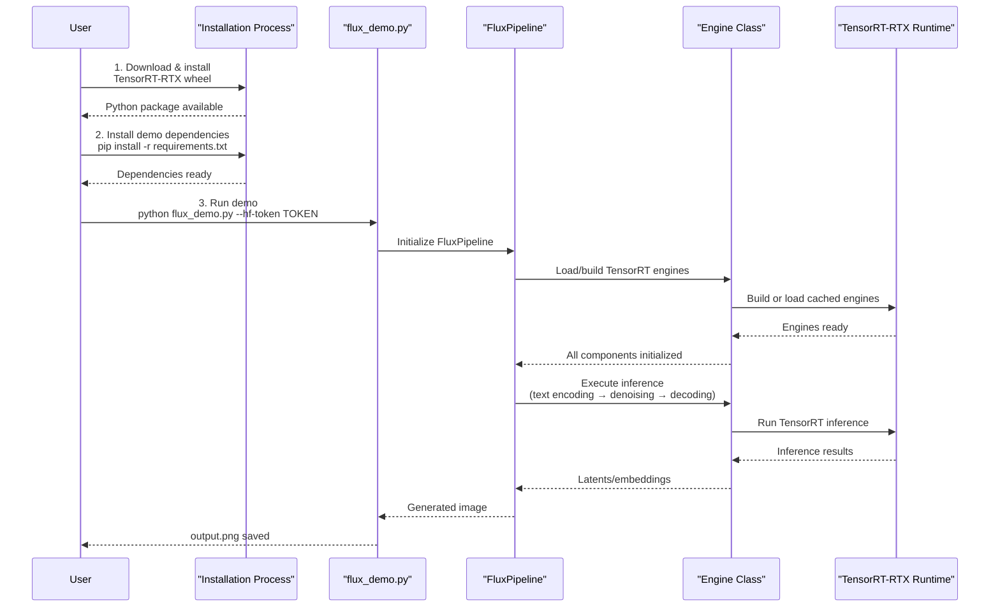
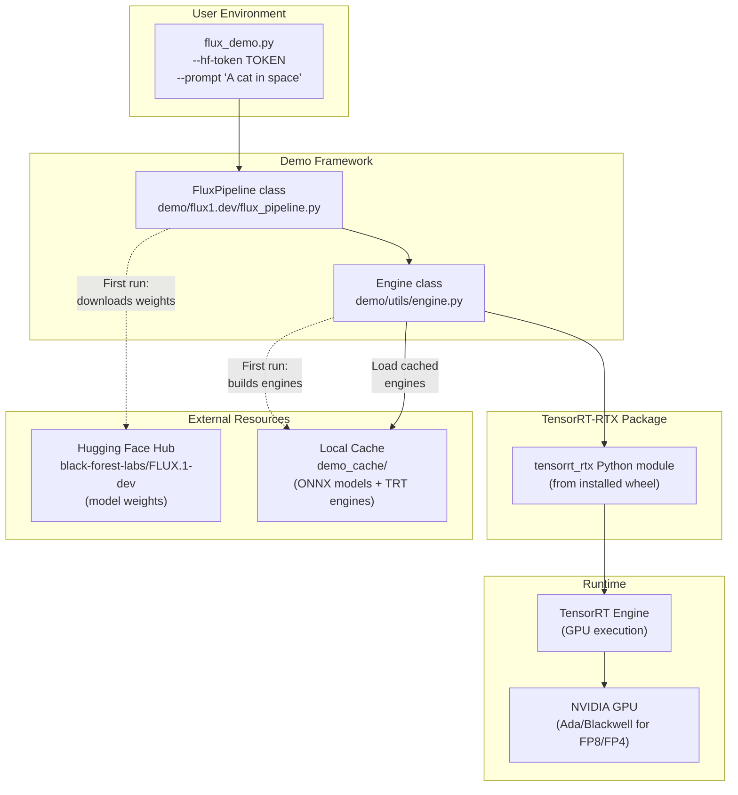
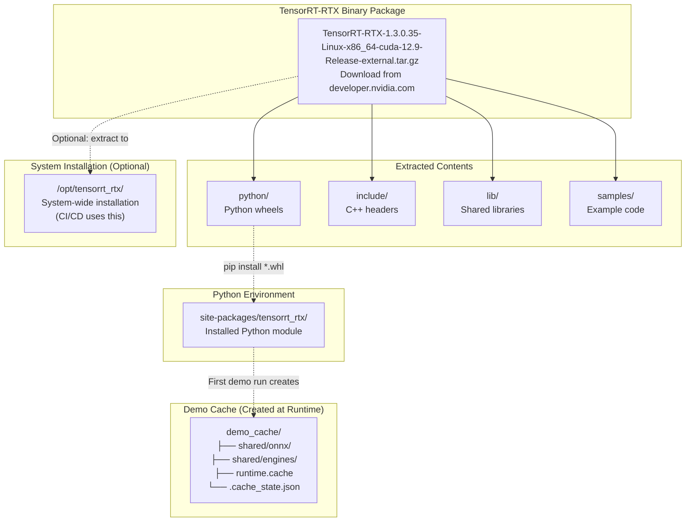

<!-- source: DeepWiki mcp.deepwiki.com · repo NVIDIA/TensorRT-RTX · page 2 Getting Started · fetched 2026-10-26 -->

# Getting Started

Relevant source files

The following files were used as context for generating this wiki page:

- [.github/workflows/utils.py](.github/workflows/utils.py)
- [demo/README.md](demo/README.md)
- [demo/tests/README.md](demo/tests/README.md)

This page provides an overview of how to set up and begin using TensorRT-RTX. It covers prerequisites, system requirements, and the general workflow for getting your first example running. For detailed installation instructions, see [Installation](#2.1). For a step-by-step tutorial on running the Flux.1 demo, see [Quick Start Guide](#2.2).

## Purpose and Scope

This section guides you through:
- Understanding system prerequisites and requirements
- Overview of the installation process
- Understanding the repository structure relevant to getting started
- General workflow from installation to running your first inference

For information about the CI/CD system and automated builds, see [CI/CD System](#3). For detailed API usage and extending the framework, see [Core Framework](#5).

## Prerequisites

### Hardware Requirements

TensorRT-RTX requires an NVIDIA GPU with specific architecture support:

| Component | Requirement |
|-----------|-------------|
| **GPU Architecture** | Ada (RTX 40 series) or Blackwell required for FP8/FP4 precision Ampere (RTX 30 series) supported for BF16 precision only |
| **CUDA Version** | CUDA 12.9 or compatible |
| **Minimum VRAM** | 11 GB (with `--low-vram` and `--precision fp4` on Blackwell) 12 GB recommended for FP8 precision 23+ GB for BF16 precision |

### Software Requirements

| Component | Requirement |
|-----------|-------------|
| **Python Version** | 3.9, 3.10, 3.11, or 3.12 |
| **Operating System** | Linux (Ubuntu 22.04/24.04 tested) Windows (supported) |
| **TensorRT-RTX Binary** | Version 1.3.0.35 or later |

Sources: [demo/README.md:9-9](), [demo/README.md:125-157]()

## Installation Overview

The TensorRT-RTX installation process consists of three main steps:

**Installation Workflow**

The binary package available from NVIDIA contains:
- Python wheels for different Python versions and platforms
- C++ headers and shared libraries
- Sample applications
- Documentation

Sources: [.github/workflows/utils.py:26-30](), [demo/README.md:7-22]()

## Repository Structure for Getting Started

After cloning the repository, the key directories for getting started are:

**Key Components**

| Path | Purpose |
|------|---------|
| `demo/flux1.dev/` | Complete text-to-image generation demo showcasing TensorRT-RTX features |
| `demo/utils/engine.py` | `Engine` class managing TensorRT engine lifecycle |
| `demo/utils/pipeline.py` | `Pipeline` base class for building inference pipelines |
| `samples/cpp/` | Minimal C++ examples demonstrating API usage |
| `samples/python/` | Minimal Python examples demonstrating API usage |

Sources: [demo/README.md:1-3](), [demo/flux1.dev/flux_demo.py](), [demo/utils/engine.py](), [demo/utils/pipeline.py]()

## Getting Started Workflow

The typical workflow for getting started with TensorRT-RTX follows these stages:

**Workflow Stages**

1. **Installation** ([See Installation](#2.1))
   - Download TensorRT-RTX binary package from `developer.nvidia.com`
   - Install the Python wheel matching your Python version and OS
   - Install demo-specific dependencies

2. **First Run** ([See Quick Start Guide](#2.2))
   - Execute `flux_demo.py` with required Hugging Face token
   - Pipeline downloads model weights from Hugging Face Hub (first run only)
   - TensorRT engines are built and cached (first run only)
   - Image generation occurs

3. **Subsequent Runs**
   - Cached engines are loaded from `demo_cache/`
   - No recompilation needed unless configuration changes
   - Faster startup and inference

Sources: [demo/README.md:7-32](), [.github/workflows/utils.py:44-69]()

## Component Interaction for First Inference

Understanding how the components interact helps clarify the setup requirements:

**Component Roles**

| Component | Role | Required for First Run |
|-----------|------|------------------------|
| `tensorrt_rtx` module | Core TensorRT-RTX runtime providing inference APIs | Yes - must be installed |
| `FluxPipeline` | High-level pipeline orchestrating text-to-image generation | Yes - part of demo |
| `Engine` class | Manages TensorRT engine lifecycle (build, load, execute) | Yes - part of demo |
| Hugging Face Hub | Source of pre-trained model weights | Yes - requires `--hf-token` |
| Local cache | Stores ONNX models and compiled TensorRT engines | Created automatically |

Sources: [demo/README.md:7-22](), [demo/flux1.dev/flux_demo.py](), [demo/utils/engine.py](), [demo/utils/pipeline.py]()

## Installation Artifacts and Locations

Understanding where components are installed helps with troubleshooting:

**Installation Paths**

| Path | Description | Set By |
|------|-------------|--------|
| `TRT_RTX_BASE_URL` | Download URL for binary package | [.github/workflows/utils.py:26]() |
| `TRTRTX_INSTALL_DIR` | System installation directory (CI default: `/opt/tensorrt_rtx`) | [.github/workflows/utils.py:30]() |
| `site-packages/tensorrt_rtx/` | Python module location after `pip install` | Python package manager |
| `demo_cache/` | Runtime cache for models and engines | [demo/README.md:73]() via `--cache-dir` |

Sources: [.github/workflows/utils.py:26-31](), [demo/README.md:73-74](), [demo/README.md:189-200]()

## Environment Variables

Key environment variables used by TensorRT-RTX:

| Variable | Purpose | Default | Set In |
|----------|---------|---------|--------|
| `TRT_RTX_FILENAME` | Name of TensorRT-RTX archive file | `TensorRT-RTX-1.3.0.35-Linux-x86_64-cuda-12.9-Release-external.tar.gz` | [.github/workflows/utils.py:27-29]() |
| `TRTRTX_INSTALL_DIR` | Installation directory for TensorRT-RTX | `/opt/tensorrt_rtx` | [.github/workflows/utils.py:30]() |
| `BUILD_DIR` | Build output directory for C++ samples | `build` | [.github/workflows/utils.py:31]() |
| `CACHE_TRT_RTX_HIT` | Skip download if cache exists | `false` | [.github/workflows/utils.py:46]() |

Sources: [.github/workflows/utils.py:25-31]()

## Next Steps

Once you understand the prerequisites and architecture:

1. **Install TensorRT-RTX** - Follow detailed instructions in [Installation](#2.1)
   - Download the binary package
   - Install the Python wheel
   - Verify installation

2. **Run Your First Example** - Follow the [Quick Start Guide](#2.2)
   - Set up Hugging Face authentication
   - Run the Flux.1 demo
   - Explore configuration options

3. **Explore Further**
   - Learn about [Flux Demo Configuration](#4.1.1) for advanced options
   - Understand [Engine Management](#5.1) for custom applications
   - Review [Sample Applications](#4.2) for minimal examples

## Common Setup Issues

| Issue | Solution | Reference |
|-------|----------|-----------|
| Python version incompatibility | Use Python 3.9-3.12 | [demo/README.md:9]() |
| GPU architecture mismatch | Verify precision support for your GPU (FP8 requires Ada/Blackwell) | [demo/README.md:125-157]() |
| Missing dependencies | Install demo requirements: `pip install -r demo/flux1.dev/requirements.txt` | [demo/README.md:21]() |
| CUDA version mismatch | Ensure CUDA 12.9 or compatible version is installed | [.github/workflows/utils.py:28]() |
| Insufficient VRAM | Use `--low-vram` flag and lower precision (FP8 or FP4) | [demo/README.md:66](), [demo/README.md:210-215]() |

Sources: [demo/README.md:9-10](), [demo/README.md:38](), [demo/README.md:202-226]()

---

