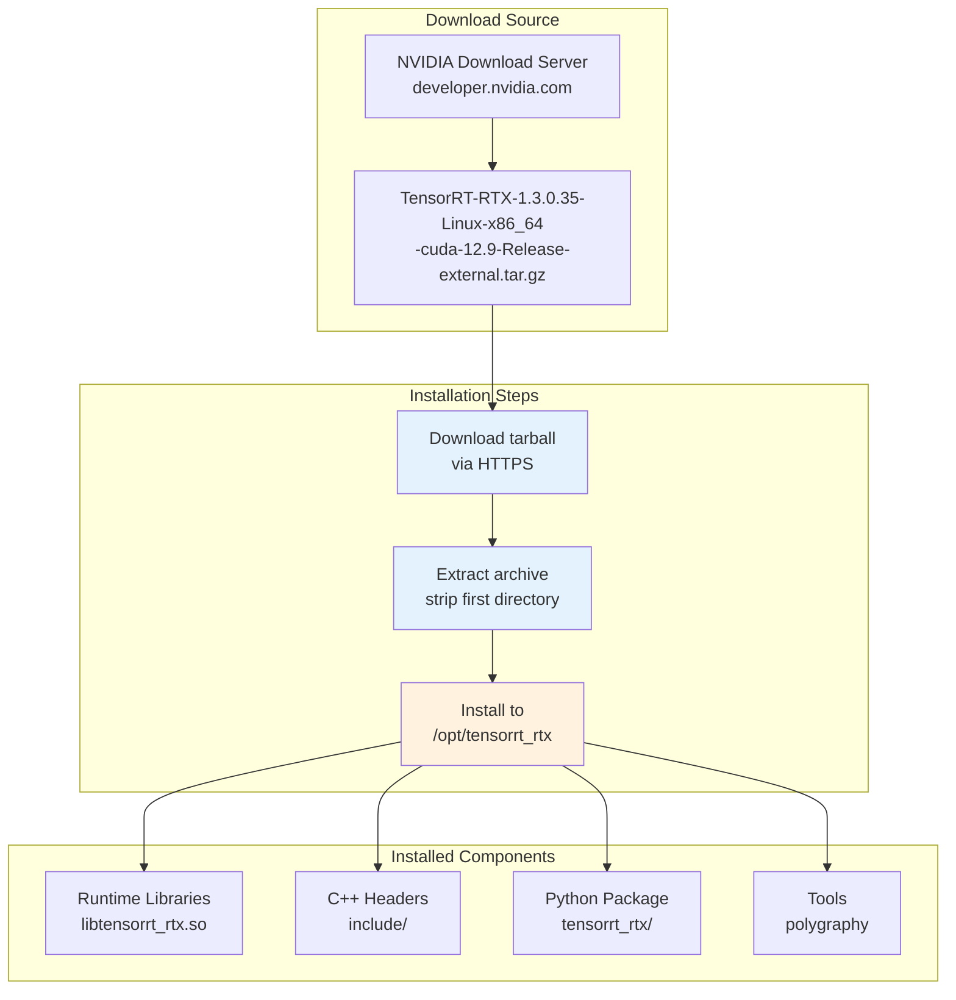
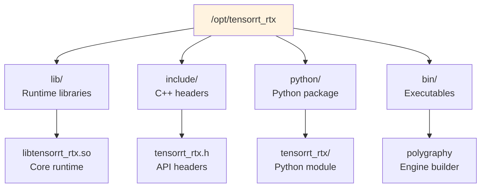
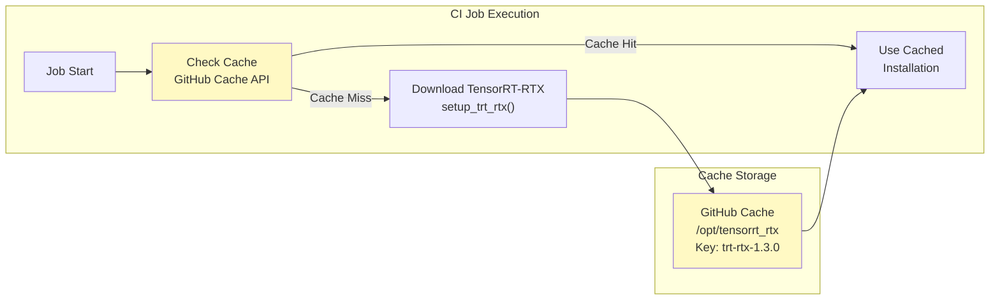

<!-- source: DeepWiki mcp.deepwiki.com · repo NVIDIA/TensorRT-RTX · page 2.1 Installation · fetched 2026-10-26 -->

# Installation

<details>
<summary>Relevant source files</summary>

The following files were used as context for generating this wiki page:

- [.github/workflows/.python-version](.github/workflows/.python-version)
- [.github/workflows/pyproject.toml](.github/workflows/pyproject.toml)
- [.github/workflows/utils.py](.github/workflows/utils.py)
- [.github/workflows/uv.lock](.github/workflows/uv.lock)
- [demo/flux1.dev/requirements.txt](demo/flux1.dev/requirements.txt)

</details>


This page provides detailed instructions for installing TensorRT-RTX and its dependencies. It covers system prerequisites, downloading and installing the TensorRT-RTX binary package, configuring the Python environment, and verifying the installation.

For a quick walkthrough of running your first example after installation, see [Quick Start Guide](#2.2). For information about the C++ and Python API usage patterns, see [Sample Applications](#4.2).

---

## System Prerequisites

### Hardware Requirements

TensorRT-RTX requires an NVIDIA GPU with the following characteristics:

| Component | Requirement | Notes |
|-----------|-------------|-------|
| GPU Architecture | Ada (RTX 40-series) or Blackwell | Required for FP8/FP4 precision support |
| VRAM | 8GB minimum, 24GB+ recommended | Flux.1 demo requires ~12GB; low-VRAM mode available |
| Example GPUs | RTX 4090, RTX 4080, RTX 4070 Ti | Consumer GPUs supported |

**Sources:** [Diagram 3: Application Stack]

### Software Requirements

The following software must be installed before proceeding with TensorRT-RTX installation:

| Component | Version | Required |
|-----------|---------|----------|
| Operating System | Ubuntu 24.04 (recommended) or 22.04 | Yes |
| CUDA Toolkit | 12.9 | Yes |
| CUDA Driver | Compatible with CUDA 12.9 | Yes |
| Python | 3.9 or higher | Yes |
| pip | Latest version | Yes |

**Sources:** [.github/workflows/.python-version:1](), [.github/workflows/pyproject.toml:4](), [demo/flux1.dev/requirements.txt:2-3]()

---

## TensorRT-RTX Binary Installation

### Download and Installation Process

The TensorRT-RTX binary package is distributed as a compressed tarball from NVIDIA's download servers. The installation process extracts the package to `/opt/tensorrt_rtx` by default.



**Sources:** [.github/workflows/utils.py:26-29](), [.github/workflows/utils.py:44-69]()

### Installation Script Method

The repository provides a utility script that automates the download and installation process. This is the recommended method for most users.

```bash
# Clone the repository
git clone https://github.com/NVIDIA/TensorRT-RTX.git
cd TensorRT-RTX

# Run the installation utility
python3 .github/workflows/utils.py
```

The `setup_trt_rtx()` function in [.github/workflows/utils.py:44-69]() performs the following operations:

1. **Check cache status**: If `CACHE_TRT_RTX_HIT` environment variable is set to `"true"`, assumes installation already exists
2. **Download tarball**: Fetches the package from the base URL via HTTPS streaming
3. **Extract contents**: Uses Python's `tarfile` module to extract, stripping the top-level directory
4. **Install to directory**: Places contents in `/opt/tensorrt_rtx` (or path specified by `TRTRTX_INSTALL_DIR`)

**Sources:** [.github/workflows/utils.py:44-69]()

### Manual Installation Method

For environments where the script cannot be used, perform manual installation:

```bash
# Download the package
wget https://developer.nvidia.com/downloads/trt/rtx_sdk/secure/1.3/TensorRT-RTX-1.3.0.35-Linux-x86_64-cuda-12.9-Release-external.tar.gz

# Create installation directory
sudo mkdir -p /opt/tensorrt_rtx

# Extract with directory stripping
tar -xzf TensorRT-RTX-1.3.0.35-Linux-x86_64-cuda-12.9-Release-external.tar.gz \
    --strip-components=1 -C /opt/tensorrt_rtx
```

**Sources:** [.github/workflows/utils.py:26-30](), [.github/workflows/utils.py:61-67]()

### Environment Variables

The installation process can be customized using environment variables:

| Variable | Default Value | Purpose |
|----------|---------------|---------|
| `TRT_RTX_FILENAME` | `TensorRT-RTX-1.3.0.35-Linux-x86_64-cuda-12.9-Release-external.tar.gz` | Specifies the tarball filename to download |
| `TRTRTX_INSTALL_DIR` | `/opt/tensorrt_rtx` | Target installation directory |
| `CACHE_TRT_RTX_HIT` | `""` | Set to `"true"` to skip download if already installed |

**Sources:** [.github/workflows/utils.py:27-30]()

### Directory Structure

After installation, the `/opt/tensorrt_rtx` directory contains the following structure:



**Sources:** [.github/workflows/utils.py:62-67]()

---

## Python Environment Setup

### Installing Python Dependencies

The demonstration applications and Python samples require additional Python packages. These dependencies are specified in the requirements file.

```bash
# Navigate to the Flux demo directory
cd demo/flux1.dev

# Install dependencies
pip install -r requirements.txt
```

**Sources:** [demo/flux1.dev/requirements.txt:1-21]()

### Core Python Dependencies

The following table lists the essential Python packages and their version requirements:

| Package | Version Requirement | Purpose |
|---------|---------------------|---------|
| `torch` | `>=2.7.0` | PyTorch framework with CUDA 12.9 support |
| `tensorrt-rtx` | `>=1.3.0` | TensorRT-RTX Python bindings |
| `transformers` | `>=4.52.4` | Hugging Face transformers for text encoding |
| `diffusers` | `>=0.33.1` | Diffusion models framework |
| `polygraphy` | `>=0.49.24` | ONNX to TensorRT engine builder |
| `cuda-python` | `<13.0.0` | CUDA Python bindings |

**Sources:** [demo/flux1.dev/requirements.txt:2-15]()

### PyTorch CUDA Configuration

PyTorch must be installed with CUDA 12.9 support. The requirements file includes the appropriate PyTorch index URL:

```
--extra-index-url https://download.pytorch.org/whl/cu129
```

This ensures that `torch>=2.7.0` installs the CUDA 12.9-compatible build.

**Sources:** [demo/flux1.dev/requirements.txt:2-3]()

### Additional Dependencies

Supporting packages for data handling and notebook support:

| Package | Purpose |
|---------|---------|
| `pillow` | Image loading and saving |
| `numpy` | Numerical array operations |
| `tqdm` | Progress bars |
| `huggingface-hub` | Model downloading |
| `accelerate` | Model loading optimization |
| `sentencepiece` | T5 tokenizer |
| `protobuf` | Protocol buffers |
| `packaging` | Version parsing |

**Sources:** [demo/flux1.dev/requirements.txt:1-14]()

### Jupyter Notebook Dependencies

For interactive notebook usage (optional):

```
requests>=2.25.0
ipython>=8.0.0
ipywidgets>=8.0.0
jupyter
```

**Sources:** [demo/flux1.dev/requirements.txt:18-21]()

---

## Library Path Configuration

### Setting LD_LIBRARY_PATH

To enable runtime library loading, add the TensorRT-RTX library directory to your `LD_LIBRARY_PATH`:

```bash
export LD_LIBRARY_PATH=/opt/tensorrt_rtx/lib:$LD_LIBRARY_PATH
```

For persistent configuration, add this to your shell profile (`~/.bashrc` or `~/.zshrc`):

```bash
# TensorRT-RTX configuration
export TRTRTX_INSTALL_DIR=/opt/tensorrt_rtx
export LD_LIBRARY_PATH=$TRTRTX_INSTALL_DIR/lib:$LD_LIBRARY_PATH
export PATH=$TRTRTX_INSTALL_DIR/bin:$PATH
```

**Sources:** [.github/workflows/utils.py:30]()

### Python Path Configuration (for C++ bindings)

If using the Python bindings from the binary distribution:

```bash
export PYTHONPATH=/opt/tensorrt_rtx/python:$PYTHONPATH
```

**Sources:** [demo/flux1.dev/requirements.txt:15]()

---

## Installation Verification

### Verifying TensorRT-RTX Binary

Check that the binary package is correctly installed:

```bash
# Verify installation directory exists
ls -la /opt/tensorrt_rtx

# Check for core library
ls -la /opt/tensorrt_rtx/lib/libtensorrt_rtx.so

# Verify polygraphy tool
/opt/tensorrt_rtx/bin/polygraphy --version
```

### Verifying Python Environment

Verify that Python packages are correctly installed:

```python
# Test imports
import torch
import tensorrt_rtx
import transformers
import diffusers

# Check versions
print(f"PyTorch: {torch.__version__}")
print(f"CUDA available: {torch.cuda.is_available()}")
print(f"CUDA version: {torch.version.cuda}")
print(f"TensorRT-RTX: {tensorrt_rtx.__version__}")
```

### Verifying GPU Access

Ensure CUDA and GPU are accessible:

```python
import torch

# Check GPU availability
assert torch.cuda.is_available(), "CUDA not available"

# Display GPU information
print(f"GPU: {torch.cuda.get_device_name(0)}")
print(f"Compute capability: {torch.cuda.get_device_capability(0)}")
print(f"VRAM: {torch.cuda.get_device_properties(0).total_memory / 1e9:.1f} GB")
```

**Sources:** [demo/flux1.dev/requirements.txt:2-3]()

---

## Installation in CI Environments

### GitHub Actions Caching Strategy

The CI system implements a sophisticated caching mechanism to avoid redundant downloads:



**Sources:** [.github/workflows/utils.py:46-69](), [Diagram 2: CI/CD Workflow]

### Cache Control

The `CACHE_TRT_RTX_HIT` environment variable controls cache behavior:

- When set to `"true"`: Skips download, assumes `/opt/tensorrt_rtx` exists
- When unset or `"false"`: Downloads and extracts the package

This mechanism allows CI systems to cache the installation between runs, significantly reducing job execution time.

**Sources:** [.github/workflows/utils.py:46-52]()

---

## Troubleshooting

### Common Installation Issues

| Issue | Cause | Solution |
|-------|-------|----------|
| Directory already exists | Previous incomplete installation | Remove `/opt/tensorrt_rtx` or set `CACHE_TRT_RTX_HIT=true` |
| Download fails | Network issues or authentication | Check network connectivity; verify URL accessibility |
| Library not found | `LD_LIBRARY_PATH` not set | Add `/opt/tensorrt_rtx/lib` to `LD_LIBRARY_PATH` |
| CUDA version mismatch | Wrong CUDA toolkit installed | Install CUDA 12.9 toolkit and drivers |
| Import tensorrt_rtx fails | Python package not in path | Install via `pip install tensorrt-rtx>=1.3.0` |

### Verifying Installation Directory Permissions

Ensure proper permissions for system-wide installation:

```bash
# Set ownership (if installed to /opt)
sudo chown -R $USER:$USER /opt/tensorrt_rtx

# Or install to user directory
export TRTRTX_INSTALL_DIR=$HOME/tensorrt_rtx
```

**Sources:** [.github/workflows/utils.py:50-52](), [.github/workflows/utils.py:62]()

---

## Next Steps

After completing installation:

1. **Run the Quick Start**: Follow the [Quick Start Guide](#2.2) to generate your first image with the Flux.1 demo
2. **Explore Samples**: Review [Sample Applications](#4.2) for minimal C++ and Python examples
3. **Read the API Documentation**: See [Engine Management](#5.1) for details on the core API

**Sources:** [Table of Contents JSON]

---

