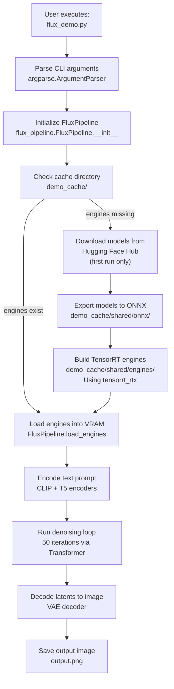
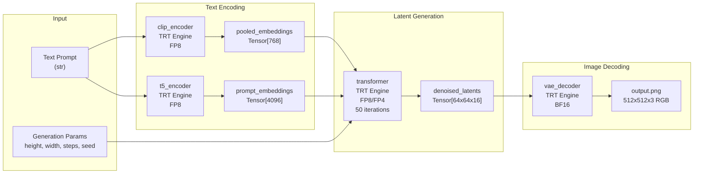

<!-- source: DeepWiki mcp.deepwiki.com · repo NVIDIA/TensorRT-RTX · page 2.2 Quick Start Guide · fetched 2026-10-26 -->

# Quick Start Guide

<details>
<summary>Relevant source files</summary>

The following files were used as context for generating this wiki page:

- [demo/README.md](demo/README.md)
- [demo/flux1.dev/flux_demo.ipynb](demo/flux1.dev/flux_demo.ipynb)
- [demo/tests/README.md](demo/tests/README.md)

</details>


This guide walks you through generating your first image using the TensorRT-RTX Flux.1 text-to-image demo. After completing this tutorial, you will have successfully executed a complete inference pipeline on an NVIDIA RTX GPU.

**Prerequisites**: This guide assumes TensorRT-RTX is already installed. For installation instructions, see [Installation](#2.1). For comprehensive configuration options and advanced usage, see [Flux.1 Text-to-Image Demo](#4.1).

**Scope**: This page covers the minimal steps to generate your first image. It does not cover advanced features like dynamic shapes, low-VRAM mode, or custom pipeline development.

---

## System Requirements

Before proceeding, verify your system meets these requirements:

| Component | Requirement |
|-----------|-------------|
| **Python Version** | 3.9, 3.10, 3.11, or 3.12 |
| **GPU Architecture** | NVIDIA Ada or Blackwell (for FP8/FP4 support) |
| **CUDA Version** | 12.9 or compatible |
| **Available VRAM** | Minimum 12 GB (with `--low-vram` and `--precision fp8`) |
| **Disk Space** | ~50 GB for model weights and cached engines |

Sources: [demo/README.md:9-10](), [demo/README.md:125-157]()

---

## Setup Steps

### Step 1: Install Demo Dependencies

Navigate to the TensorRT-RTX repository root and install the Flux.1 demo requirements:

```bash
cd TensorRT-RTX
python -m pip install -r demo/flux1.dev/requirements.txt
```

This installs packages required by the `FluxPipeline` class, including:
- `transformers` - for CLIP and T5 text encoders
- `diffusers` - for model loading and scheduling
- `safetensors` - for model checkpoint loading
- `pillow` - for image saving
- Additional dependencies for tokenization and processing

Sources: [demo/README.md:20-22]()

### Step 2: Obtain Hugging Face Access Token

The Flux.1-dev model requires authentication to download from Hugging Face Hub:

1. Visit https://huggingface.co/settings/tokens
2. Create a new token with **read** access
3. Accept the model access terms at https://huggingface.co/black-forest-labs/FLUX.1-dev
4. Save your token for use in the next step

Sources: [demo/README.md:42-46]()

---

## Running Your First Image Generation

### Basic Execution Flow

Execute the demo with minimal parameters:

```bash
python demo/flux1.dev/flux_demo.py --hf-token YOUR_HF_TOKEN
```

This command uses default parameters:
- **Prompt**: Default text prompt (if not specified)
- **Height/Width**: 512x512 pixels
- **Precision**: FP8 quantization (Ada/Blackwell GPUs)
- **Inference Steps**: 50 denoising iterations
- **Cache Directory**: `./demo_cache`

Sources: [demo/README.md:79-83]()

### Execution Workflow Diagram



Sources: [demo/flux1.dev/flux_demo.py:1-200](), [demo/README.md:24-32]()

### First Run vs Subsequent Runs

The first execution involves model downloading and engine compilation:

| Phase | First Run | Subsequent Runs |
|-------|-----------|-----------------|
| **Download Models** | ~30 GB from HuggingFace | Skip (cached) |
| **Export to ONNX** | ~5-10 minutes | Skip (cached) |
| **Build TRT Engines** | ~5-15 minutes (depending on GPU) | Skip (cached) |
| **Load Engines** | ~5-10 seconds | ~5-10 seconds |
| **Generate Image** | ~15-30 seconds | ~15-30 seconds |
| **Total Time** | ~30-60 minutes | ~30-60 seconds |

Sources: [demo/README.md:190-200]()

---

## Understanding the Output

### Console Output

During execution, the script logs progress through several stages:

```
Loading tokenizers...
Building/loading engines (this may take a while on first run)...
Loading CLIP text encoder...
Loading T5 text encoder...
Loading transformer...
Loading VAE decoder...
Encoding prompt...
Running denoising loop: 100%|████████| 50/50
Decoding latents...
Image saved to: output.png
```

Sources: [demo/flux1.dev/flux_demo.py:1-200]()

### Generated Artifacts

After successful execution, the following artifacts are created:

```
./
├── output.png                              # Generated image (512x512 RGB)
└── demo_cache/
    ├── shared/
    │   ├── onnx/
    │   │   ├── clip_encoder/fp8/          # CLIP ONNX model
    │   │   ├── t5_encoder/fp8/            # T5 ONNX model
    │   │   ├── transformer/fp8/           # Transformer ONNX model
    │   │   └── vae_decoder/bf16/          # VAE ONNX model
    │   └── engines/
    │       ├── clip_encoder/fp8/          # CLIP TensorRT engine
    │       ├── t5_encoder/fp8/            # T5 TensorRT engine
    │       ├── transformer/fp8/           # Transformer TensorRT engine
    │       └── vae_decoder/bf16/          # VAE TensorRT engine
    ├── runtime.cache                       # JIT kernel cache (if enabled)
    └── .cache_state.json                   # Cache metadata
```

Sources: [demo/README.md:190-200]()

### Data Flow During Generation



Sources: [demo/README.md:5-110](), [demo/flux1.dev/flux_pipeline.py:1-500]()

---

## Customizing Your First Generation

### Specifying a Custom Prompt

Generate an image with a specific text description:

```bash
python demo/flux1.dev/flux_demo.py \
    --hf-token YOUR_HF_TOKEN \
    --prompt "A serene mountain landscape at sunrise with misty valleys"
```

Sources: [demo/README.md:50-51]()

### Adjusting Image Resolution

Generate a higher resolution image (requires more VRAM):

```bash
python demo/flux1.dev/flux_demo.py \
    --hf-token YOUR_HF_TOKEN \
    --height 1024 \
    --width 1024 \
    --prompt "A detailed cityscape at golden hour"
```

**Note**: Dimensions must be multiples of 16. First-time generation at new resolutions requires engine recompilation.

Sources: [demo/README.md:85-89](), [demo/README.md:204-208]()

### Using Different Precisions

For memory-constrained GPUs (Blackwell architecture):

```bash
python demo/flux1.dev/flux_demo.py \
    --hf-token YOUR_HF_TOKEN \
    --low-vram \
    --precision fp4 \
    --prompt "A serene forest scene"
```

Sources: [demo/README.md:103-107]()

---

## Common Issues and Solutions

### Issue: Out of Memory Error

**Symptoms**: CUDA out of memory error during engine loading or inference.

**Solutions**:
1. Enable low-VRAM mode: `--low-vram`
2. Use lower precision: `--precision fp8` (default) or `--precision fp4` (Blackwell only)
3. Reduce image resolution: `--height 512 --width 512`
4. Disable runtime cache: omit `--enable-runtime-cache` flag

Sources: [demo/README.md:210-215]()

### Issue: Build Failures During Engine Compilation

**Symptoms**: Errors during TensorRT engine build phase.

**Solutions**:
1. Verify GPU architecture supports the specified precision (see table below)
2. Check TensorRT-RTX installation: `python -c "import tensorrt_rtx; print(tensorrt_rtx.__version__)"`
3. Verify CUDA version compatibility: `nvidia-smi`
4. Check disk space: at least 50 GB required in cache directory

| Precision | Supported GPU Architecture |
|-----------|---------------------------|
| `bf16` | Ampere, Ada, Blackwell |
| `fp8` | Ada, Blackwell |
| `fp4` | Blackwell only |

Sources: [demo/README.md:222-225](), [demo/README.md:125-157]()

### Issue: Slow First Run

**Symptoms**: Script takes 30+ minutes on first execution.

**Explanation**: This is expected behavior. The first run downloads ~30 GB of models from Hugging Face Hub and compiles TensorRT engines optimized for your specific GPU. Subsequent runs use cached engines and complete in under a minute.

**Optimization**: Enable runtime caching for faster JIT compilation on subsequent runs with different shapes:

```bash
python demo/flux1.dev/flux_demo.py \
    --hf-token YOUR_HF_TOKEN \
    --enable-runtime-cache
```

Sources: [demo/README.md:91-95]()

### Issue: Disk Space Exhausted

**Symptoms**: No space left on device during model download or engine build.

**Solutions**:
1. Use lean cache mode: `--cache-mode lean` (auto-cleanup unused models)
2. Manually delete cache directory: `rm -rf demo_cache/`
3. Change cache location to larger drive: `--cache-dir /path/to/large/drive`

Sources: [demo/README.md:217-220]()

---

## Interactive Alternative: Jupyter Notebook

For interactive exploration with detailed explanations, use the Jupyter notebook:

```bash
jupyter notebook demo/flux1.dev/flux_demo.ipynb
```

The notebook provides:
- Step-by-step code execution with explanations
- Inline visualization of generated images
- Interactive parameter experimentation
- Detailed documentation of TensorRT-RTX features

Sources: [demo/README.md:29-32](), [demo/README.md:109]()

---

## Next Steps

After successfully generating your first image:

1. **Explore Advanced Configuration**: See [Flux Demo Configuration](#4.1.1) for precision modes, shape modes, and memory management options
2. **Understand the Pipeline**: Read [Flux Pipeline Architecture](#4.1.2) to learn how the `FluxPipeline` class orchestrates model execution
3. **Build Custom Pipelines**: Review [Pipeline Architecture](#5.2) to create your own inference workflows
4. **Examine Sample Code**: Study [Python API Usage Sample](#4.2.2) for minimal API usage patterns

Sources: [demo/README.md:111-183]()

---

## Command Reference

Common command patterns for quick reference:

```bash
# Minimal execution (default 512x512, FP8)
python demo/flux1.dev/flux_demo.py --hf-token YOUR_TOKEN

# Custom prompt
python demo/flux1.dev/flux_demo.py --hf-token YOUR_TOKEN \
    --prompt "Your custom prompt"

# High resolution (1024x1024)
python demo/flux1.dev/flux_demo.py --hf-token YOUR_TOKEN \
    --height 1024 --width 1024

# Low VRAM mode (for 12GB GPUs)
python demo/flux1.dev/flux_demo.py --hf-token YOUR_TOKEN \
    --low-vram --precision fp8

# Dynamic shapes (flexible resolution)
python demo/flux1.dev/flux_demo.py --hf-token YOUR_TOKEN \
    --dynamic-shape

# Enable runtime caching (faster JIT)
python demo/flux1.dev/flux_demo.py --hf-token YOUR_TOKEN \
    --enable-runtime-cache

# Verbose logging
python demo/flux1.dev/flux_demo.py --hf-token YOUR_TOKEN \
    --verbose
```

Sources: [demo/README.md:34-110]()

---

