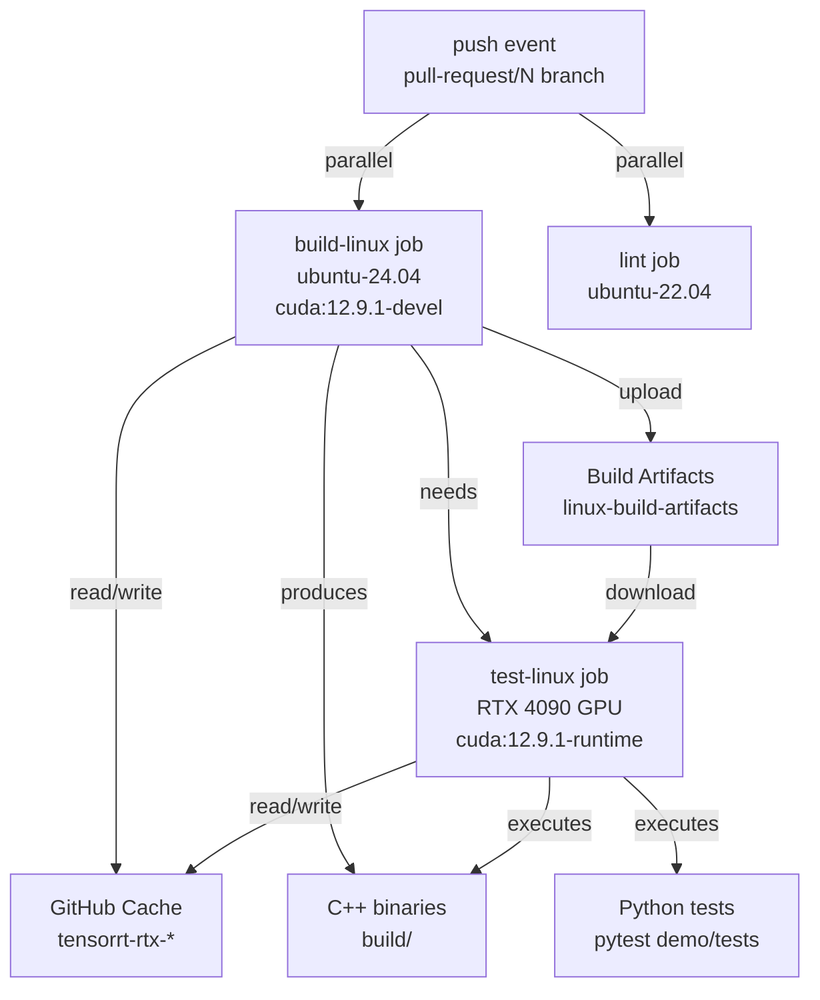
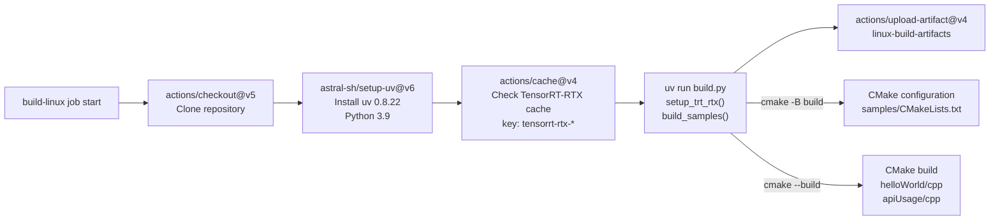
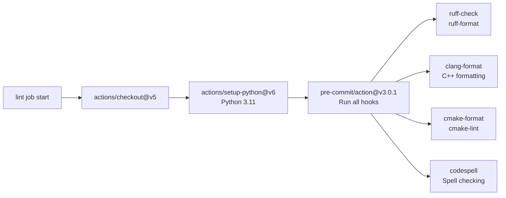
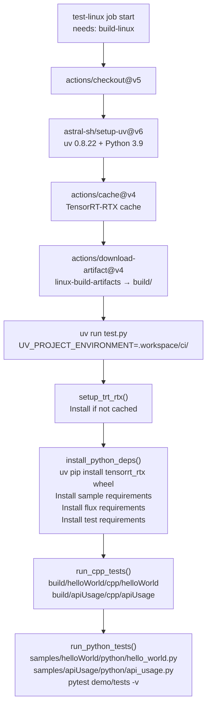
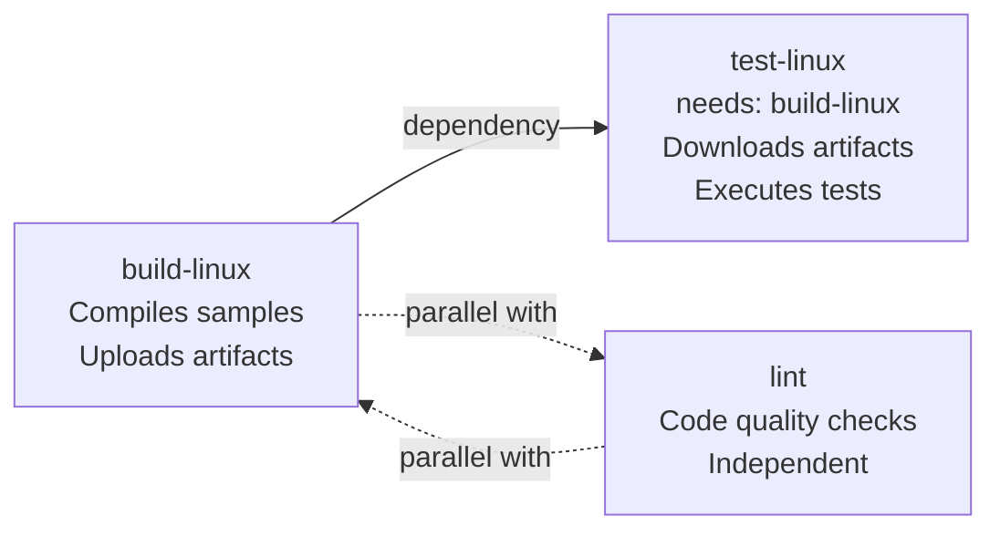
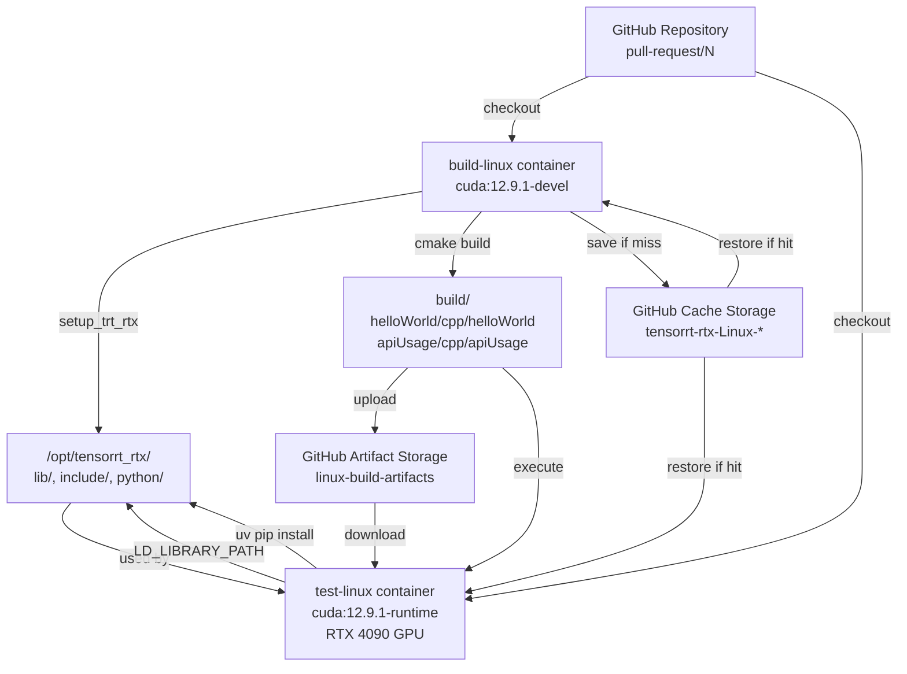

<!-- source: DeepWiki mcp.deepwiki.com · repo NVIDIA/TensorRT-RTX · page 3 CI/CD System · fetched 2026-10-26 -->

# CI/CD System

<details>
<summary>Relevant source files</summary>

The following files were used as context for generating this wiki page:

- [.github/workflows/build.py](.github/workflows/build.py)
- [.github/workflows/ci.yaml](.github/workflows/ci.yaml)
- [.github/workflows/test.py](.github/workflows/test.py)

</details>


## Purpose and Scope

This document describes the continuous integration and continuous deployment (CI/CD) infrastructure for the TensorRT-RTX repository. The CI/CD system automates building, testing, and validation of code changes using GitHub Actions. This includes compiling C++ samples, running test suites on GPU hardware, and enforcing code quality standards.

For details on code quality tools and pre-commit hooks, see [Code Quality and Formatting](#6.2). For information on writing tests, see [Testing Guide](#6.3).

## Workflow Overview

The CI/CD system is defined in [.github/workflows/ci.yaml:1-92]() and implements a three-job pipeline that executes on pull request branches. The workflow orchestrates building, linting, and testing operations across different environments with GPU acceleration.



**Sources:** [.github/workflows/ci.yaml:1-92]()

### Trigger Configuration

The workflow triggers on push events to branches matching the pattern `pull-request/[0-9]+` as defined in [.github/workflows/ci.yaml:2-5](). This naming convention integrates with NVIDIA's internal development workflow.

## Environment Variables

Global environment variables configure the workflow execution across all jobs:

| Variable | Value | Purpose |
|----------|-------|---------|
| `TRT_RTX_FILENAME` | `TensorRT-RTX-1.3.0.35-Linux-x86_64-cuda-12.9-Release-external.tar.gz` | TensorRT-RTX binary package filename |
| `TRTRTX_INSTALL_DIR` | `/opt/tensorrt_rtx` | Installation directory for TensorRT-RTX |
| `BUILD_DIR` | `build` | CMake build output directory |
| `UV_PROJECT` | `.github/workflows/` | Project directory for `uv` package manager |

These are defined in [.github/workflows/ci.yaml:6-10]().

**Sources:** [.github/workflows/ci.yaml:6-10]()

## Job Architecture

### build-linux Job

The `build-linux` job compiles C++ samples and prepares build artifacts. It runs on `ubuntu-24.04` using the `nvcr.io/nvidia/cuda:12.9.1-devel-ubuntu22.04` container image to provide CUDA development tools.



**Sources:** [.github/workflows/ci.yaml:12-44](), [.github/workflows/build.py:1-39]()

#### Build Script Execution

The build process is encapsulated in [.github/workflows/build.py:1-39](). The `main()` function [.github/workflows/build.py:27-34]() executes two operations:

1. **`setup_trt_rtx()`** [.github/workflows/build.py:29]() - Downloads and installs the TensorRT-RTX binary if not cached
2. **`build_samples()`** [.github/workflows/build.py:20-24]() - Configures and builds C++ samples using CMake

The CMake configuration step:
```
cmake -B build -S samples -DTRTRTX_INSTALL_DIR=/opt/tensorrt_rtx
```

The build step:
```
cmake --build build
```

Both commands are executed via the `run_command()` utility function imported from [.github/workflows/build.py:17]().

**Sources:** [.github/workflows/build.py:17-34]()

### lint Job

The `lint` job validates code formatting and style using pre-commit hooks. It runs independently on `ubuntu-22.04` with Python 3.11.



The lint job executes all hooks defined in `.pre-commit-config.yaml` without requiring any manual setup beyond Python installation. See [Code Quality and Formatting](#6.2) for details on individual hooks.

**Sources:** [.github/workflows/ci.yaml:46-54]()

### test-linux Job

The `test-linux` job executes C++ and Python tests on GPU hardware. It runs on a self-hosted runner with an RTX 4090 GPU using the `nvcr.io/nvidia/cuda:12.9.1-runtime-ubuntu22.04` container.



**Sources:** [.github/workflows/ci.yaml:56-91](), [.github/workflows/test.py:1-78]()

#### Test Script Execution

The test execution is orchestrated by [.github/workflows/test.py:62-73](). The `main()` function performs:

1. **`setup_trt_rtx()`** [.github/workflows/test.py:64]() - Ensures TensorRT-RTX is installed
2. **`install_python_deps()`** [.github/workflows/test.py:23-36]() - Installs Python dependencies:
   - TensorRT-RTX wheel from `/opt/tensorrt_rtx/python/`
   - Sample requirements from `samples/*/python/requirements.txt`
   - Flux demo requirements from `demo/flux1.dev/requirements.txt`
   - Test requirements from `demo/tests/requirements-test.txt`
3. **`run_cpp_tests()`** [.github/workflows/test.py:39-47]() - Executes C++ binaries
4. **`run_python_tests()`** [.github/workflows/test.py:50-59]() - Runs Python samples and pytest suite

**Sources:** [.github/workflows/test.py:23-73]()

#### GPU Container Configuration

The test job requires GPU access, configured via the `options: --gpus all` parameter in [.github/workflows/ci.yaml:61](). This passes all available GPUs to the container runtime, enabling CUDA operations during test execution.

**Sources:** [.github/workflows/ci.yaml:56-62]()

## Caching Strategy

The workflow implements a caching strategy to minimize redundant downloads and improve execution time.

### TensorRT-RTX Binary Cache

Both `build-linux` and `test-linux` jobs cache the TensorRT-RTX binary installation using GitHub's cache action:

```yaml
- name: Cache TensorRT RTX
  id: cache-trt-rtx
  uses: actions/cache@v4
  with:
    path: ${{ env.TRTRTX_INSTALL_DIR }}
    key: tensorrt-rtx-${{ runner.os }}-${{ env.TRT_RTX_FILENAME }}
```

**Cache Key Structure:**
- Base: `tensorrt-rtx`
- OS identifier: `${{ runner.os }}` (e.g., `Linux`)
- Version: `${{ env.TRT_RTX_FILENAME }}` (ties cache to specific TensorRT-RTX release)

This is defined in [.github/workflows/ci.yaml:27-32]() and [.github/workflows/ci.yaml:74-79]().

### Cache Hit Detection

The cache action outputs a `cache-hit` boolean that scripts can access via environment variables:

- `CACHE_TRT_RTX_HIT` in build job [.github/workflows/ci.yaml:37]()
- `CACHE_TRT_RTX_HIT` in test job [.github/workflows/ci.yaml:89]()

These variables are consumed by the `setup_trt_rtx()` function (defined in `utils.py`) to conditionally skip download and installation when the cache is populated.

**Sources:** [.github/workflows/ci.yaml:27-32](), [.github/workflows/ci.yaml:74-79](), [.github/workflows/ci.yaml:36-37](), [.github/workflows/ci.yaml:89]()

## Artifact Management

Build artifacts enable sharing compiled binaries between the `build-linux` and `test-linux` jobs.

### Upload Process

The `build-linux` job uploads the entire `build/` directory as an artifact named `linux-build-artifacts`:

```yaml
- name: Upload build artifacts
  uses: actions/upload-artifact@v4
  with:
    name: linux-build-artifacts
    path: ${{ env.BUILD_DIR }}/
```

This is defined in [.github/workflows/ci.yaml:40-44]().

### Download Process

The `test-linux` job downloads these artifacts back into the `build/` directory:

```yaml
- name: Download build artifacts
  uses: actions/download-artifact@v4
  with:
    name: linux-build-artifacts
    path: ${{ env.BUILD_DIR }}/
```

This is defined in [.github/workflows/ci.yaml:81-85]().

### Artifact Contents

The uploaded artifacts include:

| Path | Description |
|------|-------------|
| `build/helloWorld/cpp/helloWorld` | C++ Hello World executable |
| `build/apiUsage/cpp/apiUsage` | C++ API Usage executable |
| `build/CMakeCache.txt` | CMake configuration cache |
| `build/**/CMakeFiles/` | CMake build metadata |

**Sources:** [.github/workflows/ci.yaml:40-44](), [.github/workflows/ci.yaml:81-85]()

## Job Dependencies

The workflow implements a linear dependency chain to ensure proper execution order:



The `needs: build-linux` declaration in [.github/workflows/ci.yaml:57]() ensures that `test-linux` waits for `build-linux` to complete successfully before starting. The `lint` job has no dependencies and runs in parallel with `build-linux`.

**Sources:** [.github/workflows/ci.yaml:57]()

## Python Environment Management

Both build and test jobs use `uv` as the Python package and environment manager.

### UV Installation

The `astral-sh/setup-uv@v6` action installs `uv` version 0.8.22 with Python 3.9:

```yaml
- name: Install uv
  uses: astral-sh/setup-uv@v6
  with:
    version: "0.8.22"
    python-version: "3.9"
```

This is defined in [.github/workflows/ci.yaml:18-22]() and [.github/workflows/ci.yaml:65-69]().

### Project Configuration

The `UV_PROJECT` environment variable [.github/workflows/ci.yaml:10]() sets the project directory to `.github/workflows/`, which contains:
- `pyproject.toml` - Project metadata and dependencies
- `build.py` - Build script with `[dependency-groups.build]`
- `test.py` - Test script

The test job also sets `UV_PROJECT_ENVIRONMENT=.workspace/ci/` in [.github/workflows/ci.yaml:90]() to isolate the test environment.

**Sources:** [.github/workflows/ci.yaml:10](), [.github/workflows/ci.yaml:18-22](), [.github/workflows/ci.yaml:65-69](), [.github/workflows/ci.yaml:90]()

## Container Images

The workflow uses NVIDIA CUDA container images from the NGC catalog:

| Job | Image | Purpose |
|-----|-------|---------|
| `build-linux` | `nvcr.io/nvidia/cuda:12.9.1-devel-ubuntu22.04` | Provides CUDA development tools, headers, and libraries for compiling C++ |
| `test-linux` | `nvcr.io/nvidia/cuda:12.9.1-runtime-ubuntu22.04` | Provides CUDA runtime libraries for executing GPU-accelerated code |

The `devel` variant includes compilation tools (nvcc, cuDNN headers) while the `runtime` variant is lighter and only includes execution libraries. Both use CUDA 12.9.1 to match the TensorRT-RTX binary requirements.

**Sources:** [.github/workflows/ci.yaml:14](), [.github/workflows/ci.yaml:60]()

## Test Execution Details

### C++ Test Execution

The `run_cpp_tests()` function [.github/workflows/test.py:39-47]() executes both C++ sample binaries:

1. Sets executable permissions on Unix systems [.github/workflows/test.py:44-46]()
2. Runs each binary via `run_command()`:
   - `build/helloWorld/cpp/helloWorld`
   - `build/apiUsage/cpp/apiUsage`

### Python Test Execution

The `run_python_tests()` function [.github/workflows/test.py:50-59]() executes Python tests with custom environment configuration:

1. Creates environment with `LD_LIBRARY_PATH` including TensorRT-RTX libraries [.github/workflows/test.py:54-55]()
2. Runs sample scripts via `uv run`:
   - `samples/helloWorld/python/hello_world.py`
   - `samples/apiUsage/python/api_usage.py`
3. Executes pytest test suite: `pytest demo/tests -v`

All commands inherit the modified environment to ensure shared library visibility.

**Sources:** [.github/workflows/test.py:39-59]()

## Build and Test Workflow Data Flow



**Sources:** [.github/workflows/ci.yaml:1-92](), [.github/workflows/build.py:1-39](), [.github/workflows/test.py:1-78]()

## Utility Functions

Both `build.py` and `test.py` import shared utilities from `utils.py`:

- **`run_command()`** - Executes shell commands with error handling
- **`setup_trt_rtx()`** - Downloads and installs TensorRT-RTX if not cached
- **Environment variables:**
  - `BUILD_DIR` - Build output directory
  - `TRTRTX_INSTALL_DIR` - TensorRT-RTX installation path

These are imported in [.github/workflows/build.py:17]() and [.github/workflows/test.py:20]().

**Sources:** [.github/workflows/build.py:17](), [.github/workflows/test.py:20]()

---

