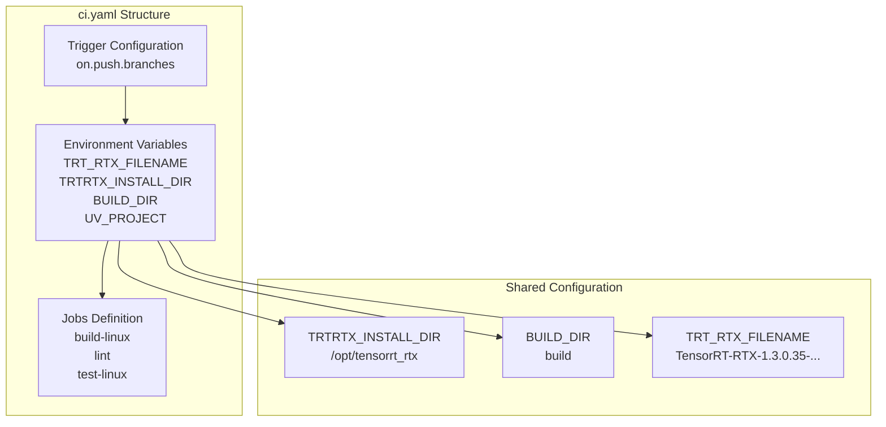
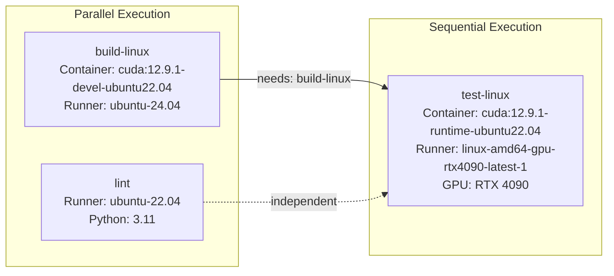
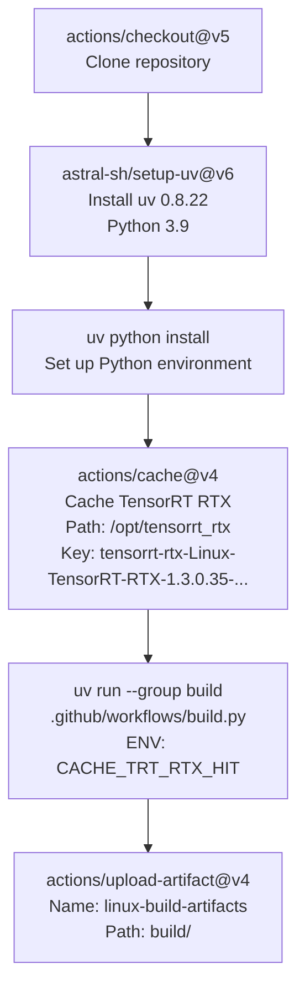
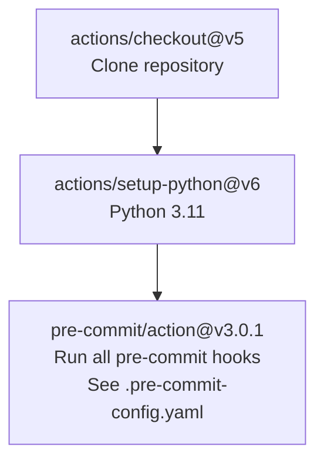
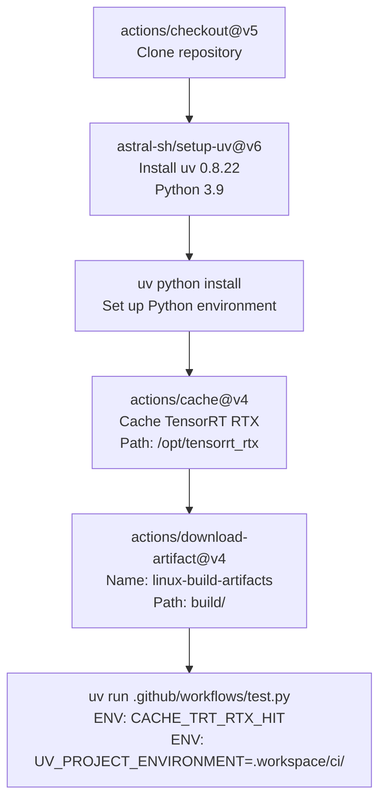
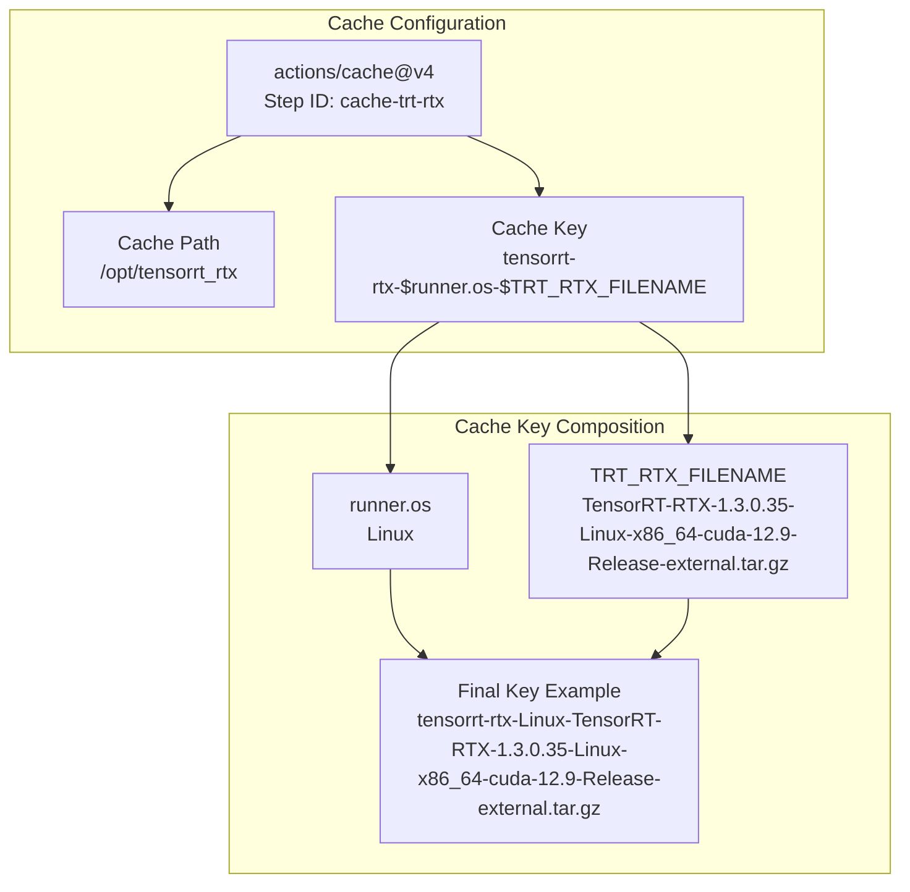
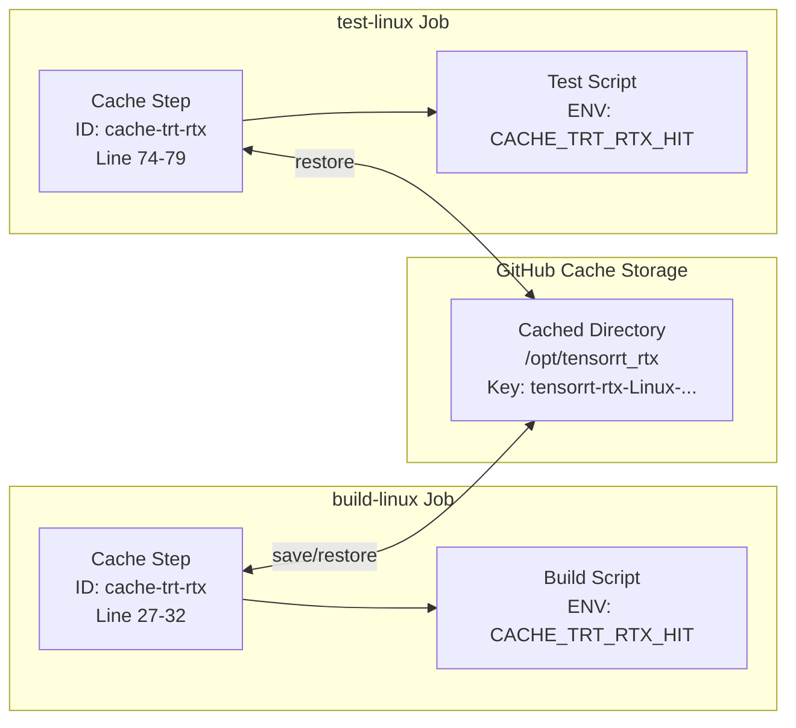
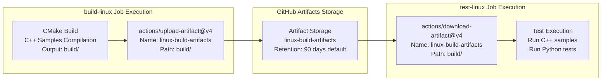
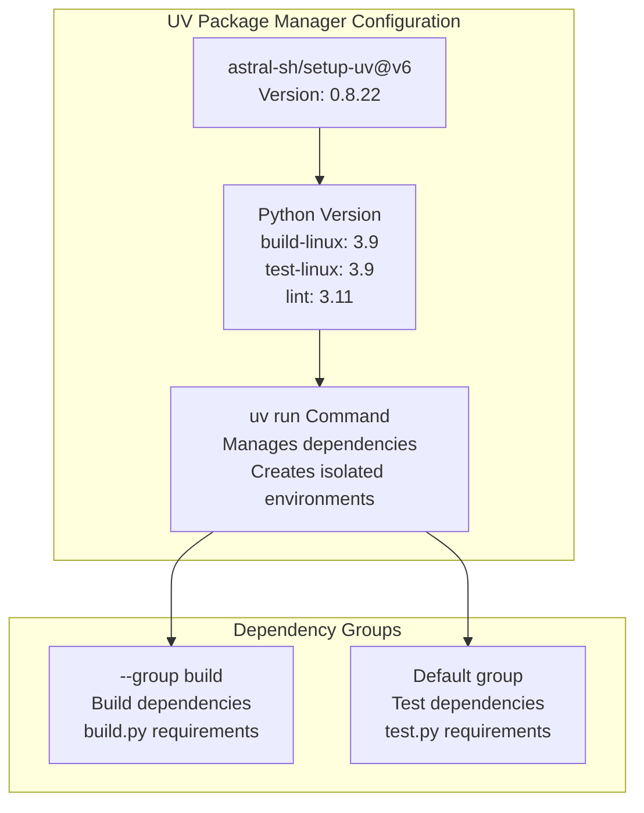
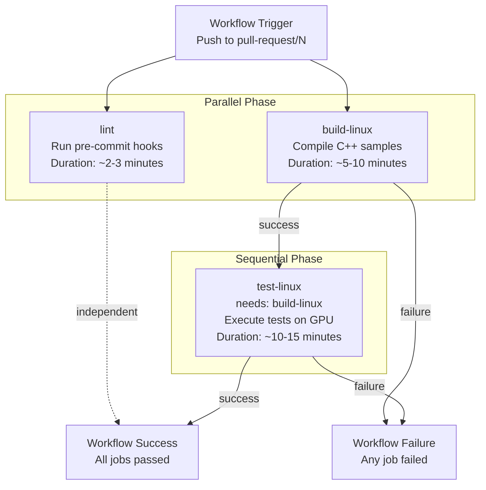

<!-- source: DeepWiki mcp.deepwiki.com · repo NVIDIA/TensorRT-RTX · page 3.1 Workflow Architecture · fetched 2026-10-26 -->

# Workflow Architecture

<details>
<summary>Relevant source files</summary>

The following files were used as context for generating this wiki page:

- [.github/workflows/ci.yaml](.github/workflows/ci.yaml)
- [.github/workflows/utils.py](.github/workflows/utils.py)

</details>


## Purpose and Scope

This document explains the GitHub Actions CI workflow architecture for the TensorRT-RTX repository. It covers the workflow structure defined in [.github/workflows/ci.yaml](), job dependencies, caching mechanisms, artifact management, and the utility functions provided by [.github/workflows/utils.py](). For information about the specific build process executed within the workflow, see [Build Process](#3.2). For details about test execution, see [Testing Infrastructure](#3.3).

## Workflow Overview

The CI workflow implements a three-job pipeline that builds C++ samples, validates code quality, and executes tests on GPU hardware. The workflow is triggered on pushes to pull request branches and orchestrates compilation, validation, and testing across different environments.

### Workflow File Structure



**Sources:** [.github/workflows/ci.yaml:1-10]()

The workflow is configured at the repository level with shared environment variables that ensure consistency across all jobs:

| Environment Variable | Default Value | Purpose |
|---------------------|---------------|---------|
| `TRT_RTX_FILENAME` | `TensorRT-RTX-1.3.0.35-Linux-x86_64-cuda-12.9-Release-external.tar.gz` | Specifies the TensorRT-RTX binary package filename |
| `TRTRTX_INSTALL_DIR` | `/opt/tensorrt_rtx` | Installation directory for TensorRT-RTX binaries |
| `BUILD_DIR` | `build` | Output directory for compiled artifacts |
| `UV_PROJECT` | `.github/workflows/` | Project directory for uv package manager |

**Sources:** [.github/workflows/ci.yaml:6-10](), [.github/workflows/utils.py:27-31]()

### Trigger Configuration

The workflow activates on push events to branches matching the pattern `pull-request/[0-9]+`, which corresponds to NVIDIA's internal pull request workflow convention:

```yaml
on:
  push:
    branches:
      - "pull-request/[0-9]+"
```

**Sources:** [.github/workflows/ci.yaml:2-5]()

## Job Architecture

The workflow defines three jobs with specific responsibilities and execution environments. The jobs execute in parallel where possible, with explicit dependency declarations where sequential execution is required.

### Job Execution Flow



**Sources:** [.github/workflows/ci.yaml:11-91]()

### build-linux Job

The `build-linux` job compiles C++ samples and prepares build artifacts. It runs in a CUDA development container with full compilation toolchain.

**Job Configuration:**

| Property | Value |
|----------|-------|
| Runner | `ubuntu-24.04` |
| Container | `nvcr.io/nvidia/cuda:12.9.1-devel-ubuntu22.04` |
| Python Version | `3.9` |
| UV Version | `0.8.22` |

**Sources:** [.github/workflows/ci.yaml:12-25]()

#### build-linux Step Sequence



**Sources:** [.github/workflows/ci.yaml:15-44]()

The job executes the following steps:

1. **Checkout**: Clones the repository using `actions/checkout@v5`
2. **UV Setup**: Installs the `uv` package manager at version `0.8.22`
3. **Python Installation**: Configures Python 3.9 via `uv python install`
4. **Cache Restoration**: Attempts to restore cached TensorRT-RTX binaries
5. **Build Execution**: Runs [.github/workflows/build.py]() with the `build` dependency group
6. **Artifact Upload**: Uploads the contents of `build/` directory as `linux-build-artifacts`

### lint Job

The `lint` job validates code formatting and style compliance using pre-commit hooks. It executes independently of other jobs without GPU requirements.

**Job Configuration:**

| Property | Value |
|----------|-------|
| Runner | `ubuntu-22.04` |
| Python Version | `3.11` |

**Sources:** [.github/workflows/ci.yaml:46-54]()

#### lint Step Sequence



**Sources:** [.github/workflows/ci.yaml:48-54]()

The lint job performs three steps:
1. **Checkout**: Clones the repository
2. **Python Setup**: Configures Python 3.11
3. **Pre-commit Execution**: Runs all configured pre-commit hooks (see [Code Quality and Formatting](#6.2) for hook details)

### test-linux Job

The `test-linux` job executes compiled C++ samples and Python tests on GPU hardware. This job depends on `build-linux` completion and downloads its artifacts.

**Job Configuration:**

| Property | Value |
|----------|-------|
| Runner | `linux-amd64-gpu-rtx4090-latest-1` (self-hosted) |
| Container | `nvcr.io/nvidia/cuda:12.9.1-runtime-ubuntu22.04` |
| Container Options | `--gpus all` |
| Python Version | `3.9` |
| UV Version | `0.8.22` |
| Depends On | `build-linux` |

**Sources:** [.github/workflows/ci.yaml:56-91]()

#### test-linux Step Sequence



**Sources:** [.github/workflows/ci.yaml:63-91]()

The test job executes:

1. **Checkout**: Clones the repository
2. **UV Setup**: Installs `uv` package manager
3. **Python Installation**: Configures Python 3.9
4. **Cache Restoration**: Restores TensorRT-RTX binaries (same cache as build job)
5. **Artifact Download**: Downloads `linux-build-artifacts` to `build/` directory
6. **Test Execution**: Runs [.github/workflows/test.py]() with GPU access

**Key Environment Variables for Test Execution:**

| Variable | Value | Purpose |
|----------|-------|---------|
| `CACHE_TRT_RTX_HIT` | `${{ steps.cache-trt-rtx.outputs.cache-hit }}` | Indicates if cache was hit |
| `UV_PROJECT_ENVIRONMENT` | `.workspace/ci/` | Isolates Python environment |

**Sources:** [.github/workflows/ci.yaml:88-90]()

## Caching Strategy

The workflow implements a sophisticated caching strategy to minimize download times and improve CI performance. The primary cache target is the TensorRT-RTX binary distribution.

### Cache Configuration



**Sources:** [.github/workflows/ci.yaml:27-32](), [.github/workflows/ci.yaml:74-79]()

### Cache Behavior

The cache action sets an output variable `cache-hit` which is consumed by subsequent steps:

| Cache State | `cache-hit` Value | Behavior |
|-------------|-------------------|----------|
| Cache Hit | `true` | TensorRT-RTX binaries restored from cache, skip download |
| Cache Miss | Empty string | Download and extract TensorRT-RTX binaries |

**Sources:** [.github/workflows/utils.py:44-69]()

The `setup_trt_rtx()` function in [.github/workflows/utils.py]() checks the `CACHE_TRT_RTX_HIT` environment variable:

```python
if os.environ.get("CACHE_TRT_RTX_HIT") != "true":
    # Download from TRT_RTX_BASE_URL
    # Extract to TRTRTX_INSTALL_DIR
else:
    print("Cache hit for TensorRT RTX")
```

**Sources:** [.github/workflows/utils.py:46-69]()

### Cache Restoration in Both Build and Test Jobs

Both `build-linux` and `test-linux` jobs declare the same cache configuration, ensuring the cached binaries are available in both environments:



**Sources:** [.github/workflows/ci.yaml:27-32](), [.github/workflows/ci.yaml:74-79]()

## Artifact Management

The workflow uses GitHub Actions artifacts to transfer compiled binaries from `build-linux` to `test-linux`. This mechanism decouples compilation from testing and allows test execution on specialized GPU hardware.

### Artifact Upload in build-linux

After successful compilation, the build job uploads the entire `build/` directory:

```yaml
- name: Upload build artifacts
  uses: actions/upload-artifact@v4
  with:
    name: linux-build-artifacts
    path: ${{ env.BUILD_DIR }}/
```

**Artifact Name:** `linux-build-artifacts`  
**Artifact Contents:** All files in `build/` directory, including compiled C++ sample executables

**Sources:** [.github/workflows/ci.yaml:40-44]()

### Artifact Download in test-linux

The test job downloads artifacts before executing tests:

```yaml
- name: Download build artifacts
  uses: actions/download-artifact@v4
  with:
    name: linux-build-artifacts
    path: ${{ env.BUILD_DIR }}/
```

**Download Target:** `build/` directory  
**Effect:** Restores compiled executables with permissions preserved

**Sources:** [.github/workflows/ci.yaml:81-85]()

### Artifact Flow Diagram



**Sources:** [.github/workflows/ci.yaml:40-44](), [.github/workflows/ci.yaml:81-85]()

## Container and Environment Configuration

Each job uses specific container images and environment configurations optimized for its purpose.

### Container Image Strategy

| Job | Container Image | CUDA Installation | Purpose |
|-----|----------------|-------------------|---------|
| `build-linux` | `nvcr.io/nvidia/cuda:12.9.1-devel-ubuntu22.04` | CUDA 12.9.1 Development | Provides compilation toolchain (nvcc, headers) |
| `lint` | None (native runner) | Not required | Lightweight linting environment |
| `test-linux` | `nvcr.io/nvidia/cuda:12.9.1-runtime-ubuntu22.04` | CUDA 12.9.1 Runtime | Provides CUDA runtime libraries only |

**Sources:** [.github/workflows/ci.yaml:14](), [.github/workflows/ci.yaml:47](), [.github/workflows/ci.yaml:60]()

### GPU Access Configuration

The `test-linux` job requires GPU access for TensorRT execution:

```yaml
container:
  image: nvcr.io/nvidia/cuda:12.9.1-runtime-ubuntu22.04
  options: --gpus all
```

The `--gpus all` option exposes all available GPUs to the container, enabling TensorRT engine execution on the RTX 4090 runner.

**Sources:** [.github/workflows/ci.yaml:59-61]()

### Python Environment Management

All jobs use the `uv` package manager for Python dependency management:



**Sources:** [.github/workflows/ci.yaml:18-25](), [.github/workflows/ci.yaml:65-72](), [.github/workflows/ci.yaml:50-52]()

The build job uses `uv run --group build` to install build-specific dependencies, while the test job uses the default dependency group via `uv run`.

## Utility Functions

The [.github/workflows/utils.py]() module provides shared utility functions used by both build and test scripts.

### Core Functions

**`run_command(cmd, check=True, shell=False, env=None)`**

Executes shell commands with error handling. Terminates the script with the subprocess exit code on failure.

**Sources:** [.github/workflows/utils.py:34-41]()

**`setup_trt_rtx()`**

Downloads and extracts TensorRT-RTX binaries when cache is not available:

```python
def setup_trt_rtx():
    """Download and setup TensorRT RTX."""
    if os.environ.get("CACHE_TRT_RTX_HIT") != "true":
        # Download from TRT_RTX_BASE_URL
        # Extract to TRTRTX_INSTALL_DIR with path stripping
    else:
        print("Cache hit for TensorRT RTX")
```

**Download URL:** `https://developer.nvidia.com/downloads/trt/rtx_sdk/secure/1.3/{TRT_RTX_FILENAME}`  
**Extraction:** Strips first directory component from tar archive  
**Target:** `TRTRTX_INSTALL_DIR` (default: `/opt/tensorrt_rtx`)

**Sources:** [.github/workflows/utils.py:44-69]()

### Shared Constants

The utility module defines constants synchronized with [.github/workflows/ci.yaml]():

| Constant | Default Value | Environment Variable Override |
|----------|---------------|------------------------------|
| `TRT_RTX_BASE_URL` | `https://developer.nvidia.com/downloads/trt/rtx_sdk/secure/1.3/` | None |
| `TRT_RTX_FILENAME` | `TensorRT-RTX-1.3.0.35-Linux-x86_64-cuda-12.9-Release-external.tar.gz` | `TRT_RTX_FILENAME` |
| `TRTRTX_INSTALL_DIR` | `/opt/tensorrt_rtx` | `TRTRTX_INSTALL_DIR` |
| `BUILD_DIR` | `build` | `BUILD_DIR` |

**Sources:** [.github/workflows/utils.py:25-31]()

## Job Dependencies and Execution Order

The workflow defines an explicit dependency relationship between jobs to ensure proper execution order:



**Sources:** [.github/workflows/ci.yaml:56-57]()

The `needs: build-linux` declaration on the `test-linux` job creates a hard dependency. If `build-linux` fails, `test-linux` is skipped. The `lint` job executes independently and does not block other jobs.

---

