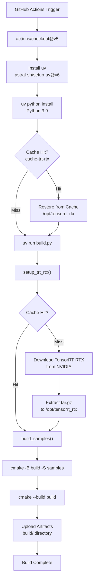
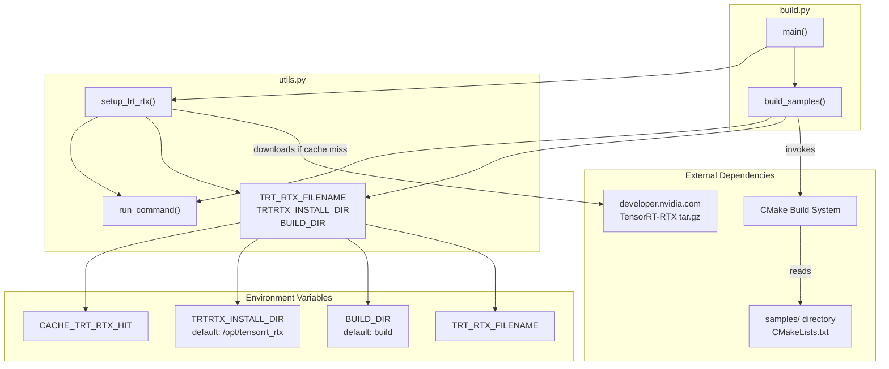
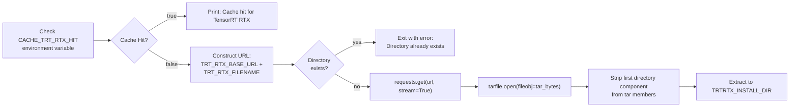
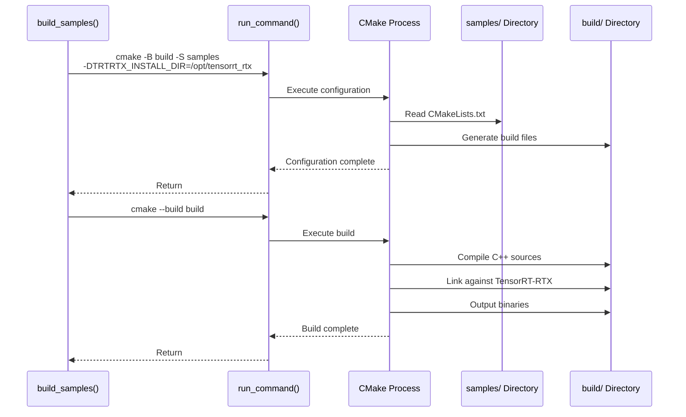
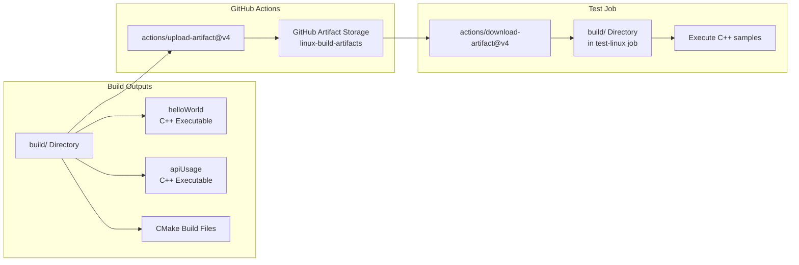

<!-- source: DeepWiki mcp.deepwiki.com · repo NVIDIA/TensorRT-RTX · page 3.2 Build Process · fetched 2026-10-26 -->

# Build Process

<details>
<summary>Relevant source files</summary>

The following files were used as context for generating this wiki page:

- [.github/workflows/build.py](.github/workflows/build.py)
- [.github/workflows/ci.yaml](.github/workflows/ci.yaml)
- [.github/workflows/utils.py](.github/workflows/utils.py)

</details>


## Purpose and Scope

This document describes the automated build process for TensorRT-RTX, specifically focusing on how the CI system compiles C++ samples and prepares build artifacts. The build process is orchestrated by the `build-linux` job in the GitHub Actions workflow and executed by the Python build script.

For information about test execution and validation, see [Testing Infrastructure](#3.3). For the overall CI/CD workflow architecture, see [Workflow Architecture](#3.1).

**Sources:** [.github/workflows/ci.yaml:1-92]()

## Build Environment

The build process executes in a containerized environment with the following specifications:

| Component | Specification |
|-----------|---------------|
| Host OS | Ubuntu 24.04 |
| Container Image | `nvcr.io/nvidia/cuda:12.9.1-devel-ubuntu22.04` |
| Python Version | 3.9 |
| Package Manager | uv 0.8.22 |
| Build System | CMake |
| CUDA Version | 12.9.1 (development environment) |

The container image provides the CUDA development tools necessary for compiling C++ code that links against TensorRT-RTX libraries.

**Sources:** [.github/workflows/ci.yaml:12-22]()

## Build Process Overview



**Diagram: Build Process Execution Flow**

The build process consists of three main phases: environment setup, TensorRT-RTX installation, and sample compilation. The GitHub Actions cache optimizes the TensorRT-RTX download step across workflow runs.

**Sources:** [.github/workflows/ci.yaml:12-44](), [.github/workflows/build.py:1-38]()

## Build Script Architecture



**Diagram: Build Script Component Relationships**

The build script is modularized into `build.py` (main orchestration) and `utils.py` (shared utilities). Configuration is driven by environment variables with sensible defaults.

**Sources:** [.github/workflows/build.py:1-38](), [.github/workflows/utils.py:1-70]()

## TensorRT-RTX Installation

The `setup_trt_rtx()` function manages the TensorRT-RTX binary installation process:



**Diagram: TensorRT-RTX Installation Logic**

The installation process handles caching intelligently. When `CACHE_TRT_RTX_HIT` is set to `"true"`, the function skips downloading. Otherwise, it downloads the tar.gz file from NVIDIA's server and extracts it to `/opt/tensorrt_rtx`, stripping the first directory component to flatten the structure.

**Key Implementation Details:**

| Aspect | Implementation |
|--------|----------------|
| Download URL | `https://developer.nvidia.com/downloads/trt/rtx_sdk/secure/1.3/{filename}` |
| Target Directory | `/opt/tensorrt_rtx` (configurable via `TRTRTX_INSTALL_DIR`) |
| Archive Format | tar.gz with streaming extraction |
| Path Normalization | Strips first directory component using `Path().parts[1:]` |
| Cache Detection | Environment variable `CACHE_TRT_RTX_HIT` |

**Sources:** [.github/workflows/utils.py:44-70]()

### TensorRT-RTX Binary Specification

The binary package is defined by these constants:

- **Filename**: `TensorRT-RTX-1.3.0.35-Linux-x86_64-cuda-12.9-Release-external.tar.gz`
- **Version**: 1.3.0.35
- **Platform**: Linux x86_64
- **CUDA Version**: 12.9
- **Build Type**: Release
- **Variant**: external (not internal NVIDIA build)

**Sources:** [.github/workflows/ci.yaml:7-8](), [.github/workflows/utils.py:26-30]()

## C++ Sample Compilation

The `build_samples()` function compiles all C++ samples using CMake:



**Diagram: C++ Sample Build Sequence**

The build process executes two CMake commands:

1. **Configuration**: `cmake -B {BUILD_DIR} -S samples -DTRTRTX_INSTALL_DIR={TRTRTX_INSTALL_DIR}`
   - `-B {BUILD_DIR}`: Specifies build directory (default: `build`)
   - `-S samples`: Specifies source directory containing CMakeLists.txt
   - `-DTRTRTX_INSTALL_DIR={TRTRTX_INSTALL_DIR}`: Passes TensorRT-RTX installation path

2. **Build**: `cmake --build {BUILD_DIR}`
   - Compiles all C++ samples
   - Links against TensorRT-RTX libraries
   - Produces executable binaries

**Sources:** [.github/workflows/build.py:20-24]()

### Build Directory Structure

After compilation, the `build/` directory contains:

```
build/
├── CMakeFiles/           # CMake internal files
├── CMakeCache.txt        # CMake configuration cache
├── Makefile              # Generated build rules
├── helloWorld            # C++ sample executable
├── apiUsage              # C++ sample executable
└── [other build artifacts]
```

**Sources:** [.github/workflows/ci.yaml:9](), [.github/workflows/build.py:20-24]()

## Command Execution Utility

The `run_command()` function provides error handling for all subprocess invocations:

| Parameter | Type | Description |
|-----------|------|-------------|
| `cmd` | str or list | Command to execute |
| `check` | bool | Whether to check return code (default: True) |
| `shell` | bool | Whether to use shell execution (default: False) |
| `env` | dict | Environment variables to pass |

**Error Handling Behavior:**

1. Executes command via `subprocess.run()`
2. If `CalledProcessError` is raised:
   - Prints the failing command
   - Prints the exit code
   - Calls `sys.exit()` with the error code

This ensures build failures propagate correctly to the CI system, causing the workflow to fail and report the error.

**Sources:** [.github/workflows/utils.py:34-41]()

## Build Artifacts

The build process produces artifacts that are uploaded to GitHub Actions:



**Diagram: Build Artifact Flow**

**Artifact Details:**

- **Artifact Name**: `linux-build-artifacts`
- **Content**: Entire `build/` directory
- **Purpose**: Transfer compiled binaries from build job to test job
- **Retention**: GitHub Actions default retention policy

The test job (running on GPU hardware) downloads these artifacts and executes the compiled C++ samples to validate functionality.

**Sources:** [.github/workflows/ci.yaml:40-44](), [.github/workflows/ci.yaml:81-85]()

## Build Configuration Variables

The build process is configured through environment variables:

| Variable | Default | Purpose | Set By |
|----------|---------|---------|--------|
| `TRT_RTX_FILENAME` | `TensorRT-RTX-1.3.0.35-Linux-x86_64-cuda-12.9-Release-external.tar.gz` | TensorRT-RTX archive filename | CI workflow |
| `TRTRTX_INSTALL_DIR` | `/opt/tensorrt_rtx` | Installation directory for TensorRT-RTX | CI workflow |
| `BUILD_DIR` | `build` | CMake build output directory | CI workflow |
| `CACHE_TRT_RTX_HIT` | (dynamic) | Whether cache was hit for TensorRT-RTX | GitHub Actions cache |
| `UV_PROJECT` | `.github/workflows/` | uv project directory for dependency management | CI workflow |

These variables can be overridden in the CI workflow or when running the build script locally for development purposes.

**Sources:** [.github/workflows/ci.yaml:6-10](), [.github/workflows/utils.py:26-31]()

## Build Script Entry Point

The build script executes the following sequence:

```python
def main():
    # Setup TensorRT RTX
    setup_trt_rtx()
    
    # Build samples
    build_samples()
    
    print("Build completed successfully!")
```

This simple orchestration ensures TensorRT-RTX is available before attempting compilation. The script is designed to be idempotent—running it multiple times with caching enabled will skip unnecessary downloads and rebuilds.

**Sources:** [.github/workflows/build.py:27-38]()

## Build Process Invocation

In the CI workflow, the build script is invoked via uv:

```yaml
- name: Run build script
  env:
    CACHE_DEB_HIT: ${{ steps.cache-deb.outputs.cache-hit }}
    CACHE_TRT_RTX_HIT: ${{ steps.cache-trt-rtx.outputs.cache-hit }}
  run: uv run --group build .github/workflows/build.py
```

The `--group build` flag ensures build-specific dependencies (defined in the uv project configuration) are installed before executing the script. Cache hit variables are passed as environment variables to control download behavior.

**Sources:** [.github/workflows/ci.yaml:34-38]()

---

