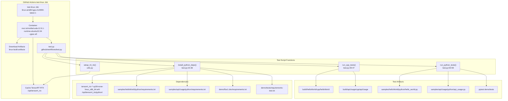
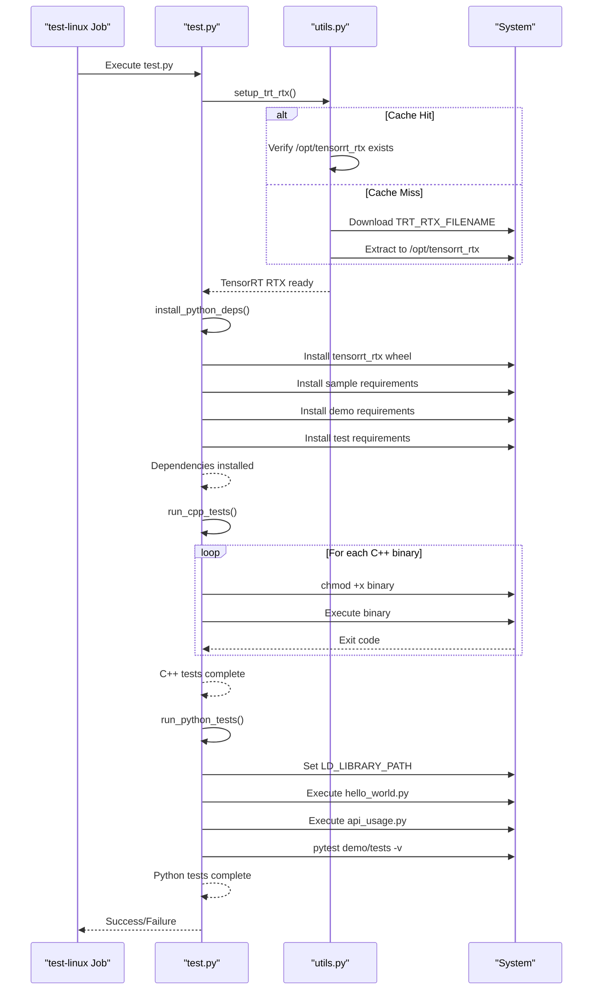

<!-- source: DeepWiki mcp.deepwiki.com · repo NVIDIA/TensorRT-RTX · page 3.3 Testing Infrastructure · fetched 2026-10-26 -->

# Testing Infrastructure

<details>
<summary>Relevant source files</summary>

The following files were used as context for generating this wiki page:

- [.github/workflows/ci.yaml](.github/workflows/ci.yaml)
- [.github/workflows/test.py](.github/workflows/test.py)
- [demo/tests/README.md](demo/tests/README.md)

</details>


## Purpose and Scope

This document describes the automated testing infrastructure that validates TensorRT-RTX functionality across C++ and Python interfaces. The testing system executes on GPU-equipped runners to ensure correctness of compiled binaries, sample applications, and demonstration code.

For information about the build process that precedes testing, see [Build Process](#3.2). For information about pre-commit validation and code quality checks, see [Code Quality and Formatting](#6.2).

## Test Execution Architecture

The testing infrastructure operates as part of the CI/CD pipeline, executing after successful compilation. The `test-linux` job downloads build artifacts and orchestrates test execution through a Python script that manages environment setup, dependency installation, and test suite execution.



**Test Execution Architecture**

Sources: [.github/workflows/ci.yaml:56-91](), [.github/workflows/test.py:1-78]()

## Test Job Configuration

The `test-linux` job executes on specialized GPU hardware with the following configuration:

| Configuration | Value |
|--------------|-------|
| Runner Label | `linux-amd64-gpu-rtx4090-latest-1` |
| Container Image | `nvcr.io/nvidia/cuda:12.9.1-runtime-ubuntu22.04` |
| GPU Access | `--gpus all` |
| Python Version | 3.9 |
| Package Manager | `uv` (0.8.22) |
| Job Dependency | `needs: build-linux` |

The job depends on the `build-linux` job completing successfully, ensuring that all C++ binaries are compiled before test execution begins.

Sources: [.github/workflows/ci.yaml:56-61]()

## Test Types and Organization

The testing infrastructure executes three categories of tests:

### C++ Sample Tests

Two C++ binaries are validated by executing them directly:

- `build/helloWorld/cpp/helloWorld` - Basic TensorRT-RTX initialization and engine creation
- `build/apiUsage/cpp/apiUsage` - Comprehensive API demonstration including build, load, and execution workflows

The test script sets executable permissions on these binaries before execution (non-Windows systems) and validates successful completion through exit codes.

Sources: [.github/workflows/test.py:39-47]()

### Python Sample Tests

Two Python sample scripts are executed to validate the Python bindings:

- `samples/helloWorld/python/hello_world.py` - Basic Python API usage
- `samples/apiUsage/python/api_usage.py` - Advanced Python API patterns

These tests require the TensorRT-RTX Python wheel to be installed and the library path configured via `LD_LIBRARY_PATH`.

Sources: [.github/workflows/test.py:50-59]()

### Pytest Suite

The `demo/tests/` directory contains pytest-based tests for utility functions and demo components. These tests validate:

- Engine management utilities
- Pipeline abstractions
- Demo-specific functionality

The pytest suite executes with verbose output (`-v` flag) and requires both demo dependencies and test-specific dependencies.

Sources: [.github/workflows/test.py:59](), [demo/tests/README.md:1-34]()

## Test Execution Flow



**Test Execution Sequence**

Sources: [.github/workflows/test.py:62-77]()

## Environment Setup and Dependencies

### TensorRT RTX Installation

The test infrastructure relies on the `setup_trt_rtx()` function from `utils.py` to ensure TensorRT-RTX is available. This function checks the cache and downloads/extracts the binary package if necessary:

- **Installation Directory**: `/opt/tensorrt_rtx` (defined by `TRTRTX_INSTALL_DIR`)
- **Package Filename**: `TensorRT-RTX-1.3.0.35-Linux-x86_64-cuda-12.9-Release-external.tar.gz`
- **Cache Key**: `tensorrt-rtx-${{ runner.os }}-${{ env.TRT_RTX_FILENAME }}`

Sources: [.github/workflows/ci.yaml:6-8](), [.github/workflows/test.py:20]()

### Python Dependency Installation

The `install_python_deps()` function installs dependencies in the following order:

1. **TensorRT-RTX Wheel**: Located at `/opt/tensorrt_rtx/python/tensorrt_rtx-*-cp39-none-linux_x86_64.whl`
2. **Sample Dependencies**: 
   - `samples/helloWorld/python/requirements.txt`
   - `samples/apiUsage/python/requirements.txt`
3. **Demo Dependencies**: `demo/flux1.dev/requirements.txt` (installed with `--index-strategy unsafe-best-match`)
4. **Test Dependencies**: `demo/tests/requirements-test.txt`

Sources: [.github/workflows/test.py:23-36]()

### Environment Variables

The Python tests execute with a modified environment:

```python
test_env = os.environ.copy()
test_env["LD_LIBRARY_PATH"] = f"{TRTRTX_INSTALL_DIR}/lib:{test_env.get('LD_LIBRARY_PATH', '')}"
```

This ensures the TensorRT-RTX shared libraries are discoverable at runtime.

Sources: [.github/workflows/test.py:53-55]()

## Running Tests Locally

Developers can execute the test suite locally by following the procedure documented in `demo/tests/README.md`:

### Prerequisites

- Python 3.9-3.12
- TensorRT-RTX binary package downloaded from [developer.nvidia.com/tensorrt-rtx](https://developer.nvidia.com/tensorrt-rtx)
- NVIDIA GPU with appropriate drivers

### Installation Steps

```bash
# Clone repository
git clone https://github.com/NVIDIA/TensorRT-RTX.git
cd TensorRT-RTX

# Install TensorRT-RTX wheel (customize for your Python version)
python -m pip install YOUR_TENSORRT_RTX_DOWNLOAD_DIR/python/tensorrt_rtx-1.3.0.35-cp312-none-linux_x86_64.whl

# Install demo dependencies
python -m pip install -r demo/flux1.dev/requirements.txt

# Install test dependencies
python -m pip install -r demo/tests/requirements-test.txt
```

### Running Tests

```bash
# Run pytest suite
python -m pytest demo/tests -v
```

Sources: [demo/tests/README.md:6-34]()

## Test Artifacts and Caching

The test infrastructure leverages GitHub Actions caching to optimize execution time:

### Build Artifacts

The `test-linux` job downloads build artifacts produced by the `build-linux` job:

| Artifact Name | Content | Path |
|--------------|---------|------|
| `linux-build-artifacts` | Compiled C++ binaries | `build/` |

These artifacts are downloaded using `actions/download-artifact@v4` and placed in the `BUILD_DIR` location.

Sources: [.github/workflows/ci.yaml:81-85]()

### TensorRT RTX Cache

The TensorRT-RTX binary package is cached using `actions/cache@v4`:

- **Cache Path**: `/opt/tensorrt_rtx`
- **Cache Key**: `tensorrt-rtx-${{ runner.os }}-${{ env.TRT_RTX_FILENAME }}`

Cache hits prevent redundant downloads and extractions, significantly reducing test job duration.

Sources: [.github/workflows/ci.yaml:74-79]()

## Test Failure Handling

Test failures propagate through exit codes at each level:

1. **C++ Binary Failures**: Non-zero exit codes from C++ executables cause the test script to fail via `run_command()` in `utils.py`
2. **Python Script Failures**: Uncaught exceptions or assertion failures cause immediate script termination
3. **Pytest Failures**: Failed test cases result in non-zero pytest exit code

The `test-linux` job marks the CI run as failed if any test fails, blocking pull request merges.

Sources: [.github/workflows/test.py:39-59]()

## GPU Validation

All tests execute on hardware with GPU access (`--gpus all`), enabling validation of:

- CUDA kernel execution
- TensorRT engine inference
- GPU memory management
- Multi-precision operations (FP8, FP4, BF16)

The runner's RTX 4090 GPU provides Ada Lovelace architecture features required by advanced TensorRT-RTX capabilities.

Sources: [.github/workflows/ci.yaml:58-61]()

---

